# COMP2300 — Set 1 Notes

> **Course**: Computer Organisation and Program Execution (ANU, Convener: Shoaib Akram)
> **Topics**: Course introduction + information representation (number systems / two's complement) + computer building blocks (transistors / CMOS / logic gates)

---

## 1. Course Introduction: Layered Abstraction (PDF P11–P104)

### 1. Transformation Hierarchy — the backbone of the whole course

A computer system is layered from abstract to concrete, and every layer involves choices:

| Layer | Description / Examples |
|------|------------|
| Problem | The problem to be solved |
| Algorithm | Algorithm |
| Program (high-level language) | Java / Python / C++ / Rust… |
| **ISA** | **ARM / x86 / RISC-V** (the hardware/software boundary) |
| Microarchitecture | Intel / AMD / Apple… |
| Circuits | Circuits |
| Devices | Transistors and other devices |

Core claim: **if you ignore any layer, you cannot use the computer system optimally.**

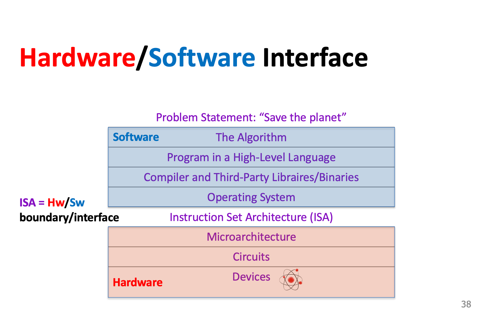

### 2. Two recurring themes

- **Abstraction**: view a component from a high level without caring about the underlying details. Nobody can manually trace the tens of billions of transistors in an Apple M1 — computer systems work entirely thanks to abstraction.
- **Hardware-Software Interplay**: software and hardware influence each other and are co-designed.

### 3. ISA vs. Microarchitecture (core distinction, must-know for the exam)

- **ISA (Instruction Set Architecture)**: the **specification / list** of basic instructions a CPU can execute (ADD, MULTIPLY, DIVIDE, MOVE, BRANCH…). It is the **boundary / contract between software and hardware**. Different vendors may adopt different instruction sets.
- **Microarchitecture**: **implementing** that ISA **with circuits**. The same ISA can have completely different microarchitectural implementations.

> In one sentence: the ISA says "what to do", the microarchitecture says "how to do it".

### 4. Two key propositions

- **The core components are the same**: from a Google data center (115,000 square feet) to a 94-milliwatt nano drone, the key components are the same.
- **Universal Computational Device**: anything computable can be computed by a computer. This comes from Alan Turing's (1937) mathematical description of the Turing machine — a particular kind of machine (the Turing machine) can perform all computations.

### 5. Course Plan: how one line of C lands on hardware

`int z = z + 1;` → compiler → Assembly → assembler → Machine Code (0s/1s) → stored in memory → CPU **fetch / decode / execute**, executing one instruction per clock cycle. The ISA is the hardware/software boundary along this chain.

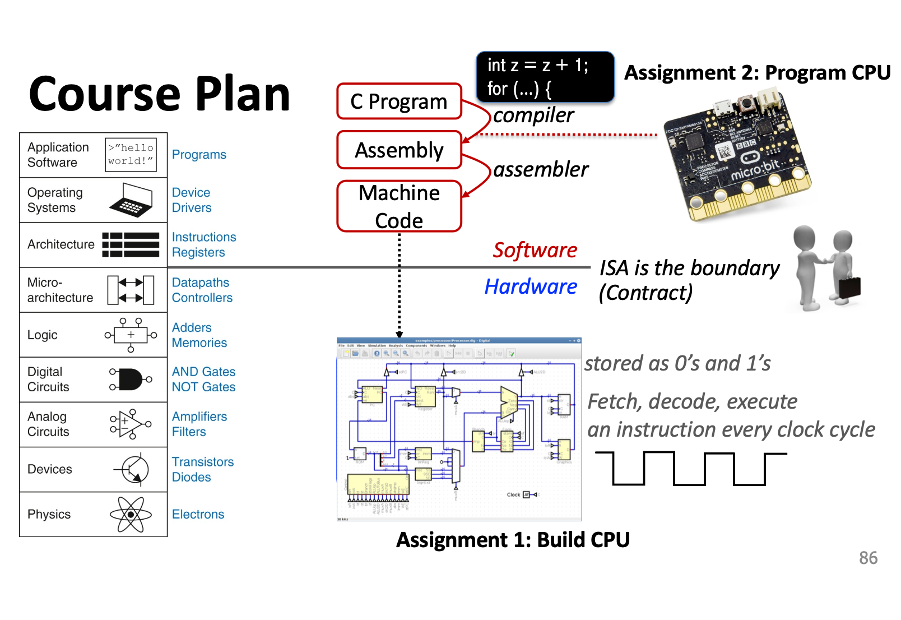

---

## 2. Information Representation: Number Systems and Two's Complement (PDF P106–P176)

> ⚠️ The most hardcore part of this set, with the densest exam points.

### 1. Why digital rather than analog

Analog signals are affected by noise and attenuation, and errors **accumulate**; the digital approach only distinguishes two voltage levels, 0/1, so it is noise-resistant and reliable. This course uses the digital (binary) approach throughout.

### 2. Terminology

- **bit**: 1 bit
- **nibble**: 4 bits
- **byte**: 8 bits (0–255)
- **word**: machine-dependent. 8–16 bits on low-end devices, 32–64 bits on high-end ones
- **MSB** (Most Significant Bit): the highest bit / **LSB** (Least Significant Bit): the lowest bit

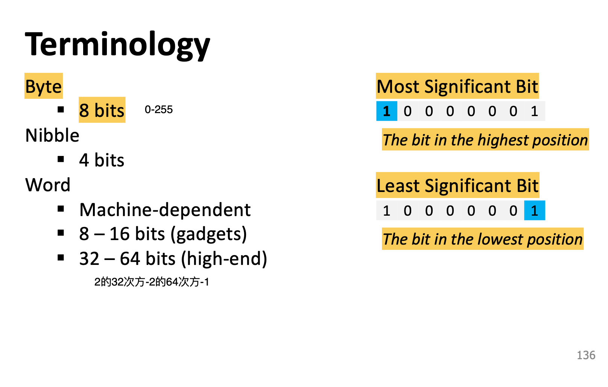

### 3. Bases and conversion

- **Binary**: carry when reaching two
- **Hexadecimal (base 16)**: groups of 4 bits, 16 possibilities; digits 0–9 + A–F; column weights 1, 16, 256, 4096. Motivation: long binary strings are tedious and error-prone to write, so hex shortens them.
- Master: decimal ↔ binary and binary ↔ hexadecimal conversions.

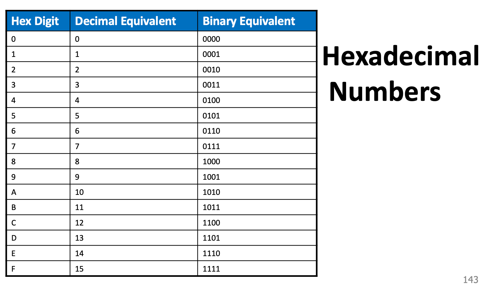

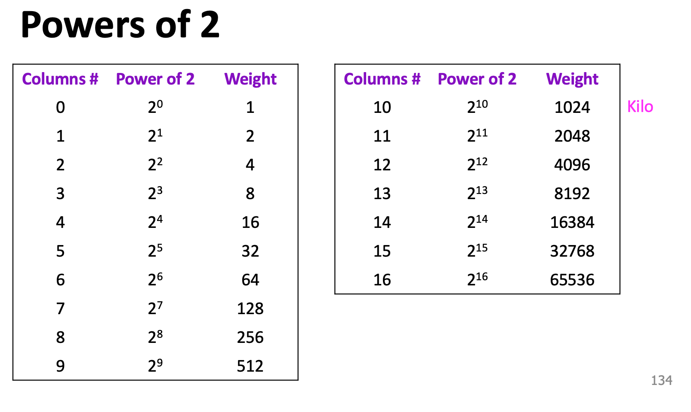

### 4. Binary addition and overflow

- Add bit by bit, carrying at two.
- **Overflow**: the result is too large and exceeds the range representable by the available bit width.

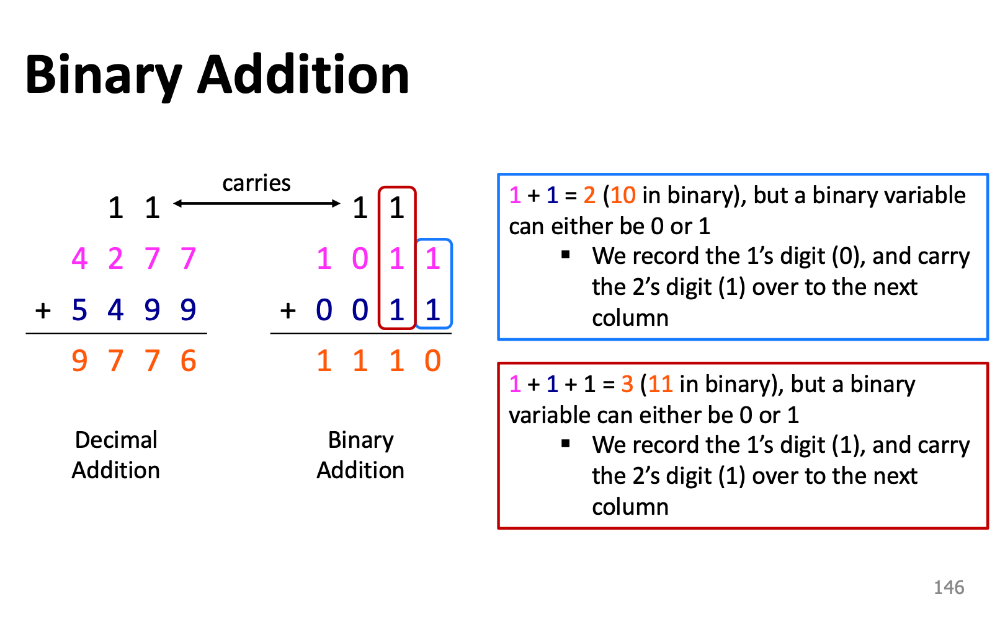

### 5. Three representations of signed numbers (key point)

| Representation | Key points |
|--------|------|
| **Sign/Magnitude** | The highest bit is the sign bit, the rest is the magnitude. Drawbacks: zero has two representations, and addition doesn't work generally |
| **One's Complement** | Invert the bits to get the negative number |
| **Two's Complement** | **Used by almost all modern computers** |

**Advantages of Two's Complement**:

- Ordinary addition just works (no special handling for subtraction)
- Zero has only **one unique** representation
- Positive numbers have MSB = 0, negative numbers MSB = 1 (the sign property is retained)

**The reasoning behind two's complement**:

- If A + B = 0 and A = +5, then B must be −5 → we have found a new representation for negative numbers.
- To turn A into B (i.e. +5 → −5): first take the **1's complement**, then **+1**. This is what "B is the two's complement of A" means.

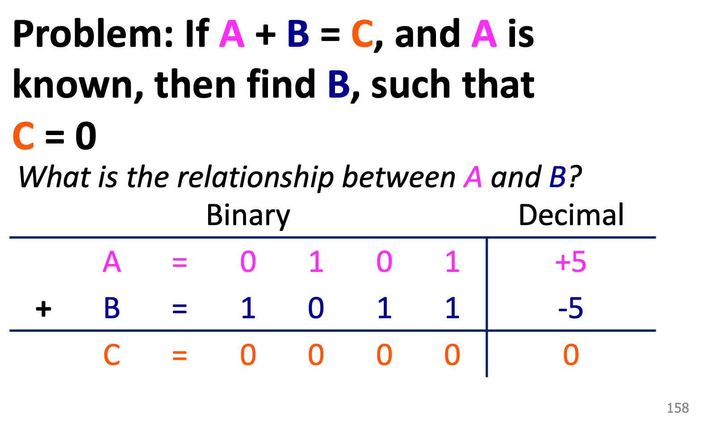

### 6. Two's complement overflow

- Adding two positive numbers but getting a negative one = **overflow** (the result exceeds the bit width).
- Example: 5-bit two's complement, A = 01001 (+9), B = 01011 (+11), sum = 10100 (−12) → overflow.

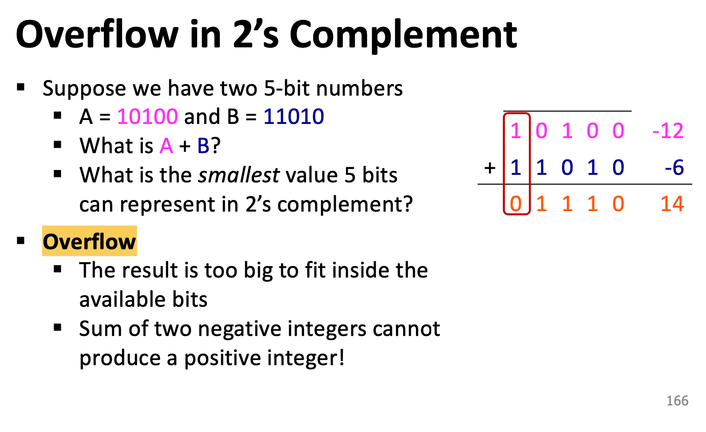

### 7. Ranges of the number systems (formulas to memorize)

| Number System | Minimum | Maximum |
|---------------|---------|---------|
| Unsigned | 0 | 2ᴺ − 1 |
| Sign/Magnitude | −2ᴺ⁻¹ + 1 | 2ᴺ⁻¹ − 1 |
| Two's Complement | −2ᴺ⁻¹ | 2ᴺ⁻¹ − 1 |

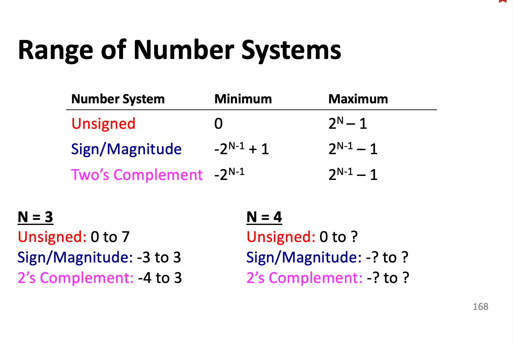

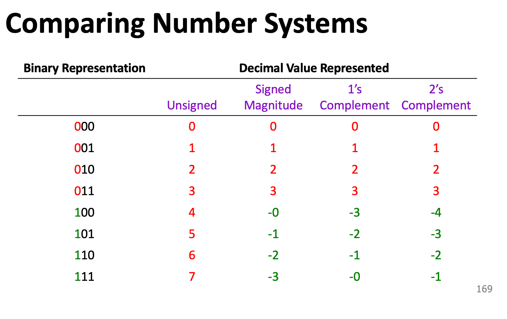

### 8. Sign Extension

- When extending a narrow two's complement number to a wider width, fill the upper bits with the **sign bit** (0 for positive, 1 for negative); the value is unchanged.
- Example: 4-bit `0101` and 16-bit `0000000000000101` both represent +5 — leading 0s don't affect the value.

---

## 3. Computer Building Blocks: Transistors → CMOS → Logic Gates (PDF P177–P248)

### 1. MOS transistors

- **MOS** = Metal (conductor) + Oxide (insulator) + Semiconductor.
- Three terminals: **Gate, Source, Drain**.
- Essentially = an **electrically controlled switch**. Analogy of a "wall switch + light bulb": for the bulb to light, electrons must flow; for electrons to flow, there must be a closed circuit; the switch controls whether the circuit is open or closed.
- The electrical details of transistors are **below the lowest abstraction layer of this course** and are not required.

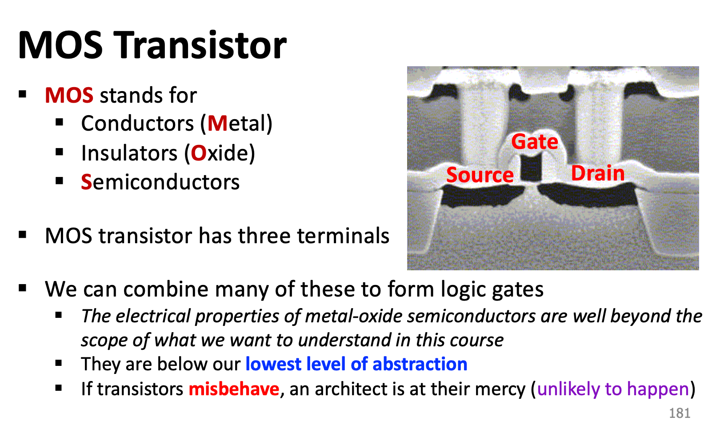

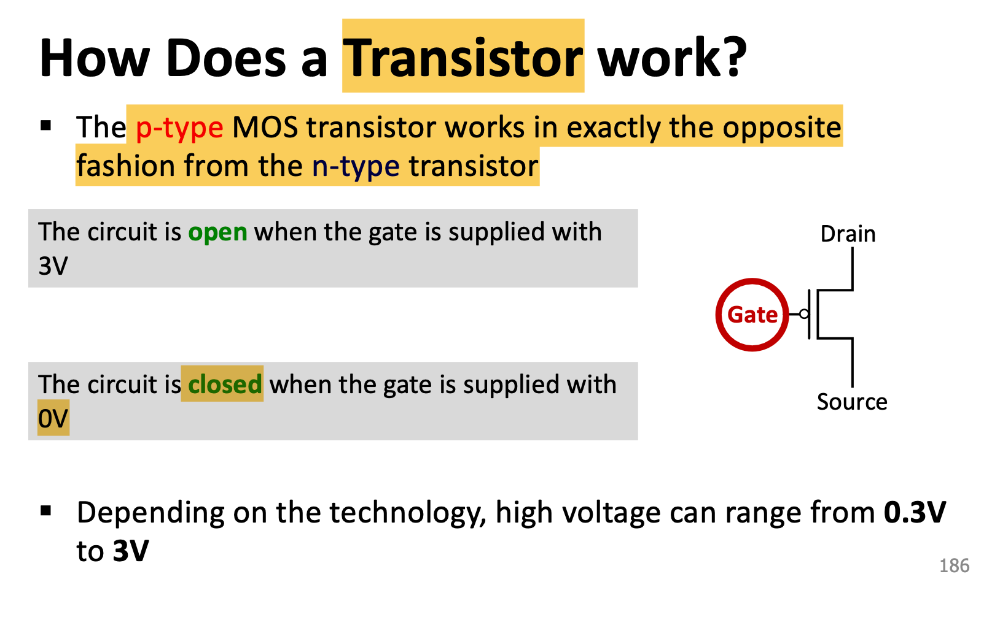

### 2. CMOS gates

- **CMOS** = nMOS + pMOS (Complementary MOS); modern computers use both kinds of transistor.
- Voltage convention: 0V = logic 0, 3V = logic 1.
- **General structure**:
  - **pull-up network** (pMOS): pulls the output up to 3V (logic 1)
  - **pull-down network** (nMOS): pulls the output down to 0V (logic 0)
  - **Parallel**: any transistor on → the network conducts
  - **Series**: only when all are on → the network conducts
- CMOS naturally implements **inverting** logic, so NOT / NAND / NOR are more "native" than AND / OR.

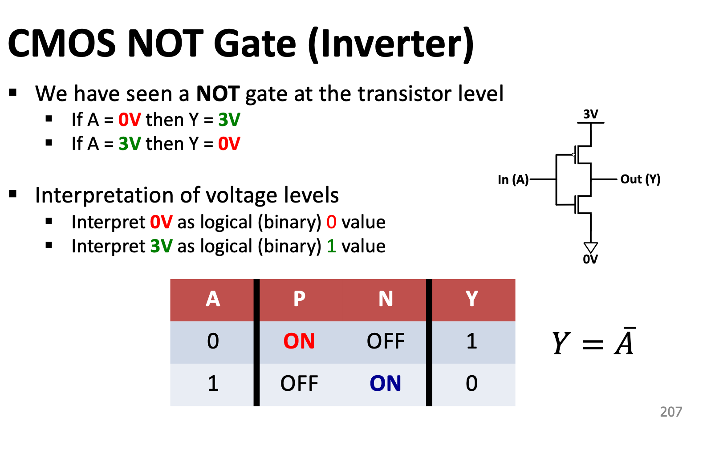

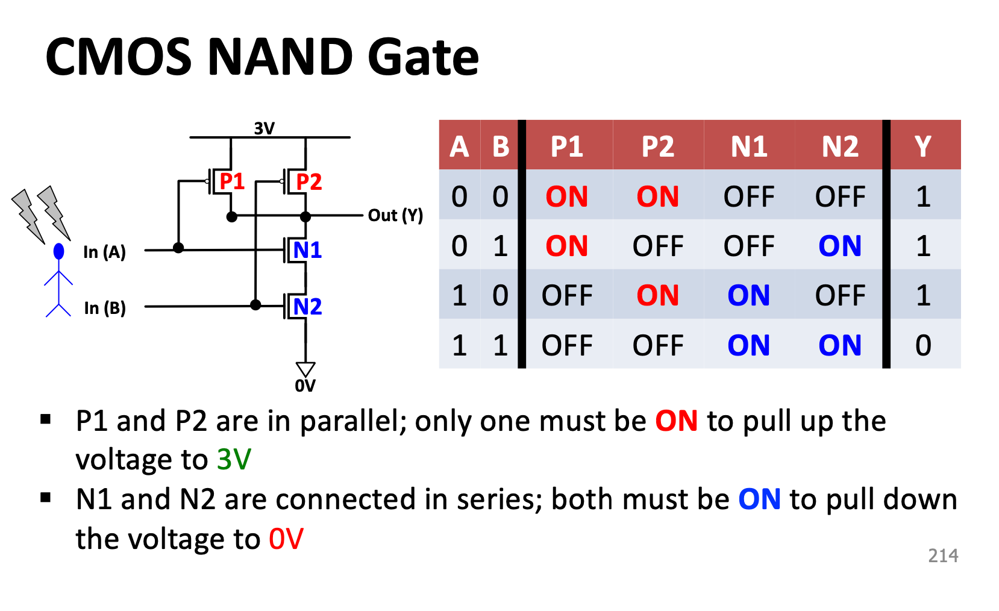

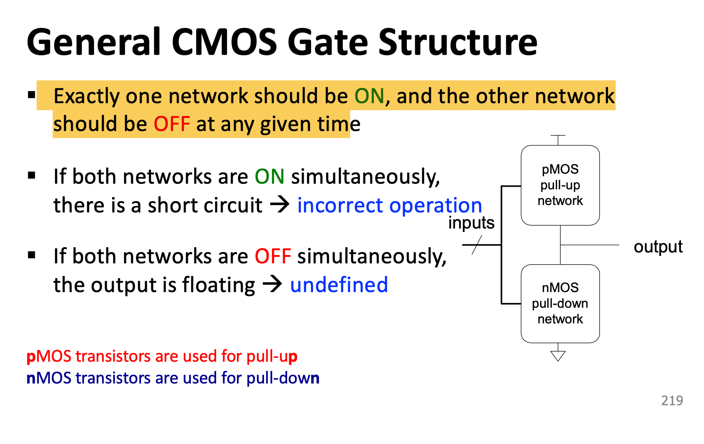

### 3. Boolean logic and logic gates

- George Boole's Boolean algebra → describe logic functions with **truth tables** → logic gates implement these functions.
- Basic gates: **AND / OR / XOR / NOT / NAND / NOR / XNOR / BUF**, each with its own symbol and truth table.
- XOR and XNOR are special logic functions ("parity / equality" checks).
- Multiple-Input Gates.

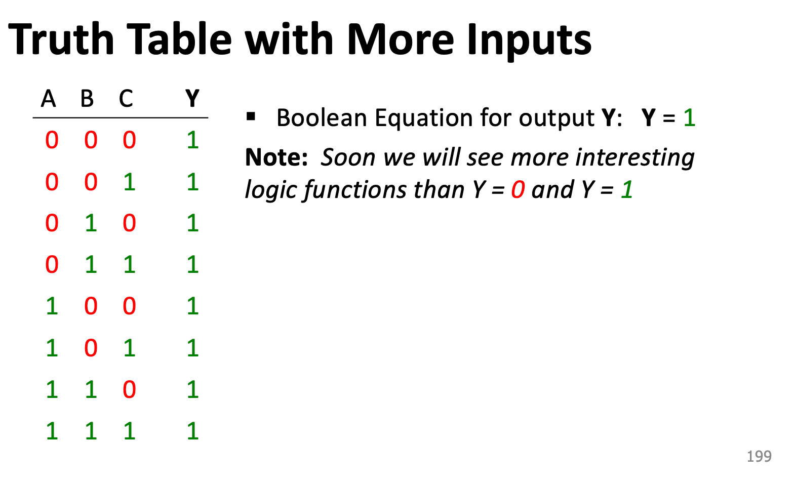

### 4. Bitwise operations and bit masks

- **Bitwise operations**: bit-by-bit AND / OR / XOR, applied to m-bit bit vectors, operating independently on each pair of bits. AND/OR on two 8-bit inputs gives an 8-bit result.
- **Bit Mask**: use a mask to selectively clear / set certain bits.
  - Example: a packet contains passwd bits and user id bits; use a mask to clear the passwd bits and keep the user id.

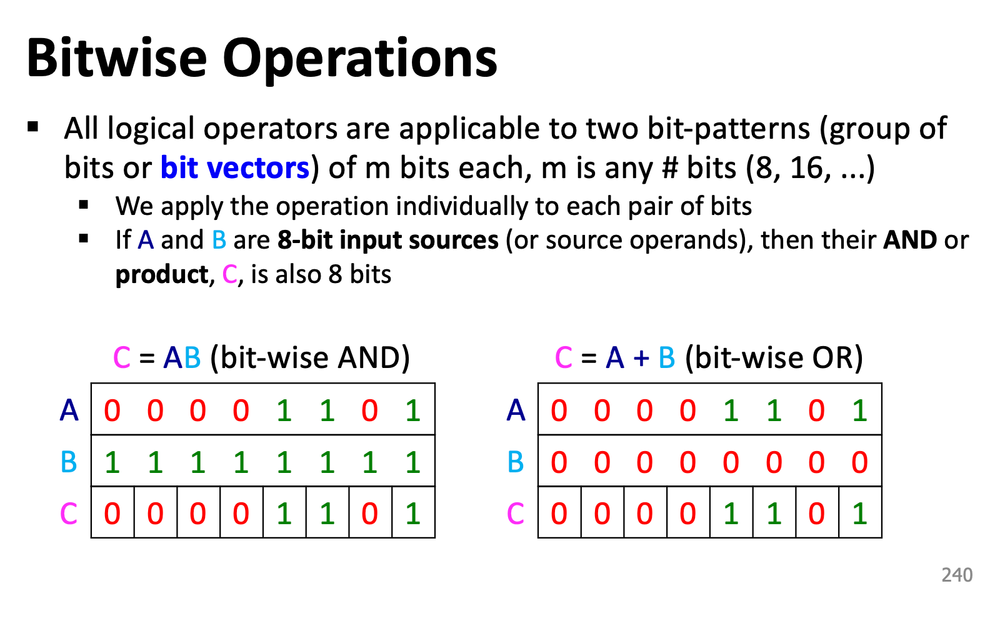

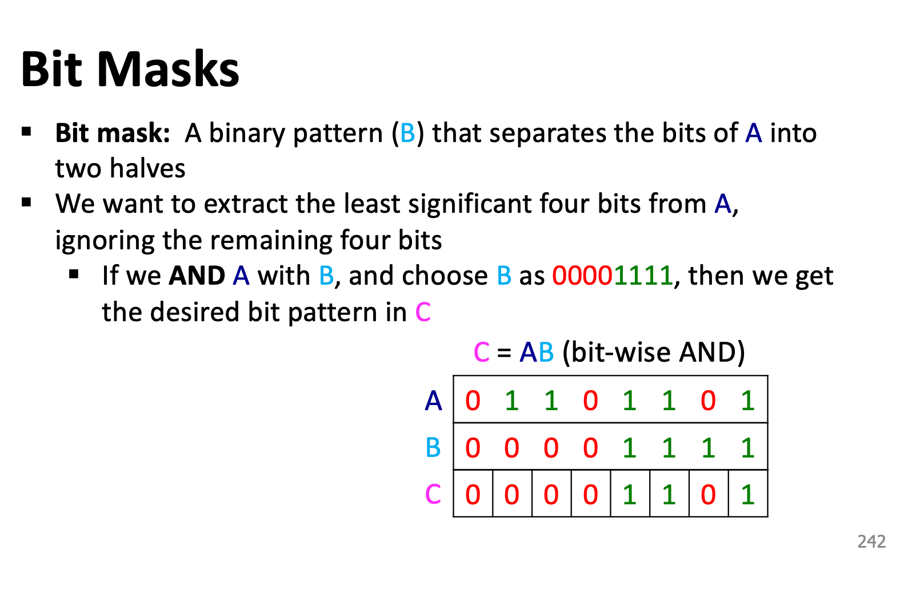
