# COMP2300 Set 2 Notes: Combinational Circuits

> **Course**: ANU COMP2300 — Computer Organisation and Program Execution
> **Lecturer**: Shoaib Akram　**Textbook**: H&H (Harris & Harris) Ch.2, 5.2, 5.6
> **This set in one sentence**: Use the pipeline "truth table → Boolean equation → gate circuit" to turn any logic specification into a memory-less combinational circuit, get to know the standard building blocks of modern computers (Mux / adder / decoder / PLA / ALU / tri-state buffer), and master Boolean algebra simplification to reduce area and delay.

---

## 0. Starting Point: Combinational vs Sequential

Digital circuits come in two kinds; this is the watershed for everything that follows:

| Type | Output depends on | Key feature |
|---|---|---|
| **Combinational** | **Only** the current input combination | **Memory-less**; all logic gates are combinational |
| Sequential | Current inputs **+ input history** | Has **state/memory**; the sequence of inputs over time determines the output (e.g. an elevator controller) |

> Exam point: "memory-less" is the defining feature of combinational circuits. Deciding whether a circuit is combinational ultimately comes down to whether it introduces memory/feedback (see Section 12).

**The standard pipeline for implementing combinational logic** (runs through the whole set):
**Spec → Truth Table → Boolean Eq → Schematic**

---

## 1. Truth Tables and Boolean Equations

- **A truth table is the unique signature of a Boolean function** — a function has exactly one truth table.
- To build a truth table, first fix the **interface** (inputs/outputs); the interface may be implicit and has to be extracted from a natural-language spec.

**Minterm / Maxterm (must distinguish)**:
- **Minterm**: an **AND** term of n variables. If a variable is **0 in that row → complement it (add a prime)**, if 1 → use it as is. Each minterm is 1 in exactly one row of the truth table.
- **Maxterm**: an **OR** term of n variables. If a variable is **1 → complement it**, if 0 → as is.

**Operator precedence (must memorize)**: `NOT > AND > OR`.

---

## 2. SOP (Sum of Products)

- **SOP = disjunctive normal form = minterm expansion**.
- **Core idea**: **OR together the minterms of every row whose output is 1**. This is a **two-level** expression: AND at the first level, OR at the second.
- **Standard shorthand**: `F(A,B,C) = Σm(3,4,5,6,7)` — after Σm, list the numbers of the minterms whose output is 1.
- **Canonical form ≠ minimal form** (canonical ≠ minimal): the canonical SOP covers all combinations giving 1, but is usually not the implementation with the fewest gates. Simplification is covered in Section 13.

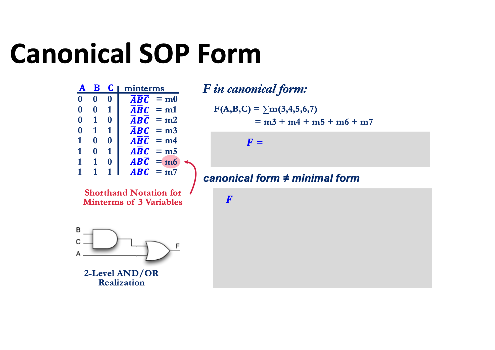

**SOP procedure summary**: truth table → write a minterm for each row with output 1 → add them all (OR) → get the algebraic expression → realize it as a two-level AND/OR gate circuit.

---

## 3. Equation → Schematic

- Schematic = a circuit diagram drawn with gates and wires; the physical counterpart of a Boolean equation.
- **Key insight (often examined)**: a two-level expression sometimes **collapses into a single monolithic gate**.

**Happiness Detector example** (a recurring use case; master all three parts):
Spec: Mr. X is unhappy when he "has an assignment deadline" **or** "his usual bar is closed"; design a circuit that outputs 1 only when he is happy.
- Truth table → `H = D'B'` (D = deadline, B = bar closed) → i.e. `(D)' AND (B)'`
- This is exactly a **NOR gate**: `D'B' = (D + B)'`.

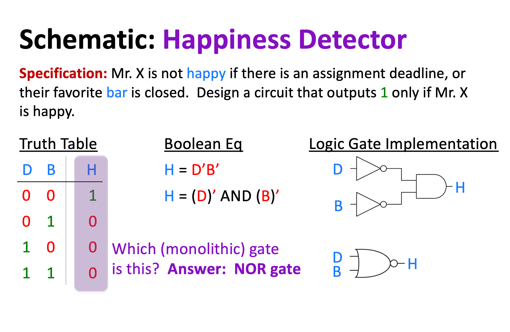

---

## 4. Combinational Building Block (1): the Multiplexer (Mux)

**2:1 Mux**: two data inputs D0/D1, one **select signal S**, output `Y = S'D0 + SD1` (S=0 selects D0, S=1 selects D1).

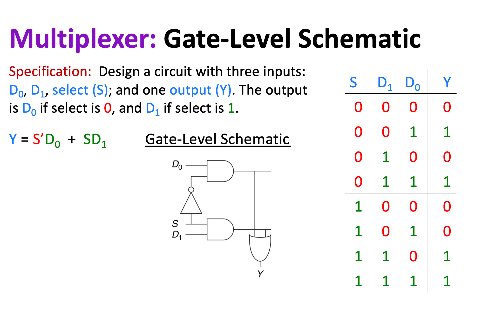

**Wide Muxes and number of select bits (formula to memorize)**:
- Selecting among 4 inputs needs **2** selects; selecting among n inputs needs **log₂n** select bits.
- A 4:1 Mux can be built hierarchically from **three 2:1 Muxes**.

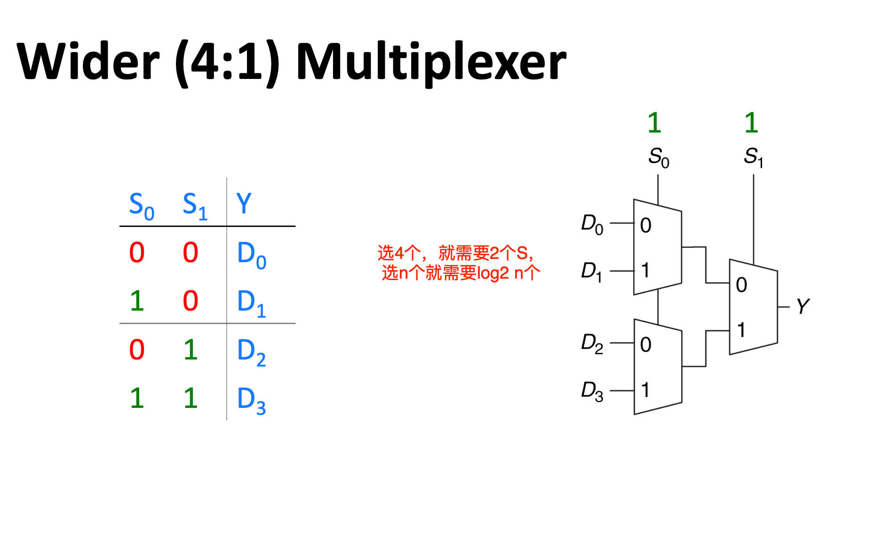

**Using a Mux as a lookup table (LUT) (often-examined conversion)**:
- Any truth table can be viewed as a **lookup table**: tie the data inputs directly to 0/1 constants and use the circuit inputs (A/B…) as **selects**; the Mux "looks up" the corresponding output.
- Example: implementing a 2-input AND with a 4:1 Mux: only the 11 entry is tied to 1, the rest to 0, i.e. `Y = AB`.

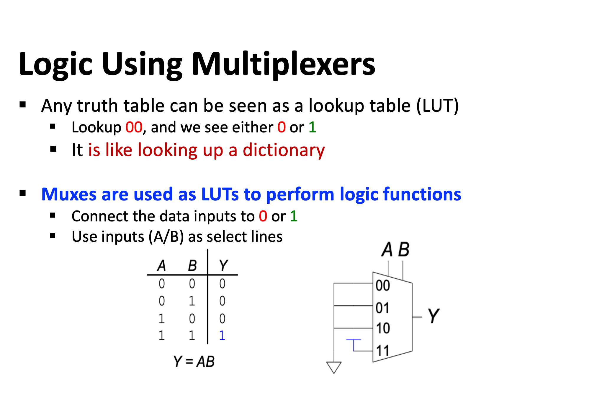

**3-LUT and FPGA (core concept)**:
- A 3-bit-input LUT = 8 **configuration memory** bits + one 8:1 Mux; the 3 input bits act as selects to look up a 1-bit output.
- The LUT is the **basic building block of an FPGA**; a modern FPGA consists of many LUTs interconnected by routing, with each 3-LUT implementing a subset of an N-input logic function.

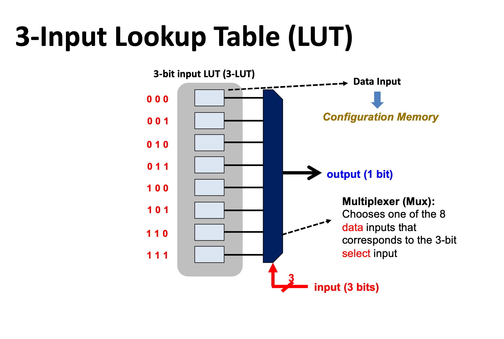

---

## 5. Combinational Building Block (2): Adders and Timing/Delay

**Half Adder** (no carry input):
`S = A ⊕ B`, `Cout = AB`

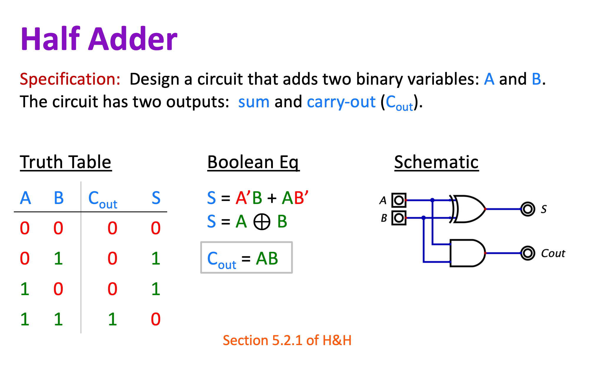

**Full Adder** (with carry input Cin; the half adder's inability to handle carry-in is its limitation):
`S = A ⊕ B ⊕ Cin`, `Cout = Cin(A ⊕ B) + AB`
- Implementation = **two half adders + one OR gate**.

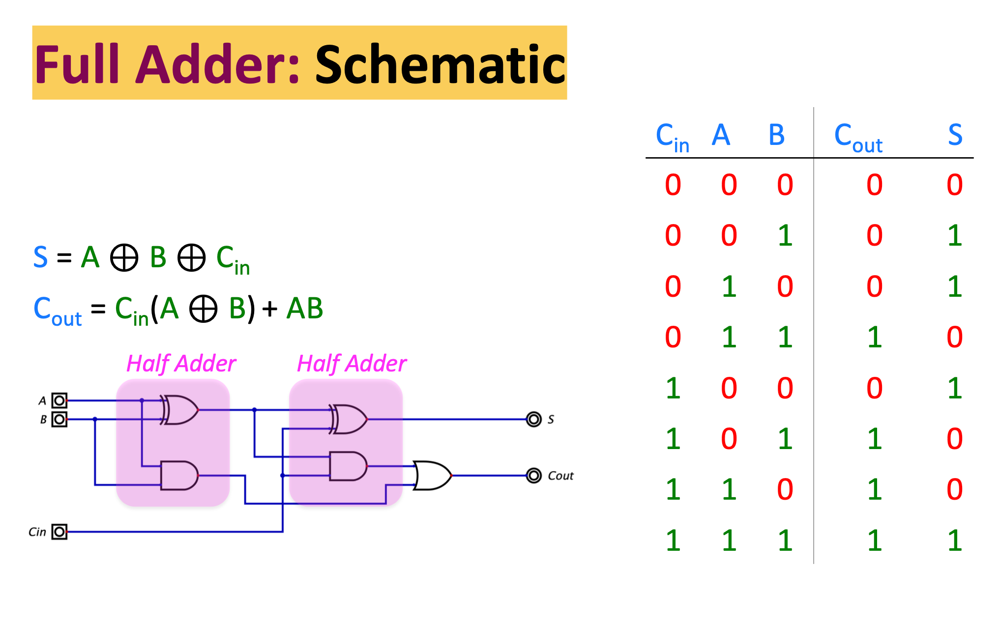

**Ripple Carry Adder (RCA)**:
- To add two N-bit numbers: **chain N full adders from right to left**, passing the carry stage by stage.
- **Fatal drawback (exam point)**: delay **grows linearly** with the number of bits — the carry must ripple stage by stage to the most significant bit before the result settles.

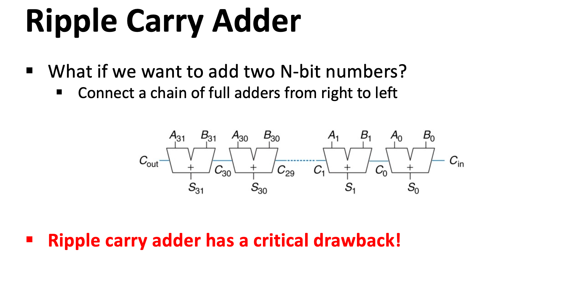

### Timing / Delay
- **Every combinational circuit has a propagation delay** (in seconds / picoseconds, ps = 10⁻¹² s).
- Delay of a chain of gates = **sum of the delays of the gates on the chain**.
- Among multiple input→output paths:
  - **Critical Path** = the longest path, **determines the speed of the whole circuit**.
  - **Shortest Path** = the shortest delay.
- Circuit propagation delay = sum of element delays along the **critical path**.

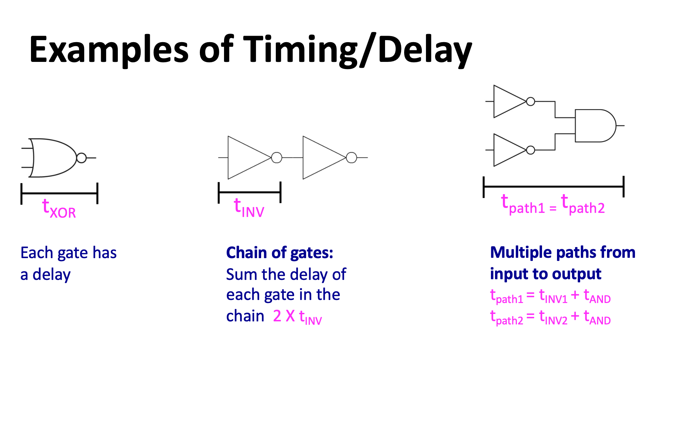

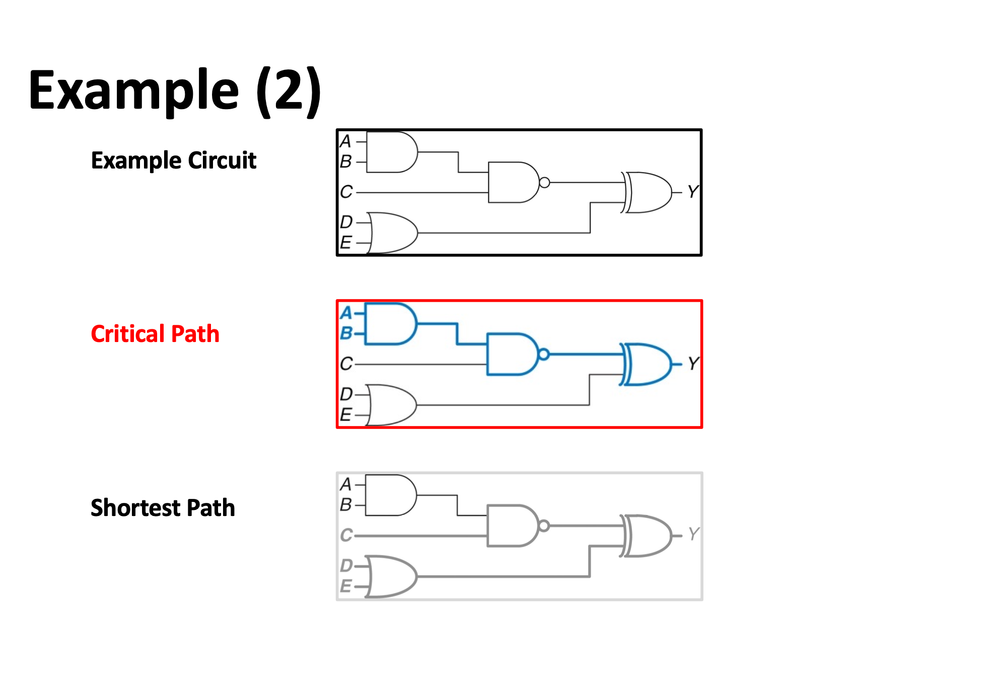

### Carry-Lookahead Adder (CLA)
- **Motivation**: a design is not scalable when circuit delay grows with the number of input bits — the RCA is the counterexample. The CLA speeds things up by generating carries ahead of time **in parallel**.
- **Generate / Propagate (definitions to memorize)**:
  - `Gi = AiBi` (this column generates a carry itself)
  - `Pi = Ai + Bi` (this column can propagate a carry)
  - `Ci = AiBi + (Ai+Bi)Ci-1 = Gi + PiCi-1`
- Block level (4-bit block): `G3:0 = G3 + P3(G2 + P2(G1 + P1G0))`, `P3:0 = P3P2P1P0`, `Ci = Gi:j + Pi:jCj-1`.
- Each CLA block computes the carry for the next block **simultaneously (in parallel)**.
- **Lesson**: the **Speed-Area Tradeoff** — the CLA is faster but uses more hardware. This is a general law of digital systems.

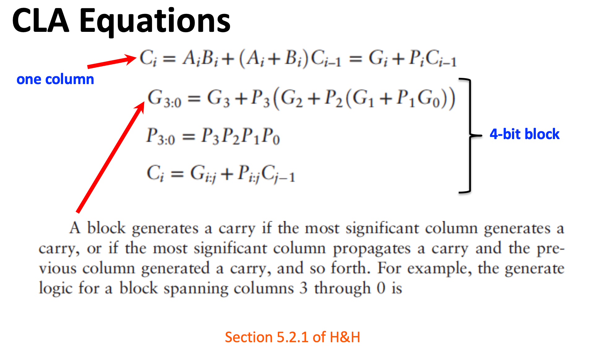

---

## 6. Combinational Building Block (3): the Decoder

- **N inputs, 2^N outputs**; for each input combination **exactly one output is 1 (one-hot)**.
- Each output = a minterm: `Y0 = A1'A0'`, `Y1 = A1'A0`, `Y2 = A1A0'`, `Y3 = A1A0`.
- **Decoder + OR gate → implement any logic function** (OR together the needed minterms).
- Application view: treat 00/01/10/11 as "commands" sent to four different devices; the decoder selects the one.

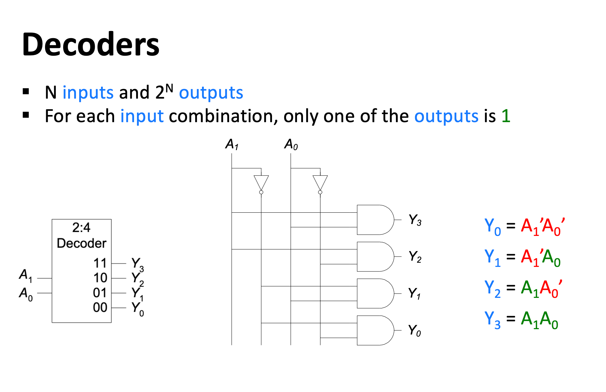

---

## 7. Combinational Building Block (4): PLA (Programmable Logic Array)

- SOP naturally leads to **two-level logic**, and the PLA is its hardware vehicle: **AND array → OR array**.
- Literals and implicants are selected through **programming connections (blowing fuses)**.
- It can implement **any N-input, P-output function**; chips are mass-produced uniformly in the factory (low cost) and programmed after shipping.
- **Lesson**: programmability has a cost — if only part of the logic is actually used, the PLA contains **redundant** logic (the cost of programmability).

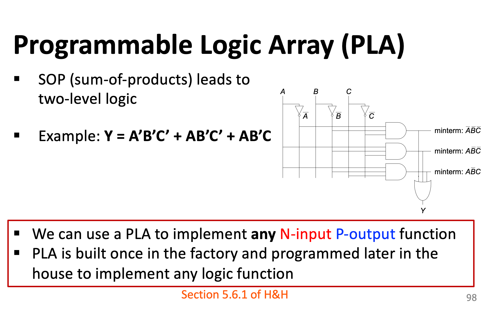

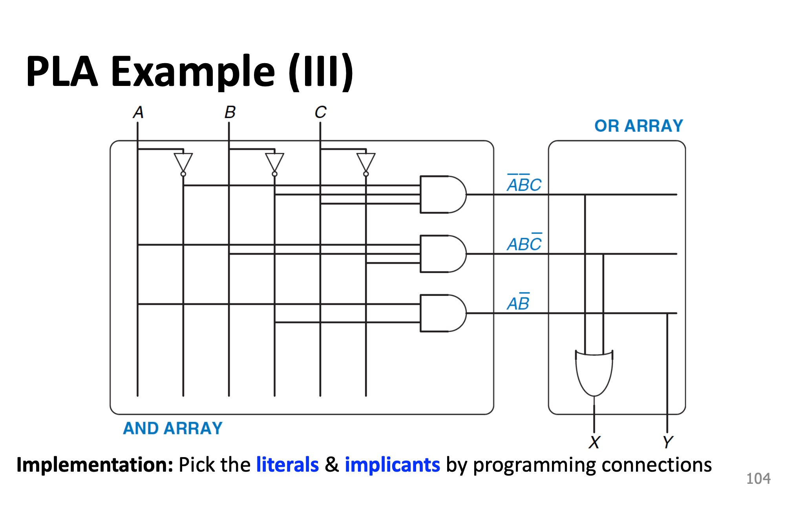

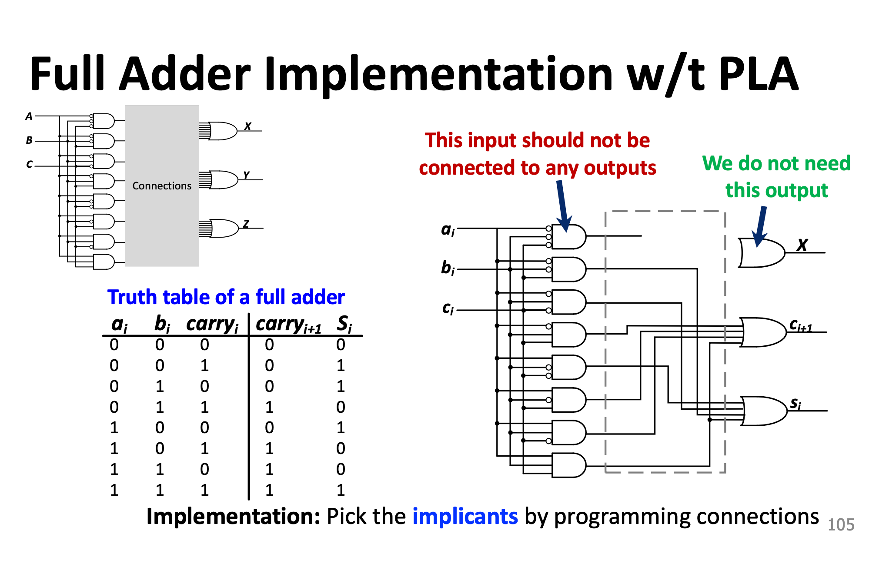

---

## 8. ALU (Arithmetic Logic Unit) — the climax of this set

- N-bit data inputs/outputs; **ALUControl** selects which operation to perform.
- **ALUControl[1:0] function table (must memorize)**:

| ALUControl₁:₀ | Function |
|---|---|
| 00 | Add |
| 01 | Subtract |
| 10 | AND |
| 11 | OR |

- **Implementation structure**: an N-bit **add/subtract circuit** + an N-bit **logic circuit (AND/OR)** + a **4:1 Mux** that uses ALUControl to select the final Result.
- Add/subtract circuit: A+B is a normal addition; A−B uses `A + (−B)` (the two's complement invert-and-add-one idea).
- **The essence of hardware: inherently parallel** — all logic gates in the ALU work simultaneously; there is no "compute this first, then that".

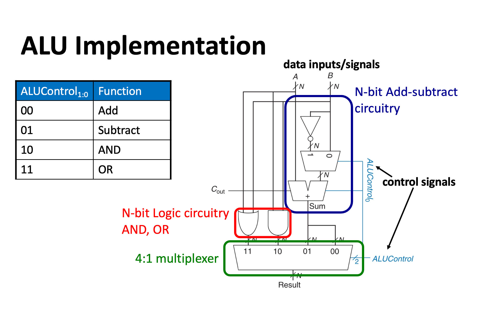

### ALUFLAGS (flags, must memorize)
`N Z C V` — meta-information about the ALU result:
- **N**egative (the result is negative; look at the MSB)
- **Z**ero (the result is 0)
- **C**arry
- o**V**erflow

**Detecting overflow**:
- **Option 1 (enumeration)**: list the 4 cases that overflow according to operation + sign bits A₃₁/B₃₁/S₃₁:

| Case | ALUControl₀ | A₃₁ | B₃₁ | S₃₁ | In plain words |
|---|---|---|---|---|---|
| #1 | 0 (Add) | 0 | 0 | 1 | positive + positive = negative |
| #2 | 0 (Add) | 1 | 1 | 0 | negative + negative = positive |
| #3 | 1 (Sub) | 0 | 1 | 1 | positive − negative = negative |
| #4 | 1 (Sub) | 1 | 0 | 0 | negative − positive = positive |

- **Option 2 (unify as addition)**: use A and the output of a 2:1 Mux — Add takes B, Subtract takes −B, so `A−B` is treated as `A+(−B)`; **everything is addition**, so there's no need to consider subtraction separately when reasoning about overflow, and the circuit is simpler. (The handout leaves the concrete circuit for Option 2 as Homework.)

> Often examined: remember Option 1's 4 rules through sign intuition like "positive + positive gives negative / negative + negative gives positive" — more reliable than rote-learning the 0/1 table.

---

## 9. Combinational Building Block (5): the Comparator

- **Equality checker**: checks whether two N-bit values are exactly the same.
- Implementation: **XNOR** each bit pair `Ai, Bi` (1 if equal), then **AND** all the bit results → `Equal`.
- (Magnitude comparison is a different matter; this page only does equality.)

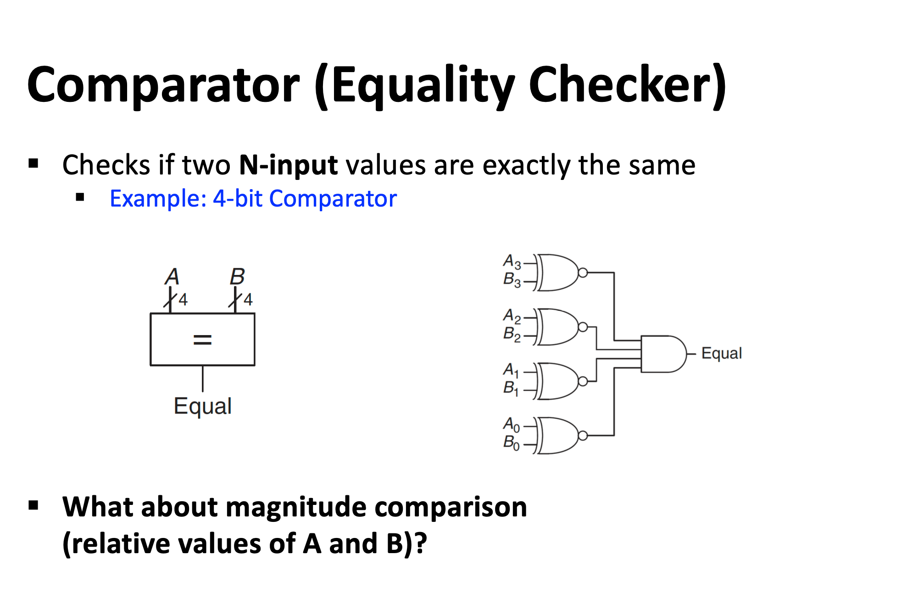

---

## 10. Combinational Building Block (6): the Tri-State Buffer

- Purpose: **gating** different signals onto the same wire. Like a switch, but when enabled it can pass both 0 and 1.
- **The third state Z (high impedance) is the key**. Truth table:

| E (enable) | A | Y |
|---|---|---|
| 0 | 0 | **Z** |
| 0 | 1 | **Z** |
| 1 | 0 | 0 |
| 1 | 1 | 1 |

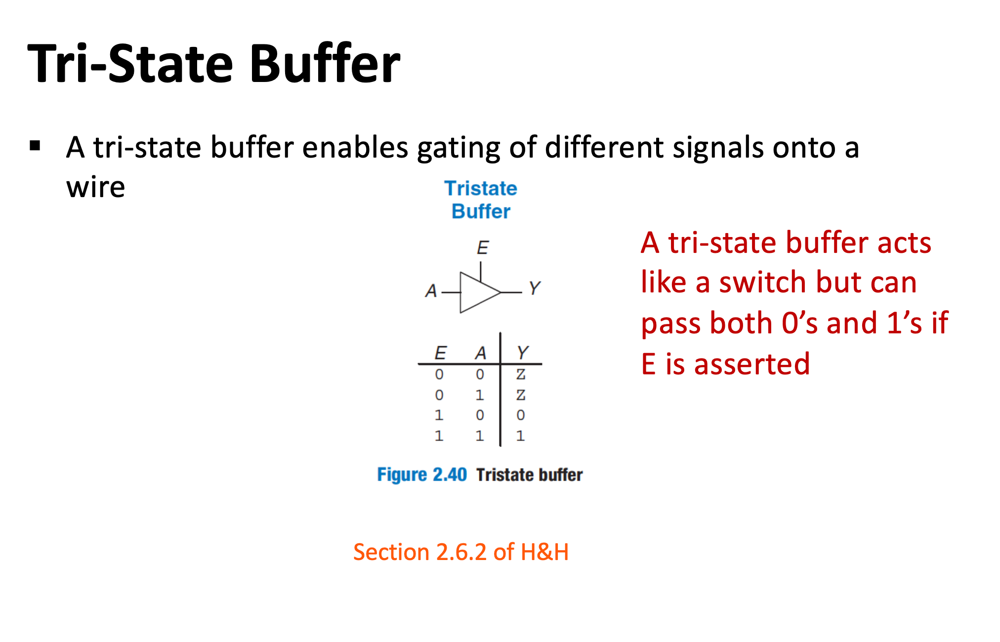

**Typical use: a shared bus**
- One wire is shared by the CPU and memory (or several I/O peripherals); each driver has a tri-state buffer in front of it, and **only one may be enabled at any moment** to drive the bus, while the others output Z and don't interfere.

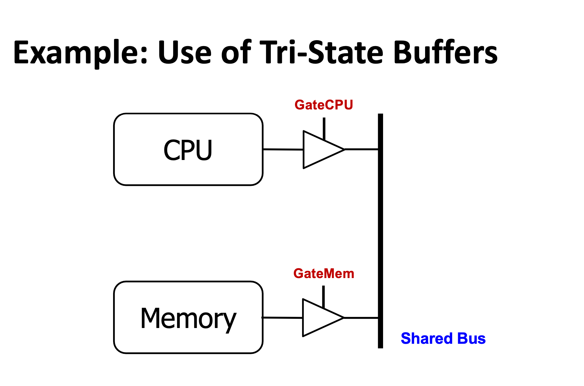

**Building a Mux from tri-state buffers**: put a tri-state buffer on each data input, use the decoded select signal to enable one of them, and join the outputs onto one wire. `Y = D0S' + D1S` (2:1 case).

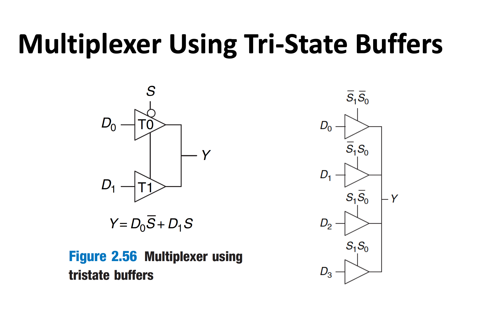

---

## 11. Composition Rules for Combinational Circuits

A circuit **is combinational** if and only if:
- every circuit element is itself combinational;
- every node is either a circuit input or connects to exactly **one** element's output;
- **it contains no cyclic paths / feedback loops** — a loop introduces memory and makes it sequential.

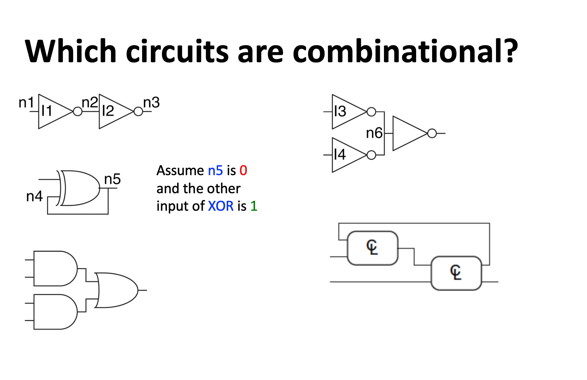

---

## 12. Boolean Algebra and Logic Minimization

**Why learn Boolean algebra**: to **minimize area, cost, logic complexity, and energy**. The canonical SOP is not minimal and needs algebraic simplification.

**Axioms (A1–A5)**:

| # | Axiom | Dual | Name |
|---|---|---|---|
| A1 | B=0 if B≠1 | B=1 if B≠0 | Binary Field |
| A2 | 0̄=1 | 1̄=0 | NOT |
| A3 | 0·0=0 | 1+1=1 | AND/OR |
| A4 | 1·1=1 | 0+0=0 | AND/OR |
| A5 | 0·1=1·0=0 | 1+0=0+1=1 | AND/OR |

**Single-variable theorems (T1–T5)**:

| # | Theorem | Dual | Name |
|---|---|---|---|
| T1 | B·1=B | B+0=B | Identity |
| T2 | B·0=0 | B+1=1 | Null Element |
| T3 | B·B=B | B+B=B | Idempotency |
| T4 | B̿=B | — | Involution |
| T5 | B·B̄=0 | B+B̄=1 | Complements |

**Multi-variable theorems (T6–T11)**:

| # | Theorem | Dual | Name |
|---|---|---|---|
| T6 | B·C=C·B | B+C=C+B | Commutativity |
| T7 | (B·C)·D=B·(C·D) | (B+C)+D=B+(C+D) | Associativity |
| T8 | B·(C+D)=BC+BD | B+(C·D)=(B+C)(B+D) | Distributivity |
| T9 | B·(B+C)=B | B+(B·C)=B | Covering |
| T10 | (B·C)+(B·C̄)=B | (B+C)(B+C̄)=B | Combining |
| T11 | BC+BD+CD=BC+BD | … | Consensus |

> ⚠️ **Common pitfall**: the T8' dual (OR distributes over AND, `B+CD=(B+C)(B+D)`) differs from ordinary arithmetic — in ordinary algebra addition doesn't distribute over multiplication, but in Boolean algebra it does.
- **Dual rule**: swap `·` ↔ `+` and `0` ↔ `1` throughout.
- The tables above suffice for these axioms/theorems; **no screenshot needed** (the text tables are a complete reconstruction).

**Proof methods**:
- Method 1: **Perfect Induction** — check all input combinations exhaustively.
- Method 2: algebraic derivation using existing theorems (e.g. T9 Covering, T10 Combining).

**Basic principle of simplification**: `PA + PA' = P` (P is any implicant).
- Minimization criteria: use the **fewest implicants**; with equal numbers of implicants, the one with the **fewest literals** is better.
- **Prime implicant**: an implicant that cannot be combined with other terms into a term with fewer literals.

**Simplification examples (typical derivations; worth copying out once)**:
- Ex 1: `Y = AB + AB' → A` (T10 Combining; or T8 distribution → T5' → T1)
- Ex 2: `Y = A(AB + ABC) → AB` (T8 → T2' → T1 → T7 → T3)
- Ex 3A: `Y = AB'C + ABC + A'BC → AC + A'BC` (stuck being able to combine only one pair)
- Ex 3B: use **T3' idempotency to duplicate ABC first**, then combine separately → `AC + BC` (both are prime implicants). **Duplicating the overlapping minterm so it can take part in two combinations at once** is the key trick here.
- Ex 4: `Y = A'B'C' + AB'C' + AB'C` (left as an exercise to simplify yourself)

**De Morgan's Theorem (T12, must memorize)**:
- `(B0·B1·B2…)' = B0' + B1' + B2'…` (complement of a product = sum of complements)
- `(B0+B1+B2…)' = B0'·B1'·B2'…` (complement of a sum = product of complements)

**Bubble Pushing rules**:
- Pushing a bubble swaps the gate body between **AND↔OR**.
- Pushing a bubble **from the output toward the inputs** → add a bubble to every input.
- Pushing the bubbles on all inputs **toward the output** → add a bubble to the output.

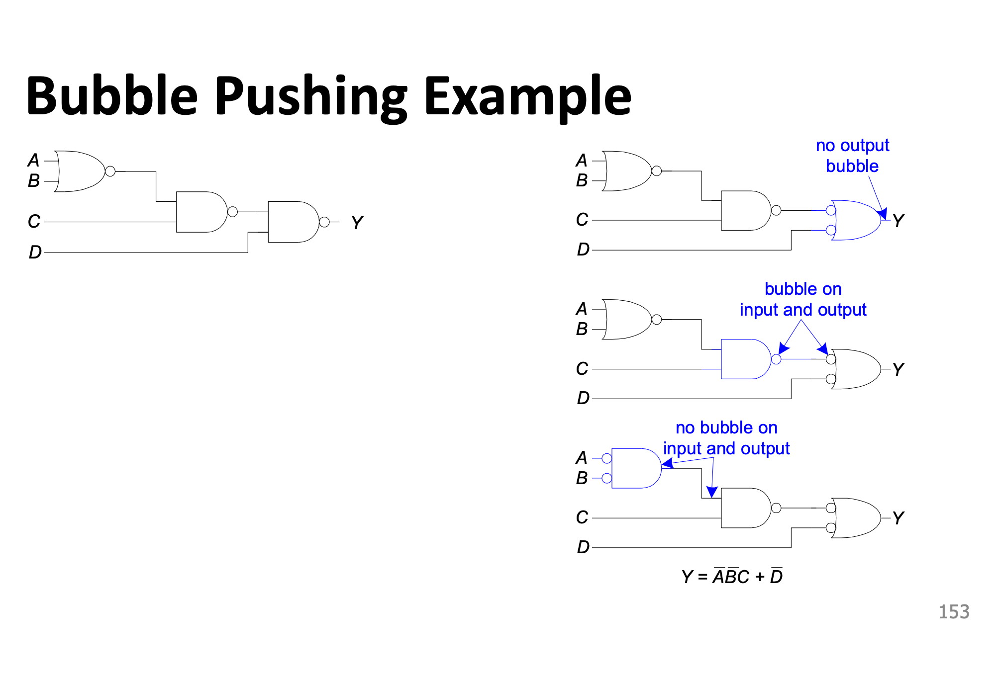

---

## 13. Priority Circuit (with Don't-Cares)

- Inputs: "Requestors" with priorities; outputs: a "Grant" signal for each requestor (**one-hot**).
- Applications: booking meeting rooms, four CPUs contending for a bus.
- Highest bit has priority: `Y3 = A3`, `Y2 = A3'A2`, `Y1 = A3'A2'A1`, `Y0 = A3'A2'A1'A0`.
- **Don't-Care (X)**: means "we don't care what value this input has". Using X **compresses** the full 16-row truth table **into 5 rows** — once a higher-priority bit has determined the output, the lower bits can be anything.

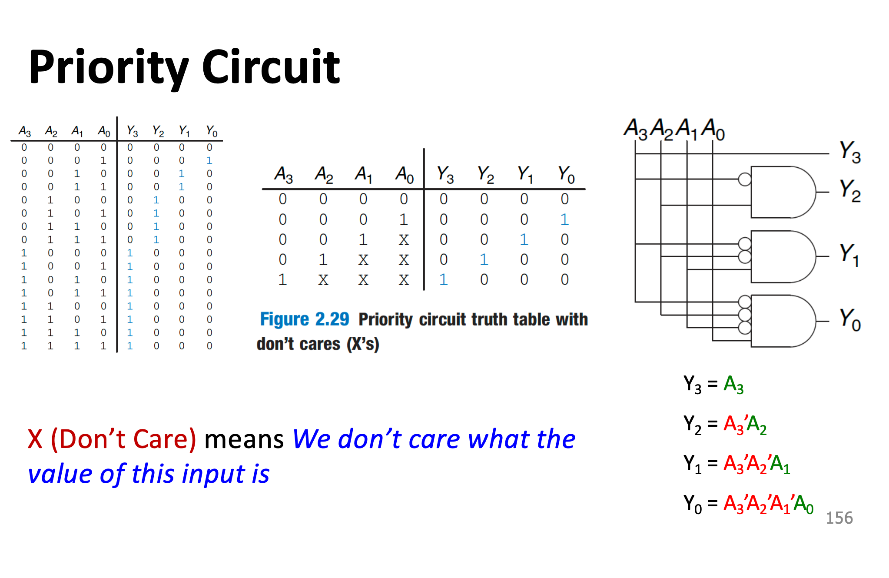

---

## 14. Logical Completeness

- A PLA needs only three gate types, **AND, OR, NOT**, to implement any logic function.
- **NAND alone is logically complete**: NOT, AND, and OR can be built from NAND only → therefore **an entire computer can be built from just one gate type, NAND**. Most computers today are indeed made of billions of NAND gates. (Prove NAND completeness yourself.)
- This page is a text-only conclusion; **no screenshot needed**.

---

## 15. Optional Self-Study
- **POS (Product of Sums)**: the dual canonical form of SOP, expanded with maxterms. If you understand SOP you don't necessarily need it.
- Other combinational circuits: **Shifters**, etc.

---

## Set Review (What We've Done)
The full family of combinational building blocks of modern computers: transistors → logic gates → Mux / adder / decoder / comparator / tri-state buffer / PLA / ALU; with the supporting methodology: the truth table → equation → gate circuit pipeline, Boolean algebra simplification, and timing/delay analysis. Next we enter **sequential circuits** (the world with memory).
