# COMP2300 Set 3 Notes — Sequential Circuits, Memory, and Finite State Machines

> **Course**: ANU COMP2300 — Computer Organisation & Program Execution
> **Lecturer**: Shoaib Akram
> **This Set in one sentence**: Cross from "combinational circuits that depend only on current inputs" to "sequential circuits that can remember the past" — first build an element that stores 1 bit (bistable → SR/D latch → D flip-flop), then assemble registers and memories, then organize them into FSMs with clock discipline, and finally land on SRAM/DRAM physical storage and timing parameters.
> **Reference**: H&H Chapter 3 (sequential logic/FSM), Section 5.5 (memory).

> **Notation**: `S'` = next state; `~X` = NOT X (complement, drawn as an overbar in the slides); `·` = AND, `+` = OR, `⊕` = XOR.

---

## 0. Context: Why We Need Sequential Circuits
- Combinational circuits: output depends **only on the current input combination**.
- What we want: output depends on **current + past** inputs — i.e. circuits with memory.
- **State**: a set of bits (state variables) summarizing the system's "past behavior", each bit stored in a memory/state element. **Knowing the current state = having all the past information needed to predict the future**.
- Sequential circuit = combinational circuit + storage elements; output depends on "input combination + system state".

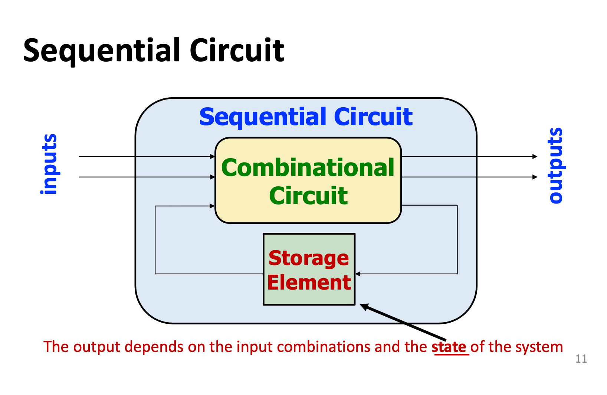

---

## 1. Storing 1 bit: from bistable to flip-flop (core chain)

This section is the foundation of the whole Set; each of the four elements fixes the defect of the previous one:

| Element | Inputs | Triggering | Fatal defect → motivates the next one |
|---|---|---|---|
| Cross-coupled inverter (bistable) | none | — | Has two stable states but **the state cannot be controlled** |
| SR Latch | S, R | level | S=R=1 is illegal; S/R control both "what to store" and "when to change" |
| D Latch | D, CLK | **level** (level-triggered) | While CLK=1, Q **keeps following changes in D** |
| D Flip-Flop | D, CLK | **edge** (edge-triggered) | (essentially no defect; the basic unit of registers) |

### 1.1 Bistable element
- The fundamental building block of storage: **a pair of inverters connected in a loop (cross-coupled inverters)**.
- Two stable states: Q=0 stays 0 forever, Q=1 stays 1 forever; Q and Q' are complementary.
- Defect: **the initial state at power-up is unpredictable**, and the user has no input to control it → not practical.

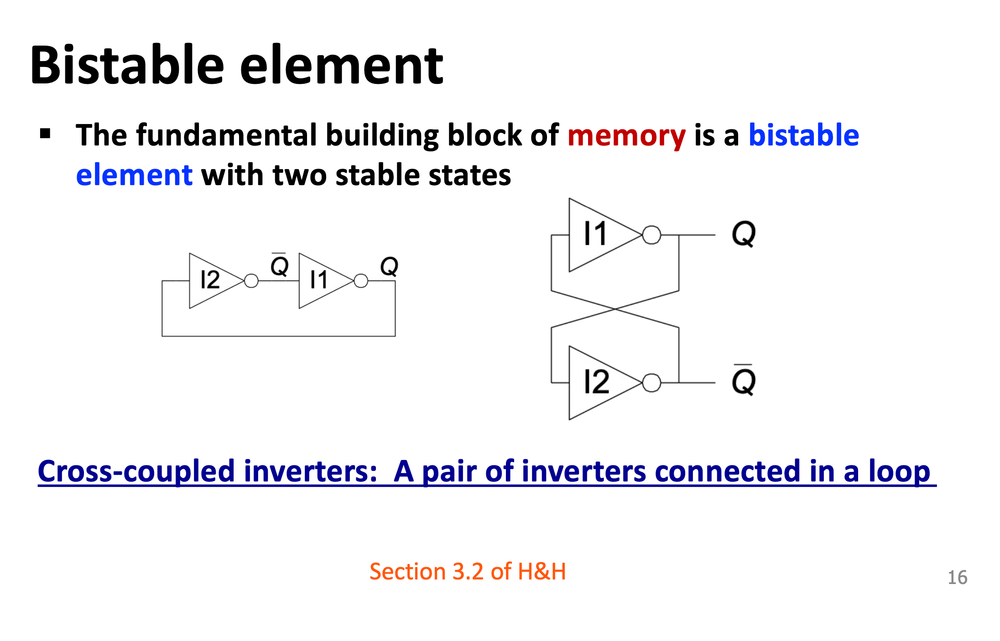

### 1.2 SR Latch
- Two cross-coupled **NOR** gates; S = Set (set to 1), R = Reset (set to 0).
- NOR review: both inputs 0 → output 1; any input 1 → output 0.

**SR Latch truth table (reconstructed, P25):**

| Scenario | S | R | Q | Q' |
|---|---|---|---|---|
| Sim-0 (hold) | 0 | 0 | Q_prev | Q'_prev |
| Reset | 0 | 1 | 0 | 1 |
| Set | 1 | 0 | 1 | 0 |
| **Sim-1 (illegal)** | 1 | 1 | **0** | **0** |

- **Often examined**: when S=R=1, Q and Q' are both 0, violating "complementary" — meaningless both intuitively and physically; it is an **illegal input to be avoided**.
- Q summarizes the whole history: only the **most recent** set/reset determines the future.

### 1.3 Discrete model of time (prerequisite for the D Latch)
- CS doesn't use continuous time; instead time is cut into **fixed-length, indivisible cycles**.
- **Clock**: a periodic square wave produced by a special circuit, used to **synchronize state updates across the whole system**.
- Terms: rising edge, falling edge, **Clock period Tc**.
- **Formula**: `Frequency = 1 / Tc`.
- **The world changes only at cycle boundaries (clock edges); within a cycle the world is static.**

### 1.4 D Latch
- Fixes the two SR defects: ① a single **D (data)** input determines "what the next state is"; ② **CLK** determines "when it changes".
- **Level-sensitive / level-triggered**:
  - **CLK = 1 → Transparent**, like a buffer, Q follows D.
  - **CLK = 0 → Opaque**, holds the old value, Q = Q_prev.
- Internal implementation: an SR latch preceded by an inverter, gated by CLK.

**D Latch truth table (reconstructed, P34):**

| Scenario | CLK | D | Q | Q' |
|---|---|---|---|---|
| Opaque | 0 | X | Q_prev | Q'_prev |
| Transparent/0 | 1 | 0 | 0 | 1 |
| Transparent/1 | 1 | 1 | 1 | 0 |

- **Defect**: while CLK=1, Q **keeps changing** → timing bugs, hard to analyze. We want the state to change **only at one instant**.

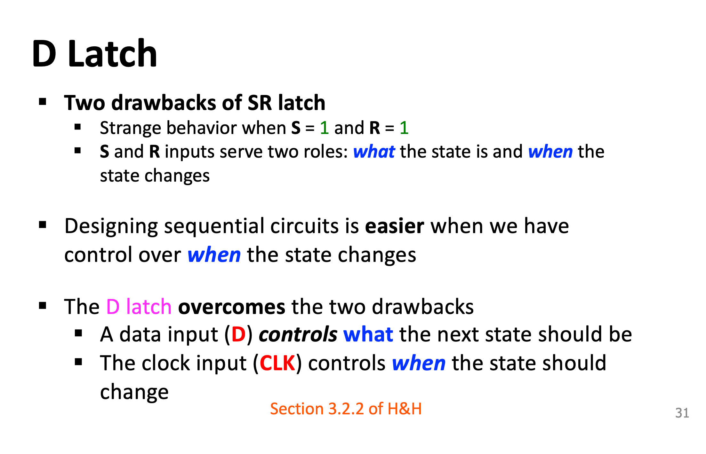

### 1.5 D Flip-Flop (key point)
- **Edge-triggered**: at the **instant CLK goes from 0 to 1**, D is sampled into Q; at all other times Q holds.
- **Photography analogy**: rising edge = pressing the shutter to take a picture (copying D into Q); D is ignored the rest of the time.
- **Internal structure = two back-to-back D latches with complementary clocks**:
  - **L1 = master**, **L2 = slave**.
  - CLK=0: master transparent, slave opaque → D passes to the middle node N1, but Q is cut off.
  - CLK=1: master opaque, slave transparent → N1 passes to Q, but N1 is cut off from D.
  - Net effect: **only the D just before the rising edge is copied to Q**.
- Aliases (all the same thing): master-slave FF, edge-triggered FF, positive edge-triggered FF.

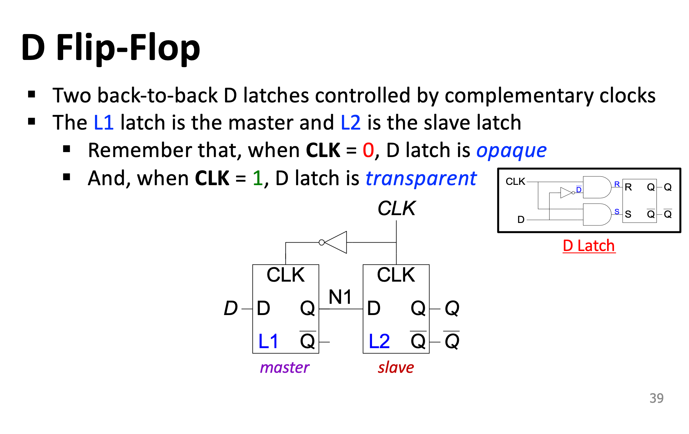

### 1.6 Remember the symbols
- **D Latch symbol**: a box, D on the left, CLK on top, Q/Q' on the right.
- **D Flip-Flop symbol**: a box, Q/Q' on the right, with a **triangle (edge) mark** on the clock input — this is the key to telling a latch from an FF.

---

## 2. Registers and Flip-Flop Variants

### 2.1 Register
- **Modularity principle**: to store multiple bits → use multiple flip-flops **sharing the same CLK**, written simultaneously.
- **Register width = number of FFs**. Typical: 8/16/32/64/…/512+ bits.
  - Wide registers are used for large numbers and floating point (which needs extra bits). 64-bit: high-performance computing/finance; 16-bit: microwaves, car ECUs.
- N-bit register = N FFs sharing CLK. Data is written `Q[3:0]`; a thick line + slash `/4` denotes a 4-wire bus.

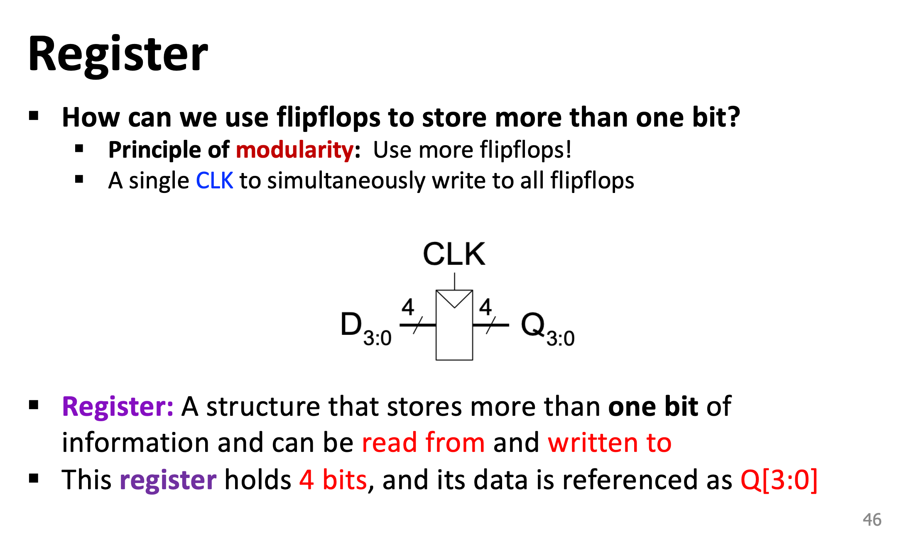

### 2.2 Three flip-flop variants
- **Enabled FF**: an extra **EN** input. When EN=1 it samples D on the rising edge; when EN=0 it holds.
  - Internally often uses **clock gating**: `CLK AND EN`. **⚠️ Doing logic on the clock is a cardinal sin** — the AND gate delays the clock; if EN changes while CLK=1 it produces a glitch (toggling at the wrong time).
- **Resettable FF**: an extra **RESET** input. RESET=1 → ignore D, output set to 0. Split into **synchronous reset** (only at clock edges) and **asynchronous reset** (immediate).
- **Settable FF**: an extra **SET** input. SET=1 → Q set to 1.

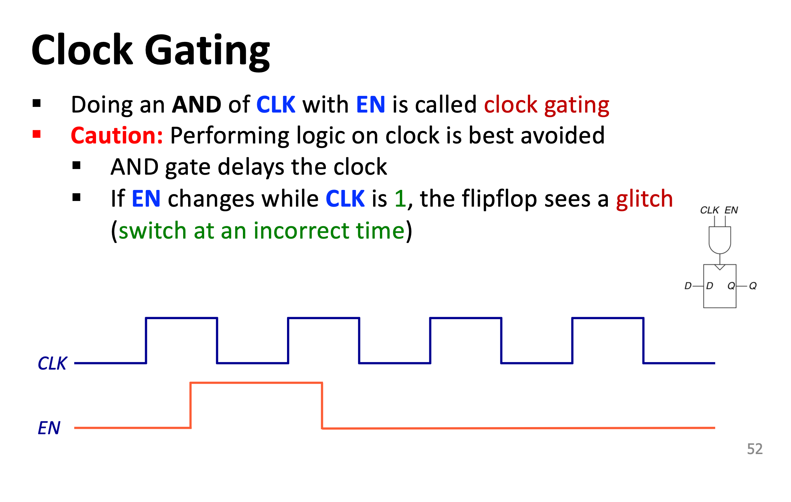

### 2.3 Latch vs Flip-flop timing example (exam prototype ⭐)
Given the CLK and D waveforms, draw Q(Latch) and Q(Flipflop):
- **Latch (transparent when CLK=1)**: during CLK high, Q **keeps following D**.
- **Flip-flop (edge sampling)**: takes D only once at the **rising edge** and holds it within the cycle.
- The two differ when D changes during CLK high — that is exactly the exam point.

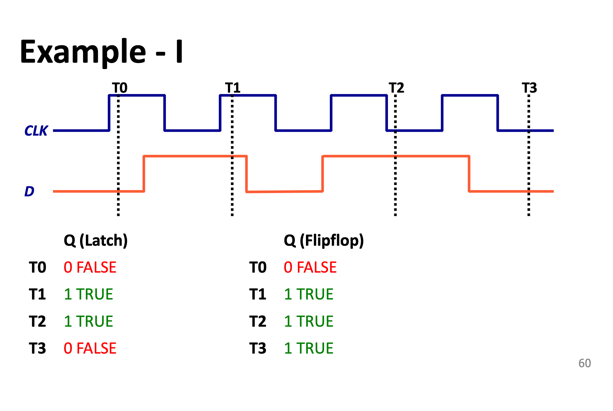

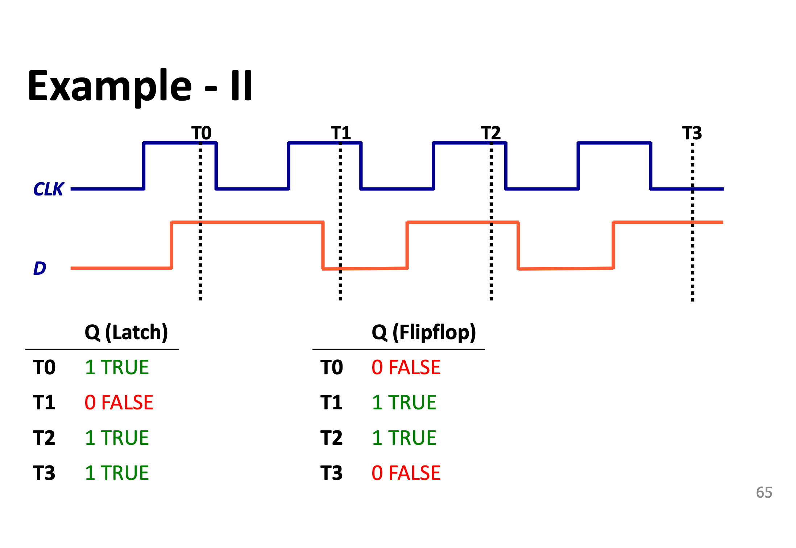

---

## 3. Memory (Memory Arrays)

### 3.1 Core concepts (must memorize)
- **Address = naming/identification scheme**; **Data = the information stored in a location**. The two are opposites.
- Three parameters that define a memory: ① how many locations? ② how many bits per location? ③ what technology stores them?
- **Number of address bits = log2(number of locations)**. Example: 4 locations → 2-bit address.
- **Addressability = number of bits stored per location** (8 bits in the example).
- **Address space = the set of all unique locations**.
- Almost all modern computers are **byte-addressable**; typical sizes are billions of locations.
  - Example: 2 billion locations × 8-bit → 2 GB address space.

**Example memory array (reconstructed, P71):**

| Address | Data |
|---|---|
| 00 | 0100 1001 |
| 01 | 0100 1011 |
| 10 | 0010 0010 |
| 11 | 1100 1001 |

### 3.2 Circuit implementation of read/write
- Each "box" is a **bit cell** (stores 1 bit, similar to an enabled FF, with input Di and output D).
- **Read**: the **Address Decoder** decodes the address into one **wordline** (selects one row) → the cells of that row drive their values to the outputs → a **Multiplexer (working with the decoder)** selects the corresponding column.
- **Write**: set **WE (Write Enable)** = 1 and send **Di** to the D/EN of the selected cell.
- **Full Memory Array** = supports both read and write (WE + Addr + Di + D output).

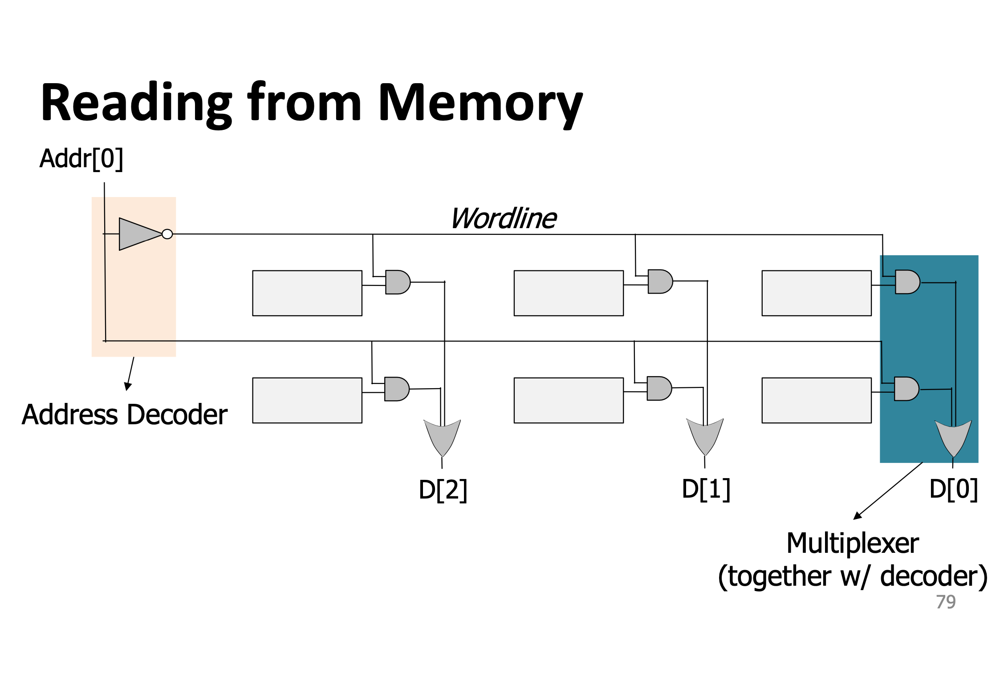

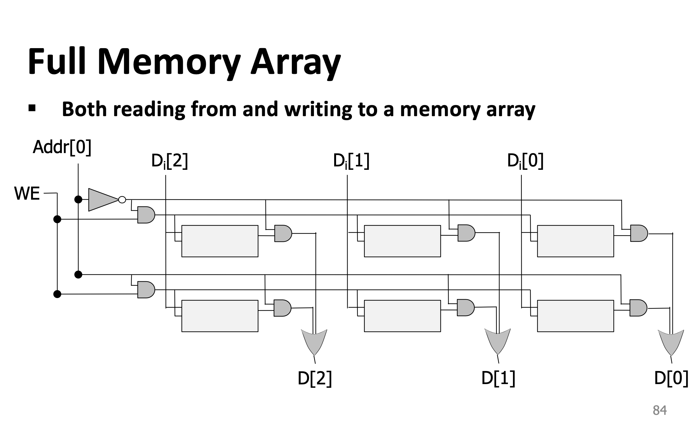

### 3.3 Bigger arrays & multiple ports
- **Bigger array (4 locations × 3 bits)**: 2-bit address `Addr[1:0]`, decoder selects the row, MUX selects the output.
- **Multi-Ported Memory**: one port = one read/write access. Common configuration: two read ports (A1/RD1, A2/RD2) + one write port (A3/WD3), supporting **simultaneous access to multiple addresses**. This is the prototype of the register file.

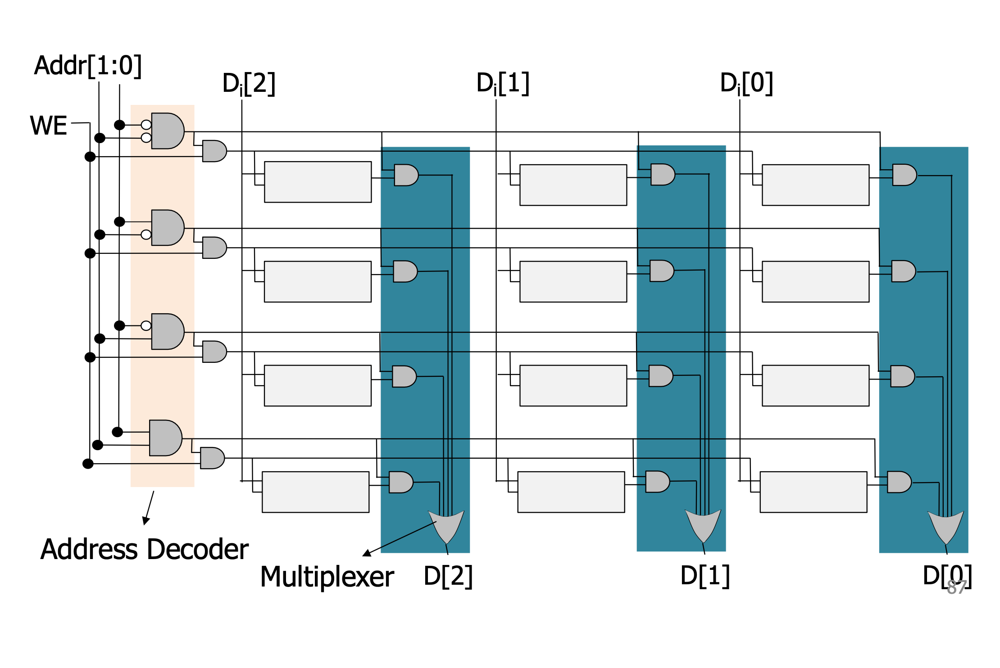

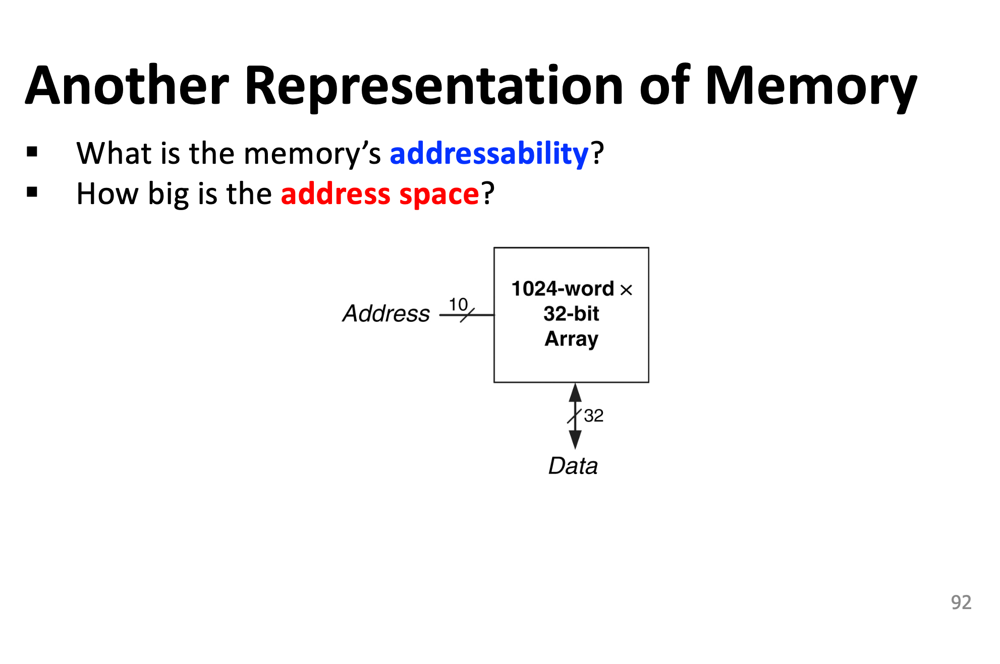

---

## 4. Sequential Logic: State, Clock Discipline, and "Why You Can't Wire Things Arbitrarily"

### 4.1 State and state diagrams
- **State = a snapshot of all relevant elements of the system at an instant**.
- Example (combination lock R13-L22-R3): state A (locked, no action) → B (R13 done) → C (R13-L22 done) → D (unlocked). Any wrong step returns to A.
- A **state diagram** fully describes system behavior (locks, vending machines, traffic lights can all be drawn).

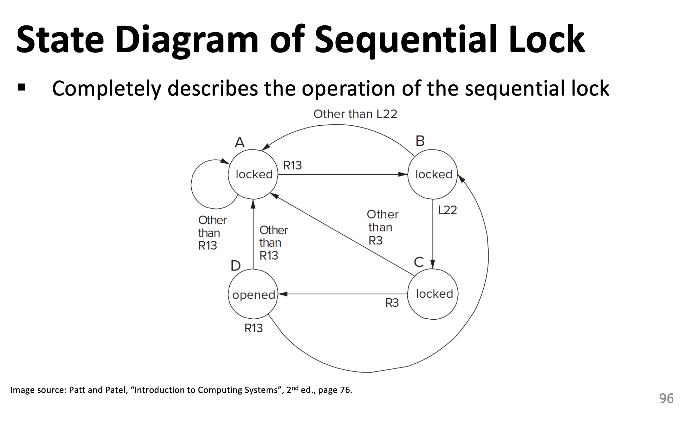

### 4.2 Asynchronous vs synchronous (core distinction)
| | Asynchronous | Synchronous |
|---|---|---|
| When state transitions happen | **Any time** an event occurs, no synchronizing signal | At **fixed intervals**, triggered by a **clock** |
| Examples | Combination lock, vending machine | Modern computers |
| Tradeoff | More efficient (no clock overhead) | **Easier to get right** with many components and states |

**This course always assumes synchronous systems.**

- Role of the clock: ① decides **when** to change state; ② **synchronizes** state changes across many sequential elements; ③ combinational logic evaluates within one cycle → **the clock period must accommodate the maximum combinational delay**.

### 4.3 Why arbitrary (asynchronous) circuits are a bad idea
- **Cyclic path**: an output fed directly back to an input. **Combinational logic has no cyclic paths** (outputs settle after the propagation delay).
- Two counterexamples:
  - **Ring Oscillator**: an odd number of inverters in a loop, no stable state (astable), X oscillates between 0/1. If each inverter has 1 ns delay and there are 3 inverters → clock period 6 ns (one round trip each way).
  - **Asynchronous D Latch**: if `t_INV >> t_AND, t_OR`, N1 and Q may fall before CLK changes → Q stuck at 0 → **race condition**.
- **Conclusion**: a circuit with cyclic paths = an asynchronous circuit: hard to analyze, has races/oscillation, and fails when conditions change.

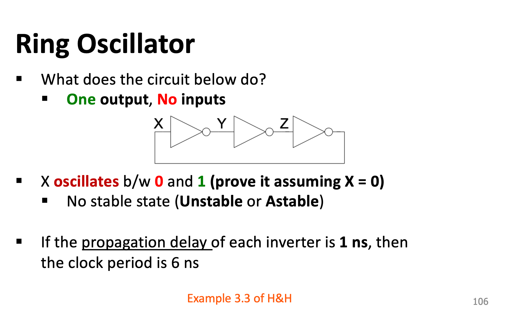

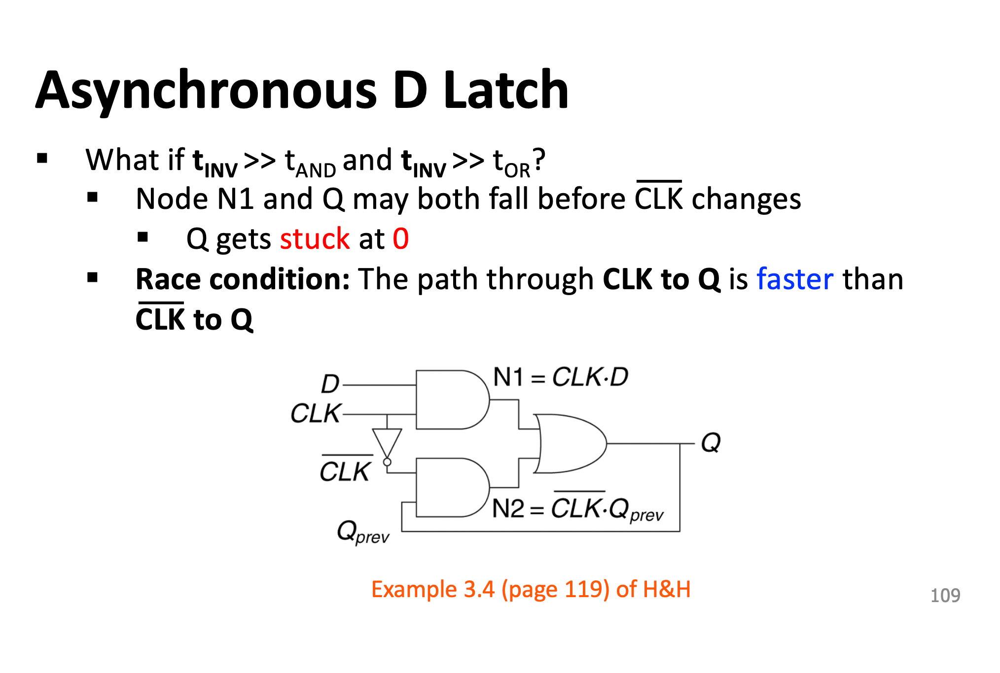

### 4.4 Synchronous sequential circuits + composition rules (must memorize)
- **Solution**: **insert a register** into the cycle to break it. A register holds state and is synchronized by the clock.
- **Overall rule**: as long as the clock is slow enough for all register inputs to settle before the next clock edge, all races are eliminated.
- **Composition Rules (4 rules):**
  1. Every element is **either a register or a combinational element**.
  2. There is **at least one** register.
  3. **All registers receive the same clock** signal.
  4. **Every cyclic path contains at least one register**.

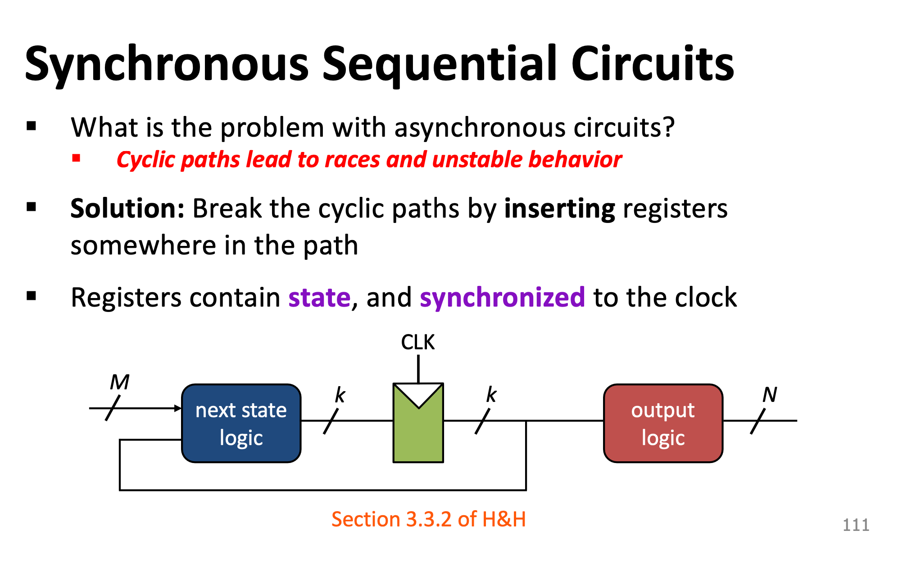

---

## 5. Finite State Machines (FSM) (the main event of this Set)

### 5.1 What an FSM is & its five elements
- **FSM = a discrete-time model of a stateful system**: a finite number of states + transitions between them. Can model traffic lights / elevators / microwaves / CPUs, etc.
- **Five elements**: ① a finite set of states; ② a finite set of external inputs; ③ a finite set of external outputs; ④ an explicit specification of all state transitions; ⑤ an explicit specification of what determines each output value.

### 5.2 Three components & Moore vs Mealy (must-know distinction)
Three parts of an FSM: **next state logic (combinational) + state register (sequential) + output logic (combinational)**.
- **state register**: stores the current state S at the clock edge and supplies it for computing the next state S'.
- **The two kinds of FSM differ in the output logic**:

| | Moore | Mealy |
|---|---|---|
| Output depends on | **Only the current state** | **Current state + inputs** |
| Output response speed | One cycle slower (waits for the state to change) | **One cycle faster** (responds directly to inputs) |
| Number of states | More | **Fewer** |
| State diagram labeling | Output labeled **inside the state circle** | Output labeled **on the transition arrow (arc)** |

- To align a Mealy output with Moore: add a flip-flop after the Mealy output to delay it by one cycle.
- Which to choose depends on "when you want the output to respond".

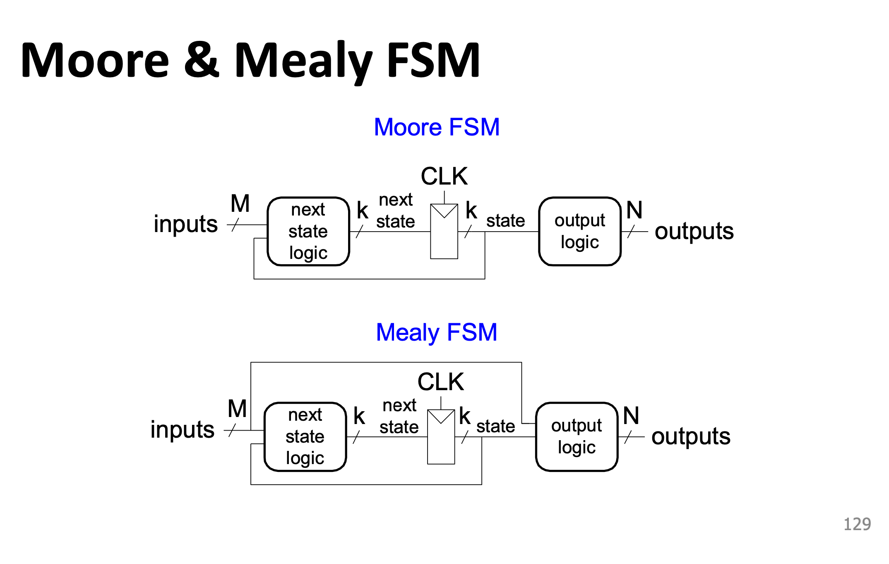

### 5.3 Why the state register must use flip-flops, not latches
- Requirement: data must be **available for the whole clock cycle** (so the combinational logic has enough time to process it).
- **Latches don't work**: when CLK=1 a latch is transparent, D passes straight through to Q → the state changes erratically within the cycle (undesirable).
- **Flip-flops are right**: D becomes visible at Q only **at the start of the next cycle**, and Q is **stable for the whole cycle**.

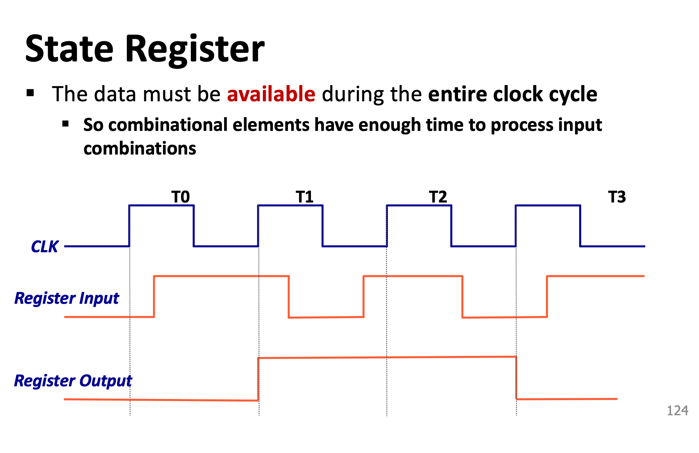

---

## 6. Complete Example: Smart Traffic Light FSM (H&H 3.4.1, through the whole flow)

**Spec**: 2 inputs `TA, TB` (TRUE if there are cars); 2 outputs `LA, LB` (red/yellow/green). The state may change every 5 seconds, **unless the light is green and there are cars, in which case it stays green**.

**Four states**: S0 (LA green / LB red), S1 (LA yellow / LB red), S2 (LA red / LB green), S3 (LA red / LB yellow).

### 6.1 State Transition Diagram ⭐
- Moore type: outputs labeled inside the circles; arrows = transitions, labeled with input conditions.
- Logic: in S0, if there are A cars (TA) stay in S0, otherwise → S1; S1 → S2; in S2, if there are B cars (TB) stay in S2, otherwise → S3; S3 → S0.

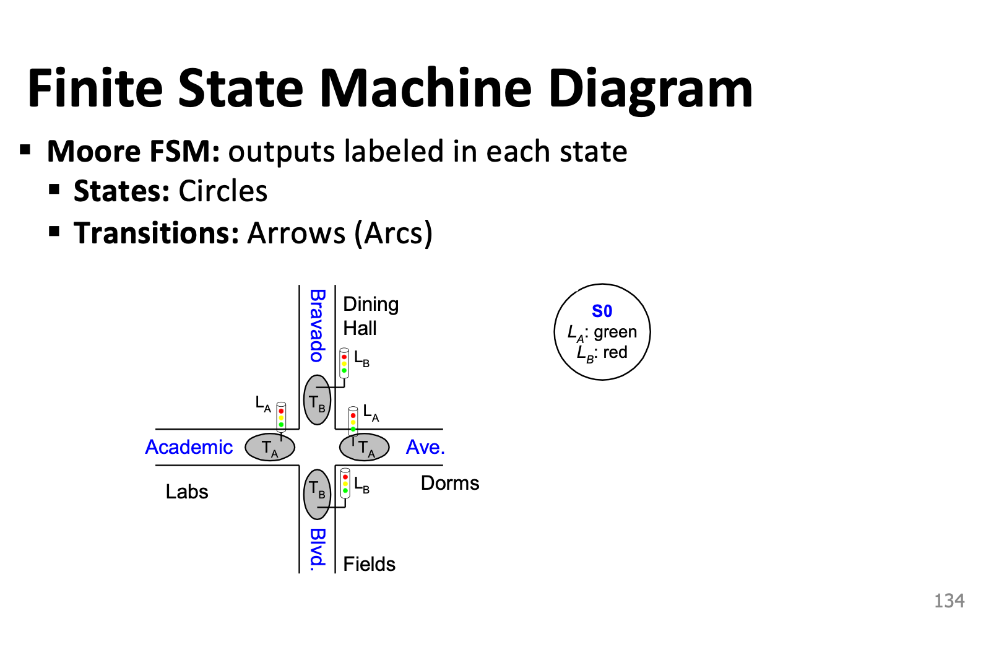

### 6.2 State transition tables (reconstructed)

**Symbolic table (P141):**

| Current S | TA | TB | Next S' |
|---|---|---|---|
| S0 | 0 | X | S1 |
| S0 | 1 | X | S0 |
| S1 | X | X | S2 |
| S2 | X | 0 | S3 |
| S2 | X | 1 | S2 |
| S3 | X | X | S0 |

**State encoding**: S0=00, S1=01, S2=10, S3=11.

**Encoded transition table (P143):**

| S1 | S0 | TA | TB | S'1 | S'0 |
|---|---|---|---|---|---|
| 0 | 0 | 0 | X | 0 | 1 |
| 0 | 0 | 1 | X | 0 | 0 |
| 0 | 1 | X | X | 1 | 0 |
| 1 | 0 | X | 0 | 1 | 1 |
| 1 | 0 | X | 1 | 1 | 0 |
| 1 | 1 | X | X | 0 | 0 |

**Next state equations (P148, simplified):**
```
S'1 = S1 ⊕ S0
S'0 = (~S1 · ~S0 · ~TA) + (S1 · ~S0 · ~TB)
```

### 6.3 Output table (reconstructed)

**Output encoding**: green=00, yellow=01, red=10.

| S1 | S0 | LA1 | LA0 | LB1 | LB0 | Meaning |
|---|---|---|---|---|---|---|
| 0 | 0 | 0 | 0 | 1 | 0 | S0: LA green, LB red |
| 0 | 1 | 0 | 1 | 1 | 0 | S1: LA yellow, LB red |
| 1 | 0 | 1 | 0 | 0 | 0 | S2: LA red, LB green |
| 1 | 1 | 1 | 0 | 0 | 1 | S3: LA red, LB yellow |

**Output equations (P155):**
```
LA1 = S1
LA0 = ~S1 · S0
LB1 = ~S1
LB0 = S1 · S0
```

### 6.4 Full Schematic ⭐
Connect the three parts above: inputs → **next state logic** → **state register** (2 FFs, S'1/S'0 → S1/S0, with Reset) → **output logic** → outputs.

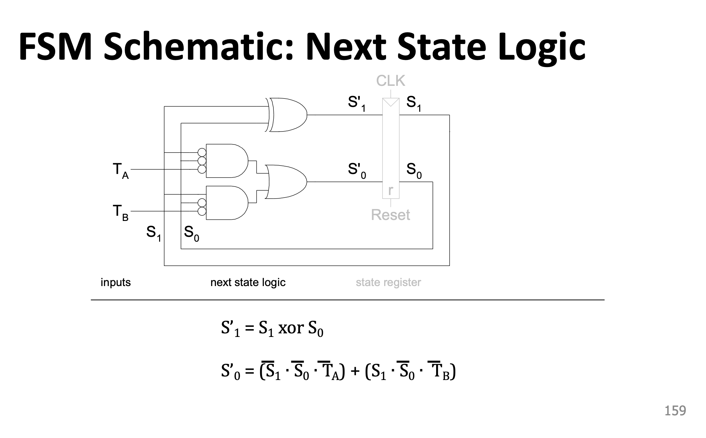

### 6.5 Timing Diagram ⭐
10 cycles, showing how CLK / Reset / TA / TB / S' / S / LA / LB evolve cycle by cycle (note that S' leads S by one cycle, and the outputs change with S). This is the key figure that ties "state diagram + tables + circuit" together for verification, and is **very likely to be examined**.

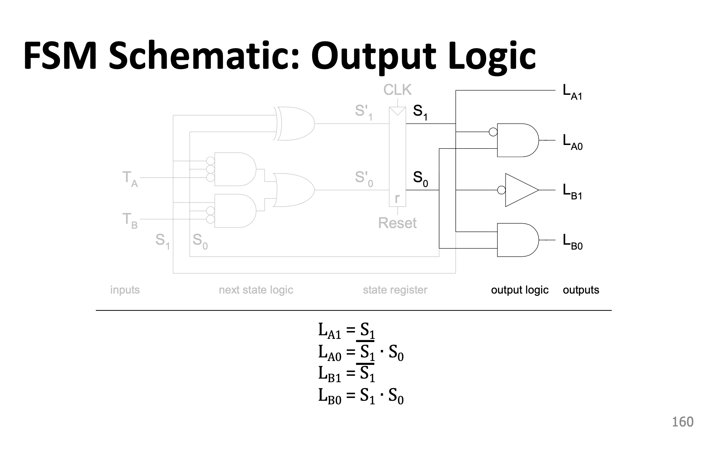

- **Synchronizer**: ensures that **asynchronous inputs** such as traffic sensors are sampled only at clock edges, avoiding metastability.

---

## 7. State Encoding

| Scheme | Number of bits | Characteristics |
|---|---|---|
| **Binary / Full Encoding** | log2(number of states) | **Fewest FFs**; but the next state / output logic isn't necessarily simplest. E.g. 00, 01, 10 |
| **One-Hot Encoding** | = number of states (exactly 1 bit is 1) | **Most FFs**, but **simplest next state logic**, easiest to synthesize automatically. E.g. 0001, 0010, 0100, 1000 |

- **The point of one-hot**: trade space (more register bits) for simpler, faster state transition logic; **especially common in FPGAs**, because the logic structure is easier to synthesize.
- Designers must **weigh and choose** an encoding scheme under the given constraints.

---

## 8. Other FSM Topics

### 8.1 Divide-by-N Counter
- No inputs, one output Y; Y is **high for 1 cycle** every N clock cycles → **divides** the clock frequency **by N** (N=3 in the example).
- Can be implemented with binary and with one-hot encoding; compare the two sets of transition/output tables and circuits.

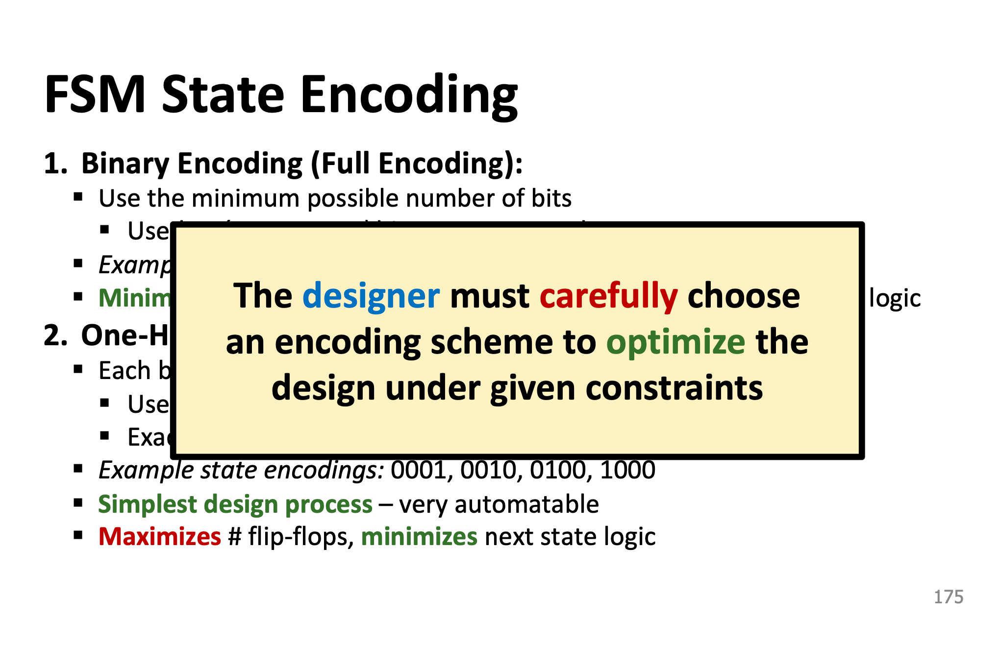

### 8.2 Moore vs Mealy example (the snail problem)
- Alyssa's snail crawls along a paper tape of 0/1s and **smiles when the last two bits are `01`**. Design a Moore FSM and a Mealy FSM.
- **Observations**: the Mealy output comes **one cycle earlier** (responds to the input rather than waiting for the state to change); Mealy has **fewer states**; Mealy outputs are labeled **on the arrows**.

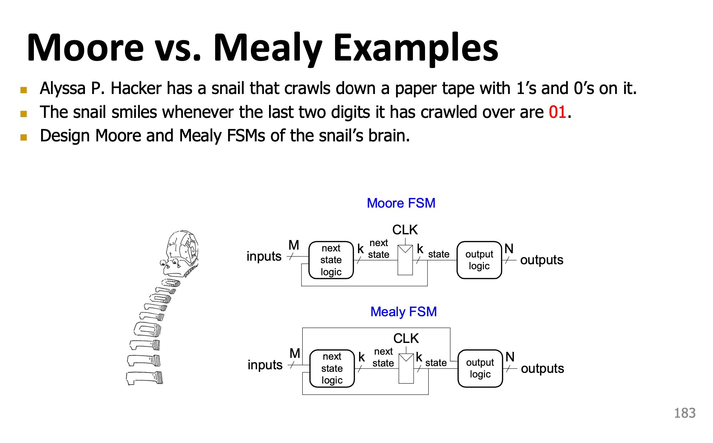

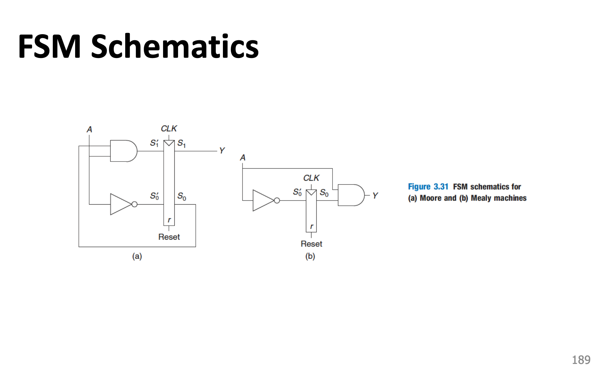

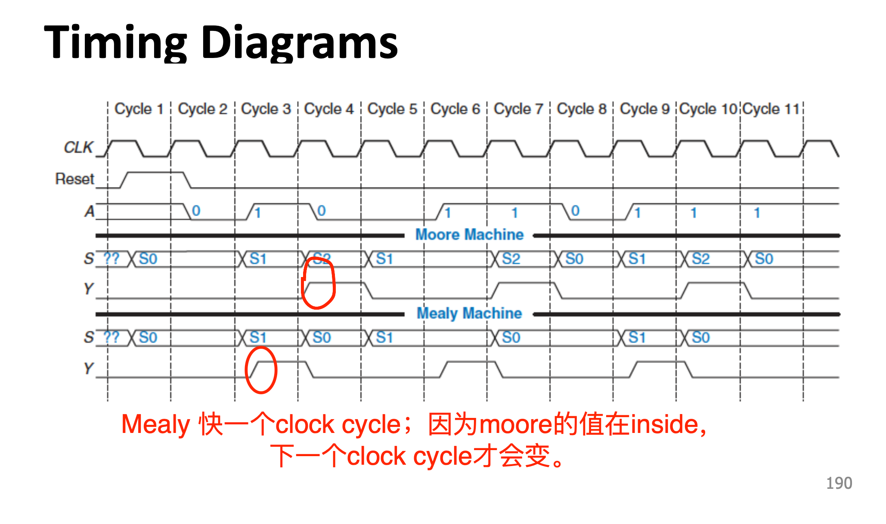

### 8.3 Deriving an FSM from a circuit (reverse engineering)
Given an FSM circuit, work back to the FSM diagram. Steps:
1. Determine the type (does the output depend on inputs → Moore/Mealy).
2. Derive the next state and output **equations**.
3. Build a **simplified truth table** from the equations.
4. Guess the binary encoding and name the states.
5. Build the **output table** with state labels.
6. Draw the FSM diagram.

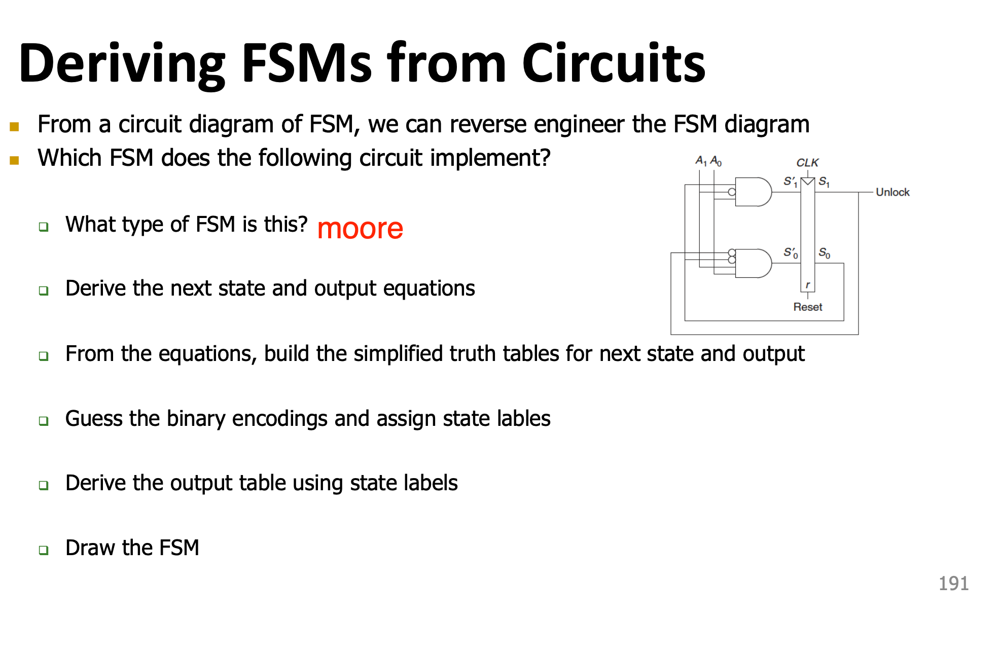

### 8.4 FSM design procedure (forward, must memorize)
1. **Draw the state transition diagram**: formalize and disambiguate the written spec. (Fix the reset state first, then add transitions step by step; **choosing good state names matters**.)
2. **Derive the next state logic**: binary state encoding → transition (truth) table → simplified next state equations.
3. **Derive the output logic**: output encoding → output table → equations.
4. **Turn the equations into logic gate circuits** (next state + output).
> Tip: building an FSM is like programming (there is control flow, and if-then-else controlled by inputs), but **it is not programming**; hardware usually has many concurrent FSMs.

---

## 9. Timing Parameters (Timing, H&H 3.5)

Understand three key quantities (all because "outputs don't change instantly, and inputs must stay stable to be sampled reliably"):

| Parameter | Definition |
|---|---|
| **t_pcq** (Clock-to-Q propagation delay) | Time after the clock rises for the output to **settle to its final value** |
| **t_setup** (Setup time) | Minimum time **before** the rising edge that the input must already be stable |
| **t_hold** (Hold time) | Minimum time **after** the rising edge that the input must remain stable |
| **Aperture time** | = t_setup + t_hold, the total time the input must remain stable |

- **Technology assumption**: modern FFs have t_hold ≈ 0, so hold time can be ignored in later discussion.
- **Clock period (formula to memorize)**:
```
Tc = t_pcq + t_pd + t_setup
```
where t_pd = propagation delay of the combinational circuit (next state logic). "It has to be this slow for the circuit to be stable."
- **Sequencing overhead = t_pcq + t_setup**: ideally the whole cycle should do useful work (combinational processing), but the FF timing overhead eats into it.

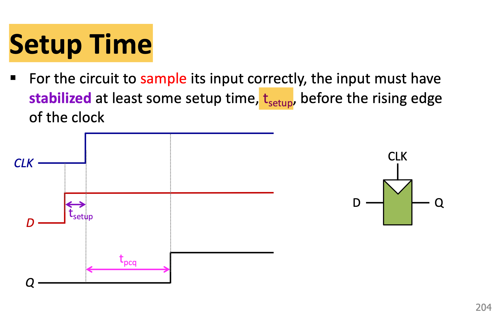

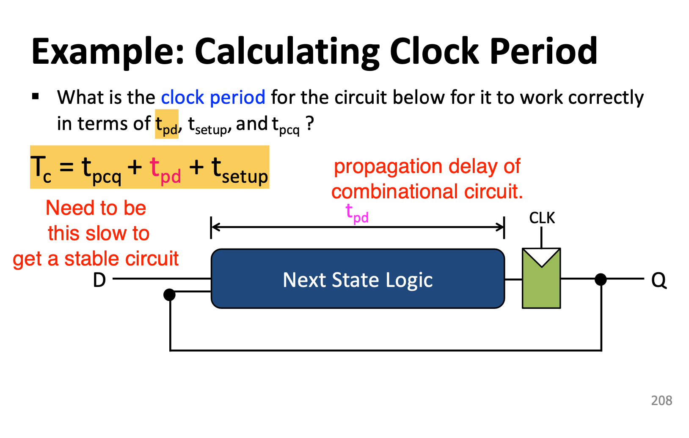

---

## 10. Storage Elements: SRAM / DRAM (H&H 5.5)

### 10.1 Motivation and three-level comparison (must memorize)
FFs/registers suit "storing while processing", but sometimes we only need **lots of storage** (main memory, USB drives, SSDs, disks), and can use cheaper elements that **store asynchronously**.

| Type | Speed | Cost/bit | Key characteristics |
|---|---|---|---|
| Latch / Flip-Flop | Very fast | Very expensive (~20+ transistors) | Used for registers inside the CPU |
| **SRAM** (Static RAM) | Fairly fast | Expensive (**6T**) | Bit stored in **cross-coupled inverters**; non-destructive read |
| **DRAM** (Dynamic RAM) | Slow | Cheap (**1T1C**: 1 transistor + 1 capacitor) | **Destructive read**, needs **refresh**; needs a special fabrication process |

### 10.2 General storage organization
- **Bit cell**: stores 1 bit. The **Wordline** selects (enables) a whole row; the **Bitline** is used to read out/write that bit.
  - It's called a word line because it addresses one "word" of a whole row — the whole row is read/written together.
- **General memory organization**: the decoder decodes the address → selects a wordline; a MUX (or **tri-state buffer**) selects the output bitline.
- **Tri-state Buffer review**: conducts when E is high; when E is low the output is **floating (Z)** (not driven by any circuit). A pair of tri-state buffers lets a bitline be both read and written.
- **Read/write sequencing**:
  - **READ**: raise the wordline first; the selected row drives the bitlines to H/L.
  - **WRITE**: drive the bitlines to H/L first, then raise the wordline to store the value into that row's cells.

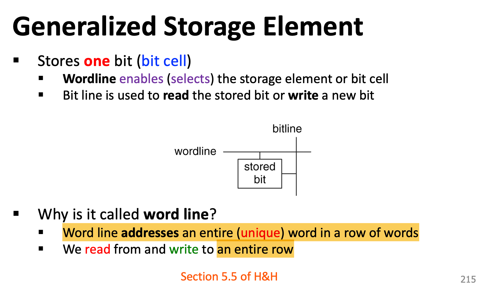

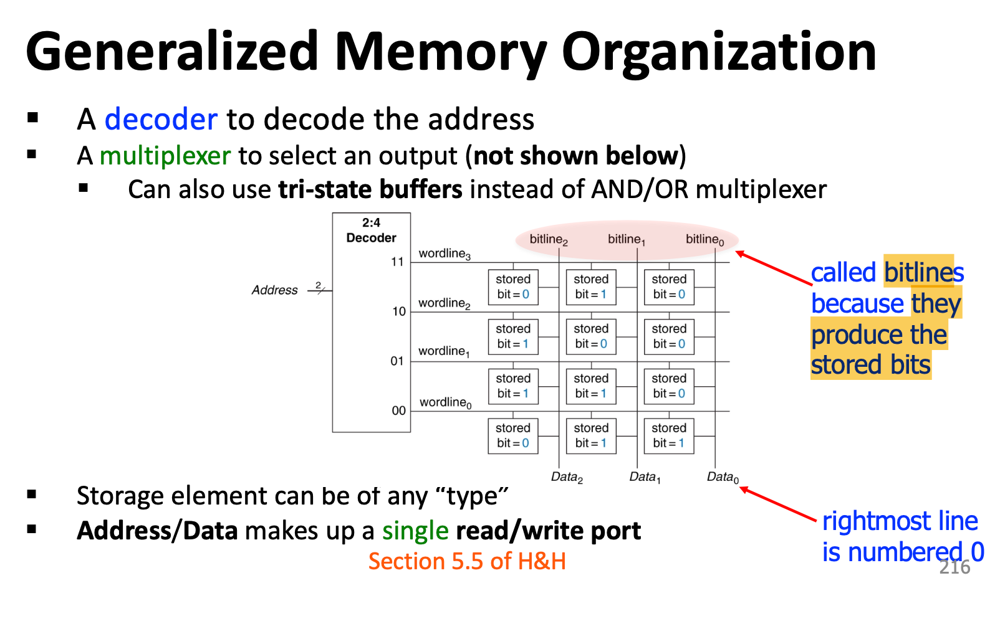

### 10.3 SRAM Bit Cell (6T) ⭐
- Data is stored in **cross-coupled inverters**; two outputs: **bitline** and **~bitline**.
- **6T** = cross-coupled inverters (4 transistors) + 2 nMOS access transistors.
- When the wordline is high, the two nMOS turn on and data moves between the cell and the bitlines.

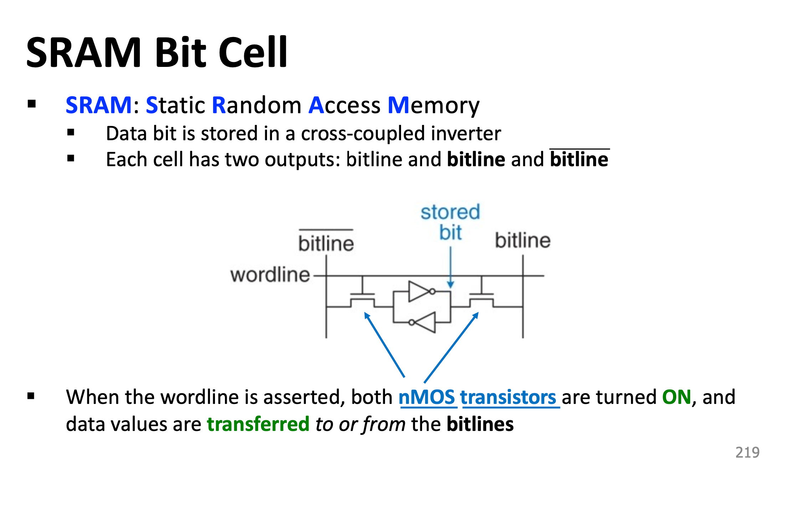

**MOS NOT gate review (reconstructed, P221):** 0V = logic 0, 3V = logic 1, `Y = ~A`.

| A | P (pMOS) | N (nMOS) | Y |
|---|---|---|---|
| 0 | ON | OFF | 1 |
| 1 | OFF | ON | 0 |

### 10.4 DRAM Bit Cell (1T1C) ⭐
- Stores 1 bit as **the presence or absence of charge on a capacitor**; an nMOS acts as a switch connecting/disconnecting the capacitor to/from the bitline.
- **The essential difference between Static and Dynamic**: SRAM nodes are **actively driven** by cross-coupled inverters connected to the power supply; the DRAM capacitor node is **not actively driven** → the charge leaks.
- **Read**: charge moves from the capacitor to the bitline → **destroys the original value → must be rewritten (restored) after reading**.
- **Refresh**: even without reads, each cell must be read + rewritten **every few milliseconds** (the charge gradually leaks) → extra energy + expensive circuitry, a key drawback of DRAM (especially at large capacities). This is also why it's called "dynamic".
- **Write**: the value moves from the bitline to the capacitor.

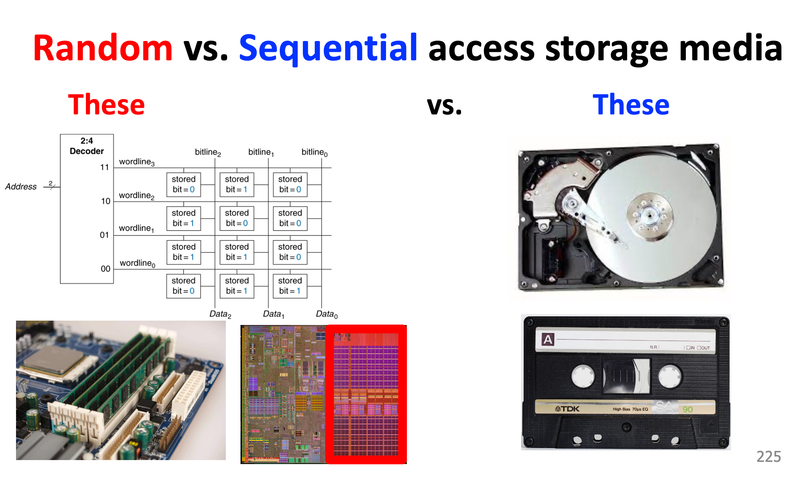

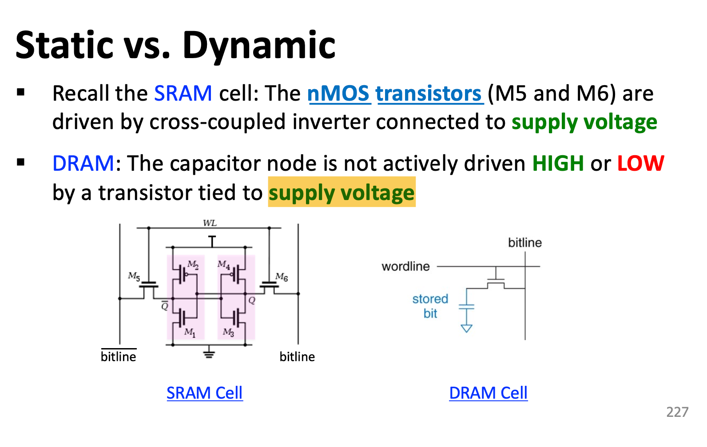

### 10.5 RAM, sequential-access media, and the storage hierarchy
- **RAM (Random Access Memory)**: byte-addressable; any data word can be **accessed independently**, and **every word has the same access latency**.
- **Sequential-access media** (in contrast to RAM):
  - **Cassette/tape**: nearby data is fast to get, but **you must rewind from the start to read** → inherently sequential.
  - **Hard disk (HDD)**: spinning platters + an arm; nearby is fast, the platter must rotate under the arm to be read → inherently sequential.
- **Memory Hierarchy**:
  - **On** the CPU chip: flip-flops (registers) + SRAM (cache).
  - **Off** the CPU chip: DRAM (DIMM memory modules).
  - **Volatile (lost when power is off)**: SRAM, DRAM. **Non-volatile (retained without power)**: e.g. the medium a photo album stores photos on.

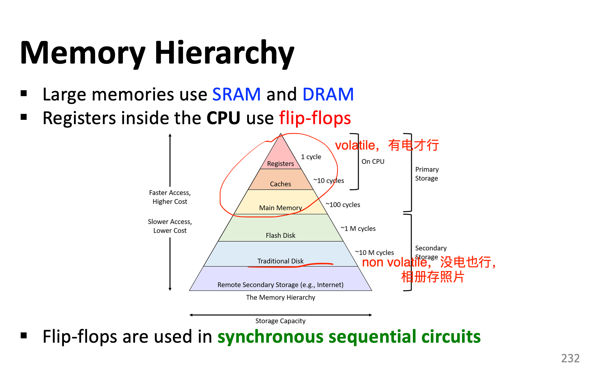

