# COMP2300 Set 4 Notes — The Architecture Layer: the Von Neumann Model, ARM ISA, and the Single-Cycle Microarchitecture

> **Course**: ANU COMP2300 — Computer Organisation and Program Execution
> **Lecturer**: Shoaib Akram
> **This set in one sentence**: Starting from the Von Neumann execution model, explain **what an ISA is** (ARM/QuAC instructions, formats, addressing modes, conditional execution, branches, C→assembly translation), then explain **how to implement it in hardware** (single-cycle datapath + control unit + critical path performance analysis)

---

## 0. Skeleton of this set

```
Von Neumann model (5 components)
   ↓
ISA = instruction set + architectural state
   ↓  (ARM / QuAC / MIPS / LC-3 compared)
Instruction cycle (FETCH → ... → STORE RESULT)
   ↓
ARM assembly: DP instructions / memory instructions / conditional execution / branches / the three C constructs / arrays / shifts / characters
   ↓
ISA tradeoffs (RISC vs CISC, semantic gap, addressing modes)
   ↓
Microarchitecture: single-cycle datapath + control unit
   ↓
Performance analysis: Execution time = N × CPI × Tc
```

---

## 1. The Von Neumann Model

### 1.1 Five components (1946, Burks/Goldstine/von Neumann)

| Component | Responsibility | Key registers |
|---|---|---|
| **Memory** | Stores **program + data** (unified, not separated) | MAR, MDR |
| **Processing Unit** | Does the actual computation | ALU + register file (TEMP) |
| **Control Unit** | Controls the order of instruction execution | **PC** (=IP), **IR** |
| **Input** | Keyboard, mouse, disk… | KBDR, KBSR |
| **Output** | Monitor, printer, disk… | DDR, DSR |

> All general-purpose computers today use this model.

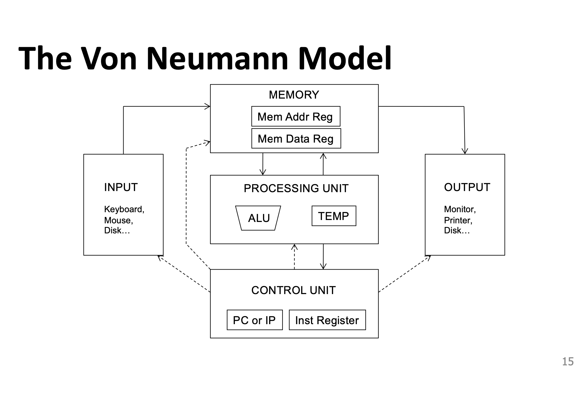

### 1.2 Two key properties ⭐ must-know for the exam

1. **Stored program**
   - Instructions are stored in a **linear memory array**
   - **Instructions and data share the same memory** (unified)
   - **Whether a stored value is an instruction or data depends on the control signals** — this is the key point; it is not "tagged" in memory
2. **Sequential instruction processing**
   - One instruction is processed at a time (fetch → execute → complete)
   - The PC identifies the current/next instruction
   - The PC advances sequentially, **unless a control transfer instruction is encountered**

(P56 and P131 are the same slide, repeated for emphasis.)

---

## 2. ISA vs. Microarchitecture ⭐ core concept distinction

This is the most likely conceptual question in this set.

| | **ISA (Architecture)** | **Microarchitecture** |
|---|---|---|
| What it is | **Specification / interface** | **Implementation** (organization + hardware) |
| Analogy | Gas pedal = the interface for "accelerate" | Engine internals = how "accelerate" is implemented |
| Includes | Instructions and their binary encodings, the **semantics** of each instruction, word size, number of registers, memory addressability | Ripple-carry vs carry-lookahead adder; mux vs tri-state buffer; SOP vs minimal Boolean expression; NAND only vs AND/OR/NOT |
| Relationship | **One ISA → many microarchitectures** | Changes quickly |
| Rate of change | Designed once + incremental changes; only a handful of ISAs in the world | Changes every generation |

**Key insight**: the design of the ISA determines whether circuits at the microarchitecture level are simple or complex.

**Who needs to know the ISA?**
- Programmers (to convey intent to the hardware)
- Computer architects (to build circuits that execute these instructions)
- **Compiler writers** — the ISA specifies **everything** one needs to know to translate C/C++/Rust into machine code

### 2.1 The 4 ISAs you'll meet at ANU

| ISA | Role | Word size | Registers | Where it's used |
|---|---|---|---|---|
| **QuAC** | ANU's own teaching ISA | 16 bit | 8 GPRs (one undefined) | tutorials + Assignment 1 |
| **MIPS** | The pioneering RISC (John Hennessy) | 32 bit | 32 GPRs (5-bit numbers) | breadth only |
| **ARM** | Mainstream RISC (Advanced RISC Machines), the de facto standard for handheld devices | ARMv4: 32 bit (v8: 64) | 16 GPRs R0–R15 (4-bit numbers) | main lecture thread + Assignment 2 |
| **LC-3** | Little Computer 3, a teaching ISA | 16 bit | 8 GPRs | instruction cycle examples |

### 2.2 What exactly an ISA specifies ⭐

**ISA = instruction set + architectural state**

- **Instruction set**
  - Opcodes (what to do)
  - Operands (what to do it to)
  - **Data types** (e.g. 2's complement, bit vector)
  - **Addressing modes** (addressing mode = the formula for computing an operand)
  - **Instruction formats**
- **Architectural State (programmer-visible state)**
  - **Memory**
  - **Register set**
  - **Program Counter**

> **Meta point**: the architectural state is part of the ISA specification. These three are exactly what a programmer can manipulate by writing machine code.

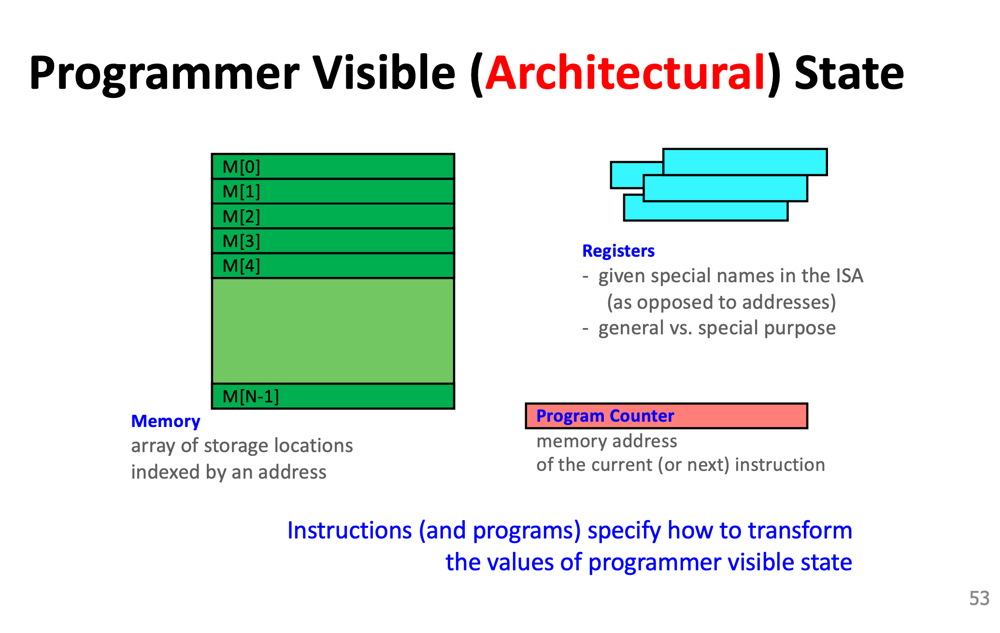

---

## 3. Memory Organization

### 3.1 Address space vs addressability ⭐ must distinguish

| Term | Definition | Examples |
|---|---|---|
| **Address space** | The **total number of locations** that can be uniquely identified | MIPS: 2³²; ARM: 2³² or 2⁴⁸; x86-64: up to 2⁴⁸ |
| **Addressability** | **How many bits are stored at each address** | byte-addressable (8 bit), word-addressable |

- **Word-addressable**: each data word has a unique address. QuAC is word-addressable (16-bit words)
- **Byte-addressable**: each byte has a unique address. **MIPS and ARM are both byte-addressable**
- The same-size memory made bit-addressable: 8 locations × 8 bits → 64 locations, each storing 1 bit

### 3.2 Big/Little Endian

- Origin: Gulliver's Travels, cracking eggs from the big end / the little end
- **The difference is only the numbering order of the 4 bytes within a word**; the word's address doesn't change
- **Does it matter? Answer: no, it's just a convention** — except when exchanging data between machines / casting pointer types

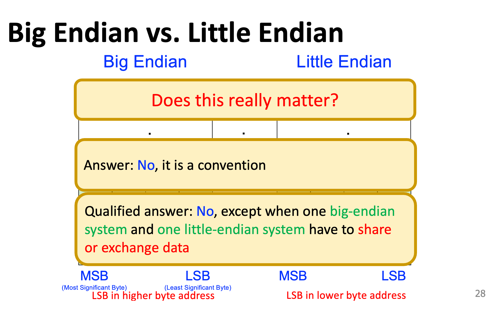

### 3.3 MAR / MDR — the two registers for memory access ⭐

| | Step 1 | Step 2 |
|---|---|---|
| **Read (load)** | MAR ← address to read | Memory places the data at that address into **MDR** |
| **Write (store)** | MAR ← address, MDR ← data | Assert **Write Enable** → MDR's value is written to the address in MAR |

> **Mnemonic (P175 verbatim)**: "brackets mean an address". `[R1]` → R1 is a **pointer**; `[PC]` → fetch an instruction.
> The same memory stores both instructions and data; the only difference is **who is using it**.

---

## 4. The Processing Unit and the Register File

- The quantity the ALU processes is called a **word**. ARMv4 = 32 bit, MIPS = 32 bit, **QuAC = 16 bit**
- Why registers? When computing `((A+B)*C)/D`, if each intermediate result were written to memory and read back, **one memory access is far slower than one addition/multiplication**
- **Register File**: a set of registers that instructions can manipulate
  - ARM: **16 GPRs, R0–R15**, 4-bit numbers, register width = word size = 32 bit
    - **R0–R12 hold variables; R13–R15 have special purposes**
  - MIPS: 32 GPRs, 5-bit numbers
  - QuAC: 8 GPRs
- The **names and binary numbers of registers are specified by the ISA; whether they're implemented with SRAM or flip-flops is a microarchitecture matter**

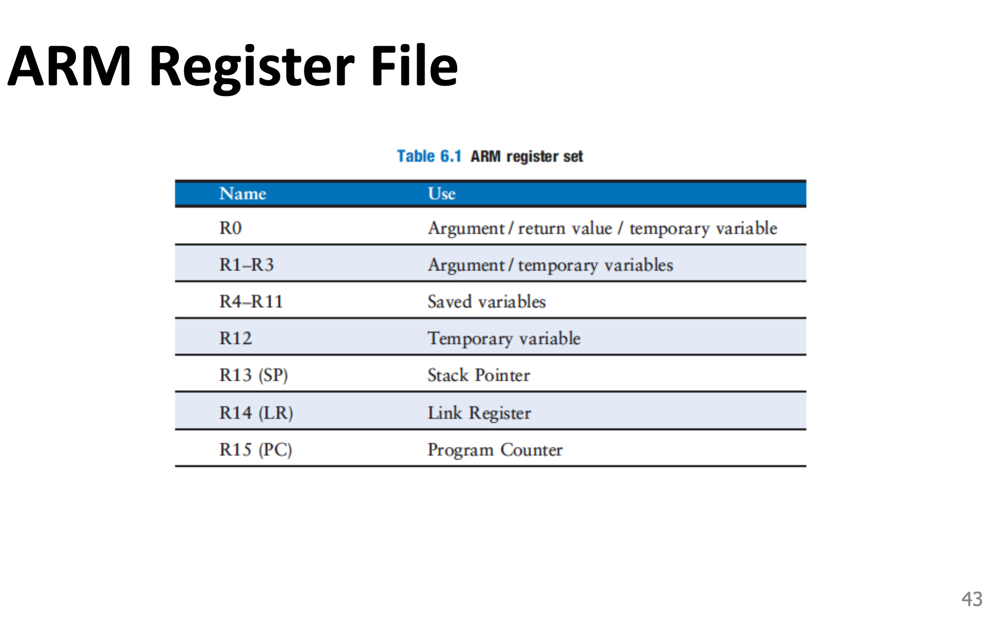

MIPS register conventions (no screenshot needed, reconstructed):

| Name | Number | Usage |
|---|---|---|
| `$0` | 0 | constant 0 |
| `$at` | 1 | assembler temporary |
| `$v0-$v1` | 2–3 | function return values |
| `$a0-$a3` | 4–7 | function arguments |
| `$t0-$t7` | 8–15 | temporaries |
| `$s0-$s7` | 16–23 | saved variables |
| `$t8-$t9` | 24–25 | temporaries |
| `$k0-$k1` | 26–27 | OS temporaries |
| `$gp` | 28 | global pointer |
| `$sp` | 29 | stack pointer |
| `$fp` | 30 | frame pointer |
| `$ra` | 31 | return address |

---

## 5. Instruction Basics

### 5.1 The three instruction types ⭐ (throughout the set; recurring at P78 / P134 / P331)

1. **Operate (Data Processing) instructions** — compute in the ALU
2. **Data movement (Memory) instructions** — read/write memory
3. **Control flow (Branch/Jump) instructions** — change the execution order (make decisions)

### 5.2 Instruction = Opcode + Operands

- **Opcode**: what to do
- **Operands**: what to do it to
- Their layout = **instruction format / encoding**

| ISA | Instruction width | Opcode position | Max number of opcodes |
|---|---|---|---|
| MIPS | 32 bit | `[31:26]` | 64 |
| QuAC | 16 bit | `[15:12]` | 16 |
| **ARM** | 32 bit | **`[27:26]`** | **4** |

> **ARM has only a 2-bit opcode (4 classes)** — very counterintuitive and likely to be examined. The specific instruction is further distinguished by the `cmd`/`funct` fields.

### 5.3 From assembly to machine code

- **Compiler**: high-level language → assembly (human readable)
- **Assembler**: assembly → machine code (0/1)

Deriving the encoding of ARM `ADD R0, R1, R2` (you must be able to do this by hand):

| 31:28 | 27:26 | 25 | 24:21 | 20 | 19:16 | 15:12 | 11:0 |
|---|---|---|---|---|---|---|---|
| cond | op | I | cmd | S | Rn | Rd | Src2 |
| 1110 | 00 | 0 | 0100 | 1 | 0001 | 0000 | 000000000010 |

→ `0xE0910002` (slide P83 writes `0x E 0 9 1 0 0 0 1`; note the last digit should be 2 = R2; **this looks like a typo on the slide** — recompute it yourself field by field.)

QuAC `add r0, r1, r2` → fields `8 | 0 | 0 | 1 | 2` → `1000 0 0 000 001 0 010` → **`0x8012`**

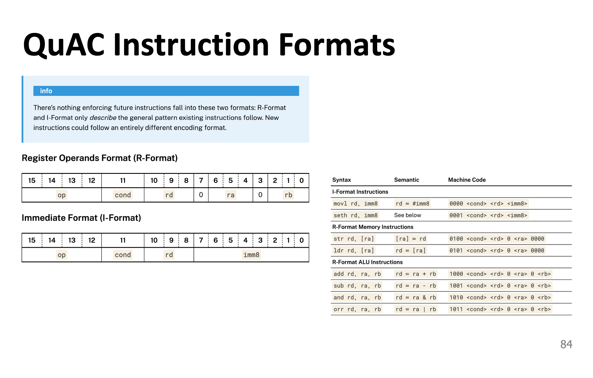

---

## 6. ARM Instruction Formats (the three formats, must memorize) ⭐⭐

### Format 1: Data Processing (DP)

```
 31:28   27:26   25   24:21   20   19:16   15:12        11:0
| cond  |  op  | I  |  cmd  | S  |  Rn   |  Rd   |     Src2     |
| cond  |  00  |         funct         |  Rd   |     Src2     |
```

Field meanings:

| Field | Bits | Meaning |
|---|---|---|
| `cond` | 31:28 | Conditional execution (**1110 = unconditional AL**) |
| `op` | 27:26 | **00 = data processing** |
| `funct` | 25:20 | = `I` + `cmd` + `S` |
| `I` | 25 | **0 → Src2 is a register; 1 → Src2 is an immediate** |
| `cmd` | 24:21 | Which DP instruction (**0100 = ADD, 0010 = SUB, 1101 = shift class**) |
| `S` | 20 | 1 = this instruction sets the condition flags |
| `Rn` | 19:16 | First source operand register |
| `Rd` | 15:12 | Destination register |
| `Src2` | 11:0 | Second source (register or unsigned immediate) |

Two variants:

```
DP-Immediate:  cond | 00 | 1 | cmd | S | Rn | Rd | 0000 |  imm8
DP-Register:   cond | 00 | 0 | cmd | S | Rn | Rd | 00000000 |  Rm
```

### Format 2: Memory

```
 31:28   27:26      25:20       19:16   15:12    11:0
| cond  |  01  | I P U B W L  |  Rn   |  Rd   | imm12 |
```

- `op = 01`
- `Rn` = base register
- `Rd` = destination (LDR) / source (STR)
- `Src2` = offset (immediate / register / shifted register)
- **`I` (bit25) = how Src2 is encoded; `L` (bit20) = 1 → LDR, 0 → STR**

Concretely:
```
LDR Rd, [Rn, #imm12]:   cond | 01 | 1 1 1 0 0 1 | Rn | Rd | imm12
STR Rd, [Rn, #imm12]:   cond | 01 | 1 1 1 0 0 0 | Rn | Rd | imm12
                                              ↑ L
```

### Format 3: Branch

```
 31:28   27:26   25:24        23:0
| cond  |  10  |  1 L  |     imm24     |
```

- `op = 10`, bit25 is always 1
- **`L` = 0 → B (branch); `L` = 1 → BL (Branch and Link, supports function calls)**
- `imm24` = **24-bit signed immediate**

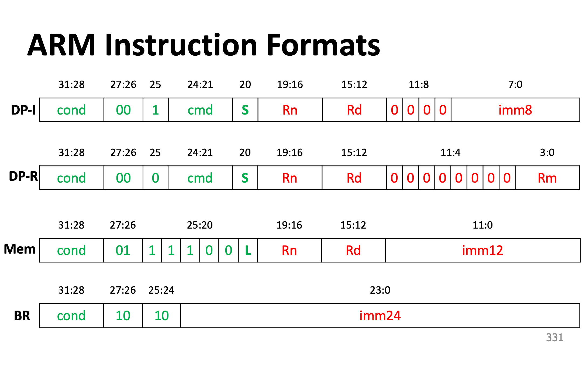

---

## 7. Data Processing Instructions

### 7.1 Basic usage

```arm
; a = b + c – d, mapping R0=a, R1=b, R2=c, R3=d, R4=t
ADD R4, R1, R2
SUB R0, R4, R3
```
- `R1, R2` = source operands, `R4` = destination operand
- The register mapping is decided by a human or **the compiler**

### 7.2 The four design principles ⭐ must memorize

| # | Principle | Meaning |
|---|---|---|
| **1** | **Regularity leads to simpler hardware** | Fixed 2 sources and 1 destination: easier to encode and implement. Same for QuAC |
| **2** | **Smaller is Faster** | A small register file is faster to read than a large one |
| **3** | **Good design demands good compromises** | To encode immediates you must give up the R format and introduce a new format |
| **4** | **Make the common case fast** | ARM keeps only simple, common instructions; fewer instructions → decode hardware is simple, small, fast; complex operations are composed from several simple instructions |

### 7.3 Immediates

- Fact: **98% of constants in programs fit in 13 bits**
- Advantage: **no memory/register access needed — the value is right in the instruction**
- Disadvantage: **limited encoding bits; immediates are only 8–12 bits**

```arm
ADD R7, R7, #4      ; a = a + 4
SUB R8, R7, #0xC    ; b = a - 12
MOV R4, #0          ; i = 0
MOV R5, #0xFF0      ; x = 4080
MOV R1, R7          ; MOV can also take a register source
```

### 7.4 More DP instructions

`AND` / `ORR` (OR) / `EOR` (XOR) / `BIC` (Bit Clear) / `MVN` (MoVe and Not)

**BIC masking key point** ⭐:
```arm
BIC R6, R1, R2      ; R6 = R1 AND (NOT R2)
```
- R2 is the **mask**: **the bits you want cleared in R1 are set to 1 in R2**
- Uses: bit masking, forcing unwanted bits to zero

### 7.5 RISC vs. CISC ⭐

| | **RISC** | **CISC** |
|---|---|---|
| Full name | Reduced Instruction Set Computer | Complex Instruction Set Computer |
| Instructions | Few and simple | Many and complex |
| Hardware | Low complexity → **high clock frequency, power-efficient** | Complex → **long critical path, low frequency** |
| Code | **Needs more instructions** to solve the same problem | Each instruction does more → **fewer instructions** |
| Examples | **ARM, MIPS, QuAC, RISC-V** | **Intel x86** |

**Why QuAC is RISC**: fixed-width instructions (simple decoding), few opcodes, only two formats that are regular across formats (`rd` is always in `Instr[10:8]`, the opcode always in the same position), few GPRs, room for constants in the ISA, easy to convert to hex, **memory accessed only through dedicated instructions** (load-store architecture). The only "somewhat complex" one is `seth`.
**QuAC's conditional branch = conditional execution + a general-purpose PC** (there's no dedicated branch instruction; it works by writing the PC as an ordinary register).

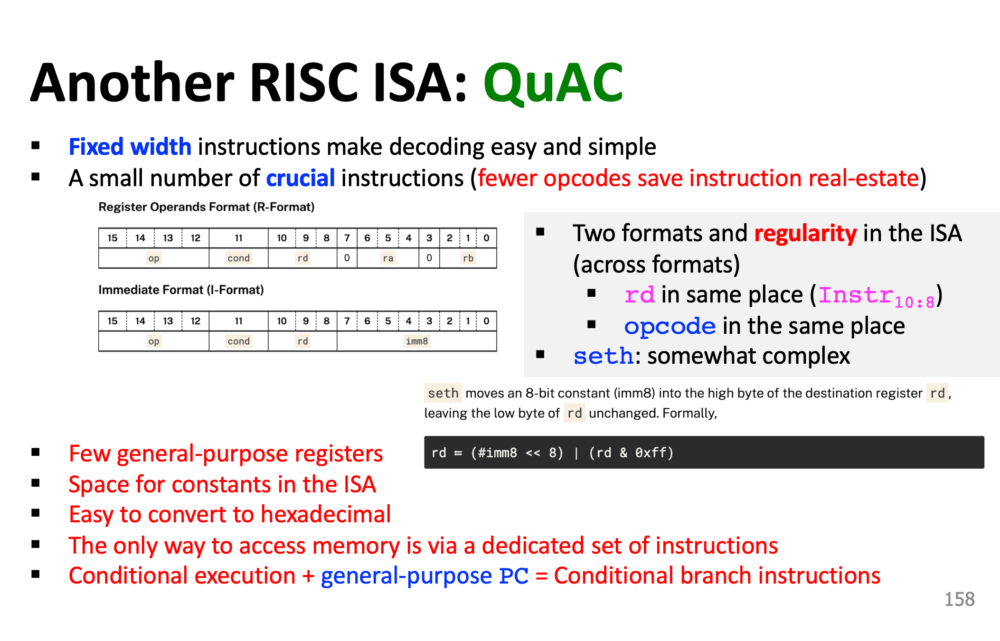

---

## 8. Data Movement Instructions (LDR / STR)

### 8.1 Why they're needed

The register file can't hold a real program's data → most data lives in **slow memory**, moved into registers when needed and moved back when not, to free up registers.

- **LDR** = LoaD Register: memory → register file
- **STR** = STore Register: register file → memory

### 8.2 base + offset addressing ⭐

```arm
LDR R0, [R1, #12]     ; R0 ← Memory[R1 + 12]    R1=base (source), R0=destination
STR R0, [R1, #12]     ; Memory[R1 + 12] ← R0    R0 and R1 are both sources; the destination is a memory address
```

Cross-ISA comparison (`a = A[2]`, with A's base address in the base register):

| ISA | Assembly | Semantics | Why this offset |
|---|---|---|---|
| ARM | `LDR R3, [R0, #8]` | R3 ← Mem[R0+8] | byte-addressable, 4 bytes/word → 2×4 = 8 |
| MIPS | `lw $s3, 8($s0)` | $s3 ← Mem[$s0+8] | same as above |
| LC-3 | `LDR R3, [R0, #2]` | R3 ← Mem[R0+2] | **word-addressable**, uses the word number directly |

> **Conversion formula**: `byte address = word_address × (bytes/word)`. 4 for ARM/MIPS; if QuAC were byte-addressable it would be 2.

### 8.3 LDR / STR exercises (must practice)

```arm
; read the 32-bit word at address 8 into R3, using R2 as the base
MOV R2, #0
LDR R3, [R2, #8]     ; R3 = 0x01EE2842  (contents of Word 2)

; store R7 into memory word 21
MOV R5, #0
STR R7, [R5, #0x54]  ; 21 × 4 = 84 = 0x54
```

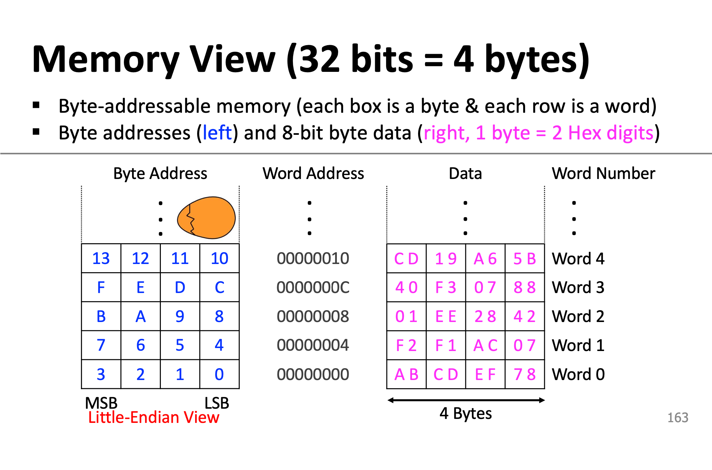

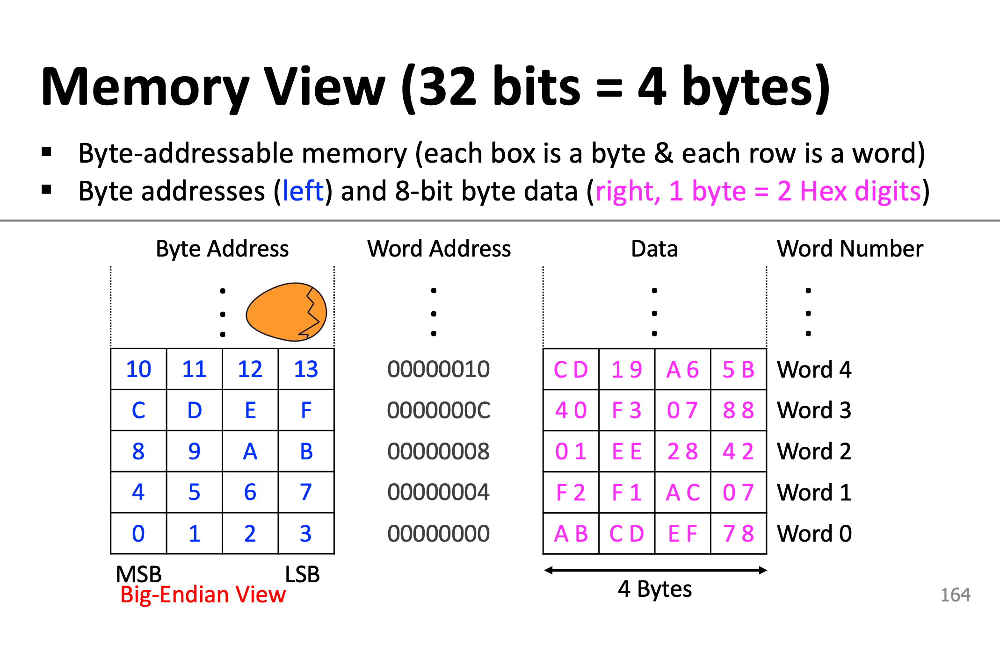

### 8.4 Two facts about 32-bit machines

- The address bus is 32 bits wide → an address space of 2³² locations
- **Although memory is byte-addressable, one LDR still returns a full 32-bit word** to fill the register

---

## 9. Conditional Execution ⭐⭐ an ARM specialty

### 9.1 Two steps

1. **Some instruction sets the condition flags** (N, Z, C, V), which are stored in the **CPSR** (Current Program Status Register)
2. **Subsequent instructions decide whether to execute based on the state of the flags**

### 9.2 Two ways to set the flags

| Method | Syntax | Description |
|---|---|---|
| **1. CMP** | `CMP R5, R6` | Computes **R5 − R6**, **does not save the result**, only sets the flags |
| **2. Add the S suffix** | `ADDS R1, R2, R3` | Does the addition normally and **saves the result in R1**, also setting the flags |

Flag meanings:

| Flag | Set to 1 when |
|---|---|
| **Z** | The result is 0 |
| **N** | The result is negative |
| **C** | A carry out is produced |
| **V** | A **signed overflow** occurs |

### 9.3 Condition mnemonic table (P182 contents, reconstructed)

| cond | Mnemonic | Meaning | Condition expression |
|---|---|---|---|
| 0000 | **EQ** | Equal | Z |
| 0001 | **NE** | Not equal | Z̄ |
| 0010 | CS / **HS** | Carry set / unsigned higher or same | C |
| 0011 | CC / **LO** | Carry clear / unsigned lower | C̄ |
| 0100 | **MI** | Minus / negative | N |
| 0101 | **PL** | Plus / positive or zero | N̄ |
| 0110 | **VS** | Overflow set | V |
| 0111 | **VC** | Overflow clear | V̄ |
| 1000 | **HI** | Unsigned higher | Z̄ · C |
| 1001 | **LS** | Unsigned lower or same | Z + C̄ |
| 1010 | **GE** | Signed ≥ | (N ⊕ V)′ |
| 1011 | **LT** | Signed < | N ⊕ V |
| 1100 | **GT** | Signed > | Z̄ · (N ⊕ V)′ |
| 1101 | **LE** | Signed ≤ | Z + (N ⊕ V) |
| 1110 | **AL** (or omitted) | Always / unconditional | flags ignored |

> **Common mistake**: **HS/LO/HI/LS = unsigned comparisons (look at C, Z); GE/LT/GT/LE = signed comparisons (look at N, V)**. Whether to write `BGT` or `BHI` depends on whether the data is signed.

### 9.4 Example 1 (P184)

```arm
; R5 = 17, R9 = 23
CMP   R5, R9        ; 17 - 23 = -6
SUBEQ R1, R2, R3
ORRMI R4, R0, R9
```
- Flags: **N=1, Z=0, C=0, V=0** (borrow → C=0)
- `SUBEQ`: Z=0 → **not executed**
- `ORRMI`: N=1 → **executed**

### 9.5 Example 2 (P185, textbook pp. 307–308)

```arm
; R2 = 0x80000000, R3 = 0x00000001
CMP   R2, R3        ; 0x80000000 - 1 = 0x7FFFFFFF
ADDEQ R4, R5, #78
ANDHS R7, R8, R9
ORRMI R10, R11, R12
EORLT R12, R7, R10
```
- Flags: **N=0, Z=0, C=1, V=1** (negative minus positive gives positive → signed overflow)
- `ADDEQ`: Z=0 → not executed
- `ANDHS`: C=1 → **executed**
- `ORRMI`: N=0 → not executed
- `EORLT`: LT = N⊕V = 0⊕1 = 1 → **executed**

> **These two are exam prototypes**; be sure to compute NZCV yourself.

### 9.6 Scope of the flags (P222 handwritten note, important)

- The flags set by CMP **control the subsequent conditional branch/conditional execution instructions, not only the one immediately following**
- **Multiple instructions can use them**, as long as they haven't been overwritten by a new arithmetic/logic instruction in between
- **Once the flags are overwritten, the effect of the CMP is gone**

### 9.7 Conditional execution in QuAC

- **`Instr[11]` is the cond bit**
- ALU instructions set the flags
- `cond = TRUE` → **this instruction executes only if the previous ALU instruction set Z to TRUE**, otherwise it doesn't execute
- **Default encoding cond = 0 (execute)**: `add r1,r2,r3` (cond=FALSE) vs `addeq r1,r2,r3` (cond=TRUE)
- The relation between `eq` and Z: two registers are equal ⟺ their difference is 0 ⟺ Z=1

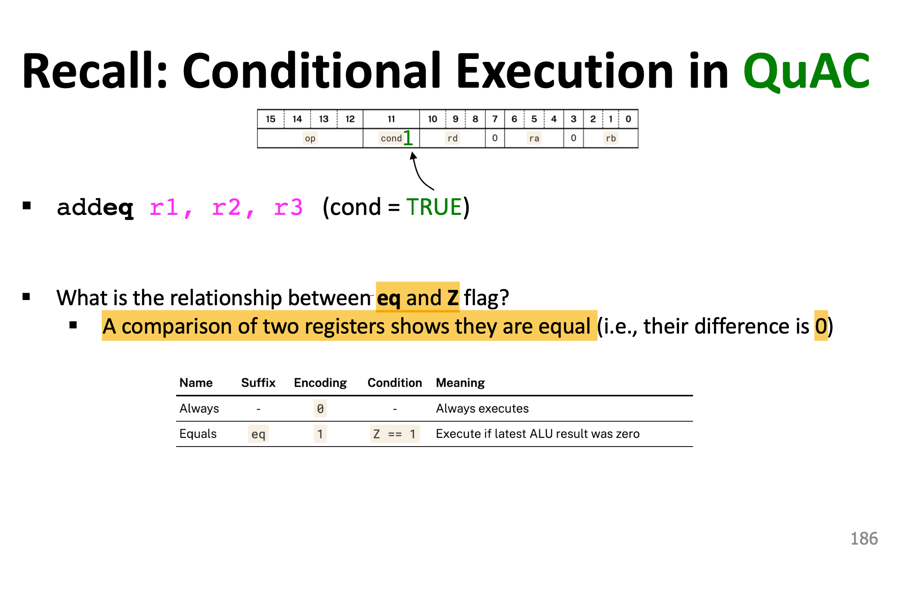

---

## 10. Branch Instructions and the PC

### 10.1 Rules for sequential PC advance ⭐

| ISA configuration | PC update |
|---|---|
| **32-bit ISA + byte-addressable** | **PC = PC + 4** |
| 64-bit ISA + byte-addressable | PC = PC + 8 |
| 32-bit ISA + word-addressable | PC = PC + 1 (QuAC) |

- **The PC is incremented in the FETCH stage** (ready for the next instruction)
- **A branch overwrites the PC with a new address in the EXECUTE stage** → wiping out the value incremented during FETCH

### 10.2 Branch types

| Instruction | Description |
|---|---|
| **B** | Unconditional branch: always jumps to TARGET |
| **B\<cond\>** (e.g. BEQ/BNE) | Conditional branch: jumps to TARGET or executes the next sequential instruction |
| **BL** | Branch and Link: architectural support for C/Java **function calls** |

```arm
; unconditional, always Taken
    ADD R1, R2, #17
    B   TARGET
    ORR R1, R1, R3      ; skipped
    AND R3, R1, #0xFF   ; skipped
TARGET
    SUB R1, R1, #78
```
```arm
; conditional, Not Taken
    MOV R0, #4
    ADD R1, R0, R0      ; R1 = 8
    CMP R0, R1          ; 4 - 8 ≠ 0 → Z = 0
    BEQ THERE           ; Z=0 → NOT TAKEN
    ORR R1, R1, R1      ; ← this is what actually executes
THERE
    ADD R1, R1, #78
```

**Symbolic Address**: labels like `TARGET` are human-readable **names for memory addresses**, translated into real addresses by the **assembler**.

### 10.3 BTA calculation ⭐⭐ must-know formula

**BTA (Branch Target Address) = the address of the next instruction to execute when the branch is taken**

The processor computes the BTA in three steps:
1. **Shift `imm24` left by 2** (word → byte)
2. **Sign-extend** (copy `Instr[23]` into `Instr[31:24]`)
3. **Add PC + 8** ← **this +8 is ARM's trap; must memorize**

**Example (P211)**: `imm24 = 3`, PC points to `0x80A0`
- 3 << 2 = 12 (`0b1100`)
- Still +12 after sign extension
- BTA = **PC + 8 + 12** = `0x80A0 + 8 + 12` = **`0x80B4`**

> Why +8 and not +4? Because in ARM **reading R15 returns PC + 8** (historically a product of the three-stage pipeline). This comes up again in the datapath section.

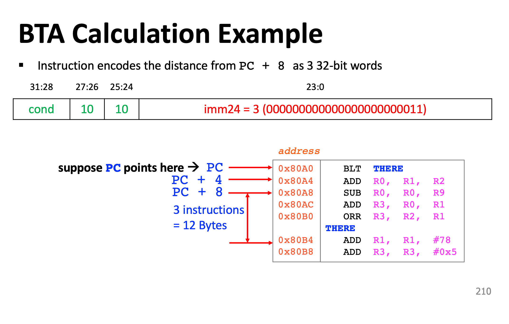

### 10.4 Branch terminology (P213)

| Term | Meaning |
|---|---|
| **Branch Target** | The memory address of the TARGET instruction |
| **Branch Condition** | The condition under which the branch is taken if true |
| **Branch Resolution/Evaluation** | The act of evaluating the branch condition |
| **Taken (T)** | Condition is TRUE → jump |
| **Untaken / Not Taken (NT)** | Condition is FALSE → execute sequentially |
| **Branch behavior** | Strongly/Weakly Taken/Untaken; Always Taken/Untaken |
| **Branch Prediction** | In high-performance CPUs branches get in the way of useful work → a branch predictor predicts the **direction (T/NT) and the target** |

---

## 11. The Instruction Cycle ⭐⭐

### 11.1 Six stages

| # | Stage | What it does |
|---|---|---|
| 1 | **FETCH** | Fetch the instruction from memory into IR. **Every instruction needs it** |
| 2 | **DECODE** | Identify the instruction **and generate the control signals for the following stages** |
| 3 | **EVALUATE ADDRESS** | Compute the memory access address (base + offset) |
| 4 | **FETCH OPERANDS** | Fetch the source operands |
| 5 | **EXECUTE** | Actually perform the operation in the ALU |
| 6 | **STORE RESULT** | Write the result back to the destination. When done → **a new FETCH** |

**Not every instruction needs all six stages** ⭐:
- **LDR doesn't need EXECUTE**
- **ADD doesn't need EVALUATE ADDRESS**
- x86's `ADD [eax], edx` is an example that uses all six stages

### 11.2 The three steps of FETCH (LC-3, must memorize)

1. **MAR ← PC, and the PC is incremented at the same time**
2. **Access memory → the instruction goes into MDR**
3. **IR ← MDR**

### 11.3 Stage details

- **DECODE**: LC-3 uses a **4-to-16 decoder** to identify the 4-bit opcode in `IR[15:12]` (16 kinds); the remaining 12 bits describe what else is needed
- **EVALUATE ADDRESS**: needed by LDR (register + immediate); not needed by ADD
- **FETCH OPERANDS**:
  - LDR: ① MAR ← the address computed in the previous step ② read memory → the source operand goes into MDR
  - ADD: fetched from the register file. **Some microprocessors can read the register file during DECODE** (→ the origin of the later five-stage division)
- **STORE RESULT**: ADD writes ALUResult into DR; LDR writes MDR into DR

### 11.4 Machine Cycle vs Instruction Cycle ⭐

- Each step is directed by the control unit, and **each step takes one machine cycle**
- **One machine cycle = one clock cycle** (these are the same thing)
- **One instruction cycle usually consists of several machine cycles** (= a multicycle machine)
- **If an instruction cycle uses only one machine cycle → a single-cycle computer**
  - Single-cycle machines are **simpler** (the control unit is not an FSM, just combinational logic)
- A 1 GHz CPU → 10⁹ clock cycles per second → one cycle is 1 ns

**Labs 4–6 + Assignment 1 build a single-cycle CPU**: the whole instruction (all stages) must complete within one cycle, **one clock cycle = one machine cycle = one instruction cycle**.

### 11.5 Caveats to remember (P129)

- Not every instruction needs every stage
- **The order of the stages is not an iron law**
- **Some stages can be merged into one**
- With a different microarchitecture, some structures may not be needed at all
- **The "microarchitecture style" determines many details**

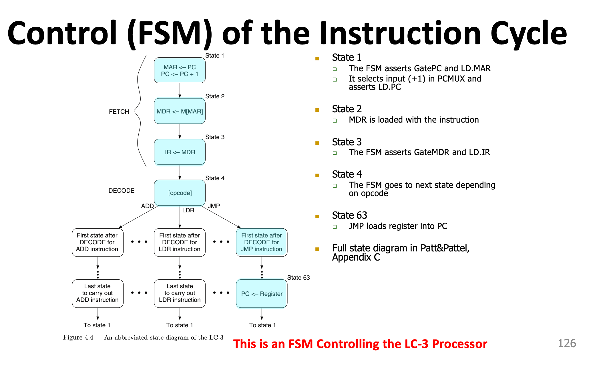

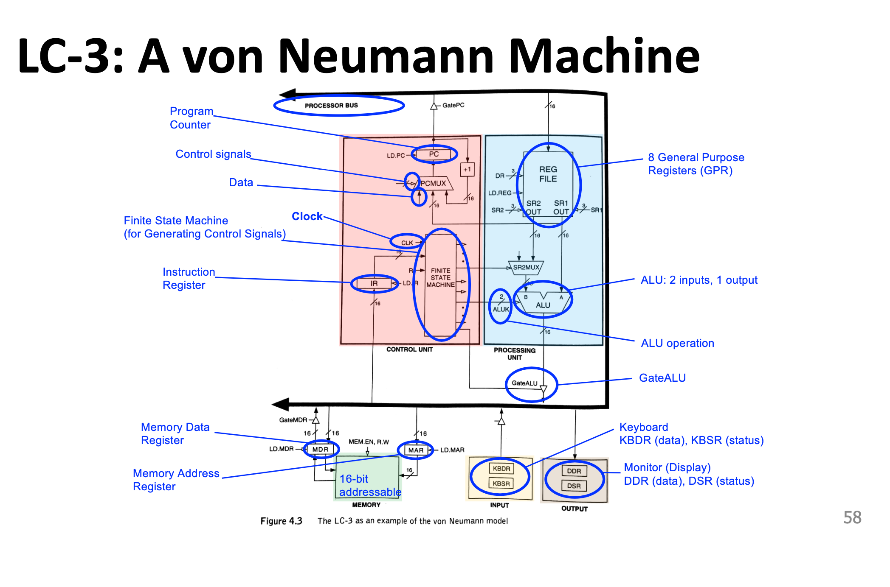

---

## 12. The Three C Program Constructs → ARM Assembly ⭐⭐

### 12.1 The three constructs

1. **Sequential**: one subtask after another, no going back
2. **Conditional**: choose one of two
3. **Iterative**: repeat some subtask

### 12.2 if statements

**Core trick: in assembly you check the "opposite condition" of the C condition, skipping the if block when the condition is false.**

```c
if (apples == oranges)
    f = i + 1;
f = f - i;
```
```arm
; R0=apples, R1=oranges, R2=f, R3=i
    CMP R0, R1
    BNE L1            ; ← check the opposite condition! skip the if block if not equal
    ADD R2, R3, #1
L1
    SUB R2, R2, R3
```

**Version 2 (using BEQ, a more literal translation, but one more instruction)**:
```arm
    CMP R0, R1
    BEQ L1
    B   L2
L1
    ADD R2, R3, #1
L2
    SUB R2, R2, R3
```

**Version 3 (conditional execution, shortest and fastest)**:
```arm
    CMP   R0, R1
    ADDEQ R2, R3, #1
    SUB   R2, R2, R3
```

### 12.3 if-else

```c
if (apples == oranges) f = i + 1;
else                   f = f - i;
```
```arm
    CMP R0, R1
    BNE L1
    ADD R2, R3, #1
    B   L2            ; ← unconditional branch, skip the else block
L1
    SUB R2, R2, R3
L2
```

**Conditional execution version**:
```arm
    CMP   R0, R1
    ADDEQ R2, R3, #1
    SUBNE R2, R2, R3
```

### 12.4 Tradeoff between conditional execution and branches ⭐ exam point

**Advantages of conditional execution**: shorter, faster (one fewer instruction).
**Disadvantages of conditional execution**:
- **When the if block is long, writing a condition mnemonic on every instruction is tedious**
- **Conditional execution still fetches the non-executed instructions from memory** (needless fetching) — wasting fetch bandwidth

### 12.5 switch-case

```c
switch (button) {
   case 1: atm = 20;  break;
   case 2: atm = 50;  break;
   case 3: atm = 100; break;
   default: atm = 0;  break;
}
```
```arm
; R0 = button, R1 = atm      (assembly comments start with ;)
    CMP   R0, #1
    MOVEQ R1, #20
    BEQ   DONE
    CMP   R0, #2
    MOVEQ R1, #50
    BEQ   DONE
    CMP   R0, #3
    MOVEQ R1, #100
    BEQ   DONE
    MOV   R1, #0        ; default
DONE
```
→ `break` is just `BEQ DONE`; it's **a chain of CMP + conditional MOV + conditional exit**.

---

## 13. Loops

### 13.1 The three elements of a for loop

```c
for (i = 0; i < 10; i = i + 1)   // ① initialization ② termination condition ③ advance
    sum = sum + i;
```

### 13.2 Standard translation (style 1)

```arm
; R0 = i, R1 = sum
    MOV R0, #0        ; i = 0
    MOV R1, #0        ; sum = 0
FOR
    CMP R0, #10       ; i < 10 ?
    BGE DONE          ; i >= 10 → exit
    ADD R1, R1, R0    ; sum += i
    ADD R0, R0, #1    ; i++
    B   FOR
DONE
```
**5 instructions per iteration.**

### 13.3 Another style (style 2, worse)

```arm
    MOV R0, #0
    MOV R1, #0
COND
    CMP R0, #10
    BLT FOR           ; i < 10 → enter the loop body
    B   DONE          ; otherwise exit
FOR
    ADD R1, R1, R0
    ADD R0, R0, #1
    B   COND
DONE
```
**6 instructions per iteration** — one extra `B`. These two versions are exactly what §17 Exercise 2 compares for performance.

### 13.4 Decrementing loop (optimal) ⭐

```c
for (i = 9; i >= 0; i = i - 1) sum = sum + i;
```
```arm
    MOV  R0, #9
    MOV  R1, #0
FOR
    ADD  R1, R1, R0   ; sum += i
    SUBS R0, R0, #1   ; i-- and set flags   ← key: one instruction does two things
    BNE  FOR          ; continue while i != 0
DONE
```
**Saves 2 instructions per iteration** (no separate CMP and unconditional B needed).
**Core trick: change the loop to count down to 0 and use the Z flag from `SUBS` directly as the termination condition, eliminating the CMP.**

### 13.5 Why not just write ADD out 10 times

- Poor practice
- **The code isn't reusable** (next time it may be 20 times, not 10)
- **Instructions take up memory**: every instruction occupies space and must be fetched

### 13.6 while loops

```c
int POW = 1; int X = 0;
while (POW != 128) { POW = POW * 2; X = X + 1; }
```
```arm
; R0 = POW, R1 = X
    MOV R0, #1
    MOV R1, #0
WHILE
    CMP R0, #128
    BEQ DONE
    LSL R0, R0, #1    ; POW *= 2    ← shift left by one = multiply by 2
    ADD R1, R1, #1
    B   WHILE
DONE
```
Special cases: `while(TRUE)` runs forever, `while(FALSE)` never runs.

### 13.7 Syntax vs Semantics

- **Syntax**: how keywords are arranged (ending with `;`, loops using parentheses)
- **Semantics**: what those arrangements mean (execute repeatedly until the condition no longer holds)
- Without syntax rules → it's hard to understand the programmer's intent; what the CPU does depends on the **semantics** of statements and instructions

---

## 14. Arrays

### 14.1 Concepts

- **Data Structure**: a collection of data organized in memory in a particular way for convenient access. Two aspects: **the organization + the read/write functions**. Examples: Array, Linked List, Stack, Queue
- **Array**: data objects of the **same type** laid out **sequentially** in memory
- **Base Address = the address of the first element**; indices start at 0
- **Same base address and indexing scheme, different element types → different actual element addresses** (1-byte array vs 4-byte array)
- How a value stored in memory is interpreted depends on its **type** (unsigned int / int / 12-byte student record…)

```c
int marks[5] = {0, 2, 3, 1, 5};   // int is 4 bytes on most architectures
char alphas[5] = {'a','b','c','d','e'};   // char is always 1 byte
```

### 14.2 Four versions of array traversal (progressively compressed) ⭐ key point

Task: `for (i=0; i<200; i++) scores[i] = scores[i] + 10;`, base address `0x14000000`

**Version 1 (P269) — compute the byte offset manually**
```arm
    MOV R0, #0x14000000
    MOV R1, #0
LOOP
    CMP R1, #200
    BGE L3
    LSL R2, R1, #2       ; word → byte (i × 4)
    LDR R3, [R0, R2]     ; R3 = scores[i]
    ADD R3, R3, #10
    STR R3, [R0, R2]
    ADD R1, R1, #1
    B   LOOP
L3
```

**Version 2 (P273) — use `LDR Rd,[Rn,Rm,LSL #2]` to absorb the LSL**
```arm
LOOP
    CMP R1, #200
    BGE L3
    LDR R3, [R0, R1, LSL #2]    ; address = R0 + (R1 × 4)
    ADD R3, R3, #10
    STR R3, [R0, R1, LSL #2]
    ADD R1, R1, #1
    B   LOOP
L3
```

**Version 3 (P277) — use post-index to absorb the pointer increment**
```arm
    MOV R0, #0x14000000
    ADD R1, R0, #800      ; R1 = address of the array's last byte 0x14000800 (200×4)
LOOP
    CMP R0, R1            ; reached the end of the array?
    BGE L3
    LDR R2, [R0]
    ADD R2, R2, #10
    STR R2, [R0], #4      ; ← post-index: store to [R0] first, then R0 += 4
    B   LOOP
L3
```

> **This section is precisely about "the ISA evolving to lighten the software's load"**: `LDR R3,[R0,R1,LSL #2]` saves one LSL, but **the microarchitecture has to add a shifter before the ALU**. This is a concrete instance of RISC vs CISC — **put the burden on software or on hardware?**

### 14.3 ARM's three Indexing Modes ⭐⭐ must-know

| Mode | Syntax | Address | Base register |
|---|---|---|---|
| **Offset** | `LDR R0, [R1, R2]` | **R1 + R2** | **Unchanged** |
| **Pre-indexed** | `LDR R0, [R1, R2]!` | **R1 + R2** | Updated **before the access**: R1 = R1 + R2 |
| **Post-indexed** | `LDR R0, [R1], R2` | **R1** | Updated **after the access**: R1 = R1 + R2 |

**Memory points**:
- **Exclamation mark `!` = pre-index** (update first, then use? No — **the address is still R1+R2, but the base register is written back**)
- **Bracket closing early `[R1], R2` = post-index** (**the address is R1 itself**, the addition happens only after use)
- In all three modes **the offset can be an immediate**

### 14.4 Other exercises

```arm
; array[i] = array[i] * 8, i counting down from 199
    MOV  R0, #0x60000000
    MOV  R1, #199
FOR
    LDR  R2, [R0, R1, LSL #2]
    LSL  R2, R2, #3            ; ×8
    STR  R2, [R0, R1, LSL #2]
    SUBS R1, R1, #1
    BPL  FOR                   ; continue while i >= 0 (using PL: N=0)
```

---

## 15. Shift Instructions (category: Data Processing)

### 15.1 Four kinds of shift

| Instruction | Full name | Behavior | What fills the vacated bits |
|---|---|---|---|
| **LSL** | Logical Shift Left | Shift left, high bits dropped | **0s fill the low bits** |
| **LSR** | Logical Shift Right | Shift right, low bits dropped | **0s fill the high bits** |
| **ASR** | Arithmetic Shift Right | Shift right, low bits dropped | **The sign bit fills the high bits** |
| **ROR** | Rotate Right | Circular right shift | **Bits falling off the right are put back on the left** |

### 15.2 Numerical meaning ⭐

- **Shift left by N = multiply by 2ᴺ** (`0b00000011`=3 → LSL 1 → `0b00000110`=6)
- **Arithmetic shift right by N = divide by 2ᴺ** (`0b00000011`=3 → LSR 1 → `0b00000001`=1)
- Uses: **extracting bits / assembling bit patterns** → network programming, cryptography, data compression

> **Note**: LSR is for unsigned division; **signed division must use ASR** (because the sign bit must be preserved). This is a common mistake.

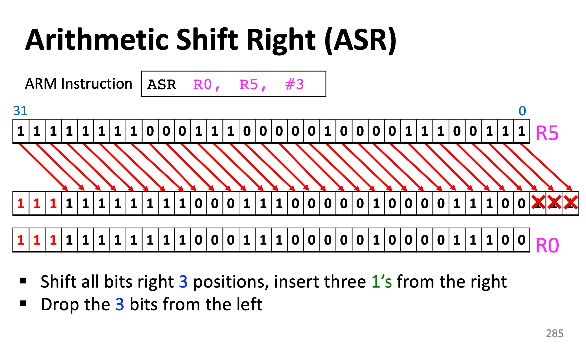

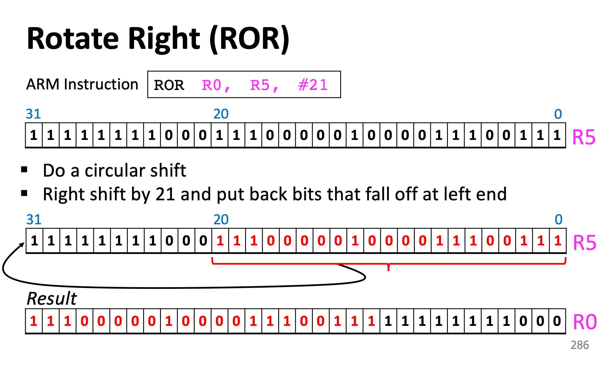

### 15.3 Machine encoding of shift instructions ⭐⭐

**Shift instructions are a special case of the DP-Register format**:

```
DP-R general:   cond | 00 | 0 | cmd  | S |  Rn  | Rd |  00000000  | Rm
Shift instr:    cond | 00 | 0 | 1101 | S | 0000 | Rd | shamt5 |sh|0| Rm
                              ↑          ↑      11:7    6:5  4  3:0
```

| Field | Value | Meaning |
|---|---|---|
| **`cmd`** | **1101** | Shift-class instruction |
| **`Rn`** | **0000** | Unused, set to 0 |
| **`shamt5`** `[11:7]` | 5-bit | **Shift amount** (immediate form) |
| **`sh`** `[6:5]` | **00=LSL, 01=LSR, 10=ASR, 11=ROR** | Which shift |
| bit 4 | 0 | The shift amount is an immediate |
| `Rm` `[3:0]` | | The register being shifted |

**Variant with the shift amount in a register** (e.g. `LSL R4, R8, R6`):

```
 31:28  27:26  25  24:21  20  19:16  15:12  11:8  7  6:5  4  3:0
| cond |  00  | 0 | cmd  | S |  Rn  |  Rd  | Rs  | 0 | sh | 1 | Rm |
                                            ↑            ↑
                                  shift-amount register  bit4=1
```
→ **bit 4 = 0 means the shift amount is an immediate; = 1 means the shift amount is in register Rs**.

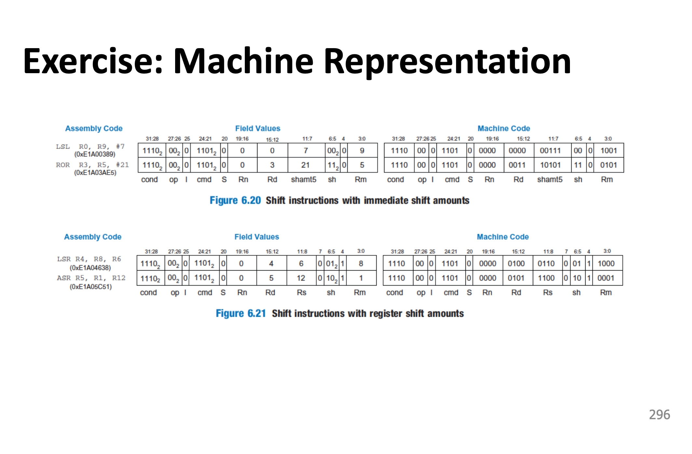

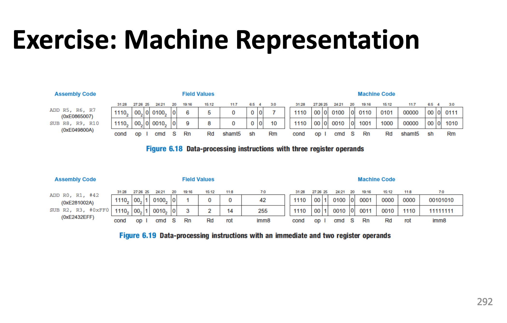

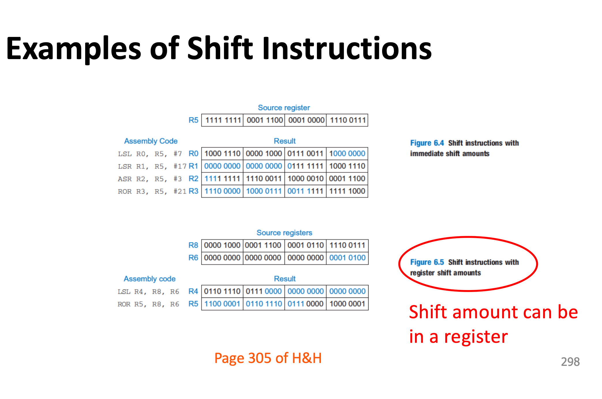

---

## 16. Characters and Byte Operations

### 16.1 ASCII

- Defined in **1963**, American Standard Code for Information Interchange
- Each text character has a unique **byte**; English characters < 256 → a single byte suffices
- Range: decimal 0–255, hex 00–FF
- C uses **`char`** to represent bytes/characters
- **Unicode**: 16 bit, supports accents, Asian languages, etc. (used by Java and others)

**Number to memorize** ⭐: **lowercase and uppercase differ by `0x20` (32)**.
→ `array[i] - 32` converts lowercase to uppercase.

### 16.2 Byte memory instructions ⭐

| Instruction | Behavior |
|---|---|
| **LDRB** | Loads one byte from memory into a register, **zero-extended** to fill 32 bits |
| **LDRSB** | Loads one byte from memory into a register, **sign-extended** to fill 32 bits |
| **STRB** | Stores the **least significant byte (LSB)** of a 32-bit register into the specified memory byte; **the upper bits are ignored** |

**Example (P308–P311)**, assuming R4 = 0, memory: address 0→`03`, 1→`42`, 2→`8C`, 3→`F7`; R3 = `11 10 A1 9B`

| Instruction | Result |
|---|---|
| `LDRB  R1, [R4, #2]` | **R1 = `00 00 00 8C`** (zero-extended) |
| `LDRSB R2, [R4, #2]` | **R2 = `FF FF FF 8C`** (0x8C's top bit is 1 → sign-extended with FF) |
| `STRB  R3, [R4, #3]` | **The contents of address 3 change from `F7` to `9B`** (only R3's LSB is written) |

> **This is an exam prototype**: the difference between LDRB zero-extension and LDRSB sign-extension, and that STRB touches only one byte.

### 16.3 C strings

```c
char welcome[6] = {'H','E','L','L','O','\0'};   // write '\0' manually, track the length manually
char welcome[]  = "HELLO";                       // the compiler computes the length and inserts '\0' automatically
```
- **C strings end with a null terminator `'\0'`** (unlike Python, which stores the length)
- 5 characters + 1 `'\0'` = 6

### 16.4 Exercise: converting a character array to uppercase

```c
char array[11] = "anthonymay";
for (i = 0; i < 10; i = i + 1) array[i] = array[i] - 32;
```
```arm
; R0 = base addr, R1 = i
    MOV  R1, #0
LOOP
    CMP  R1, #10
    BGE  DONE
    LDRB R2, [R0, R1]     ; R2 = array[i]   ← must use LDRB, not LDR
    SUB  R2, R2, #32      ; lowercase → uppercase
    STRB R2, [R0, R1]     ; array[i] = R2
    ADD  R1, R1, #1
    B    LOOP
DONE
```

### 16.5 Exercise: layout of a string in memory ⭐

Store `"HELLO!"` at `0x1522FFF0` (ASCII: H=0x48, E=0x65, L=0x6C, O=0x6F, !=0x21, Null=0x00)

| Address | Byte 3 | Byte 2 | Byte 1 | Byte 0 |
|---|---|---|---|---|
| `0x1522FFF4` | — | `00` (`\0`) | `21` (`!`) | `6F` (`O`) |
| `0x1522FFF0` | `6C` (`L`) | `6C` (`L`) | `65` (`E`) | `48` (`H`) |

> **Note this is a little-endian layout**: `H` is in Byte 0 (the low address); read each word row from right to left. It's very easy to trip up on the byte order here.
> On the slide `E = 0x65` should really be `0x45` (`0x65` is lowercase `e`) — **a typo on the slide; in the exam go by the standard ASCII table**.

---

## 17. ISA Tradeoffs

### 17.1 What the ISA affects

**Performance / Power & energy / Code size and instruction footprint / circuit cost and complexity (chip area) / room for future evolution**

### 17.2 Complex vs simple instructions ⭐

| | **Complex instructions** | **Simple instructions** |
|---|---|---|
| Advantages | **Dense, efficient code** | **Simple circuits** (simple microarchitecture) |
| Disadvantages | **Complex circuits, long critical path** | **Instructions take up a lot of space** (more instructions for the same problem); **large semantic gap** |
| Example | **x86**: an operate instruction's operands can be both registers and memory → **Register-Memory architecture** | **ARM**: memory accessed only through LDR/STR → **Load-Store architecture** |

**Tradeoff on the number of registers**: more registers → fewer memory accesses, but **the register file gets slower** (Design Principle #2), and more bits are needed in the instruction to encode register numbers.

### 17.3 The Semantic Gap ⭐

**Definition**: **how close** the instructions, data types, and addressing modes are **to high-level languages (HLL)**.

```
Small semantic gap                       Large semantic gap
HLL                                      HLL
 ↕ (easy to map)                          ↕ (hard to map, heavy compiler burden)
ISA: complex instructions + complex       ISA: simple instructions + simple
data types + complex addressing modes     data types + simple addressing modes
 ↕                                        ↕
HW control signals (complex)              HW control signals (simple)
```

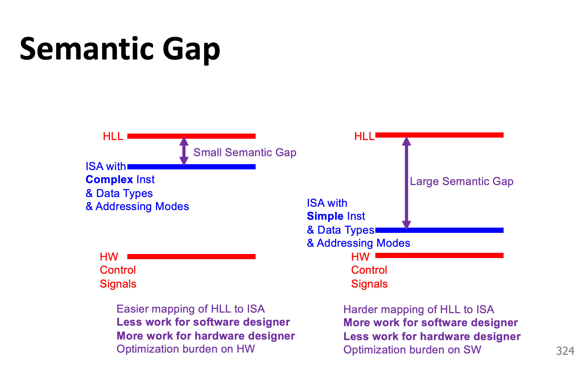

### 17.4 ARM's four addressing modes

| Mode | Use |
|---|---|
| **Register** | Read/write operands |
| **Immediate** | Read/write operands |
| **Base** (base + offset) | Read/write operands |
| **PC-relative** | **Write the PC** (branches) |

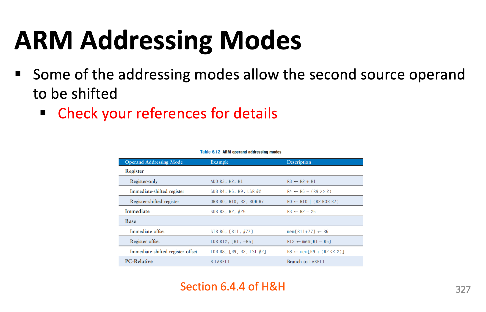

**Addressing Mode tradeoff**:
- Complex addressing modes → **simplify the HLL→assembly translation**
- But → **more complex circuits** (an ALU is needed to add base and offset, a shifter before the ALU)
- **Core question: put the optimization burden on software or hardware?**
  - Many simple instructions + a simple microarchitecture
  - A few complex instructions + a complex microarchitecture

---

## 18. Microarchitecture: the Single-Cycle ARM CPU ⭐⭐⭐

### 18.1 What "processing an instruction" means

```
AS  (architectural state before processing)
     ↓  Process Instruction
AS' (architectural state after processing)
```
**Processing an instruction = transforming AS into AS' according to the ISA specification**.

- **The ISA specifies abstractly** what AS' should be → it defines an **abstract FSM**:
  - **State = programmer-visible state**
  - **Next-state logic = the instruction execution specification**
  - **From the ISA's point of view there is no "intermediate state" between AS and AS' — one instruction, one state transition**
- **The microarchitecture decides how to turn AS into AS'**:
  - There are many implementation choices
  - **It may introduce programmer-invisible state to speed things up** → **multiple state transitions per instruction**

### 18.2 Single-cycle vs multi-cycle ⭐ must-know comparison

| | **Single-Cycle** | **Multi-Cycle** |
|---|---|---|
| Each instruction | **One clock cycle** | **Multiple cycles/stages** |
| State updates | **All at the end of instruction execution** | **Can be updated during execution** (but **architectural state** is still updated at the end) |
| What determines the cycle time | **The slowest instruction** → **long clock period** | **The slowest stage** |
| Implementation | Pure **combinational logic** executes the instruction, no programmer-invisible intermediate state; **the control unit is not an FSM** | The control unit is an FSM |
| Advantages | Simple, easy to explain | The clock can be faster |

> **Both are literally the von Neumann model at the microarchitecture level.**

```
      ┌──────────────┐        ┌─────────────┐
   ┌─►│ Combinational│  AS'   │ Sequential  │  AS
   │  │    Logic     ├───────►│   Logic     ├──┐
   │  └──────────────┘        │  (State)    │  │
   └───────────────────────────────────────────┘
```
- **What determines the clock cycle time?** → the **critical path** (the longest-delay path) of the combinational logic

### 18.3 ARM architectural state elements (P348–P349) ⭐

| Element | Characteristics |
|---|---|
| **PC** | **Logically part of the register file**; read and written independently every cycle. (Should it "physically" be placed in the register file? → a design choice) |
| **Instruction Memory** | **Single read port**; 32-bit address input A, 32-bit instruction output RD |
| **Register File** | **15 registers (R0–R14) + an extra input receiving R15 from the PC**; **two read ports** (4-bit A1/A2 → 32-bit RD1/RD2); **one write port** (A3 + WD3 + write enable); **reading R15 returns PC + 8**; if the PC is outside the register file, writing R15 needs special handling |
| **Data Memory** | **Single read/write port**; WE=TRUE → writes WD to address A on the **rising clock edge**; WE=FALSE → reads the value at address A onto RD |

**General rules**:
- **All reads are combinational and constant-time** (unrealistic, but good enough for now)
- **All writes and state updates happen on the rising clock edge** → **a synchronous sequential circuit**

### 18.4 The two main parts of a microarchitecture

| | Responsibility | Composition |
|---|---|---|
| **Datapath** (32-bit in this course) | Operates on data words | **Memories, registers, ALUs, multiplexers** |
| **Control Unit** | Tells the datapath how to execute instructions | Receives the current instruction from the datapath → produces **mux selects, ALU control, register enable, memory write** signals |

> Charles Petzold, *CODE*: "CPU control signals are the strings of a marionette."

### 18.5 Design process (add one instruction at a time)

Supported instruction subset:
- **DP**: `ADD, SUB, AND, ORR` (both register and immediate offsets supported)
- **Memory**: `LDR, STR` (**only positive immediate offsets supported**)
- **Branch**: `B`

Color conventions: **new wires = black; hardware already covered = gray; control signals = blue**.

### 18.6 The 7 steps of the LDR datapath ⭐⭐

| Step | What it does |
|---|---|
| **1** | **Fetch**: read the instruction from instruction memory. **Note the difference between PC (current state) and PC' (next state)** |
| **2** | Read the source operand (base register `Rn`) from the register file → data appears on **RD1** |
| **3** | **Zero-extend** `Instr[11:0]` (imm12) |
| **4** | **The ALU computes the address** (`ALUControl = 00` → ADD) |
| **5** | Write the data read back from data memory into `Rd` in the register file |
| **6** | Compute the next instruction address **PC' = PC + 4**. **Hardware is inherently parallel** — this step happens at the same time as the ones above |
| **7a** | **Reading R15 returns PC + 8** |
| **7b** | **Writing R15** (the PC may be the result of some instruction) |

**Zero Extension**: `ImmExt[31:12] = 0`, `ImmExt[11:0] = Instr[11:0]`.

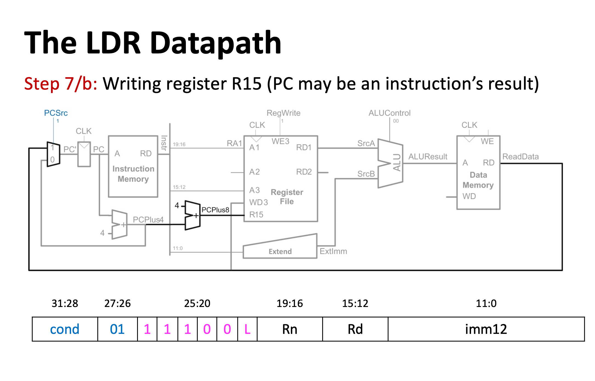

### 18.7 Step-by-step extension

| Step | Instruction | What's added |
|---|---|---|
| **8** | **STR** | Read a second register (`Rd`) and write its value to memory. **ReadData is ignored because RegWrite = FALSE**. **STR and LDR use the same format, but `Rd` becomes a source operand** |
| **9** | **DP-Immediate** | Change the extend block (imm8 rather than imm12); add a signal to **write ALUResult back to the register file** |
| **10** | **DP-Register** | Send `Rm` to the register file's **A2 port** → requires **adding muxes on the register file input and the ALU input** to select the second source |
| **11** | **Branch** | Change the extend block (sign-extend imm24 and shift left by 2); **add one bit to RegSrc** |

**Two key differences between DP-Immediate and LDR**:
1. **imm8 instead of imm12**
2. **The destination register stores the ALU result, not the memory access result** → requires a **MemtoReg multiplexer** to choose between `ReadData` and `ALUResult`
   - **MemtoReg = 1 → LDR; = 0 → DP instructions**

### 18.8 ALU control encoding ⭐ must memorize

| ALUControl | Function |
|---|---|
| **00** | **ADD** |
| **01** | **SUB** |
| **10** | **AND** |
| **11** | **ORR** |

The ALU also produces **four flags (NZCV) sent to the control unit**.

### 18.9 Extend Block operation ⭐⭐ must memorize

The three instruction formats interpret the immediate field differently, controlled by the **2-bit `ImmSrc[1:0]`**:

| `ImmSrc[1:0]` | `ExtImm` | Description |
|---|---|---|
| **00** | `{24'b0, Instr[7:0]}` | **Zero-extend imm8** (DP-Immediate) |
| **01** | `{20'b0, Instr[11:0]}` | **Zero-extend imm12** (LDR/STR) |
| **10** | `{6{Instr[23]}, Instr[23:0], 2'b00}` | **Sign-extend imm24 and shift left by 2** (Branch) |

> Note the `10` row does three things at once: **replicate the sign bit 6 times + concatenate imm24 + append two 0s at the end (= shift left by 2)**. This corresponds exactly to the first two steps of the BTA calculation in §10.3. (**The PC+8 step is not in the extend block**; it's achieved by reading R15 returning PC+8.)

### 18.10 The control unit

**Inputs**: `Instr[31:28]` (cond), `Instr[27:26]` (op), `Instr[25:20]` (funct), **Flags** (needed for conditional execution), **destination register** (to update the PC correctly)

**Key property** ⭐: **the controller of a single-cycle microarchitecture is purely combinational** (not an FSM).

**Conditional logic**: must ensure that architectural state updates are enabled only when a conditional instruction **actually executes** → **write-enable signals must be TRUE only when the condition holds**.
→ **When the condition isn't met, the write-enable lines are "killed" by the conditional logic**.

**Example of generating PCSrc** ⭐:
```
PCSrc = ((Rd == 15) & RegW) | Branch
```
Three cases that make PCSrc = 1:
- **The destination register Rd is R15**
- **RegW = 1** (ADD/SUB or LDR writes a register)
- **It is a branch instruction** (opcode = 10, B or BL)

> **Assignment reminder (slide verbatim)**: **don't forget to take conditional execution into account!**

### 18.11 Main decoder truth table (P379, reconstructed) ⭐⭐

| Op | Funct5 | Funct0 | Type | Branch | MemtoReg | MemW | ALUSrc | ImmSrc | RegW | RegSrc | ALUOp |
|---|---|---|---|---|---|---|---|---|---|---|---|
| 00 | 0 | X | **DP Reg** | 0 | 0 | 0 | 0 | XX | 1 | 00 | 1 |
| 00 | 1 | X | **DP Imm** | 0 | 0 | 0 | 1 | 00 | 1 | X0 | 1 |
| 01 | X | 0 | **STR** | 0 | X | 1 | 1 | 01 | 0 | 10 | 0 |
| 01 | X | 1 | **LDR** | 0 | 1 | 0 | 1 | 01 | 1 | X0 | 0 |
| **11** | X | X | **B** | 1 | 0 | 0 | 1 | 10 | 0 | X1 | 0 |

> ⚠️ **The slides contradict themselves**: Instruction Format – 3 clearly states **branch `op = 10`** (both P209 and P332 say 10), but the Op column of this truth table says **11**. **The H&H textbook table uses 10**. For exams/assignments go with **`op = 10`**; this is most likely a typo on the slide. Either remember it as 10, or ask in class.
>
> Also note **`Funct5` = `Instr[25]` = the I bit** (distinguishes DP-Reg / DP-Imm), and **`Funct0` = `Instr[20]` = the L bit** (distinguishes STR / LDR).

**Control signal values in example processor operations**:

| Signal | **ORR** (DP-R) | **LDR** |
|---|---|---|
| PCSrc | 0 | 0 |
| MemtoReg | **0** (wants the ALU result) | **1** (wants the memory data) |
| MemWrite | 0 | 0 |
| ALUControl | **11** (ORR) | **00** (ADD, computes the address) |
| ALUSrc | **0** (second source is a register) | **1** (second source is an immediate) |
| ImmSrc[1:0] | **XX** (unused) | **01** (zero-extend imm12) |
| RegWrite | 1 | 1 |
| RegSrc[1:0] | 00 | 00 |

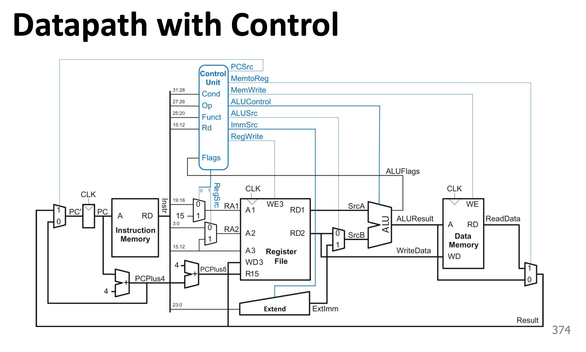

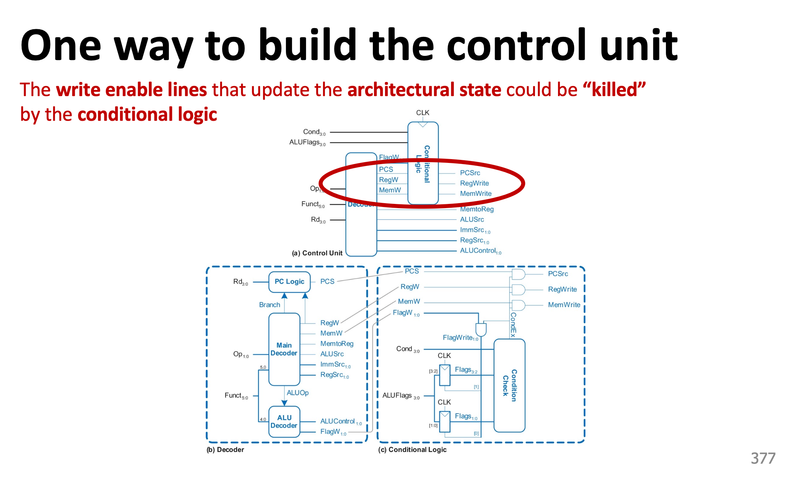

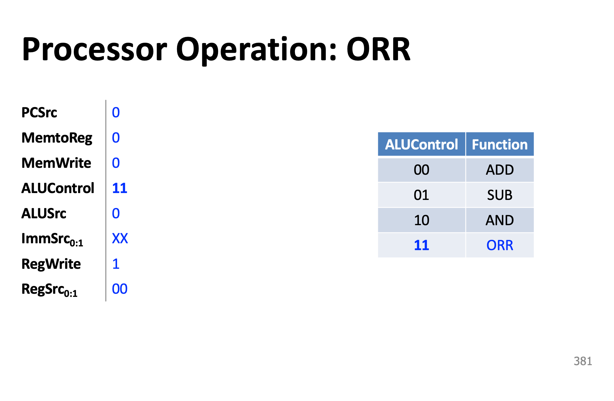

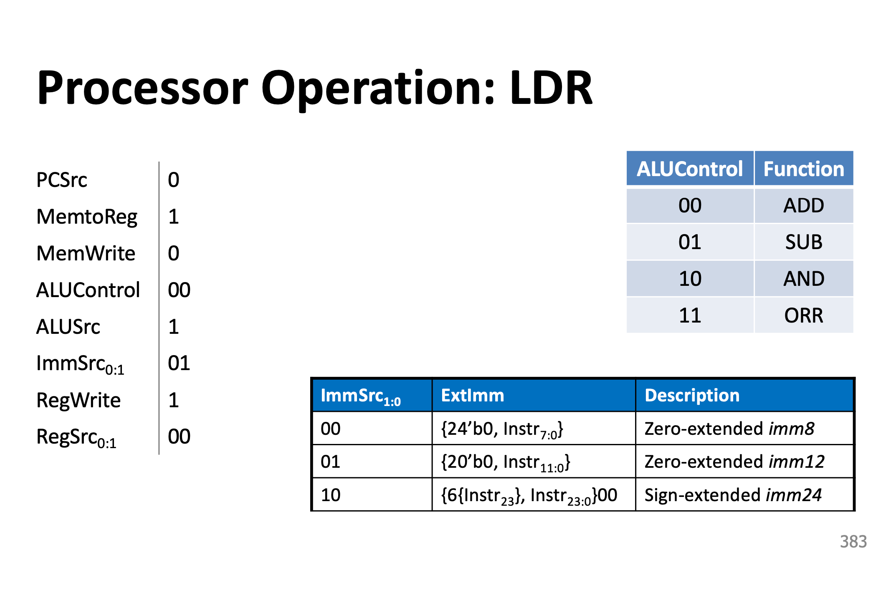

---

## 19. Performance Analysis ⭐⭐

### 19.1 Core formula (must memorize)

```
Execution time = (# instructions) × (cycles / instruction) × (seconds / cycle)
               =        N         ×          CPI           ×        Tc
```

| Factor | Depends on |
|---|---|
| **N** (instruction count) | **ISA, programmer skill, compiler, algorithm** |
| **CPI** (cycles per instruction) | **Microarchitecture** |
| **Tc** (clock period = 1/f) | **Critical path, circuit technology, adder type, gate-level details** |

> **Performance = execution time** (the time for a program to run from start to finish).

### 19.2 How to make programs faster

| Reduce which | Means |
|---|---|
| **N** | Make instructions "do more" (**CISC**); use a better compiler |
| **CPI** | **Simpler instructions (RISC)**; use multiple parallel units/ALUs/cores |
| **f ↑ (Tc ↓)** | Newer fabrication technology; redesign timing-critical components; **adopt pipelining** |

> **Note that N and CPI work against each other**: CISC reduces N but increases CPI/Tc; RISC reduces CPI/Tc but increases N. That's where the whole tradeoff lies.

### 19.3 The single-cycle CPU case

- **N**: ARM is RISC → on the high side
- **CPI = 1, fixed** — slide verbatim: **"One, fixed, bad idea!"**
- **Tc = the critical path of the CPU circuit**

**Why CPI=1 is a bad idea** ⭐: because **the clock period must accommodate the slowest instruction**, so every instruction is as slow as the slowest. **There's no way to make the common case fast** (violates Design Principle #4).

### 19.4 Critical path elements (P393)

| Parameter | Description |
|---|---|
| `tpcq_PC` | **Clock-to-Q delay of the PC** |
| `tmem` | Memory read |
| `tdec` | Decoder propagation delay |
| `tmux` | Multiplexer delay |
| `tRFread` | Register file read |
| `text` | Extend block delay |
| `tALU` | ALU delay |
| `tRFsetup` | Setup for writing the register file in the next cycle |

### 19.5 Critical path formulas ⭐⭐ must memorize

**LDR (the slowest instruction)**:
```
Tc = tpcq_PC + tmem + tdec + max[tmux + tRFread , text + tmux] + tALU + tmem + tmux + tRFsetup
```
Because **memory and the register file are slower than combinational logic** → `tmux + tRFread >> text + tmux`, so:
```
Tc(LDR) = tpcq_PC + 2·tmem + tdec + tRFread + tALU + 2·tmux + tRFsetup
```

**DP-R**:
```
Tc(DP-R) = tpcq_PC + tmem + tdec + tRFread + tALU + 2·tmux + tRFsetup
```

**Comparison**: **LDR has one more `tmem` than DP-R** (it has to access data memory).

### 19.6 Conclusions of critical path analysis ⭐

- **Different instructions have different critical paths**: **LDR is the slowest**; **DP-R and B are shorter**, because they **don't access data memory (memory is slow!)**
- The single-cycle processor is a **synchronous sequential circuit** → **the clock period must be constant and long enough to accommodate the slowest instruction**
- The numerical values of the variables in the critical path formula **depend on the specific fabrication technology**

### 19.7 Exercise 1 (P397) — must do

**Problem**: 16 nm CMOS, 100 billion (10¹¹) instructions, single-cycle CPU; find the execution time.

| Parameter | Delay (ps) |
|---|---|
| tpcq_PC | 40 |
| tmem | 200 |
| tdec | 70 |
| tmux | 25 |
| tRFread | 100 |
| tALU | 120 |
| tRFsetup | 60 |

**Solution**:
```
Tc = tpcq_PC + 2·tmem + tdec + tRFread + tALU + 2·tmux + tRFsetup
   = 40 + 2(200) + 70 + 100 + 120 + 2(25) + 60
   = 40 + 400 + 70 + 100 + 120 + 50 + 60
   = 840 ps
```
```
Execution time = N × CPI × Tc = 10¹¹ × 1 × 840×10⁻¹² s = 84 s
```

> **This is the exam pattern**: first plug into the LDR critical path formula to get Tc, then multiply by N and CPI (single-cycle CPI=1).

### 19.8 Exercise 2 (P398) — comparing the performance of two for-loop styles

The same `for (i=0; i<10; i++) sum += i;`, two translations:

| | **Style A** (COND first) | **Style B** (FOR label first) |
|---|---|---|
| Loop body | `CMP; BLT FOR; B DONE;` + `ADD; ADD; B COND;` | `CMP; BGE DONE; ADD; ADD; B FOR;` |
| **Instructions per iteration** | **6** | **5** |

- Initialization: 2 instructions each (`MOV R0,#0` + `MOV R1,#0`)
- The loop runs 10 full iterations + an 11th check to exit
- **N_A = 2 + 10×6 + 2 = 64** (the last CMP + B DONE)
- **N_B = 2 + 10×5 + 2 = 54** (the last CMP + BGE DONE)
- **Execution time = N × 1 × 840 ps** → **A ≈ 53.8 ns, B ≈ 45.4 ns**

> ⚠️ The boundary of the instruction count (how the last iteration is counted) depends on the counting convention; **go with the answer given in class/tutorial**. The point here: **the same C code, different translation styles → different N → different execution times**, while CPI and Tc are unchanged. This confirms that in the formula **N depends on the programmer/compiler**.

### 19.9 Drawbacks of the single-cycle CPU (P399) ⭐ must memorize

1. **Needs two memories** (instruction memory + data memory, **can't be reused**)
2. **Needs three adders** (**can't be reused**)
3. **The clock period is determined by the slowest instruction** → **can't make the common case fast** (e.g. DP instructions could clearly be faster)

> These three are exactly the motivation for moving next to **multicycle / pipelining**.

---

## 20. Appendix: Pitfalls to Watch Out For

| # | Pitfall | Correct answer |
|---|---|---|
| 1 | ARM opcode is only 2 bits | `op[27:26]`: **00=DP, 01=Memory, 10=Branch**. Specific instructions are distinguished by `cmd`/`funct` |
| 2 | Forgetting +8 in the BTA | **BTA = PC + 8 + (sign_extend(imm24) << 2)** |
| 3 | Reading R15 | **Returns PC + 8**, not PC |
| 4 | pre-index vs post-index | `[R1,R2]!` address is R1+R2; `[R1],R2` **address is just R1** |
| 5 | LSR vs ASR | **Dividing a signed number by 2ᴺ must use ASR** |
| 6 | LDRB vs LDRSB | **Zero extension vs sign extension**. `0x8C` → `00 00 00 8C` vs `FF FF FF 8C` |
| 7 | Conditional execution still fetches | Non-executed instructions are still fetched, **they just don't update architectural state** |
| 8 | Single-cycle controller | **Purely combinational logic, not an FSM** (only multicycle uses an FSM) |
| 9 | Single-cycle Tc | Take the critical path of **LDR** (including **2·tmem**), not of DP |
| 10 | Lifetime of the flags | Several conditional instructions can follow a CMP, **until the flags are overwritten by a new arithmetic/logic instruction** |

