# COMP2300 Set 5 Notes — Multicycle Microarchitecture: Multicycle ARM, the FSM Controller, and Microprogramming

> **Course**: ANU COMP2300 — Computer Organisation and Program Execution
> **Lecturer**: Shoaib Akram
> **This set in one sentence**: Split set4's **single-cycle** datapath into **multiple clock cycles** — use less hardware (**one** memory, **one** ALU) + several **non-architectural registers** to hold intermediate values across cycles, and an **FSM controller** that issues control signals cycle by cycle according to its state; finally cover the two implementations of the controller (hardwired FSM vs **microprogramming**) and what it means for the semantic gap, leading into pipelining.
> **Reference**: H&H Section 7.4 (multicycle processor), 7.6 (microprogramming/controller implementation), Section 7.5 (start of pipelining).

> **Notation**: `←` = assignment (written at the clock edge ending this cycle); `Rn/Rm/Rd` = ARM instruction fields; `ExtImm` = the extended immediate; `PC+8` = the value of R15 when read in ARM.

---

## 0. Skeleton of this set

```
The two pain points of single-cycle (hardware redundancy + Tc held hostage by the slowest instruction)
   ↓
Multicycle idea: split an instruction into steps, one clock cycle per step
   ↓
Streamlined state elements: unified Instr/Data memory, one ALU
   ↓  but non-architectural registers must be added (IR / Data / A / WriteData / ALUOut)
Building the datapath step by step: LDR's STEP 1~6 → R15 read/write → STR → DP → B
   ↓
Complete Multicycle ARM Processor (13 control signals)
   ↓
Controller = FSM (S0 Fetch ... S9 Branch)
   ↓
Performance: CPI varies by instruction, Tc determined by the slowest step
   ↓
Controller implementation: hardwired FSM  vs  microprogramming (Microsequencer + Control Store)
   ↓  microprogramming → a complex ISA can run on simple hardware → changes the semantic gap tradeoff
Pipelining: different instructions occupy different stages at the same time
```

---

## 1. Starting Point Review: the Problems of the Single-Cycle Processor

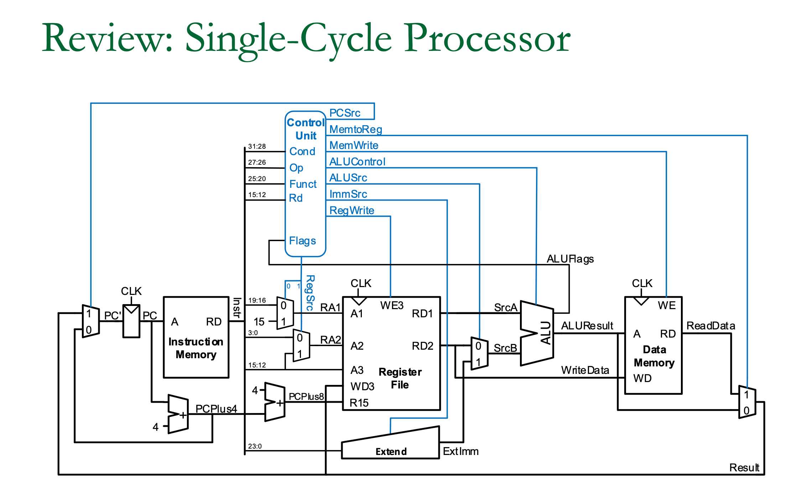

In the single-cycle design, **one instruction = one clock cycle**, so:

| Problem | Concretely |
|---|---|
| **Hardware redundancy** | Must have **two memories** (Instruction Memory + Data Memory), because in the same cycle we both fetch and access memory |
| | Must have **multiple adders** (ALU + PCPlus4 adder + PCPlus8 adder), because in the same cycle we both compute addresses/operations and compute the PC |
| **The clock period is held hostage** | `Tc` must be ≥ the total delay of **the slowest instruction** (LDR: fetch → read RF → ALU computes address → memory access → writeback) |
| | Result: very fast instructions like `ADD` and `B` also have to wait out an extra-long cycle — **wasteful** |

> **Core motivation**: since the steps of an instruction happen **serially** anyway, why not let them **occupy different cycles**? Then the same hardware can be **reused**, and `Tc` only needs to cover **one step** instead of the whole instruction.

**Cost**: CPI goes from 1 to >1 (3~5), and extra registers are needed to hold intermediate results across cycles.

---

## 2. Multicycle State Elements

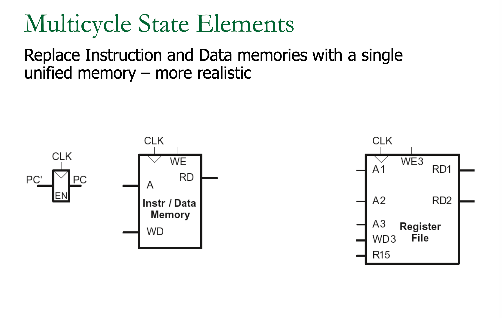

Three basic state elements:

| Element | Ports | Description |
|---|---|---|
| **PC register** | `PC'` in / `PC` out, with **EN** (enable) | With EN we can **choose not to update the PC in some cycles** — this is key to multicycle |
| **Instr / Data Memory** | `A` (address), `WD` (write data), `WE` (write enable), `RD` (read data) | ⭐ **Instructions and data share one memory** — closer to real machines (Von Neumann's unified memory) |
| **Register File** | `A1/A2` (read addresses), `RD1/RD2` (read data), `A3/WD3/WE3` (write port), `R15` | An extra `R15` input port, used to feed in PC+8 as the value of R15 |

> **Often examined**: a single memory means **the fetch cycle and the memory access cycle must not collide** — they naturally fall into different cycles, so there's no conflict. This is exactly why multicycle can save a memory.

---

## 3. ⭐ Non-architectural Registers

This is the **core new concept** of the whole set.

- **Architectural registers**: state specified by the ISA and **visible to the programmer** — R0–R15, memory.
- **Non-architectural registers**: **invisible to the programmer**, purely "relay stations" the microarchitecture adds to implement multicycle.

| Non-architectural register | What it stores | Why it's needed |
|---|---|---|
| **IR** (output `Instr` in the figure, enabled by `IRWrite`) | The 32 bits of the current instruction | Memory is shared: in later cycles memory is used to read/write **data**, and the instruction would be lost. It must first be **latched** into IR |
| **Data** | Data read back from memory | LDR gets the data in the "read memory" cycle, but writes it back to the RF only in the **next cycle** |
| **A** | RF's `RD1` (the value of Rn) | RF read values are only valid in the current cycle; the ALU uses it in the next cycle |
| **WriteData** | RF's `RD2` (the value of Rm / Rd) | Same as above; STR writes it to memory in a later cycle |
| **ALUOut** | The ALU's result | The address/operation result is kept for the next cycle (memory access or writeback) |

> **One-sentence summary**: **the output of combinational logic is valid only in the current cycle; values needed across cycles must be stored in registers.** Non-architectural registers are the separators that cut "one long combinational path" into several segments.

---

## 4. Building It Step by Step: `LDR Rd, [Rn, imm12]` as the Example

LDR is the longest instruction (5 cycles); the slides use it to build the whole datapath step by step.

Instruction encoding (review of set4):

| 31:28 | 27:26 | 25:20 | 19:16 | 15:12 | 11:0 |
|---|---|---|---|---|---|
| cond | 01 | 1 1 1 0 0 **L** | Rn | Rd | imm12 |

- `L = 1` → LDR (load); `L = 0` → STR (store). This bit is **Funct₀** in the FSM.

### STEP 1: Fetch

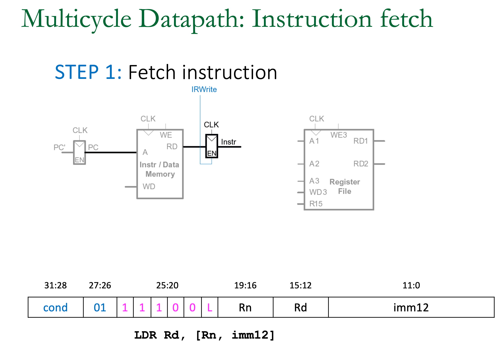

```
Instr ← Mem[PC]
```
- `PC` → memory `A` port, read `RD` → into **IR**
- New control signal: **`IRWrite`** — asserted only in the fetch cycle to latch the instruction
- In the same cycle `PC ← PC+4` is also done (see STEP 6; both things happen in the same cycle)

### STEP 2: Read registers + extend the immediate

![STEP 2: Read source operands from RF — Instr[19:16] to A1, Instr[23:0] into Extend, RD1 latched into register A](../images/set5/p27.png)

```
A ← RF[Rn]
```
- `Instr[19:16]` (= Rn) → `A1`, and the `RD1` read out is stored into **non-architectural register A**
- `Instr[23:0]` → **Extend** unit → `ExtImm`
- New control signal: **`ImmSrc`** — tells the Extend unit whether this is imm8 / imm12 / imm24 (the three instruction formats have different immediate widths)

### STEP 3: Compute the address

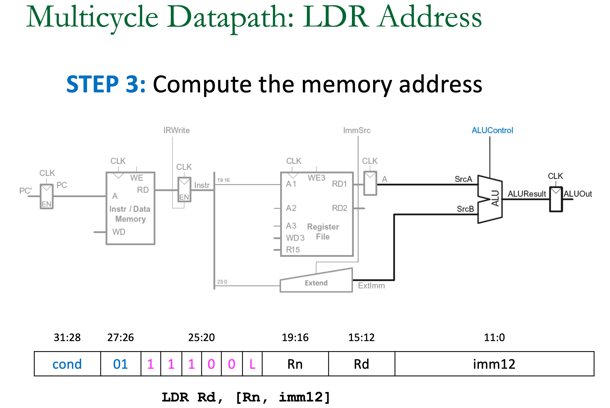

```
ALUOut ← A + ExtImm      // i.e. Rn + imm12
```
- The two ALU inputs: `SrcA` ← register A, `SrcB` ← ExtImm
- New control signal: **`ALUControl`** (select ADD)
- The result is stored into **non-architectural register ALUOut**

### STEP 4: Read memory (no screenshot of this step in the slides)

```
Data ← Mem[ALUOut]
```
- In this cycle the memory address is no longer the PC but **ALUOut** → we need to choose between PC and Result
- New control signal: **`AdrSrc`** (0 = PC, 1 = Result) and the **`Adr` multiplexer** in front of it
- The data read back is latched into **non-architectural register Data**

### STEP 5: Write back to the register file

![STEP 5: Write data back to register file — Data → Result → WD3, Instr[15:12] → A3](../images/set5/p30.png)

```
RF[Rd] ← Data
```
- `Instr[15:12]` (= Rd) → `A3`; `Data` → `Result` → `WD3`
- New control signals:
  - **`RegWrite`** (= `WE3`): only in this cycle is the RF actually written
  - **`ResultSrc`**: selects the source of the Result bus, **`01` = Data**
- `PCWrite` and `AdrSrc` also appear in the figure; at this point the `Result` bus is already shared in three places: writing the RF, as the memory address, writing the PC

### STEP 6: Update the PC

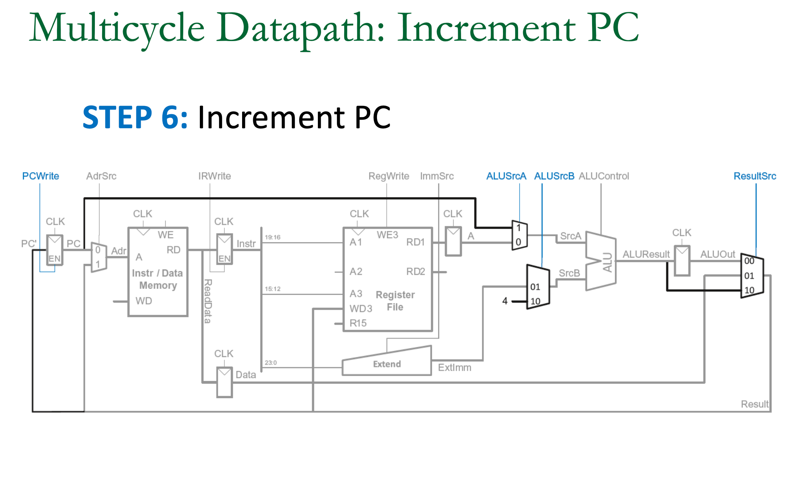

```
PC ← PC + 4
```
- Key: **reuse the same ALU** to compute PC+4 (in single-cycle this was a dedicated adder!)
- New control signals:
  - **`ALUSrcA`**: `1` = PC, `0` = register A
  - **`ALUSrcB`**: `00` = WriteData, `01` = ExtImm, `10` = **constant 4**
  - **`ResultSrc = 10`** = **ALUResult passthrough** (bypassing the ALUOut register!)
  - **`PCWrite`**: the PC register's EN
- **Why does ResultSrc have an ALUResult passthrough path (bypassing ALUOut)?** Because PC+4 must be written into the PC **at the end of this cycle**; going through ALUOut first would mean waiting one more cycle. (This is exactly Quiz question 3.)

> **⭐ Timeline key point**: STEP 1 and STEP 6 happen in the **same cycle** (the Fetch state). So at the end of fetch, `PC` is already `PC_old + 4`.

**LDR's complete micro-operation sequence (5 cycles)**:

| Cycle | State | Micro-operation |
|---|---|---|
| 1 | Fetch | `Instr ← Mem[PC]`; `PC ← PC+4` |
| 2 | Decode | `ALUOut ← PC+4` (i.e. PC_old+8, preparing R15) |
| 3 | MemAdr | `ALUOut ← Rn + ExtImm` |
| 4 | MemRead | `Data ← Mem[ALUOut]` |
| 5 | MemWB | `RF[Rd] ← Data` |

---

## 5. ⭐ Special Handling of R15 (PC)

ARM exposes the PC as the general-purpose register R15, and reading it must give **PC+8** (a historical legacy: the old ARM three-stage pipeline). The multicycle implementation has to cater to this specially.

### 5.1 Reading R15: `ADD R1, R15, R2`

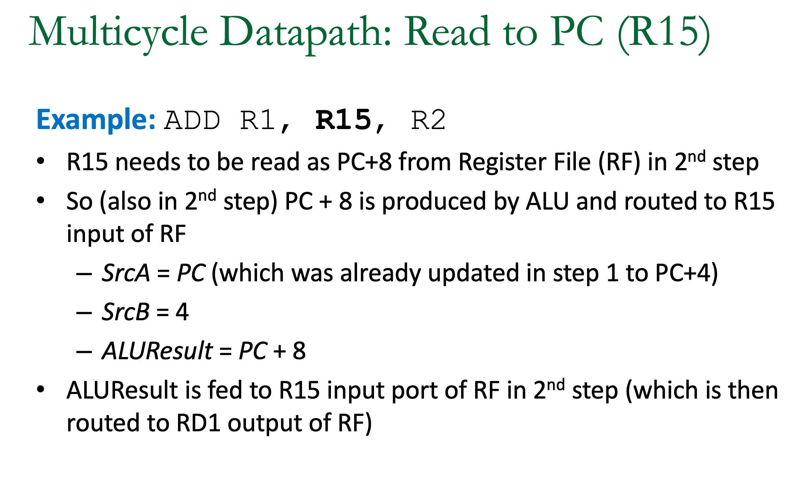

- R15 must be read by the RF as `PC+8` in **step 2 (Decode)**
- So **also in step 2**, the ALU produces PC+8 and sends it to the RF's `R15` input port:
  - `SrcA = PC` (**note: the PC was already updated to PC_old+4 in step 1**)
  - `SrcB = 4`
  - `ALUResult = PC_old + 8` ✅
- `ALUResult` feeds the RF's **R15 input port**, and the RF internally routes it to the `RD1` output

> This explains why in the FSM's **Decode state**, even though decoding "isn't finished yet", the ALU computes `PC+4` once: it's computing **the value of R15**, and incidentally stores it in ALUOut for Branch to use.

### 5.2 Writing R15: `SUB R15, R8, R3`

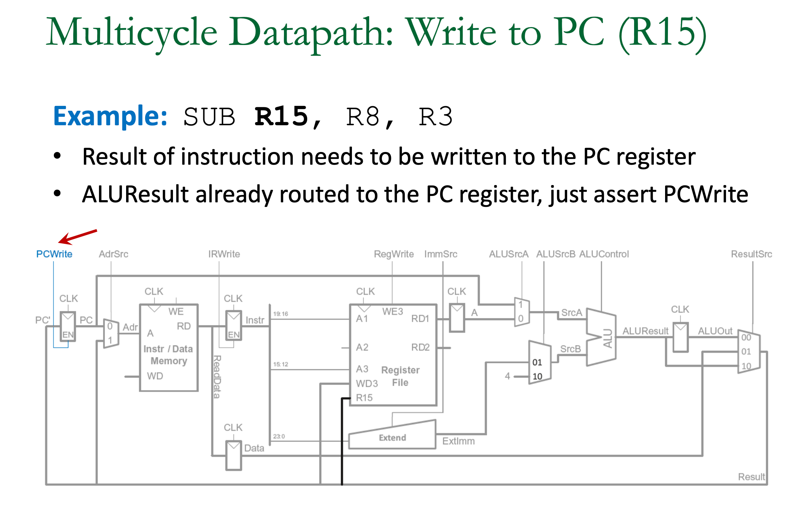

- The instruction result must be written into the **PC register** (equivalent to a jump)
- **No new hardware needed**: the path `ALUResult → Result → PC'` already exists for PC+4
- Just **assert `PCWrite` as well** in the writeback cycle

> **Design aesthetics**: the microarchitectural cost of ARM's "the PC is R15" is absorbed by an existing multiplexer and an existing wire.

---

## 6. `STR`: Writing Data to Memory

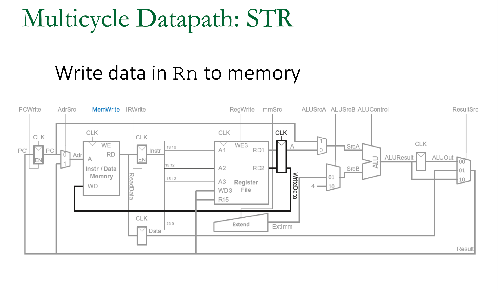

- The first 3 steps are exactly the same as LDR (Fetch → Decode → MemAdr, the address is still `Rn + ExtImm`)
- Step 4 becomes a memory write:
  - The data to write comes from `Rd` → via `A2` → `RD2` → **WriteData register** → memory `WD` port
  - New control signal: **`MemWrite`** (the memory's `WE`)
- **STR takes only 4 cycles** (no RF writeback step)

> Note that in the figure `A2`'s input is `Instr[15:12]` (Rd) rather than `Instr[3:0]` (Rm) — STR needs to read **the register being stored**, which is one of the reasons `RegSrc` (below) exists.

---

## 7. Data-Processing Instructions (DP)

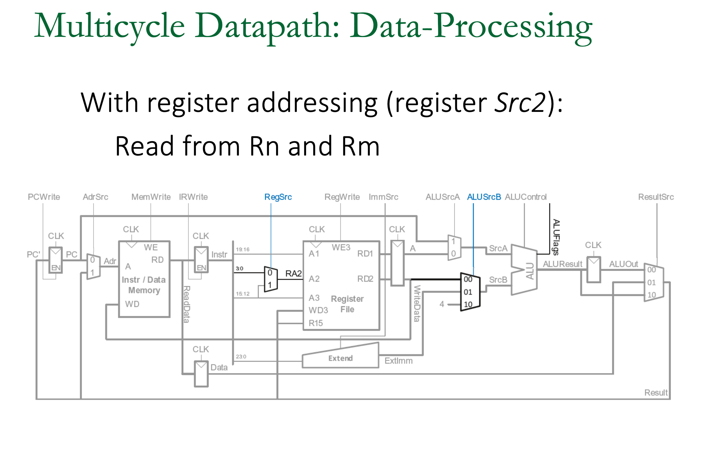

**Register addressing (register Src2)**: `ADD Rd, Rn, Rm`

- Must read both **Rn** (`Instr[19:16]` → A1) and **Rm** (`Instr[3:0]` → A2)
- New control signal: **`RegSrc`** — the multiplexer in front of A2
  - `0` → `Instr[3:0]` (Rm, used by DP instructions)
  - `1` → `Instr[15:12]` (Rd, used by STR)
- ALU inputs: `ALUSrcA = 0` (register A = Rn), **`ALUSrcB = 00`** (WriteData = Rm)
- The ALU's **`ALUFlags`** output connects back to the control unit (needed for conditional execution/conditional branches)

**Immediate addressing (immediate Src2)**: `ADD Rd, Rn, #imm8` → just change `ALUSrcB` to `01` (ExtImm); this is the only difference between the FSM's **ExecuteR / ExecuteI** states.

**DP instructions take 4 cycles**: Fetch → Decode → ExecuteR/I → ALUWB.

---

## 8. Branch `B`

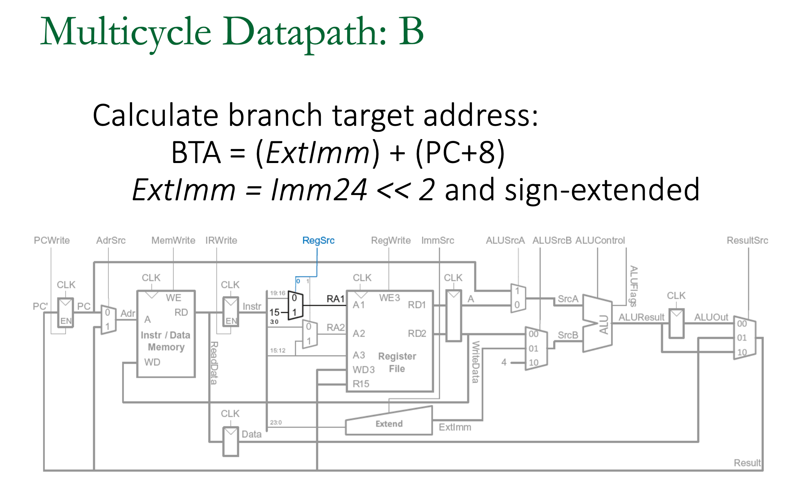

```
BTA = ExtImm + (PC + 8)
ExtImm = Imm24 << 2, then sign-extended
```

- `Imm24 << 2`: because instructions are **word-aligned**, the offset counts "number of instructions", and multiplying by 4 gives the byte offset
- `PC+8`: ARM's branch base is the value of R15
- **How do we get PC+8?** Use `RegSrc` to **force `A1`'s input to the constant 15** (the `15 → 1` path in the figure), so the RF reads out R15 = PC+8 (already computed and sent to the R15 port in the Decode cycle)
- Then `ALUSrcA = 0` (A = PC+8), `ALUSrcB = 01` (ExtImm), `ResultSrc = 10` (ALUResult passthrough), assert **`Branch`** → `PC ← BTA`

> **`RegSrc` is 2 bits**: `RegSrc₀` controls A1 (0 = Rn, 1 = 15), `RegSrc₁` controls A2 (0 = Rm, 1 = Rd).

**B takes only 3 cycles**: Fetch → Decode → Branch.

---

## 9. The Complete Multicycle ARM Processor

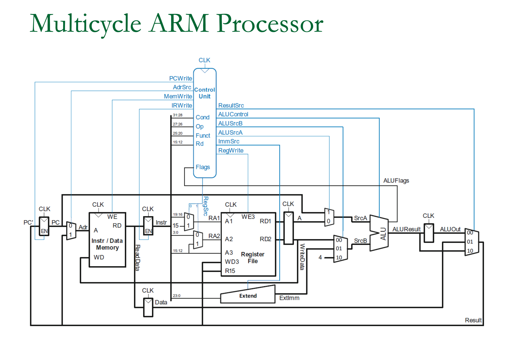

### 9.1 Inputs and outputs of the control unit

**Inputs (from the instruction and the ALU)**:

| Input | From | Purpose |
|---|---|---|
| `Cond` | `Instr[31:28]` | Conditional execution check |
| `Op` | `Instr[27:26]` | Instruction class: `00` = DP, `01` = Memory, `10` = Branch |
| `Funct` | `Instr[25:20]` | The specific operation; `Funct₅` = I bit (immediate?), `Funct₀` = L bit (Load?) |
| `Rd` | `Instr[15:12]` | Checks whether the destination register is R15 |
| `Flags` | ALUFlags (N, Z, C, V) | Condition checks |

**Outputs (13 control signals)**:

| Signal | Width | Role | Value meanings |
|---|---|---|---|
| `PCWrite` | 1 | PC register EN | 1 = update the PC this cycle |
| `AdrSrc` | 1 | Memory address source | 0 = PC (fetch), 1 = Result (memory access) |
| `MemWrite` | 1 | Memory WE | 1 = write memory (STR) |
| `IRWrite` | 1 | IR EN | 1 = latch the instruction |
| `RegSrc` | 2 | RF read address source | see §8 |
| `RegWrite` | 1 | RF WE3 | 1 = write back to a register |
| `ImmSrc` | 2 | Immediate extension mode | imm8 / imm12 / imm24<<2 |
| `ALUSrcA` | 1 | ALU A input | 0 = register A, 1 = PC |
| `ALUSrcB` | 2 | ALU B input | `00` = WriteData, `01` = ExtImm, `10` = constant 4 |
| `ALUControl` | 2 | ALU operation | ADD / SUB / AND / ORR |
| `ResultSrc` | 2 | Result bus source | `00` = ALUOut, `01` = Data, `10` = ALUResult (passthrough) |
| `Branch` | 1 | (FSM-internal) write the PC on a branch | combined into the PCWrite logic |
| `NextPC` | 1 | (FSM-internal) write the PC on fetch | combined into the PCWrite logic |

> `PCWrite = NextPC + (Branch · CondEx)` — i.e. "unconditional +4 in the fetch cycle" or "jump when the branch succeeds".

### 9.2 Comparing the figures: what multicycle adds/removes versus single-cycle

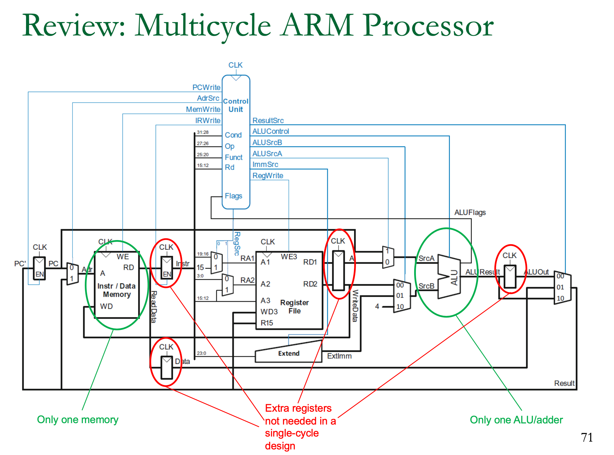

| | Green (**saved**) | Red (**added**) |
|---|---|---|
| Memory | **Only one memory** (single-cycle needs two) | — |
| Arithmetic units | **Only one ALU/adder** (single-cycle needs an ALU + two adders) | — |
| Registers | — | Five non-architectural registers: **IR, Data, A, WriteData, ALUOut** |
| Multiplexers | — | `Adr`, `ALUSrcA`, `ALUSrcB`, 3-input `ResultSrc` |

> **The essential tradeoff**: trade **a few small-area registers and muxes** for **a whole memory and two 32-bit adders**. A net gain.

---

## 10. The Main Controller FSM

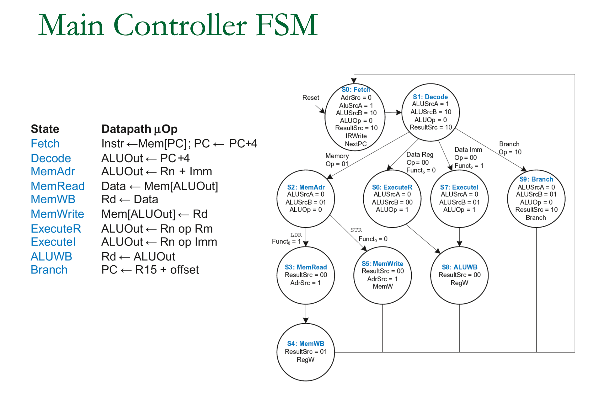

### 10.1 States and micro-operations

| State | Name | Datapath μOp |
|---|---|---|
| **S0** | Fetch | `Instr ← Mem[PC]` ; `PC ← PC+4` |
| **S1** | Decode | `ALUOut ← PC+4` (= PC_old+8, for R15/Branch) |
| **S2** | MemAdr | `ALUOut ← Rn + Imm` |
| **S3** | MemRead | `Data ← Mem[ALUOut]` |
| **S4** | MemWB | `Rd ← Data` |
| **S5** | MemWrite | `Mem[ALUOut] ← Rd` |
| **S6** | ExecuteR | `ALUOut ← Rn op Rm` |
| **S7** | ExecuteI | `ALUOut ← Rn op Imm` |
| **S8** | ALUWB | `Rd ← ALUOut` |
| **S9** | Branch | `PC ← R15 + offset` |

### 10.2 Control signals of each state (copied from the slides, must memorize)

| State | Control signals |
|---|---|
| S0 Fetch | `AdrSrc=0`, `ALUSrcA=1`, `ALUSrcB=10`, `ALUOp=0`, `ResultSrc=10`, `IRWrite`, `NextPC` |
| S1 Decode | `ALUSrcA=1`, `ALUSrcB=10`, `ALUOp=0`, `ResultSrc=10` |
| S2 MemAdr | `ALUSrcA=0`, `ALUSrcB=01`, `ALUOp=0` |
| S3 MemRead | `ResultSrc=00`, `AdrSrc=1` |
| S4 MemWB | `ResultSrc=01`, `RegW` |
| S5 MemWrite | `ResultSrc=00`, `AdrSrc=1`, `MemW` |
| S6 ExecuteR | `ALUSrcA=0`, `ALUSrcB=00`, `ALUOp=1` |
| S7 ExecuteI | `ALUSrcA=0`, `ALUSrcB=01`, `ALUOp=1` |
| S8 ALUWB | `ResultSrc=00`, `RegW` |
| S9 Branch | `ALUSrcA=0`, `ALUSrcB=01`, `ALUOp=0`, `ResultSrc=10`, `Branch` |

> **Table-reading tip**: `ResultSrc=00` + `AdrSrc=1` in S3/S5 are a pair — first make the Result bus select **ALUOut** (the computed address), then make the memory address port select **Result**.

### 10.3 State transitions

```
Reset → S0 Fetch → S1 Decode ─┬─ Op=01              ───→ S2 MemAdr ─┬─ Funct₀=1 (LDR) → S3 MemRead → S4 MemWB ─┐
                              │                                     └─ Funct₀=0 (STR) → S5 MemWrite ───────────┤
                              ├─ Op=00 and Funct₅=0 ───→ S6 ExecuteR ──→ S8 ALUWB ──────────────────────────────┤
                              ├─ Op=00 and Funct₅=1 ───→ S7 ExecuteI ──→ S8 ALUWB ──────────────────────────────┤
                              └─ Op=10              ───→ S9 Branch ─────────────────────────────────────────────┤
                                                                                              back to S0 Fetch ←┘
```

- **Op** decides which branch to take: `01` memory access, `00` data processing, `10` branch
- **Funct₅** (I bit) distinguishes register/immediate in the DP branch
- **Funct₀** (L bit) distinguishes LDR/STR in the memory branch

### 10.4 Cycle count (CPI) of each instruction class

| Instruction | States traversed | Cycles |
|---|---|---|
| **LDR** | S0→S1→S2→S3→S4 | **5** |
| **STR** | S0→S1→S2→S5 | **4** |
| **DP** | S0→S1→S6/S7→S8 | **4** |
| **B** | S0→S1→S9 | **3** |

**Average CPI = Σ(fraction of the instruction class × cycles of the class)**.

> 📖 **Textbook supplement** (instruction mix of the benchmark used by H&H: DP 45%, LDR 25%, STR 13%, B 17%):
> `CPI = 0.45×4 + 0.25×5 + 0.13×4 + 0.17×3 = 4.08`
> That is, multicycle CPI is about 4, but its `Tc` is less than 1/4 of the single-cycle one — **overall execution time improves slightly, while hardware cost drops noticeably**.
> `Execution time = N × CPI × Tc` (set4's formula continues to apply here).

---

## 11. Quiz: Multicycle Processor (slides P72)

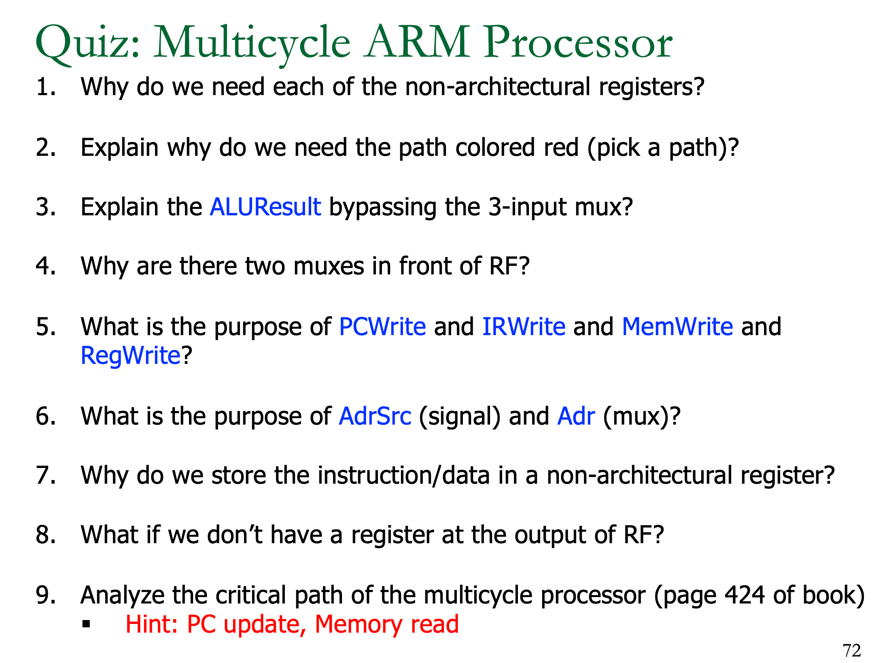

Below is a question-by-question breakdown (answers based on the derivations above):

**1. Why is each non-architectural register needed?**
See the table in §3. In one sentence: memory and the ALU are reused, their outputs are only valid in the current cycle, and **values needed across cycles must be latched**.

**2. Why is a certain (red) path needed?**
Take `Data → Result → WD3` as an example: the data read back by LDR is produced in the MemRead cycle, but the RF write waits until the MemWB cycle, so it must go through the Data register and loop back to the RF's write port.

**3. Why does `ALUResult` bypass ALUOut and go directly into the 3-input mux (ResultSrc=10)?**
Because **PC+4 (Fetch) and the BTA (Branch) must be written into the PC at the end of the current cycle**. Forcing them through ALUOut would cost an extra cycle. A passthrough path saves that cycle.

**4. Why are there two muxes in front of the RF?**
They are the two bits of `RegSrc`:
- In front of A1: normally takes `Rn` (`Instr[19:16]`), **on a branch it must take the constant 15** (reading R15 = PC+8)
- In front of A2: DP takes `Rm` (`Instr[3:0]`), **STR must take `Rd` (`Instr[15:12]`)** — because STR needs to read out the value being stored

**5. What do `PCWrite` / `IRWrite` / `MemWrite` / `RegWrite` do?**
They are all **write enables**. The essence of multicycle is "**the same hardware does different things in different cycles**", so every state element must be **precisely controlled cycle by cycle as to when it's written** — in cycles where it shouldn't be written, it must keep its old value.

**6. What do `AdrSrc` (the signal) and `Adr` (the mux) do?**
The single memory must both fetch and access data: on fetch the address = `PC` (`AdrSrc=0`), on memory access the address = `Result` (= ALUOut, `AdrSrc=1`). This mux is the price paid for "merging the two memories".

**7. Why store instructions/data in non-architectural registers?**
Because memory will be used for something else in the next cycle, and the read value would disappear. IR latches the instruction so it can supply fields to the control unit and the RF throughout the instruction's lifetime.

**8. What would happen without registers at the RF outputs (A / WriteData)?**
The RF read ports may be changed to read other registers in later cycles (e.g. A1 is changed to 15 on a branch), so the read value would change; and the RF is **written** in the MemWB/ALUWB cycle, which might overwrite a source operand that's still needed. Without the A / WriteData registers, the source operands would be lost before they're used.

**9. Critical path analysis (textbook p.424)**
The hint says there are two candidate paths:
- **PC update path**: `register A → ALUSrcA/B mux → ALU → ResultSrc mux → PC`
- **Memory read path**: `PC register → Adr mux → Memory → IR/Data registers`

```
Tc ≥ t_pcq + t_mux + max( t_ALU + t_mux , t_mem ) + t_setup
```
Which is longer depends on the relative sizes of `t_mem` and `t_ALU` — memory is usually the bottleneck. **The exact coefficients should follow textbook p.424.**

---

## 12. Another Controller Implementation: Microprogramming

The FSM above is **hardwired**: both the next-state logic and the output logic are combinational circuits. The other route is to **store the control signals as data**.

### 12.1 Microprogrammed ARM

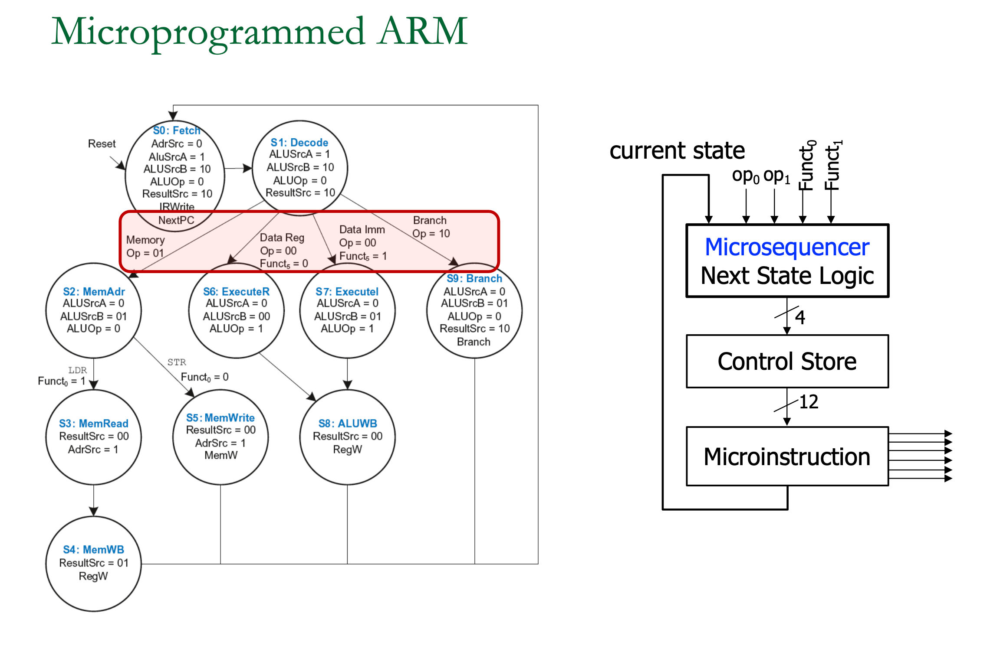

The structure splits into three parts:

| Component | Input | Output | Role |
|---|---|---|---|
| **Microsequencer** (Next State Logic) | `current state` + `op₀ op₁` + `Funct₀ Funct₁` | **4-bit** next state address | Replaces **the transition arrows marked by the red box** in the FSM diagram |
| **Control Store** | 4-bit address | **12-bit** microinstruction | A table: one row per state |
| **Microinstruction** | — | All control signals | Drives the datapath directly |

- 4-bit address → at most 16 states (we use only 10)
- 12-bit microinstruction → corresponds exactly to the 12 control signals

### 12.2 Contents of the Control Store

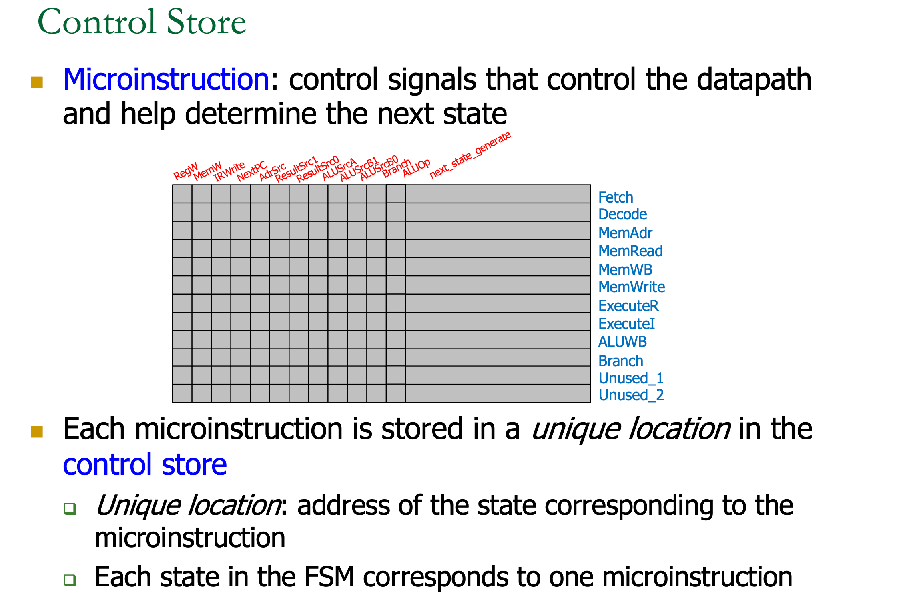

- **Microinstruction**: a set of control signals that **control the datapath** and **help determine the next state**
- Columns (12 signals + 1 next-state field):
  `RegW`, `MemW`, `IRWrite`, `NextPC`, `AdrSrc`, `ResultSrc₁`, `ResultSrc₀`, `ALUSrcA`, `ALUSrcB₁`, `ALUSrcB₀`, `Branch`, `ALUOp`, `next_state_generate`
- Rows (one per state):
  `Fetch`, `Decode`, `MemAdr`, `MemRead`, `MemWB`, `MemWrite`, `ExecuteR`, `ExecuteI`, `ALUWB`, `Branch`, `Unused_1`, `Unused_2`

> **⭐ Key correspondence**:
> **Each FSM state = one microinstruction in the Control Store**, stored at a unique location **whose address is that state's number**.
> So "designing the controller" changes from **drawing circuits** to **filling in a table / writing a microprogram**.

### 12.3 Hardwired vs microprogrammed

| | **Hardwired FSM** | **Microprogrammed** |
|---|---|---|
| Where control signals come from | Computed on the fly by combinational logic | Read out of the **Control Store (ROM/RAM)** |
| Changing the design | Redo the circuit | **Change the table** (even patch after shipping with a microcode update) |
| Speed | Fast | One extra table lookup, slightly slower |
| Suited to | **RISC** with few, regular instructions | **CISC** with many complex instructions (x86 still uses microcode today) |

### 12.4 How microprogramming changes the semantic gap tradeoff ⭐

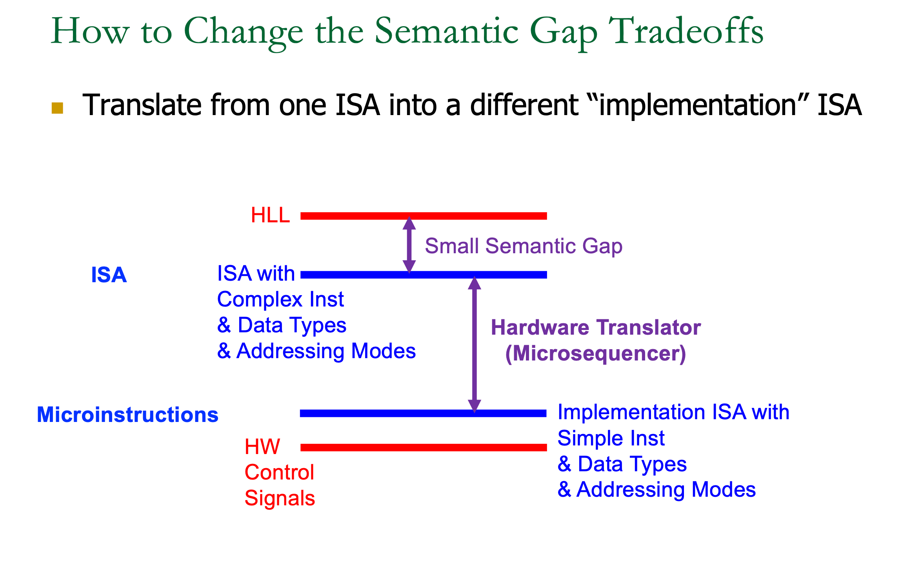

Recall set4's semantic gap: the closer the ISA is to the HLL (complex instructions), the harder the hardware; the closer to the hardware (simple instructions), the harder the compiler's job.

**Microprogramming offers a third route: translate one ISA into another "implementation ISA".**

```
HLL
 ↕  small semantic gap
ISA: complex instructions + complex data types + complex addressing modes   ← what the programmer/compiler sees
 ↕  Hardware Translator (Microsequencer)
Microinstructions: simple instructions + simple data types + simple addressing modes   ← what the hardware actually executes
 ↕
HW Control Signals
```

- **Upward**: expose a **complex ISA close to high-level languages** (small semantic gap, easy for the compiler, high code density)
- **Downward**: the hardware only needs to implement a set of **simple micro-operations** (circuits easy to build and verify)
- **In between**: the microsequencer **expands one complex instruction into a sequence of microinstructions**

> **This is why CISC (e.g. x86) can keep thousands of complex instructions while internally using RISC-style execution units.**

---

## 13. Next Step: Pipelining

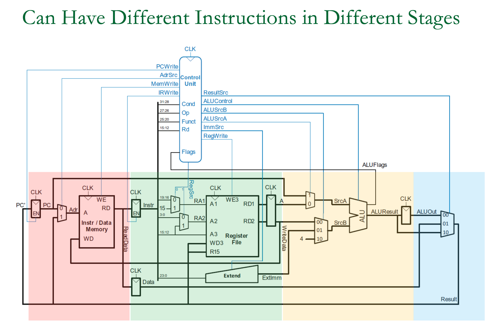

Multicycle has already cut an instruction into several **stages**, but in each cycle **only one stage is working** and the rest of the hardware sits idle.

The natural idea: **let different instructions occupy different stages at the same time.**

In the figure the datapath is painted in four blocks:

| Color | Stage | Hardware |
|---|---|---|
| 🔴 Red | **Fetch** | PC, Adr mux, Instr/Data Memory |
| 🟢 Green | **Decode / Register Read** | IR, RegSrc mux, Register File, Extend |
| 🟡 Yellow | **Execute** | ALUSrcA/B mux, ALU, ALUOut |
| 🔵 Blue | **Writeback / Result** | ResultSrc mux, Result bus |

- While instruction 1 is in Execute, instruction 2 can be in Decode and instruction 3 in Fetch
- Ideally **CPI → 1 while Tc stays short** — throughput rises substantially
- Cost: **hazards** — data dependences, control dependences, structural conflicts (the content of the next set)

---

## 14. Must-Memorize List for This Set

1. **Motivation for multicycle**: reuse hardware (one memory, one ALU) + Tc is determined by **the slowest step** rather than the slowest **instruction**.
2. **The five non-architectural registers**: IR, Data, A, WriteData, ALUOut — and why each is indispensable.
3. **The 13 control signals** and their value encodings, especially `ResultSrc` (00=ALUOut / 01=Data / 10=ALUResult passthrough) and `ALUSrcB` (00=WriteData / 01=ExtImm / 10=4).
4. **The ten FSM states**, their control signals, and transition conditions (Op / Funct₅ / Funct₀).
5. **Cycle counts**: LDR 5, STR 4, DP 4, B 3; `Execution time = N × CPI × Tc`.
6. **Reading/writing R15**: read = PC+8 (computed by the ALU in the Decode cycle and sent to the R15 port); write = just assert `PCWrite`.
7. **Microprogramming**: FSM state ↔ one row (microinstruction) of the Control Store; Microsequencer = next-state logic.
8. **Semantic gap**: microprogramming = a hardware translator that lets a complex ISA run on simple hardware.

