# COMP2300 Set 6 Notes — Functions, the Stack, Memory Mapping, Exceptions and I/O, Power

> **Course**: ANU COMP2300 — Computer Organisation and Program Execution
> **Lecturer**: Shoaib Akram
> **This set in one sentence**: Starting from "one BL instruction", take software abstractions (functions, stack frames, calling conventions, pointers, the heap) all the way down to hardware mechanisms (exceptions/interrupts, privilege levels, I/O architecture, DMA), and finally use Amdahl's law and the power formula to answer "where should the system actually be optimized".
> **Page numbers**: all based on `set6__后半部分_.pdf` (255 pages, the updated version); it is identical to the old `set6.pdf` for the first 156 pages and diverges from P157 (adding the micro:bit exception mechanism P157–168, EDP P230, chiplets P234, program structure / Flash vs SRAM / locality / Cache P237–255). PDF page number = number at the bottom right of the slide + 1.

---

# 1. Branch Instructions and BTA Calculation

## 1.1 Branch instruction format (Format 3)

| 31:28 | 27:26 | 25:24 | 23:0 |
|---|---|---|---|
| `cond` | `op` | `1L` | `imm24` |

- `op = 10` (binary), identifying a branch-class instruction
- bits[25:24] form the funct field, **bit 25 is always 1**
- **L bit (bit 24)**: `L = 0` → `B` (ordinary branch); `L = 1` → `BL` (Branch and Link, function call)
- `imm24`: a 24-bit **signed** immediate

## 1.2 BTA (Branch Target Address) calculation — the three steps to memorize

> **BTA = (SignExtend(imm24 << 2)) + PC + 8**

Broken down, these are the slides' three steps:

1. **Shift** `imm24` **left by 2** (converting "words" into "bytes", because ARM instructions are a fixed 4 bytes)
2. **Sign-extend**: copy `Instr[23]` into `Instr[31:24]`
3. **Add PC + 8**

**Why +8 and not +4?** In ARM's classic three-stage pipeline, at fetch time the PC is already 2 instructions (2 × 4 = 8 bytes) ahead of the current instruction. This is a hardware fact, not a convention, and is often examined.

**Example (P6)**: `imm24 = 3` → shifted left by 2 gives 12 (0x0C) → PC = 0x80A0, PC+8 = 0x80A8 → BTA = 0x80A8 + 12 = 0x80B4, exactly at the `THERE` label.

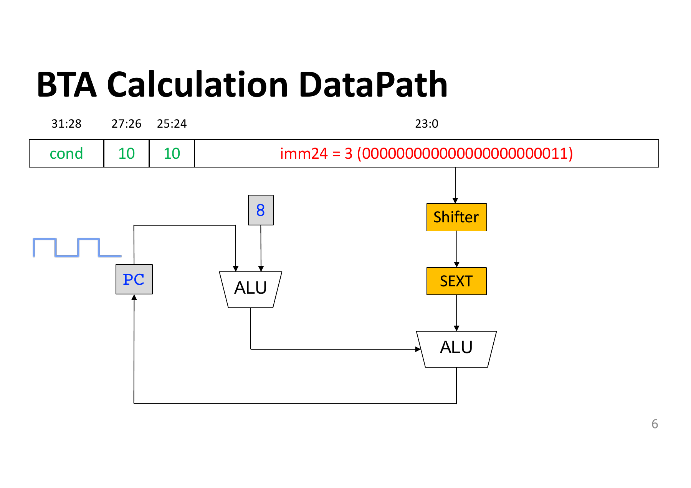

**PC-relative addressing mode**: compute the target address by adding an offset to the PC. The advantage is that the code is **position independent**; the whole block of code can be moved elsewhere in memory without changes.

---

# 2. Functions

## 2.1 Conceptual level

- **Function / procedure / subroutine**: a piece of program written once and called many times
- **Library**: a collection of functions provided by a vendor or third party (e.g. the math library's `sqrt`/`sin`/`cos`)
- **API (Application Programming Interface)**: defines the interface for communication between programs **at the source code level**. **An API defines only the interface, not the implementation**; the same API can have multiple implementations
- Benefits of functions: abstraction and modularity, code reuse, readability, testability, maintainability

## 2.2 Core role distinctions

| Term | Meaning |
|---|---|
| **Caller** | The party making the call, responsible for preparing arguments |
| **Callee** | The party being called, responsible for doing the work and returning the result |
| **Leaf function** | Doesn't call any other function (e.g. `sum()`) |
| **Non-leaf function** | Calls other functions internally (e.g. `main()`); much more complex at the assembly level |

⚠️ caller/callee are **relative roles** depending on context — when `main` is called by someone else, it is the callee.

## 2.3 Complete breakdown of function execution (P21, memorize it)

1. The caller places arguments in registers or memory
2. **Function call**: the caller hands control flow to the callee
3. The callee requests/allocates the memory needed for its work
4. The callee executes the function body
5. The callee places the result in "a certain" register
6. The callee frees the memory
7. **Function return**: the callee returns control to the caller

The professor's metaphor (P20): a function is like a **spy** — takes the mission, gets resources, does the work, **leaves no trace**, returns safely. "Leaving no trace" is precisely the reason calling conventions exist.

## 2.4 ISA support for functions

| ISA | Function call instruction |
|---|---|
| ARM | `BL` |
| MIPS | `jal` |
| RISC-V | `jal` |
| Intel x86 | `call` |
| **QuAC** | **No architectural support** |

**`BL LABEL` does two things**:
1. Jumps to `LABEL`
2. Stores the **return address** (the address of the instruction after the function call) in **LR (Link Register, R14)**

**Return**: `MOV PC, LR`

## 2.5 ARM register conventions (table to memorize)

| Name | Use |
|---|---|
| **R0** | Argument 0 / **return value** / temporary |
| **R1–R3** | Arguments 1–3 / temporaries |
| **R4–R11** | Saved variables |
| **R12** | Temporary (IP) |
| **R13 (SP)** | Stack Pointer |
| **R14 (LR)** | Link Register |
| **R15 (PC)** | Program Counter |

**Argument passing convention**: R0, R1, R2, R3 (at most 4); **return value convention**: R0.

## 2.6 Example: DIFFOFSUMS (original version, with problems)

```arm
; R4 = y
MAIN
  ...
  MOV R0, #2        ; argument 0 = 2
  MOV R1, #3        ; argument 1 = 3
  MOV R2, #4        ; argument 2 = 4
  MOV R3, #5        ; argument 3 = 5
  BL  DIFFOFSUMS    ; call function
  MOV R4, R0        ; y = returned value
  ...

; R4 = result
DIFFOFSUMS
  ADD R8, R0, R1    ; R8 = f + g
  ADD R9, R2, R3    ; R9 = h + i
  SUB R4, R8, R9    ; result = (f+g) - (h+i)
  MOV R0, R4        ; put return value in R0
  MOV PC, LR        ; return to caller
```

**Two open problems (P30)**:
1. How are more than 4 arguments passed?
2. `DIFFOFSUMS` overwrites R4, R8, R9, but these registers may still be **live** in `MAIN` — what then?

**The answer to both: the Stack.**

## 2.7 Aside: register reuse and liveness (often-examined concept)

- **Live register**: a later instruction will still use its current value
- **Dead register**: no later instruction will use its value, so it can be safely overwritten
- ⚠️ Precisely: **what is dead is the "value" in the register, not the physical register itself**

---

# 3. The Stack

## 3.1 Uses of the stack (P32)

1. Saving/restoring registers
2. Passing extra arguments (the ones beyond 4)
3. Holding function local variables that don't fit in registers

## 3.2 What's needed to implement a stack

| Requirement | Hardware counterpart |
|---|---|
| "A chunk of memory" to store data | Data memory |
| "An arrow" pointing at the top of the stack | A register (a pointer holding a memory address) = **SP** |

> **Stack Pointer (SP)**: the architectural register dedicated by convention to holding the address of the top of the stack (R13 in ARM).

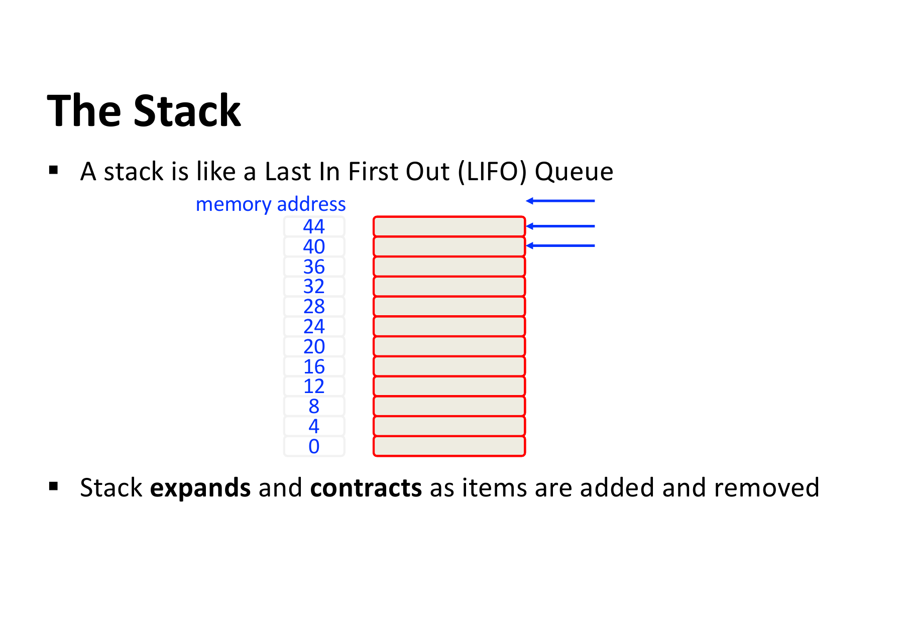

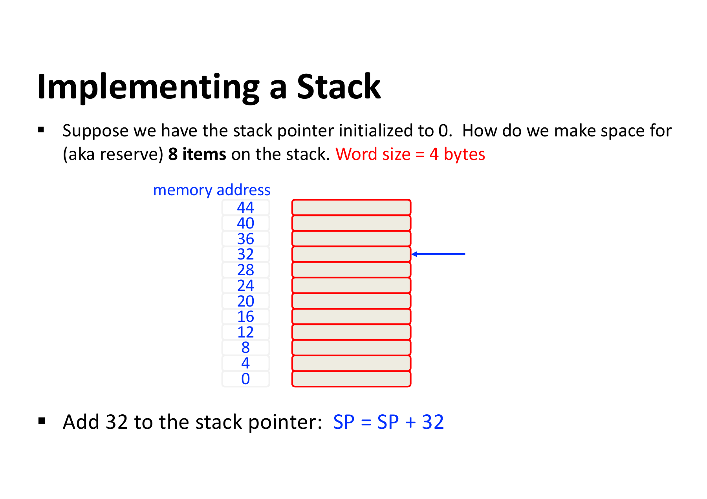

## 3.3 The four kinds of stack — core exam point

**Two orthogonal dimensions:**

**Dimension 1: growth direction**

| Descending Stack | Ascending Stack |
|---|---|
| Grows toward **lower addresses** (downward) | Grows toward **higher addresses** (upward) |
| SP points to the **lowest address** of the used region | SP points to the **highest address** of the used region |

**Dimension 2: where SP points**

| Full Stack | Empty Stack |
|---|---|
| SP points to **the last allocated location** (the valid element at the top of the stack, the location of the last push) | SP points **one slot beyond the top** (the next empty slot to be written) |

Combining gives four: **Full Descending (FD)** / Full Ascending (FA) / Empty Descending (ED) / Empty Ascending (EA).

> ✅ **ARM uses Full Descending (FD)**: the stack grows toward lower addresses, and SP points to the most recently pushed element.

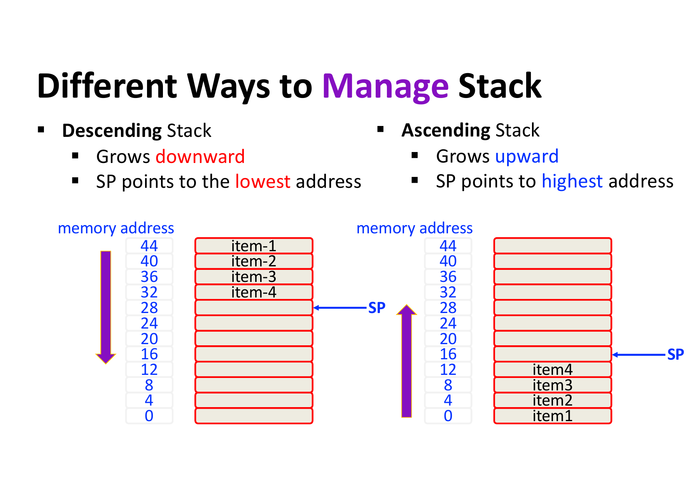

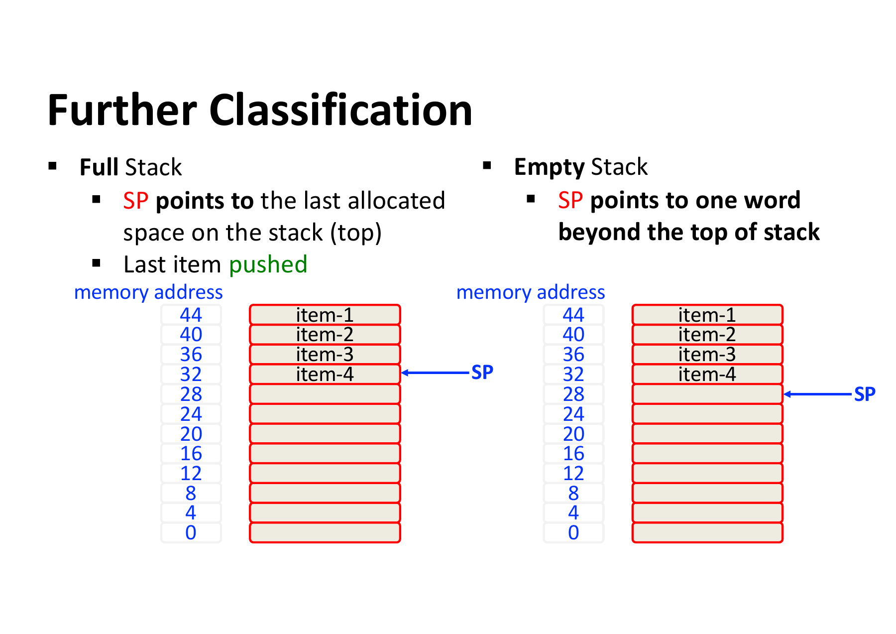

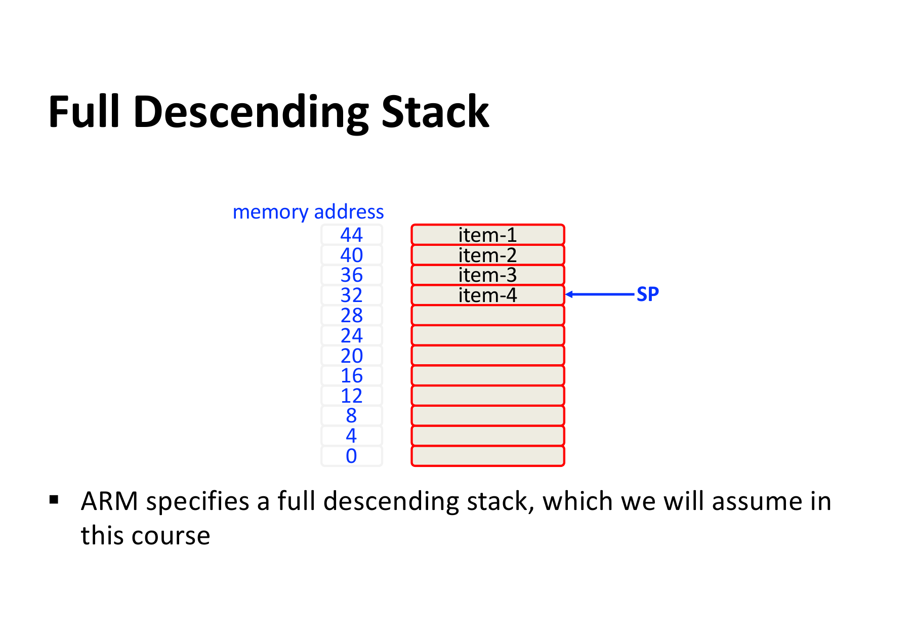

## 3.4 ⚠️ Slide error: the SP direction for push/pop is reversed

**P38 original**: `push` → `SP = SP + 4`; `pop` → `SP - 4`
**P60 original**: `PUSH {R4}` … *adds 4 to SP*; `POP {R4}` … *subtracts 4 from SP*

**Both are backwards.** ARM is Full Descending:

| Operation | Correct SP change | Equivalent instruction sequence |
|---|---|---|
| `PUSH {Rn}` | **SP = SP − 4** | `SUB SP, SP, #4` + `STR Rn, [SP]` |
| `POP {Rn}` | **SP = SP + 4** | `LDR Rn, [SP]` + `ADD SP, SP, #4` |

Your handwritten "substract / add" annotation on P60 is correct. P38's statement only holds for an ascending stack, and contradicts all the later ARM examples (P46–48, P51–54, P77–87). **In the exam answer according to ARM's actual semantics: PUSH subtracts, POP adds.**

## 3.5 Actual behavior of the ARM stack

```
Initial:  BEFFFAE8  AB000001   ← SP
After push 0x12345678, push 0xFFFFDDCC:
        BEFFFAE8  AB000001
        BEFFFAE4  12345678
        BEFFFAE0  FFFFDDCC   ← SP   (SP decreased by 8)
```

⚠️ Key understanding (your annotation on P46 is correct): **the SP register holds an address** (e.g. `0xBEFFFAE0`); to get the data you must then read the contents at that address — SP is a pointer, not data.

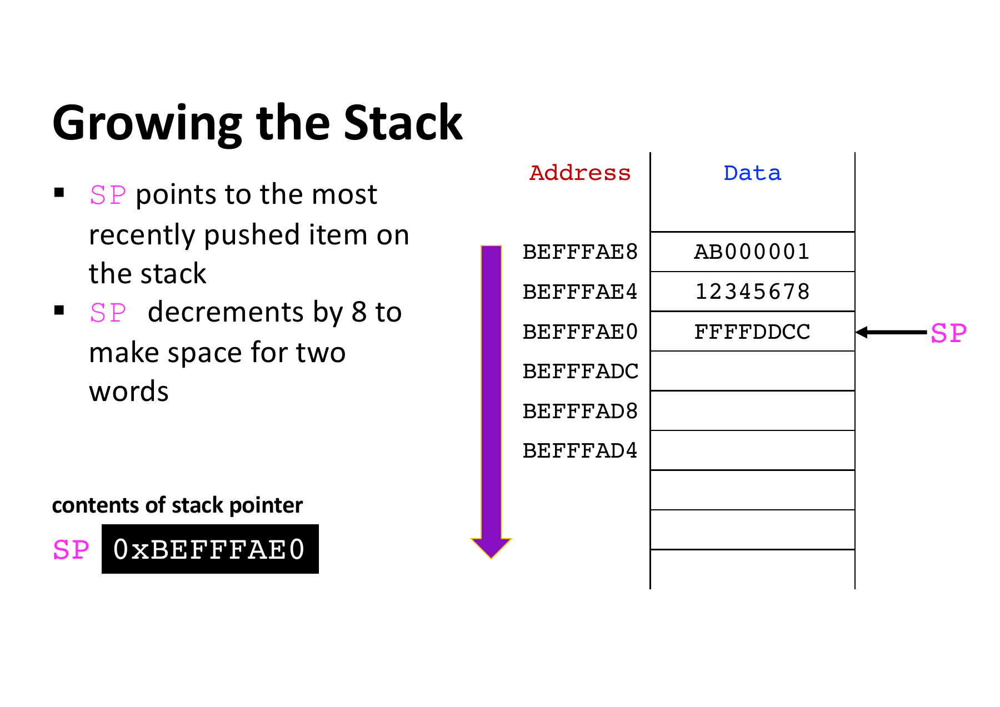

## 3.6 Saving/restoring registers with the stack: Improved DIFFOFSUMS

**The four-step routine (P50)**: allocate space (`SUB SP, SP, #12`) → save registers → execute the function body → restore registers → free space (`ADD SP, SP, #12`).

```arm
; R0 = result
DIFFOFSUMS
  SUB SP, SP, #12    ; make space on the stack for 3 registers
  STR R9, [SP, #8]   ; save R9
  STR R8, [SP, #4]   ; save R8
  STR R4, [SP]       ; save R4
  ADD R8, R0, R1     ; R8 = f + g
  ADD R9, R2, R3     ; R9 = h + i
  SUB R4, R8, R9     ; result = (f+g) - (h+i)
  MOV R0, R4         ; return value in R0
  LDR R4, [SP]       ; restore R4
  LDR R8, [SP, #4]   ; restore R8
  LDR R9, [SP, #8]   ; restore R9
  ADD SP, SP, #12    ; free stack space
  MOV PC, LR         ; return
```

⚠️ **Minor slide error**: the comment at the top of P51 says `; R0 = result`, but on P52–54 it becomes `; R2 = result` — the comments of the same code are inconsistent; in fact the result is first in **R4**, then `MOV R0, R4` sends it to R0. Go with R4 → R0.

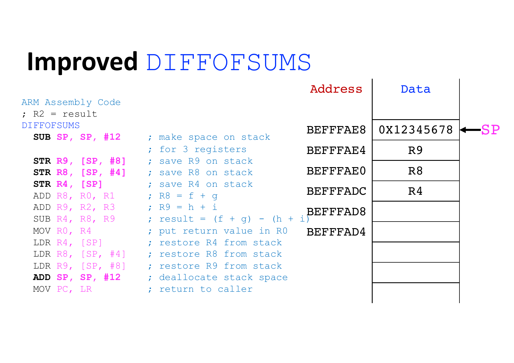

---

# 4. Calling Convention — the most central exam point of this set

## 4.1 Why a convention is needed

Saving **every** register a function uses is wasteful: `DIFFOFSUMS` saved R4, R8, R9, but the caller may not have been using R8/R9 at all.

> **A calling convention is a "contract" that both caller and callee must obey.**

With it: functions written by different programmers can interoperate, functions compiled by different compilers can interoperate, and third-party library functions can be used safely without worrying that misplaced arguments/return values will corrupt state.

## 4.2 Preserved vs Nonpreserved (table to memorize)

| **Preserved (callee-saved)** | **Nonpreserved (caller-saved)** |
|---|---|
| Saved registers: **R4 – R11** | Temporary register: **R12** |
| Stack pointer: **SP (R13)** | Argument registers: **R0 – R3** |
| Return address: **LR (R14)** | Current Program Status Register (CPSR) |
| Stack space **above SP** | Stack space **below SP** |

**Definitions**:
- **Preserved registers**: preserved across function calls. The caller can assume "the call never happened". **The callee is responsible for saving and restoring them.**
- **Nonpreserved registers**: **the caller saves them itself before the call**; the callee has no obligation to protect them.

**Two corollaries (exam points)**:
- **The stack space above SP is preserved** — provided the callee doesn't mess with the caller's stack frame
- **SP itself is preserved** — because the callee frees the stack space it used before returning

## 4.3 The two rules

- **Caller save rule**: the caller must save the nonpreserved registers **it still needs after the call** before calling; and restore them after the call returns.
- **Callee save rule**: the callee must save any preserved registers before touching them; and restore them before returning.

## 4.4 PUSH / POP of multiple registers

```arm
PUSH {R4, R8, LR}
```

**Ordering rule (often examined)**:
- **The highest-numbered register is stored at the highest address** (toward R13)
- **The lowest-numbered register is stored at the lowest address**
- **Independent** of the order written in the braces; the hardware arranges by register number

## 4.5 Complete example: F1 calls F2

```arm
; ---------------- F1 ----------------
; R0=a, R1=b, R4=i, R5=x
F1
  PUSH {R4, R5, LR}   ; callee-save: R4/R5 are preserved, LR because it calls someone else
  ADD  R5, R0, R1     ; x = (a+b)
  SUB  R12, R0, R1    ; temp = (a-b)      ← R12 is nonpreserved, free to use
  MUL  R5, R5, R12    ; x = x*temp
  MOV  R4, #0         ; i = 0
FOR
  CMP  R4, R0         ; i < a?
  BGE  RETURN         ; no: exit loop
  PUSH {R0, R1}       ; caller-save: R0/R1 still needed after the call
  ADD  R0, R1, R4     ; arg = b+i
  BL   F2             ; call f2(b+i)
  ADD  R5, R5, R0     ; x = x + f2(b+i)
  POP  {R0, R1}       ; restore
  ADD  R4, R4, #1     ; i++
  B    FOR
RETURN
  MOV  R0, R5         ; return x
  POP  {R4, R5, LR}   ; restore
  MOV  PC, LR         ; return

; ---------------- F2 ----------------
; R0=p, R4=r
F2
  PUSH {R4}           ; callee-save
  ADD  R4, R0, 5      ; r = p+5
  ADD  R0, R4, R0     ; return r+p
  POP  {R4}
  MOV  PC, LR
```

**This code demonstrates both rules at once**:
- `PUSH {R4, R5, LR}` / `PUSH {R4}` → **callee save rule** (R4/R5 are preserved)
- `PUSH {R0, R1}` (around `BL F2`) → **caller save rule** (R0–R3 are nonpreserved)
- `LR` must be saved because F1 is **non-leaf**: `BL F2` overwrites LR

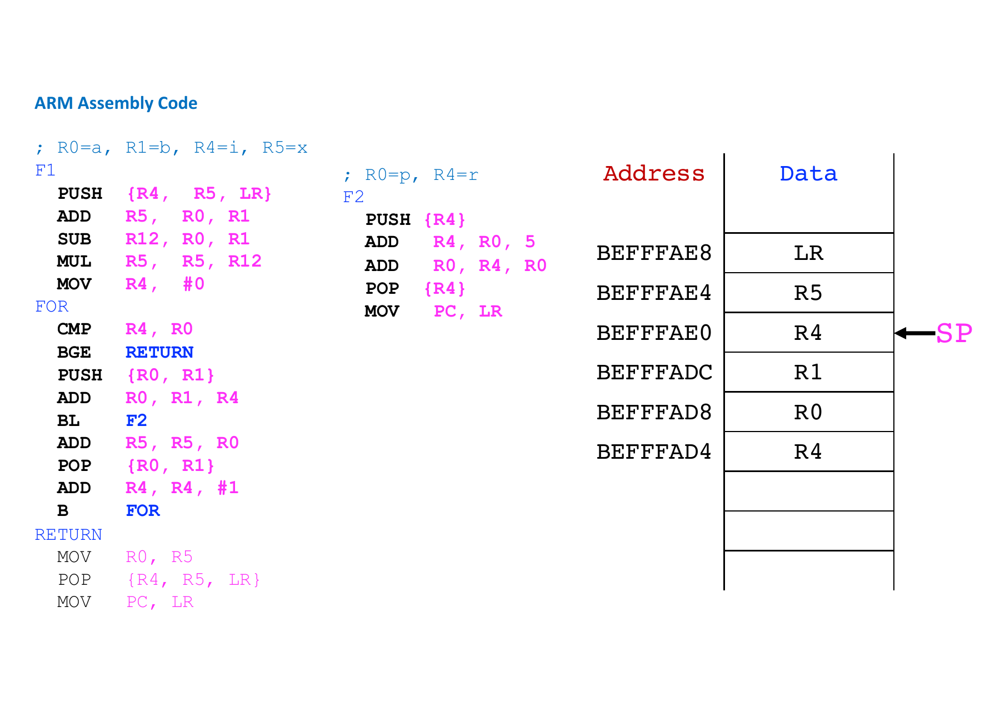

## 4.6 Exercise (P67) and answers

**Problem**: give two optimizations that reduce the stack space used by the program above without affecting correctness.

**Answers (your annotations are correct)**:
1. **No need to push/pop R1 in F1** — the callee F2 doesn't use R1 at all, so R1 won't be clobbered.
2. **Use R3 instead of R4 in F2** — R3 is nonpreserved and the caller F1 doesn't use R3, so F2 no longer needs `PUSH {R4}` / `POP {R4}`.

> The thinking behind this question is worth remembering: **the basis for optimization is not "which registers did I use", but "which registers' values are live at the call site" + "who is responsible for saving them under the convention"**.

## 4.7 Call/return summary (P74)

| What the caller does | What the callee does |
|---|---|
| Put arguments in R0–R3 | Save preserved registers that may be clobbered (R4–R11, LR) |
| Save needed nonpreserved registers (R0–R3, R12) | Execute the function body |
| `BL CALLEE` | Put the result in R0 |
| Restore registers | Restore registers |
| Take the result from R0 | Return with `MOV PC, LR` |

---

# 5. Stack Frames and the Call Stack

## 5.1 Definitions

- **Stack frame**: the chunk of space a function allocates on the stack. Also called an **activation record**.
- **A function's execution environment**: PC + stack frame + preserved registers.
  - The caller's execution environment must be **preserved between the call and the return**
  - The callee's execution environment must be **set up**
- A running program has many active stack frames; together they're called the **call stack**.

**The many aliases of the call stack** (P73; the exam may swap the wording on you): Execution Stack / Program Stack / Run-time Stack / Control Stack / Machine Stack / Activation Stack.

**General stack frame layout (P71, top to bottom)**: return value → arguments → link to the previous frame → saved machine state → local data → temporaries.

⚠️ **Important reminder (P71)**: **the stack is not a hardware component**. We just set aside a region of memory and "use it as a stack". The exact shape and layout of the call stack **depend on the compiler and architecture**.

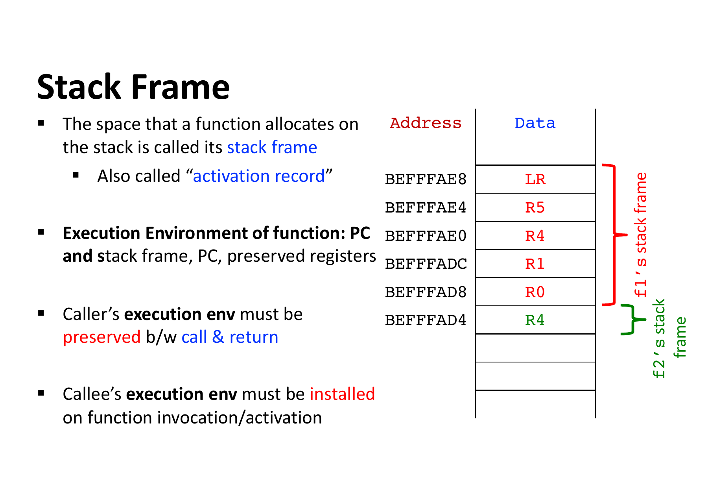

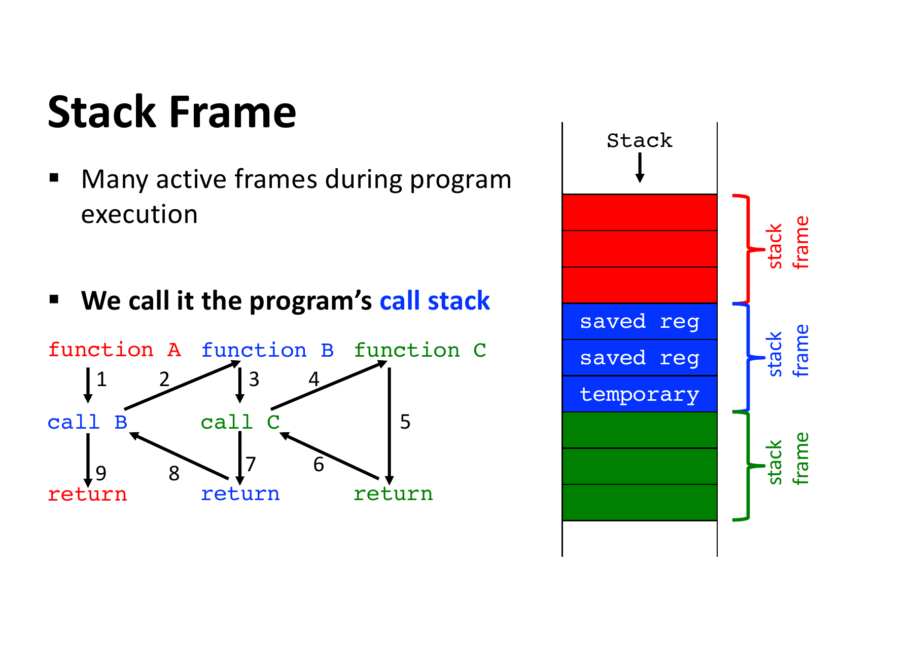

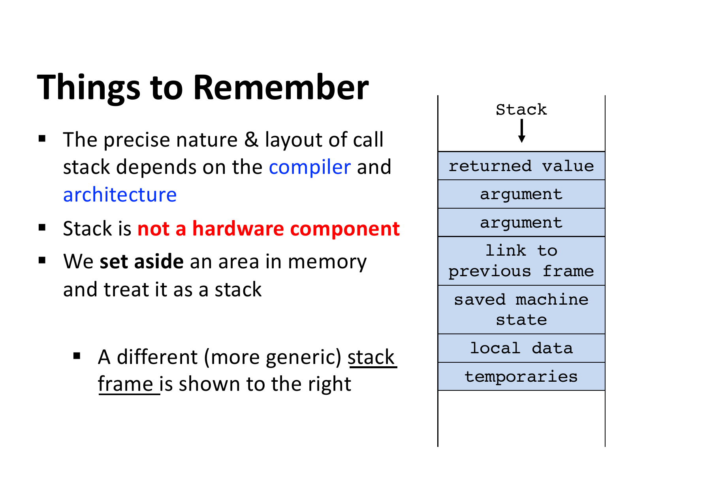

## 5.2 ABI (Application Binary Interface)

> **The calling convention is not part of the ISA**; it belongs to the procedure call interface. Together these things are called the **ABI (Application Binary Interface)**.

This is a frequent concept-distinction question: **the ISA is a hardware contract, the ABI is a software contract (who saves which register, how arguments are laid out, how the stack is aligned)**. Changing the compiler/OS may change the ABI, but not the ISA.

## 5.3 More than 4 arguments / local variables and arrays

- With more than 4 arguments, **the caller extends its own stack** to hold the extra arguments; **the callee fetches them from the caller's stack**.
  - ⚠️ This is the **only exception** to the rule "the callee must not access the caller's stack space".
- Local variables are visible only within the function (**stack-resident**). Local variables that don't fit in R4–R11 are stored in **the callee's own stack frame**.
- **Local arrays always go on the stack** (registers can't hold them).

---

# 6. Recursion

## 6.1 Assembly implementation of factorial

```arm
0x8500 FACTORIAL  PUSH {R0, LR}    ; push n and LR
0x8504            CMP  R0, #1      ; R0 <= 1?
0x8508            BGT  ELSE        ; no: branch to else
0x850C            MOV  R0, #1      ; otherwise return 1
0x8510            ADD  SP, SP, #8  ; restore SP (discard the two words just pushed)
0x8514            MOV  PC, LR      ; return
0x8518 ELSE       SUB  R0, R0, #1  ; n = n - 1
0x851C            BL   FACTORIAL   ; recursive call (LR ← 0x8520)
0x8520            POP  {R1, LR}    ; pop n into R1, pop LR
0x8524            MUL  R0, R1, R0  ; R0 = n * factorial(n-1)
0x8528            MOV  PC, LR      ; return
```

## 6.2 Point-by-point notes (P89, must read)

- `factorial` saves **LR** per the **callee save rule** (it's non-leaf; `BL` overwrites LR)
- `factorial` saves **R0** per the **caller save rule** — because `n` is still needed after calling itself
- If `n ≤ 1`: put the result 1 in R0 and return directly. **No need to restore LR**, because LR wasn't changed on this path (just `ADD SP, SP, #8` to balance the stack)
- When restoring n it uses **R1, not R0** — to avoid overwriting the return value
- `MUL R0, R1, R0`: n (in R1) × return value (in R0) → result into R0

> ⚠️ **A recursive function is both caller and callee**, so both rules apply at the same time. This is the key to understanding this code.

## 6.3 Stack changes for factorial(3)

| Stage | Stack contents (high addresses on top) |
|---|---|
| Enter factorial(3) | `BEFFFAE8: LR(0x1000)` / `BEFFFAE4: R0(3)` ← SP |
| Enter factorial(2) | push `BEFFFAE0: LR(0x8520)` / `BEFFFADC: R0(2)` ← SP |
| Enter factorial(1) | push `BEFFFAD8: LR(0x8520)` / `BEFFFAD4: R0(1)` ← SP (**deepest**) |
| Return level by level | R0 = 1 → 2×1=2 → 3×2=**6**, SP rises back level by level |

Note that **the LR saved at the second level and beyond is always 0x8520** (the instruction after the recursive call site); only the outermost level holds the real caller address 0x1000.

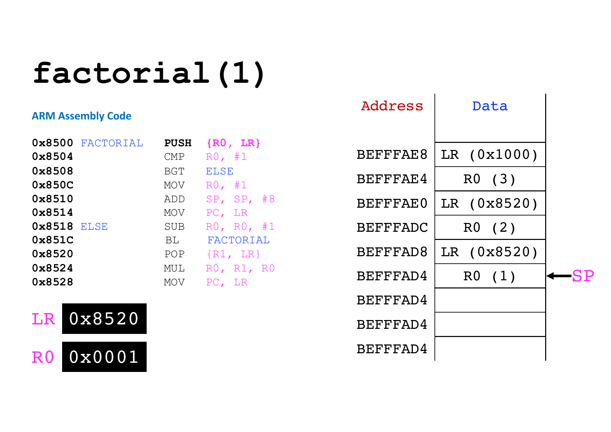

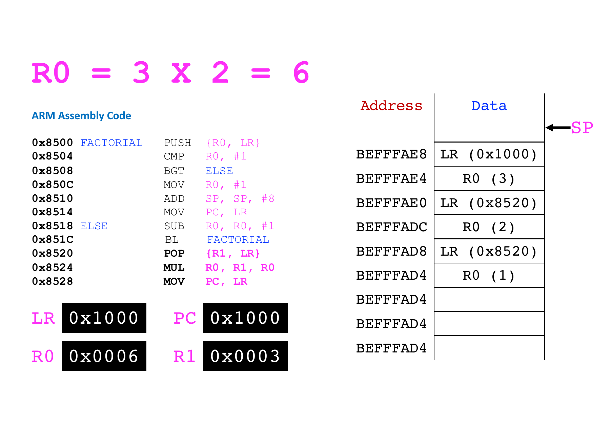

## 6.4 Recursion vs iteration (often-examined comparison)

- **Every recursive solution has an equivalent iterative solution** (a mathematically true proposition)
- **Overhead of recursion**:
  - **CPU side**: function calls add extra branch instructions
  - **Memory side**: each stack frame consumes extra memory
- But in many domains the convenience is worth the cost: neural networks, data structures, recursive descent parsers
- **Exercise**: write `factorial(int n)` iteratively and compare instruction count and stack usage

---

# 7. Loading Literals and Ways of Passing Arguments

## 7.1 Loading Literals (the literal pool)

**Problem**: a program needs to load a 32-bit literal (a constant or an address), but each instruction is only 32 bits, and `MOV` can only carry a **12-bit** constant.

**Solution**: use `LDR` to read from a **literal pool**.

```arm
LDR Rd, =literal    ; load a constant
LDR Rd, =label      ; load an address
```

- The **literal pool** is a region in the **text segment** that stores literals
- ⚠️ **Constraint**: the literal pool must be **less than 4096 bytes** away from the `LDR` instruction for the load to be done with base addressing
- ⚠️ System software (assembler, compiler) must **ensure the PC never accidentally points inside the literal pool** — otherwise data would be executed as instructions

## 7.2 Call by Value vs Call by Reference

| | **Call by Value** | **Call by Reference** |
|---|---|---|
| What's passed | A **copy** of the value (in a register or on the stack) | The **address** of the argument |
| Advantages | **Information hiding, safety** — the callee's operations on the argument don't affect the value in the caller's activation frame | Low call overhead, low memory usage |
| Disadvantages | Copying large objects costs memory | **The callee can modify the caller's data**, with potentially serious consequences |
| Languages | Default in C/C++; **the only way in Java** | C/C++ via pointers |

**Assembly comparison (P99–101)**:

```arm
; ---- Call by Value: using registers ----
        .data
record: .word 100, 200
        LDR R2, =record
        LDR R0, [R2]        ; fetch the "value"
        LDR R1, [R2, #4]
        BL  CALLEE
CALLEE: ADD R0, #16         ; modifies the copy, the caller's record is unchanged

; ---- Call by Value: using the stack ----
        LDR R2, =record     ; the address is "hidden", not passed to the callee
        LDR R0, [R2]
        LDR R1, [R2, #4]
        PUSH {R0, R1}
        BL  CALLEE
CALLEE: POP {R0, R1}
        ADD R0, #16

; ---- Call by Reference ----
        LDR R2, =record     ; pass only the address
        BL  CALLEE
CALLEE: LDR R0, [R2]        ; the callee dereferences it itself
        ADD R0, #16         ; can directly modify the caller's data
```

⚠️ Note the pairing of `PUSH {R0, R1}` / `POP {R0, R1}` in the second example — R0–R3 are caller-save; here the values are handed to the callee via the stack, and **the key point is that the callee can't get the address of `record`**, which is where the safety comes from.

## 7.3 References in high-level languages

| | C / C++ | Java |
|---|---|---|
| Address data type? | **Yes** (pointers) | **No** |
| Argument passing | Pass by value + pass by reference via pointers | **Pass by value only** |
| Address manipulation | Done directly by the programmer | Handled by the **JVM (Java Virtual Machine) runtime**; application code never touches memory addresses |
| Consequences | High performance, can interface directly with devices; but **the main source of memory safety vulnerabilities** | Safe, but with runtime overhead |

**Managed languages**: Java, Python, Scala, Ruby — memory is managed by the runtime.

**Software stack comparison (P104)**:

| C environment | Java environment |
|---|---|
| User Code | User Code |
| C Library | **Managed Runtime (JVM)** |
| Operating System | C Library |
| Hardware Resources | Operating System |
| | Hardware Resources |

## 7.4 Pointers (Pointers in C/C++)

- **A pointer is a variable whose contents are the address of another variable**
- `&`: address-of (unary operator)
- `*`: dereferencing / indirection operator

```c
int A = 19;   // addr 0x00000000
int B = 10;   // addr 0x00000004
int C = 8;    // addr 0x00000008
int D = 17;   // addr 0x0000000C
int *P = &B;  // addr 0x00000010, contents = 0x00000004
*P = 1;       // B becomes 1
```

**Key properties**:
- Pointer size: **4 bytes** on a 32-bit system, **8 bytes** on a 64-bit system
- Pointers can live on the stack or in the data segment, just like ordinary variables
- **Pointers wear "data type glasses"**: `int *P` and `char *Q` interpret what they dereference differently even if they point to the same address (a 4-byte integer vs a 1-byte character)

**The Good**: memory efficient; low-level code needs to access specific addresses; devices are exposed as memory addresses (**memory-mapped I/O**); the programmer has "unlimited power" over memory.

**The Ugly**:
- A bug manipulating values → wrong results (sometimes tolerable)
- C allows **pointer arithmetic**
- A bug manipulating **addresses** → serious security problems (access violations, state corruption)
- C requires the programmer to `free` manually → **memory leaks**

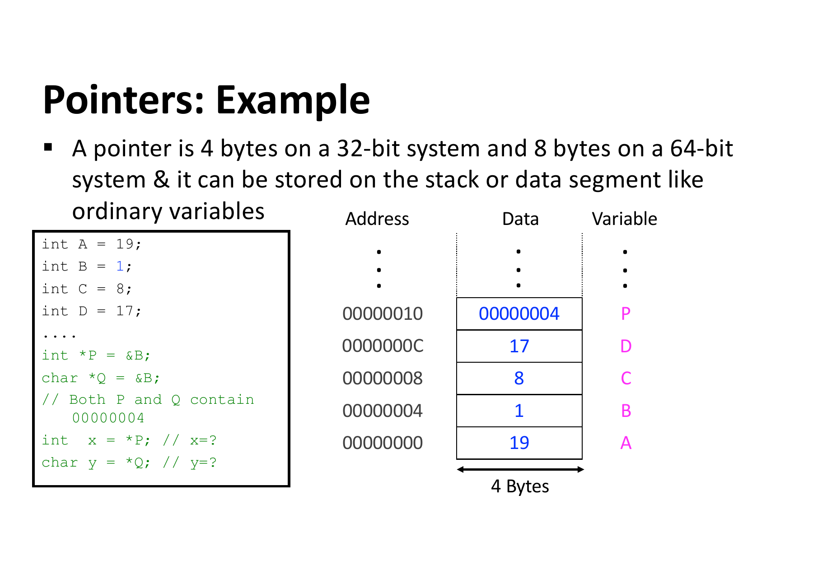

---

# 8. The Memory Map

## 8.1 Address space

- Range of addresses generated by a 32-bit ARM CPU: **0 to 0xFFFFFFFC** (4,294,967,292)
- Address space size = **2³² bytes = 4 GB**, addressing 4 billion individual bytes
- Each word is 32 bits = 4 bytes
- ⚠️ 32-bit ARM often accesses memory in units of **words**, so many instructions (e.g. `LDR`) require **the address to be a multiple of 4** (an alignment requirement)

> The **memory map** defines where code, data, and the stack are located in a program's address space. **It differs between architectures**.

## 8.2 The ARM 32-bit memory map: five segments

From high addresses to low:

| Segment | Contents | Key addresses / pointers |
|---|---|---|
| **Operating System & I/O** | The operating system and I/O devices | Top down to 0xC0000000 |
| **Stack** | The stack, **grows downward** | Starts around 0xBEFFFAE8, pointed to by **SP** |
| **Dynamic Data** | Dynamic data region (Stack ↓ and Heap ↑ move toward each other here) | |
| **Heap** | Allocated by the program at runtime (`malloc()` / `new`), **grows upward** | |
| **Global Data** | Global variables (visible to all functions, as opposed to local variables visible only to one function) | Pointed to by **R9 = SB (Static Base Pointer)** |
| **Text** | The machine language program. Also called the **read-only (RO) segment**. Literals (e.g. `"Hello"`) are here too | Starts at 0x00008000 |
| **Exception Handlers** | Exception handlers | 0x00000000 – 0x00008000, **the PC points to 0x00000000 at power-up** |

> ✅ **Must memorize**: **the Heap grows up, the Stack grows down**, and they share the Dynamic Data region between them. If they collide, that's a stack/heap overflow.

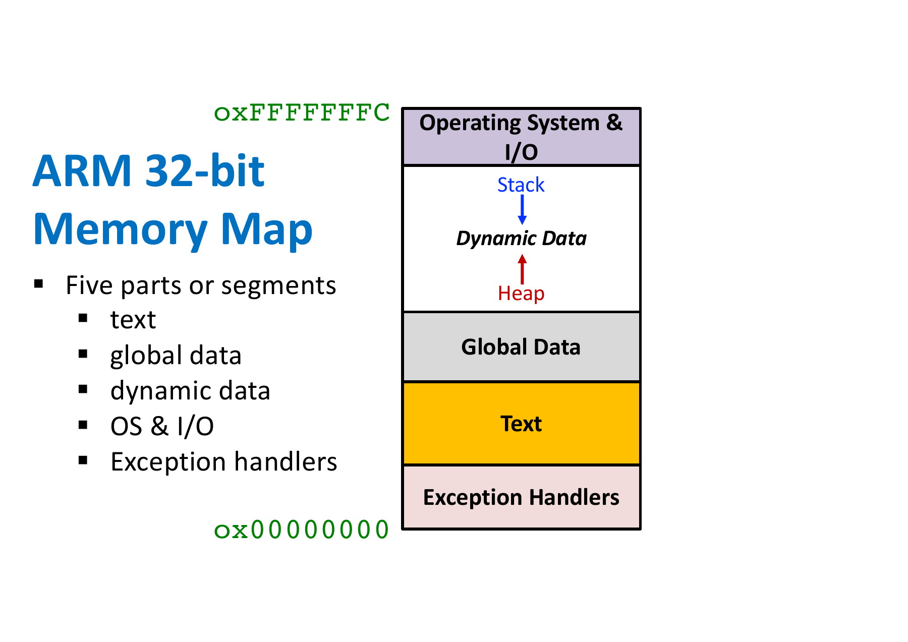

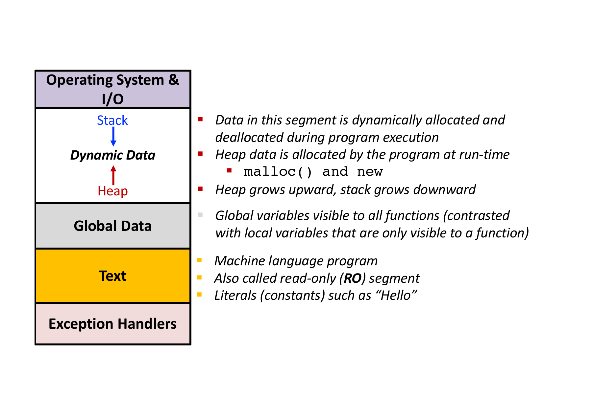

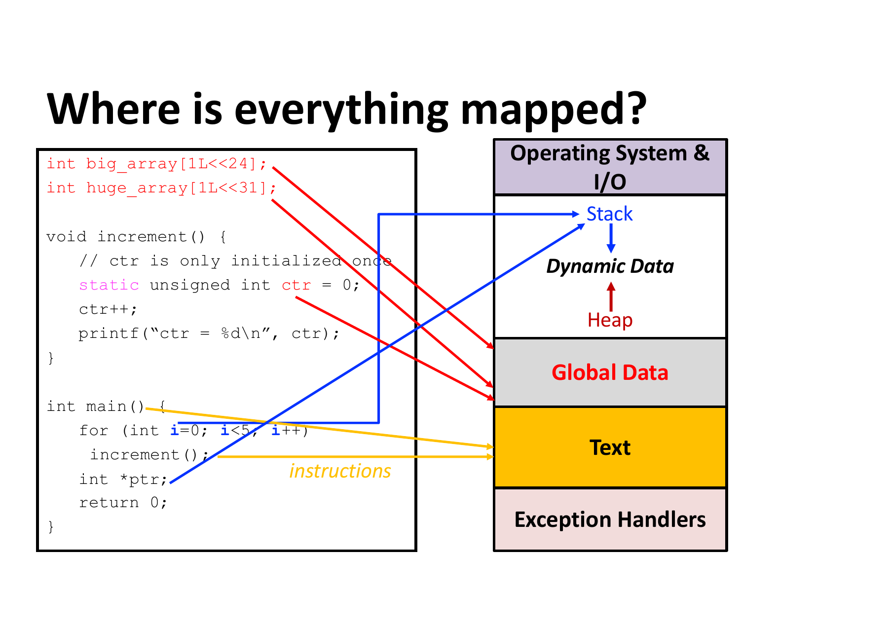

**The mapping on P142 (do it yourself first, then check the answers)**:
- `int big_array[1L<<24]` / `int huge_array[1L<<31]` → **Global Data**
- `static unsigned int ctr` → **Global Data** (static variables live for the whole program)
- `int i` (the loop variable of `main`), `int *ptr` (the pointer variable itself) → **Stack**
- Things from `malloc` → **Heap**
- All functions' instructions → **Text**

## 8.3 Virtual Memory

**Problem**: what if physical memory is less than 4 GB?

**Desktop/high-performance computers use virtual memory**:

- The address space is **virtual** (virtual addresses), managed by the **operating system**
- The **MMU (Memory Management Unit)** (on the CPU) + the OS perform virtual→physical address translation
- The 4 GB address space is divided into **4 KB pages**
- Each virtual page has a **virtual page number**, corresponding to a **physical page number**
- ⚠️ **Not a one-to-one correspondence** — the OS can freely choose the mapping
- The OS records the mapping in a **page table** (key = virtual page number, value = the page's location)
- The MMU **walks the page table** to get the physical address
- When physical memory runs out, the OS swaps virtual pages to **swap space** on disk, and the page table records whether a page is in memory or on disk

**The three big benefits of virtual memory**:
1. **Memory expansion** — extended using large-capacity disks
2. **Memory protection** — the MMU can raise a protection fault for protected addresses or unauthorized accesses
3. **Memory sharing** — each user/program has its own 4 GB virtual mapping and page table

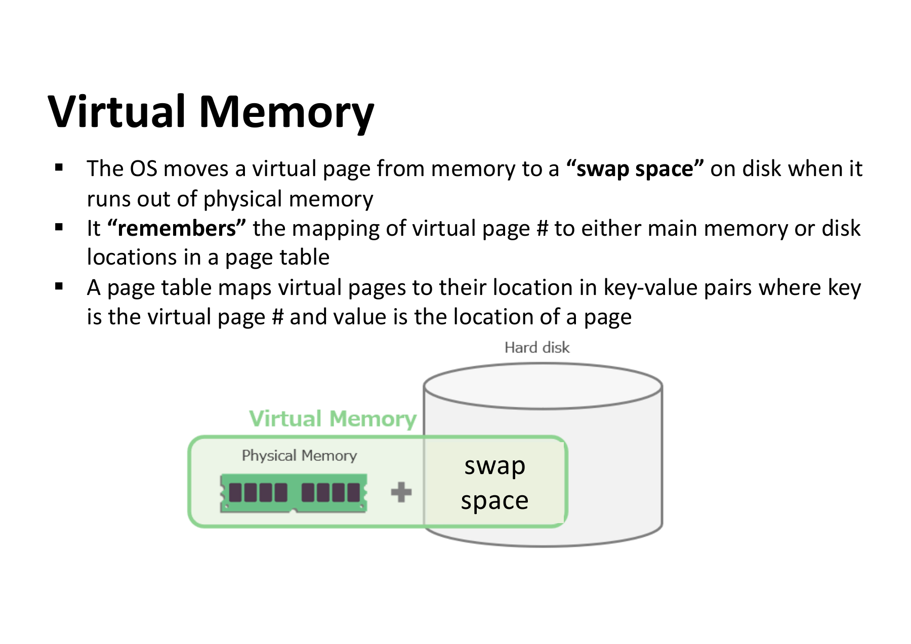

## 8.4 Comparison with the micro:bit (easily confused in exams)

| | Desktop/server | **micro:bit** |
|---|---|---|
| Virtual memory | Yes | **No — all addresses are physical addresses** |
| Memory map | Managed by the OS, flexible | **A fixed memory map defined by hardware** |
| Code/data location | Decided by the OS/loader | At **predetermined physical addresses** |
| Peripherals | Through drivers | **Memory-mapped to specific address ranges** |

---

# 9. Program Translation and Startup, Static vs Dynamic, the Heap

## 9.1 Translation and startup flow (P124)

```
High level code
    ↓ Compiler
Assembly code
    ↓ Assembler            ┐
Object file                ├─ Compile time / Static
    ↓ Linker  ← Object files, Library files
Executable                 ┘
    ↓ Loader               ┐
Memory                     ┴─ Run-time / Execution time / Dynamic
```

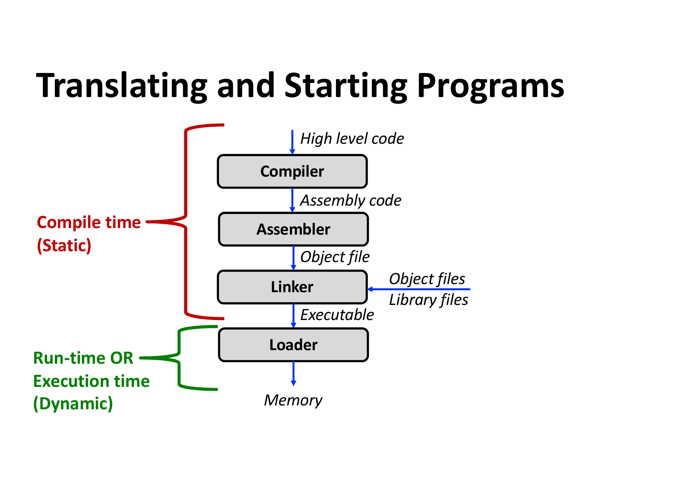

## 9.2 Static vs Dynamic (terminology distinction, exam point)

| **Static** | **Dynamic** |
|---|---|
| When the program is **compiled** | When the program is **executing** |
| At **compile time** | At **run-time** |

Some behaviors of a program are known **statically**, others only at **run-time**.

## 9.3 Comparison of three kinds of memory allocation (core table)

| | **Static allocation** | **Stack allocation** | **Heap allocation** |
|---|---|---|---|
| Typical contents | Global variables, `static` variables | Function local variables, local arrays | Objects from `malloc` / `new` |
| When the size is fixed | **Fixed at compile time** | Determined on function entry | **Determined at runtime, variable** |
| Location | Global Data segment | Stack segment | Heap segment |
| Lifetime | **Static**: the whole program / the whole function execution | **Automatic**: freed when the function exits | **Dynamic**: from allocate to deallocate |
| How it's freed | Not needed | Automatically (strictly LIFO) | **Manual `free` (C) or GC (Java/Python)** |

> Stack allocation is also called **automatically allocated memory** — its lifetime is determined automatically by function execution.

## 9.4 Why the heap is needed

1. Sometimes variables/arrays need to **live longer than the function**
2. Sometimes the size is **unknown at compile time** or needs to be **adjusted dynamically**
3. The order of freeing is **arbitrary** (unlike the stack, which must be LIFO)

**The heap is a large block of subdividable memory**. In C the programmer explicitly allocates and frees; a piece of code called the **dynamic memory allocator** is responsible for finding free space on the heap.

## 9.5 Freeing and memory leaks

- Releasing memory is also called **freeing memory**
- **DRAM is a finite resource**; in the CPU's eyes a program runs "for a long time" (1 second = 2 billion cycles)
- Allocated memory that's no longer needed becomes **garbage** and must be reclaimed for reuse
  - Stack space is reclaimed automatically when the function returns
- ⚠️ **Memory leak**: not returning unused heap memory to the memory manager → the heap stays full, even though there's logically free space

## 9.6 Memory managers

| Language | Allocation | Freeing |
|---|---|---|
| C / C++ | `malloc` / `new` | **Manual `free` / `delete`** |
| Java / Python | Same as C | **Automatic — Garbage Collector** |

```c
void *malloc(size_t size);   // takes a number of bytes, returns void* (castable to any pointer type)
void  free(void *ptr);       // needs only the start address; the memory manager knows how many bytes to free
```

```c
#include <stdlib.h>
#include <stdio.h>
void useless_func() {
    int *array = malloc(10 * sizeof(int));
    for (int i = 0; i < 10; i++)
        array[i] = i * i;
    int sum = array[0] + array[9];
    free(array);                      // ← forgetting this line is a memory leak
    printf("%i\n", sum);
    return;
}
```

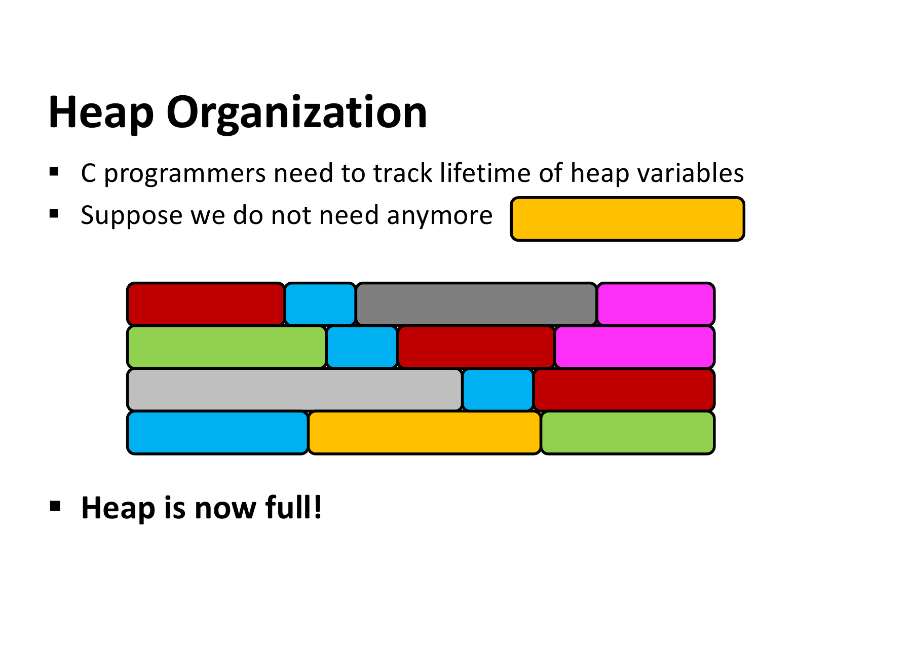

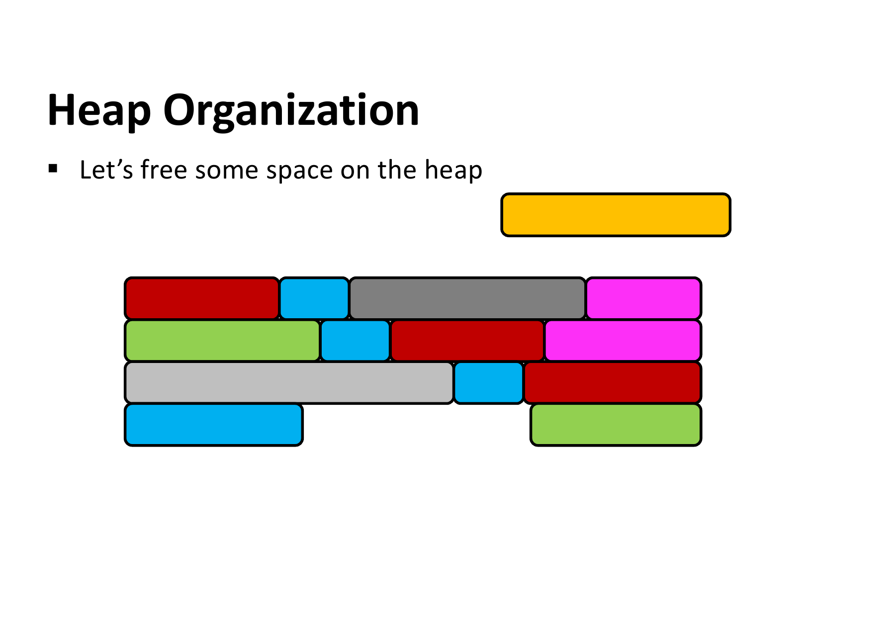

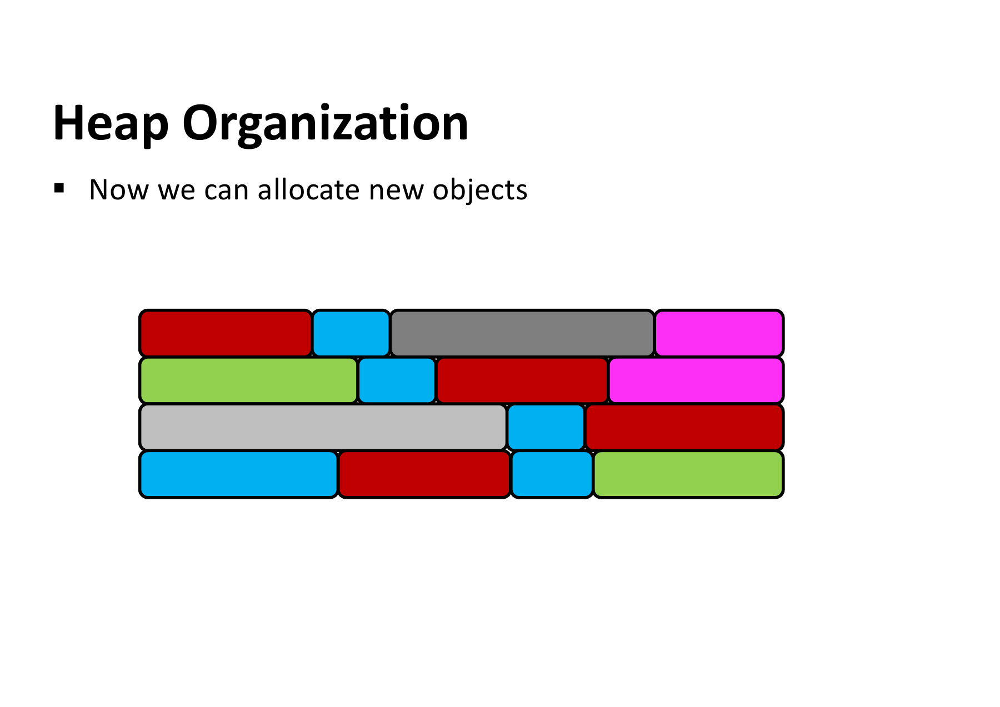

**Note**: P143 mentions this material is covered in depth in COMP2310 (writing a memory manager by hand + a database application, in C, twelve weeks of manual memory management).

---

# 10. Exceptions

> Textbook: H&H **Section 6.6.3**

## 10.1 Why control flow changes

**What we've learned (arising from changes in "program state")**:
- Unconditional branches, conditional branches
- Function calls and returns (essentially branches too)

**New (arising from changes in "system state")**: a useful system must be able to change control flow in response to changes in **system state** (computer system = hardware + software).

> **Event**: a change of state. These are **"unplanned"** events.
> **Exception**: like an **unscheduled function call**, jumping to a new address. Can be caused by hardware or software.

Typical examples: division by zero (execution can't continue), data arriving from an I/O device (keyboard, disk), an I/O device needing service, a system timer expiring.

## 10.2 Classification of exceptions (core table, must memorize)

| Category | Synchrony | Source | Intentional? | Recoverable? | Examples |
|---|---|---|---|---|---|
| **Interrupt** | **Asynchronous** | Hardware / I/O devices | — | Yes | Pressing a key, timer expiry, power failure, machine check (hardware error / bit flip) |
| **Trap** | **Synchronous** | Instruction execution | **Intentional** | Yes | **System call instruction (`SVC`)** |
| **Fault** | Synchronous | Instruction execution | Unintentional | **Possibly recoverable** | **Division by zero** |
| **Abort** | Synchronous | Instruction execution | Unintentional | **Unrecoverable** | **Undefined opcode** |

> **Memory key**:
> **Synchronous = caused by instruction execution** (trap / fault / abort); **asynchronous = caused by external devices** (interrupt).
> **Intentional = trap**; **unintentional and recoverable = fault**; **unintentional and unrecoverable = abort**.

## 10.3 System calls and privilege levels

- A **system call** is a kind of trap, used by a program to invoke a function in the **operating system**
- That function runs at a **higher privilege level** and can access all system resources
- User/application code runs at a **lower privilege level**

**Why have privilege levels**: to prevent
1. Buggy user code from corrupting other programs
2. System crashes
3. Malicious code from taking over the system

> The OS has full control of the system; ordinary user code doesn't.

## 10.4 The four steps of CPU exception handling

1. **Stop** the current program
2. **Save the architectural state**
3. **Handle** the exception/interrupt → switch to the handler
4. If possible and meaningful, **return** to the program to continue execution

## 10.5 When to handle (exam point)

| | Source | When handled |
|---|---|---|
| **Software exception (internal)** | internal | **Handled as soon as detected** |
| **Hardware exception (external)** | external | **Handled when convenient** |

**Exception**: very high-priority or **non-maskable** exceptions must be handled immediately (e.g. **power failure**).

When multiple interrupts arrive at once: users can define interrupt **priorities**, and there are **interrupt classes**.

## 10.6 The Exception Vector Table

- Exceptions use a **vector table** to decide which handler to jump to
- The table is placed in **low memory** (recall the Exception Handlers segment of the memory map)
- The instruction handling interrupts is at **0x00000018**
- **At power-up the CPU goes to address 0x00000000**
- Each entry in the vector table is a **branch instruction** jumping to the real handler; the handler returns to user code when done
- Each kind of event has a unique **exception number k**, and k is the **index into the table**; when exception k occurs, handler k is called

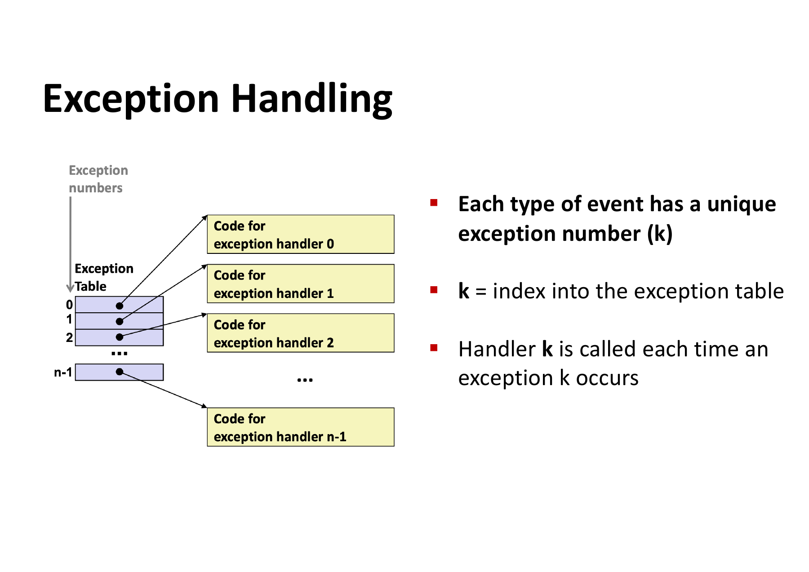

---

## 10.7 [Cortex-A / ARMv7 route] Execution modes and banked registers

> ⚠️ This part (P163–175) covers the classic **v7 / Cortex-A** mechanism, which is **not the same scheme** as the micro:bit (Cortex-M) in the next part. In the exam be clear about which one is being asked.

**ARM Execution Modes**:
- An ARM processor can run in several execution modes, each with a different privilege level
- The mode is recorded in **the low bits of the CPSR (CPSR[4:0])**
- **User mode = PL0**; other modes = **PL1**, with access to all system resources
- Execution modes help the CPU with bookkeeping: which registers to save? which stack frame to use? how to return to the program?

**ARM execution mode table (Table 6.13)**:

| Mode | CPSR[4:0] |
|---|---|
| User | `10000` |
| Supervisor | `10011` |
| Abort | `10111` |
| Undefined | `11011` |
| Interrupt (IRQ) | `10010` |
| Fast Interrupt (FIQ) | `10001` |

**Exception vector table (Table 6.14)**:

| Exception | Address | Mode |
|---|---|---|
| Reset | `0x00` | Supervisor |
| Undefined Instruction | `0x04` | Undefined |
| Supervisor Call | `0x08` | Supervisor |
| Prefetch Abort (instruction fetch error) | `0x0C` | Abort |
| Data Abort (load/store error) | `0x10` | Abort |
| Reserved | `0x14` | N/A |
| Interrupt | `0x18` | IRQ |
| Fast Interrupt | `0x1C` | FIQ |

**Banked Registers (shadow registers)**:

- An exception handler is like an ordinary function call: it needs to know where to return, and needs to save registers
- **But the stack is in memory, and memory is slow**
- **Banked registers are extra (shadow) registers**; when an interrupt occurs, the values of the actual registers are quickly copied into them
- Purpose: **handle interrupts as fast as possible**
- **FIQ mode** has its own banked **R8–R12, R13 (SP), R14 (LR)** and **SPSR** (the shadow of CPSR)

**The three phases of exception handling (P171–173, must memorize)**:

**(1) Hardware entry**
1. Save **CPSR into the banked SPSR**
2. **Set the execution mode and privilege level** according to the exception type
3. **Set the interrupt mask bits** in CPSR so the handler itself isn't interrupted (only for maskable interrupts)
4. Save **the return address into the banked LR**
5. **Branch to the exception vector table** according to the exception type

**(2) What the handler does**
- Push other registers onto its own stack → handle the exception → pop the registers back from the stack

**(3) Return**: with **`MOVS PC, LR`**
- Copy **the banked SPSR back to CPSR** (restoring the status register)
- Copy **the banked LR into the PC** (returning to where the exception occurred)
- Restore the execution mode and privilege level

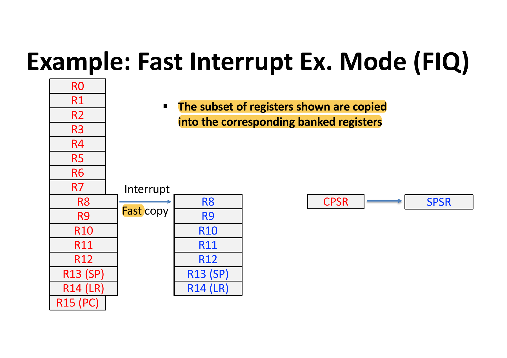

**The Supervisor instruction (SVC)**:
- User code runs at a low privilege level; **`SVC` is used to switch between privilege levels**
- The CPU reads arguments from "certain" registers and executes a specific flavor of `SVC`
- **`SVC` is a software exception**
- A table specifies "which service the user code wants from the OS → what to do next"
- Comparison: ARM's **`SVC`** ≈ Intel x86's **`syscall`**
- ⚠️ **In the labs your code runs on bare metal, with no OS**; in the real world the only way for user code to access system resources is to call functions in the OS, and these functions are **system calls**

---

## 10.8 [Cortex-M / micro:bit route] Exception mechanism (new in the updated version, key point)

### The vector table

- The interrupt vector table is defined in **`startup.S`**
- If a handler doesn't exist, the corresponding label **is not bound to a binary address**
- **The first 16 handlers are ARM-specific**; once a handler is defined, the assembler fills its binary address into the vector table
- **`GPIOTE_IRQHandler`** is used to detect changes in GPIO signals (e.g. **a button press**)


### Exception Entry: hardware pushes automatically

When an exception occurs, **the hardware automatically** pushes the following registers onto the stack (no code needed from you):

| Stack offset | Contents |
|---|---|
| `SP + 0x1C` | `xPSR` |
| `SP + 0x18` | `PC` |
| `SP + 0x14` | `LR` |
| `SP + 0x10` | `R12` |
| `SP + 0x0C` | `R3` |
| `SP + 0x08` | `R2` |
| `SP + 0x04` | `R1` |
| `SP + 0x00` | `R0` ← **SP points here after the interrupt** |

(Before the interrupt SP points to `<previous>`, i.e. above the table; addresses decrease downward)

- **`PC`** is used to return control to the interrupted program
- **`LR`** holds a special return value (**EXC_RETURN**) used to return control

> 💡 Note that what's pushed is exactly **R0–R3, R12, LR, PC, xPSR** — precisely **the caller-saved (nonpreserved) group**. This is no coincidence: the hardware executes the caller save rule for you, so the handler can be written as an **ordinary C function**, and the compiler handles R4–R11 per the usual AAPCS.

### Exception Return: EXC_RETURN

The **EXC_RETURN** value in LR determines how to restore:

| EXC_RETURN | Meaning |
|---|---|
| `0xFFFFFFF1` | Return to **Handler mode**; take state from the **main stack**; use **MSP** after return |
| `0xFFFFFFF9` | Return to **Thread mode**; take state from the **main stack**; use **MSP** after return |
| `0xFFFFFFFD` | Return to **Thread mode**; take state from the **process stack**; use **PSP** after return |
| Other values | Reserved |

### Two modes, two stacks

| | **Thread mode** | **Handler mode** |
|---|---|---|
| Use | Normal program execution | Exception/interrupt service |
| Privilege level | **Privileged or unprivileged (PL0 or PL1)** | **Always privileged (PL1)** |
| Default stack pointer | **PSP** (Process Stack Pointer) | **MSP** (Main Stack Pointer) |

- The return value in LR tells the CPU **which stack to restore state from** and **which mode to return to**
- ⚠️ **After saving registers to some stack, exception handlers always use MSP** (think of **nested interrupts**: all nesting levels share MSP, so they won't trample the user thread's PSP)
- **R13 mirrors whichever stack pointer is currently in use**

### How does the CPU know it's in Handler mode?

- Via the **IPSR (Interrupt Program Status Register)** field in **xPSR**
- **IPSR holds the exception number of the exception/interrupt currently executing**
- **`IPSR == 0` → Thread mode** (ordinary program code)
- **`IPSR > 0` → Handler mode** (servicing an exception)

> Terminology: **xPSR is a whole 32-bit status register, and IPSR is one of its "sub-registers / sub-fields"**, which can be read on its own.

### The privilege level is controlled by the CONTROL register

- **`CONTROL[0]`**: privilege level / stack selection in Thread mode
  - `0` → Thread mode uses **MSP**
  - `1` → Thread mode uses **PSP**

### micro:bit system register table

| Register | Use |
|---|---|
| `CONTROL` | Privilege level & stack pointer selection |
| `IPSR` | Current exception number |
| `xPSR` | Composite status register |
| `MSP`, `PSP` | Main / Process stack pointers |
| `PRIMASK` | Disables all interrupts (except NMI) |
| `BASEPRI` | Sets the interrupt priority threshold |
| `FAULTMASK` | Disables all exceptions |
| `NVIC` & `SCB` | Nested Vectored Interrupt Controller, System Control Block |

> Privileged code is generally considered trusted and will "treat these registers kindly".

### Summary of the micro:bit exception mechanism (P168)

- **Two bits in the control register** decide: privileged vs unprivileged, main stack vs process stack
- **R13 mirrors the current stack pointer**
- **Exceptions are always handled in Handler mode (PL1)**
- **What can this mechanism do?** With interrupts (e.g. the system timer interrupt) + different modes + different stacks, you can build a **multitasking operating system scheduler** — choosing one of several tasks to execute. This is the embryo of an OS.

### ARM Cortex exception number table (structure to memorize)

| Exception number | Exception |
|---|---|
| 1 | Reset |
| 2 | NMI |
| 3 | HardFault |
| 4 | MemManage |
| 5 | BusFault |
| 6 | UsageFault |
| 7–10 | Reserved |
| 11 | **SVCall** |
| 12 | DebugMonitor |
| 13 | Reserved |
| 14 | PendSV |
| 15 | SysTick |
| **16** | **External interrupt 0** |
| … | … |
| 16+N | External interrupt N |

**Three key points**:
1. **External interrupts start at 16**
2. **The first 16 exceptions are part of the ISA**
3. Usually they **must have handlers** for the system to work properly

**NVIC (Nested Vectored Interrupt Controller)** (inside the ARM Cortex-M CPU):
- Manages all external and internal interrupts
- Prioritizes them
- **Handles nested interrupts**

---

# 11. I/O Architecture

## 11.1 I/O devices and storage devices

**Three kinds of I/O devices**: input devices, output devices, **storage devices**.

**Two important uses of storage devices**:
1. **Persistent storage** — as opposed to the **volatility** of SRAM/DRAM
2. **Extension of main memory/DRAM** — analogy: the stack in memory is an extension of the register file (RF); extending memory with disk = virtual memory (COMP2310)

⚠️ **Storage devices are much slower than DRAM**: access latency is on the order of **microseconds (µs)**, DRAM on the order of **nanoseconds (ns)** — **three orders of magnitude**.

For high-end systems in the cloud and data centers, **storage is the most important I/O device**.

## 11.2 The I/O subsystem

**What does a computer system consist of?**
- **CPU–Memory (also called the host system)**: tightly coupled; the CPU accesses memory quickly and directly over the address/data buses
- **I/O subsystem**: many I/O devices need to communicate with the CPU, so a "subsystem" is needed to interface with the host system

**The I/O subsystem includes (P185)**:
- Blocks of main memory dedicated to I/O functions
- Internal system buses (memory bus, host bus, I/O bus)
- Control modules in the host and peripherals
- Interfaces to external components (keyboard, disk)
- External cables and communication links (Ethernet cables, mouse cables)

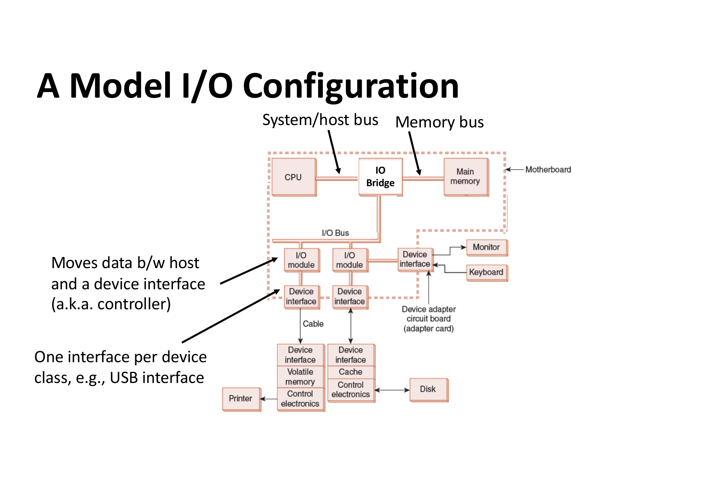

The **IO Bridge** moves data between the host and the **device interface (also called a controller)**; **one interface per kind of device** (e.g. a USB interface).

**PCIe (Peripheral Component Interconnect Express)**:
- A **serial** expansion bus standard for connecting peripherals (GPUs, SSDs)
- Compared with "traditional" **parallel** PCI, PCIe has **lower latency and higher transfer rates**

## 11.3 Interfaces and protocols

**Interfaces** communicate with specific kinds of devices (keyboards, disks, printers), ensuring:
- The device is ready to receive the next batch of data
- The host is ready to receive the next batch of data from the peripheral

> **Protocol**: the **exact form and meaning** of the signals exchanged between sender and receiver.
> Signals come in two kinds: **command signals** and **data signals**.
> **Handshake**: a protocol exchange in which the receiver sends an **Acknowledgement** for a received command/data, or indicates it's ready to receive data.

## 11.4 Three-dimensional classification of I/O systems (core framework)

There's no standard classification scheme, and not every "combination" makes sense. Three dimensions:

| Dimension | Option A | Option B |
|---|---|---|
| **Device visibility** | **Port-mapped I/O (PMIO)** | **Memory-mapped I/O (MMIO)** ← micro:bit |
| **Reading data** | **Programmed I/O (PIO)** | **Direct Memory Access (DMA)** |
| **Event notification** | **Polled I/O** | **Interrupt-driven I/O** |

### Dimension 1: Port-Mapped vs Memory-Mapped

| | **PMIO (port-mapped / isolated I/O / instruction-based I/O)** | **MMIO (memory-mapped I/O)** |
|---|---|---|
| Address space | **A separate dedicated address space**, apart from memory | **Shares the same address space as memory** |
| Hardware implementation | Usually via **extra "I/O" pins** on the CPU's physical interface | Each I/O device has its own reserved region of memory |
| Access instructions | **Dedicated instructions `IN` / `OUT`** | **Ordinary `LDR` / `STR`** |
| Alias | isolated I/O | — |
| Assessment | — | Good abstraction, simple and convenient (programmer-friendly), clean hardware |

**MMIO example (P191–192)**: each I/O device is assigned one or more addresses in the address space; `STR` writes data to the device, `LDR` reads data from the device.

**Example (P192)**: suppose I/O Device 1 is assigned address `0x20001000`; write ARM assembly that writes 7 to it and reads back the output value.

```arm
LDR R1, =0x20001000   ; device address
MOV R0, #7
STR R0, [R1]          ; write 7 to the device
LDR R2, [R1]          ; read back the output value from the device
```

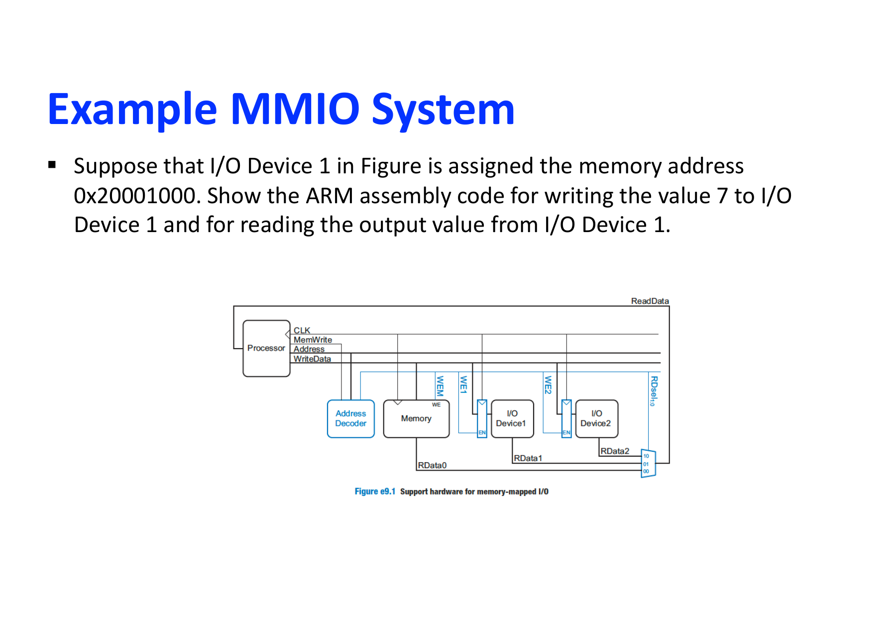

**What the micro:bit does**:
- Uses **MMIO**, with standard `LDR` / `STR`
- **Only one address space** for accessing both memory and I/O peripherals
- ⚠️ The micro:bit has things called "ports" (P0, P1) and "pins" (P0.01, P0.02), **but those are just names for physical pins, not port-mapped I/O** (this is a trick question)

**micro:bit pin address mapping (P194)**:

| Port | Base Address |
|---|---|
| P0 | `0x50000000` |
| P1 | `0x50000300` |

Add an offset to the base address to get each configuration register:

| Register | Offset | Description |
|---|---|---|
| `OUT` | `0x504` | Write GPIO port |
| `DIR` | `0x514` | GPIO pin direction |

```arm
@ load r1 with the base address of P0
ldr r1, =0x50000000

@ load r2 with the value of P0 DIR
@ (note the 0x514 offset from the P0 base address)
ldr r2, [r1, 0x514]

@ set bit 21 by doing a logical or with 0b1 left-shifted by 21
@ think: why does this work?
mov r3, 0b1
lsl r3, r3, #21
orr r2, r2, r3

@ store the modified result back into P0 DIR
str r2, [r1, 0x514]
```

> **The three-step read–modify–write routine**: `LDR` reads the current value → `ORR`/`BIC` changes only the target bit → `STR` writes it back. A direct `MOV` would wipe out the configuration of the other 20-odd pins.

### Dimension 2: Programmed I/O vs DMA

**Programmed I/O (PIO)**:
- **Every data transfer is initiated by an instruction in the program, and every transaction involves the CPU**
- The term can refer to either MMIO or PMIO
- **What's the problem?** The CPU is extremely fast (1 second = 2 billion cycles), I/O devices are extremely slow. For large data transfers (e.g. reading a video file from disk), we want to **free the CPU to do other things while the transfer proceeds in parallel**

**Direct Memory Access (DMA)**:
- The CPU **offloads** the execution of tedious I/O instructions **to a dedicated chip: the DMA controller**
- The CPU gives the DMA controller three things:
  1. The **location** of the bytes to transfer
  2. The **number of bytes** to transfer
  3. The **destination memory address**
- After notifying the DMA controller, the CPU **goes off to do other work**
- The DMA completes the I/O, **places the data in memory, then interrupts the CPU**

**Key points of the DMA configuration**:
- The DMA and the CPU **share the bus** (**memory-mapped I/O must be used**)
- The DMA runs at **higher priority** and "**steals memory cycles**" from the CPU

> ⚠️ **Version difference**: the old P187 says "below: memory-mapped I/O", while the new P198 changes it to **"must use memory-mapped I/O"**. This is consistent with P208's "**DMA cannot work with port-mapped!**". **Go with the new version: DMA must be paired with MMIO.**

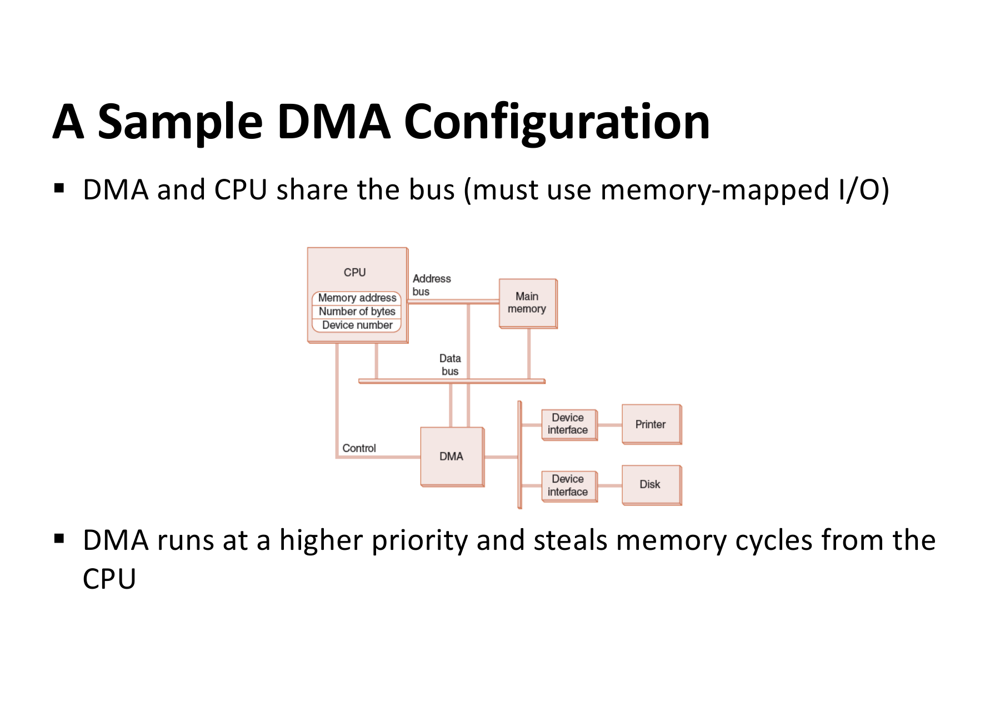

**The micro:bit's EasyDMA**:
- Some (not all) peripherals use EasyDMA to access RAM directly
- A **low-power, simpler version** of DMA in server processors
- Suited to: audio streaming, Bluetooth data exchange, reading sensors
- **How it works**: you set a pointer to a memory buffer → the peripheral (e.g. UART or SAADC) automatically moves data in/out → **the CPU doesn't have to touch every byte** → lower overhead, faster, more power-efficient

| Peripheral | Use case |
|---|---|
| UART | Serial data streaming into/out of memory |
| SPI | Buffered data transfer to sensors/displays |
| TWI/I2C | Automatic sensor reads |
| PWM | Streaming waveform values |
| SAADC | Continuous analog sampling (e.g. audio) |
| RADIO | Bluetooth packet buffer management |

### Dimension 3: Polled vs Interrupt-driven

The loop of **Polled I/O**:
1. The CPU monitors the **control/status register** associated with a port
2. When a byte arrives at the port, a bit in the control register is set
3. The CPU eventually polls and notices the "**data ready**" control bit is set
4. The CPU **resets the control bit**, takes the byte and processes it
5. The CPU resumes polling

**Interrupt-driven I/O**:
- **The CPU isn't tied up** and can do other things
- **An interrupt is an asynchronous signal**
- **The device actively tells the CPU** it has data to send
- The CPU continues with other tasks until a device needing service sends it an interrupt
- **Configurable granularity**: one interrupt per word, or one per batch

**Interrupt Controller**:
- Communication between multiple interrupt-enabled devices and the CPU is handled by an interrupt controller
- Once the circuit recognizes an interrupt signal from any device, it raises a **single interrupt signal**, activating a control line on the system bus
- That control line **connects directly to a pin on the CPU chip**
- **INTA (Interrupt Acknowledge)**: when the interrupt controller receives the acknowledgment it **lowers INT**
- **Priority** is decided by the **time-criticality** of the device requesting I/O

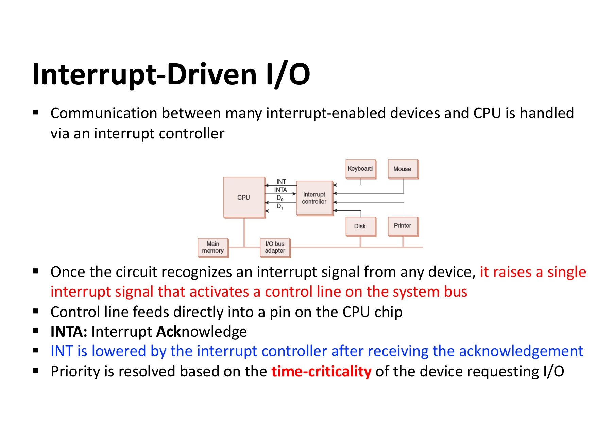

**micro:bit summary**: uses both polled I/O and interrupt-driven I/O, **depending on the peripheral and how it's configured**.

## 11.5 Meaningful combinations (P208, exam point)

| Combination | Sensible? | Explanation |
|---|---|---|
| **Memory-mapped + DMA + interrupt-driven** | ✅ | Typical for **storage devices transferring large amounts of data** |
| **Port-mapped + DMA + interrupt-driven** | ❌ | **DMA can't work with port-mapped!** |
| **Port-mapped + programmed + polling** | ✅ | Polling, programmed, and port-mapped naturally go together |

## 11.6 Character vs Block I/O

| | **Character I/O** | **Block I/O** |
|---|---|---|
| Granularity | One byte (character) at a time | Bytes handled in groups |
| Examples | Modems, **keyboards**, mice | Most **mass storage devices** (disks, tapes) |
| Best connection method | **interrupt-driven programmed I/O** | **interrupt-driven DMA** |

> **Device driver**: software that handles the details of I/O transfer granularity and the I/O-related instructions.

## 11.7 Bus technology

> **Bus**: a set of wires carrying signals (address, data, control) between a sender and a receiver.

| | **Serial** | **Parallel** |
|---|---|---|
| Transfer | One bit at a time | Multiple bits in parallel |
| Examples | Keyboards, mice, USB drives, old printers | CPU–memory communication, parallel-port printers, PCI |
| Characteristics | Thin cables | **Thicker cables**, and **susceptible to electrical interference**, which shortens signal transmission distance |

In both cases a **clock** is used for timing, especially of control signal transitions.

> 💡 This explains why modern high-speed buses (PCIe, USB, SATA) have all moved from parallel to serial: at high frequencies, crosstalk and skew between parallel wires are more fatal than serial's bit-width disadvantage.

---

# 12. Amdahl's Law

## 12.1 Why cover this

- Sluggish I/O throughput has a **ripple effect** that drags down the whole system's performance
- The world's fastest processor is of little use if it spends most of its time waiting for data from peripherals
- Overall system performance is **the result of the interaction of all components**
- **Improving the performance of the most frequently used component is the most effective way to improve system performance**

## 12.2 Formula (must memorize)

$$S = \frac{1}{(1-f) + \frac{f}{k}}$$

| Symbol | Meaning |
|---|---|
| **S** | Overall speedup |
| **f** | The **fraction of work** done by the faster component |
| **k** | The **speedup** of that component itself |

## 12.3 Converting "N% faster" (common mistake)

> In Amdahl's context: **"50% faster" = 1.5× speed** (the reference 100% speed + an extra 50% = 150% = 1.5×)

Conversion formula: **A is N% faster than B** if and only if

$$\frac{\text{Perf}_A}{\text{Perf}_B} = 1 + \frac{N}{100}$$

So: "50% faster" → k = **1.5**; "150% faster" → k = **2.5**.

## 12.4 Example (be sure to work it yourself)

**Setup**: choose one of two on a large system
- Spend **$10,000** upgrading the CPU to make it **50% faster**
- Spend **$7,000** upgrading the disk to make it **150% faster**

The program spends **70%** of its time running on the CPU and **30%** waiting for disk service. Which upgrade is more cost-effective?

**Solution**:

Processor option: f = 0.70, k = 1.5

$$S = \frac{1}{(1-0.70) + \frac{0.70}{1.5}} = \frac{1}{0.30 + 0.4667} = 1.30 \quad (\text{30\% speedup})$$

Disk option: f = 0.30, k = 2.5

$$S = \frac{1}{(1-0.30) + \frac{0.30}{2.5}} = \frac{1}{0.70 + 0.12} = 1.22 \quad (\text{22\% speedup})$$

**Cost-effectiveness**:
- Processor: **$333** per 1% improvement (10000 / 30)
- Disk: **$318** per 1% improvement (7000 / 22)

**Conclusion**: the disk option is slightly more cost-effective per unit. **But should cost-effectiveness be the only consideration?** — Not necessarily (there's also power, reliability, future workload changes, etc.).

## 12.5 Implications for program performance

- Programs spend most of their time in **a small fraction of the code**
- Programmers can use Amdahl's law to **estimate the benefit of optimizing critical code sections**

> 💡 Read it the other way: if f is small, S stays close to 1 however large k is. This is why "optimizing a function that takes only 5% of the time by 100×" is nearly useless — the upper bound is only 1.052×.

---

# 13. Power and Energy

## 13.1 Background

- Clock frequency and power rose rapidly for decades, **but in recent years have leveled off or even declined**
- We've hit **practical thermal power limits**
- Goal: understand **the correlation between power and clock frequency**

## 13.2 Formulas (must memorize)

$$P_{total} = P_{dynamic} + P_{static}$$

$$P_{dynamic} = \tfrac{1}{2} \times A \times C \times V^2 \times N \times F_{switch}$$

$$P_{static} = V \times I_{leak}$$

$$E_{total} = P_{total} \times Time = (P_{dynamic} + P_{static}) \times time$$

**Meaning of each parameter (must be able to explain each one)**:

| Symbol | Meaning |
|---|---|
| **A** | **Activity factor**: quantifies **how often** transistors **switch** within a cycle |
| **C** | Capacitance, a function of the **CMOS process** and the **fanout** (the number of transistors connected to a transistor's output) |
| **V** | Supply voltage (**a squared term**!) |
| **N** | **Number of transistors** |
| **F_switch** | Switching frequency, **depends on the clock frequency** |
| **I_leak** | Leakage current |

**Why there's dynamic power**: transistors dissipate power during transitions from **LOW(0) → HIGH(1)** and **HIGH(1) → LOW(0)** — **only when switching occurs**.

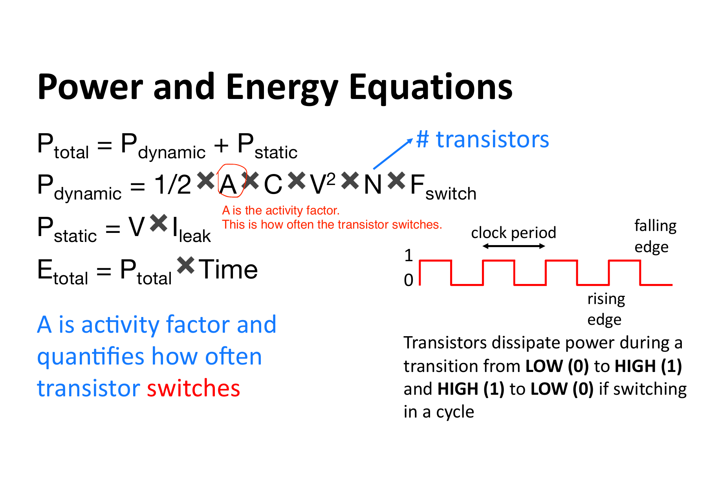

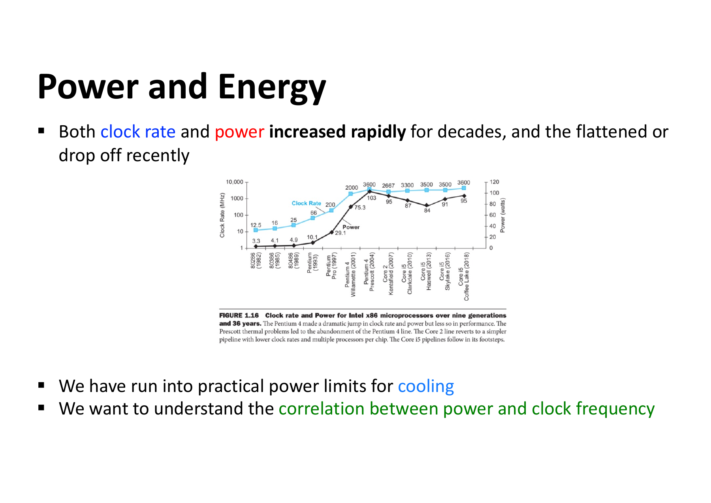

**Recall how a transistor switches (P221)**: for an n-type MOS transistor, a high voltage on the gate → the source-drain acts like a wire (closed circuit); zero voltage on the gate → open circuit. Depending on the process, a "high voltage" can range from 0.3V to 3V.

## 13.3 Reducing dynamic power

**Two routes**:
1. **Lower the frequency**
2. **Lower the supply voltage** (**quadratic reduction**, the most effective)

**The reality of the past ~30 years**:
- Frequency increased **1000×**
- Voltage dropped about **15%** per generation (from 5V to 1V)
- **Power increased 30×**

**A, F, N kept rising → hitting the power wall.**

⚠️ **Lowering the supply voltage is no longer viable**: it **increases leakage current** and brings manufacturing complexity (cost).

Power is measured in **watts**, usually reported as **peak or average**.

## 13.4 Dynamic vs Static Power (comparison table)

| | **Dynamic Power** | **Static Power** |
|---|---|---|
| Source | Dissipated when transistors **switch** | **Leakage current**, flowing even when transistors aren't switching |
| Status | The **main source** of energy consumption | **Rising significantly** in recent years, **now about 40% of total power** |
| Influencing factors | Certain **instruction combinations** increase dynamic power (toggling control bits increases switching activity) | Further lowering the supply voltage actually **increases leakage** |
| Risk | — | The **thermal runaway** phenomenon |

(Further reading: the paper by Nam and Todd)

## 13.5 Power vs Energy (concept distinction, must-know)

> **Energy is the accumulation of power over time.**

- Units: **joules (= watt-seconds)** or **kilowatt-hours (kWh)**
- **1 kWh = 3,600,000 joules** (used on electricity bills)
- ⚠️ **P_static is always present** (independent of activity)

**Analogies (P226)**:
- **Driving**: power = the **rate** you drive at (mph); energy = the **total distance** you drive (miles)
- **Filling a bucket from a hose**: power = the **flow rate** of the water (liters/second); energy = **how much water ends up in the bucket** (liters)

## 13.6 Which metric to use?

| Metric | Use |
|---|---|
| **Power** | Determines **packaging and cooling requirements** |
| **Energy** | Compares the **energy/battery efficiency** of two CPUs |

- **If the goal is to maximize battery life → use the energy metric**
- **Power is a rate metric (joules/second)**
- ⚠️ **A CPU may draw more power but use less energy because it finishes the program sooner**

**Example (P228/231) — the same program, different CPUs**:

| | Power (Watts) | Execution time (s) | **Energy = P × T (J)** |
|---|---|---|---|
| Processor A | 100 W | 100 s | **10,000 J** |
| Processor B | 80 W | 140 s | **11,200 J** |
| Processor C | 75 W | 120 s | **9,000 J** ← most energy-efficient |

**Conclusion**: **B, with the lowest power, actually uses the most energy**. C is the most energy-efficient. This is the textbook counterexample to "power ≠ energy".

⚠️ **Version difference**: the old P216 has only two processors, A (100W/100s) and B (80W/**150s**); the new version changes B to 140s and adds C. **Go with the new version's three-processor data.**

**Example — the same CPU, different programs (P229)**:

| | Power | Execution time | **Energy** |
|---|---|---|---|
| C++ program | 100 W | 75 s | **7,500 J** |
| Java program | 100 W | 750 s | **75,000 J** |

At the same power, **the energy difference is determined entirely by execution time** — 10× slower means 10× the energy.

## 13.7 The problem with the energy metric → EDP

**Problem**: one way to reduce power is to **slow the CPU down**, but that seriously hurts performance. **Both performance (execution time) and power matter in system design.**

> **EDP (Energy-Delay Product)** is used to balance the two:
> $$EDP = Energy \times Delay$$
> where delay means execution time. **EDP penalizes systems with higher delay**, so it's a useful metric when both energy and performance matter.

## 13.8 Multicore and power management

**AMD EPYC 9754S** (Zen 4c microarchitecture): **128 Zen 4c cores** on a single die (core = CPU), with a specified **base clock** and **boost clock**.

**The power/energy management flexibility multicore brings**:
- Not all cores have to run at the highest frequency
- Use only the cores you need
- **Write parallel software** — the alternative to "building a 100 GHz single core" (which would cause unmanageable thermal problems)

**TDP (Thermal Design Point)**:
- Different power ratings are expressed as TDP
- ⚠️ The **exact definition of TDP is subtle**; you need to read the datasheet
- ⚠️ **TDP ≠ battery life** — it is a **thermal design guideline**

**Chiplet**:
- A chiplet is a **small chip building block** that makes up a larger chip
- **CCD (Core Complex Die)** = a group containing **8 cores sharing a cache**
- The chiplet-based approach brings **better yield and complexity management**

---

# 14. [Supplement in the new version] Program Structure, Flash/SRAM, Locality, and Cache

> This entire section (P237–255) exists only in `set6__后半部分_.pdf`, not in the old version. It's the lead-in to the later memory hierarchy material.

## 14.1 Good program constructs

- **Conditional constructs**: if/else or conditional execution
- **Iterative constructs**: loops
- **Functions**
- **Data structures**: arrays, pointers, addresses vs data, memory hygiene, memory utilization

## 14.2 Code + Data = Program

- In the **Von Neumann model**, code and data **reside in the same address space**
- **Address space**: the list of addresses the CPU can generate
- On the micro:bit the address space is divided into **segments**, each backed by **different physical technologies**:
  - **Code is stored in Flash memory**
  - **The stack and heap are in SRAM**
  - **I/O peripherals can be accessed with `LDR`/`STR` through special addresses** (i.e. MMIO)

**micro:bit (ARMv7-M) address space segments**:

| Segment | Address range | Size |
|---|---|---|
| Vendor-specific memory | `0xE0100000` – `0xFFFFFFFF` | 511 MB |
| Private peripheral bus | `0xE0000000` – `0xE00FFFFF` | 1 MB |
| External device | `0xA0000000` – `0xDFFFFFFF` | 1 GB |
| External RAM | `0x60000000` – `0x9FFFFFFF` | 1 GB |
| **Peripheral** | `0x40000000` – `0x5FFFFFFF` | 0.5 GB |
| **SRAM** | `0x20000000` – `0x3FFFFFFF` | 0.5 GB |
| **Code** | `0x00000000` – `0x1FFFFFFF` | 0.5 GB |

> 💡 Compare back with P194: the GPIO P0 base address `0x50000000` falls right in the **Peripheral** segment (`0x40000000`–`0x5FFFFFFF`). If you can match these up, you've understood it.

## 14.3 Why code is stored in Flash

- **Flash is a non-volatile/persistent storage medium**; the code is still there after power-off, which is why it's used as a storage device
- On the micro:bit, Flash is **integrated on the same chip** as the CPU and SRAM
- **Flash integrates easily with the CMOS process, DRAM doesn't** — which is why there's an External RAM segment in the address space

**But Flash is slow**:
- High-capacity Flash storage devices have latencies on the order of **microseconds** (versus nanoseconds for RAM)
- The nRF52833 (the micro:bit's CPU) has an **internal Flash read latency of about 20–30 ns**
- **Cortex-M4 at up to 64 MHz (one cycle = 15.625 ns)** → **Flash is slower than one CPU cycle**

## 14.4 How to bridge the Flash latency gap (exam point)

**The dumbest way**: the CPU waits for Flash (**wait states or pipeline stalls**) — very inefficient.

**Can we do better? Yes, with hardware and software optimizations:**

| Approach | How |
|---|---|
| **Hardware (Caching)** | An instruction cache inside Flash (CODE) reduces the need for the CPU to wait for Flash; it **stores frequently accessed instructions** and can **prefetch instructions in advance** |
| **Software (Code placement)** | **Put hot loops, interrupt handlers, and other performance-critical code in SRAM**. SRAM is usually much faster than Flash. You can place critical functions under the `.data` section and branch to those functions |

## 14.5 The Principle of Locality — must memorize

> **Programs tend to access data and instructions at addresses near or equal to those accessed recently.**

| Type | Definition |
|---|---|
| **Temporal locality** | **Recently referenced items** are **likely to be referenced again** in the near future |
| **Spatial locality** | Items with **nearby** addresses tend to be accessed one after another |

**Classic example**:

```c
sum = 0;
for (i = 0; i < n; i++)
    sum += a[i];
return sum;
```

- **Data references**:
  - Array elements are referenced in order (**stride-1 reference pattern**) → **spatial locality**
  - The variable `sum` is referenced every iteration → **temporal locality**
- **Instruction references**:
  - The loop body instructions are executed repeatedly → **temporal locality**
  - Instructions are fetched in order → **spatial locality**

## 14.6 The Memory Hierarchy

**Three fundamental and enduring properties of hardware and software**:
1. **Faster storage technologies: more expensive per byte, smaller capacity, more power-hungry (heat!)**
2. **The speed gap between the CPU and main memory keeps widening**
3. **Well-written programs tend to exhibit good locality**

> These three properties **complement each other perfectly**, and together point to a way of organizing memory and storage systems: **the memory hierarchy**.

| Level | Device | Where its contents come from |
|---|---|---|
| **L0** | **Regs** (CPU registers) | Hold words fetched from the L1 cache |
| **L1** | L1 cache (SRAM) | Holds cache lines fetched from the L2 cache |
| **L2** | L2 cache (SRAM) | Holds cache lines fetched from the L3 cache |
| **L3** | L3 cache (SRAM) | Holds cache lines fetched from main memory |
| **L4** | **Main memory (DRAM)** | Holds disk blocks fetched from disk |
| **L5+** | Local disk / remote storage | — |

**Direction**: upward = smaller, faster, more expensive per byte; downward = larger, slower, cheaper.

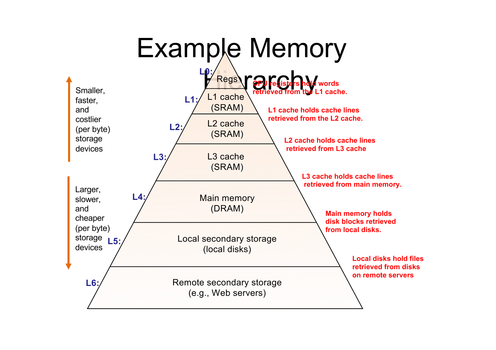

## 14.7 Basic cache concepts

> **Cache**: a smaller, faster storage device that acts as a **staging area for a subset of the data in a larger, slower device**.

**The fundamental idea of the memory hierarchy**: **for each k, the faster, smaller device at level k serves as a cache for the larger, slower device at level k+1.**

**General cache concepts**:
- Memory is viewed as **partitioned into "blocks"**
- The cache caches a **subset** of these blocks
- Data is copied in **block-sized transfer units**
- **Blocks should be large enough to exploit spatial locality**

| Case | Definition |
|---|---|
| **Hit** | Data in block b is needed, and **block b is in the cache** |
| **Miss** | Block b is not in the cache → **fetch** b from memory → **store it in the cache** |

**The two decisions to make on a miss (terms to memorize)**:
- **Placement policy**: decides where block b goes
- **Replacement policy**: decides which block is **evicted (the victim)**

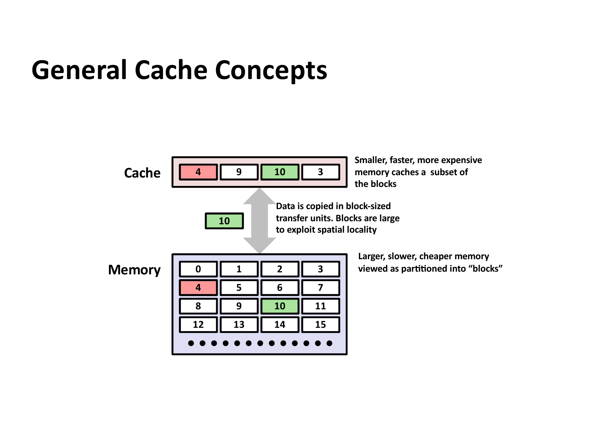

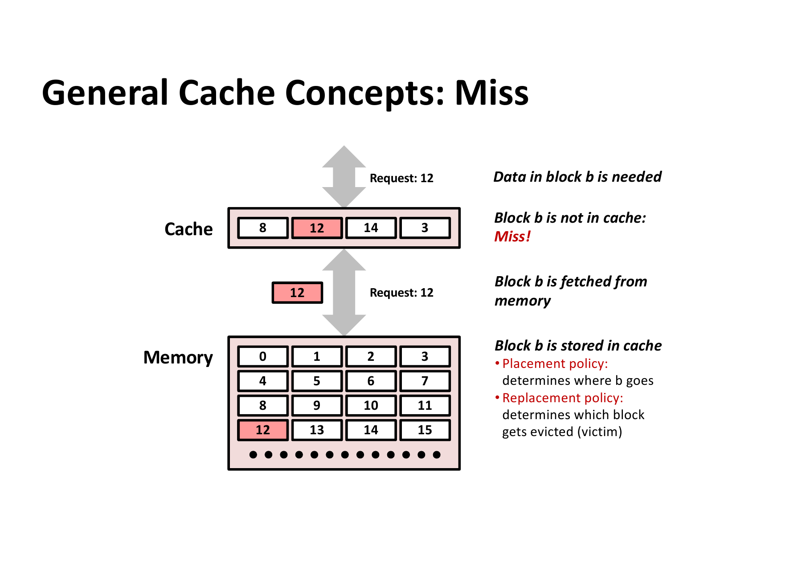

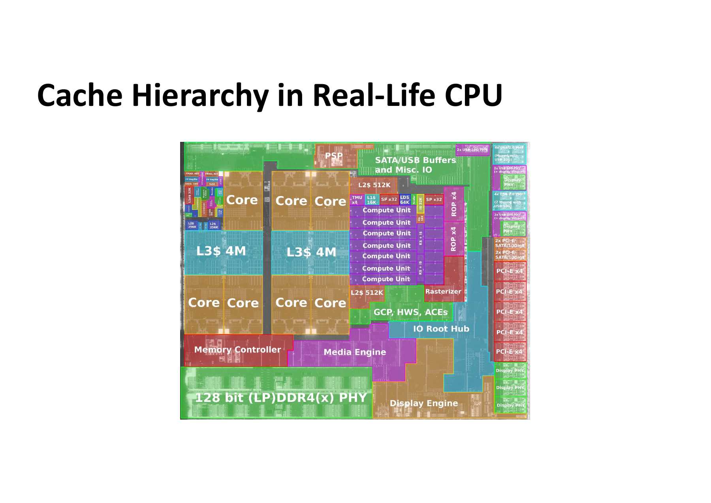

---

# 15. Summary of Slide Errors and Version Differences

| Location | Problem | Correct statement |
|---|---|---|
| **P38** | `push → SP = SP + 4`, `pop → SP − 4` | **Backwards**. ARM is Full Descending: **PUSH subtracts 4, POP adds 4** |
| **P60** | "PUSH {R4} … adds 4 to SP", "POP … subtracts 4" | Same as above, **backwards**. (Your handwritten "substract/add" annotation is correct) |
| **P51 vs P52–54** | Comments say `; R0 = result` in one place and `; R2 = result` in another | The result is actually first in **R4**, then in **R0** after `MOV R0, R4` |
| **P27** | "LR = PC + 4 = 0x00000204" | Semantically it's "the BL instruction's address + 4". Note that it uses a **different PC base** from P5's BTA "PC + 8"; don't mix them up |
| **P187 (old) vs P198 (new)** | Old version "below: memory-mapped I/O", new version "**must use** memory-mapped I/O" | Go with the **new version**: **DMA must be paired with MMIO** (consistent with P208 "DMA cannot work with port-mapped") |
| **P216 (old) vs P228/231 (new)** | Processor B's execution time changed from 150s to 140s, and Processor C (75W/120s) added | Compute energy using the **new version's three-processor** data |
| **P157 (old)** | Marked "not the latest ppt version" | Replaced by P157–168 of the `后半部分` file |
| **P228 and P231** | Exactly the same slide appears twice (with P229/P230 in between) | Not an error, it's a recap during the lecture; one screenshot suffices |

---

# 16. Review Self-Check List

If you can't answer one, go back to the corresponding section:

**Functions and the stack**
1. What are the three BTA steps? Why PC + 8?
2. Which kind of stack (of the four) does ARM use? Does SP increase or decrease on PUSH?
3. Which registers are Preserved and which Nonpreserved? What do the two saving rules say?
4. In `PUSH {R4, R8, LR}`, which register is stored at the highest address?
5. What's usually in a stack frame? Why do we say "the stack is not a hardware component"?
6. What's the difference between the ABI and the ISA?
7. Why must a recursive function obey both the caller save rule and the callee save rule?
8. Why doesn't factorial's base case need to restore LR?

**Memory**
9. What are the five segments of the ARM memory map from high to low? Which way do the heap and the stack grow?
10. Which segment do global variables, static variables, local arrays, and `malloc`ed objects go in, respectively?
11. The three big benefits of virtual memory? What are the key and value in a page table?
12. What determines the lifetimes of static / stack / heap allocation, respectively?
13. What is the definition of a memory leak?

**Exceptions and I/O**
14. How do Interrupt / Trap / Fault / Abort differ? Give one example of each.
15. When are internal and external exceptions handled, respectively? Which exceptions must be handled immediately?
16. Which 8 things does the hardware push automatically on Cortex-M exception entry? Why exactly these?
17. What do `IPSR == 0` and `IPSR > 0` mean, respectively?
18. In which modes are MSP and PSP used? Why is MSP always used after the handler starts?
19. What are the two options in each of the three I/O classification dimensions? Which combination is impossible?
20. What three pieces of information does the DMA need from the CPU? How does the DMA notify the CPU when done?
21. Are the micro:bit's "ports P0/P1" port-mapped I/O?

**Performance and power**
22. What is Amdahl's formula? What k does "150% faster" correspond to?
23. What are the five factors in the P_dynamic formula? Which one is squared?
24. Why might "a CPU with lower power" actually use more energy?
25. What is EDP? Why is it needed?
26. Definitions of temporal and spatial locality? Give an example of each from a loop.
27. Which two policy decisions are made on a cache miss?

---
