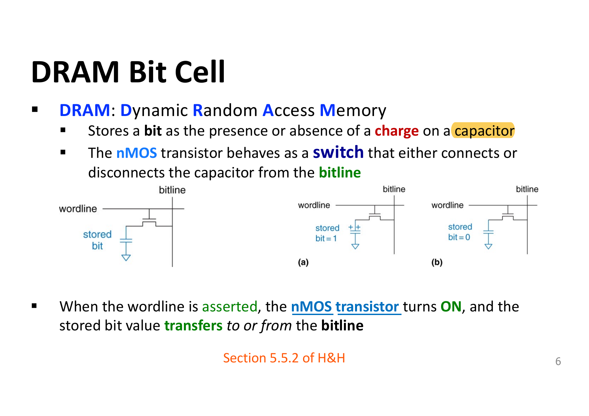
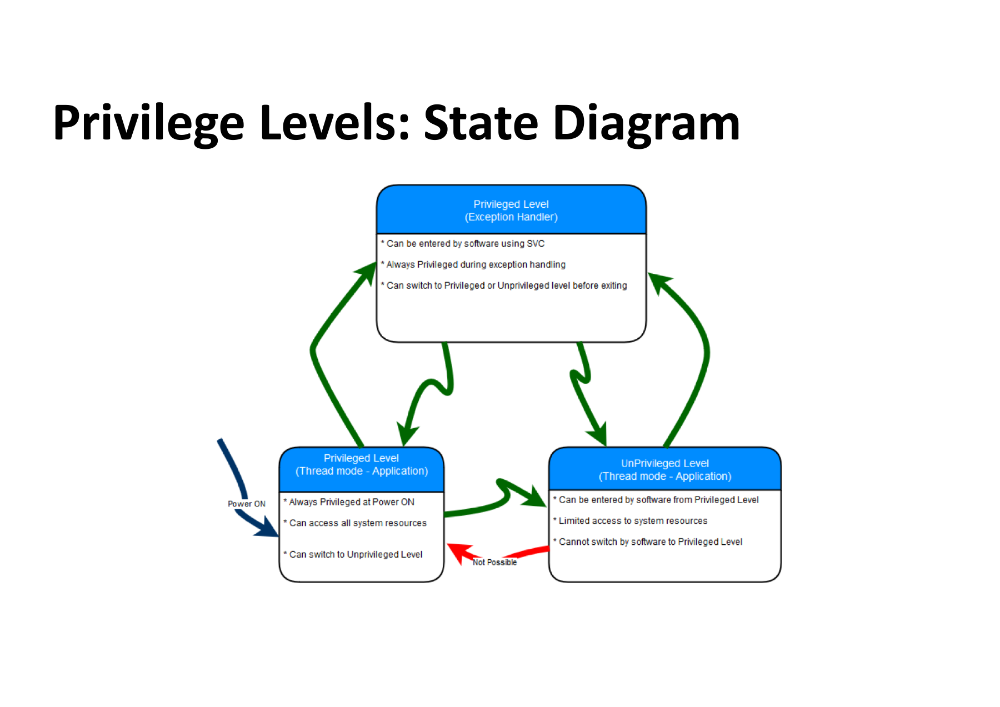
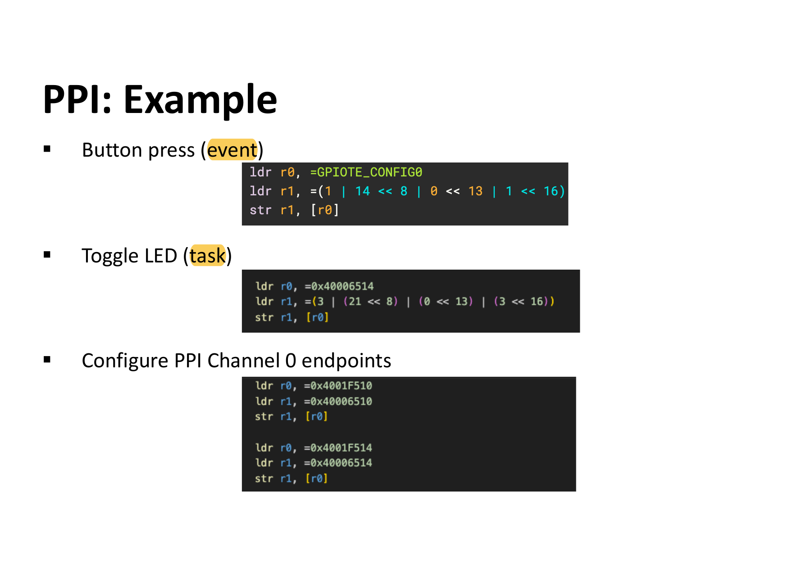
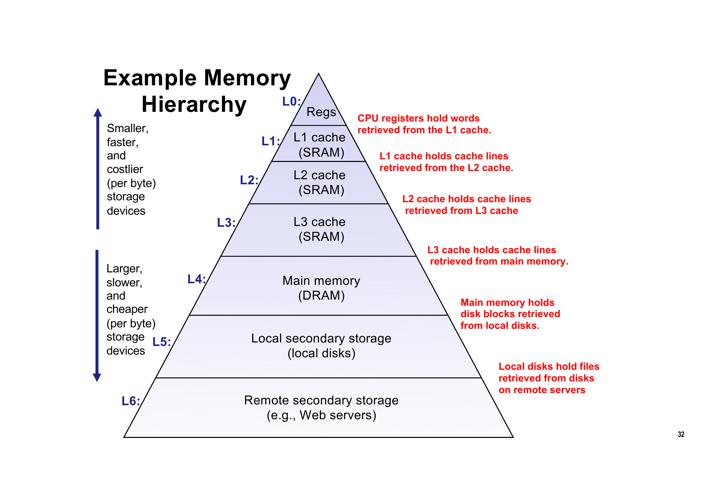
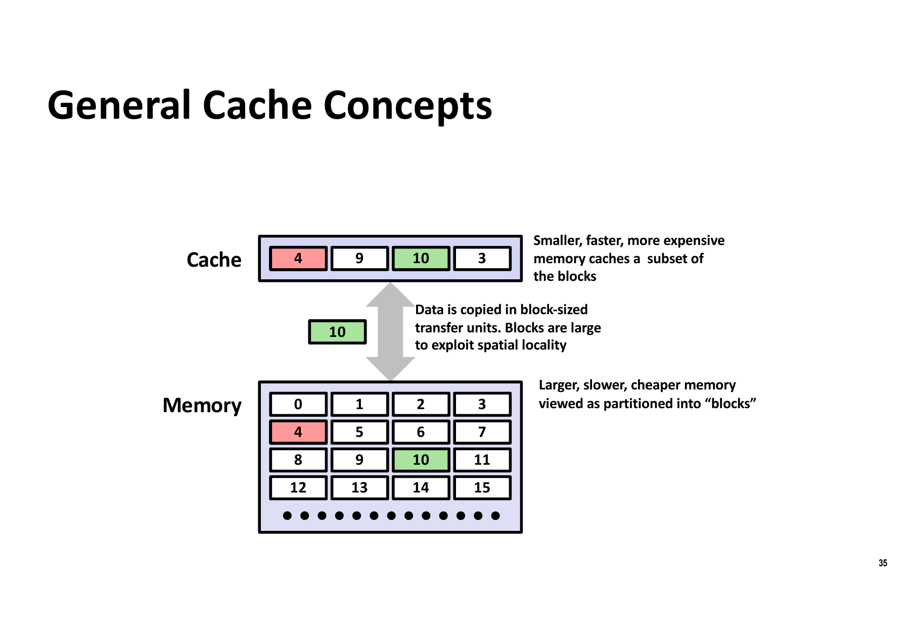
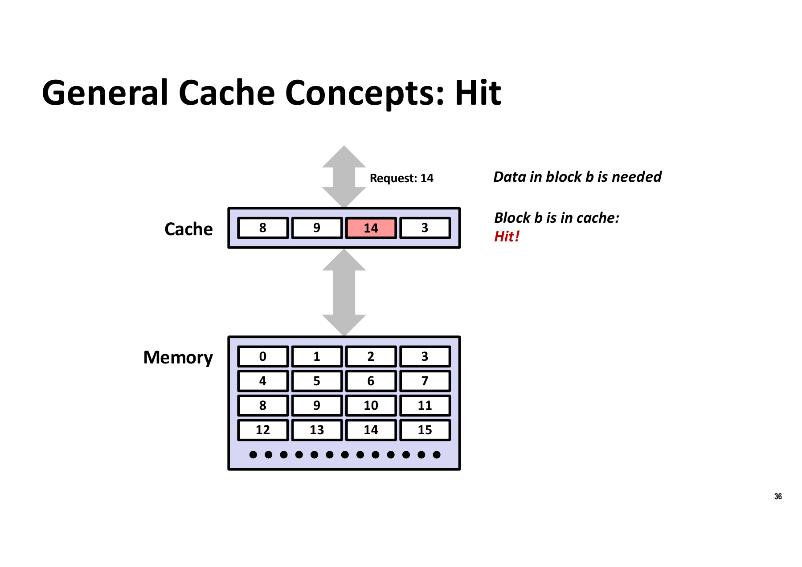
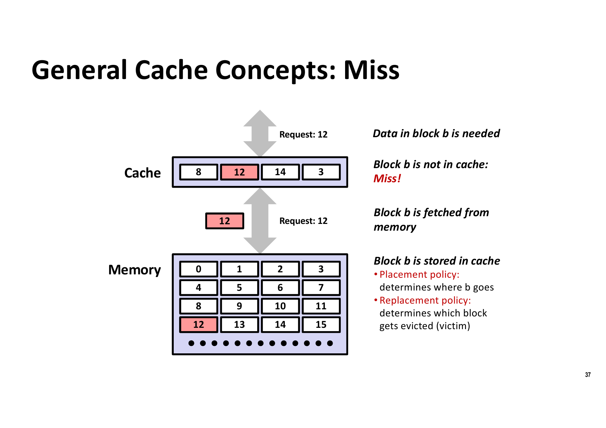
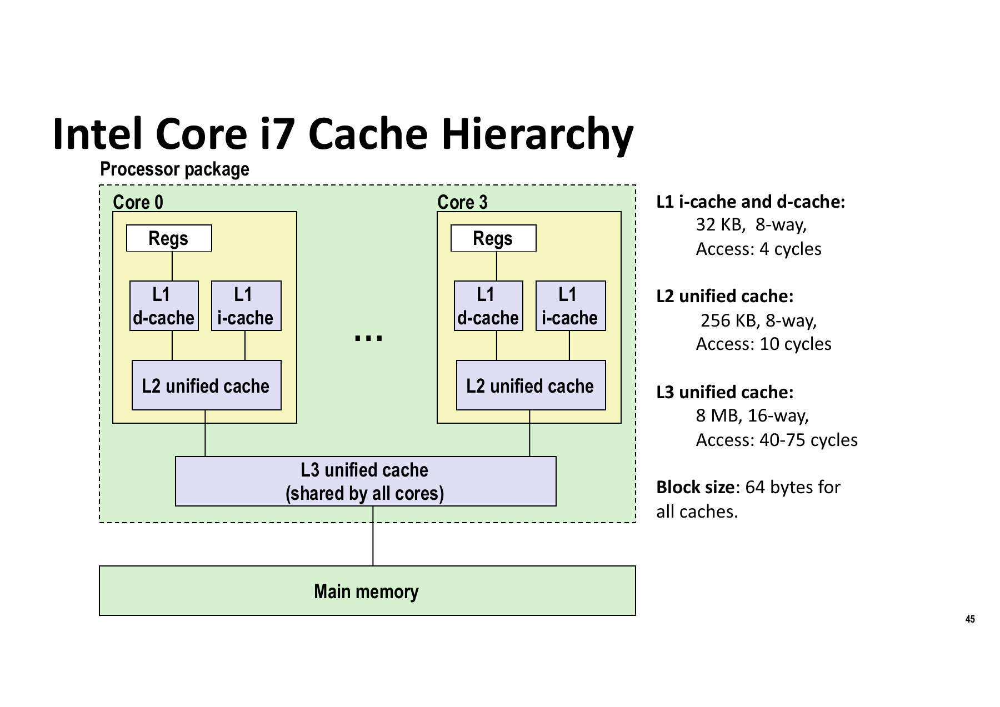
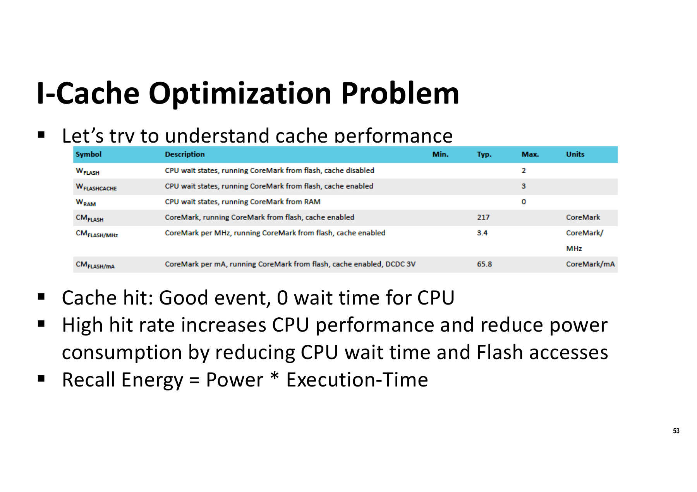

# COMP2300 Set 7 Notes — micro:bit Hardware, Privilege Levels and Interrupts, Locality and Cache

> **Course**: ANU COMP2300 / COMP6300 / ENGN2219 — Computer Organisation and Program Execution
> **Lecturer**: Shoaib Akram
> **This set in one sentence**: Starting from the micro:bit's real hardware, explain "where code is stored (Flash), how the CPU gets around slow storage (I-Cache / putting code in SRAM), and how it responds to the outside world (privilege levels / SVC / interrupts / GPIOTE / PPI / SysTick)", and use this to introduce the principle of locality and the whole cache hierarchy.
> **Page numbers**: PDF page number = number at the bottom right of the slide + 1.

---

## 1. Overview: What This Lecture Is About

| Block | Contents |
|---|---|
| micro:bit hardware features | Address space segments, code in Flash, stack/heap in SRAM, memory-mapped I/O |
| Coping with slow Flash | wait states / I-Cache (hardware) / moving code to SRAM (software) |
| Privilege and exceptions | Thread/Handler mode, SVC software trap, exception stack frame |
| Peripherals and interrupts | GPIOTE (event/task), NVIC, PPI (bypassing the CPU entirely), SysTick |
| Locality and cache | temporal/spatial locality, memory hierarchy, hit/miss, placement/replacement, direct-mapped vs n-way |
| Real systems | Intel i7 / AMD 3D V-Cache / Cortex-A72 / A53 / M4 (no cache) / nRF52833 I-Cache |

> ⚠️ **The "Introduction to pipelining" on P2 never actually appears in this set**; the whole deck ends with I-Cache optimization. The pipelining material should be in Set 8. Don't think you missed something.

---

## 2. General Concepts: Programs and Address Spaces

### Core propositions
- **Code + Data = Program**. Under the Von Neumann model, **code and data share the same address space** (the difference from the Harvard model is an exam point).
- **Address space**: the set of all addresses the CPU can generate.
- The micro:bit **partitions the address space into segments**, and **different segments are backed by different physical technologies** — the most important sentence of this section: the address space is a logical view, backed by heterogeneous media such as Flash / SRAM / peripheral registers.
- Code goes in **Flash** by default; **the stack and heap go in SRAM**.
- **I/O peripherals are accessed with LDR/STR through special addresses → memory-mapped I/O** (no dedicated I/O instructions needed; this is ARM's choice).

### Cortex-M address space segments (figure on the right of P4, reconstructed as a table)

| Address range | Segment | Size |
|---|---|---|
| 0x00000000 – 0x1FFFFFFF | **Code** (Flash on the micro:bit) | 0.5 GB |
| 0x20000000 – 0x3FFFFFFF | **SRAM** | 0.5 GB |
| 0x40000000 – 0x5FFFFFFF | **Peripheral** | 0.5 GB |
| 0x60000000 – 0x9FFFFFFF | External RAM | 1 GB |
| 0xA0000000 – 0xDFFFFFFF | External device | 1 GB |
| 0xE0000000 – 0xE00FFFFF | **Private peripheral bus (PPB)** | 1 MB |
| 0xE0100000 – 0xFFFFFFFF | Vendor-specific memory | 511 MB |

**This table directly explains all the addresses that follow**; check them yourself:
- GPIOTE base `0x40006000`, PPI base `0x4001F000` → fall in the **Peripheral** segment (defined by the chip vendor Nordic)
- NVIC ISER0 `0xE000E100`, SysTick `0xE000E010` → fall in the **PPB** segment (defined by the ARM core, the same on all Cortex-Ms)

**Often examined**: given an address, which segment does it belong to / is it a core or vendor peripheral? `0xE000xxxx` means the core, `0x4000xxxx` means a vendor peripheral.

---

## 3. Code Storage and Execution: Why Flash Is a Problem

### Flash's role
- Code is stored in Flash by default because it is **non-volatile / persistent** and survives power-off → so Flash is a **storage device**, not memory.
- On the micro:bit, Flash is **integrated on the microcontroller chip**.
- **Why on-chip Flash rather than DRAM**: Flash integrates easily with the CMOS process, **DRAM doesn't**. That's why the address space reserves a segment specifically for external RAM (SRAM or DRAM).

### Latency numbers to memorize (exam point)

| Item | Value |
|---|---|
| High-capacity Flash storage device latency | On the order of **microseconds (µs)** |
| RAM latency | On the order of **nanoseconds (ns)** |
| nRF52833 on-chip Flash read latency | **30–40 ns** |
| Cortex-M4 clock frequency | Up to **64 MHz** |
| One CPU cycle | **15.625 ns** (= 1/64 MHz) |

**Conclusion: 30–40 ns > 15.625 ns, Flash is slower than one CPU cycle** → instruction fetch must wait. This is the motivation for the whole second half of the lecture.

### How to bridge this latency gap (P8, three routes, must memorize)

1. **The CPU just waits**: insert **wait states / pipeline stalls**. Works, but inefficient.
2. **Hardware approach: Caching**
   - **The instruction cache sits on the Flash (CODE) side**, reducing how often the CPU waits for Flash.
   - Stores frequently accessed instructions and can **prefetch** ahead.
   - The CPU itself also has a **prefetch buffer** for fetching the next sequential instruction.
3. **Software approach: Code placement**
   - Put **hot loops, interrupt handlers, and performance-critical code** into **SRAM**.
   - SRAM is much faster than Flash.
   - How: place critical functions in the **`.data` section**, then branch to them.


### Flash Memory basics (P9/P10)

- Made of **floating gate transistors**.
- Organized into **pages**; on the micro:bit **1 page = 4 kB**; per the manual: Flash has **128 pages × 4 kB** (= 512 kB), accessed by the CPU over the **ICODE and DCODE buses**.
- **Read**: unlimited, at any granularity (byte addressable on the micro:bit).
- **Write**: **a page can be overwritten only after it is erased**.
- The **NVMC (non-volatile memory controller)** handles writes: it finds an empty page and rewrites "unchanged bytes + changed bytes" onto it. Can also be operated through configuration registers.
- **Limited endurance**: **10 000 write/erase cycles**; beyond this threshold the memory no longer works properly. **DRAM cells don't have this problem**.
- In high-end systems Flash is a **storage device accessed through system calls** (not on the micro:bit, which maps it directly into the address space).
- Flash replaced spinning mechanical hard disks (Flash is a semiconductor device).

**Often-examined comparison**:

| | Flash | DRAM | SRAM |
|---|---|---|---|
| Volatility | Non-volatile | Volatile | Volatile |
| Write endurance | **Limited (10k)** | Essentially unlimited | Essentially unlimited |
| Erase needed before overwrite | **Yes** | No | No |
| Integration with CMOS | Easy | Difficult | Easy |
| Use on the micro:bit | Code (CODE segment) | (off-chip) | Stack/heap + I-Cache |

### DRAM Bit Cell (P7, review of Set 3)

- **DRAM = Dynamic Random Access Memory**.
- **Stores 1 bit as the presence or absence of charge on a capacitor**.
- **An nMOS transistor acts as a switch**, **connecting or disconnecting the capacitor to/from the bitline**.
- **The wordline is asserted → the nMOS conducts → the stored bit value moves between the capacitor and the bitline** (in either the read or write direction).
- Textbook source: **H&H Section 5.5.2**.



---

## 4. CPU Operating Modes and Privilege Levels

### The two operating modes (P11, get the definitions exactly right)

| Mode | When entered | Privilege |
|---|---|---|
| **Thread mode** | Entered **on Reset**, or after **returning from an exception** | **Both Privileged and Unprivileged code can run here** |
| **Handler mode** | Entered **when triggered by an exception** | **All code in Handler mode is privileged** |

### Core idea of privilege levels
- **Unprivileged execution: restricts or excludes access to certain resources**.
- **Privileged execution: can access all resources**.

### Key points of the state diagram (P12)
- **At Power ON it is always Privileged Thread mode**.
- Privileged Thread → can **switch to Unprivileged via software**.
- Unprivileged Thread → **cannot switch back to Privileged via software** (the "Not Possible" marked in red in the figure). This is the key to the security mechanism.
- To get from Unprivileged back to Privileged, **the only way is via an exception** (e.g. SVC) into Handler mode, after which the handler decides before exiting whether to return to Privileged or Unprivileged.



### SVC: entering the OS and changing the privilege level (P13)

- User code runs at a **low privilege level**.
- The **SVC (Supervisor Call) instruction** is used to **switch between privilege levels**.
- The CPU reads arguments from "certain agreed registers" and executes a specific flavor of the SVC instruction.
- **SVC is a special software exception called a trap**.
- The argument specifies the **service** the user code wants from the OS; the handler calls the corresponding function based on the argument.

**Three points you must understand (the P15 Demo checklist maps directly to exam questions)**:
1. Trying to write the CONTROL register in Unprivileged mode to switch back to the privileged level → **doesn't work**.
2. How to get the svc argument in the SVC handler → **take it from the stack** (because the exception stack frame saves the return address, and the SVC instruction's immediate is in the instruction just before the return address).
3. Recognize what "**the architectural support needed for secure software design**" is: mode separation + one-way privilege restriction + hardware automatically saving state + vectored handlers.

### Exception stack frame (P14, must memorize)

When an exception occurs, **the hardware automatically** pushes the following 8 registers (ordered by address from low to high):

| Offset from SP | Contents |
|---|---|
| SP + 0x1C | **xPSR** |
| SP + 0x18 | **PC** |
| SP + 0x14 | **LR** |
| SP + 0x10 | **R12** |
| SP + 0x0C | R3 |
| SP + 0x08 | R2 |
| SP + 0x04 | R1 |
| SP + 0x00 | **R0** ← SP points here after the exception |

- Memory addresses grow **downward**; before the exception SP points above these 8 words.
- **The PC is used to return control to the interrupted program**.
- **LR holds a special return value (EXC_RETURN)** used to return control (not an ordinary function return address! This is easily confused).
- Memory anchor: **R0–R3 + R12 + LR + PC + xPSR**, exactly the caller-saved set in AAPCS → so the handler can be written directly as a C function, with the compiler responsible for the callee-saved part.

---

## 5. Interrupts

### Definition (P16)
- **A hardware exception triggered by an I/O device (e.g. a keyboard) is called an interrupt**, and belongs to the **asynchronous exceptions**.
- The CPU receives a **notification** when the user presses a key.
- **The normal fetch cycle stops and the CPU goes to handle the interrupt**.
- Like an ordinary function call, an exception must: **save the return address → jump to some address → do the work → clean up → return to the program**.

### Core distinction (P17 explicitly marks this as a quiz/exam point)

| | Software trap (SVC) | External interrupt |
|---|---|---|
| Trigger source | **The program itself executes an SVC instruction** | **An external I/O device** (button, timer, etc.) |
| Synchrony | **Synchronous**, occurs at a definite instruction boundary | **Asynchronous**, can arrive at any time |
| Predictability | The program actively requests it | The program is passively interrupted |
| Purpose | Request OS services, raise the privilege level | Respond to external events |
| Handler | SVC_Handler, needs to **parse the argument** | ISR, usually needs to **clear the event register** |

**You must be able to answer** (original P17 questions):
- What is GPIOTE's role? → Turns pin level changes into events / turns tasks into pin actions, eliminating CPU polling.
- What is the NVIC's role? → Receives IRQs, routes them to the correct handler by IRQ number, manages enabling and priority.
- What does the hardware do to save architectural state? → Automatically pushes the 8 registers above.
- Difference between the SVC trap handler and an interrupt handler? → See the table above.

### Terminology table (P23, must distinguish)

| Term | Full name | Meaning |
|---|---|---|
| **IRQ** | Interrupt Request | **A hardware (physical) signal line** that delivers the interrupt to the CPU's NVIC |
| **ISR** | Interrupt Service Routine | The interrupt handler / exception handler (interrupt handler and exception handler both refer to it) |
| **ISER** | Interrupt Service Enable Register | The interrupt enable register, `.set NVIC_ISER0, 0xE000E100` |

**IRQ number → bit index in ISER** (nRF52833; the exam may give code and ask which peripheral it is):

| Peripheral / interrupt | ISER bit index | Description |
|---|---|---|
| POWER_CLOCK | 0 | Power and clock management |
| RADIO | 1 | Bluetooth radio |
| UART0 | 2 | UART communication |
| SPI0_TWI0 | 3 | SPI / I2C (TWI) communication |
| **GPIOTE** | **6** | **GPIO tasks and events (e.g. buttons)** |
| TIMER0 | 8 | General-purpose timer 0 |
| TIMER1 | 9 | General-purpose timer 1 |
| TIMER2 | 10 | General-purpose timer 2 |
| RTC0 | 11 | Real-time counter 0 |

**Why IRQ numbers exist**: each interrupt source has a unique number, and **the NVIC uses it to route the right interrupt to the right handler**.

---

## 6. GPIOTE: GPIO Tasks and Events

### Concept (P18/P19)

- **Core value: freeing the CPU from polling GPIO pins**.
- **Event**
  - An **output** of a peripheral, indicating "something happened"
  - Example: **a button press**
  - **Connected to the NVIC or PPI**
- **Task**
  - An **input** of a peripheral, telling it "do something"
  - Example: **toggle an LED**
  - **Connected to the PPI**
- **GPIOTE channel**: provides a **dedicated hardware path for "a specific pin ↔ a task/event", without CPU involvement**.
- Each channel is independent and can monitor/control a different GPIO pin.
- **8 channels in total, one register per channel**.
- You need to choose: **mode (task or event), pin, port, polarity**.

**Three advantages (P19)**:
1. Eliminates CPU polling;
2. Can send interrupts to the Cortex-M4's interrupt controller;
3. **Through the PPI it can bypass the CPU entirely** — e.g. a button press directly toggles an LED, with no CPU involvement at all.

### GPIOTE register map (base = `0x40006000`)

| Register | Offset | Description |
|---|---|---|
| TASKS_OUT[0..7] | 0x000 + 4n | Triggers the OUT[n] task (acts according to POLARITY) |
| EVENTS_IN[0] | **0x100** | Event generated by the pin specified by CONFIG[0].PSEL |
| EVENTS_IN[1..7] | 0x104 … 0x11C | Same as above, for CONFIG[1..7] |
| EVENTS_PORT | 0x17C | Event generated by the SENSE mechanism of multiple input pins |
| **INTENSET** | **0x304** | **Enable interrupts** |
| INTENCLR | 0x308 | Disable interrupts |
| **CONFIG[0]** | **0x510** | Configures the OUT[n]/SET[n]/CLR[n] tasks and the IN[n] event |
| CONFIG[1..7] | 0x514 … 0x52C | Same as above |

> ⚠️ **Don't mistake CONFIG[n] (0x510+) for event/task registers**. CONFIG is only **configuration**; the real event registers are **EVENTS_IN[n] (0x100+)**, and the real task registers are **TASKS_OUT[n] (0x000+)**. This distinction directly determines right or wrong in the PPI section below.

### CONFIG[n] register bit fields (P20, reconstructed, no screenshot needed)

| Field | Bits | Value | Meaning |
|---|---|---|---|
| **MODE** | [1:0] | 0 = Disabled | The pin specified by PSEL is not acquired by the GPIOTE module |
| | | **1 = Event** | The pin is configured as an **input**; an **IN[n] event** is generated when the operation specified by POLARITY occurs |
| | | **3 = Task** | The pin is configured as an **output**; when the SET[n]/CLR[n]/OUT[n] task is triggered it acts according to POLARITY. Once enabled as a task the pin is acquired by GPIOTE, and **the GPIO module can no longer write it as an ordinary output pin** |
| **PSEL** | [12:8] | 0..31 | The **GPIO pin number** associated with the SET[n]/CLR[n]/OUT[n] tasks and the IN[n] event |
| **PORT** | [13] | 0..1 | **Port number** |
| **POLARITY** | [17:16] | 0 = None | Task: OUT[n] has no effect on the pin; Event: pin activity doesn't generate IN[n] |
| | | **1 = LoToHi** | Task: set the pin to 1; **Event: a rising edge generates IN[n]** |
| | | 2 = HiToLo | Task: clear the pin to 0; Event: a falling edge generates IN[n] |
| | | **3 = Toggle** | **Task: toggle the pin**; Event: any change generates IN[n] |
| **OUTINIT** | [20] | 0 = Low / 1 = High | **Only effective in task mode**: the initial output value when the GPIOTE channel is configured (no effect in event mode) |

Reset value `0x00000000`, i.e. Disabled by default.

### Code walkthrough (P22 + P25, exam prototype)

**(1) Configure channel 0 to listen to button A**

```asm
.set GPIOTE_EVENTS_IN0, 0x40006100
.set GPIOTE_INTENSET,   0x40006304
.set GPIOTE_CONFIG0,    0x40006510

ldr r0, =GPIOTE_CONFIG0
ldr r1, =(1 | 14 << 8 | 0 << 13 | 1 << 16)
str r1, [r0]
```
Field-by-field breakdown (**this bit-assembly question type is a must-know**):

| Fragment | Field | Value | Meaning |
|---|---|---|---|
| `1` | MODE[1:0] | 1 | **Event mode** |
| `14 << 8` | PSEL[12:8] | 14 | **Pin 14** |
| `0 << 13` | PORT[13] | 0 | **Port 0** |
| `1 << 16` | POLARITY[17:16] | 1 | **LoToHi = rising edge** |

→ "Monitor (pin 14, port 0) on channel 0 (that's **button A** in the pin map), and generate an event on the **rising edge**".

**(2) Enable the interrupt**
```asm
ldr r0, =GPIOTE_INTENSET
ldr r1, =0b1                @ enable the interrupt for the IN[0] event
str r1, [r0]
```
→ When an event is detected, a signal/IRQ is sent to the CPU's NVIC.

**(3) Let this IRQ through in the NVIC**
```asm
ldr r0, =NVIC_ISER0         @ 0xE000E100
ldr r1, =(1 << 6)           @ GPIOTE's IRQ number is 6
str r1, [r0]
```

**Memorize the three-step chain: GPIOTE_CONFIG (generate the event) → GPIOTE_INTENSET (allow sending the IRQ) → NVIC_ISER (allow the CPU to receive it). Missing any one step means the interrupt never reaches the handler.**

---

## 7. PPI: Bypassing the CPU Entirely

### Concept (P24)
- **PPI (Programmable Peripheral Interconnect)** lets **peripherals interact autonomously** using tasks and events, **independent of the CPU**.
- Mechanism: **an event in one peripheral → automatically triggers a task in another peripheral**, the two connected via a **PPI channel**.
- The nRF52833's PPI: **20 configurable channels CH[0..19]** + **12 pre-programmed channels CH[20..31]**, base = **`0x4001F000`**.

### Basic steps (four steps to memorize)
1. Set up an **event** with GPIOTE;
2. Set up a **task** with GPIOTE;
3. **Do not** set up the interrupt request line to the NVIC;
4. Pick a **PPI channel** and give it **the addresses of the task and event registers**.

### PPI registers (P26)

| Register | Offset | Description |
|---|---|---|
| TASKS_CHG[0..5].EN / .DIS | 0x000 / 0x004 … (8 bytes per group) | Enable / disable channel groups |
| **CHEN** | 0x500 | Channel enable register |
| **CHENSET** | **0x504** | Channel enable set register |
| CHENCLR | 0x508 | Channel enable clear register |
| **CH[0].EEP** | **0x510** | **Channel 0 event endpoint** |
| **CH[0].TEP** | **0x514** | **Channel 0 task endpoint** |
| CH[1].EEP / .TEP | 0x518 / 0x51C | Channel 1 |
| CH[2].EEP | 0x520 | Channel 2 |

### Example code (P25)

```asm
@ (1) button press = event: channel 0, pin 14, port 0, LoToHi, Event mode
ldr r0, =GPIOTE_CONFIG0            @ 0x40006510
ldr r1, =(1 | 14 << 8 | 0 << 13 | 1 << 16)
str r1, [r0]

@ (2) toggle LED = task: channel 1 (CONFIG[1] = 0x40006514)
ldr r0, =0x40006514
ldr r1, =(3 | (21 << 8) | (0 << 13) | (3 << 16))
str r1, [r0]
@ MODE=3(Task), PSEL=21, PORT=0, POLARITY=3(Toggle)

@ (3) configure the two endpoints of PPI channel 0
ldr r0, =0x4001F510                @ CH[0].EEP
ldr r1, =0x40006510
str r1, [r0]

ldr r0, =0x4001F514                @ CH[0].TEP
ldr r1, =0x40006514
str r1, [r0]
```

> ⚠️ **Slide error (P25) — this PPI endpoint code is wrong; don't copy it**
>
> 1. **The addresses written into EEP/TEP are wrong**. EEP should hold the address of an **event register**, and TEP the address of a **task register**. But the `0x40006510` / `0x40006514` the code writes are GPIOTE's **CONFIG[0] / CONFIG[1]**, which are **configuration registers**, not event/task registers.
>    - The correct EEP should be **`0x40006100`** (GPIOTE `EVENTS_IN[0]`)
>    - The correct TEP should be **`0x40006004`** (GPIOTE `TASKS_OUT[1]`, offset `0x000 + 4×1`)
> 2. **The step to enable the PPI channel is missing**. You must also write `CHENSET` (`0x4001F504`) to set bit 0 to 1 before the channel is really connected:
>    ```asm
>    ldr r0, =0x4001F504        @ PPI CHENSET
>    ldr r1, =(1 << 0)          @ enable channel 0
>    str r1, [r0]
>    ```
>
> The conceptual chain (event register → PPI channel → task register) is correct; **don't memorize the specific addresses from the slide**.



**Comparison of the three paths GPIOTE / NVIC / PPI (exam point)**:

| Path | Data flow | CPU involvement |
|---|---|---|
| Polling | The CPU repeatedly reads the GPIO pin | **Occupies the CPU the whole time** |
| GPIOTE + NVIC | Pin → GPIOTE event → IRQ → NVIC → ISR | **The CPU is interrupted and executes the handler** |
| GPIOTE + PPI | Pin → GPIOTE event → PPI channel → GPIOTE task → pin | **No CPU involvement at all** |

---

## 8. The SysTick Timer

### Concept (P27)
- Used to **schedule periodic events** (triggered when the timer expires).
- Once enabled, it **counts down from the reload value to 0**;
- On the next clock cycle it **reloads the value of SYST_RVR**, then keeps decrementing every clock cycle;
- It **sends an interrupt to the NVIC**, and if the handler is set up correctly it will be executed.
- ⚠️ **Don't confuse it with CLOCK**: CLOCK is **outside the CPU** and uses a **crystal oscillator** to generate the processor clock signal; SysTick is a counter peripheral in the core.

### Registers (P28)

| Address | Name | Type | Access | Reset value | Description |
|---|---|---|---|---|---|
| `0xE000E010` | **SYST_CSR** | RW | Privileged | 0x00000000 | Control and status register |
| `0xE000E014` | **SYST_RVR** | RW | Privileged | Unknown | Reload value register |
| `0xE000E018` | **SYST_CVR** | RW | Privileged | Unknown | Current value register |
| `0xE000E01C` | SYST_CALIB | **RO** | Privileged | Implementation defined | Calibration value register |

> Small trap: P27 says "Three memory mapped registers", but the manual's table has four. The fourth, **SYST_CALIB, is a read-only calibration register** not needed for software configuration, so the handout counts only three.

### SYST_CSR bit fields

| Bit | Name | Meaning |
|---|---|---|
| [16] | **COUNTFLAG** | Whether the counter has reached zero since it was last read |
| [2] | **CLKSOURCE** | Clock source selection |
| [1] | **TICKINT** | Whether a SysTick exception is generated when the count reaches 0 |
| [0] | **ENABLE** | Enables the counter |

The rest are Reserved.

### Standard initialization code (P28, formulaic — memorize it)

```asm
main:
    ldr r0, =0xE000E014     @ SYST_RVR
    ldr r1, =0x????         @ load the reload value (determines the period)
    str r1, [r0]

    ldr r0, =0xE000E018     @ SYST_CVR
    mov r1, #0              @ clear the current value (writing any value clears it)
    str r1, [r0]

    ldr r0, =0xE000E010     @ SYST_CSR
    ldr r1, =0x00000007     @ all three bits ENABLE | TICKINT | CLKSOURCE set to 1
    str r1, [r0]

    bx lr

SysTick_Handler:
    @ do something
    bx lr
```

**The order matters: set RVR first → then clear CVR → finally write CSR to enable**. Doing it the other way round would use an undefined current value. `0x7 = 0b111` turns on exactly the low three bits.

---

## 9. The Principle of Locality

### Definition (P30, must memorize)

**Principle of Locality: programs tend to access data and instructions at addresses "equal or adjacent to those accessed recently".**

| Type | Definition |
|---|---|
| **Temporal locality** | **Recently referenced items are likely to be referenced again in the near future** |
| **Spatial locality** | **Items with adjacent addresses tend to be referenced close together in time** |

### Classic example (P31, examined directly)

```c
sum = 0;
for (i = 0; i < n; i++)
    sum += a[i];
return sum;
```

| Reference type | Concrete behavior | Locality |
|---|---|---|
| **Data references** | Array elements accessed in sequence (**stride-1 access pattern**) | **Spatial locality** |
| | The variable `sum` referenced every iteration | **Temporal locality** |
| **Instruction references** | Instructions executed in sequence | **Spatial locality** |
| | The loop body executed repeatedly | **Temporal locality** |

**Mnemonic**: "**traversal → spatial; reuse → temporal**". Data and instructions **each have** spatial + temporal locality; don't give only half the answer.

---

## 10. The Memory Hierarchy

### Why there's a hierarchy (P32, three fundamental properties)

1. **Faster storage technologies: more expensive per byte, smaller capacity, higher power (heat!)**;
2. **The speed gap between the CPU and main memory keeps widening**;
3. **Well-written programs tend to exhibit good locality**.

**These three properties complement each other perfectly** → suggesting a way of organizing storage systems: **the memory hierarchy**.

### Hierarchy structure (P33)

| Level | Contents | Technology |
|---|---|---|
| L0 | Registers | — |
| L1 | L1 cache | SRAM |
| L2 | L2 cache | SRAM |
| L3 | L3 cache | SRAM |
| L4 | Main memory | DRAM |
| L5 | Local secondary storage | Local disk |
| L6 | Remote secondary storage | Web servers, etc. |

**Upward: smaller, faster, more expensive per byte; downward: larger, slower, cheaper per byte.**
**Each level fetches data from the level below**: registers fetch words from L1, L1 fetches cache lines from L2, ……, main memory fetches disk blocks from the local disk, the local disk fetches files from remote servers.



### General definition of a cache (P34)

- **Cache: a smaller, faster storage device that acts as a staging area for "a subset of the data" in a larger, slower device.**
- **The fundamental idea of the memory hierarchy: for each k, the faster, smaller device at level k serves as a cache for the larger, slower device at level k+1.**
- **Why it works**: because of locality, programs access data at level k **far more often** than data at level k+1; so level k+1 can be slower, and thus larger and cheaper.
- **Big Idea (the original wording is valuable)**: the memory hierarchy creates a **large pool** whose **cost is close to the cheap storage at the bottom**, but which **serves data to programs at a rate close to the fast storage at the top**.

### How a cache works (P35)

- Cache memories are **small, fast SRAM memories, managed automatically by hardware** (transparent to software).
  - They hold frequently accessed blocks of main memory;
  - **The CPU checks the cache first, then memory**.
- **Correspondence of implementation technologies (must memorize)**:

| Level | Device |
|---|---|
| Cache | **SRAM cell** |
| Main memory | **DRAM cell** |
| Storage (non-volatile/persistent) | **Flash memory cell** |

- High-performance systems: **SRAM cache backed by DRAM memory**.
- **micro:bit: an SRAM instruction cache backed by Flash (code) memory**. ← This is the seam between the two halves of this set, and an exam point.

### General cache concepts: Hit and Miss (P36–P38)

**Basic model**:
- Slow, large storage is **partitioned into blocks**;
- The cache holds only **a subset** of them;
- Data moves between levels **in units of blocks**;
- **Blocks are made large to exploit spatial locality**.

**Hit (P37)**: request block 14 → block 14 is in the cache → **hit**.

**Miss (P38)**: request block 12 → not in the cache → **miss** → fetch block 12 from memory → store it in the cache. Two policies are involved here:
- **Placement policy: decides where b goes**;
- **Replacement policy: decides which block is evicted (the victim)**.







---

## 11. Cache Performance (must-know calculations)

### Three metrics (P39)

| Metric | Definition | Typical values |
|---|---|---|
| **Miss Rate** | **misses / accesses = 1 − hit rate** | **L1: 3–10%**; L2 can be very small (e.g. < 1%) |
| **Hit Time** | Time to deliver a line in the cache to the processor, **including the time to determine whether it's a hit** | **L1: 4 cycles; L2: 10 cycles** |
| **Miss Penalty** | The **additional** time required because of a miss | **Main memory: 50–200 cycles (trend: still increasing!)** |

### Formulas to memorize

```
Miss Rate = 1 − Hit Rate

Average access time = Hit Time + Miss Rate × Miss Penalty
```

### Classic calculation (P40, almost certain to be examined)

Assume **hit time = 1 cycle, miss penalty = 100 cycles**:

| Hit rate | Calculation | Average access time |
|---|---|---|
| 97% | 1 + 0.03 × 100 | **4 cycles** |
| 99% | 1 + 0.01 × 100 | **2 cycles** |

**Conclusion: a 99% hit rate is twice as fast as 97%.**

**Why use "miss rate" instead of "hit rate"**: 97% → 99% looks like only 2 percentage points, but the miss rate going from 3% to 1% is **a reduction to one third**, and the performance difference is amplified by the **up to 100×** gap between hit and miss. **The hit rate masks the real difference; the miss rate doesn't.**

---

## 12. Placement and Replacement Policies

### Cache lines and tags (P42)

- **Cache line: a data block associated with a tag (part of the memory address)**.
- Because the tag bits are stored together with the data, **this kind of cache is called an associative cache**.
- Some bits of the address are used to **locate the byte within the block**, and others to **decide where the block is placed**.

### The two extremes (comparison table to memorize)

| | **n-way set-associative** | **Direct-mapped (n = 1)** |
|---|---|---|
| Placement rule | Each block of the slow level can go in one of **n possible locations** in the fast level | Each block of the slow level **can go in only one location** |
| Alias | n-way set associative | 1-way set-associative |
| Placement freedom | **Large** | None |
| Silicon area/cost | **More** (more comparators needed) | **Simple to implement** |
| Miss rate | **Low** (high hit rate) | **High** (frequent conflicts, low hit rate) |

- **A replacement policy is needed only when the cache is full**, e.g. **LRU (least recently used)**.
- Note: strictly speaking direct-mapped doesn't need a replacement policy choice — the location is unique, so only that one can be evicted.

### Address split (P43/P44, exam prototype)

Assume **cache block size = 8 bytes, direct mapped (one line per set)**:

```
Address structure:  |  t bits (tag)  |  set index  |  block offset  |
                                      (0…01)          (100)
```

- **block offset**: block size = 8 bytes → needs **log₂8 = 3 bits** (`100` in the figure = byte 4)
- **set index**: selects which set (with direct-mapped each set has only one line)
- **tag**: the remaining high bits, compared with the tag stored in the line

**Hit condition: `valid == 1` and `tag matches` → hit.**
In the figure's example: offset = `100` = 4 → this **4-byte int is at bytes 4–7 within the block**.
**If the tag doesn't match: the old line is evicted and replaced.**


---

## 13. Why Multi-Level Caches (P45)

- **Smaller is faster** — a general principle of computer architecture.
- An extremely fast SRAM cache is placed **closest to the CPU**;
- Subsequent levels use **progressively slower** SRAM, **balancing cost and performance**;
- The result is **a typical 3-level cache hierarchy**.

| Level | Capacity | Access latency |
|---|---|---|
| **L1** | **Tens of KB** | **1 clock cycle** (as stated on this page of the handout) |
| **L2** | — | **~10 cycles** |
| **L3** | — | **~30 cycles** |

- L1's goal: **the CPU never stalls (waits) for the next instruction or data**.
- **L1 is split into two caches: an instruction cache and a data cache** (**split L1**, an exam point; L2/L3 are usually unified).

> ⚠️ **The slides contradict themselves**: P45 says the L1 access latency is **1 clock cycle**, but the typical-values table on P39 and the Intel i7 data on P46 both say L1 is **4 cycles**.
> How to understand it: **1 cycle** is "an idealized teaching statement / throughput from a pipeline perspective", **4 cycles** is the load-use latency of real processors. When answering, check which page the question refers to; if unspecified, it's safer to write **L1 ≈ 1–4 cycles, L2 ≈ 10 cycles, L3 ≈ 30–75 cycles** and state the source.

---

## 14. Cache Hierarchies of Real Systems

### Intel Core i7 (P46, reconstructed as a table)

| Cache | Capacity | Associativity | Access latency | Sharing |
|---|---|---|---|---|
| **L1 i-cache / d-cache** | **32 KB** each | **8-way** | **4 cycles** | **Private per core, split** |
| **L2 unified** | **256 KB** | **8-way** | **10 cycles** | Private per core, **unified** |
| **L3 unified** | **8 MB** | **16-way** | **40–75 cycles** | **Shared by all cores** |

**The block size of all caches is 64 bytes.**

**The pattern (more useful to remember than the numbers)**: **the further down → larger, higher associativity, slower, more likely to be shared and unified.**



### ARM Cortex-A72 (P48)
- **L1: 48 KB I-Cache (with parity) + 32 KB D-Cache (with ECC)**, private per core, split.
- **L2: 512 KB ~ 4 MB, with ECC**, shared by multiple cores.
- Also ARMv8-A 32b/64b CPU, NEON SIMD engine, FPU, ACP, SCU, 128-bit AMBA 4 ACE / AMBA 5 CHI coherent bus interfaces.

### ARM Cortex-A53 (P49, **the latency numbers are the key point**)

| Level | Latency |
|---|---|
| **L1 hit** | **3.4 ns** |
| **L2 hit** | **16.6 ns** |
| **Main memory access** | **154 ns** |

Structure: 4 cores each with private L1 → shared L2 → main memory.
**Note these are absolute times (ns) rather than cycle counts**, a different unit from the i7 table; don't mix them. **L1 : L2 : main memory ≈ 1 : 5 : 45** — this ratio is more worth remembering than the absolute values.

### AMD EPYC 7003X Milan-X / 3D V-Cache (P47)
- **8 cores** per CCD, each core with **32 K I-Cache + 32 K D-Cache (8-way)**, **private 512 K L2**.
- Zen3: **8 cores share 32 MB of L3**, 16-way set associative, 32 B/cycle interface per core, DECTED ECC.
- Zen3+ V-Cache: **shared L3 up to 96 MB after stacking**, >2 TB/s L3 bandwidth, **+4 cycles of latency cost**.
- Key point: **3D stacking triples the L3 capacity at a cost of only 4 cycles** — a real-world case of the capacity vs latency tradeoff.

### ARM Cortex-M4 / micro:bit (P50–P51)
- **The CPU on the micro:bit has no cache** ☹
- **But……** there's still a cache on the chip, it's just **not in the CPU but on the Flash (NVMC) side** → see the next section.

---

## 15. The nRF52833's I-Cache

### Location and configuration (P52)

- **An instruction cache (I-Cache) can be enabled for the ICODE bus in the NVMC**.
- In other words: **the instruction cache is on the Flash memory side**, not inside the CPU. This is the biggest structural difference from general-purpose processors.
- **Enabling the cache is a tradeoff**, so the hardware **exposes profiling registers** to track the hit/miss rate, letting you **make data-driven decisions**.

**ICACHECNF (address offset `0x540`, I-code cache configuration register, reset value `0x00000000`)**:

| Field | Bits | Value | Meaning |
|---|---|---|---|
| **CACHEEN** | [0] | 0 = Disabled | **Disable the cache and invalidate all cache entries** |
| | | 1 = Enabled | Enable the cache |
| **CACHEPROFEN** | [8] | 0 = Disabled | Disable cache profiling |
| | | 1 = Enabled | Enable cache profiling |

### Profiling registers (P53)

| Register | Offset | Description |
|---|---|---|
| **IHIT** | **0x548** | I-code cache **hit** counter, field HITS (RW) |
| **IMISS** | **0x54C** | I-code cache **miss** counter, field MISSES (RW) |

Both have reset value `0x00000000`, and are **writable, but only with `0`** (i.e. they can only be cleared, not set to arbitrary values).

**Manual supplement (quoted on P56)**: once profiling is enabled, **IHIT/IMISS increment on every instruction cache hit/miss respectively**. **These two registers do not wrap around after reaching their maximum value**; if the maximum is reached, you should **shorten the profiling period** to get correct numbers.

> Often-examined trap: the counter **not wrapping around** ≠ resetting to zero on overflow. Once it hits the cap it stays there, and the data is distorted from then on.

### The I-Cache optimization question (P54–P56)

**Key nRF52833 datasheet parameters (reconstructed as a table, exam point)**:

| Symbol | Description | Value | Unit |
|---|---|---|---|
| **W_FLASH** | CPU wait states running CoreMark from flash, **cache disabled** | **Max 2** | — |
| **W_FLASHCACHE** | CPU wait states running CoreMark from flash, **cache enabled** | **Max 3** | — |
| **W_RAM** | CPU wait states running CoreMark from **RAM** | **Max 0** | — |
| CM_FLASH | Running CoreMark from flash (cache enabled) | 217 (typ) | CoreMark |
| CM_FLASH/MHz | CoreMark per MHz | 3.4 | CoreMark/MHz |
| CM_FLASH/mA | CoreMark per mA (DCDC 3V) | 65.8 | CoreMark/mA |

**The most counterintuitive and most examinable point of this table**:
> **W_FLASHCACHE (3) > W_FLASH (2)**. With the cache on, **the wait on a miss is actually longer than without the cache** (there's the extra step of checking the cache).

Two conclusions follow:
- **Cache hit: a good event, the CPU's wait time is 0.**
- **Cache miss: a bad event, the wait is longer than with the cache disabled** — **this is why block size matters** (large blocks use spatial locality to amortize the cost of misses).

**Double benefit for performance and power**:
- **A high hit rate both improves CPU performance and lowers power** — because it reduces both **CPU wait time** and **the number of Flash accesses**.
- Recall the formula: **Energy = Power × Execution-Time**. Shortening execution time itself saves energy.
- But **the cache itself also draws current when enabled**. So it's a net-benefit judgment:
  > **If "the drop in average current from fewer Flash accesses" is greater than "the cache's own power requirement", then the average current for executing that program code will drop.**

**Where should the responsibility for optimization lie (P56, open-ended discussion question)**:

| Approach | Advantage |
|---|---|
| **Hardware controller** | Can track the cache hit rate and **turn the cache on/off automatically, transparently to software** |
| **Software (the program)** | **Knows more about each function's behavior (the programmer's insight)** |

> **"Where to place the burden of optimization is an important research question."** This sentence closes the set, and is standard material for answering open-ended discussion questions: hardware is transparent but short-sighted, software has global semantics but needs manual intervention.



---

## 16. Summary of Slide Problems Found

| Page | Problem | Explanation |
|---|---|---|
| **P25** | **Wrong PPI endpoint addresses** | EEP/TEP are written with GPIOTE's **CONFIG[0]/CONFIG[1]** (`0x40006510` / `0x40006514`) rather than **EVENTS_IN[0]** (`0x40006100`) / **TASKS_OUT[1]** (`0x40006004`). |
| **P25** | **PPI channel enable missing** | `CHENSET` (`0x4001F504`) is never written, so channel 0 won't actually take effect. |
| **P39 vs P45** | **L1 latency contradicts itself** | P39/P46 say 4 cycles, P45 says 1 cycle. |
| **P27** | Says "Three memory mapped registers" | The manual's table has 4 (the 4th, SYST_CALIB, is RO and not involved in configuration). |
| **P55** | Muddled sentence + repeated word | "more wait time for CPU than cache enabled" should be "than when cache is **disabled**"; "the the average current" repeats "the". |
| **P8 / P52** | Imprecise wording | "instruction cache is **inside** Flash memory" — strictly speaking the I-Cache is on the **NVMC / ICODE bus** side, not inside the Flash array. Understand it as "on the Flash side rather than the CPU side". |
| **P2** | Promises pipelining | This deck has no pipelining content at all. |
| **P9** | Endurance figure lacks context | "10 000 write/erase cycles" is the endurance **per page**, which the slide doesn't state. |

---

## 17. Must-Memorize List for the Whole Set (10-minutes-before-the-exam version)

1. **PDF page number = slide number + 1** (for organizing notes).
2. **Flash 30–40 ns > CPU cycle 15.625 ns (64 MHz)** → must wait → three countermeasures: wait states / I-Cache / code in SRAM.
3. **Thread mode can be privileged or unprivileged; Handler mode is entirely privileged; Unprivileged can't switch back to Privileged via software**.
4. **The 8 registers of the exception stack frame: R0, R1, R2, R3, R12, LR, PC, xPSR** (addresses from low to high).
5. **SVC = synchronous software trap; interrupt = asynchronous hardware exception**.
6. **GPIOTE: an event is a peripheral output, a task is a peripheral input; CONFIG bit fields MODE[1:0] / PSEL[12:8] / PORT[13] / POLARITY[17:16] / OUTINIT[20]**.
7. **The three-step interrupt chain: GPIOTE_CONFIG → GPIOTE_INTENSET → NVIC_ISER0 (GPIOTE IRQ = 6)**.
8. **PPI lets an event trigger a task directly, with no CPU involvement at all**.
9. **SysTick initialization order: RVR → CVR (clear) → CSR = 0x7**.
10. **Temporal = reuse; Spatial = adjacent. In the array traversal example, data and instructions each have both kinds of locality**.
11. **Average access time = Hit Time + Miss Rate × Miss Penalty**; classic calculation 97% → 4 cycles, 99% → 2 cycles.
12. **Direct-mapped: simple, high miss rate; n-way: large silicon area, low miss rate; LRU needed only when full**.
13. **Address split: tag | set index | block offset**; number of offset bits = log₂(block size).
14. **SRAM → cache, DRAM → main memory, Flash → storage device**.
15. **The micro:bit's I-Cache is on the Flash (NVMC/ICODE) side, not in the CPU; the M4 core itself has no cache**.
16. **W_FLASHCACHE (3) > W_FLASH (2)**: with the cache on, misses are more expensive, so the hit rate and block size are what matter.

---
