# COMP2300 Set 8 Notes — Pipelining, Hazards and Branch Prediction

> **Course**: ANU COMP2300 — Computer Organisation and Program Execution
> **Lecturer**: Shoaib Akram
> **This set in one sentence**: Cut the single-cycle ARM microarchitecture into a 5-stage pipeline (F/D/E/M/W), isolating the stages with pipeline registers to raise throughput; the resulting structural / data / control hazards are resolved with forwarding, stalling, flushing and branch prediction, and finally the set extends to superscalar and dynamic branch prediction.
> **Page numbers**: `set8.pdf` has 143 pages; PDF page number = number at the bottom-right of the slide + 1 (many pages hide their number, so go by the PDF page number).

---

## 1. Why Pipeline: latency vs. throughput

### 1.1 Two speed metrics of a circuit

| Metric | Definition | Unit |
|---|---|---|
| **Latency** | Time required to produce **one set** of outputs | seconds |
| **Throughput** | Number of input sets processed per unit time | sets/second |

Parallelism is the key means of raising throughput. **Note these two metrics can be completely decoupled** — this is the core intuition of this set.

### 1.2 Two kinds of parallelism

| Type | Approach | Latency | Throughput | Hardware cost |
|---|---|---|---|---|
| **Spatial Parallelism** | Replicate N copies of the complete hardware | Unchanged, still L | N/L (speedup = N) | N× hardware |
| **Temporal Parallelism = Pipelining** | Cut the circuit into M equal-length stages, insert registers | **Unchanged or even longer** | M/L (ideal speedup = M) | Only extra pipeline registers |

> **Conclusions to memorize**:
> - Spatial parallelism **does not reduce** latency. Each task still takes L seconds; you can just do more tasks at the same time.
> - Pipelining **also does not reduce** latency, and actually **increases** the latency of a single instruction because of the registers' sequencing overhead and "Tc set by the slowest stage".
> - **The challenge of pipelining: finding stages of equal length.** Unequal lengths → internal fragmentation, and Tc is dragged down by the slowest stage.

### 1.3 Cookie example (a must-know intuition question)

Task: Roll cookies 5 min → Bake 15 min. Total latency = 20 min.

| Scenario | Latency | Throughput | Explanation |
|---|---|---|---|
| No parallelism (Ben only) | 20 min (1/3 h) | **3 trays/hour** | One tray every 20 min |
| Spatial parallelism (Ben + Jon, each with an oven) | 20 min (unchanged) | **6 trays/hour** | Hardware replicated, doubled |
| Pipelining (Ben only, rolls the next tray while the previous bakes) | 20 min (unchanged) | **4 trays/hour** | One tray every 15 min (limited by the slowest stage) |
| Spatial + temporal parallelism | 20 min (unchanged) | **8 trays/hour** | Two pipelines |

> **Exam detail**: in the pipelining scenario, Ben **loses 5 minutes** in the first hour to "fill the pipeline" (fill time). Ideal throughput = 60/15 = 4, but reaching steady state requires warm-up.

### 1.4 Laundry example

Wash → Dry → Fold → Hang, 30 min each.
- Sequential: start one load every 2 hours.
- Pipelined: start one load every 30 min → **ideal speedup = 4**.
- But with only 3 loads (Alice/Bob/Tim), **the actual speedup is only 2**, because fill + drain take up too large a share.

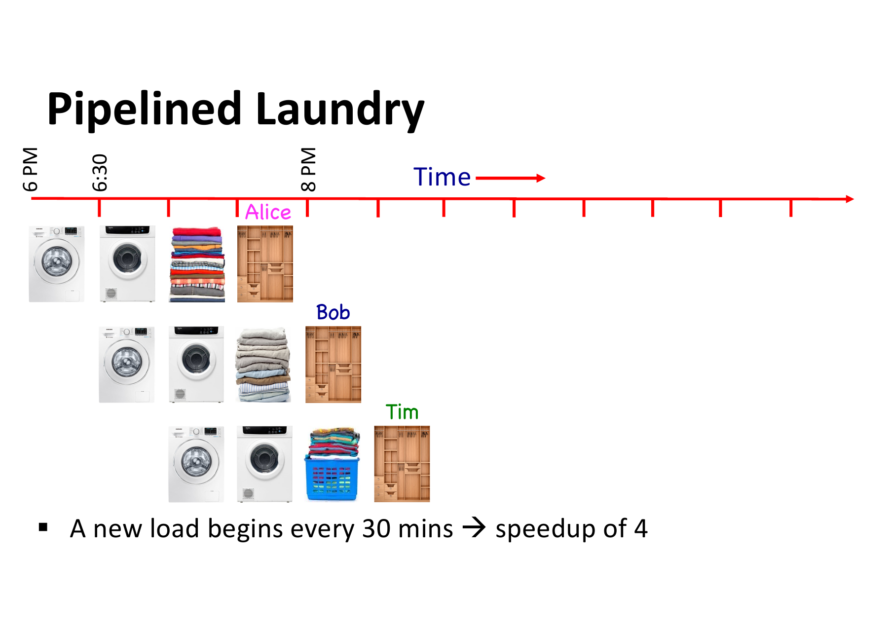

### 1.5 Three steps to pipeline a circuit

1. Cut the large combinational circuit into shorter stages.
2. **Insert registers** between stages — the previous stage's output is stored in the register and passed to the next stage.
3. Run at a **higher clock frequency** (Tc is determined by the slowest stage rather than the whole combinational path).

---

## 2. The Five-Stage Pipelined Microarchitecture

### 2.1 The five stages

| Abbreviation | Full name | What it does |
|---|---|---|
| **F** | Fetch | Fetch the instruction from instruction memory, PC ← PC+4 |
| **D** / DE / DEC / RF | Decode / RF-Read | Decode + read the register file + immediate extension |
| **E** / EX | Execute | ALU operation / address calculation / condition evaluation |
| **M** / MEM | Memory | Access data memory (LDR/STR) |
| **W** / WB | Writeback | Write the result back to the register file |

### 2.2 Key Idea

- In any cycle there can be **up to 5 instructions** in the pipeline, each in a different stage. The goal is to **maximize hardware resource utilization**.
- The stages must be isolated from each other with **pipeline registers (PPR, non-architectural registers)**.
- **Every cycle, a stage's work must be saved into its PPR.**
- The PPR is where the next stage gets its data in subsequent cycles.
- **If any downstream stage of the pipeline needs data from upstream, that data must be passed all the way down through every PPR.** ← This foreshadows the WA3 bug later.

### 2.3 PPR naming

- **The PC itself is the Fetch PPR.**
- Between F↔D: **Decode PPR**
- Between D↔E: **Execute PPR**
- Between E↔M: **Memory PPR**
- Between M↔W: **Writeback PPR**

Signal naming convention: the suffix **F / D / E / M / W** indicates the stage the signal is currently in. E.g. `InstrD`, `ALUResultE`, `ALUOutM`, `ResultW`, `WA3E`.

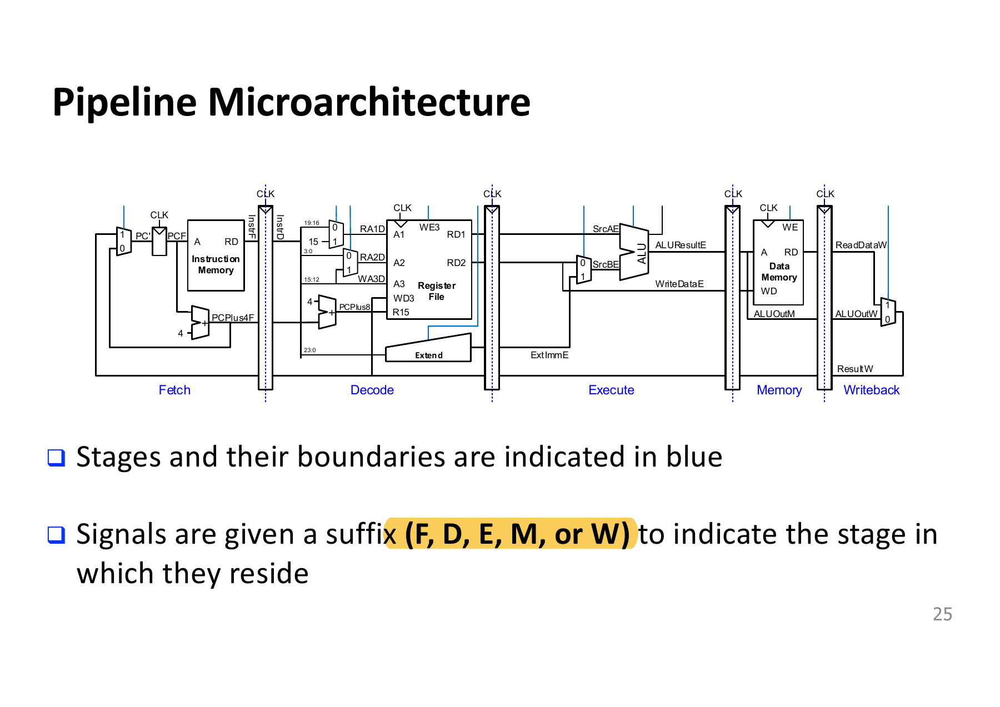

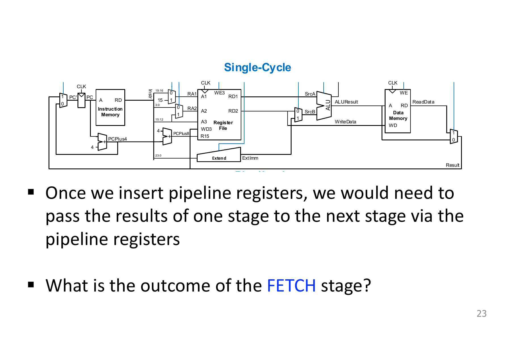

### 2.4 What exactly passes between the PPRs (often examined)

| Boundary | What is passed |
|---|---|
| **F → D** | Instruction, PC+4 |
| **D → E** | The two register read values (RD1/RD2), the extended immediate (ExtImm) |
| **E → M** | `ALUResultE`, `WriteDataE` |
| **M → W** | ALU result `ALUOutM`, memory read data `ReadDataW` |

> `WriteDataE` is one of the registers read from the RF; the M stage needs it to write memory when executing **STR** — so it must be passed all the way to M.

> **Think question (left for you by the slides)**: how wide is each pipeline register? Just add up the bit widths of every item in the table above.

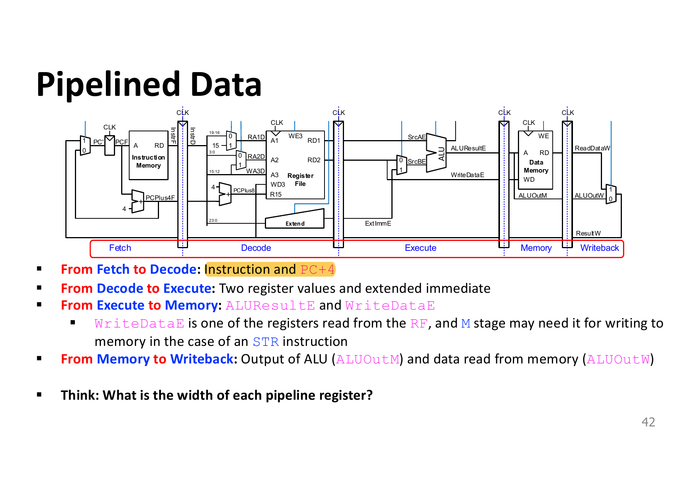

### 2.5 Cycle-by-cycle operation (Pipeline Operation)

Example program:

```armasm
I1: ADD R0, R5, #10
I2: ADD R1, R5, #10
I3: ADD R2, R5, #10
I4: STR R0, [R7, #4]
I5: STR R1, [R7, #8]
I6: STR R2, [R7, #12]
```

PDF **P28–P38** are a cycle-by-cycle datapath walkthrough from Cycle 1 to Cycle 10 (one cycle per page). **There's no need to capture every page** — pick one representative figure of "the pipeline fully loaded"; understanding the pattern is enough:

- Cycle 1–4: fill, the pipeline isn't full.
- **Cycle 5: the pipeline is fully loaded** (F=I5, D=I4, E=I3, M=I2, W=I1), "Is the pipeline fully utilized? **YES**".
- Cycle 6–10: drain.

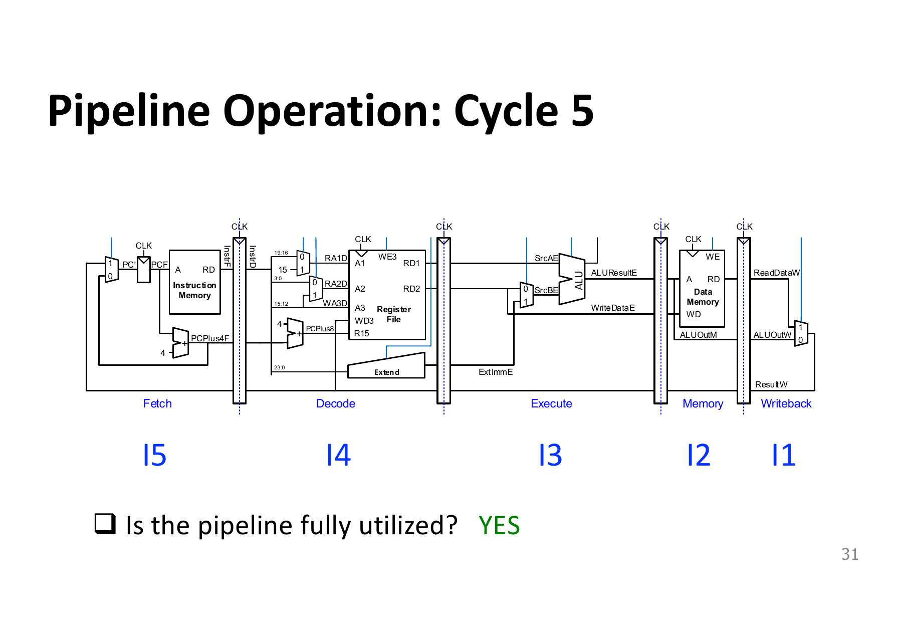

---

## 3. The WA3 Bug: A Must-Know Design Flaw

### 3.1 What the bug is

**Location of the error: the register file write logic in the Writeback stage.**

In the original pipelined datapath, the write destination register number **WA3 (from Instr[15:12]) is produced in the Decode stage but not pipelined down**. The Writeback stage uses the WA3 of **the instruction currently in the Decode stage**, rather than the WA3 of **the instruction being written back**.

Example sequence:

```armasm
LDR  R2,  [R0, #40]
ADD  R3,  R9, R10
SUB  R4,  R1, R5
AND  R5,  R12, R13
STR  R6,  [R1, #20]
ORR  R7,  R11, #42
```

In Cycle 5 `LDR R2` is in Writeback, but at this moment the Decode stage holds `AND R5, R12, R13`. So LDR's result is **wrongly written into R5 instead of R2**.

### 3.2 The fix

> **The `WA3` signal must be pipelined all the way through Execute → Memory → Writeback** (becoming `WA3D → WA3E → WA3M → WA3W`) to stay in sync with the rest of the instruction.

This is a direct application of the principle in §2.2: **upstream data needed downstream must pass through the PPRs**.

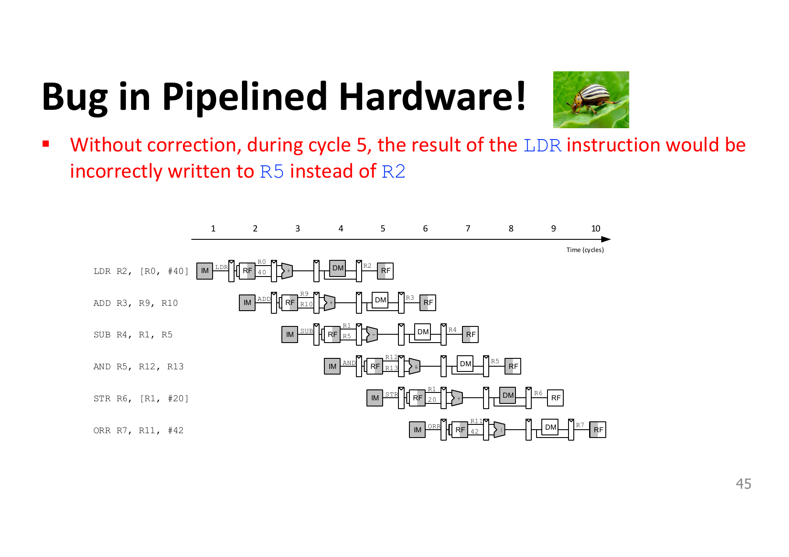

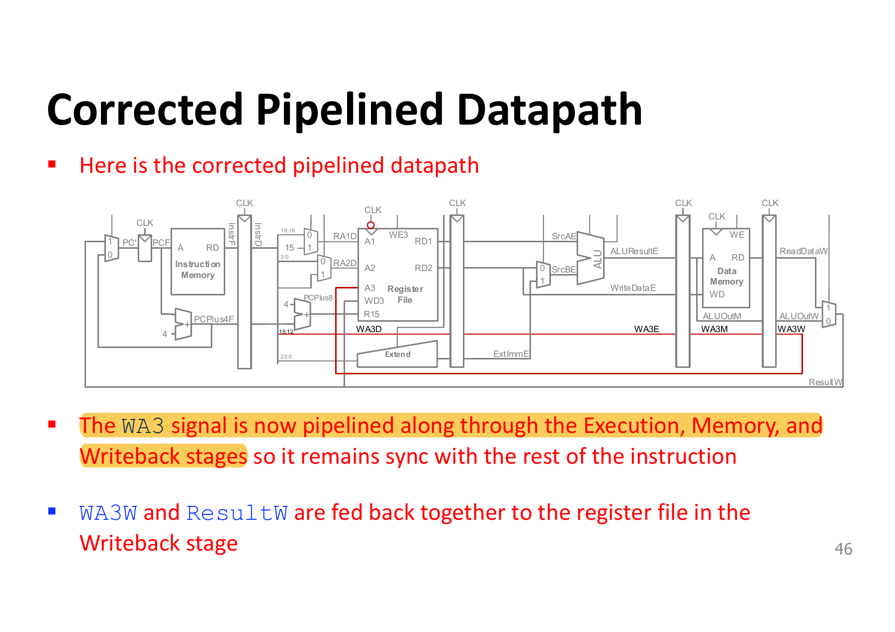

### 3.3 Optimized datapath

Use **`PCPlus4F`, which has already been updated to PC+4**, to produce `PCPlus8D`, thereby **eliminating one adder**.

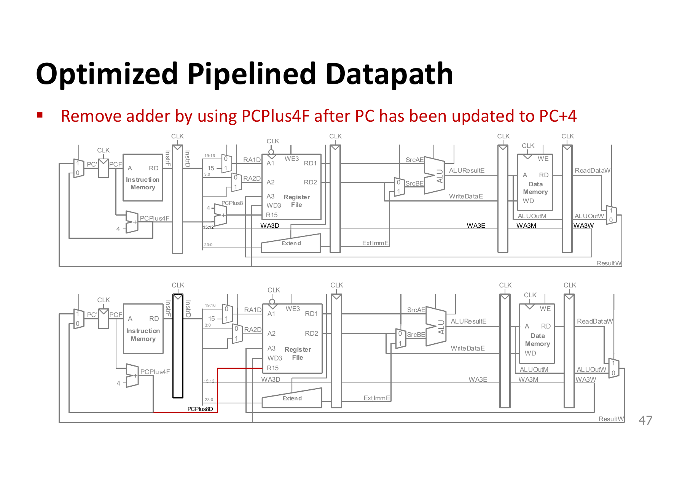

---

## 4. The Pipeline's Control Unit

- **The control signals are exactly the same as in the single-cycle processor**, so **the same control unit is reused**.
- The control unit examines the instruction's `Op` and `Funct` fields in the **Decode stage** to produce the control signals.
- **These control signals must be pipelined down together with the data** (`RegWriteD → RegWriteE → RegWriteM → RegWriteW`, etc.).
- The control unit also examines the `Rd` field (this is a **backward flow**).
- **`RegWrite` and `WA3` need special handling** (backward flow, from the W stage back to the RF's write port).

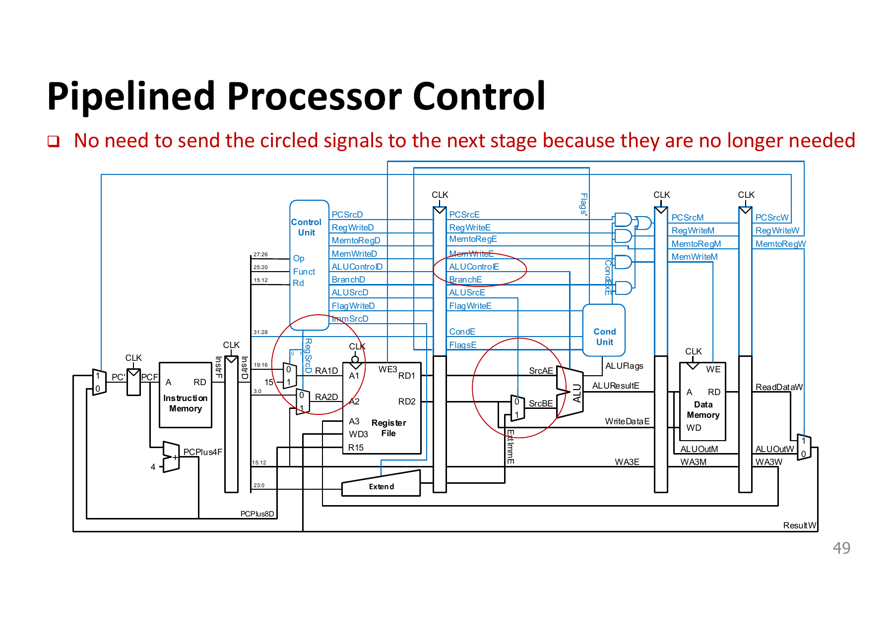

---

## 5. Performance Analysis

### 5.1 CPI / IPC and fill / drain

The 6-instruction example above took **10 cycles**:

- **CPI = 10 / 6 = 1.66**
- **IPC = 6 / 10 = 0.6**

Ideally we want **IPC ≈ 1** (one instruction completed per cycle). Why can't we reach it?

- **Pipeline fill time**: the time required to fill the pipeline and get it running at full efficiency.
- **Pipeline drain time**: time wasted when there's no new work in the pipeline.

**These two are fatal only when "the amount of work is small relative to the number of pipeline stages".**

### 5.2 Amortization (formula to memorize)

For a 5-stage pipeline and N instructions:

$$\text{CPI} = \frac{N + (\text{stages} - 1)}{N} = \frac{N + 4}{N}$$

- N = 6 → CPI = 10/6 = 1.66
- **N = 10⁹ → CPI = (10⁹ + 4)/10⁹ ≈ 1**

> **Conclusion**: real programs execute billions of instructions, so the fill/drain overhead is completely amortized.

### 5.3 Timing Diagram: single-cycle vs. pipelined

Based on the logic element delays in textbook Table 7.5:

| Microarchitecture | Time per instruction | Throughput (IPS) |
|---|---|---|
| **Single-cycle** | 680 ps (the whole combinational path) | 1 / 680 ps = **1.47 G instr/s** |
| **Pipelined** | 200 ps (**determined by the slowest stage**) | 1 / 200 ps = **5 G instr/s** |

Speedup = 680/200 = 3.4, not the ideal 5 — because **the stage lengths are unbalanced**.

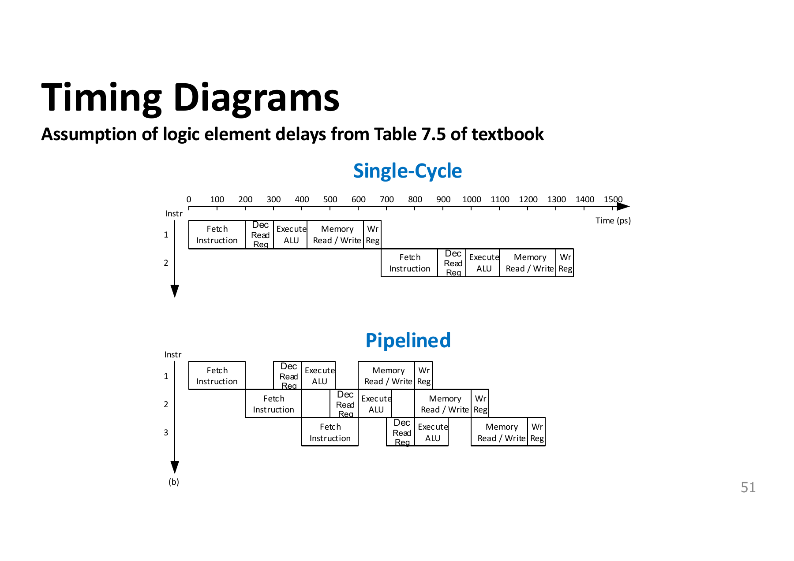

### 5.4 The latency of a single instruction actually gets longer (core exam point)

> **Pipelining does not reduce the latency of a single instruction; it makes it longer.** Two reasons:
> 1. **The sequencing overhead of pipeline registers** (setup + clock-to-Q).
> 2. **Tc is determined by the slowest stage** — fast stages waste time (internal fragmentation, caused by unbalanced stages).
>
> Pipelining raises **the throughput of the whole workload**, and requires the workload (number of instructions) to be **large enough**.

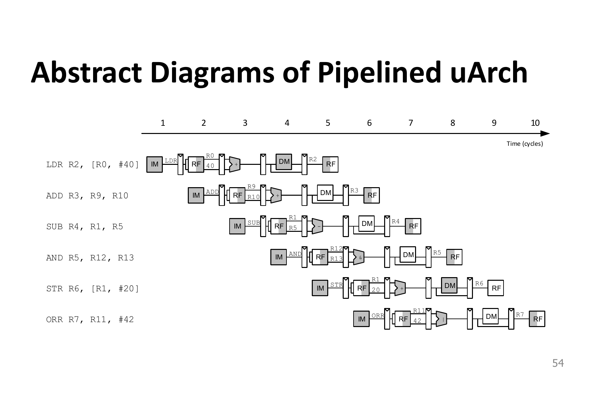

### 5.5 Register file read/write policy (eliminates one hazard for free)

> **Write in the first half of the clock cycle, read in the second half.**
>
> This way, within **the same cycle**, one instruction's writeback is visible to a younger instruction's register read — **a RAW dependence at distance 3 (W and D colliding in the same cycle) is eliminated automatically, with no forwarding needed.**

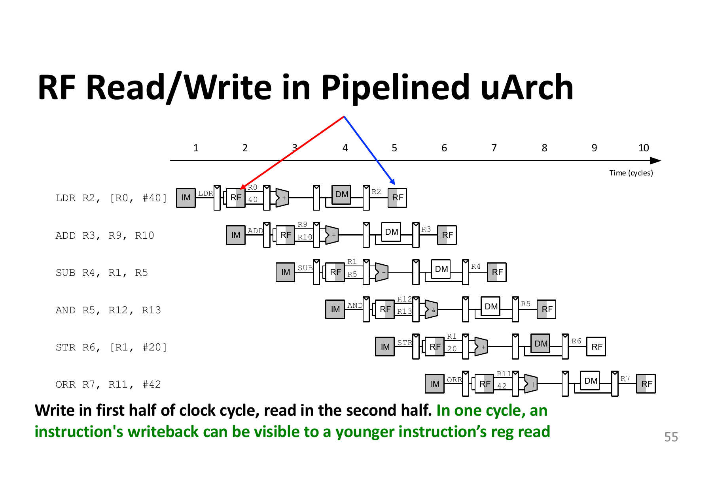

### 5.6 Simplified notation

```
      C1  C2  C3  C4  C5  C6  C7  C8
I1    F   D   E   M   W
I2        F   D   E   M   W
I3            F   D   E   M   W
I4                F   D   E   M   W
```

This F/D/E/M/W staircase diagram is the fastest notation when solving problems; **practice it until fluent**.

---

## 6. Pipeline Hazards

### 6.1 Three kinds of hazard

| Type | Trigger condition | Examples in this course |
|---|---|---|
| **Structural hazard** | Two instructions want to use **the same resource** | ① Instruction memory (F stage) and data memory (M stage) — solved with **separate IM/DM**; ② the register file is **accessed in two different stages** (read in D, written in W) — solved with **write in the first half, read in the second half** |
| **Data hazard** | A later instruction needs the **result** of an earlier instruction | RAW (read-after-write) |
| **Control hazard** | There's an instruction in the pipeline that **changes the PC** | B instructions, writes to R15 |

### 6.2 Another view: backward flow

> **Instructions and data generally flow from left to right. Right-to-left flow affects future instructions, and this is the source of hazards.**

Two backward flows:
1. **The Writeback stage writes the result back to the register file** → the root of data hazards.
2. **Selection of the next PC (PC+4 or the branch target address)** → the root of control hazards.

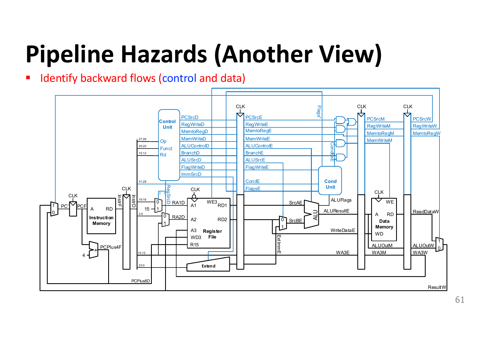

### 6.3 Tradeoffs between mitigation strategies

From the processor's point of view, different schemes have different costs:
- The architectural state needs **serious patching** (it was already written wrong and must be rolled back);
- The architectural state **is not touched**, and the hazard is avoided;
- **Dedicated logic** is needed to avoid the hazard;
- The defensive approach: **stall the CPU until the hazard is gone**.

Power, energy and latency are all considerations.

### 6.4 Data Dependence vs. Hazard (**must distinguish**)

In the von Neumann model, instructions depend on each other through data.

**True dependence (data dependence)**: a result produced by one instruction is consumed by a later instruction.

```armasm
; Dependent
ADD  R0, R0, #4
LDR  R1, [R0, #0]    ; depends on ADD's R0
SUB  R2, R1, #1      ; depends on LDR's R1

; Independent
ADD  R0, R1, #4
LDR  R2, [R3, #0]
ADD  R4, R5, #1
```

> **Two extremely important distinctions (free marks)**:
> - **True dependence is a property of the "program"** — the programmer's intent is expressed through it.
> - **A hazard is a property of the "microarchitecture"** — **the same dependence may or may not be a hazard on different microarchitectures.**
> - Corollary: **a RAW hazard cannot occur on a single-cycle microarchitecture** (one instruction completes entirely within one cycle), but the dependence still exists.

### 6.5 Example: three data hazards

```armasm
ADD  R1, R4, R5
AND  R8, R1, R3    ; distance 1, most severe
ORR  R9, R6, R1    ; distance 2
SUB  R10, R1, R7   ; distance 3
```

- The hazard of `SUB` (distance 3) is **eliminated for free by the "write in the first half, read in the second half" policy**.
- The remaining two hazards, `AND` (distance 1) and `ORR` (distance 2), need handling.

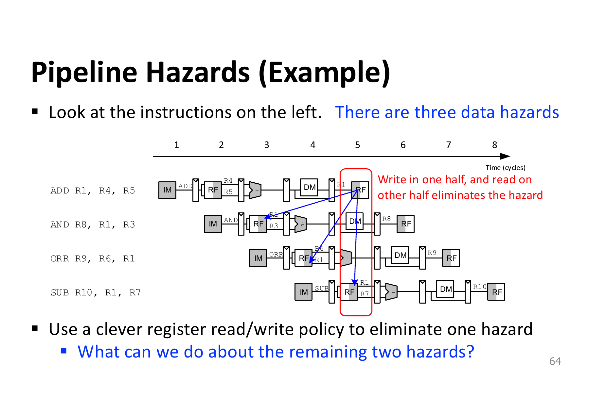

---

## 7. Resolving Data Hazards

### Approach 1: Software Interlocking

**Insert NOPs at compile time**:
- A NOP is an instruction that does nothing.
- Insert enough NOPs to wait until the result is ready.
- **A better approach**: at compile time, schedule **independent useful instructions** forward to fill these slots (instruction scheduling).

The example above needs **2 NOPs** inserted between `ADD` and `AND`.

**Drawbacks**:
- Complicates programming (the compiler must know the microarchitecture's pipeline depth → breaks the ISA abstraction).
- Slows things down (NOPs waste cycles).

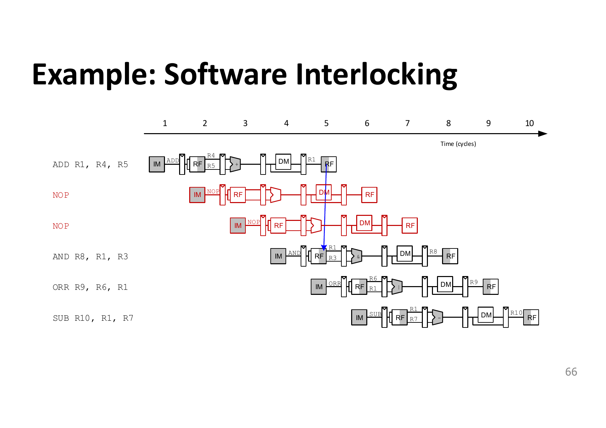

### Approach 2: Forwarding / Bypassing

**A hardware solution. Except for a few special cases, data hazards can all be solved by forwarding.**

**Principle**: add extra hardware to send the result of the **Memory or Writeback stage** directly to the dependent instruction in the **Execute stage**.
> **Key: bypass the register file and take the result early from the pipeline register.**

**Hardware cost**: add **multiplexers (muxes)** in front of the ALU to select operands from three sources:
1. **RF** (the normal path)
2. **Memory PPR** (`ALUOutM`)
3. **Writeback PPR** (`ResultW`)

**Why it works**: the sum of `ADD` is computed by the ALU in **cycle 3**, and `AND` doesn't need it until **cycle 4** — there's plenty of time; there's no need to wait for it to appear in the register file.

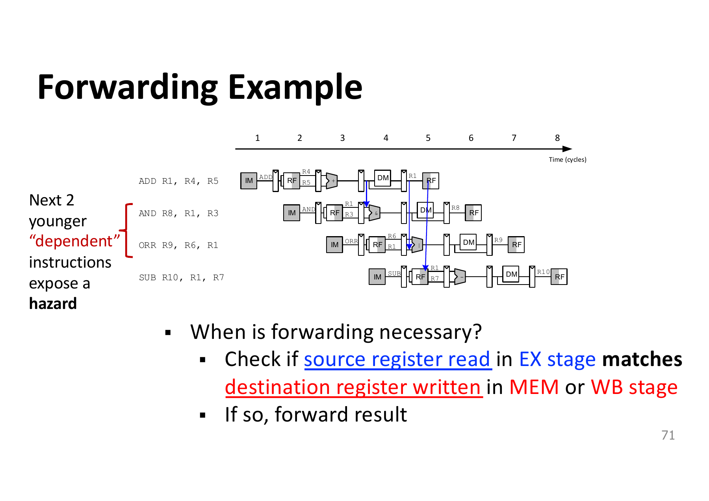

#### Forwarding conditions and control equations (**must memorize**)

**When forwarding is needed**: a source register read in the Execute stage is the same as the destination register to be written in the Memory or Writeback stage.

```
; Execute source == Memory destination?
Match_1E_M = (RA1E == WA3M)
Match_2E_M = (RA2E == WA3M)

; Execute source == Writeback destination?
Match_1E_W = (RA1E == WA3W)
Match_2E_W = (RA2E == WA3W)

; Priority: M stage over W stage (the value in M is younger and newer)
if      (Match_1E_M · RegWriteM)   ForwardAE = 10;   ; forward from Memory PPR
else if (Match_1E_W · RegWriteW)   ForwardAE = 01;   ; forward from Writeback PPR
else                               ForwardAE = 00;   ; normal read from RF

; ForwardBE is identical, just replace Match_1E with Match_2E
```

> **Common mistake**: you must **AND with `RegWriteM` / `RegWriteW`** — if that instruction doesn't write a register at all (e.g. STR, CMP), you can't forward even if the register numbers match.
>
> **The priority can't be reversed** — the instruction in the M stage is younger than the one in W, so its value is the newest.

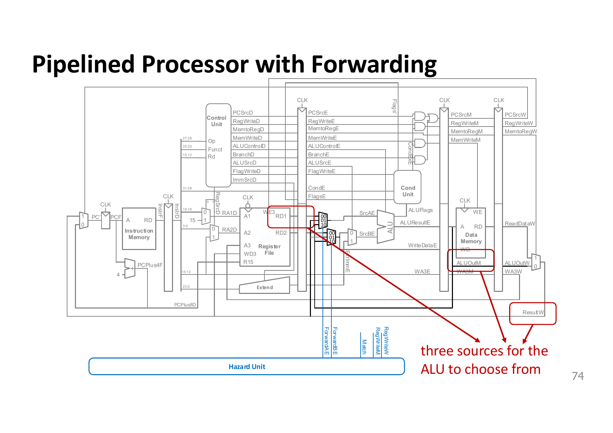

#### Forwarding Exercise (exam prototype, with answers)

```
      C1  C2  C3  C4  C5  C6  C7  C8        PPR code
I1    F   D   E   M   W                       D
I2        F   D   E   M   W                   E
I3            F   D   E   M   W               M
I4                F   D   E   M   W           W
```

| Question | Answer | Reason |
|---|---|---|
| Is I1(M) → I2(E) forwarding valid? | **Valid** | I1 is in M in C4, and I2 is in E also in C4; same cycle, in time |
| Is I1(W) → I3(E) forwarding valid? | **Valid** | I1 is in W in C5, and I3 is in E also in C5; same cycle |
| Is I1(W) → I2(E) forwarding valid? | **Invalid** | I1 is in W in C5, but I2 is in E in C4 — **it would need time to go backwards**. (Besides, I2 already got the value from I1(M)) |

> **General criterion: forwarding is valid ⟺ the source and destination line up in the same clock cycle (or the source is earlier). You can never pass backwards.**

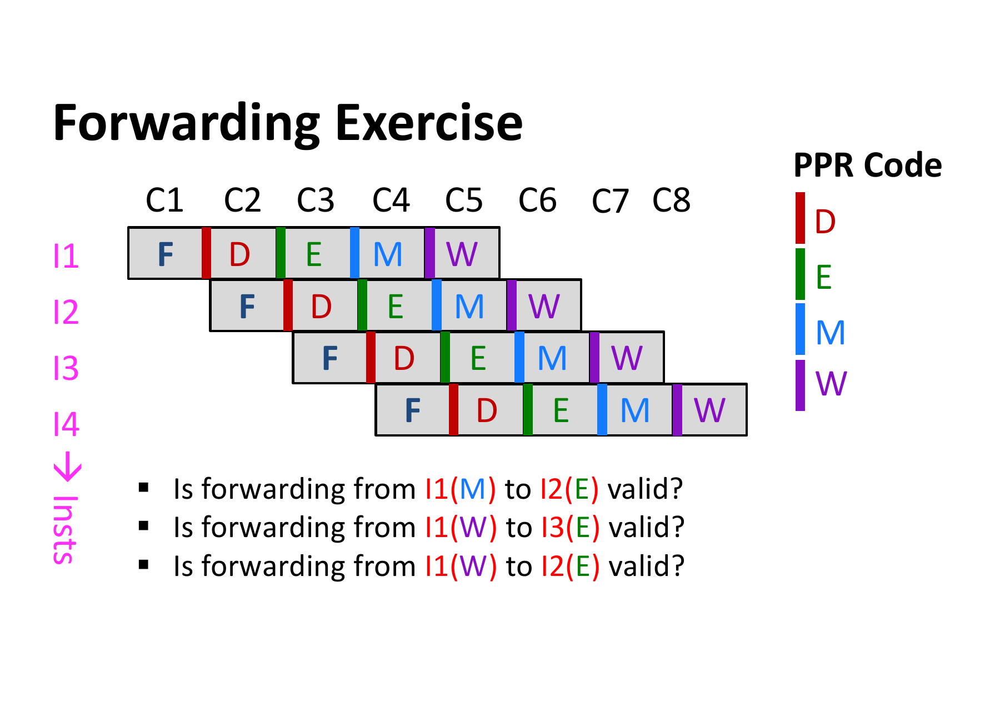

### Approach 3: Stalling (for Load-Use Hazards)

#### Load-Use Hazard: the special case forwarding can't cure

> **LDR execution has a two-cycle latency (E + M). The data isn't read out until the end of the MEM stage, so it can't be forwarded to the EX stage of the immediately following instruction.**

```armasm
LDR  R1, [R4, #40]
AND  R8, R1, R3     ; ← Load-Use hazard!
```

- LDR gets the data from memory only at **the end of cycle 4**.
- AND needs this data at **the start of cycle 4**.
- **You can't make time go backwards to patch it.** ⇒ **You must stall.**

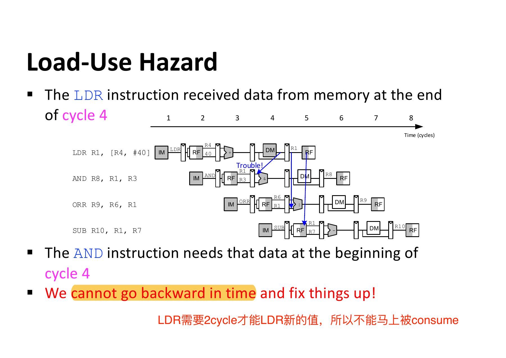

#### Solution: stall one cycle in the Decode stage

- The dependent instruction (LDR's "user") **is decoded at the end of the Decode stage**, at which point the hazard can be detected.
- **Stall this dependent instruction in the Decode stage for one cycle** until LDR completes the memory read.
- Meanwhile, **the instruction right after the "user" must stay in the Fetch stage**, because the Decode stage is occupied.
- Cycle 5: the result is forwarded from LDR's **WB** to AND's **EX**.

> **Note: stall + forwarding are used together, not one or the other.** After stalling one cycle, W→E forwarding is still needed to make it line up.

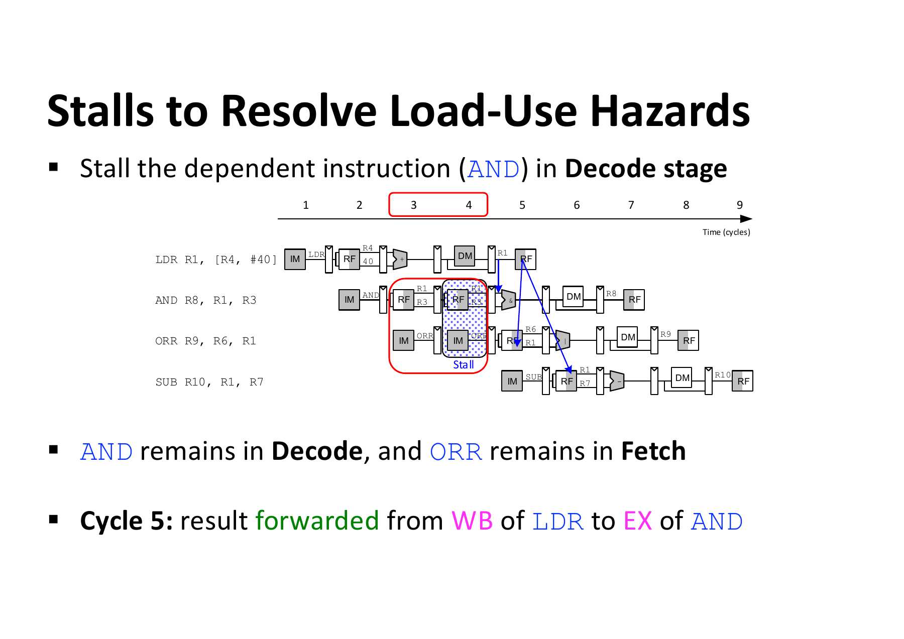

#### The three things a stall actually does (**must memorize**)

> **Stalling stage X ⟹**
> 1. **Stall stage X** (obviously)
> 2. **Stall stage X − 1** (block everything upstream)
> 3. **Insert a bubble into stage X + 1**

#### Cycle-by-cycle visualization of a stall (i1–i5, Load-Use hazard between i2–i3)

| Cycle | Fetch | Decode | Execute | Memory | Writeback |
|---|---|---|---|---|---|
| 1 | i1 | | | | |
| 2 | i2 | i1 | | | |
| 3 | i3 | i2 | i1 | | |
| **4 (stall)** | **i3** | **i2** | **00000000** | i1 | |
| 5 | i4 | i3 | i2 | 00000000 | i1 |
| 6 | i5 | i4 | i3 | i2 | 00000000 |
| 7 | — | i5 | i4 | i3 | i2 |

Look at cycle 4: i3 and i2 **stay in place** (Fetch and Decode are stalled), and all zeros = a bubble is inserted into Execute. This bubble then propagates all the way downstream.

#### Pipeline Bubble

- EX idles in cycle 4, MEM idles in cycle 5, WB idles in cycle 6.
- This phenomenon of "an idle stage propagating down the pipeline" is called a **bubble**.
- **A bubble behaves equivalently to a NOP instruction.**

#### Hardware implementation of a stall (**must memorize**)

| Operation | Hardware means |
|---|---|
| **Stall** | Use the pipeline register's **Enable input** to hold/retain the register contents unchanged. **All upstream stages must stall too.** |
| **Flush (insert a bubble)** | Use the pipeline register's **Clear input** to clear the register contents to zero. |

> **A bubble is introduced by "clearing the pipeline register right after the stalled stage"**, in order to **prevent bogus information from propagating onward**.
>
> **Forgetting to introduce a bubble will wrongly update the architectural state.** Stalls reduce performance, so use them only when necessary.

#### Load-Use stall control equations (**must memorize**)

```
; Is either source register in the Decode stage the same as the register being written in the Execute stage?
Match_12D_E = (RA1D == WA3E) + (RA2D == WA3E)

; Is the Execute stage an LDR, and does the match above hold? (MemtoRegE identifies LDR)
ldrstall = Match_12D_E · MemtoRegE

StallF = StallD = FlushE = ldrstall
```

> **Note that here we compare the D-stage sources with the E-stage destination** (one stage earlier than the forwarding check), because the hazard must be detected **before** it does damage.

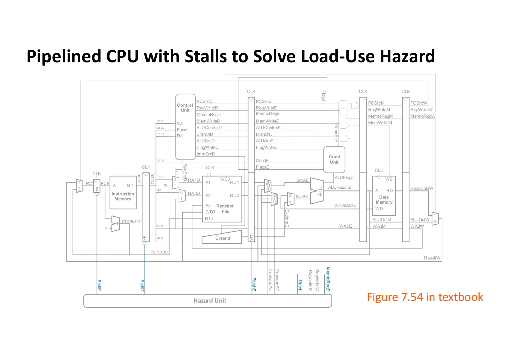

---

## 8. Control Hazards

### 8.1 Causes

Control hazards come from **changes to sequential control flow**:
- **Branch (B) instructions**
- **Ordinary instructions writing the PC (R15)** ← ARM-specific; the PC is one of the general-purpose registers

> The pipelined processor **doesn't know which instruction to fetch next**: the branch decision hasn't been made when the instruction is fetched, but **the PC register has already been incremented in the Fetch stage**.

### 8.2 Two approaches

| Approach | Method | Cost |
|---|---|---|
| **Stall** | Stop whenever a branch is encountered | The instruction is fetched in stage 1 and the branch resolved in stage **5** ⇒ **4 stall cycles per branch**, extremely costly |
| **Branch Prediction** | Predict the branch outcome | Prediction **correct → zero cost**; prediction **wrong → flush the pipeline + restart from the correct target (recovery)**. **The misprediction penalty depends on when recovery starts** |

### 8.3 The simplest predictors (static policies)

| Policy | Behavior | Prediction correct | Prediction wrong |
|---|---|---|---|
| **Predict-always-untaken** | Keep fetching sequentially (keep the pipeline busy) | Nothing to do | **Flush 4 instructions**, repair the architectural state (update the PC with the correct target) |
| **Predict-always-taken** | The target address isn't known yet in the Fetch stage ⇒ **the CPU still has to stall 4 cycles** | Jump to the target instruction, no loss | Use the incremented PC of the next instruction, **4 cycles wasted** |

Both are **static prediction policies**.

> **The pitfall of predict-always-taken (often examined)**: even when the prediction is correct, because **the target address can't be computed**, the CPU still has to stall 4 cycles. So without a BTB, always-taken is no better than always-untaken.

**Dynamic branch prediction**: gives different predictions for different executions of the same branch, **taking recent branch behavior into account**.

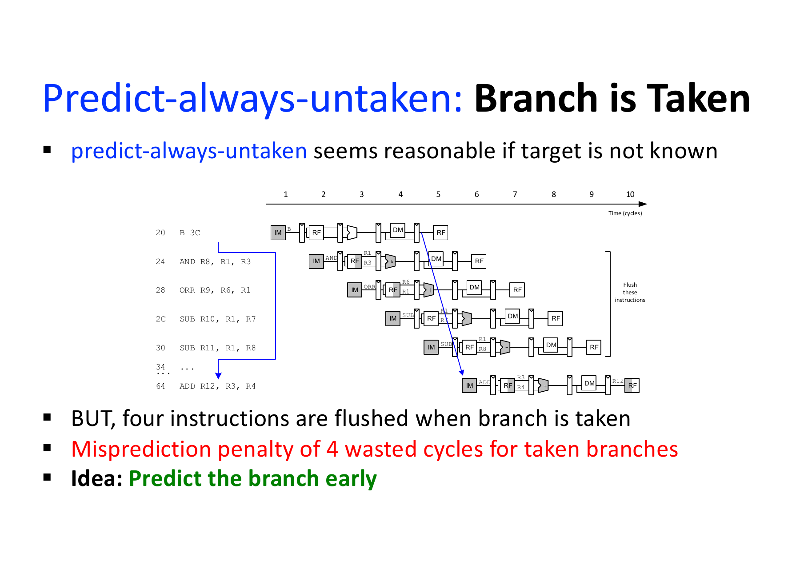

### 8.4 Early Branch Resolution (**key point**)

> **The branch target address can be known as early as the EX stage ⇒ update the PC in the EX stage, saving 2 cycles.**
> **The misprediction penalty drops from 4 cycles to 2 cycles**; only the 2 instructions in Fetch and Decode need to be flushed.

**Hardware changes**:
1. Add a **branch multiplexer in front of the PC register** to select the BTA (branch target address) from `ALUResultE`.
2. Add the **`BranchTakenE`** select signal — **asserted only when the branch condition is met**.

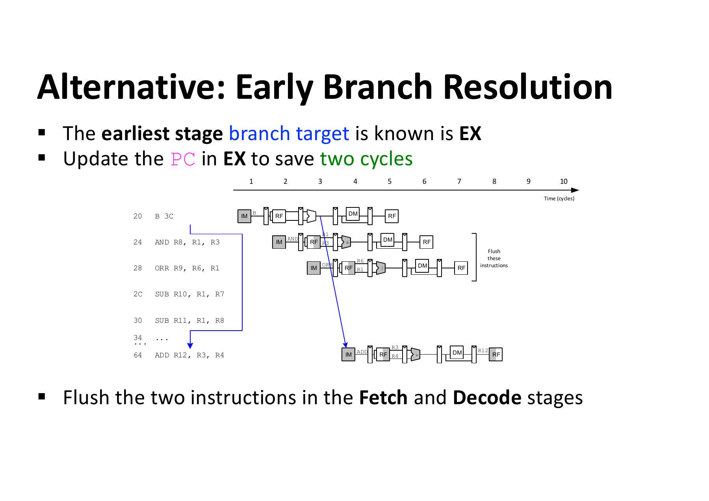

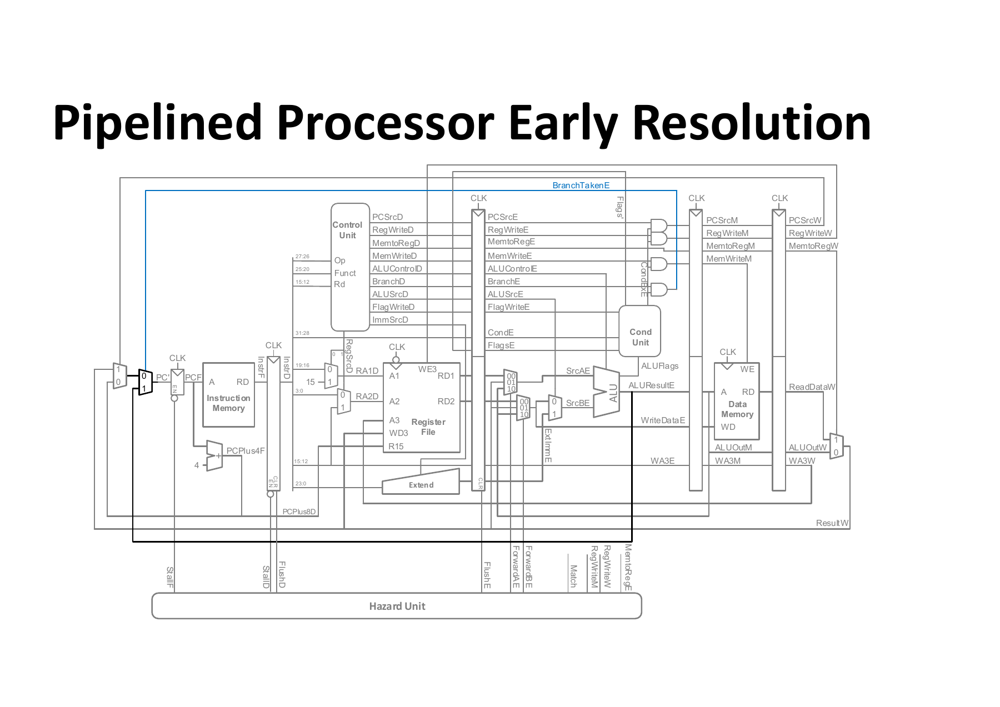

### 8.5 Flush / Stall control equations

**Considering only early branch resolution + Load-Use:**

```
StallF = ldrStallD
StallD = ldrStallD
FlushD = BranchTakenE
FlushE = ldrStallD + BranchTakenE
```

**The case of writing the PC (R15)** (much more costly than a B instruction, **still a 4-cycle stall**):

```
StallF = PCSrcD + PCSrcE + PCSrcM
FlushD = PCSrcD + PCSrcE + PCSrcM + PCSrcW
```

**Complete version (textbook p.440, must memorize)**:

```
PCWrPendingF = PCSrcD + PCSrcE + PCSrcM        ; a PC write is in progress in D/E/M

StallF = ldrStallD + PCWrPendingF              ; Load-Use hazard, or a PC write in D/E/M
StallD = ldrStallD                             ; stall Decode only for a Load-Use hazard
FlushD = PCWrPendingF + PCSrcW + BranchTakenE  ; a PC write in D/E/M/W, or a branch taken in E
FlushE = ldrStallD + BranchTakenE              ; Load-Use bubble, or branch taken
```

#### Why StallF / FlushD are like this (cycle-by-cycle derivation, often examined)

Let the PC-writing instruction I be fetched in cycle 1:

| Cycle | Event |
|---|---|
| 1 | I is fetched |
| 2 | I is decoded, `PCSrcD` asserted |
| 3 | I executes, `PCSrcE` asserted |
| 4 | I is in the M stage, `PCSrcM` asserted |
| 5 | `PCSrcW` asserted, the new PC is written onto the `ResultW` bus |
| 6 | The PC is a register, updated in the next clock cycle (cycle 6) |
| 7 | The correct instruction enters the Decode register |

- **StallF**: `StallF` is asserted in cycle 5 so that the PC register can correctly capture the new instruction address (`ResultW`) in the next cycle. **`StallF` stays deasserted for the first 4 cycles** so as not to interfere with the PC.
- **FlushD**: if `FlushD` stayed asserted in cycle 5, the register would still read all zeros when the rising edge starting cycle 6 arrives. **`FlushD` is released in cycle 6**, so in cycle 7 the correct instruction can be captured into the Decode register at the clock edge.

### 8.6 Summary of the three decision rules (**memorize these**)

**When to Forward?**
> There's a RAW hazard between two instructions, **and the older one is not a load**.
> ```armasm
> ADD R0, R1, R2
> SUB R4, R0, #1      ; forward
>
> MUL R12, R2, R3
> ADD R0, R12, #1     ; forward
> ```

**When to Stall?**
> - **Load-use hazard**: on discovering the "use", stall both the **Decode and Fetch** stages.
> - **PC-writing instructions**: in theory Fetch could be stalled for four cycles, but **this isn't used in this course's implementation for complexity reasons**.

**When to Flush?**
> - **Load-use hazard**: flush the **Execute** pipeline register (insert a bubble).
> - **PC-writing instructions**: keep flushing the **Decode** stage until the new instruction (the branch target) appears in the Decode PPR.
> - **Branch instructions**: when the branch is resolved early in the **Execute** stage, flush both the **Decode and Execute** pipeline registers.

**How does the CPU implement Stall and Flush?**
> - **Stall** → the pipeline register's **Enable** input (hold the old value)
> - **Flush** → the pipeline register's **Clear** input (clear to zero)

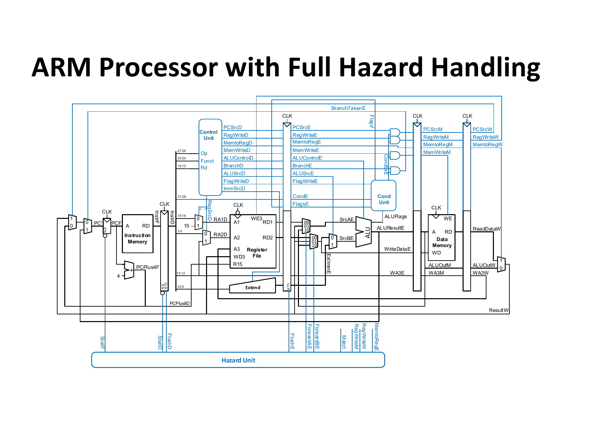

---

## 9. Superscalar Processors

### 9.1 The idea

> **Replicate multiple copies of the datapath hardware and execute multiple instructions simultaneously.**
> E.g. a **2-way superscalar** fetches and executes **2** instructions per cycle.

**Hardware requirements for 2-way**:
- **A 6-port register file** (4 read + 2 write)
- **2 ALUs**
- **A 2-port data memory**
- **Ideal CPI = 0.5, ideal IPC = 2**

**But**: dependencies and hazards prevent reaching the ideal IPC. (The figure on the slide **doesn't show** the forwarding and hazard detection logic.)

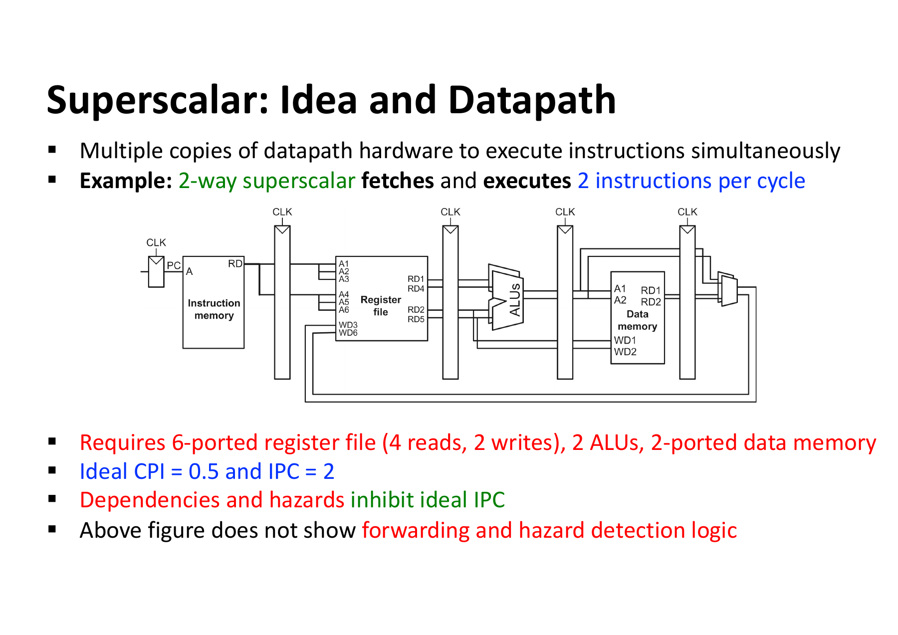

### 9.2 The impact of dependencies

- **Ideal case** (a program with no dependencies): 6 instructions issued in 3 cycles, **IPC = 2**.
- **A program with data dependencies**: the CPU completes 6 instructions in an average of **5 cycles ⇒ IPC = 1.2**.
  - You can also compute IPC from the **fetch side** (6 instructions issued in 5 cycles), with the same result.

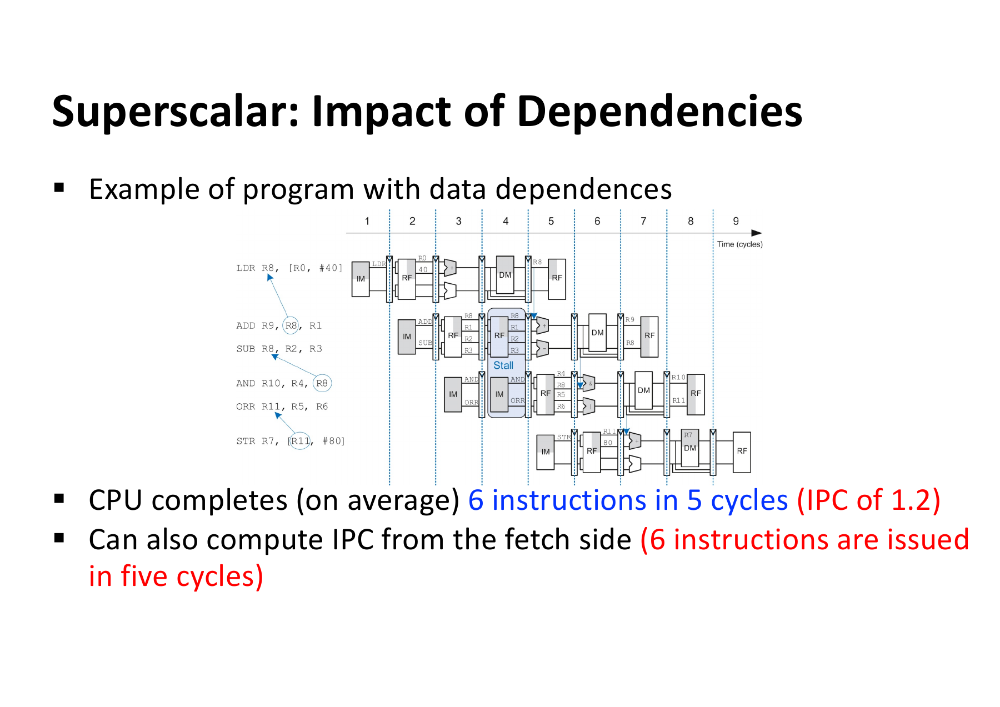

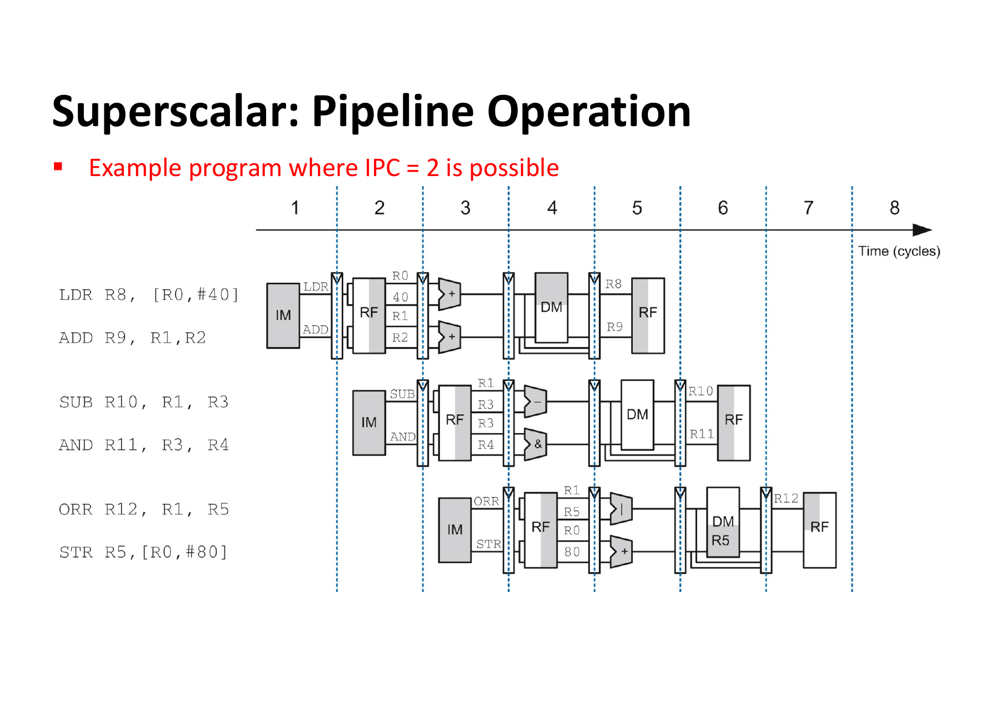

### 9.3 Tradeoffs of In-Order Superscalar

- Superscalar = **spatial parallelism + temporal parallelism** (two pipeline lanes in one CPU, resources replicated).
- **2-wide, 4-wide and 6-wide are all common** (wide means way).
- **Real programs have too many dependencies (data + control)**:
  - It's hard to find enough issuable instructions **in order** every cycle.
  - **Out-of-order CPUs break this bottleneck.**
- Many execution units + complex forwarding and hazard detection logic → high costs in **area, power and energy**.

---

## 10. Branch Prediction

### 10.1 Static branch prediction

- Policy 1: **always predict not taken**
- Policy 2: **always predict taken**

> **The misprediction penalty is larger for superscalar** — all the effort spent processing "wrong path" instructions is wasted, and the wider the machine, the more instructions are flushed at once.
>
> ⇒ We need predictors with **accuracy > 99%**.

### 10.2 Dynamic branch prediction

> **In the Fetch stage, predict the branch's outcome based on its recent behavior.**

Two things are needed:

| What's needed | Where it comes from |
|---|---|
| **Branch identification** | **The PC uniquely identifies a branch** — using the branch's address in instruction memory, which can be taken directly from the PC |
| **Branch behavior** | The ALU's condition evaluation result (taken/untaken last time); **the branch target from the last execution also needs to be stored** |

### 10.3 One-Bit Predictor

**Branch History Table (BHT)**, also called the Branch Prediction Buffer:
- A small memory, indexed by **the low-order bits of the branch address**.
- Each entry stores **one bit**, indicating whether this branch was recently taken.

**Because the number of entries is limited, there will be conflicts (conflict / aliasing)** — different branches map to the same entry.

**Operation (placed in the Fetch stage)**:
- Predict **untaken** → fetch the next sequential instruction
- Predict **taken** → compute the target address and fetch from the target

**BHT update**:
- Outcome **matches** the prediction → do nothing
- Outcome **doesn't match** the prediction → ① **flip that bit in the BHT**; ② **flush the pipeline and update the PC**

> **Standard answers to the two thinking questions**:
> - **Does misprediction affect correctness? → No.** The predictor is only a performance optimization; the recovery mechanism guarantees the architectural state is correct.
> - **Does misprediction affect performance? → Yes.** All the cycles spent on flush + refetch are wasted.

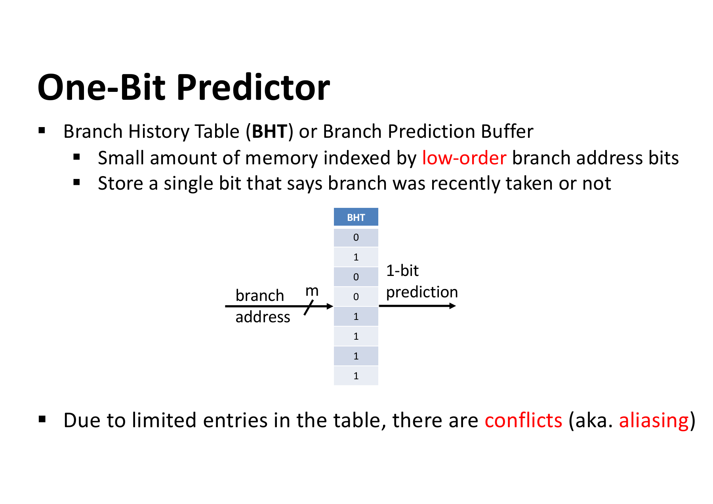

### 10.4 The pathology of the 1-bit predictor: loop termination

```armasm
        MOV R1, #0
        MOV R0, #1
FOR:
        CMP R0, #10
        BGE DONE        ; ← analyze this branch
        ADD R1, R1, R0
        ADD R1, R1, R0
        B FOR
DONE:
```

Behavior of `BGE DONE` over 10 executions (assuming the initial state is Taken):

| i | 1 | 2 | 3 | 4 | 5 | 6 | 7 | 8 | 9 | 10 |
|---|---|---|---|---|---|---|---|---|---|---|
| **Direction (actual)** | NT | NT | NT | NT | NT | NT | NT | NT | NT | **T** |
| **Current State / Prediction** | **T** | NT | NT | NT | NT | NT | NT | NT | NT | NT |
| **New State** | NT | NT | NT | NT | NT | NT | NT | NT | NT | **T** |

- **2 mispredictions** (the cold start at i=1 + the loop exit at i=10)
- **Accuracy = 8/10 = 80%**

> **Anomalous Decision**:
> - For a branch that's **NOT TAKEN 90% of the time**, the 1-bit predictor's accuracy is only **80%**.
> - **Anomaly = a branch strongly biased in one direction suddenly goes the other way.**
> - **A single anomalous decision is enough to "throw off" the 1-bit predictor** — because it's not only wrong this time, it'll be wrong again next time because its state was flipped.

> ⚠️ **Slide problem**: this loop code **has no instruction like `ADD R0, R0, #1` that increments R0**, so `R0` is always 1; it's actually an infinite loop and never reaches `DONE`. The "NT for the first 9 times, T on the 10th" assumed in the analysis is **the author's intent** rather than the code's actual behavior. When solving problems, follow the intent, but be aware the code itself has a bug.

### 10.5 Smith's Algorithm (2-bit saturating counter)

> **In 1979 James E. Smith noticed the performance pathology of the 1-bit predictor at loop termination and proposed the Smith branch prediction algorithm.**
>
> **Core insight: add "hysteresis / inertia" to the predictor's state.**
> **The same outcome must occur several times in a row to reach a "strong" state.**

A **saturating counter** maps the outcomes of the last several branches onto a multi-state counter.

**The four states for k = 2**:

| Encoding | State | Prediction |
|---|---|---|
| **00** | Strongly Not-Taken (SN) | Untaken |
| **01** | Weakly Not-Taken (WN) | Untaken |
| **10** | Weakly Taken (WT) | Taken |
| **11** | Strongly Taken (ST) | Taken |

**State transitions**: +1 when taken (saturating at 11), −1 when untaken (saturating at 00). **Prediction = the counter's MSB.**

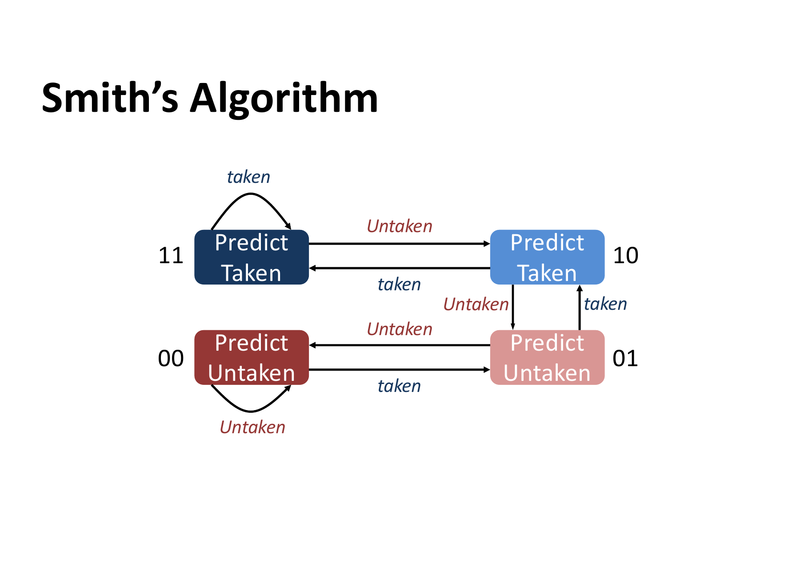

**Hardware (k = 2)**:
- The BHT stores **2^m k-bit counters**, indexed by m bits of the branch address.
- Read out the counter → **the MSB is the branch prediction**.
- When the branch outcome comes back, **the saturating counter is incremented/decremented** → the updated count is written back.

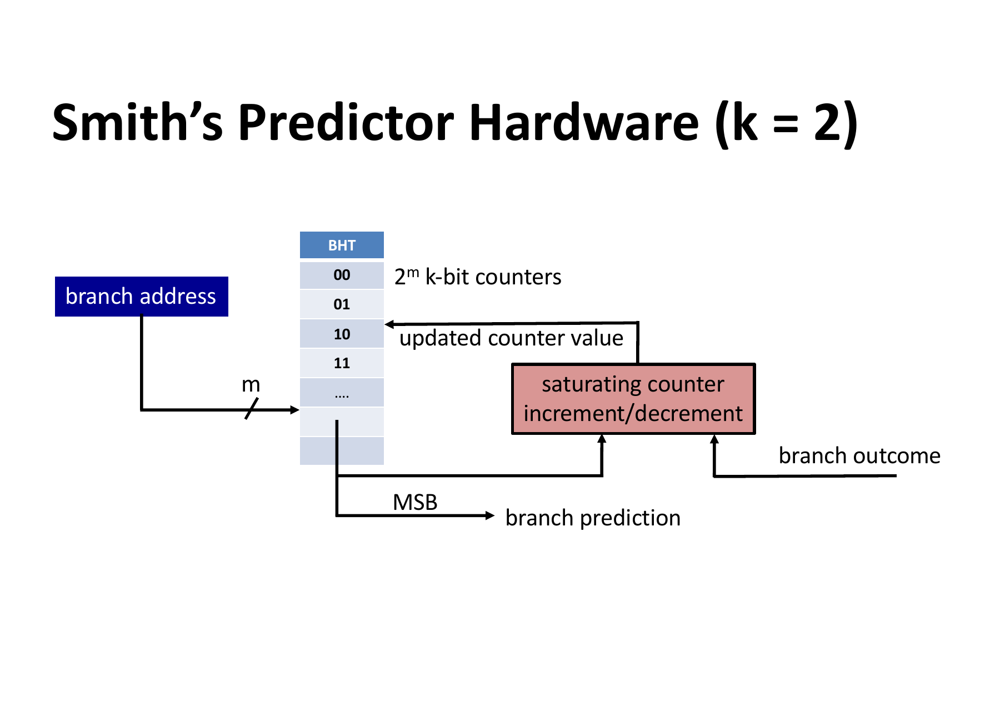

### 10.6 Smith1 vs. Smith2 comparison (when branch behavior changes abruptly)

| Actual direction | Smith1 state | Smith1 prediction | Smith2 state | Smith2 prediction |
|---|---|---|---|---|
| 1 | 1 | 1 ✓ | 11 | 1 ✓ |
| 1 | 1 | 1 ✓ | 11 | 1 ✓ |
| **0** | 1 | 1 ✗ **mispredict** | 11 | 1 ✗ **mispredict** |
| **1** | 0 | 0 ✗ **mispredict** | 10 | 1 ✓ |
| 1 | 1 | 1 ✓ | 11 | 1 ✓ |
| 1 | 1 | 1 ✓ | 11 | 1 ✓ |

> **Key difference**: after a single anomaly (that `0`), **Smith1 is flipped to the wrong state and is immediately wrong again (2 errors total)**; **Smith2 only drops from ST to WT, the predicted direction is unchanged, and it's wrong only once**. This is the value of hysteresis.

### 10.7 Branch Target Buffer (BTB)

- **Buffer = a small memory that stores "some" information.**
- In the **Fetch stage** the CPU needs to know two things: ① **the branch direction**; ② **the branch target address**.
- **The BTB stores the target addresses of taken branches.**
- **Searching for the target of an untaken branch is pointless** — untaken is just PC+4, no lookup needed.

**BTB operation**:

| Case | Behavior |
|---|---|
| Predict **taken** | Get the target address **from the BTB** |
| Predict **untaken** | **PC = PC + 4** |
| Prediction **correct** | Continue normal execution |
| Prediction **wrong** | **Flush all pipeline stages containing mispredicted-path instructions** |

> **The division of labor between BHT and BTB (easily confused)**: **the BHT answers "whether to jump", the BTB answers "where to jump to".** Only with a BTB does predict-always-taken become truly feasible (otherwise the target address can't be computed and you still have to stall).

### 10.8 Correlating Branch Predictors

In real programs, **a branch's outcome often depends on the behavior of other branches**:

```c
aa = 0; bb = 0;
if (cond1)
    aa = 1;
if (aa == bb)     // ← this branch's outcome depends strongly on the one above
    {…}
```

**Traditional (non-correlating) predictors only look at a single branch's own outcomes and can't capture this relationship.**

Correlating predictors improve accuracy by combining three kinds of information:
1. **Local history** — past behavior of **the same branch**
2. **Global history** — outcomes of **the last several branches** in the program
3. **Branch address** — used to distinguish different branches with similar histories

### 10.9 The state of branch prediction

- A **key component** of modern processors, especially **superscalar and out-of-order processors**.
- **Prediction accuracy exceeds 99%.**
- **Latest techniques: deep neural networks, machine learning methods.**
- In COMP4045 you implement and compare state-of-the-art branch predictors in a C++ simulator.

---

## 11. Real Pipelines: Memory Latency

This entire set assumes **a 1-cycle data memory access**, which is a huge simplification.

| Event | Real cost |
|---|---|
| Each memory access | **Hundreds of cycles** |
| **Cache hit** | **1–4 cycles** |
| **Cache miss** | **Close to 100 cycles** |

> **So an in-order pipelined CPU will stall for 100 cycles when memory is busy.**

**Where things go next**:
- **Aggressive in-order CPUs**: **keep doing useful work** during a cache miss (until hitting an unavoidable RAW hazard).
- **Out-of-order CPUs**: can keep doing useful work in the presence of both cache misses **and** RAW hazards.

---

## 12. Core Concept Distinctions and Exam-Point Checklist

### 12.1 Pairs of concepts you must distinguish

| A | B | Difference |
|---|---|---|
| **Latency** | **Throughput** | Time per task vs. tasks per unit time. **Parallelism only improves the latter.** |
| **Spatial parallelism** | **Pipelining** | Replicating hardware (N× cost, N× speedup) vs. splitting into stages (almost zero extra hardware, M× speedup) |
| **Data dependence** | **Data hazard** | **A property of the program** (programmer intent) vs. **a property of the microarchitecture** (the same dependence is not a hazard on single-cycle) |
| **BHT** | **BTB** | Stores "whether to jump" (1 or 2 bits) vs. stores "where to jump to" (target address) |
| **Stall** | **Flush** | Enable input holds the old value vs. Clear input clears to zero |
| **Static prediction** | **Dynamic prediction** | Fixed policy vs. based on recent behavior; different executions of the same branch can get different predictions |
| **Smith1 (1-bit)** | **Smith2 (2-bit)** | 2 errors per single anomaly vs. only 1 error per single anomaly (hysteresis) |

### 12.2 Formulas to memorize

```
Ideal pipeline speedup              = M (number of stages)
Actual CPI for N instructions       = (N + M - 1) / N        ← (N+4)/N for 5 stages
IPC                                 = 1 / CPI
Throughput (IPS)                    = 1 / Tc, Tc set by the slowest stage
n-way superscalar ideal CPI         = 1/n, ideal IPC = n

Misprediction penalty:
  branch resolved in W stage    → flush 4, penalty = 4 cycles
  branch resolved in E stage    → flush 2, penalty = 2 cycles
  write to PC (R15)             → still 4 cycles
```

### 12.3 Control equation quick reference

```
; --- Forwarding (compare E-stage sources vs M/W-stage destinations) ---
Match_1E_M = (RA1E == WA3M)      Match_2E_M = (RA2E == WA3M)
Match_1E_W = (RA1E == WA3W)      Match_2E_W = (RA2E == WA3W)
if      (Match_1E_M · RegWriteM)  ForwardAE = 10
else if (Match_1E_W · RegWriteW)  ForwardAE = 01
else                              ForwardAE = 00

; --- Load-Use Stall (compare D-stage sources vs E-stage destination) ---
Match_12D_E = (RA1D == WA3E) + (RA2D == WA3E)
ldrStallD   = Match_12D_E · MemtoRegE

; --- Complete Stall/Flush logic ---
PCWrPendingF = PCSrcD + PCSrcE + PCSrcM
StallF = ldrStallD + PCWrPendingF
StallD = ldrStallD
FlushD = PCWrPendingF + PCSrcW + BranchTakenE
FlushE = ldrStallD + BranchTakenE
```

### 12.4 Frequently examined question types

1. **Given a piece of assembly + a 5-stage pipeline, draw the F/D/E/M/W staircase diagram, mark all hazards, and explain how each is resolved.**
2. **Decide whether a given forwarding is valid** (time-alignment criterion: the source's stage cycle ≤ the destination's EX cycle).
3. **Given N and the number of stages, compute CPI / IPC / speedup**, and explain why the ideal can't be reached.
4. **WA3 bug analysis**: why not pipelining WA3 writes the wrong register, in which cycle, and to which register.
5. **State transition table + accuracy calculation for 1-bit / 2-bit predictors on a given branch sequence.**
6. **Fill in the cycle-by-cycle stall table** (which stage holds, which stage gets the bubble).
7. **Distinguish dependence from hazard** (a free-marks concept question).

### 12.5 ⚠️ Problems in the slides

| PDF page | Problem |
|---|---|
| **P84** | The title says "Load-use hazard between **i1 – i2**", contradicting "i2 – i3" in all the other frames of the same group (P81–P89). Go with **i2 – i3**. |
| **P118** | The whole "In-Order Superscalar: Role of Compiler" page contains only the letter "**A**" — **an unfinished slide** with no content to note. This topic (the compiler doing instruction scheduling to keep the superscalar pipeline fed) needs to be filled in yourself. |
| **P125–P129** | The loop example lacks `ADD R0, R0, #1`, so `R0` is always 1; the code is actually an infinite loop and never reaches `DONE`. The analysis conclusion (80% accuracy) still holds according to the author's intent. |
| **P130** | "anomolous" is misspelled (should be anomalous). |
| **P75 / P108 etc.** | Several slide titles are polluted with "Stalling" master-slide text (e.g. "Stalls **Stalling** to Resolve...", "ARM Processor **Stalling** with Full Hazard Handling"); it's a leftover from the PPT master and can be ignored. |

---
