# COMP2300 Set 9 Notes — ILP, Out-of-Order Execution: Scoreboard, ROB and Register Renaming

> **Course**: ANU COMP2300 / COMP6300 / ENGN2219 — Computer Organisation and Program Execution
> **Lecturer**: Shoaib Akram
> **This set in one sentence**: **Remove the shackle of "in-order issue" from the in-order pipeline** — first use the classification of dependences/hazards to show why in-order gets the whole pipeline stuck on a single load miss, then implement out-of-order issue with the **Scoreboard (OOO v.1)**, discovering that it can't recover from mispredictions, has imprecise exceptions, and falls back to in-order on WAR/WAW; finally, **ARF + ROB + renaming (OOO v.2 / Tomasulo lineage)** solves all three problems at once, giving the skeleton of a modern out-of-order superscalar processor.
> **Reference**: H&H *Digital Design and Computer Architecture* (this set's content corresponds more to H&P Chapter 3).

---

## ⚠️ Note on page numbers (this set differs from the previous sets, take note)

**Set 9's PDF page number = the number at the bottom-right of the slide, with an offset of 0.**

The rule of the previous sets (PDF page number = slide number + 1) **does not hold** here. This file's title page is counted as page 1 and shows no number; from page 2 onwards the PDF page number matches the printed number exactly (P2 shows "2", P41 shows "41", P131 shows "131").
Every "PDF Pxx" in these notes is directly the PDF reader page number, i.e. the number at the bottom-right of the slide. The file has **150 pages** in total.

**Also note**: the "有缺陷" (defective) after the P47 title and the passage of Chinese explanation at the bottom of P71 are **existing Chinese annotations in the PDF file**, not part of Akram's original lecture material. Don't quote them as official statements.

---

# 1. ILP and Dependences / Hazards (PDF P2–P9)

## 1.1 What ILP is

**Instruction-Level Parallelism = overlapping the execution of multiple instructions in time.**

ILP we've already seen:
- **Scalar in-order pipeline**: partial overlap (at most 1 enters per cycle)
- **Superscalar in-order pipeline**: full overlap (multiple per cycle)

**Prerequisite for full overlap**: multiple functional units + multiple datapaths.
**The bet of an ILP processor**: programs contain many instructions that are independent of each other. Win the bet and it's fast; lose it (dependence-heavy) and the hardware is wasted.

## 1.2 Dependence vs Hazard — this is the core conceptual distinction, certain to be examined

| | Definition | Whose property |
|---|---|---|
| **Dependence** | A logical relationship between instructions | **A property of the program** (independent of hardware) |
| **Hazard** | A dependence may be violated because of concurrent execution | **A property of the microarchitecture** (implementation-dependent) |

> Run the same code on a single-cycle CPU and the dependences still exist, but **no hazards arise** — because there's no concurrent execution. Hazards are a problem created by the hardware.

## 1.3 Three kinds of dependence → three kinds of data hazard

| Dependence type | Example | Meaning | Corresponding hazard | True/false dependence |
|---|---|---|---|---|
| **True / Data dependence** | `1. LDR R2,[R6,#0]`<br>`2. ADD R3,R2,R5` | 2 needs the result of 1 | **RAW** (Read-after-Write) | **True dependence**, cannot be eliminated |
| **Anti dependence** | `1. LDR R2,[R6,#0]`<br>`2. ADD R6,R3,R5` | 2 writes the register 1 reads | **WAR** (Write-after-Read) | **False dependence**, eliminated by using a different register |
| **Output dependence** | `1. LDR R2,[R6,#0]`<br>`2. ADD R2,R7,R8` | 1 and 2 write the same register | **WAW** (Write-after-Write) | **False dependence**, eliminated by using a different register |

**Corollaries to memorize**:
- True dependence → RAW, can only be resolved by waiting/forwarding.
- Anti dependence + output dependence = **false dependences (name dependences)**, arising only because register names are reused. → **Register renaming can eliminate them completely**. This is half the reason the ROB exists later.

## 1.4 Dependence chains

```
1. LDR R2, [R6,#0]      1     3
2. ADD R3, R2, R5       2     4
3. LDR R4, [R6,#0]
4. ADD R7, R4, R9      two mutually independent dependence chains
```
The source of ILP = **multiple independent dependence chains can be in execution at the same time**.

## 1.5 Which hazards appear in which microarchitectures

| Microarchitecture | RAW | WAR | WAW |
|---|---|---|---|
| Single-cycle CPU | ✗ (no concurrency) | ✗ | ✗ |
| Basic ARM 5-stage in-order pipeline | ✓ | ✗ | ✗ |
| This set's out-of-order CPU | ✓ | **✓** | **✓** |

> WAR/WAW only truly become hazards with **out-of-order writeback/out-of-order issue**. In an in-order pipeline reads always happen in earlier instructions and writes are always in order, so there's no problem.

---

# 2. From In-Order to Out-of-Order: Why In-Order Isn't Enough (PDF P10–P41)

## 2.1 Problems of the basic in-order pipeline (P11–P13)

In-order pipeline = fetch / decode / execute **all in program order**, and the hardware **does no reordering at all**.

Once a real data cache is added (100-cycle main memory latency), it **gets the whole pipeline stuck** because of **structural dependences**:
- There's only one ALU, which can execute only one operation at a time
- Memory can handle only one request at a time
- MEM stage stalls → EX stalls → the whole pipeline stalls

This is called a **stall-on-miss** pipeline.

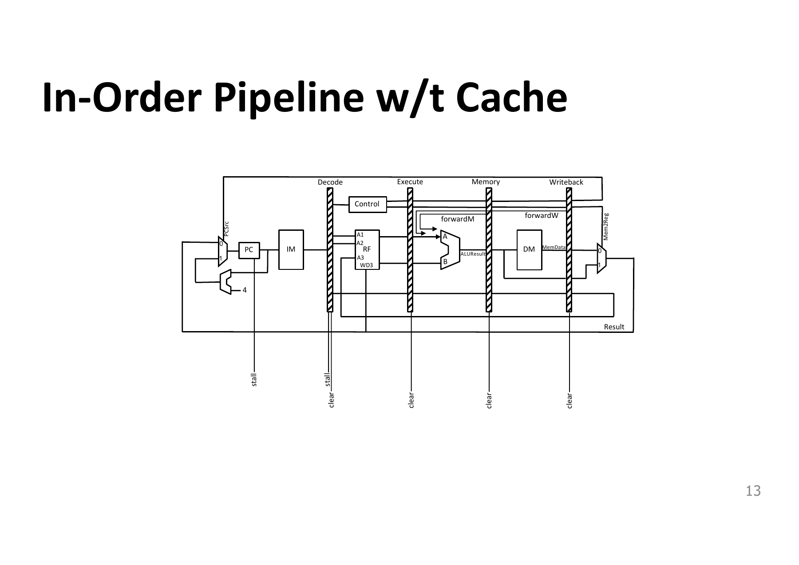

## 2.2 A more aggressive in-order pipeline: Stall-on-Use (P14–P17)

To prove that "the problem isn't that the hardware isn't powerful enough, but the in-order issue policy itself", the slides switch to an **aggressive in-order pipeline**:

**Structural changes**
- **Decode and Register Read are split into two stages**
- **Memory access moves inside the Execute stage**
- Memory can **handle multiple requests at once** (non-blocking / lock-up free cache)
- **Multiple functional units**, so instructions don't stall on structural dependences
- Load is split into three steps: **agen (address generation) → D$ (cache access) → Mem (access main memory on a miss)**

**Pipeline stages (abbreviations used in the timing tables)**

| Abbreviation | Stage |
|---|---|
| FE | Fetch |
| DE | Decode |
| RR | Register Read (**also the issue stage**) |
| EX | Execute (Big ALU / Tiny ALU / agen+D$+Mem) |
| WB | Writeback |

**Definition of issue**: when the operands are ready, send the instruction to the ALU for execution. This design puts the issue logic in the **RR stage**.

**Issue policy of the RR stage (P17, must memorize)**

| Hazard | Handling |
|---|---|
| **RAW** | Source register not ready → **stall** |
| **WAW** | Destination register "busy" → **stall** |
| **WAR** | **Not a problem**. In-order issue guarantees the earlier instruction's read happens before the later instruction's write |

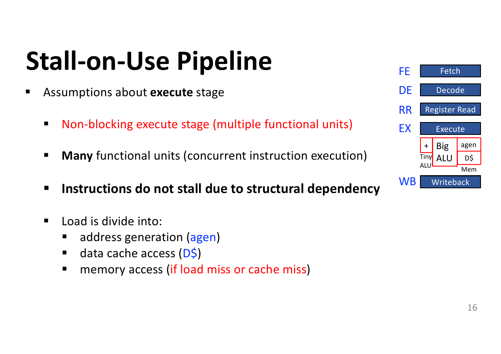

## 2.3 Scenario 1: load miss + everything after is independent (P18–P28)

```
i1: LDR R2, [R1, #0]     ← cache miss
i2: ADD R4, R3, #1       ← independent
i3: ADD R6, R5, #2       ← independent
i4: ADD R7, R6, #3       ← depends on i3 (but i3 is fast)
```

**Timing result (P27/P28)**

| Cycle | 1 | 2 | 3 | 4 | 5 | 6–8 | 9 |
|---|---|---|---|---|---|---|---|
| i1 | FE | DE | RR | EX@ | EXD$ | …miss… | WB |
| i2 | | FE | DE | RR | EX | WB | |
| i3 | | | FE | DE | RR | EX / WB | |
| i4 | | | | FE | DE | RR / EX / WB | |

**Conclusion (P28)**: the aggressive in-order pipeline **can do work "under" the load miss**, hiding the memory access latency. Note that i2/i3/i4 **complete writeback before i1** — in-order issue, but **out-of-order completion**.

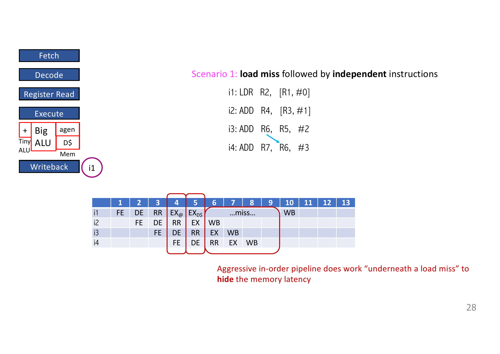

## 2.4 Scenario 2: load miss + an immediately following dependent instruction (P29–P41) — the key counterexample

```
i1: LDR R2, [R1, #0]     ← cache miss
i2: ADD R4, R2, #1       ← depends on i1 (RAW)
i3: ADD R6, R5, #2       ← independent!
i4: ADD R7, R6, #3       ← depends on i3
```

**Timing result (P39/P40)**

| Cycle | 1 | 2 | 3 | 4 | 5 | 6 | 7 | 8 | 9 | 10 | 11 | 12 | 13 |
|---|---|---|---|---|---|---|---|---|---|---|---|---|---|
| i1 | FE | DE | RR | EX@ | EXD$ | …miss… | | | | WB | | | |
| i2 | | FE | DE | **RR** | **RR** | **RR** | **RR** | **RR** | **RR** | EX | WB | | |
| i3 | | | FE | **DE** | **DE** | **DE** | **DE** | **DE** | **DE** | RR | EX | WB | |
| i4 | | | | **FE** | **FE** | **FE** | **FE** | **FE** | **FE** | DE | RR | EX | WB |

**Conclusion (P40–P41), the central argument of this set:**

- i2 waiting for i1 is **expected** (a true dependence, nothing to be done).
- But i3 and i4 are **completely unrelated** to the i1–i2 chain, yet get stuck along with it.
- **Key insight: in-order issue turns a data dependence into a structural hazard.** The RR (issue) stage is occupied by the stuck i2, so later instructions can't get in at all.
- So the problem **isn't insufficient hardware resources**, but **the in-order issue policy itself**.

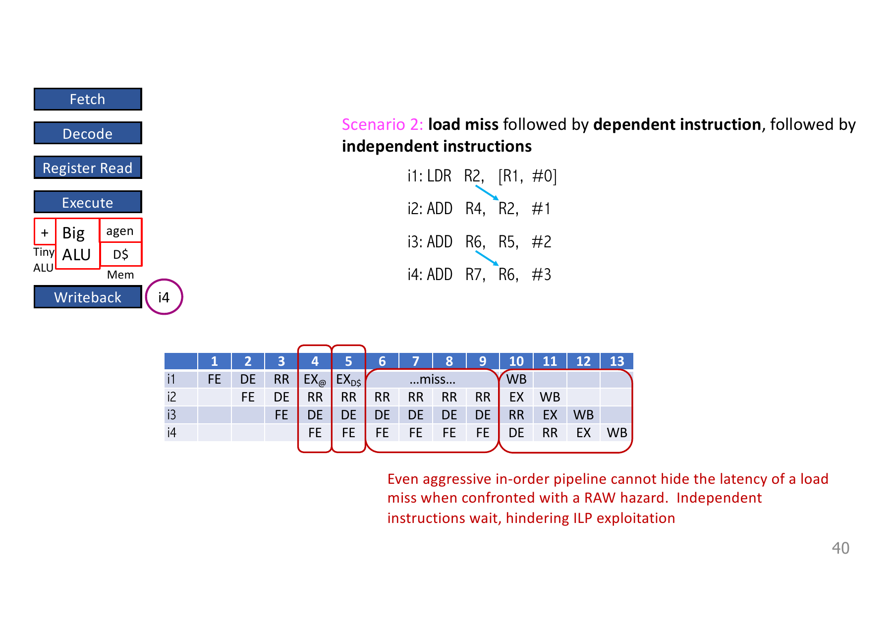

---

# 3. The Essence of Out-of-Order and the Issue Queue (P42–P46)

## 3.1 Definition of OOO (P42)

> If an instruction has a RAW hazard with an earlier instruction → **it stalls itself, which is fine**.
> But **the independent instructions after it shouldn't stall**; they can **issue out of program order (out of order)**.

## 3.2 Issue Queue — unblocking the RR stage (P43)

Add an instruction buffer dedicated to holding **instructions stalled on data dependences**. It has a whole bunch of aliases, any of which may appear in the exam:

> **reservation stations / issue buffer / issue queue (IQ) / scheduler / scheduling window**

Purpose:
- Stalled instructions **no longer block fetch**
- Younger ready instructions can issue for execution **past** older unready instructions
- "Opens" the pipeline to future independent instructions → tolerates long latencies (cache misses, floating point) and exploits ILP better

## 3.3 Static vs dynamic scheduling (P44–P46) — conceptual distinction, certain to be examined

| | Static scheduling | Dynamic scheduling |
|---|---|---|
| When | **Compile time** | **Runtime** (program execution) |
| Who does it | The compiler decides the execution order | The **hardware** decides, transparent to software |
| Dependence checking | Relies on hardware hazard detection to guarantee correctness | Done by hardware |
| Examples | The ARM 5-stage pipeline, the earlier 2-way in-order superscalar | This set's OOO |
| Slogan | — | **"Smart hardware, dumb software"** |

**Instruction schedule = an order in which instructions execute.** Goal: maximize ILP; constraint: **all dependences must be respected**.

> Real dynamically scheduled processors are all **superscalar**; to explain the principles clearly, the slides **assume scalar (1 per cycle)** throughout. Exam questions are mostly computed as scalar too.

---

# 4. OOO v.1: The CDC 6600 Scoreboard (P47–P66)

## 4.1 Changes to the pipeline structure (P47–P48)

```
Fetch  →  Decode  →  Register Read  →  Dispatch  ─┐   in-order fetch/dispatch engine
                                                   │
                                    ┌── Issue Queue (IQ) ──┐   inserted in order
                                                   │        dequeued out of order
                            Issue → Execute → Writeback     OOO issue/execute engine
```

**Two new stages**: **Dispatch (DI)**, **Issue (IS)**
**New component**: **Scoreboard**
**New bus**: **Common Data Bus (CDB)** — responsible for both writeback and forwarding

**New pipeline stage abbreviations (used in the timing tables)**: FE / DE / RR / **DI** / **IS** / EX / WB

## 4.2 Fields of the three tables (you must remember the structure)

**Scoreboard**: 1 valid bit per architectural register

| Register | v |
|---|---|
| r0..r7 | 1 = the value is in the register file and **ready**; 0 = **not ready** (an instruction is producing it) |

**Register File**: the values of r0..r7

**Fields of each Issue Queue (IQ) slot**:

| Field | Meaning |
|---|---|
| `v` | Slot occupied bit (1 = occupied, **not** a ready bit) |
| `dst tag` | Destination register tag |
| `rs1 rdy` | Whether source 1 is ready |
| `rs1 tag/value` | rdy=1 stores the value, rdy=0 stores **the producer's tag** |
| `rs2 rdy` / `rs2 tag/value` | Same as above |

> ⚠️ **Easily confused**: there are **two different `v`s** here. The Scoreboard's `v` means "register value ready", the IQ's `v` means "slot occupied". And in v.2's RMT, the meaning of `v` is **reversed again** (see §6.3). Very easy to trip on in the exam.

## 4.3 Concrete actions of each stage (P50–P51, must memorize)

**Dispatch stage**
1. Copy the instruction from the RR/DI pipeline register into the IQ (prerequisite: the IQ has a free slot)
2. Set that slot's `v` to 1 (meaning occupied)

**Issue stage**
1. Both operands ready → send the instruction to the execution unit
2. **Free the IQ slot (v = 0)**

**Scoreboard updates**
- When an instruction has rN as its destination register, set the corresponding bit to **0 (NOT READY)**
- When an instruction reads operands: **scoreboard v=0 → grab the tag; v=1 → grab the value from the register file**

**How is an instruction selected for execution? (the mnemonic is here)**
1. The IQ waits for the destination tag to appear on the wakeup bus
2. The tag appears → **wake up all instructions waiting for this tag**
3. Pick one of the "ready" instructions and send it for execution
4. Mnemonic: **Capture-Tag-And-Go-For-Execution**

**Common Data Bus (CDB)**
- Values are **broadcast** over the CDB, **bypassing the register file write**
- The CDB is the implementation of forwarding
- Three broadcast destinations: **IQ, register file, Execute stage**

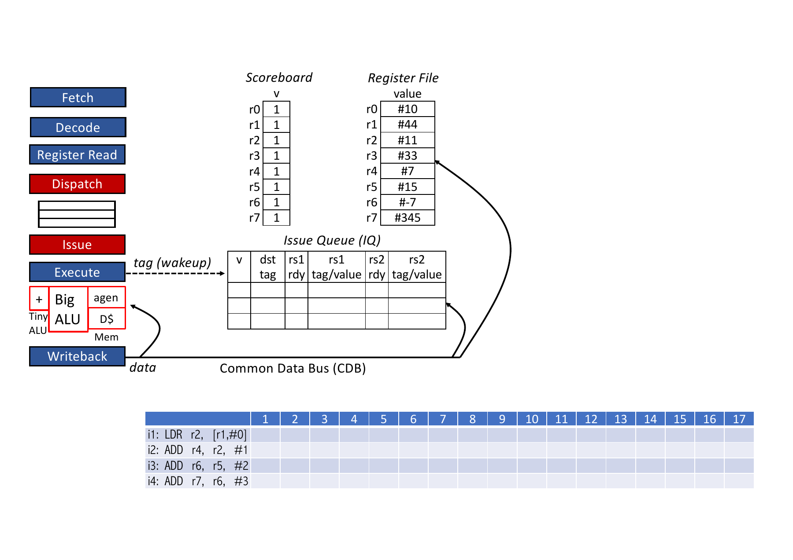

## 4.4 Cycle-by-cycle walkthrough (P52–P65)

**Page ↔ cycle mapping: `PDF page number = cycle number + 52`** (P52 = initial state, P53 = cycle 1, ……, P65 = cycle 13)

Program (same as Scenario 2):
```
i1: LDR r2, [r1,#0]     ← cache miss
i2: ADD r4, r2, #1      ← RAW on r2
i3: ADD r6, r5, #2      ← independent
i4: ADD r7, r6, #3      ← depends on i3
```
Initial RF: `r0=#10 r1=#44 r2=#11 r3=#33 r4=#7 r5=#15 r6=#-7 r7=#345`

**Final timing (P65)**

| Cycle | 1 | 2 | 3 | 4 | 5 | 6 | 7 | 8–10 | 11 | 12 | 13 |
|---|---|---|---|---|---|---|---|---|---|---|---|
| i1 | FE | DE | RR | DI | IS | EX@ | EXD$ | …miss… | WB | | |
| i2 | | FE | DE | RR | DI | IS | IS | IS ×3 | IS | EX | WB |
| i3 | | | FE | DE | RR | DI | IS | **EX(8) / WB(9)** | | | |
| i4 | | | | FE | DE | RR | DI | **IS(8) / EX(9) / WB(10)** | | | |

**Comparison with the in-order version (hardcore exam point)**

| | Aggressive in-order (§2.4) | Scoreboard OOO |
|---|---|---|
| i4 completion cycle | **13** | **10** |
| i3 completion cycle | 12 | 9 |
| i2 completion cycle | 11 | 13 (two extra stages, DI/IS) |
| Are i3/i4 stuck behind i2 | **Yes** | **No** |

> Note: OOO doesn't make every instruction faster. i2 is actually **2 cycles later** (two extra pipeline stages, DI + IS). **The gain comes from independent instructions no longer queuing**, not from reduced latency of a single instruction. This trade-off is often examined.

**Key intermediate states**
- **Cycle 5 (P57)**: i1 enters IS, IQ slot 0 is filled with `dst=r2, rs1 rdy=1 #0, rs2 rdy=1 #44`; scoreboard `v[r2]=0`
- **Cycle 7 (P59)**: i1 cache miss; i2 (`rs1 rdy=0, tag=r2`) and i3 (all ready) are both in the IQ; `v[r2]=v[r4]=v[r6]=v[r7]=0`
- **Cycle 9 (P61)**: i3 finishes executing → CDB broadcasts `(r6, #17)` → **wakes up i4** (rs1 rdy 0→1), and i4 can execute immediately. **This is the canonical frame of wakeup + CDB forwarding.**
- **Cycle 13 (P65)**: i1's value `#666` wakes up i2 via the CDB, and i2 executes and writes `r4=#667`

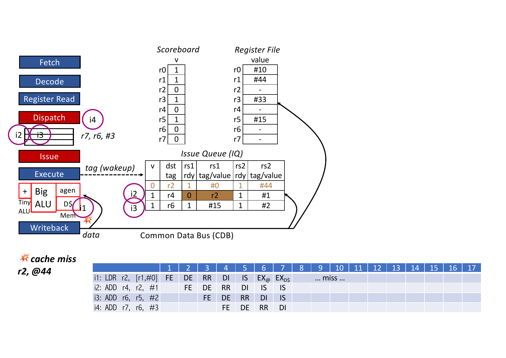


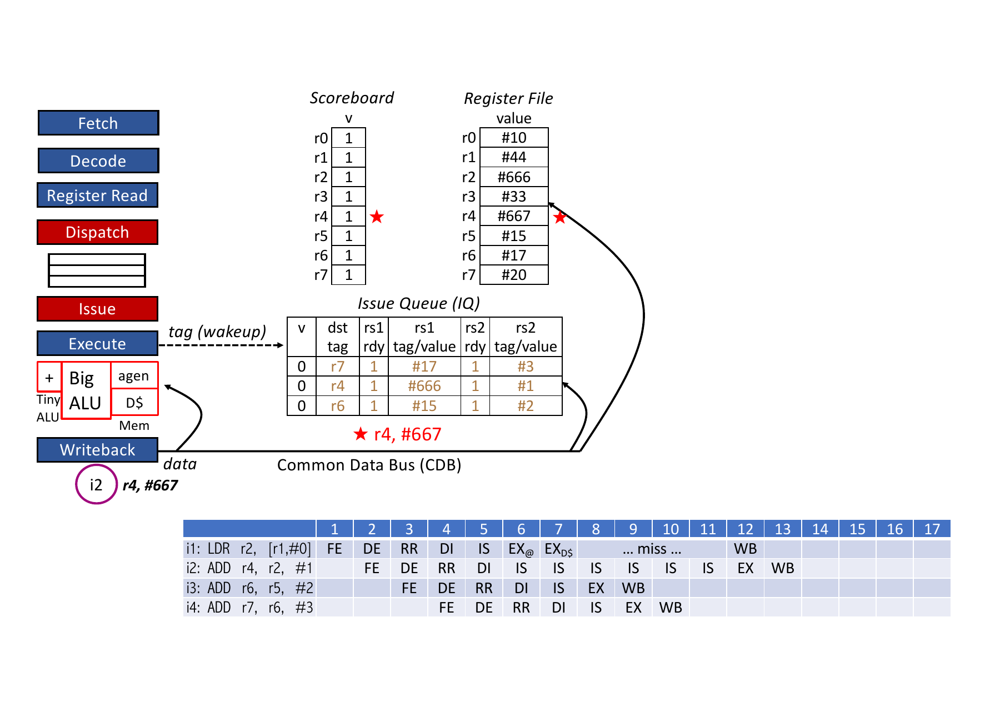

## 4.5 Interim summary (P66)

Dynamically scheduled superscalar processors:
- The hardware schedules at **runtime** and can reorder instructions to squeeze out ILP
- **The same instruction sequence can produce different schedules on different executions** (because branch behavior changes) — something the compiler can't do
- The essence of the mechanism: **collect instructions into a large instruction window and do dataflow analysis**; execute when operands are ready and there are no hazards
- In any cycle there are **multiple independent dependence chains** in execution

---

# 5. The Three Big Problems of OOO v.1 (P67–P69) — certain to be examined

| # | Problem | Consequence |
|---|---|---|
| **1** | **Cannot recover from branch mispredictions** | Younger instructions execute **speculatively** relative to older ones; there may be older, predicted branches that haven't executed yet. Once a prediction is wrong, results already written out of order into the RF **can't be undone** |
| **2** | **Imprecise exceptions** | The register file is updated **out of order**, so the machine state is no longer equivalent to sequential execution |
| **3** | **Degenerates to in-order when two instructions write the same destination register** | WAR/WAW cause stalls: the younger producer must be held in the RR stage until the older producer finishes executing |

**Problem 1 illustrated (P68)**
`i2: BNE r2, i7` is mispredicted. But i3 and i4 have long since executed and written back to the RF, and the original values of `r6` and `r7` **can no longer be recovered**; moreover, i3 and i4 have already left the pipeline ("long gone"), so there's nothing to even flush.

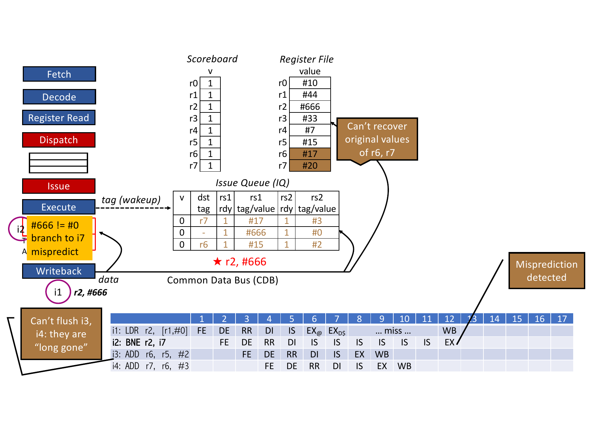

**Problem 3 illustrated (P69)**
```
i1: LDR r2, [r1,#0]     ← cache miss, produces r2
i2: ADD r4, r2, #1      ← consumes r2 (correct RAW wakeup)
i3: ADD r2, r5, #2      ← also produces r2! (WAW with i1)
i4: ADD r7, r2, #3      ← should consume i3's r2
```
If i3 isn't held in the RR stage:
- i3 finishes first and writes `r2`; then i1's miss resolves and **i1 overwrites i3's result** → **WAW handled incorrectly**
- Worse: when i3 broadcasts tag `r2`, **i2, which is waiting for i1's r2, is wrongly woken up** → labeled **"Incorrect Wakeup: WAR"** in the figure (i2 grabs a value that shouldn't belong to it)
- Only i4 waiting for i3's r2 is the **"Correct Wakeup: RAW"**

> **Root cause**: the scoreboard uses **architectural register names** as tags, and register names are **not unique**. The same `r2` may correspond to multiple producers, which the tag can't distinguish. → The solution is **renaming to unique tags**.

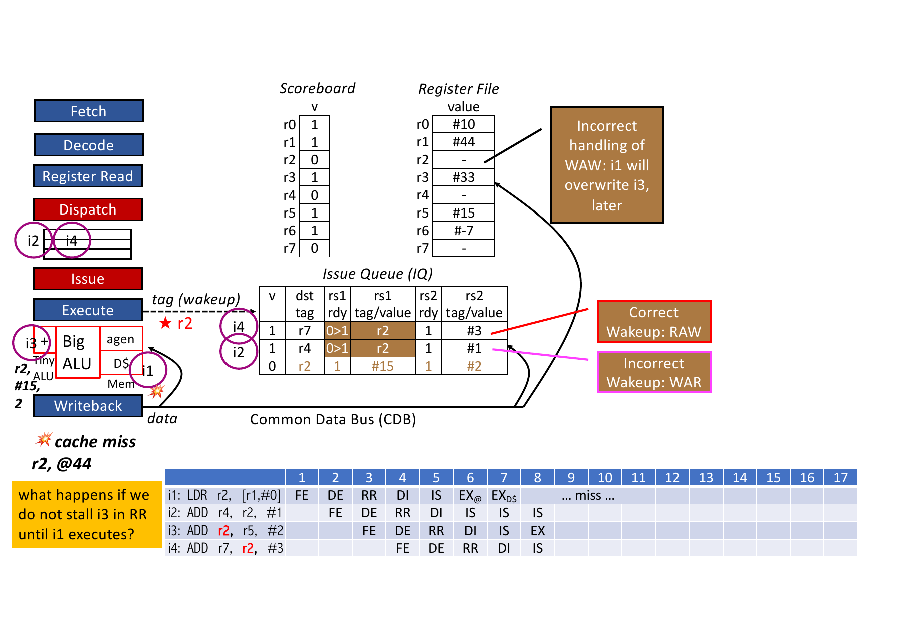

---

# 6. Precise Exceptions and the ROB (P70–P85)

## 6.1 Definition of a precise exception (P71) — three conditions, memorize verbatim

An exception is **precise** if and only if:

1. **All instructions before the faulting instruction have completed**, and their effects are visible
2. **The faulting instruction itself has not completed** — it either raised the exception or didn't execute at all
3. **No later instruction has executed** or made any visible change to the machine state (registers, memory)

> In one sentence: **when an exception occurs, the machine state must be exactly equivalent to "sequential execution up to this instruction".** This is the fundamental guarantee that lets an out-of-order CPU recover correctly and support system calls and debugging.

## 6.2 Examples

**The precise case (P72)**: `LDR R1, [R1, #0]` triggers a memory protection fault
→ earlier instructions all complete / this instruction not complete / later instructions not started → the OS can fix the address and then **safely resume execution from this LDR**.

**The imprecise case (P73, CDC6600)**
```
i1: ADD R0, R0, #4
i2: LDR R1, [R0, #0]     ← cache miss, later found to be an illegal address
i3: ADD R2, R2, #1        ← already executed out of order
i4: ADD R3, R3, #2        ← already executed out of order
i5: ADD R4, R3, #1        ← already executed out of order
i6: SUB R5, R1, #1
```
The software exception is raised only after the LDR, and the CPU jumps to the handler. But at this point the RF **already reflects the execution results of i3/i4/i5**, inconsistent with the sequential programming model → **the exception is imprecise**.

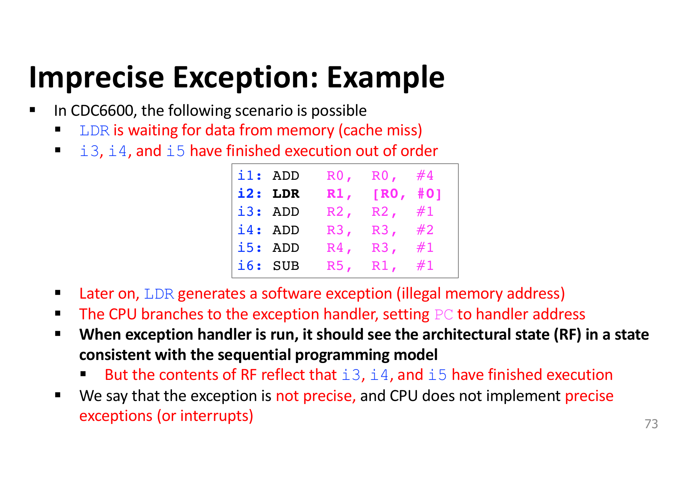

## 6.3 Solution: out-of-order execution + in-order commit (P74)

> **We need a mechanism that allows out-of-order execution of instructions, but in-order commitment to the architectural state.**
> This structure is called the **Reorder Buffer (ROB)**. It solves both **precise exceptions** and **branch misprediction recovery**.

## 6.4 The four pillars of hardware speculation (P76, must memorize)

**Hardware Speculation = a combination of four ideas:**

1. **Register renaming** — eliminates WAR / WAW
2. **Dynamic branch prediction** — eliminates control hazards
3. **Dynamic scheduling** — out-of-order execution
4. **Reorder buffer (ROB)** — precise interrupts + misprediction recovery

## 6.5 The "two humps" of the modern pipeline (P77)

```
   in order          |          out of order          |     in order
F → D → [SCHEDULE] → [ EX functional units: int add/int mul/FP mul/memory ] → [REORDER] → W
        hump 1                                                        hump 2
```
- **Hump 1 = Reservation stations (scheduling window)**
- **Hump 2 = Reordering (reorder buffer, also called instruction window / active window)**


## 6.6 OOO v.2: what the ROB does (P78)

- **The ROB supports both out-of-order execution + recovery from mispredictions and exceptions**
- **The ROB also implements register renaming**:
  - Renames **non-unique** destination tags (architectural register names) to **unique** destination tags (**ROB tags**)
  - Source tags are renamed too, **unambiguously linking a consumer to its producer**
  - **WAR/WAW are eliminated completely after renaming**, with no more need to fall back to in-order

## 6.7 Renaming example (P80)

Assume R7 and R8 are up to date in the RF:

| Original sequence | After renaming |
|---|---|
| `i1: ADD R0, R7, #4` | `i1: ADD ROB0, R7, #4` |
| `i2: ADD R1, R0, #1` | `i2: ADD ROB1, ROB0, #1` |
| `i3: ADD R0, R8, #8` | `i3: ADD ROB2, R8, #8` |
| `i4: ADD R2, R0, #1` | `i4: ADD ROB3, ROB2, #1` |

- **The WAW between i1 and i3 disappears** (one writes ROB0, the other ROB2)
- **All true dependences are still respected** (i2 clearly points to ROB0, i4 clearly points to ROB2)
- ROB0/ROB1/… are **extended microarchitectural registers**, **invisible to the programmer** (non-architectural)

## 6.8 ARF + ROB: an extended register file (P81)

The original "Register File" is split into two parts:

| | Contents | Nature |
|---|---|---|
| **ARF** (Architectural Register File) | Values of the architectural registers, **as if produced by an in-order pipeline** | **Committed / non-speculative**. On a misprediction or exception you can safely fall back to here |
| **ROB** (Reorder Buffer) | **Speculative versions** of the architectural registers; the same register **can have multiple speculative versions** | Speculative state. A **circular FIFO** with **Head (H)** and **Tail (T)** pointers |

**The ROB is a list of instructions in program order, from oldest to youngest:**
- **ROB Head = the oldest unretired instruction**
- **ROB Tail = the youngest instruction**

**ROB entry fields (P79)**

| Field | Meaning |
|---|---|
| `value` | Speculative result value |
| `dst` | Destination architectural register |
| `rdy` | Whether the value has been produced |
| `exc` | Exception bit |
| `misp` | Misprediction bit |
| `PC` | The instruction's PC (used for recovery) |

**RMT (Rename Map Table) fields** — Intel calls it the **RAT (Register Alias Table)**

| Field | Meaning |
|---|---|
| `v` | **1 = this architectural register is currently mapped to the ROB (the newest value is in the ROB, not the ARF)**; 0 = the newest value is in the ARF |
| `Tag` | Which ROB entry it maps to |

> ⚠️ **Very easy to trip on**: the RMT's `v=1` means "the value is **not** in the ARF", while the Scoreboard's `v=1` means "the value **is** in the RF and ready". **The two have opposite polarity.** When solving a problem, first confirm which version of the machine you're on.

## 6.9 New pipeline stages and rules (P82–P85 one-page quick reference)

**Pipeline stages (v.2 complete)**: FE → DE → **RN (Rename)** → RR → DI → IS → EX → WB → **RT (Retire)**

### Rename stage (after Decode, before Register Read)
1. Allocate an entry for the new instruction at the entry pointed to by the **ROB Tail**; this position is its **unique ROB tag**
2. **Source registers** are renamed into the extended register set ARF+ROB: renaming pinpoints where the value is (in the ARF or in the ROB; if in the ROB, which tag) → unambiguously links consumer to producer
3. The **destination register** is renamed to the instruction's unique ROB tag
4. **Increment the Tail pointer**; in the RMT set the destination register to `v=1, Tag=new ROB tag`

### Register Read stage
The consumer gets its source operands from **one of three places** (must memorize):

| Source | Condition |
|---|---|
| **ARF** | The producer **has retired from the ROB** |
| **ROB** (using the renamed source tag) | The producer **has executed but not yet retired** |
| **Bypass / CDB** | The producer **has not yet executed** |

If the ROB entry shows the value isn't ready yet (producer not executed) → **the instruction carries the renamed source tag into the IQ as a proxy for the value** and waits for wakeup.

### Writeback stage
The instruction **writes its speculative result into its own ROB entry out of order**, **not into the ARF**.

### Retire stage (new)
**In program order**, safely commit results from the ROB to the ARF.

### Misprediction / exception recovery
1. The faulting instruction **out of order** sets the **misp bit or exc bit** in its own ROB entry
2. The CPU **waits until that instruction reaches the ROB Head** (becomes the oldest unretired instruction)
3. Once it arrives: **flush the pipeline and all instructions in the ROB**, and **restore the RMT to the consistent "empty pipeline" state**

> P85 is a full-page "1-Page Cheat sheet" whose content is just §6.8 + §6.9 combined, pure text, all restated here, **no screenshot needed**. Before the exam just read this section.

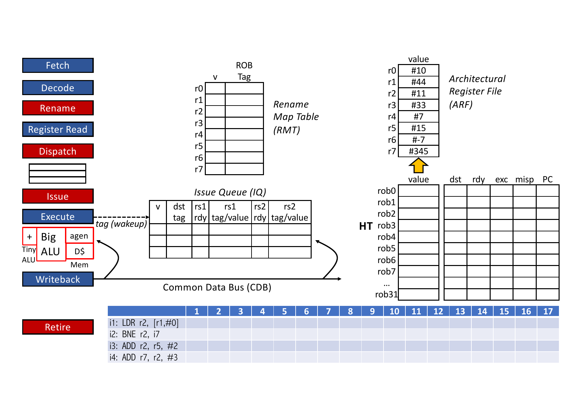

---

# 7. OOO v.2 Cycle-by-Cycle Walkthrough: No Misprediction (P86–P124)

**Page ↔ cycle mapping: `state-diagram PDF page number = cycle number + 86`** (P86 = initial, P87 = cycle 1, ……, P103 = cycle 17)
**The text commentary pages P106–P125 form a separate group**: `commentary-page PDF page number = cycle number + 105` (P106 = Cycle 1, ……, P122 = Cycle 17)

## 7.1 Program and initial state

```
i1: LDR r2, [r1,#0]     ← cache miss, fetches #0
i2: BNE r2, i7          ← branch, depends on r2
i3: ADD r2, r5, #2      ← writes r2 again (WAW with i1)
i4: ADD r7, r2, #3      ← reads r2, should get i3's value
i5: ADD r4, r2, r7      ← reads i3's r2 and i4's r7
```
Initial ARF: `r0=#10 r1=#44 r2=#11 r3=#33 r4=#7 r5=#15 r6=#-7 r7=#345`
Initial ROB Head=Tail=**rob3**. **Branch prediction policy: always not-taken.**

## 7.2 Full timing table (P105)

| Cycle | 1 | 2 | 3 | 4 | 5 | 6 | 7 | 8 | 9 | 10 | 11 | 12 | 13 | 14 | 15 | 16 | 17 | 18 |
|---|---|---|---|---|---|---|---|---|---|---|---|---|---|---|---|---|---|---|
| **i1** | FE | DE | RN | RR | DI | IS | EX@ | EXD$ | …miss… | | | | WB | **RT** | | | | |
| **i2** | | FE | DE | RN | RR | DI | IS | IS | IS | IS | IS | IS | EX | WB | **RT** | | | |
| **i3** | | | FE | DE | RN | RR | DI | IS | EX | WB | RT | RT | RT | RT | RT | **RT** | | |
| **i4** | | | | FE | DE | RN | RR | DI | IS | EX | WB | RT | RT | RT | RT | RT | **RT** | |
| **i5** | | | | | | | | | FE | DE | RN | RR | DI | IS | EX | WB | RT | **RT** |

**Key points for reading the table**:
- i3 **writes back in cycle 10**, but **has to wait until cycle 16 to retire** — because i1 and i2 ahead of it haven't retired yet. **This is "out-of-order execution, in-order commit".**
- i5 **is fetched in cycle 9**. Fetch isn't blocked at all by i1's cache miss.

## 7.3 Cycle-by-cycle key points (P106–P123, distilled)

**Cycle 3 (i1 Rename)** — the standard action template for renaming, must memorize
1. Allocate an entry for i1 at **rob3** (the Tail is currently at rob3)
2. The destination operand `r2` is renamed to **rob3**
3. The Tail increments to rob4
4. In the RMT **`v[r2]=1`, Tag=rob3**
5. One source is the constant 0
6. The second source `r1` is renamed to **ARF[r1]**, because `v[r1]=0` in the RMT
- In the same cycle i3 is fetched; **this is speculative fetch** (i2 is a branch and may be taken; the prediction policy is always-not-taken)

**Cycle 4 (i2 Rename)**
- Allocate rob4; destination `r2` → rob4; Tail → rob5
- **Source `r2` is renamed to rob3**, because `v[r2]=1` in the RMT → carry the tag into the IQ and wait for the producer i1 to produce the value
- In the same cycle i1 reads ARF[r1] = **44** in RR

**Cycle 5 (i3 Rename)**
- Allocate rob5; destination `r2` → rob5, **in the RMT `v[r2]` stays 1, and the Tag is overwritten with rob5**
- Source `r5` → ARF[r5], because `v[r5]=0`
- **The WAW (i1 vs i3) is eliminated at this step: the two instructions write different ROB entries**

**Cycle 6 (i4 Rename)**
- Allocate rob6, Tail → rob7; destination `r7` → rob6, `v[r7]=1`
- Source `r2` → **rob5** (the current RMT Tag) → **correctly gets i3's version, not i1's**

**Cycle 7 (i1 Execute-agen)**
- i1 issues to the agen unit with sources #0 and #44; **the corresponding IQ slot is freed (v=0)**

**Cycle 8 (i1 Execute-D$)**: look up the SRAM data cache
**Cycles 9–12 (i1 …miss…)**: read the data from main memory

**Cycle 9 (i3 Execute)**
- i3 issues to the Tiny ALU and is freed from the IQ
- **At the end of the cycle, the destination tag `rob5` is sent to the wakeup logic in front of the IQ**

**Cycle 9 (i4 Issue)**: `rs1 rdy` changes from 0 to 1 (received rob5's wakeup), can execute next cycle

**Cycle 10 (i3 Writeback)**
- Writes the result into **its own ROB entry rob5**
- **Broadcasts tag/value over the CDB, forwarding to waiting instructions**

**Cycle 11 (i3 Retire)**: i3 can only **queue and wait until it reaches the ROB Head**; because older instructions haven't finished executing, the Head is blocked

**Cycle 12 (i1 miss resolved)**: i1 sends the destination tag `rob3` to the IQ, **waking up i2**

**Cycle 13**
- i1 Writeback: writes the result `#0` into rob3
- i2 Execute: the branch condition is evaluated, `#0 != #0` is false → **not-taken, matches the prediction → no misprediction**; i2 **grabs the value of r2 (rob3) from the CDB** (forwarding)

**Cycle 14 (i1 Retire)** — **the standard action template for retirement, must memorize**
1. i1 reaches the **ROB Head** and enters the Retire stage
2. Update **ARF[r2]** with the value in its ROB entry
3. **Check the tag for r2 in the RMT: since it's rob5 (not rob3), the `v` bit stays unchanged**
4. **Increment the ROB Head** (moves to rob4)
- In the same cycle i2 Writeback: the branch has no value to write; **because it was actually not-taken and the prediction was also not-taken, set the ROB `misp` bit to 0**

**Cycle 15 (i2 Retire)**: no value written to the ARF, retires directly; Head → rob5

**Cycle 16 (i3 Retire)**
1. Reaches the Head, writes **ARF[r2] = #17**
2. **Check the RMT: r2's tag is exactly rob5 → match → reset the `v` bit to 0**
3. Head → rob6

**Cycle 17 (i4 Retire)**: writes **ARF[r7] = #20**; r7's tag in the RMT == rob6 → **reset the v bit**; Head → rob7

**i5's separate trajectory (P123)**: FE(9) → DE(10) → RN(11, allocate rob7, the two sources are renamed to **rob5** and **rob6** respectively, because `v[r2]=v[r7]=1 in the RMT) → RR(12, both sources are already ready in the ROB, take the values directly) → DI(13) → IS(14) → EX(15) → WB(16) → RT(17–18, **Head = Tail, all done**)

### ⭐ Rule for handling the RMT at retirement (most likely to be examined, most likely to be gotten wrong)

> When an instruction retires, **the RMT v bit is cleared only if the Tag of that destination register in the RMT exactly equals this instruction's ROB tag**.
> If they're not equal, it means **a younger instruction has renamed this register as well**, and the RMT mapping is still valid → **don't touch it**.
>
> Compare cycle 14 (i1, rob3 ≠ rob5 → **don't clear**) with cycle 16 (i3, rob5 == rob5 → **clear**).

## 7.4 Observations (P124)

- Compared with the scoreboard-only version, **the ROB doesn't reduce performance**: fetch doesn't stall as before (the D$ miss is tolerated)
- **In-order retirement doesn't hinder out-of-order, speculative execution**
- In this example **the ROB isn't used for recovery**; only its **renaming** function is used
- But the **danger of mispredictions without a ROB** can already be seen


---

# 8. Misprediction Recovery (P125–P130, P149)

## 8.1 Change of scenario (P125)

The same program, with one change: **the value fetched by the i1 load is `#666` instead of `#0`.**
So the condition of `i2: BNE r2, i7`, `#666 != #0`, is **true → taken**, while the prediction is not-taken → **misprediction**.

## 8.2 The three recovery steps (P126 → P127 → P128)

**Step 1: Detection (P126, cycle 13)**
- i2 evaluates in the EX stage and finds `#666 != #0` is true → **taken → misprediction**
- At this point the ROB Head is still at rob3 (i1 is in WB)
- **Note: i3 and i4 have long since executed and written back to the ROB, but their values are still in the ROB; the ARF hasn't been polluted at all**

**Step 2: Mark + wait to reach the Head (P127, cycle 14)**
- i2 **out of order** sets the **`misp` bit of its own ROB entry (rob4) to 1**
- In the same cycle i1 retires, writing ARF[r2] = #666; checking the RMT finds `rob5 != rob3` → **don't reset the v bit** (labeled "Don't reset: rob5 != rob3" in the figure)
- **The Head moves to rob4**, i.e. i2 reaches the Head

**Step 3: Perform recovery (P128, cycle 15)** — **four actions, must memorize**
1. **`T = H`**, clearing the entire ROB (flush ROB)
2. **Flash-clear all v bits of the RMT** (clear to zero all at once)
3. **Flush all pipeline stages** — they all hold instructions younger than the ROB Head (i.e. the branch), including i5 in the pipeline
4. Redirect fetch to the branch target **i7**

**Architectural state after recovery (P130 / P149)**
```
ARF: r0=#10  r1=#44  r2=#666  r3=#33  r4=#7  r5=#15  r6=#-7  r7=#345
RMT: all v=0
ROB: H = T
```
→ **The results of i3 (r2=#17), i4 (r7=#20) and i5 (r4=#37) are all discarded**, because they were on the wrong path. **Only the effects of i1 and i2 are kept. This is exactly the definition of a precise exception.**

### Why is flash-clearing the RMT enough?

Because after the flush, **all valid architectural values are in the ARF** (everything left in the ROB is wrong-path speculative values, which have been discarded). Clearing the whole RMT is equivalent to saying "the newest values of all registers are in the ARF" — which is exactly the consistent state of an empty pipeline. **No instruction-by-instruction rollback is needed.**


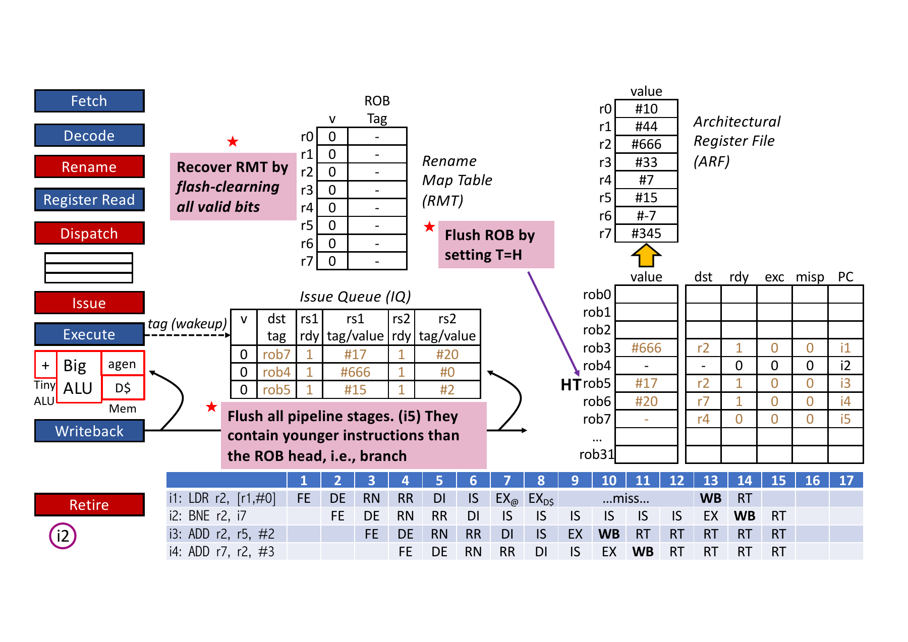


## 8.3 Overall structural comparison of in-order → out-of-order (P129)

| In-order pipeline | Out-of-order pipeline (v.2) | Role of the new part |
|---|---|---|
| Fetch | Fetch | |
| Decode | Decode | |
| — | **Rename** | Extended register file: **ARF (committed state) + ROB (speculative state)**; provides recovery capability and eliminates WAR/WAW |
| RF Read / Issue | Register Read | |
| — | **Dispatch** | Inserts instructions into the IQ **in order** |
| — | **Issue Queue → Issue** | Takes instructions out of the IQ **out of order** |
| Execute | Execute | |
| Writeback | Writeback | |
| — | **Retire** | Commits results from the ROB to the ARF **in order** |

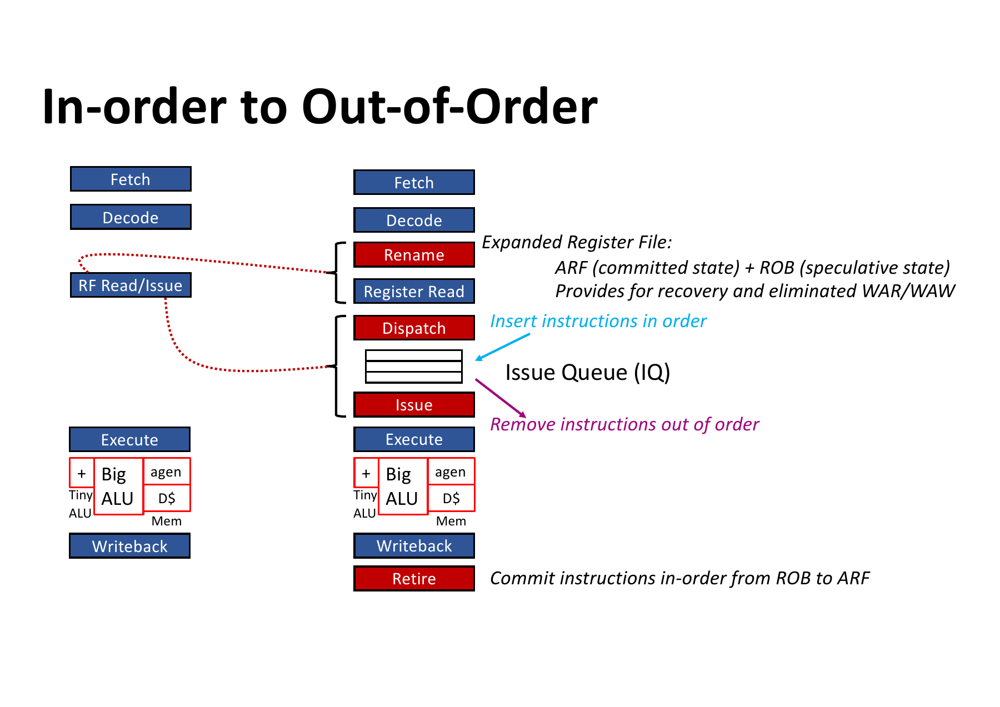

## 8.4 ARF + ROB summary figure (P134)

- **Physical register file = ARF + ROB**
- **Commit = move the value at the ROB Head into the ARF**
- **Multiple versions** of the same architectural register can exist in the ROB at the same time (in the figure `r5 = rob31` and `r5 = rob87` coexist)
- **Recovery flow**: wait for the exception/misprediction to reach the Head → **T = H** → **reset all v bits of the RMT**

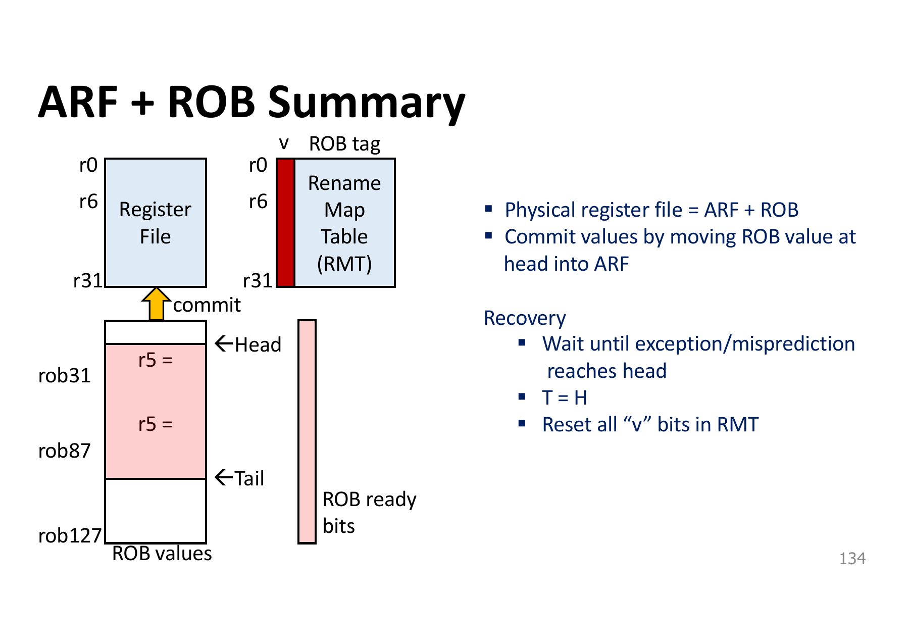

---

# 9. Out-of-Order Execution of Loads / Stores (P131–P132)

**Loads and stores also execute out of order.**

**Safety condition**: when a load and a store access **different addresses**, reordering is safe. When they access **the same address**, reordering creates hazards:

| Must respect | Meaning |
|---|---|
| **WAR** | A load **must not** consume the data of a store younger than it |
| **RAW** | The nearest store **before (older than)** the load **must** provide its value |

## Speculative Load Execution

- A load **executes speculatively while the addresses of all older stores are still unknown**, supported by a structure called the **LSQ (Load-Store Queue)**
- The load **searches all speculative (older) stores with matching addresses**; it gets "the best value it can get" (cache / main memory / ROB / RF / …)
- If what it gets is a stale value — **the recovery mechanism catches it**
- When a store executes, **it cancels all younger speculative loads with matching addresses**

> **Corollary (P132)**: once you have speculation support, you can speculate on other things — e.g. directly **predicting register values (value prediction)**.

---

# 10. History, Summary and Extensions (P133–P146)

## 10.1 Tomasulo and the IBM 360/91 (P133)

- **The ARF + ROB scheme is based on Tomasulo's algorithm (1967)**
- Original goal: execute multiple floating-point instructions concurrently
- **The original machine was imprecise (no ROB)**, and used the **issue queue for renaming**
- It used **"stall on branch"**, so it could only exploit **limited ILP**

> Exam distinction: **original Tomasulo ≠ the v.2 taught in class**. The original had no ROB, imprecise exceptions, and stalled on branches. The ROB was added later.

## 10.2 Review of the main concepts (P135, memorize item by item)

| Concept | Definition |
|---|---|
| **Dynamic branch prediction** | Choosing which instructions to execute next |
| **Speculation** | Executing instructions before dependences are resolved (with the ability to **undo** incorrectly speculated sequences) |
| **Dynamic scheduling** | Handling the scheduling of different combinations of instructions. **Dynamic scheduling is inseparable from speculation** — dynamic scheduling without speculation can only exploit limited ILP, because branches must be resolved before instructions on the predicted path can execute |
| **Register renaming** | Renaming logical/architectural registers onto an extended set of physical registers, **avoiding WAR/WAW** |
| **Hardware-based speculation** | = dynamic branch prediction + dynamic scheduling + speculation. **Renaming is an optional but important optimization** |
| **Precise interrupts** | When an exception occurs, the architectural state must correspond to the state of sequential execution |

## 10.3 Keys to the high performance of modern processors (P136–P137)

1. Eliminate false dependences with **register renaming**
2. Fetch speculatively with **dynamic branch prediction**, keeping the issue queue **full**
3. **Out-of-order issue**, keeping all functional units busy
4. Use **superscalar** to fetch/decode/……/issue **multiple instructions** per cycle

> **The fundamental reason for all of the above: hide memory latency and do work "under" cache misses. Waiting for memory kills performance, and memory accesses are extremely frequent.**

Supplement (P137):
- **There isn't much ILP in a small instruction window** (too many dependences)
- A **large scheduling window** (many IQ slots) is needed to find independent instructions, paired with a **correspondingly sized ROB**
- Modern processors all use **variants of the ARF+ROB scheme**

## 10.4 The historical debate: hardware dynamic vs software static (P138)

| | Dynamic (hardware) | Static (software/compiler) |
|---|---|---|
| Advantages | **Portable**: no recompilation when changing processors; the hardware **knows runtime information** (loop counts, branch directions, program inputs, load misses) | The compiler can do **whole-program optimization**; it has **plenty of time** to analyze code for ILP |
| Disadvantages | Power, energy, **security** problems | **Doesn't know the program inputs**, can only guess; **a commercial failure** |

## 10.5 Three classes of processors exploiting ILP (P139–P140)

| Class | Who schedules | Does the hardware reorder | Does the hardware check dependences |
|---|---|---|---|
| **Statically scheduled superscalar** | The compiler (at program creation) | **No** | **Yes** (the compiler can rely on the hardware to guarantee correctness) |
| **VLIW** (Very Long Instruction Word) | The compiler | No | **No** (the hardware doesn't check dependences at all) |
| **Dynamically scheduled superscalar** | The **hardware** (at runtime) | **Yes** | Yes |

**VLIW details**: the compiler packs instructions into **bundles**, with **up to 28 instructions** per bundle, all **completely independent of each other**; the compiler does "very smart and deep" program analysis to construct high-ILP schedules.

**The unique ability of dynamically scheduled superscalar**: **different executions of the same instruction sequence can produce different schedules**.

## 10.6 Memory-level parallelism MLP (P141–P143)

Out-of-order CPUs use ILP to **generate many load misses at the same time**, and the whole system must cooperate:

- **Caches must be lock-up free (non-blocking)**
- **DRAM main memory** must be able to handle multiple requests in parallel — through multiple **channels, ranks, banks**
- **Storage devices (SSDs)** also have internal parallelism to support concurrent access

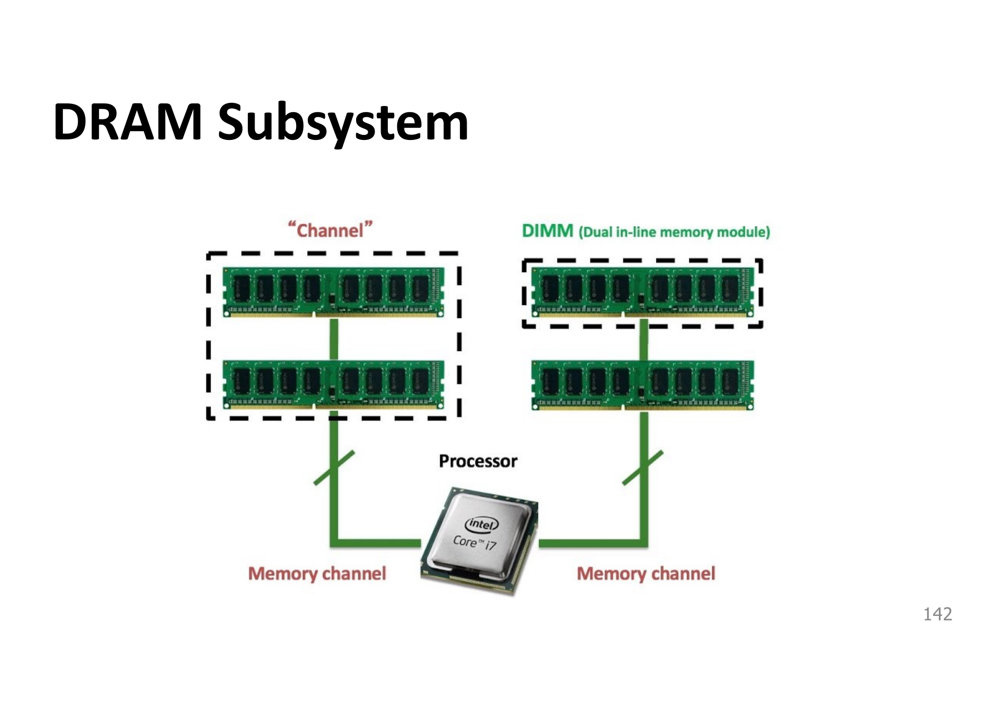

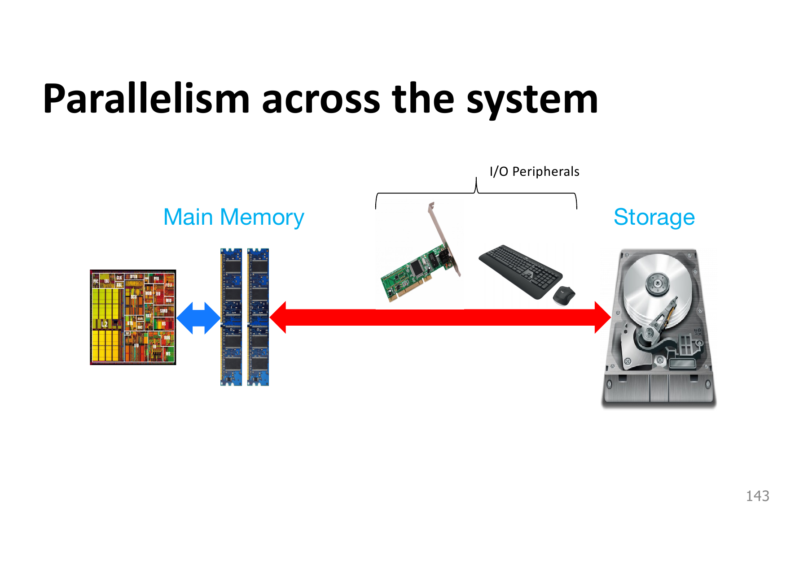

## 10.7 Other forms of parallelism (P144)

| Form | Key points |
|---|---|
| **Multicore** | Spatial parallelism (because frequency can no longer be raised). AMD has 128-core CPUs |
| **Hyperthreading** | 2-way hyperthreading, making better use of the superscalar OOO core. Because it's hard to find N (4/8/12) instructions to issue every cycle; multiple software threads **share the resources of the superscalar OOO core** (**separate RFs + shared out-of-order machinery**) |
| **SIMD registers** | Single instruction, multiple data. Use very wide registers to execute the same instruction on multiple data items |

## 10.8 Security vulnerabilities (P145)

- **Hardware speculation leads to security vulnerabilities**
- Why teach OOO? **Performance, energy, security** (security is increasingly important)
- The slides explicitly don't cover this topic, leaving it as homework: "use AI to discuss how hardware speculation makes Spectre variant 1 possible"

> P146 is a COMP3703 guest lecture notice (time, place, speaker), **irrelevant to the exam, no need to capture**.

---

# ⚠️ Errors / Doubtful Points in the Slides (don't be misled in the exam)

| PDF page | Problem | Correct form / explanation |
|---|---|---|
| **P19–P28** | Scenario 1's `i2: ADD R4, [R3, #1]` is a **syntax error**. ADD's second source can't be written in the bracketed memory-addressing form | Should be `ADD R4, R3, #1`. From the later timing it's just an ordinary independent ALU instruction |
| **P48, P50** | Title misspelled **"Dispath"** | Should be **Dispatch** (wrong on both pages) |
| **P122** | "since tag corresponding to r7 in RMT is **rob67**" | Should be **rob6**. An extra 6 was typed |
| **P144** | "Wide (up to **1024-byte**) registers" | The order of magnitude is doubtful. AVX-512 is 512 **bits** (64 bytes), ARM SVE is at most 2048 bits (256 bytes). **1024-byte = 8192 bits** doesn't currently exist; most likely bits was written as bytes |
| **P139** | "up to **28** instructions in a bundle" looks outrageous | It's actually **not wrong**; it refers to early VLIWs like the Multiflow TRACE 28/300 (28 operations per very long instruction). But Itanium is 3 per bundle, don't confuse them |
| **P123** | i5's Retire is written as "Cycle #17-18", but the timing table only goes up to cycle 17 | The table isn't wide enough; not a logic error |
| **P130 vs P149** | Exactly the same figure appears twice | P149 just adds "From Here / To Here" closing boxes. Capture one only |
| **P47, P71** | Chinese text appears ("有缺陷", a Chinese explanation of precise exceptions) | These are **existing third-party annotations in the PDF file**, not the original lecture text. Don't quote them as official definitions |

---

# 📌 Must-Memorize List (read this 30 minutes before the exam)

## Definitions
1. **Dependence is a property of the program; Hazard is a property of the microarchitecture.**
2. **True dependence → RAW (cannot be eliminated); anti dependence → WAR, output dependence → WAW, both are false dependences (name dependences) that can be eliminated by renaming.**
3. **Three conditions for a precise exception**: ① all earlier instructions have completed and their effects are visible ② the faulting instruction has not completed ③ later instructions have not executed and made no visible changes.
4. **Static = compile time, Dynamic = runtime.** The ARM 5-stage pipeline and in-order superscalar are both statically scheduled.
5. **Issue** = sending an instruction into a functional unit when its operands are ready.
6. **The four elements of hardware speculation**: register renaming + dynamic branch prediction + dynamic scheduling + ROB.

## Structures
7. **In-order pipeline stages**: FE / DE / RR / EX / WB
8. **OOO v.1 (Scoreboard)**: FE / DE / RR / **DI** / **IS** / EX / WB; adds Scoreboard + IQ + **CDB**
9. **OOO v.2 (ARF+ROB)**: FE / DE / **RN** / RR / DI / IS / EX / WB / **RT**
10. **Two humps**: hump 1 = reservation stations (scheduling window); hump 2 = reorder buffer (instruction window)
11. **ROB entry fields**: value / dst / rdy / **exc** / **misp** / PC
12. **RMT fields**: v / Tag. Intel calls it the **RAT**.
13. **ARF = committed state; ROB = speculative state; physical register file = ARF + ROB.**
14. **The ROB is a circular FIFO**, Head = oldest unretired instruction, Tail = youngest instruction.

## Mechanisms
15. **In-order issue turns data dependences into structural hazards** — this is the fundamental reason OOO is necessary.
16. **Capture-Tag-And-Go-For-Execution** (the scoreboard's wakeup-select mnemonic).
17. **The CDB broadcasts to three places**: IQ, register file, Execute stage; it is the implementation of forwarding, **bypassing the RF write**.
18. **Three sources of source operands in the RR stage**: **ARF** (producer retired) / **ROB** (executed but not retired) / **Bypass** (not executed).
19. **Condition for clearing the RMT v bit at retirement**: clear only if **the register's Tag in the RMT == this instruction's ROB tag**; if not equal, don't touch it.
20. **Four recovery steps**: wait until the Head → **T = H** → **flash-clear all RMT v bits** → **flush all pipeline stages**, redirect fetch.
21. **Out-of-order Load/Store**: different addresses are safe; same address must preserve WAR (a load doesn't eat a younger store's value) and RAW (the nearest older store provides the value); relies on the **LSQ**.
22. **The three big problems of OOO v.1**: can't recover from mispredictions / imprecise exceptions / WAR-WAW cause fallback to in-order. **The ROB solves all three at once.**

## Polarity traps (memorize separately)
23. **Scoreboard `v=1` = the value is in the RF and ready.**
24. **RMT `v=1` = the value is in the ROB (not in the ARF).**
25. **IQ `v=1` = the slot is occupied.**
> Three `v`s, three meanings. When solving a problem, first confirm which table you're on.

## Numbers
26. Main memory latency assumed to be **100 cycles**
27. In Scenario 2: aggressive in-order i4 completes in **cycle 13**; Scoreboard completes in **cycle 10**
28. ROB-version timing: i1 RT@14, i2 RT@15, i3 RT@16, i4 RT@17, i5 RT@18; i5 FE@**9** (fetch not blocked by the miss)
29. Tomasulo's algorithm: **1967, IBM 360/91**

---
