# COMP2300 Set 5 笔记 — 多周期微架构：Multicycle ARM、FSM 控制器与微程序

> **课程**：ANU COMP2300 — Computer Organisation and Program Execution
> **讲师**：Shoaib Akram
> **本 set 主题一句话**：把 set4 的**单周期**数据通路拆成**多个时钟周期**——用少量硬件（**一个**内存、**一个** ALU）+ 若干**非架构寄存器**跨周期保存中间值，再用一个 **FSM 控制器**按状态逐拍发控制信号；最后讲控制器的两种实现（硬连线 FSM vs **微程序**）与它对语义鸿沟的意义，并引出流水线。
> **参考**：H&H 第 7.4 节（multicycle processor）、7.6（微程序/控制器实现）、第 7.5 节（pipelining 开头）。

> **符号约定**：`←` = 赋值（本周期结束的时钟沿写入）；`Rn/Rm/Rd` = ARM 指令字段；`ExtImm` = 扩展后的立即数；`PC+8` = ARM 里 R15 被读出时的值。

---

## 0. 本 set 的骨架

```
单周期的两个痛点 (硬件冗余 + Tc 被最慢指令绑架)
   ↓
多周期思路：一条指令拆成多步，每步一个时钟周期
   ↓
状态元件精简：Instr/Data 统一内存、一个 ALU
   ↓  但必须新增非架构寄存器 (IR / Data / A / WriteData / ALUOut)
逐步搭建数据通路：LDR 的 STEP 1~6 → R15 读写 → STR → DP → B
   ↓
完整 Multicycle ARM Processor (13 条控制信号)
   ↓
控制器 = FSM (S0 Fetch ... S9 Branch)
   ↓
性能：CPI 因指令而异，Tc 由最慢的一步决定
   ↓
控制器实现：硬连线 FSM  vs  微程序 (Microsequencer + Control Store)
   ↓  微程序 → 可以用简单硬件实现复杂 ISA → 改变语义鸿沟权衡
流水线：不同指令同时待在不同阶段
```

---

## 1. 起点回顾：单周期处理器的问题

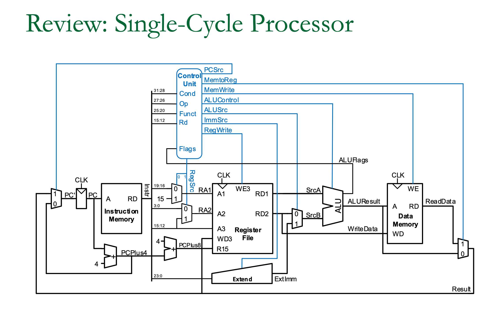

单周期设计里，**一条指令 = 一个时钟周期**，所以：

| 问题 | 具体表现 |
|---|---|
| **硬件冗余** | 必须有**两个内存**（Instruction Memory + Data Memory），因为同一周期里既要取指又要访存 |
| | 必须有**多个加法器**（ALU + PCPlus4 加法器 + PCPlus8 加法器），因为同一周期里既要算地址/运算又要算 PC |
| **时钟周期被绑架** | `Tc` 必须 ≥ **最慢那条指令**（LDR：取指 → 读 RF → ALU 算地址 → 访存 → 写回）的总延迟 |
| | 结果：`ADD`、`B` 这种很快的指令也要陪着等一个超长周期 —— **浪费** |

> **核心动机**：既然一条指令的各个步骤本来就是**串行**发生的，为什么不让它们**分占不同周期**？这样就能**复用**同一块硬件，并且让 `Tc` 只覆盖**一步**而不是整条指令。

**代价**：CPI 从 1 变成 >1（3~5 不等），并且需要额外的寄存器来跨周期保存中间结果。

---

## 2. 多周期的状态元件

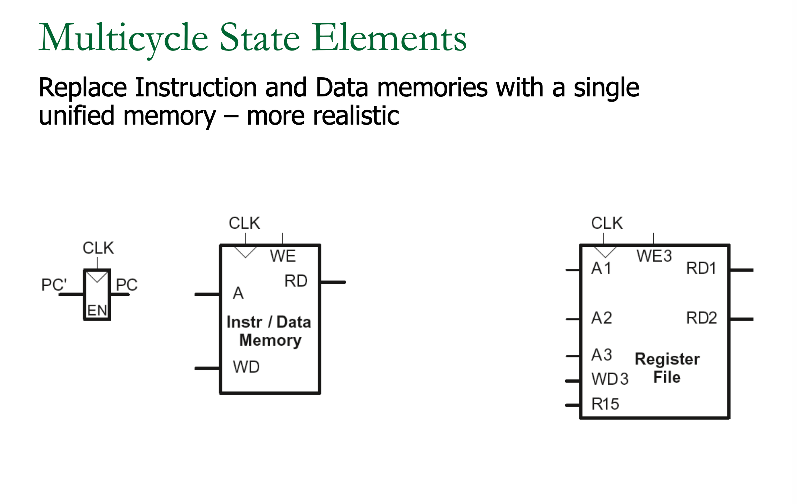

三个基本状态元件：

| 元件 | 端口 | 说明 |
|---|---|---|
| **PC 寄存器** | `PC'` 入 / `PC` 出，带 **EN**（使能） | 有了 EN，就能**选择某些周期不更新 PC** —— 这是多周期的关键 |
| **Instr / Data Memory** | `A`（地址）、`WD`（写数据）、`WE`（写使能）、`RD`（读数据） | ⭐ **指令和数据合用一块内存**——更贴近真实机器（Von Neumann 的 unified memory） |
| **Register File** | `A1/A2`（读地址）、`RD1/RD2`（读数据）、`A3/WD3/WE3`（写端口）、`R15` | 多一个 `R15` 输入端口，用于把 PC+8 送进来当 R15 的值 |

> **易考点**：单一内存意味着**取指周期和访存周期不能撞车**——它们天然被分到了不同的周期，所以不冲突。这正是多周期能省掉一块内存的原因。

---

## 3. ⭐ 非架构寄存器（Non-architectural registers）

这是整个 set 的**核心新概念**。

- **架构寄存器（architectural）**：ISA 规定、**程序员可见**的状态 —— R0–R15、内存。
- **非架构寄存器（non-architectural）**：**程序员看不见**，纯粹是微架构为了实现多周期而加的"中转站"。

| 非架构寄存器 | 存什么 | 为什么需要 |
|---|---|---|
| **IR**（图中输出 `Instr`，由 `IRWrite` 使能） | 当前指令的 32 bit | 内存是复用的：后面几个周期内存要拿去读/写**数据**，指令就没了。必须先把指令**锁**在 IR 里 |
| **Data** | 从内存读回来的数据 | LDR 在"读内存"这一拍拿到数据，但要到**下一拍**才写回 RF |
| **A** | RF 的 `RD1`（Rn 的值） | RF 的读出值只在当拍有效；下一拍 ALU 才用它 |
| **WriteData** | RF 的 `RD2`（Rm / Rd 的值） | 同上，STR 要在更晚的周期把它写进内存 |
| **ALUOut** | ALU 的计算结果 | 地址/运算结果要留到下一拍用（访存或写回） |

> **一句话总结**：**组合逻辑的输出只在本周期有效；跨周期要用的值，必须存进寄存器。** 非架构寄存器就是把"一条长组合路径"切成若干段的分隔符。

---

## 4. 逐步搭建：以 `LDR Rd, [Rn, imm12]` 为例

LDR 是最长的指令（5 个周期），课件用它把整条数据通路一步步搭出来。

指令编码（复习 set4）：

| 31:28 | 27:26 | 25:20 | 19:16 | 15:12 | 11:0 |
|---|---|---|---|---|---|
| cond | 01 | 1 1 1 0 0 **L** | Rn | Rd | imm12 |

- `L = 1` → LDR（load）；`L = 0` → STR（store）。这一位就是 FSM 里的 **Funct₀**。

### STEP 1：取指（Fetch）

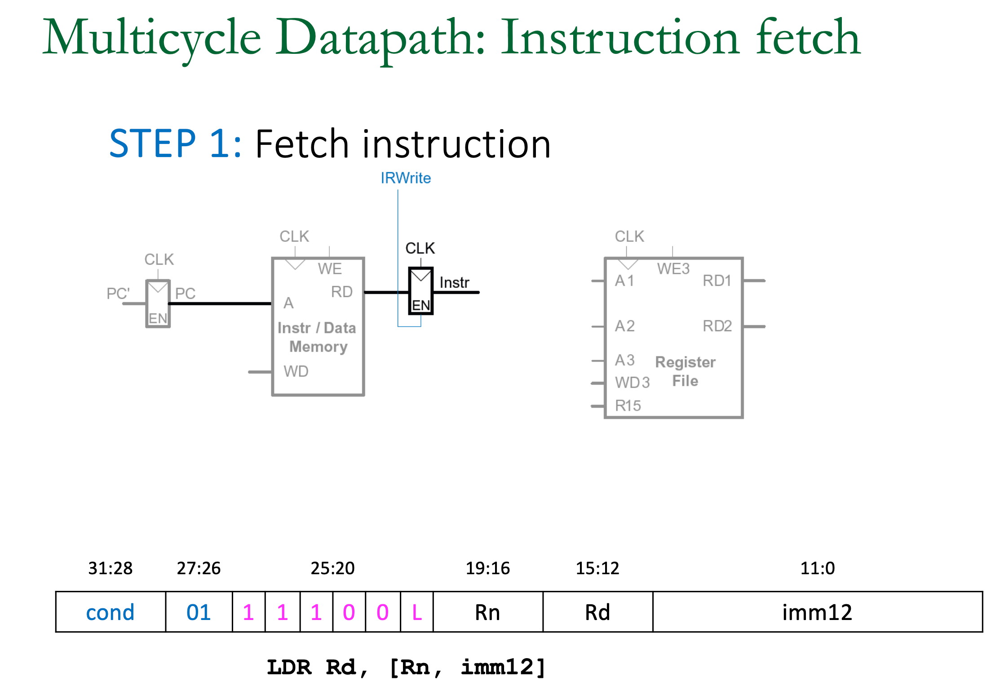

```
Instr ← Mem[PC]
```
- `PC` → 内存 `A` 口，读出 `RD` → 送进 **IR**
- 新控制信号：**`IRWrite`** —— 只在取指这拍拉高，把指令锁住
- 同一拍里还顺便做了 `PC ← PC+4`（见 STEP 6，两件事在同一周期完成）

### STEP 2：读寄存器 + 扩展立即数

![STEP 2: Read source operands from RF —— Instr[19:16] 送 A1，Instr[23:0] 进 Extend，RD1 锁进 A 寄存器](images/set5/p27.png)

```
A ← RF[Rn]
```
- `Instr[19:16]`（= Rn）→ `A1`，读出的 `RD1` 存进**非架构寄存器 A**
- `Instr[23:0]` → **Extend** 单元 → `ExtImm`
- 新控制信号：**`ImmSrc`** —— 告诉 Extend 单元这是 imm8 / imm12 / imm24（三种指令格式的立即数宽度不同）

### STEP 3：算地址

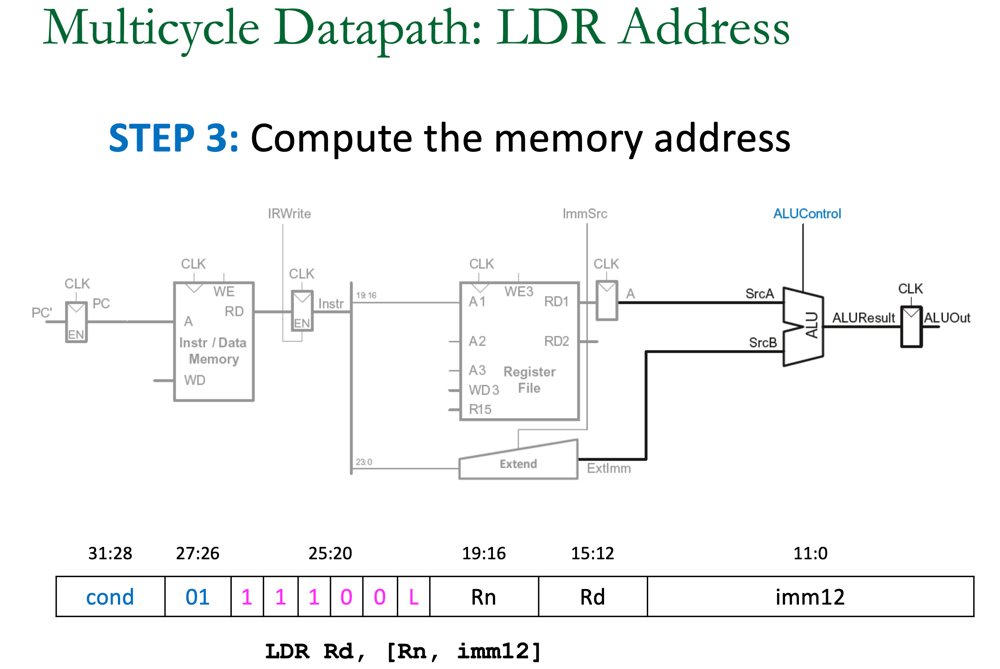

```
ALUOut ← A + ExtImm      // 即 Rn + imm12
```
- ALU 两个输入：`SrcA` ← A 寄存器，`SrcB` ← ExtImm
- 新控制信号：**`ALUControl`**（选 ADD）
- 结果存进**非架构寄存器 ALUOut**

### STEP 4：读内存（本步骤课件未截图）

```
Data ← Mem[ALUOut]
```
- 这拍内存的地址不再是 PC，而是 **ALUOut** → 需要在 PC 和 Result 之间做选择
- 新控制信号：**`AdrSrc`**（0 = PC，1 = Result）与它前面的 **`Adr` 多路选择器**
- 读回的数据锁进**非架构寄存器 Data**

### STEP 5：写回寄存器堆

![STEP 5: Write data back to register file —— Data → Result → WD3，Instr[15:12] → A3](images/set5/p30.png)

```
RF[Rd] ← Data
```
- `Instr[15:12]`（= Rd）→ `A3`；`Data` → `Result` → `WD3`
- 新控制信号：
  - **`RegWrite`**（= `WE3`）：只有这拍才真正写 RF
  - **`ResultSrc`**：选 Result 总线的来源，**`01` = Data**
- 图里同时出现了 `PCWrite` 和 `AdrSrc`，此时 `Result` 这条总线已经被三处共用：写 RF、当内存地址、写 PC

### STEP 6：更新 PC

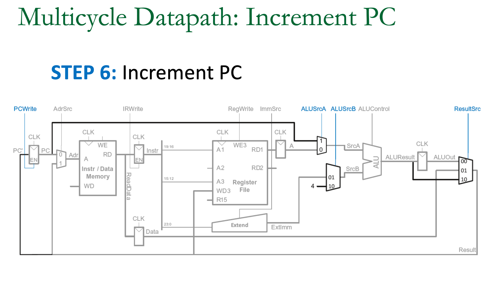

```
PC ← PC + 4
```
- 关键：**复用同一个 ALU** 来算 PC+4（单周期里这是一个专用加法器！）
- 新控制信号：
  - **`ALUSrcA`**：`1` = PC，`0` = A 寄存器
  - **`ALUSrcB`**：`00` = WriteData，`01` = ExtImm，`10` = **常数 4**
  - **`ResultSrc = 10`** = **ALUResult 直通**（绕过 ALUOut 寄存器！）
  - **`PCWrite`**：PC 寄存器的 EN
- **为什么 ResultSrc 要有一路 ALUResult 直通（绕过 ALUOut）？** 因为 PC+4 要在**本拍结束时**就写进 PC，如果先经过 ALUOut 就要多等一拍。（这正是 Quiz 第 3 题。）

> **⭐ 时间线要点**：STEP 1 和 STEP 6 发生在**同一个周期**（Fetch 状态）。所以取指结束时 `PC` 已经是 `PC_old + 4`。

**LDR 的完整微操作序列（5 拍）**：

| 周期 | 状态 | 微操作 |
|---|---|---|
| 1 | Fetch | `Instr ← Mem[PC]`；`PC ← PC+4` |
| 2 | Decode | `ALUOut ← PC+4`（即 PC_old+8，为 R15 准备） |
| 3 | MemAdr | `ALUOut ← Rn + ExtImm` |
| 4 | MemRead | `Data ← Mem[ALUOut]` |
| 5 | MemWB | `RF[Rd] ← Data` |

---

## 5. ⭐ R15（PC）的特殊处理

ARM 把 PC 暴露成通用寄存器 R15，读它要得到 **PC+8**（历史遗留：老 ARM 三级流水线）。多周期实现要专门伺候这件事。

### 5.1 读 R15：`ADD R1, R15, R2`

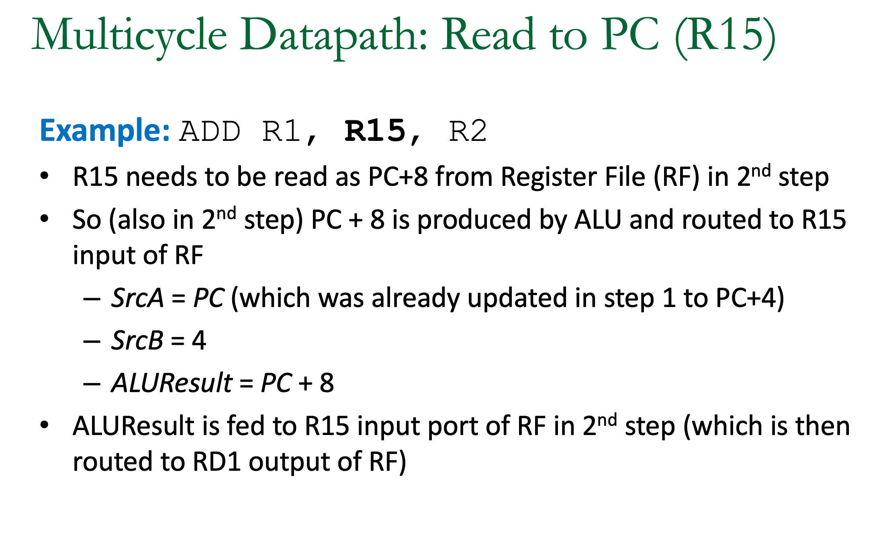

- R15 要在**第 2 步（Decode）**被 RF 读成 `PC+8`
- 所以**也在第 2 步**，用 ALU 造出 PC+8 并送进 RF 的 `R15` 输入端口：
  - `SrcA = PC`（**注意：PC 在第 1 步已经被更新成 PC_old+4**）
  - `SrcB = 4`
  - `ALUResult = PC_old + 8` ✅
- `ALUResult` 喂给 RF 的 **R15 输入端口**，RF 内部把它路由到 `RD1` 输出

> 这就解释了 FSM 里 **Decode 状态**为什么明明"还没解码完"却要让 ALU 算一次 `PC+4`：它算的是 **R15 的值**，顺手存进 ALUOut 供 Branch 使用。

### 5.2 写 R15：`SUB R15, R8, R3`

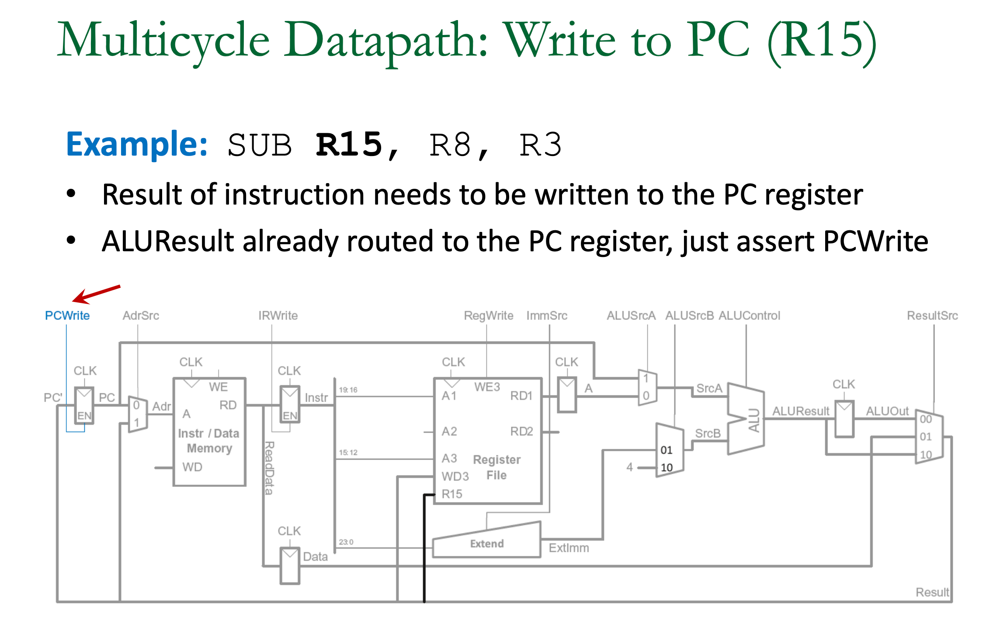

- 指令结果要写进 **PC 寄存器**（等价于一次跳转）
- **不需要新硬件**：`ALUResult → Result → PC'` 这条线为了 PC+4 早就存在
- 只要在写回那拍**同时拉高 `PCWrite`** 即可

> **设计美学**：ARM 的"PC 就是 R15"在微架构上的代价，被一个已有的多路选择器和一根已有的连线吸收掉了。

---

## 6. `STR`：把数据写进内存

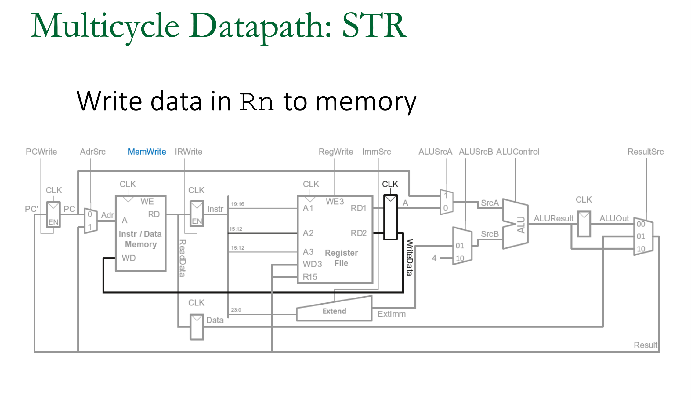

- 前 3 步和 LDR 完全一样（Fetch → Decode → MemAdr，地址仍是 `Rn + ExtImm`）
- 第 4 步改成写内存：
  - 要写的数据来自 `Rd` → 走 `A2` → `RD2` → **WriteData 寄存器** → 内存 `WD` 口
  - 新控制信号：**`MemWrite`**（内存的 `WE`）
- **STR 只要 4 拍**（没有写回 RF 这一步）

> 注意图中 `A2` 的输入是 `Instr[15:12]`（Rd）而不是 `Instr[3:0]`（Rm）—— STR 要读的是**被存的那个寄存器**，这就是下面 `RegSrc` 存在的理由之一。

---

## 7. 数据处理指令（DP）

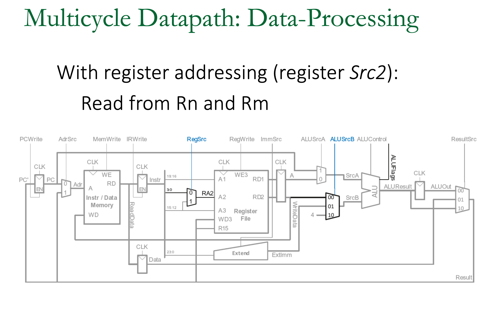

**寄存器寻址（register Src2）**：`ADD Rd, Rn, Rm`

- 要同时读 **Rn**（`Instr[19:16]` → A1）和 **Rm**（`Instr[3:0]` → A2）
- 新控制信号：**`RegSrc`** —— A2 前面的多路选择器
  - `0` → `Instr[3:0]`（Rm，DP 指令用）
  - `1` → `Instr[15:12]`（Rd，STR 用）
- ALU 输入：`ALUSrcA = 0`（A 寄存器 = Rn），**`ALUSrcB = 00`**（WriteData = Rm）
- ALU 输出的 **`ALUFlags`** 连回控制单元（条件执行/条件分支要用）

**立即数寻址（immediate Src2）**：`ADD Rd, Rn, #imm8` → 只把 `ALUSrcB` 换成 `01`（ExtImm）即可，这就是 FSM 里 **ExecuteR / ExecuteI** 两个状态的唯一区别。

**DP 指令 4 拍**：Fetch → Decode → ExecuteR/I → ALUWB。

---

## 8. 分支 `B`

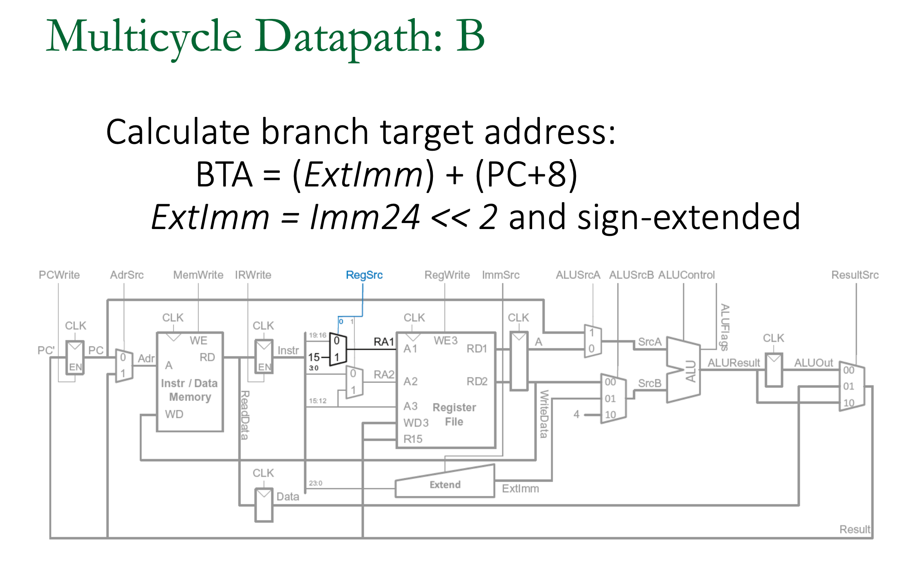

```
BTA = ExtImm + (PC + 8)
ExtImm = Imm24 << 2 后符号扩展
```

- `Imm24 << 2`：因为指令**字对齐**，偏移量以"指令条数"计，乘 4 才是字节偏移
- `PC+8`：ARM 的分支基准就是 R15 的值
- **怎么拿到 PC+8？** 用 `RegSrc` 把 `A1` 的输入**强制成常数 15**（图中 `15 → 1` 那一路），于是 RF 读出 R15 = PC+8（Decode 那拍已经算好送进 R15 端口）
- 然后 `ALUSrcA = 0`（A = PC+8），`ALUSrcB = 01`（ExtImm），`ResultSrc = 10`（ALUResult 直通），拉 **`Branch`** → `PC ← BTA`

> **`RegSrc` 是 2 bit**：`RegSrc₀` 管 A1（0 = Rn，1 = 15），`RegSrc₁` 管 A2（0 = Rm，1 = Rd）。

**B 只要 3 拍**：Fetch → Decode → Branch。

---

## 9. 完整的 Multicycle ARM Processor

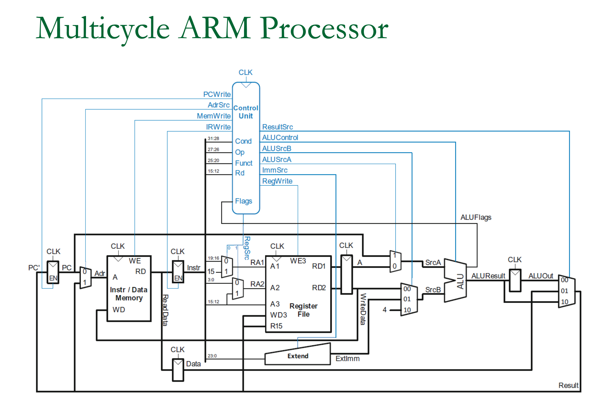

### 9.1 控制单元的输入输出

**输入（来自指令和 ALU）**：

| 输入 | 来自 | 用途 |
|---|---|---|
| `Cond` | `Instr[31:28]` | 条件执行判断 |
| `Op` | `Instr[27:26]` | 指令大类：`00` = DP，`01` = Memory，`10` = Branch |
| `Funct` | `Instr[25:20]` | 具体操作；`Funct₅` = I 位（立即数？），`Funct₀` = L 位（Load？） |
| `Rd` | `Instr[15:12]` | 判断目的寄存器是否是 R15 |
| `Flags` | ALUFlags（N、Z、C、V） | 条件判断 |

**输出（13 条控制信号）**：

| 信号 | 位宽 | 作用 | 取值含义 |
|---|---|---|---|
| `PCWrite` | 1 | PC 寄存器 EN | 1 = 本拍更新 PC |
| `AdrSrc` | 1 | 内存地址来源 | 0 = PC（取指），1 = Result（访存） |
| `MemWrite` | 1 | 内存 WE | 1 = 写内存（STR） |
| `IRWrite` | 1 | IR EN | 1 = 锁存指令 |
| `RegSrc` | 2 | RF 读地址来源 | 见 §8 |
| `RegWrite` | 1 | RF WE3 | 1 = 写回寄存器 |
| `ImmSrc` | 2 | 立即数扩展方式 | imm8 / imm12 / imm24<<2 |
| `ALUSrcA` | 1 | ALU 的 A 输入 | 0 = A 寄存器，1 = PC |
| `ALUSrcB` | 2 | ALU 的 B 输入 | `00` = WriteData，`01` = ExtImm，`10` = 常数 4 |
| `ALUControl` | 2 | ALU 操作 | ADD / SUB / AND / ORR |
| `ResultSrc` | 2 | Result 总线来源 | `00` = ALUOut，`01` = Data，`10` = ALUResult（直通） |
| `Branch` | 1 | （FSM 内部）分支时写 PC | 与 PCWrite 逻辑合并 |
| `NextPC` | 1 | （FSM 内部）取指时写 PC | 与 PCWrite 逻辑合并 |

> `PCWrite = NextPC + (Branch · CondEx)` —— 即"取指那拍无条件 +4"或"分支成功时跳转"。

### 9.2 三张图对照看：多周期比单周期多了/少了什么

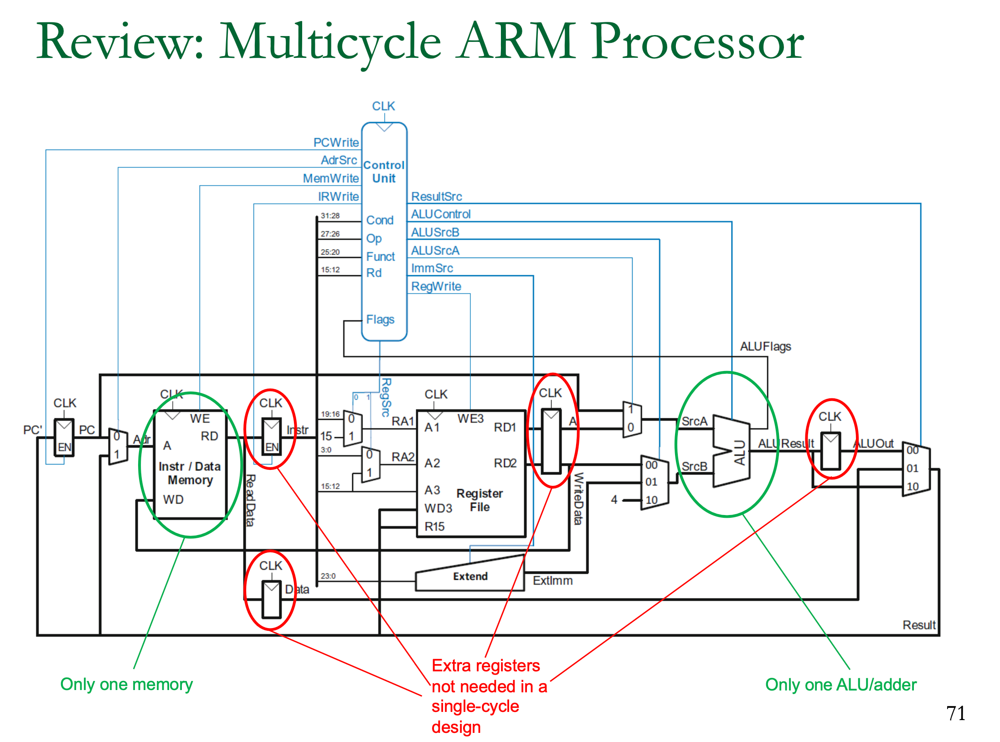

| | 绿色（**省掉**） | 红色（**新增**） |
|---|---|---|
| 内存 | **只有一块内存**（单周期要两块） | — |
| 运算器 | **只有一个 ALU/加法器**（单周期要 ALU + 两个加法器） | — |
| 寄存器 | — | **IR、Data、A、WriteData、ALUOut** 五个非架构寄存器 |
| 多路选择器 | — | `Adr`、`ALUSrcA`、`ALUSrcB`、3 输入 `ResultSrc` |

> **本质权衡**：用**少量小面积的寄存器和 mux**，换掉**一整块内存和两个 32 位加法器**。净赚。

---

## 10. 主控制器 FSM

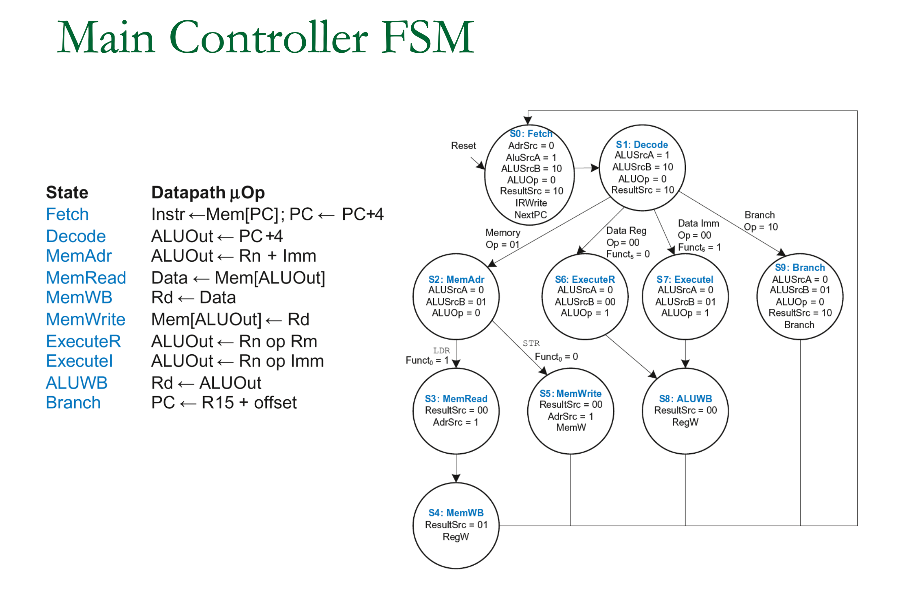

### 10.1 状态与微操作

| 状态 | 名称 | Datapath μOp |
|---|---|---|
| **S0** | Fetch | `Instr ← Mem[PC]` ; `PC ← PC+4` |
| **S1** | Decode | `ALUOut ← PC+4`（= PC_old+8，给 R15/Branch 用） |
| **S2** | MemAdr | `ALUOut ← Rn + Imm` |
| **S3** | MemRead | `Data ← Mem[ALUOut]` |
| **S4** | MemWB | `Rd ← Data` |
| **S5** | MemWrite | `Mem[ALUOut] ← Rd` |
| **S6** | ExecuteR | `ALUOut ← Rn op Rm` |
| **S7** | ExecuteI | `ALUOut ← Rn op Imm` |
| **S8** | ALUWB | `Rd ← ALUOut` |
| **S9** | Branch | `PC ← R15 + offset` |

### 10.2 各状态的控制信号（照抄幻灯片，必背）

| 状态 | 控制信号 |
|---|---|
| S0 Fetch | `AdrSrc=0`, `ALUSrcA=1`, `ALUSrcB=10`, `ALUOp=0`, `ResultSrc=10`, `IRWrite`, `NextPC` |
| S1 Decode | `ALUSrcA=1`, `ALUSrcB=10`, `ALUOp=0`, `ResultSrc=10` |
| S2 MemAdr | `ALUSrcA=0`, `ALUSrcB=01`, `ALUOp=0` |
| S3 MemRead | `ResultSrc=00`, `AdrSrc=1` |
| S4 MemWB | `ResultSrc=01`, `RegW` |
| S5 MemWrite | `ResultSrc=00`, `AdrSrc=1`, `MemW` |
| S6 ExecuteR | `ALUSrcA=0`, `ALUSrcB=00`, `ALUOp=1` |
| S7 ExecuteI | `ALUSrcA=0`, `ALUSrcB=01`, `ALUOp=1` |
| S8 ALUWB | `ResultSrc=00`, `RegW` |
| S9 Branch | `ALUSrcA=0`, `ALUSrcB=01`, `ALUOp=0`, `ResultSrc=10`, `Branch` |

> **读表技巧**：S3/S5 里的 `ResultSrc=00` + `AdrSrc=1` 是一对——先让 Result 总线选中 **ALUOut**（算好的地址），再让内存地址口选中 **Result**。

### 10.3 状态转移

```
Reset → S0 Fetch → S1 Decode ─┬─ Op=01            ───→ S2 MemAdr ─┬─ Funct₀=1 (LDR) → S3 MemRead → S4 MemWB ─┐
                              │                                   └─ Funct₀=0 (STR) → S5 MemWrite ───────────┤
                              ├─ Op=00 且 Funct₅=0 ───→ S6 ExecuteR ──→ S8 ALUWB ──────────────────────────────┤
                              ├─ Op=00 且 Funct₅=1 ───→ S7 ExecuteI ──→ S8 ALUWB ──────────────────────────────┤
                              └─ Op=10            ───→ S9 Branch ─────────────────────────────────────────────┤
                                                                                                回到 S0 Fetch ←┘
```

- **Op** 决定走哪一支：`01` 访存、`00` 数据处理、`10` 分支
- **Funct₅**（I 位）在 DP 分支里区分寄存器/立即数
- **Funct₀**（L 位）在访存分支里区分 LDR/STR

### 10.4 每类指令的周期数（CPI）

| 指令 | 走过的状态 | 周期数 |
|---|---|---|
| **LDR** | S0→S1→S2→S3→S4 | **5** |
| **STR** | S0→S1→S2→S5 | **4** |
| **DP** | S0→S1→S6/S7→S8 | **4** |
| **B** | S0→S1→S9 | **3** |

**平均 CPI = Σ(该类指令占比 × 该类周期数)**。

> 📖 **教材补充**（H&H 用的基准程序指令分布：DP 45%、LDR 25%、STR 13%、B 17%）：
> `CPI = 0.45×4 + 0.25×5 + 0.13×4 + 0.17×3 = 4.08`
> 也就是说多周期的 CPI 大约是 4，但它的 `Tc` 只有单周期的 1/4 不到 —— **总体执行时间略有改善，而硬件成本明显下降**。
> `Execution time = N × CPI × Tc`（set4 的公式在这里继续用）。

---

## 11. Quiz：多周期处理器（课件 P72）

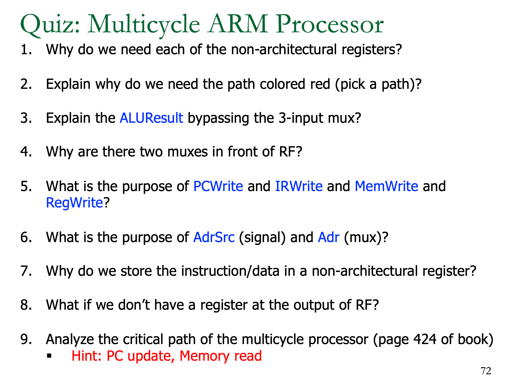

下面是逐题梳理（答案基于前面的推导）：

**1. 每个非架构寄存器为什么需要？**
见 §3 表格。一句话：内存和 ALU 被复用了，它们的输出只在本拍有效，**跨拍要用的值必须锁住**。

**2. 为什么需要某条（红色）路径？**
以 `Data → Result → WD3` 为例：LDR 读回的数据在 MemRead 那拍产生，但 RF 的写要等到 MemWB 那拍，所以必须经 Data 寄存器再绕回 RF 的写端口。

**3. `ALUResult` 为什么要绕过 ALUOut 直接进 3 输入 mux（ResultSrc=10）？**
因为 **PC+4（Fetch）和 BTA（Branch）必须在本拍结束时就写进 PC**。如果强制经过 ALUOut，就要额外多一拍。用一条直通路径把这一拍省掉。

**4. 为什么 RF 前面有两个 mux？**
就是 `RegSrc` 的两位：
- A1 前：正常取 `Rn`（`Instr[19:16]`），**分支时要取常数 15**（读 R15 = PC+8）
- A2 前：DP 取 `Rm`（`Instr[3:0]`），**STR 时要取 `Rd`（`Instr[15:12]`）**——因为 STR 要读出被存的值

**5. `PCWrite` / `IRWrite` / `MemWrite` / `RegWrite` 的作用？**
它们都是**写使能**。多周期的本质就是"**同一块硬件在不同周期做不同的事**"，所以每个状态元件都必须能被**逐拍精确控制何时写入**——不该写的周期必须保持原值。

**6. `AdrSrc`（信号）和 `Adr`（mux）的作用？**
唯一的内存既要取指又要访存：取指时地址 = `PC`（`AdrSrc=0`），访存时地址 = `Result`（= ALUOut，`AdrSrc=1`）。这个 mux 就是"合并两块内存"所付出的代价。

**7. 为什么要把指令/数据存进非架构寄存器？**
因为内存下一拍就要拿去干别的事，读出的值会消失。IR 锁住指令，让它在整条指令的生命周期里都能给控制单元和 RF 提供字段。

**8. 如果 RF 输出端没有寄存器（A / WriteData）会怎样？**
RF 的读端口在后续周期可能被改成读别的寄存器（比如分支时 A1 被改成 15），读出值会变；而且 RF 在 MemWB/ALUWB 那拍会被**写入**，可能正好覆盖掉还要用的源操作数。没有 A / WriteData 寄存器，源操作数会在用到之前就丢失。

**9. 关键路径分析（课本 p.424）**
提示说是两条候选路径：
- **PC 更新路径**：`A 寄存器 → ALUSrcA/B mux → ALU → ResultSrc mux → PC`
- **内存读路径**：`PC 寄存器 → Adr mux → Memory → IR/Data 寄存器`

```
Tc ≥ t_pcq + t_mux + max( t_ALU + t_mux , t_mem ) + t_setup
```
哪条更长取决于 `t_mem` 和 `t_ALU` 的相对大小 —— 内存通常是瓶颈。**具体系数以课本 p.424 为准。**

---

## 12. 控制器的另一种实现：微程序（Microprogramming）

前面的 FSM 是**硬连线（hardwired）**的：next-state logic 和输出逻辑都是组合电路。另一条路是把控制信号**当成数据存起来**。

### 12.1 微程序 ARM

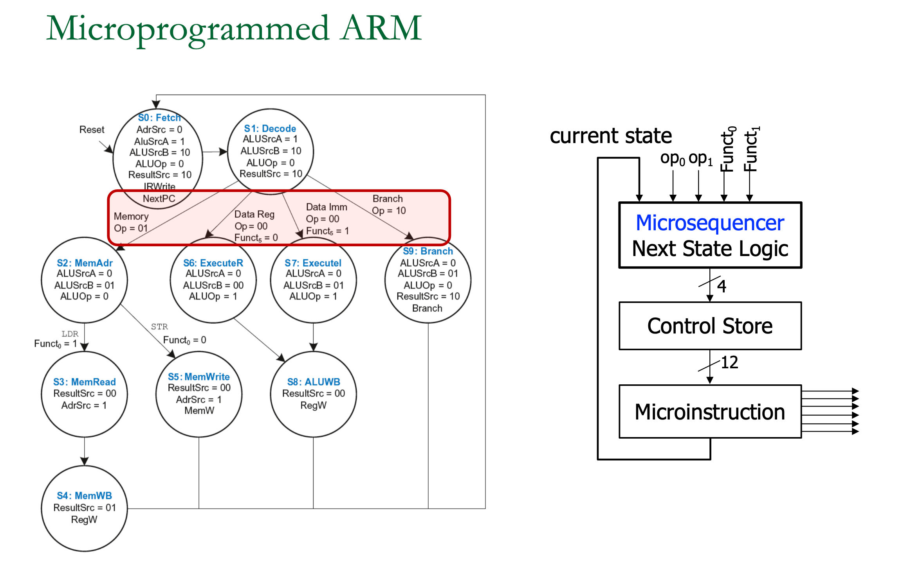

结构拆成三块：

| 部件 | 输入 | 输出 | 作用 |
|---|---|---|---|
| **Microsequencer**（Next State Logic） | `current state` + `op₀ op₁` + `Funct₀ Funct₁` | **4 bit** 下一状态地址 | 代替 FSM 图里**红框标出的那些转移箭头** |
| **Control Store** | 4 bit 地址 | **12 bit** 微指令 | 一张表：每个状态对应一行 |
| **Microinstruction** | — | 全部控制信号 | 直接驱动数据通路 |

- 地址 4 bit → 最多 16 个状态（我们只用了 10 个）
- 微指令 12 bit → 正好对应 12 条控制信号

### 12.2 Control Store 的内容

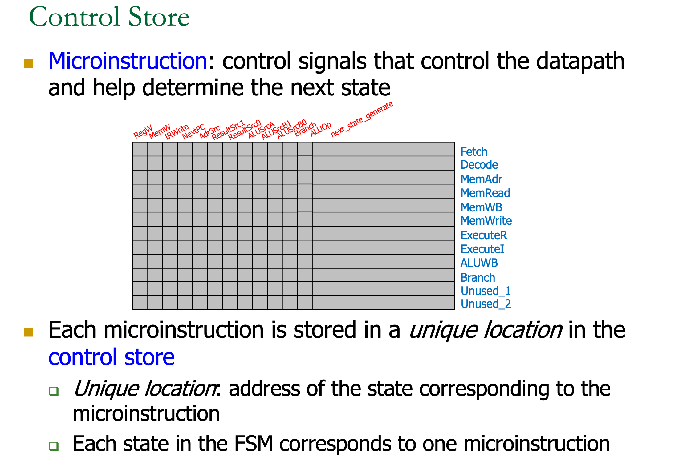

- **微指令（microinstruction）**：一组**控制数据通路**并**帮助决定下一状态**的控制信号
- 列（12 个信号 + 1 个下一状态字段）：
  `RegW`、`MemW`、`IRWrite`、`NextPC`、`AdrSrc`、`ResultSrc₁`、`ResultSrc₀`、`ALUSrcA`、`ALUSrcB₁`、`ALUSrcB₀`、`Branch`、`ALUOp`、`next_state_generate`
- 行（每个状态一行）：
  `Fetch`、`Decode`、`MemAdr`、`MemRead`、`MemWB`、`MemWrite`、`ExecuteR`、`ExecuteI`、`ALUWB`、`Branch`、`Unused_1`、`Unused_2`

> **⭐ 关键对应关系**：
> **FSM 的每一个状态 = Control Store 里的一条微指令**，存放在**以该状态编号为地址**的唯一位置。
> 于是"设计控制器"从**画电路**变成了**填一张表 / 写一段微程序**。

### 12.3 硬连线 vs 微程序

| | **硬连线 FSM** | **微程序** |
|---|---|---|
| 控制信号怎么来 | 组合逻辑现算 | 从 **Control Store（ROM/RAM）** 里读出来 |
| 改设计 | 重新做电路 | **改表**（甚至出厂后用 microcode update 打补丁） |
| 速度 | 快 | 多一次查表，稍慢 |
| 适合 | 指令少而规整的 **RISC** | 指令多而复杂的 **CISC**（x86 至今仍用微码） |

### 12.4 微程序如何改变语义鸿沟的权衡 ⭐

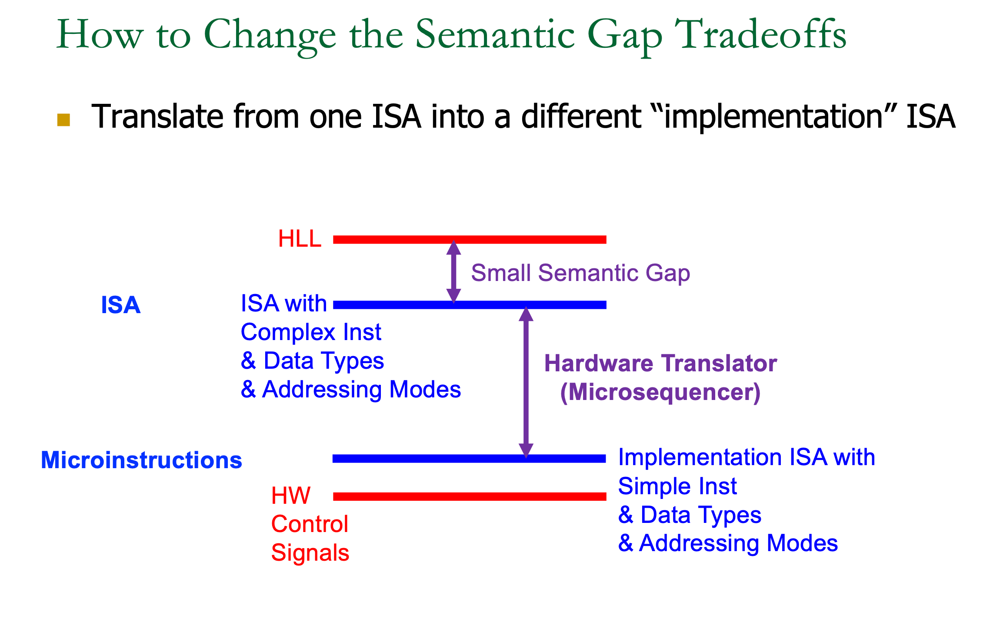

回顾 set4 的语义鸿沟：ISA 离 HLL 越近（复杂指令），硬件越难做；离硬件越近（简单指令），编译器越累。

**微程序给出的第三条路：把一个 ISA 翻译成另一个"实现 ISA"。**

```
HLL
 ↕  小语义鸿沟
ISA：复杂指令 + 复杂数据类型 + 复杂寻址模式   ← 程序员/编译器看到的
 ↕  Hardware Translator (Microsequencer)
Microinstructions：简单指令 + 简单数据类型 + 简单寻址模式   ← 硬件实际执行的
 ↕
HW Control Signals
```

- **对上**：暴露一个**贴近高级语言的复杂 ISA**（语义鸿沟小，编译器轻松，代码密度高）
- **对下**：硬件只需实现一套**简单的微操作**（电路好做、好验证）
- **中间**：用微序列器把一条复杂指令**展开成一串微指令**

> **这就是 CISC（如 x86）能一边保留几千条复杂指令、一边在内部用 RISC 风格执行单元的原因。**

---

## 13. 下一步：流水线（Pipelining）

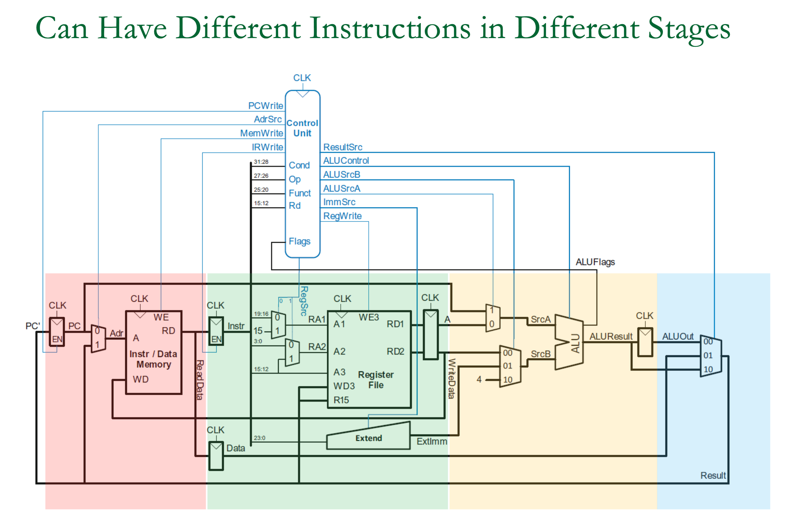

多周期已经把一条指令切成了若干**阶段**，但每一拍**只有一个阶段在工作**，其余硬件都在闲置。

自然的想法：**让不同的指令同时占据不同的阶段。**

图中数据通路被涂成四块：

| 颜色 | 阶段 | 硬件 |
|---|---|---|
| 🔴 红 | **Fetch** | PC、Adr mux、Instr/Data Memory |
| 🟢 绿 | **Decode / Register Read** | IR、RegSrc mux、Register File、Extend |
| 🟡 黄 | **Execute** | ALUSrcA/B mux、ALU、ALUOut |
| 🔵 蓝 | **Writeback / Result** | ResultSrc mux、Result 总线 |

- 当指令 1 在 Execute 时，指令 2 可以在 Decode，指令 3 可以在 Fetch
- 理想情况下 **CPI → 1，同时 Tc 仍然很短** —— 吞吐率大幅提升
- 代价：**冒险（hazards）** —— 数据相关、控制相关、结构相关（下个 set 的内容）

---

## 14. 本 set 必背清单

1. **多周期的动机**：复用硬件（一块内存、一个 ALU）+ Tc 由**最慢的一步**而非最慢的**一条指令**决定。
2. **五个非架构寄存器**：IR、Data、A、WriteData、ALUOut —— 以及每个为什么不可省。
3. **13 条控制信号**及其取值编码，特别是 `ResultSrc`（00=ALUOut / 01=Data / 10=ALUResult 直通）和 `ALUSrcB`（00=WriteData / 01=ExtImm / 10=4）。
4. **FSM 十个状态**、各自的控制信号、转移条件（Op / Funct₅ / Funct₀）。
5. **周期数**：LDR 5、STR 4、DP 4、B 3；`Execution time = N × CPI × Tc`。
6. **R15 的读写**：读 = PC+8（Decode 那拍用 ALU 算好送 R15 端口）；写 = 直接拉 `PCWrite`。
7. **微程序**：FSM 状态 ↔ Control Store 的一行微指令；Microsequencer = 下一状态逻辑。
8. **语义鸿沟**：微程序 = 硬件翻译器，让复杂 ISA 跑在简单硬件上。
