# COMP2300 Set 6 笔记 — 函数、栈、内存映射、异常与 I/O、功耗

> **课程**：ANU COMP2300 — Computer Organisation and Program Execution
> **讲师**：Shoaib Akram
> **本 set 主题一句话**：从「一条 BL 指令」出发，把软件抽象（函数、栈帧、调用约定、指针、堆）一路落到硬件机制（异常/中断、特权级、I/O 架构、DMA），最后用 Amdahl 定律和功耗公式回答「系统到底该往哪优化」。
> **页码**：统一以 `set6__后半部分_.pdf`（255 页，更新版）为准；它与旧版 `set6.pdf` 前 156 页相同，从 P157 起分叉（新增 micro:bit 异常机制 P157–168、EDP P230、chiplet P234、程序结构 / Flash vs SRAM / 局部性 / Cache P237–255）。PDF 页码 = 幻灯片右下角数字 + 1。

---

# 一、分支指令与 BTA 计算

## 1.1 Branch 指令格式（Format 3）

| 31:28 | 27:26 | 25:24 | 23:0 |
|---|---|---|---|
| `cond` | `op` | `1L` | `imm24` |

- `op = 10`（二进制），标识这是 branch 类指令
- bit[25:24] 构成 funct 字段，**bit 25 恒为 1**
- **L 位（bit 24）**：`L = 0` → `B`（普通分支）；`L = 1` → `BL`（Branch and Link，函数调用）
- `imm24`：24 位**有符号**立即数

## 1.2 BTA（Branch Target Address）计算 —— 必背三步

> **BTA = (SignExtend(imm24 << 2)) + PC + 8**

拆开就是幻灯片的三步：

1. `imm24` **左移 2 位**（把「字」换算成「字节」，因为 ARM 指令定长 4 字节）
2. **符号扩展**：把 `Instr[23]` 复制到 `Instr[31:24]`
3. **加 PC + 8**

**为什么是 +8 而不是 +4？** ARM 经典三级流水线取指时 PC 已经领先当前指令 2 条（2 × 4 = 8 字节）。这是硬件事实，不是约定，考试常考。

**例子（P6）**：`imm24 = 3` → 左移 2 位得 12（0x0C）→ PC = 0x80A0，PC+8 = 0x80A8 → BTA = 0x80A8 + 12 = 0x80B4，正好是 `THERE` 标号处。

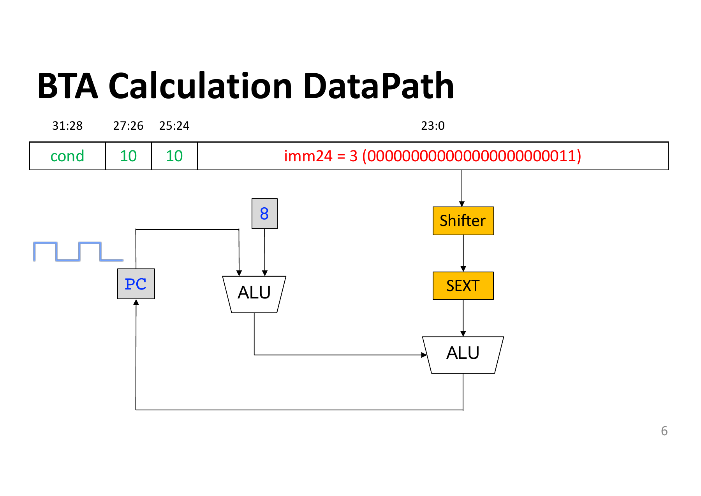

**PC-relative addressing mode**：给 PC 加一个偏移量来算目标地址。好处是代码**位置无关**（position independent），整段代码搬到内存别处也不用改。

---

# 二、函数（Functions）

## 2.1 概念层

- **函数 / procedure / subroutine**：写一次、被调用多次的程序片段
- **库（library）**：厂商或第三方提供的函数集合（如 math library 的 `sqrt`/`sin`/`cos`）
- **API（Application Programming Interface）**：在**源码层面**定义程序间通信的接口。**API 只定义接口，不定义实现**；同一 API 可有多种实现
- 函数带来的好处：抽象与模块化、代码复用、可读性、可测试性、可维护性

## 2.2 核心角色区分

| 术语 | 含义 |
|---|---|
| **Caller**（调用者） | 发起调用的一方，负责准备参数 |
| **Callee**（被调用者） | 被调用的一方，负责干活并返回结果 |
| **Leaf function** | 不再调用其他函数（如 `sum()`） |
| **Non-leaf function** | 内部还会调用别的函数（如 `main()`），汇编层复杂得多 |

⚠️ caller/callee 是**相对角色**，取决于上下文——`main` 被别人调用时它就是 callee。

## 2.3 函数执行的完整拆解（P21，背下来）

1. Caller 把参数放进寄存器或内存
2. **函数调用**：Caller 把控制流交给 callee
3. Callee 申请/分配工作所需内存
4. Callee 执行函数体
5. Callee 把结果放进「某个」寄存器
6. Callee 释放内存
7. **函数返回**：Callee 把控制权还给 caller

教授的比喻（P20）：函数像**间谍**——领任务、拿资源、干活、**不留痕迹**、安全返回。「不留痕迹」正是调用约定存在的理由。

## 2.4 ISA 对函数的支持

| ISA | 函数调用指令 |
|---|---|
| ARM | `BL` |
| MIPS | `jal` |
| RISC-V | `jal` |
| Intel x86 | `call` |
| **QuAC** | **无架构支持** |

**`BL LABEL` 做两件事**：
1. 跳转到 `LABEL`
2. 把**返回地址**（函数调用之后那条指令的地址）存入 **LR（Link Register，R14）**

**返回**：`MOV PC, LR`

## 2.5 ARM 寄存器约定（必背表）

| 名称 | 用途 |
|---|---|
| **R0** | 参数 0 / **返回值** / 临时变量 |
| **R1–R3** | 参数 1–3 / 临时变量 |
| **R4–R11** | Saved variables（被保存变量） |
| **R12** | 临时变量（IP） |
| **R13 (SP)** | Stack Pointer |
| **R14 (LR)** | Link Register |
| **R15 (PC)** | Program Counter |

**参数传递约定**：R0, R1, R2, R3（最多 4 个）；**返回值约定**：R0。

## 2.6 例子：DIFFOFSUMS（原始版，有问题）

```arm
; R4 = y
MAIN
  ...
  MOV R0, #2        ; argument 0 = 2
  MOV R1, #3        ; argument 1 = 3
  MOV R2, #4        ; argument 2 = 4
  MOV R3, #5        ; argument 3 = 5
  BL  DIFFOFSUMS    ; call function
  MOV R4, R0        ; y = returned value
  ...

; R4 = result
DIFFOFSUMS
  ADD R8, R0, R1    ; R8 = f + g
  ADD R9, R2, R3    ; R9 = h + i
  SUB R4, R8, R9    ; result = (f+g) - (h+i)
  MOV R0, R4        ; put return value in R0
  MOV PC, LR        ; return to caller
```

**两个遗留问题（P30）**：
1. 超过 4 个参数怎么传？
2. `DIFFOFSUMS` 覆盖了 R4、R8、R9，而 `MAIN` 里这些寄存器可能还是 **live** 的，怎么办？

**答案都是：栈（Stack）。**

## 2.7 Aside：寄存器复用与 liveness（易考概念）

- **Live register**：后续指令还会用到它当前的值
- **Dead register**：没有后续指令会用它的值，可以安全覆盖
- ⚠️ 精确说法：**死的是寄存器里的「值」，不是物理寄存器本身**

---

# 三、栈（Stack）

## 3.1 栈的用途（P32）

1. 保存/恢复寄存器
2. 传递额外参数（超过 4 个的部分）
3. 存放放不下寄存器的函数局部变量

## 3.2 实现栈需要什么

| 需求 | 硬件对应物 |
|---|---|
| 存数据的「一块内存」 | 数据内存（data memory） |
| 指向栈顶的「一个箭头」 | 一个寄存器（存放内存地址的指针）= **SP** |

> **Stack Pointer (SP)**：按约定专门用于存放栈顶地址的架构寄存器（ARM 中是 R13）。

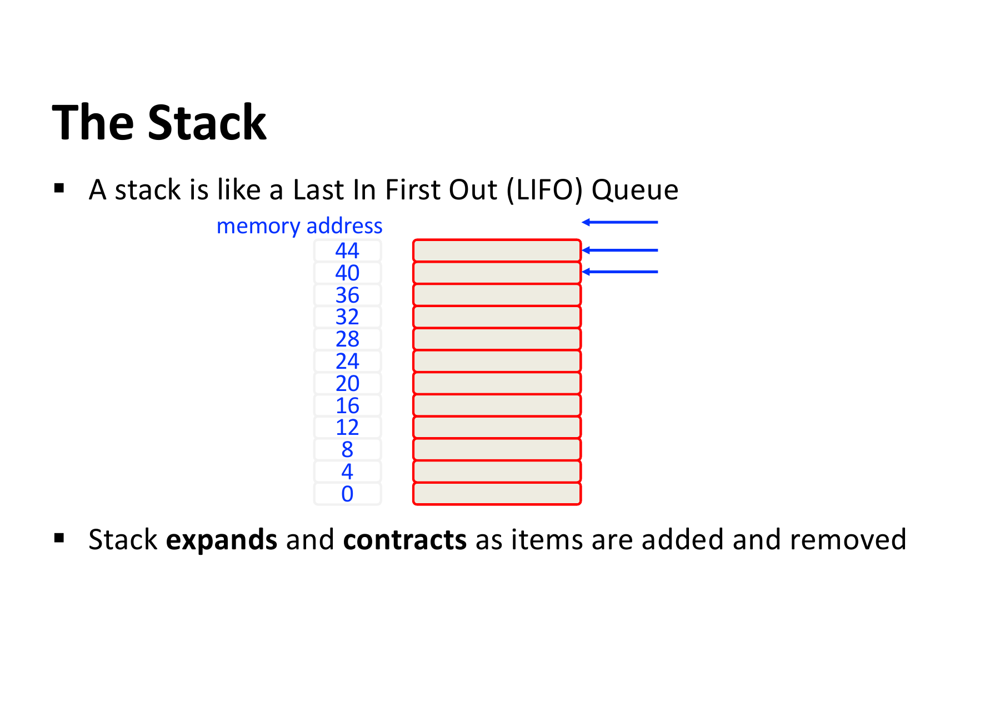

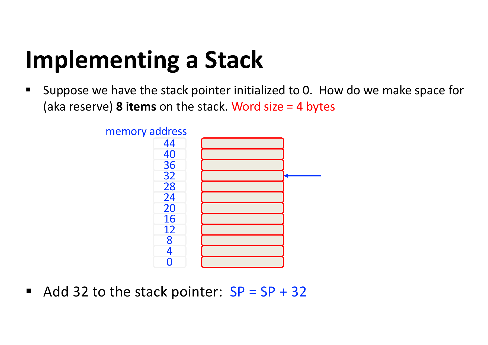

## 3.3 栈的四种分类 —— 核心考点

**两个正交维度：**

**维度一：增长方向**

| Descending Stack | Ascending Stack |
|---|---|
| 向**低地址**增长（向下） | 向**高地址**增长（向上） |
| SP 指向已用区域的**最低地址** | SP 指向已用区域的**最高地址** |

**维度二：SP 指向哪里**

| Full Stack | Empty Stack |
|---|---|
| SP 指向**最后一个已分配的位置**（即栈顶那个有效元素、最后一次 push 的位置） | SP 指向**栈顶再往外一格**（下一个将要写入的空位） |

组合出四种：**Full Descending (FD)** / Full Ascending (FA) / Empty Descending (ED) / Empty Ascending (EA)。

> ✅ **ARM 用的是 Full Descending（FD）**：栈向低地址增长，SP 指向最近一次 push 的那个元素。

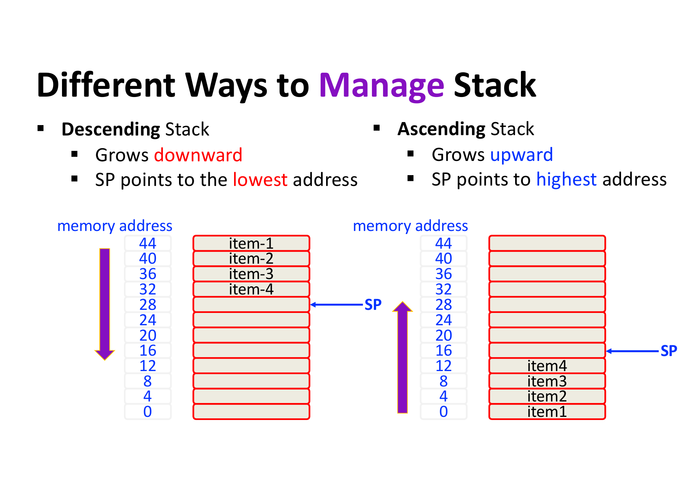

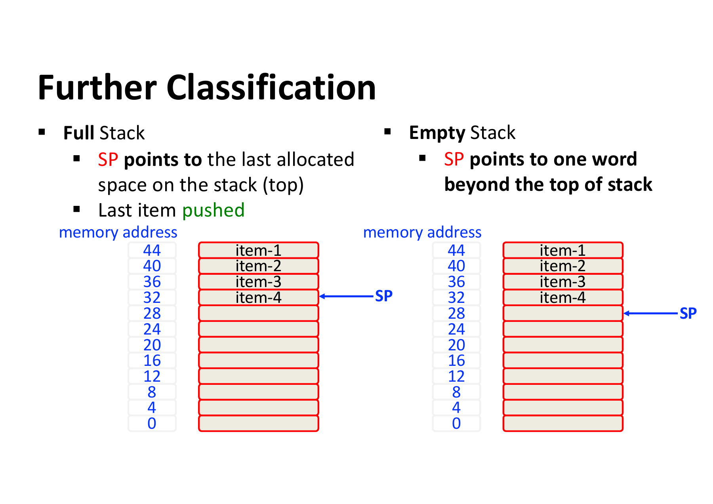

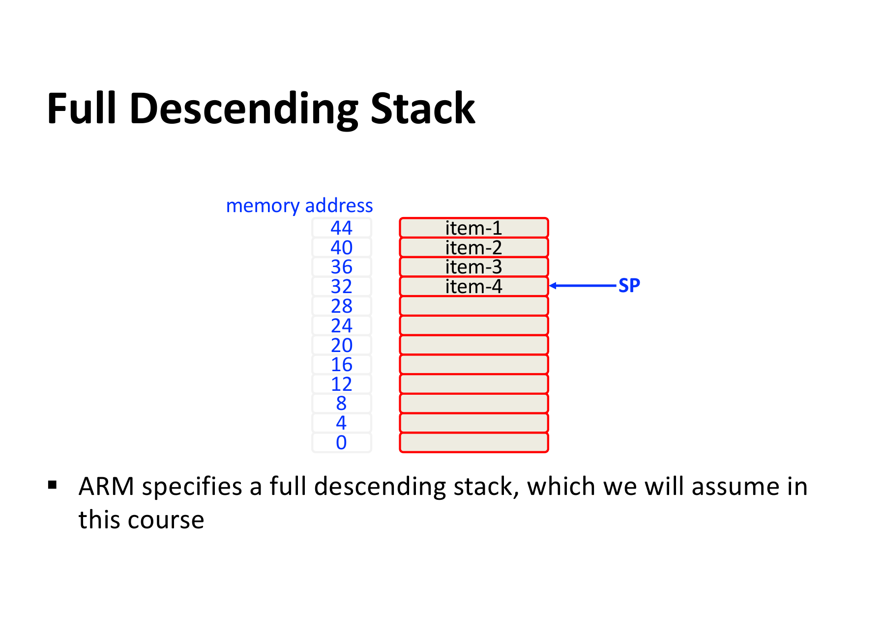

## 3.4 ⚠️ 幻灯片错误：push/pop 的 SP 方向反了

**P38 原文**：`push` → `SP = SP + 4`；`pop` → `SP - 4`
**P60 原文**：`PUSH {R4}` … *adds 4 to SP*；`POP {R4}` … *subtracts 4 from SP*

**这两处都写反了。** ARM 是 Full Descending：

| 操作 | 正确的 SP 变化 | 等价指令序列 |
|---|---|---|
| `PUSH {Rn}` | **SP = SP − 4** | `SUB SP, SP, #4` + `STR Rn, [SP]` |
| `POP {Rn}` | **SP = SP + 4** | `LDR Rn, [SP]` + `ADD SP, SP, #4` |

你在 P60 手写的「substract / add」批注是对的。P38 的说法只有在 ascending stack 下才成立，与后续所有 ARM 例子（P46–48、P51–54、P77–87）自相矛盾。**考试按 ARM 实际语义答：PUSH 减、POP 加。**

## 3.5 ARM 栈的实际行为

```
初始：  BEFFFAE8  AB000001   ← SP
push 0x12345678, push 0xFFFFDDCC 之后：
        BEFFFAE8  AB000001
        BEFFFAE4  12345678
        BEFFFAE0  FFFFDDCC   ← SP   (SP 减了 8)
```

⚠️ 关键理解（你在 P46 的批注是对的）：**SP 寄存器里存的是一个地址**（如 `0xBEFFFAE0`），要拿数据得再去读这个地址里的内容——SP 是指针，不是数据。

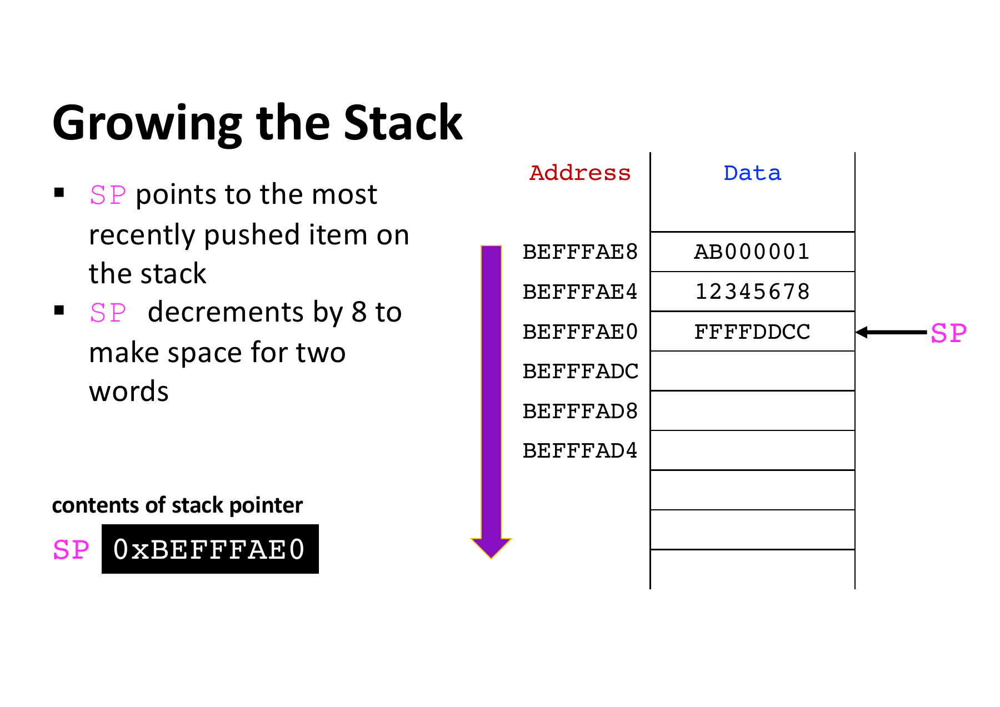

## 3.6 用栈保存/恢复寄存器：Improved DIFFOFSUMS

**四步套路（P50）**：分配空间（`SUB SP, SP, #12`）→ 存寄存器 → 执行函数体 → 恢复寄存器 → 释放空间（`ADD SP, SP, #12`）。

```arm
; R0 = result
DIFFOFSUMS
  SUB SP, SP, #12    ; 为 3 个寄存器在栈上开空间
  STR R9, [SP, #8]   ; save R9
  STR R8, [SP, #4]   ; save R8
  STR R4, [SP]       ; save R4
  ADD R8, R0, R1     ; R8 = f + g
  ADD R9, R2, R3     ; R9 = h + i
  SUB R4, R8, R9     ; result = (f+g) - (h+i)
  MOV R0, R4         ; 返回值放 R0
  LDR R4, [SP]       ; restore R4
  LDR R8, [SP, #4]   ; restore R8
  LDR R9, [SP, #8]   ; restore R9
  ADD SP, SP, #12    ; 释放栈空间
  MOV PC, LR         ; return
```

⚠️ **幻灯片小错**：P51 顶部注释写 `; R0 = result`，P52–54 变成 `; R2 = result`——同一段代码注释前后不一致，实际 result 先在 **R4**，再 `MOV R0, R4` 送到 R0。以 R4 → R0 为准。

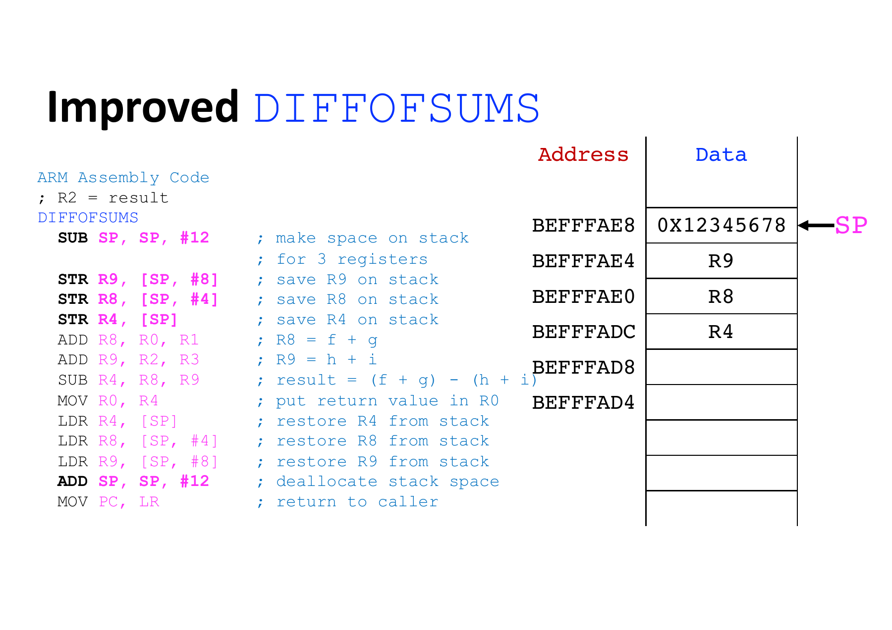

---

# 四、调用约定（Calling Convention）—— 本 set 最核心考点

## 4.1 为什么需要约定

保存函数用到的**每一个**寄存器是浪费的：`DIFFOFSUMS` 保存了 R4、R8、R9，但 caller 可能根本没在用 R8/R9。

> **Calling convention 是 caller 和 callee 都必须遵守的「合同」。**

有了它：不同程序员写的函数能互操作、不同编译器编译的函数能互操作、第三方库函数可以安全使用而不用担心参数/返回值错位导致状态被破坏。

## 4.2 Preserved vs Nonpreserved（必背表）

| **Preserved（callee-saved）** | **Nonpreserved（caller-saved）** |
|---|---|
| Saved registers: **R4 – R11** | Temporary register: **R12** |
| Stack pointer: **SP (R13)** | Argument registers: **R0 – R3** |
| Return address: **LR (R14)** | Current Program Status Register (CPSR) |
| **SP 以上**的栈空间 | **SP 以下**的栈空间 |

**定义**：
- **Preserved registers**：跨函数调用被保留。Caller 可以认为「这次调用从没发生过」。**由 callee 负责保存和恢复。**
- **Nonpreserved registers**：**由 caller 在调用前自行保存**，callee 没有保护它们的义务。

**两条推论（考点）**：
- **SP 以上的栈空间被保留**——前提是 callee 不去乱动 caller 的 stack frame
- **SP 本身被保留**——因为 caller 在返回前会释放自己用掉的栈空间

## 4.3 两条规则

- **Caller save rule**：Caller 必须在调用前保存**它在调用之后还要用的** nonpreserved 寄存器；调用返回后再恢复。
- **Callee save rule**：Callee 在动任何 preserved 寄存器之前必须先保存它们；返回前恢复。

## 4.4 PUSH / POP 多寄存器

```arm
PUSH {R4, R8, LR}
```

**顺序规则（易考）**：
- **编号最高的寄存器存在最高地址**（R13 侧）
- **编号最低的寄存器存在最低地址**
- 与花括号里写的顺序**无关**，硬件按寄存器编号排列

## 4.5 完整例子：F1 调用 F2

```arm
; ---------------- F1 ----------------
; R0=a, R1=b, R4=i, R5=x
F1
  PUSH {R4, R5, LR}   ; callee-save：R4/R5 是 preserved，LR 因为要再调用别人
  ADD  R5, R0, R1     ; x = (a+b)
  SUB  R12, R0, R1    ; temp = (a-b)      ← R12 是 nonpreserved，随便用
  MUL  R5, R5, R12    ; x = x*temp
  MOV  R4, #0         ; i = 0
FOR
  CMP  R4, R0         ; i < a?
  BGE  RETURN         ; no: exit loop
  PUSH {R0, R1}       ; caller-save：R0/R1 调用后还要用
  ADD  R0, R1, R4     ; arg = b+i
  BL   F2             ; call f2(b+i)
  ADD  R5, R5, R0     ; x = x + f2(b+i)
  POP  {R0, R1}       ; restore
  ADD  R4, R4, #1     ; i++
  B    FOR
RETURN
  MOV  R0, R5         ; return x
  POP  {R4, R5, LR}   ; restore
  MOV  PC, LR         ; return

; ---------------- F2 ----------------
; R0=p, R4=r
F2
  PUSH {R4}           ; callee-save
  ADD  R4, R0, 5      ; r = p+5
  ADD  R0, R4, R0     ; return r+p
  POP  {R4}
  MOV  PC, LR
```

**这段代码把两条规则同时演示了**：
- `PUSH {R4, R5, LR}` / `PUSH {R4}` → **callee save rule**（R4/R5 是 preserved）
- `PUSH {R0, R1}`（在 `BL F2` 前后）→ **caller save rule**（R0–R3 是 nonpreserved）
- `LR` 必须保存，因为 F1 是 **non-leaf**：`BL F2` 会覆盖 LR

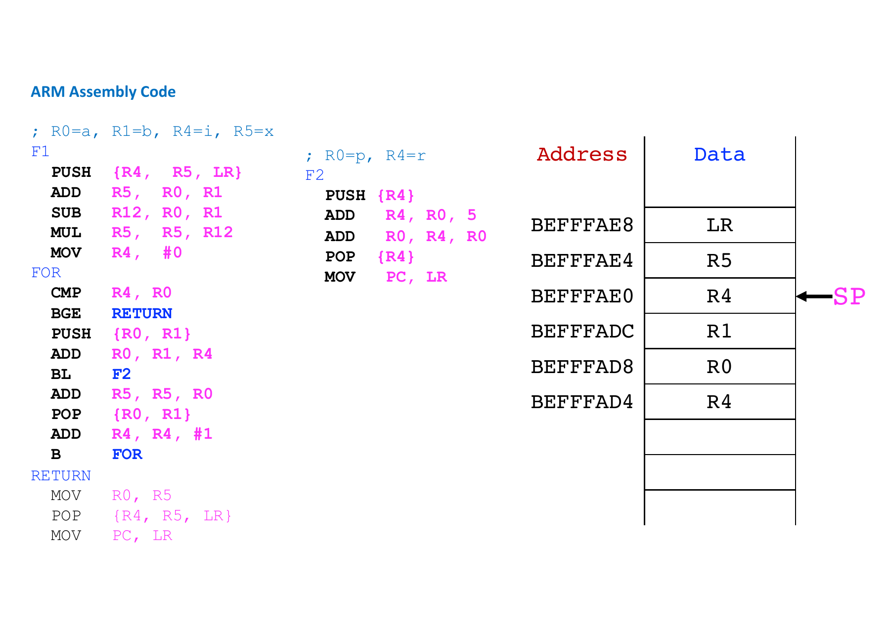

## 4.6 练习（P67）与答案

**题**：给出两个能减少上述程序栈空间占用、且不影响正确性的优化。

**答案（你的批注是对的）**：
1. **F1 中不必 push/pop R1**——callee F2 完全没用到 R1，R1 不会被破坏。
2. **F2 中用 R3 代替 R4**——R3 是 nonpreserved 且 caller F1 并未使用 R3，因此 F2 里就不用 `PUSH {R4}` / `POP {R4}` 了。

> 这道题的思路值得记：**优化的依据不是「哪些寄存器我用了」，而是「哪些寄存器的值在调用点是 live 的」+「约定里谁负责保存」**。

## 4.7 调用/返回总结（P74）

| Caller 做什么 | Callee 做什么 |
|---|---|
| 参数放入 R0–R3 | 保存可能被破坏的 preserved 寄存器（R4–R11, LR） |
| 保存需要的 nonpreserved 寄存器（R0–R3, R12） | 执行函数体 |
| `BL CALLEE` | 结果放入 R0 |
| 恢复寄存器 | 恢复寄存器 |
| 从 R0 取结果 | `MOV PC, LR` 返回 |

---

# 五、栈帧（Stack Frame）与调用栈

## 5.1 定义

- **Stack frame（栈帧）**：一个函数在栈上分配的那块空间。也叫 **activation record（活动记录）**。
- **函数的执行环境（execution environment）**：PC + stack frame + preserved registers。
  - Caller 的执行环境必须在**调用与返回之间被保留**
  - Callee 的执行环境必须被**建立起来**
- 程序运行时有很多活跃栈帧，它们合起来叫 **call stack（调用栈）**。

**call stack 的一堆别名**（P73，考试可能换词考你）：Execution Stack / Program Stack / Run-time Stack / Control Stack / Machine Stack / Activation Stack。

**通用栈帧布局（P71，自顶向下）**：返回值 → 参数 → 指向前一帧的链接 → 保存的机器状态 → 局部数据 → 临时变量。

⚠️ **重要提醒（P71）**：**栈不是硬件部件**。我们只是在内存里划出一块区域，然后「把它当成栈来用」。调用栈的精确形态和布局**取决于编译器和架构**。

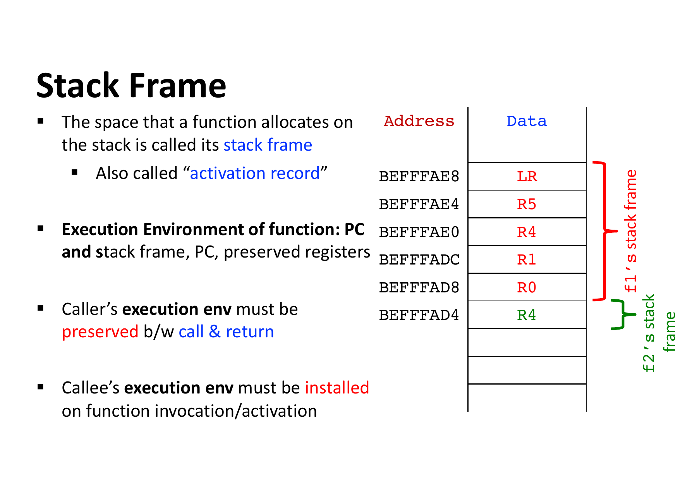

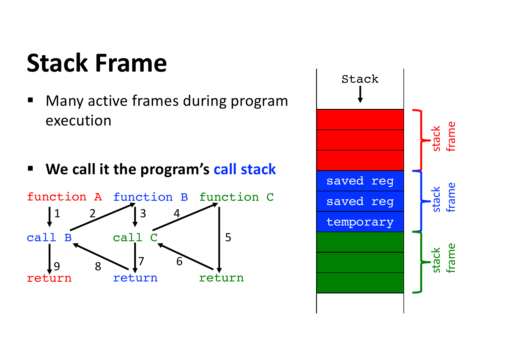

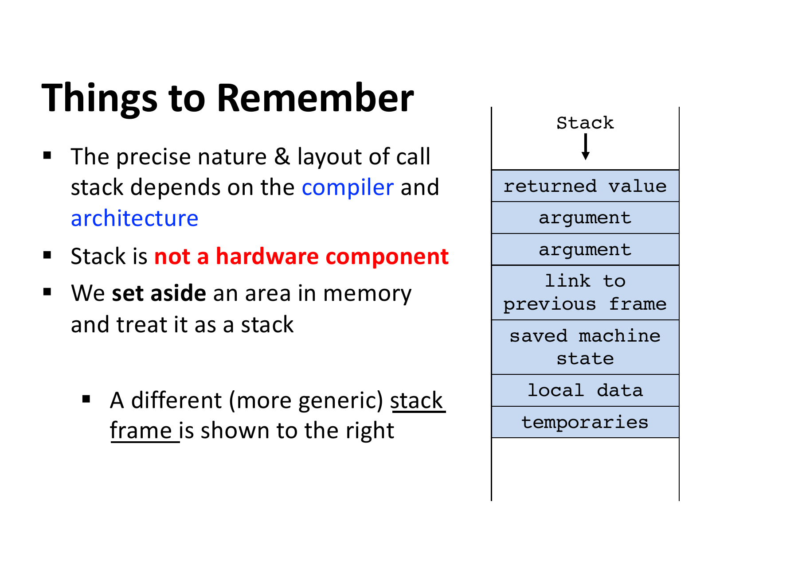

## 5.2 ABI（Application Binary Interface）

> **调用约定不属于 ISA**，它属于过程调用接口。这类内容合起来叫 **ABI（应用二进制接口）**。

这是个高频概念辨析题：**ISA 是硬件契约，ABI 是软件契约（谁保存哪个寄存器、参数怎么排、栈怎么对齐）**。换编译器/操作系统 ABI 可能变，ISA 不变。

## 5.3 超过 4 个参数 / 局部变量与数组

- 参数多于 4 个时，**caller 扩展自己的栈**放额外参数；**callee 到 caller 的栈里去取**。
  - ⚠️ 这是「callee 不得访问 caller 栈空间」这条规则的**唯一例外**。
- 局部变量只在函数内可见（**stack-resident**）。放不下 R4–R11 的局部变量存进 **callee 自己的栈帧**。
- **局部数组一律放栈上**（寄存器装不下）。

---

# 六、递归（Recursion）

## 6.1 factorial 的汇编实现

```arm
0x8500 FACTORIAL  PUSH {R0, LR}    ; 把 n 和 LR 压栈
0x8504            CMP  R0, #1      ; R0 <= 1?
0x8508            BGT  ELSE        ; no: 跳到 else
0x850C            MOV  R0, #1      ; 否则返回 1
0x8510            ADD  SP, SP, #8  ; 恢复 SP（丢弃刚压的两个字）
0x8514            MOV  PC, LR      ; return
0x8518 ELSE       SUB  R0, R0, #1  ; n = n - 1
0x851C            BL   FACTORIAL   ; 递归调用（LR ← 0x8520）
0x8520            POP  {R1, LR}    ; 弹出 n 到 R1，弹出 LR
0x8524            MUL  R0, R1, R0  ; R0 = n * factorial(n-1)
0x8528            MOV  PC, LR      ; return
```

## 6.2 逐条要点（P89，必看）

- `factorial` 按 **callee save rule** 保存 **LR**（它是 non-leaf，`BL` 会覆盖 LR）
- `factorial` 按 **caller save rule** 保存 **R0**——因为调用自身之后还要用 `n`
- 若 `n ≤ 1`：把结果 1 放 R0 直接返回。**不需要恢复 LR**，因为这条路径上 LR 没被改动（只需 `ADD SP, SP, #8` 把栈平掉）
- 恢复 n 时用的是 **R1 而不是 R0**——避免覆盖掉返回值
- `MUL R0, R1, R0`：n（在 R1）× 返回值（在 R0）→ 结果进 R0

> ⚠️ **递归函数既是 caller 又是 callee**，所以两条规则同时适用。这是理解这段代码的钥匙。

## 6.3 factorial(3) 栈变化

| 阶段 | 栈内容（高地址在上） |
|---|---|
| 进入 factorial(3) | `BEFFFAE8: LR(0x1000)` / `BEFFFAE4: R0(3)` ← SP |
| 进入 factorial(2) | 再压 `BEFFFAE0: LR(0x8520)` / `BEFFFADC: R0(2)` ← SP |
| 进入 factorial(1) | 再压 `BEFFFAD8: LR(0x8520)` / `BEFFFAD4: R0(1)` ← SP（**最深**） |
| 逐层返回 | R0 = 1 → 2×1=2 → 3×2=**6**，SP 逐层升回 |

注意 **第二层及以后保存的 LR 都是 0x8520**（递归调用点的下一条指令），只有最外层是真正的调用者地址 0x1000。

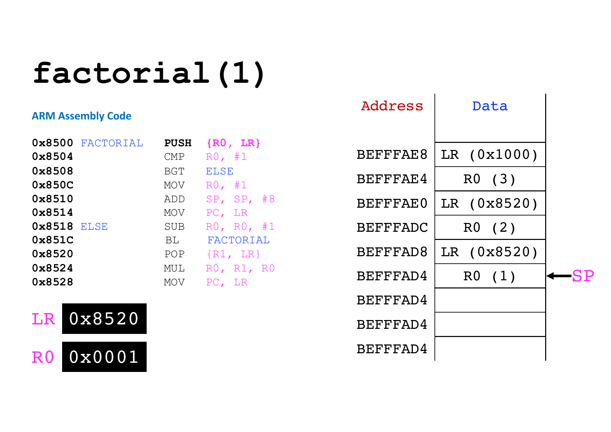

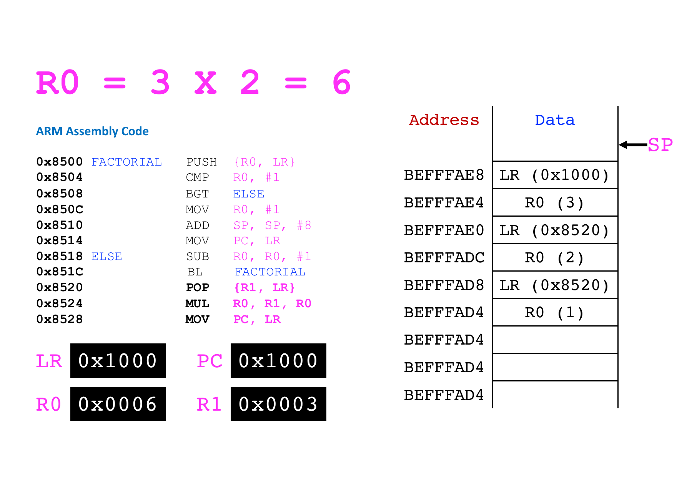

## 6.4 递归 vs 迭代（易考对比）

- **任何递归解法都存在等价的迭代解法**（数学上成立的命题）
- **递归的开销**：
  - **CPU 侧**：函数调用带来额外的分支指令
  - **内存侧**：每层栈帧额外消耗内存
- 但在很多领域便利性值得这个代价：神经网络、数据结构、递归下降解析器
- **练习**：用迭代写一遍 `factorial(int n)`，对比指令数与栈占用

---

# 七、字面量加载与参数传递方式

## 7.1 Loading Literals（字面量池）

**问题**：程序需要加载 32 位字面量（常量或地址），但每条指令只有 32 位，`MOV` 只能带 **12 位**常量。

**解法**：用 `LDR` 从 **literal pool** 里读。

```arm
LDR Rd, =literal    ; 加载常量
LDR Rd, =label      ; 加载地址
```

- **Literal pool** 是 **text 段**中存放字面量的一块区域
- ⚠️ **约束**：literal pool 必须距离该 `LDR` 指令 **小于 4096 字节**，才能用基址寻址完成加载
- ⚠️ 系统软件（汇编器、编译器）必须**保证 PC 不会意外指向 literal pool 内部**——否则会把数据当指令执行

## 7.2 Call by Value vs Call by Reference

| | **Call by Value（传值）** | **Call by Reference（传引用/传地址）** |
|---|---|---|
| 传的是 | 值的**拷贝**（放寄存器或栈上） | 参数的**地址** |
| 优点 | **信息隐藏、安全**——callee 对参数的操作不影响 caller 活动帧里的值 | 调用开销低、内存占用低 |
| 缺点 | 大对象拷贝耗内存 | **callee 能改 caller 的数据**，后果可能很严重 |
| 语言 | C/C++ 默认；**Java 唯一方式** | C/C++ 通过指针 |

**汇编对照（P99–101）**：

```arm
; ---- Call by Value：用寄存器 ----
        .data
record: .word 100, 200
        LDR R2, =record
        LDR R0, [R2]        ; 把「值」取出来
        LDR R1, [R2, #4]
        BL  CALLEE
CALLEE: ADD R0, #16         ; 改的是拷贝，caller 的 record 不变

; ---- Call by Value：用栈 ----
        LDR R2, =record     ; 地址被「藏」起来，不传给 callee
        LDR R0, [R2]
        LDR R1, [R2, #4]
        PUSH {R0, R1}
        BL  CALLEE
CALLEE: POP {R0, R1}
        ADD R0, #16

; ---- Call by Reference ----
        LDR R2, =record     ; 只传地址
        BL  CALLEE
CALLEE: LDR R0, [R2]        ; callee 自己去解引用
        ADD R0, #16         ; 可以直接改 caller 的数据
```

⚠️ 注意第二个例子里 `PUSH {R0, R1}` / `POP {R0, R1}` 的搭配——R0–R3 是 caller-save，这里是把值经由栈交给 callee，**关键点在于 callee 拿不到 `record` 的地址**，安全性由此而来。

## 7.3 高级语言中的引用

| | C / C++ | Java |
|---|---|---|
| 有无地址数据类型 | **有**（指针） | **无** |
| 参数传递 | 传值 + 指针传引用 | **只有传值** |
| 地址操作 | 程序员直接做 | 由 **JVM（Java Virtual Machine）运行时**处理，应用代码永不接触内存地址 |
| 后果 | 高性能、能直接对接设备；但**内存安全漏洞的主要来源** | 安全，但有运行时开销 |

**Managed languages（托管语言）**：Java、Python、Scala、Ruby——内存由运行时代管。

**软件栈对比（P104）**：

| C 环境 | Java 环境 |
|---|---|
| User Code | User Code |
| C Library | **Managed Runtime（JVM）** |
| Operating System | C Library |
| Hardware Resources | Operating System |
| | Hardware Resources |

## 7.4 指针（Pointers in C/C++）

- **指针是一个变量，它的内容是另一个变量的地址**
- `&`：取地址（unary operator）
- `*`：解引用 / 间接寻址（dereferencing / indirection operator）

```c
int A = 19;   // addr 0x00000000
int B = 10;   // addr 0x00000004
int C = 8;    // addr 0x00000008
int D = 17;   // addr 0x0000000C
int *P = &B;  // addr 0x00000010，内容 = 0x00000004
*P = 1;       // B 变成 1
```

**关键性质**：
- 指针大小：32 位系统 **4 字节**，64 位系统 **8 字节**
- 指针可存在栈上或数据段，和普通变量一样
- **指针戴着「数据类型的眼镜」**：`int *P` 和 `char *Q` 即使指向同一地址，解引用出来的解读也不同（4 字节整数 vs 1 字节字符）

**The Good**：内存高效；底层代码需要访问具体地址；设备被暴露为内存地址（**memory-mapped I/O**）；程序员对内存有「无限权力」。

**The Ugly**：
- 操作值出 bug → 结果错误（有时可容忍）
- C 允许**指针算术**
- 操作**地址**出 bug → 严重安全问题（访问违规、状态损坏）
- C 要求程序员手动 `free` → **内存泄漏**

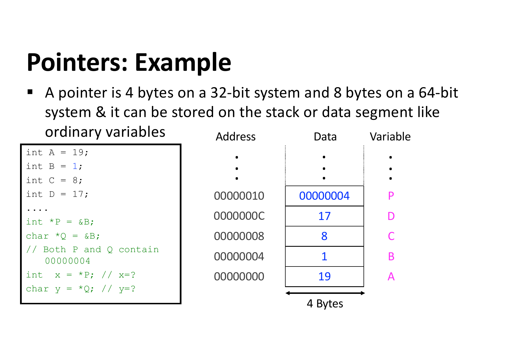

---

# 八、内存映射（Memory Map）

## 8.1 地址空间

- 32 位 ARM CPU 生成的地址范围：**0 到 0xFFFFFFFC**（4,294,967,292）
- 地址空间大小 = **2³² 字节 = 4 GB**，可寻址 40 亿个独立字节
- 每个字 32 位 = 4 字节
- ⚠️ 32 位 ARM 常以**字**为单位访问内存，因此很多指令（如 `LDR`）要求**地址是 4 的倍数**（对齐要求）

> **Memory map（内存映射）**定义了代码、数据、栈在程序地址空间中的位置。**不同架构不同**。

## 8.2 ARM 32 位内存映射：五个段

从高地址到低地址：

| 段 | 内容 | 关键地址 / 指针 |
|---|---|---|
| **Operating System & I/O** | 操作系统与 I/O 设备 | 顶部到 0xC0000000 |
| **Stack** | 栈，**向下增长** | 起点约 0xBEFFFAE8，**SP** 指向此 |
| **Dynamic Data** | 动态数据区（Stack ↓ 和 Heap ↑ 在这里相向而行） | |
| **Heap** | 运行时由程序分配（`malloc()` / `new`），**向上增长** | |
| **Global Data** | 全局变量（对所有函数可见，与只对单个函数可见的局部变量相对） | **R9 = SB（Static Base Pointer）** 指向此 |
| **Text** | 机器语言程序。也叫 **read-only (RO) 段**。字面量（如 `"Hello"`）也在这 | 起点 0x00008000 |
| **Exception Handlers** | 异常处理程序 | 0x00000000 – 0x00008000，**PC 上电时指向 0x00000000** |

> ✅ **必记**：**Heap 向上长，Stack 向下长**，它们共享中间的 Dynamic Data 区域。两者撞上就是 stack/heap overflow。

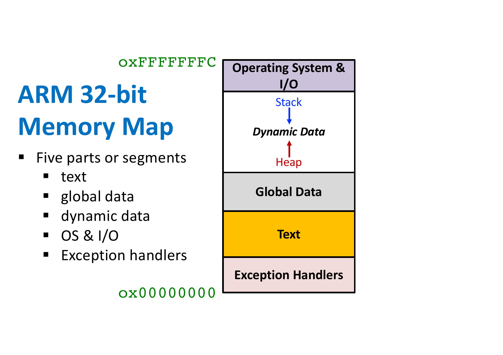

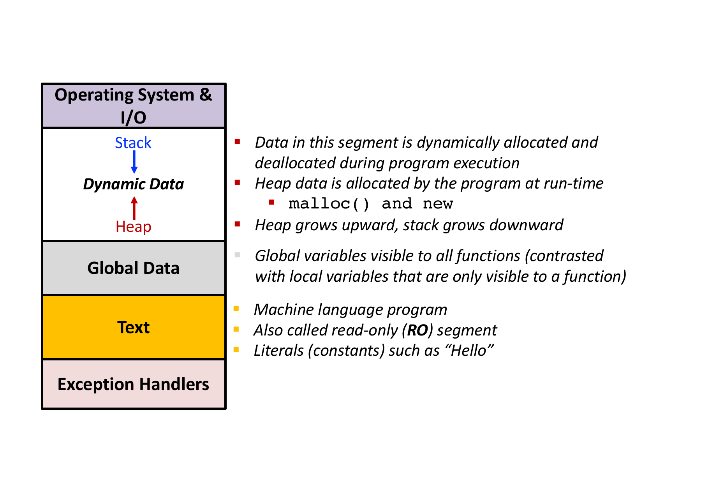

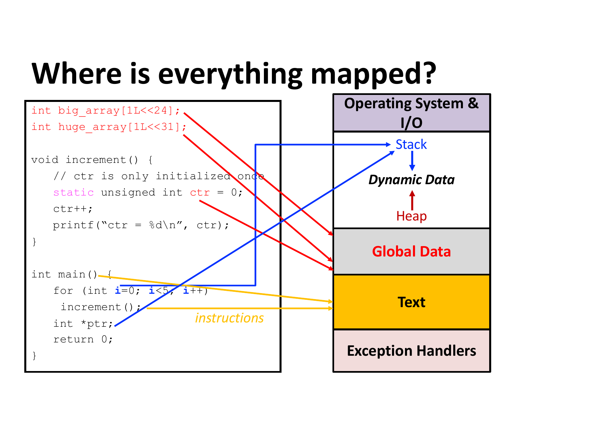

**P142 的对照关系（自己先做一遍再对答案）**：
- `int big_array[1L<<24]` / `int huge_array[1L<<31]` → **Global Data**
- `static unsigned int ctr` → **Global Data**（static 变量存活于整个程序期）
- `int i`（`main` 的循环变量）、`int *ptr`（指针变量本身）→ **Stack**
- `malloc` 出来的东西 → **Heap**
- 所有函数的指令 → **Text**

## 8.3 虚拟内存（Virtual Memory）

**问题**：物理内存不足 4 GB 怎么办？

**桌面/高性能计算机使用虚拟内存**：

- 地址空间是**虚拟的**（virtual addresses），由**操作系统**管理
- **MMU（Memory Management Unit）**（在 CPU 上）+ OS 完成虚拟→物理地址翻译
- 4 GB 地址空间被划分为 **4 KB 的页（page）**
- 每个虚拟页有 **virtual page number**，对应一个 **physical page number**
- ⚠️ **不是一一对应**——OS 可以自由选择映射
- OS 把映射记录在 **page table（页表）** 中（key = 虚拟页号，value = 页的位置）
- MMU **walk page table** 得到物理地址
- 物理内存不够时，OS 把虚拟页换到磁盘上的 **swap space**，页表记录它在内存还是磁盘

**虚拟内存的三大好处**：
1. **内存扩展**——用大容量磁盘扩充
2. **内存保护**——MMU 可对受保护地址或无权限访问抛出 protection fault
3. **内存共享**——每个用户/程序有自己的 4 GB 虚拟映射和页表

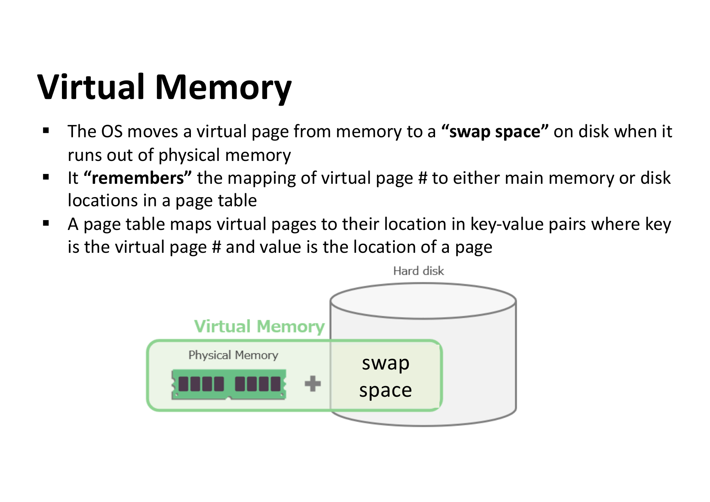

## 8.4 micro:bit 的对照（考试易混）

| | 桌面/服务器 | **micro:bit** |
|---|---|---|
| 虚拟内存 | 有 | **无——所有地址都是物理地址** |
| 内存映射 | OS 管理，灵活 | **硬件定义的固定内存映射** |
| 代码/数据位置 | 由 OS/加载器决定 | 位于**预先确定的物理地址** |
| 外设 | 通过驱动 | **memory-mapped 到特定地址范围** |

---

# 九、程序的翻译与启动、静态 vs 动态、堆

## 9.1 翻译与启动流程（P124）

```
High level code
    ↓ Compiler
Assembly code
    ↓ Assembler            ┐
Object file                ├─ 编译期（Compile time / Static）
    ↓ Linker  ← Object files, Library files
Executable                 ┘
    ↓ Loader               ┐
Memory                     ┴─ 运行期（Run-time / Execution time / Dynamic）
```

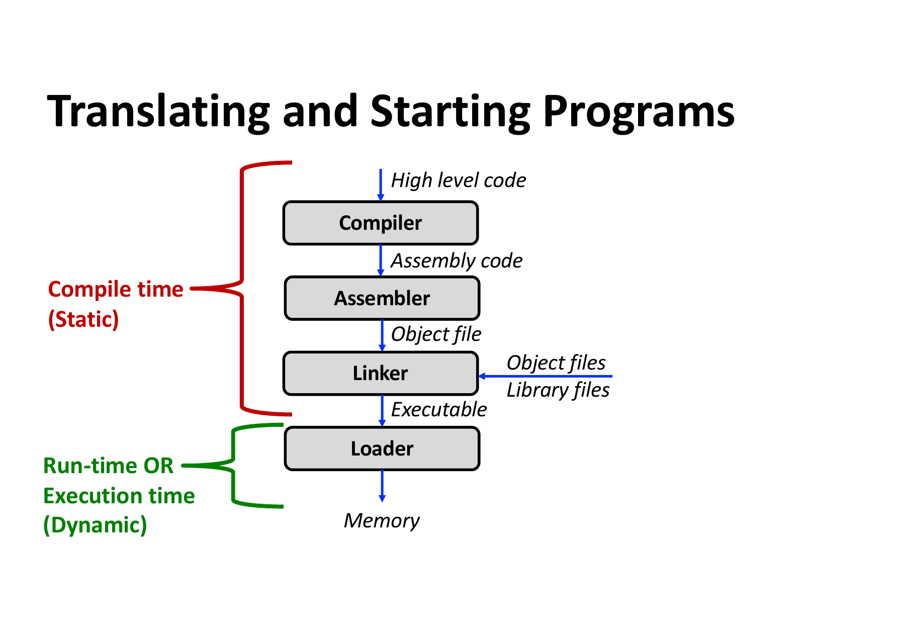

## 9.2 Static vs Dynamic（术语辨析，考点）

| **Static（静态）** | **Dynamic（动态）** |
|---|---|
| 程序被**编译时** | 程序**执行时** |
| At **compile time** | At **run-time** |

程序的某些行为在**静态**就已知，另一些只能在**运行时**才知道。

## 9.3 三种内存分配对比（核心表）

| | **静态分配** | **栈分配** | **堆分配** |
|---|---|---|---|
| 典型内容 | 全局变量、`static` 变量 | 函数局部变量、局部数组 | `malloc` / `new` 出来的对象 |
| 大小何时确定 | **编译期固定** | 进入函数时确定 | **运行时确定，可变** |
| 位置 | Global Data 段 | Stack 段 | Heap 段 |
| 生命期 | **静态**：整个程序 / 整个函数执行期 | **自动**：函数退出即释放 | **动态**：从 allocate 到 deallocate |
| 释放方式 | 无需 | 自动（严格 LIFO） | **手动 `free`（C）或 GC（Java/Python）** |

> 栈分配也叫 **automatically allocated memory（自动分配内存）**——生命期由函数执行自动决定。

## 9.4 为什么需要堆

1. 有时需要变量/数组**活得比函数更久**
2. 有时空间大小**编译期未知**或需要**动态调整**
3. 释放顺序**任意**（不像栈必须 LIFO）

**Heap 是一大块可细分的内存**。C 中程序员显式分配和释放；一段叫 **dynamic memory allocator** 的代码负责在堆上找空闲空间。

## 9.5 释放与内存泄漏

- 释放内存也叫 **freeing memory**
- **DRAM 是有限资源**；程序在 CPU 眼里运行「很久」（1 秒 = 20 亿个周期）
- 不再需要的已分配内存变成 **garbage（垃圾）**，必须回收再利用
  - 栈空间在函数返回时自动回收
- ⚠️ **Memory leak（内存泄漏）**：不把不用的堆内存还给内存管理器 → 堆一直是满的，即使逻辑上有空闲空间

## 9.6 内存管理器

| 语言 | 分配 | 释放 |
|---|---|---|
| C / C++ | `malloc` / `new` | **手动 `free` / `delete`** |
| Java / Python | 同 C | **自动——Garbage Collector（垃圾回收器）** |

```c
void *malloc(size_t size);   // 输入字节数，返回 void*（可转成任意指针类型）
void  free(void *ptr);       // 只需起始地址，内存管理器自己知道要释放多少字节
```

```c
#include <stdlib.h>
#include <stdio.h>
void useless_func() {
    int *array = malloc(10 * sizeof(int));
    for (int i = 0; i < 10; i++)
        array[i] = i * i;
    int sum = array[0] + array[9];
    free(array);                      // ← 忘了这行就是内存泄漏
    printf("%i\n", sum);
    return;
}
```

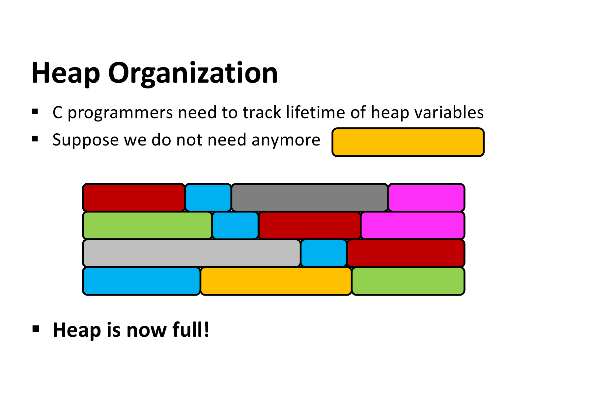

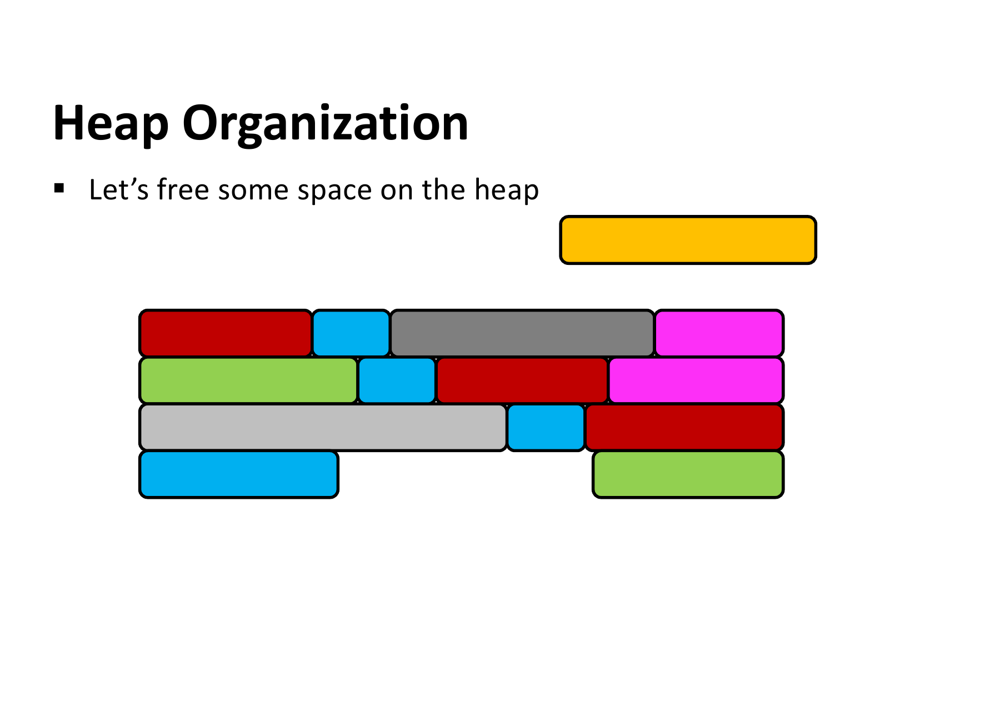

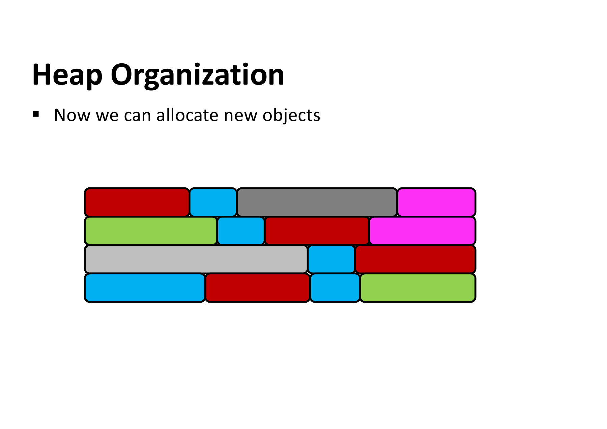

**注**：P143 提到这部分内容 COMP2310 会深入（手写内存管理器 + 数据库应用，用 C，手动内存管理十二周）。

---

# 十、异常（Exceptions）

> 教材：H&H **Section 6.6.3**

## 10.1 控制流为什么会改变

**已学的（源于「程序状态」变化）**：
- 无条件分支、条件分支
- 函数调用与返回（本质也是分支）

**新的（源于「系统状态」变化）**：一个有用的系统必须能因**系统状态**变化而改变控制流（计算机系统 = 硬件 + 软件）。

> **Event（事件）**：状态的改变。这些是**「计划外」**的事件。
> **Exception（异常）**：像一次**未经安排的函数调用**，跳转到一个新地址。可由硬件或软件引起。

典型例子：除零（无法继续执行）、I/O 设备到达数据（键盘、磁盘）、I/O 设备需要服务、系统定时器到期。

## 10.2 异常分类（核心表，必背）

| 类别 | 同步性 | 来源 | 是否有意 | 可否恢复 | 例子 |
|---|---|---|---|---|---|
| **Interrupt（中断）** | **异步（asynchronous）** | 硬件 / I/O 设备 | — | 是 | 按键盘、定时器到期、断电、machine check（硬件错误 / bit flip） |
| **Trap（陷阱）** | **同步（synchronous）** | 执行指令 | **有意** | 是 | **system call 指令（`SVC`）** |
| **Fault（故障）** | 同步 | 执行指令 | 无意 | **可能可恢复** | **除零** |
| **Abort（中止）** | 同步 | 执行指令 | 无意 | **不可恢复** | **未定义 opcode** |

> **记忆钥匙**：
> **同步 = 由指令执行引起**（trap / fault / abort）；**异步 = 由外部设备引起**（interrupt）。
> **有意 = trap**；**无意可恢复 = fault**；**无意不可恢复 = abort**。

## 10.3 System Call 与特权级

- **System call** 是一种 trap，程序用它来调用**操作系统**中的函数
- 该函数运行在**更高的特权级（privilege level）**，可以访问所有系统资源
- 用户/应用代码运行在**较低特权级**

**为什么要分特权级**：防止
1. 有 bug 的用户代码破坏其他程序
2. 系统崩溃
3. 恶意代码接管系统

> OS 对系统有完全控制权，普通用户代码没有。

## 10.4 CPU 处理异常的四步

1. **停止**当前程序
2. **保存架构状态**
3. **处理**异常/中断 → 切换到 handler
4. 若可能且有意义，**返回**程序继续执行

## 10.5 何时处理（考点）

| | 来源 | 何时处理 |
|---|---|---|
| **Software exception（内部）** | internal | **检测到就处理** |
| **Hardware exception（外部）** | external | **方便的时候处理** |

**例外**：极高优先级或**不可屏蔽（non-maskable）**的异常必须立刻处理（如**断电**）。

多个中断同时到来时：用户可定义中断的**优先级**，并有**中断类别（interrupt classes）**。

## 10.6 异常向量表（Exception Vector Table）

- 异常通过**向量表**决定跳到哪个 handler
- 表放在**低地址内存**（回忆内存映射的 Exception Handlers 段）
- 处理中断的指令位于 **0x00000018**
- **上电时 CPU 转到地址 0x00000000**
- 向量表中每一项是一条**分支指令**，跳到真正的 handler；handler 处理完返回用户代码
- 每类事件有唯一的**异常号 k**，k 就是**表的索引**；异常 k 发生时调用 handler k

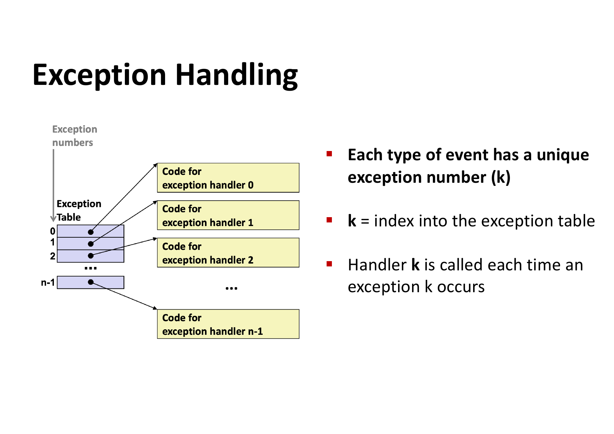

---

## 10.7 【Cortex-A / ARMv7 路线】执行模式与 banked registers

> ⚠️ 这一段（P163–175）讲的是 **v7 / Cortex-A** 的经典机制，与下一段 micro:bit（Cortex-M）**不是同一套**。考试要分清问的是哪一套。

**ARM Execution Modes**：
- ARM 处理器可运行在多种执行模式，各有不同特权级
- 模式记录在 **CPSR 的低位（CPSR[4:0]）**
- **User mode = PL0**；其他模式 = **PL1**，可访问所有系统资源
- 执行模式帮助 CPU 做记账：保存哪些寄存器？用哪个栈帧？如何返回程序？

**ARM 执行模式表（Table 6.13）**：

| Mode | CPSR[4:0] |
|---|---|
| User | `10000` |
| Supervisor | `10011` |
| Abort | `10111` |
| Undefined | `11011` |
| Interrupt (IRQ) | `10010` |
| Fast Interrupt (FIQ) | `10001` |

**异常向量表（Table 6.14）**：

| Exception | Address | Mode |
|---|---|---|
| Reset | `0x00` | Supervisor |
| Undefined Instruction | `0x04` | Undefined |
| Supervisor Call | `0x08` | Supervisor |
| Prefetch Abort（取指错误） | `0x0C` | Abort |
| Data Abort（load/store 错误） | `0x10` | Abort |
| Reserved | `0x14` | N/A |
| Interrupt | `0x18` | IRQ |
| Fast Interrupt | `0x1C` | FIQ |

**Banked Registers（影子寄存器）**：

- 异常 handler 像一次普通函数调用：需要知道返回位置、需要保存寄存器
- **但栈在内存里，内存很慢**
- **Banked registers 是额外的（影子）寄存器**，中断发生时把实际寄存器的值快速拷贝过去
- 目的：**尽可能快地处理中断**
- **FIQ 模式**独享 banked 的 **R8–R12、R13(SP)、R14(LR)** 以及 **SPSR**（CPSR 的影子）

**异常处理三阶段（P171–173，必背）**：

**(1) 硬件进入**
1. 把 **CPSR 存入 banked SPSR**
2. 根据异常类型**设置执行模式和特权级**
3. 在 CPSR 中**设置中断屏蔽位**，使 handler 自己不被中断（仅对 maskable 中断）
4. 把**返回地址存入 banked LR**
5. 根据异常类型**分支到异常向量表**

**(2) Handler 做的事**
- 把其他寄存器压入自己的栈 → 处理异常 → 从栈弹回寄存器

**(3) 返回**：用 **`MOVS PC, LR`**
- 把 **banked SPSR 拷回 CPSR**（恢复状态寄存器）
- 把 **banked LR 拷入 PC**（返回异常发生处）
- 恢复执行模式和特权级

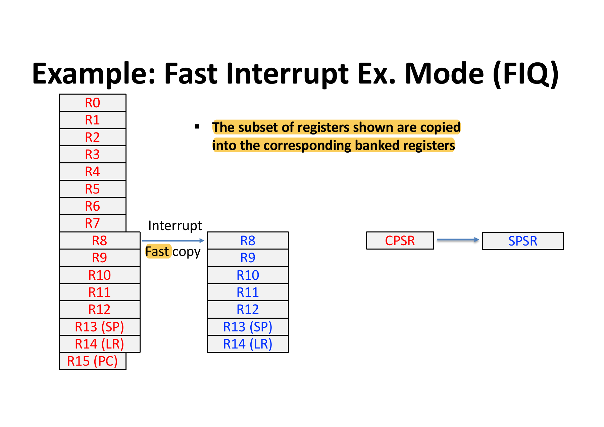

**Supervisor 指令（SVC）**：
- 用户代码运行在低特权级；**`SVC` 用于在特权级之间切换**
- CPU 从「某些」寄存器读参数，执行特定风味的 `SVC`
- **`SVC` 是软件异常**
- 一张表规定了「用户代码想要 OS 提供什么服务 → 接下来做什么」
- 对照：ARM 的 **`SVC`** ≈ Intel x86 的 **`syscall`**
- ⚠️ **实验课中你的代码跑在 bare metal 上，没有 OS**；真实世界中用户代码访问系统资源的唯一途径就是调用 OS 中的函数，这些函数就是 **system calls**

---

## 10.8 【Cortex-M / micro:bit 路线】异常机制（新版新增，重点）

### 向量表

- 中断向量表定义在 **`startup.S`** 中
- 若某 handler 不存在，对应标号**没有绑定二进制地址**
- **前 16 个 handler 是 ARM 专用的**；一旦定义了 handler，汇编器就会把它的二进制地址填进向量表
- **`GPIOTE_IRQHandler`** 用于检测 GPIO 信号变化（例如**按键按下**）


### Exception Entry：硬件自动压栈

异常发生时，**硬件自动**把下列寄存器压入栈（不用你写代码）：

| 栈偏移 | 内容 |
|---|---|
| `SP + 0x1C` | `xPSR` |
| `SP + 0x18` | `PC` |
| `SP + 0x14` | `LR` |
| `SP + 0x10` | `R12` |
| `SP + 0x0C` | `R3` |
| `SP + 0x08` | `R2` |
| `SP + 0x04` | `R1` |
| `SP + 0x00` | `R0` ← **中断后 SP 指向这里** |

（中断前 SP 指向 `<previous>`，即上表之上；地址向下递减）

- **`PC`** 用于把控制权返回被中断的程序
- **`LR`** 存放一个特殊返回值（**EXC_RETURN**）用于返回控制

> 💡 注意压栈的正是 **R0–R3、R12、LR、PC、xPSR** —— 恰好是 **caller-saved（nonpreserved）那一组**。这不是巧合：硬件替你执行了 caller save rule，于是 handler 可以写成一个**普通的 C 函数**，编译器按常规 AAPCS 处理 R4–R11 即可。

### Exception Return：EXC_RETURN

LR 中的 **EXC_RETURN** 值决定如何恢复：

| EXC_RETURN | 含义 |
|---|---|
| `0xFFFFFFF1` | 返回 **Handler mode**；从 **main stack** 取状态；返回后使用 **MSP** |
| `0xFFFFFFF9` | 返回 **Thread mode**；从 **main stack** 取状态；返回后使用 **MSP** |
| `0xFFFFFFFD` | 返回 **Thread mode**；从 **process stack** 取状态；返回后使用 **PSP** |
| 其他值 | Reserved |

### 两种模式、两个栈

| | **Thread mode** | **Handler mode** |
|---|---|---|
| 用途 | 正常程序执行 | 异常/中断服务 |
| 特权级 | **可特权可非特权（PL0 或 PL1）** | **始终特权（PL1）** |
| 默认栈指针 | **PSP**（Process Stack Pointer） | **MSP**（Main Stack Pointer） |

- LR 中的返回值告诉 CPU **用哪个栈恢复状态**、**返回哪个模式**
- ⚠️ **异常 handler 在把寄存器保存到某个栈之后，总是使用 MSP**（想想**嵌套中断**：所有嵌套层共用 MSP，就不会踩坏用户线程的 PSP）
- **R13 镜像当前正在使用的那个栈指针**

### CPU 怎么知道自己在 Handler mode？

- 靠 **xPSR** 中的 **IPSR（Interrupt Program Status Register）** 字段
- **IPSR 保存当前正在执行的异常/中断的异常号**
- **`IPSR == 0` → Thread mode**（普通程序代码）
- **`IPSR > 0` → Handler mode**（正在服务异常）

> 术语：**xPSR 是一个 32 位状态寄存器整体，IPSR 是它的一个「子寄存器 / 子字段」**，可以单独读取。

### 特权级由 CONTROL 寄存器控制

- **`CONTROL[0]`**：Thread mode 下的特权级 / 栈选择
  - `0` → Thread mode 使用 **MSP**
  - `1` → Thread mode 使用 **PSP**

### micro:bit 系统寄存器表

| 寄存器 | 用途 |
|---|---|
| `CONTROL` | 特权级 & 栈指针选择 |
| `IPSR` | 当前异常号 |
| `xPSR` | 复合状态寄存器 |
| `MSP`, `PSP` | Main / Process 栈指针 |
| `PRIMASK` | 禁用所有中断（NMI 除外） |
| `BASEPRI` | 设置中断优先级阈值 |
| `FAULTMASK` | 禁用所有异常 |
| `NVIC` & `SCB` | 嵌套向量中断控制器、系统控制块 |

> 特权代码通常被认为是可信的，会「善待」这些寄存器。

### micro:bit 异常机制总结（P168）

- **控制寄存器中的两位**决定：特权 vs 非特权、主栈 vs 进程栈
- **R13 镜像当前栈指针**
- **异常总是在 Handler mode（PL1）中处理**
- **这套机制能干什么？** 用中断（如系统定时器中断）+ 不同模式 + 不同栈，可以构建一个**多任务操作系统调度器**——从多个任务中选一个来执行。这就是 OS 的雏形。

### ARM Cortex 异常号表（必记结构）

| 异常号 | 异常 |
|---|---|
| 1 | Reset |
| 2 | NMI |
| 3 | HardFault |
| 4 | MemManage |
| 5 | BusFault |
| 6 | UsageFault |
| 7–10 | Reserved |
| 11 | **SVCall** |
| 12 | DebugMonitor |
| 13 | Reserved |
| 14 | PendSV |
| 15 | SysTick |
| **16** | **External interrupt 0** |
| … | … |
| 16+N | External interrupt N |

**三条要点**：
1. **外部中断从 16 开始**
2. **前 16 个异常属于 ISA 的一部分**
3. 通常它们**必须有 handler**，系统才能正常工作

**NVIC（Nested Vectored Interrupt Controller）**（在 ARM Cortex-M CPU 内部）：
- 管理所有外部和内部中断
- 对它们排优先级
- **处理嵌套中断**

---

# 十一、I/O 架构

## 11.1 I/O 设备与存储设备

**三类 I/O 设备**：输入设备、输出设备、**存储设备**。

**存储设备的两个重要用途**：
1. **持久化存储（persistent）**——与 SRAM/DRAM 的**易失性（volatile）**相对
2. **主存/DRAM 的扩展**——类比：内存中的栈是寄存器堆（RF）的扩展；用磁盘扩展内存 = 虚拟内存（COMP2310）

⚠️ **存储设备比 DRAM 慢得多**：访问延迟是**微秒（µs）** 级，DRAM 是**纳秒（ns）** 级——**三个数量级**。

对云和数据中心的高端系统而言，**存储是最重要的 I/O 设备**。

## 11.2 I/O 子系统

**计算机系统由什么组成？**
- **CPU–Memory（也叫 host system）**：紧耦合，CPU 通过地址/数据总线快速直接访问内存
- **I/O subsystem**：很多 I/O 设备要和 CPU 通信，需要一个「子系统」来对接 host system

**I/O 子系统包含（P185）**：
- 主存中专用于 I/O 功能的内存块
- 内部系统总线（memory bus、host bus、I/O bus）
- host 与外设中的控制模块
- 与外部组件（键盘、磁盘）的接口
- 外部线缆与通信链路（以太网线、鼠标线）

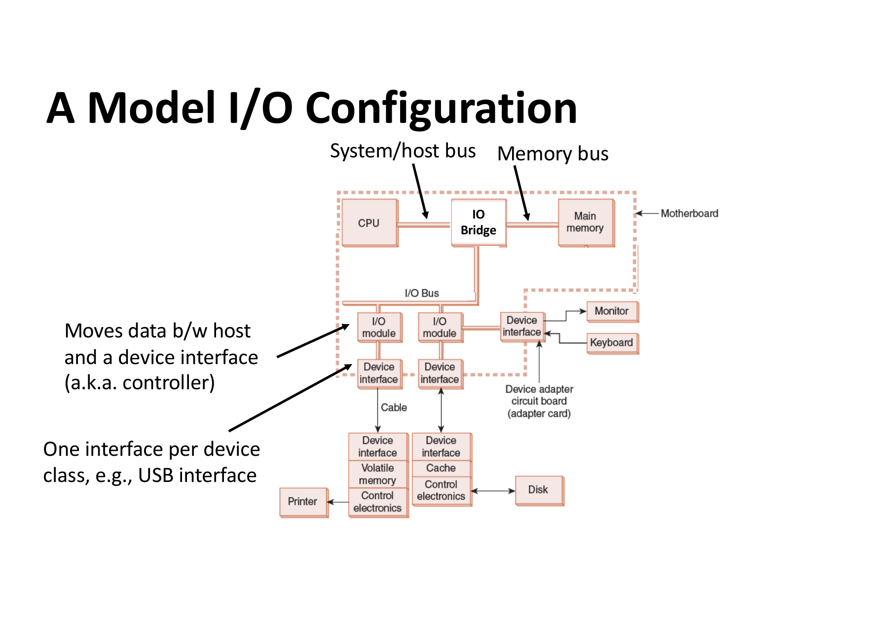

**IO Bridge** 在 host 和 **device interface（也叫 controller）** 之间搬运数据；**每类设备一个 interface**（如 USB interface）。

**PCIe（Peripheral Component Interconnect Express）**：
- **串行**扩展总线标准，用于连接外设（GPU、SSD）
- 相比「传统」的**并行** PCI，PCIe **延迟更低、传输速率更高**

## 11.3 接口与协议

**Interfaces** 与特定类型设备（键盘、磁盘、打印机）通信，确保：
- 设备已准备好接收下一批数据
- host 已准备好接收外设送来的下一批数据

> **Protocol（协议）**：发送方与接收方之间交换的信号的**确切形式与含义**。
> 信号分两类：**command signals** 和 **data signals**。
> **Handshake（握手）**：接收方对收到的命令/数据发送 **Acknowledgement**，或表示自己已准备好接收数据的协议交换。

## 11.4 I/O 系统三维分类（核心框架）

没有标准的分类方案，也不是每种「组合」都说得通。三个维度：

| 维度 | 选项 A | 选项 B |
|---|---|---|
| **Device visibility（设备可见性）** | **Port-mapped I/O (PMIO)** | **Memory-mapped I/O (MMIO)** ← micro:bit |
| **Reading data（读数据方式）** | **Programmed I/O (PIO)** | **Direct Memory Access (DMA)** |
| **Event notification（事件通知）** | **Polled I/O（轮询）** | **Interrupt-driven I/O（中断驱动）** |

### 维度一：Port-Mapped vs Memory-Mapped

| | **PMIO（端口映射 / 隔离 I/O / 指令式 I/O）** | **MMIO（内存映射 I/O）** |
|---|---|---|
| 地址空间 | **独立的专用地址空间**，与内存分开 | **与内存共享同一地址空间** |
| 硬件实现 | 通常靠 CPU 物理接口上**额外的「I/O」引脚** | 每个 I/O 设备有自己保留的一块内存区域 |
| 访问指令 | **专用指令 `IN` / `OUT`** | **普通的 `LDR` / `STR`** |
| 别名 | isolated I/O | — |
| 评价 | — | 抽象好、简单方便（对程序员友好）、硬件干净 |

**MMIO 示例（P191–192）**：每个 I/O 设备被分配地址空间中的一或多个地址；`STR` 写数据到设备，`LDR` 从设备读数据。

**例题（P192）**：设 I/O Device 1 被分配到地址 `0x20001000`，写出向它写入 7 并读回输出值的 ARM 汇编。

```arm
LDR R1, =0x20001000   ; 设备地址
MOV R0, #7
STR R0, [R1]          ; 写入 7 到设备
LDR R2, [R1]          ; 从设备读回输出值
```

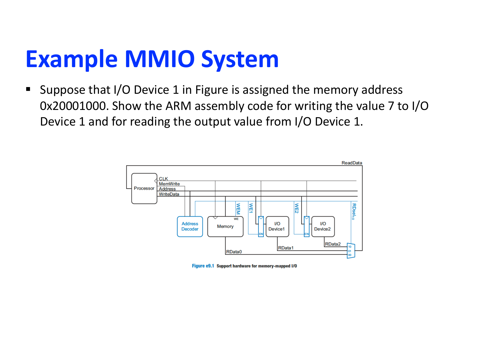

**micro:bit 的做法**：
- 使用 **MMIO**，标准 `LDR` / `STR`
- **只有一个地址空间**同时访问内存和 I/O 外设
- ⚠️ micro:bit 有叫 "ports"（P0、P1）和 "pins"（P0.01、P0.02）的东西，**但那只是物理引脚的命名，不是 port-mapped I/O**（这是个陷阱题）

**micro:bit 引脚地址映射（P194）**：

| Port | Base Address |
|---|---|
| P0 | `0x50000000` |
| P1 | `0x50000300` |

在基址上加 offset 得到各配置寄存器：

| Register | Offset | Description |
|---|---|---|
| `OUT` | `0x504` | 写 GPIO 端口 |
| `DIR` | `0x514` | GPIO 引脚方向 |

```arm
@ load r1 with the base address of P0
ldr r1, =0x50000000

@ load r2 with the value of P0 DIR
@ (note the 0x514 offset from the P0 base address)
ldr r2, [r1, 0x514]

@ set bit 21 by doing a logical or with 0b1 left-shifted by 21
@ think: why does this work?
mov r3, 0b1
lsl r3, r3, #21
orr r2, r2, r3

@ store the modified result back into P0 DIR
str r2, [r1, 0x514]
```

> **read–modify–write 三步套路**：`LDR` 读出当前值 → 用 `ORR`/`BIC` 只改目标位 → `STR` 写回。直接 `MOV` 会把其他 20 多个引脚的配置全冲掉。

### 维度二：Programmed I/O vs DMA

**Programmed I/O (PIO)**：
- **每一次数据传输都由程序中的一条指令发起，每次事务都要 CPU 参与**
- 这个词既可指 MMIO 也可指 PMIO
- **问题在哪？** CPU 极快（1 秒 = 20 亿周期），I/O 设备极慢。大数据量传输（如从磁盘读视频文件）时，我们希望**在传输并行进行的同时释放 CPU 去干别的**

**Direct Memory Access (DMA)**：
- CPU 把繁琐 I/O 指令的执行**卸载给一块专用芯片：DMA controller**
- CPU 提供给 DMA controller 三样东西：
  1. 待传输字节的**位置**
  2. 待传输的**字节数**
  3. **目标内存地址**
- CPU 通知 DMA controller 后**去忙别的**
- DMA 完成 I/O，**把数据放进内存，然后中断 CPU**

**DMA 配置要点**：
- DMA 与 CPU **共享总线**（**必须使用 memory-mapped I/O**）
- DMA 运行在**更高优先级**，会从 CPU「**偷取内存周期（steal memory cycles）**」

> ⚠️ **版本差异**：旧版 P187 写的是 "below: memory-mapped I/O"，新版 P198 改为 **"must use memory-mapped I/O"**。这与 P208 的 "**DMA cannot work with port-mapped!**" 一致。**按新版记：DMA 必须配 MMIO。**

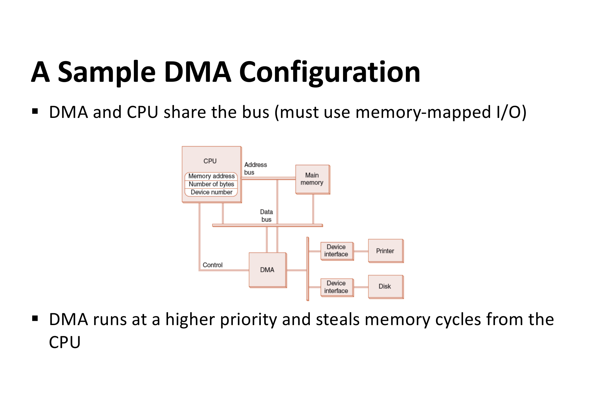

**micro:bit 的 EasyDMA**：
- 某些（不是全部）外设用 EasyDMA 直接访问 RAM
- 是服务器处理器中 DMA 的**低功耗、更简单版本**
- 适用：音频流、蓝牙数据交换、读传感器
- **工作方式**：你设置一个指向内存缓冲区的指针 → 外设（如 UART 或 SAADC）自动把数据搬进/搬出 → **CPU 不必碰每一个字节** → 开销更低、更快、更省电

| 外设 | 用例 |
|---|---|
| UART | 串行数据流入/流出内存 |
| SPI | 面向传感器/显示屏的缓冲数据传输 |
| TWI/I2C | 自动读取传感器 |
| PWM | 波形数值流 |
| SAADC | 连续模拟采样（如音频） |
| RADIO | 蓝牙数据包缓冲管理 |

### 维度三：Polled vs Interrupt-driven

**Polled I/O（轮询）** 的循环：
1. CPU 监视与端口关联的**控制/状态寄存器**
2. 一个字节到达端口时，控制寄存器中的某一位被置位
3. CPU 最终轮询到并注意到 "**data ready**" 控制位被置位
4. CPU **重置该控制位**，取走字节并处理
5. CPU 恢复轮询

**Interrupt-driven I/O（中断驱动）**：
- **CPU 不被拖住**，可以做别的事
- **中断是异步信号**
- **设备主动告诉 CPU** 自己有数据要送
- CPU 继续做别的任务，直到某个请求服务的设备向它发中断
- **粒度可配置**：每个字一次中断，或整批一次中断

**中断控制器（Interrupt Controller）**：
- 多个使能中断的设备与 CPU 之间的通信由中断控制器处理
- 电路一旦识别到任何设备的中断信号，就抬起**单一的中断信号**，激活系统总线上的一条控制线
- 该控制线**直接接到 CPU 芯片的一个引脚**
- **INTA（Interrupt Acknowledge）**：中断控制器收到确认后**放下 INT**
- **优先级**根据请求 I/O 的设备的**时间关键性（time-criticality）** 决定

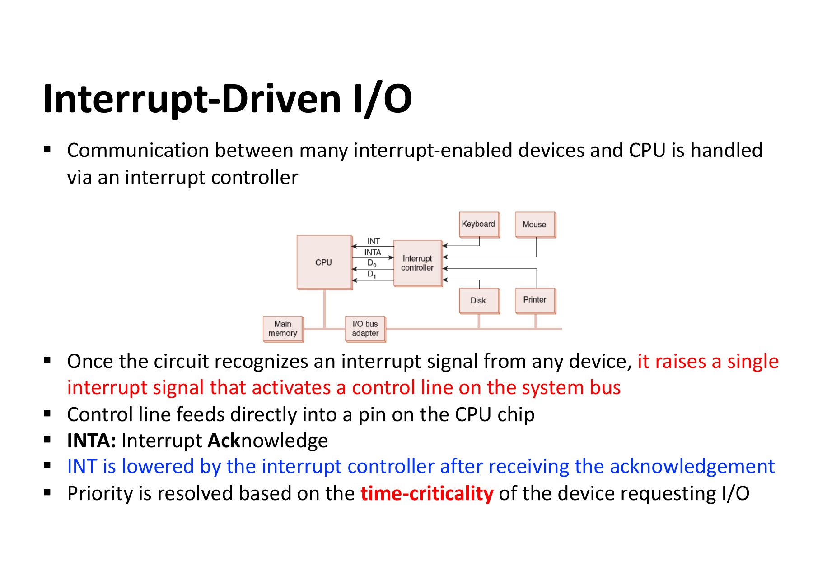

**micro:bit 总结**：同时使用 polled I/O 和 interrupt-driven I/O，**取决于是哪个外设以及如何配置**。

## 11.5 有意义的组合（P208，考点）

| 组合 | 是否合理 | 说明 |
|---|---|---|
| **Memory-mapped + DMA + interrupt-driven** | ✅ | 典型用于**传输大量数据的存储设备** |
| **Port-mapped + DMA + interrupt-driven** | ❌ | **DMA 无法与 port-mapped 配合！** |
| **Port-mapped + programmed + polling** | ✅ | polling、programmed、port-mapped 三者天然搭配 |

## 11.6 Character vs Block I/O

| | **Character I/O** | **Block I/O** |
|---|---|---|
| 粒度 | 一次一个字节（字符） | 成组处理字节 |
| 例子 | 调制解调器、**键盘**、鼠标 | 大多数**大容量存储设备**（磁盘、磁带） |
| 最佳连接方式 | **interrupt-driven programmed I/O** | **interrupt-driven DMA** |

> **Device driver（设备驱动）**：处理 I/O 传输粒度细节以及 I/O 相关指令的软件。

## 11.7 总线技术

> **Bus（总线）**：在发送方和接收方之间传输信号（地址、数据、控制）的一组导线。

| | **Serial（串行）** | **Parallel（并行）** |
|---|---|---|
| 传输 | 一次一位 | 多位并行 |
| 例子 | 键盘、鼠标、USB 驱动器、旧打印机 | CPU–内存通信、并口打印机、PCI |
| 特点 | 线细 | **线更粗**，且**易受电气干扰**，从而缩短信号传输距离 |

两种情况下都用**时钟**做定时，尤其是控制信号跳变。

> 💡 这解释了为什么现代高速总线（PCIe、USB、SATA）反而都从并行转向了串行：并行线之间的串扰和 skew 在高频下比串行的位宽劣势更致命。

---

# 十二、Amdahl 定律

## 12.1 为什么讲这个

- 迟缓的 I/O 吞吐会产生**连锁反应**，拖垮整个系统性能
- 世界上最快的处理器，如果大部分时间在等外设的数据，也没什么用
- 系统整体性能是**所有组件交互的结果**
- **提升使用最频繁的组件的性能，对系统性能提升最有效**

## 12.2 公式（必背）

$$S = \frac{1}{(1-f) + \frac{f}{k}}$$

| 符号 | 含义 |
|---|---|
| **S** | 整体加速比（overall speedup） |
| **f** | 由更快的组件完成的**工作占比** |
| **k** | 该组件自身的**加速比** |

## 12.3 「快 N%」的换算（易错点）

> Amdahl 的语境中：**「快 50%」= 1.5 倍速**（参照物 100% 的速度 + 额外 50% = 150% = 1.5×）

换算公式：**A 比 B 快 N%**，当且仅当

$$\frac{\text{Perf}_A}{\text{Perf}_B} = 1 + \frac{N}{100}$$

所以：「快 50%」→ k = **1.5**；「快 150%」→ k = **2.5**。

## 12.4 例题（务必自己算一遍）

**题设**：大型系统上二选一
- 花 **$10,000** 升级 CPU，使其**快 50%**
- 花 **$7,000** 升级磁盘，使其**快 150%**

程序 **70%** 时间在 CPU 中运行，**30%** 时间等待磁盘服务。哪个升级性价比更高？

**解**：

处理器方案：f = 0.70，k = 1.5

$$S = \frac{1}{(1-0.70) + \frac{0.70}{1.5}} = \frac{1}{0.30 + 0.4667} = 1.30 \quad (\text{30\% 加速})$$

磁盘方案：f = 0.30，k = 2.5

$$S = \frac{1}{(1-0.30) + \frac{0.30}{2.5}} = \frac{1}{0.70 + 0.12} = 1.22 \quad (\text{22\% 加速})$$

**性价比**：
- 处理器：每 1% 提升花费 **$333**（10000 / 30）
- 磁盘：每 1% 提升花费 **$318**（7000 / 22）

**结论**：磁盘方案单位性价比略优。**但性价比应该是唯一考量吗？** ——不一定（还有功耗、可靠性、未来工作负载变化等）。

## 12.5 对程序性能的启示

- 程序把大部分时间花在**一小部分代码**上
- 程序员可用 Amdahl 定律**估算优化关键代码段的收益**

> 💡 反过来读：如果 f 很小，k 再大 S 也接近 1。这就是为什么「优化了一个只占 5% 时间的函数 100 倍」几乎没用——上限只有 1.052×。

---

# 十三、功耗与能量

## 13.1 背景

- 时钟频率和功耗几十年来都在快速上升，**近年趋于平缓甚至下降**
- 我们撞上了**实际的散热功耗限制**
- 目标：理解**功耗与时钟频率的相关性**

## 13.2 公式（必背）

$$P_{total} = P_{dynamic} + P_{static}$$

$$P_{dynamic} = \tfrac{1}{2} \times A \times C \times V^2 \times N \times F_{switch}$$

$$P_{static} = V \times I_{leak}$$

$$E_{total} = P_{total} \times Time = (P_{dynamic} + P_{static}) \times time$$

**各参数含义（必须能一一说清）**：

| 符号 | 含义 |
|---|---|
| **A** | **Activity factor（活动因子）**：量化晶体管在一个周期内**切换的频繁程度** |
| **C** | 电容，是 **CMOS 工艺**和 **fanout**（连接到某个晶体管输出端的晶体管数）的函数 |
| **V** | 供电电压（**平方项**！） |
| **N** | **晶体管数量** |
| **F_switch** | 开关频率，**取决于时钟频率** |
| **I_leak** | 漏电流 |

**为什么会有动态功耗**：晶体管在从 **LOW(0) → HIGH(1)** 和 **HIGH(1) → LOW(0)** 的跳变过程中耗散功率——**只有发生切换时才耗散**。

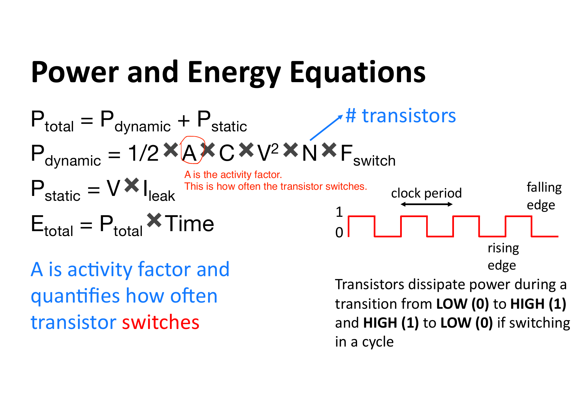

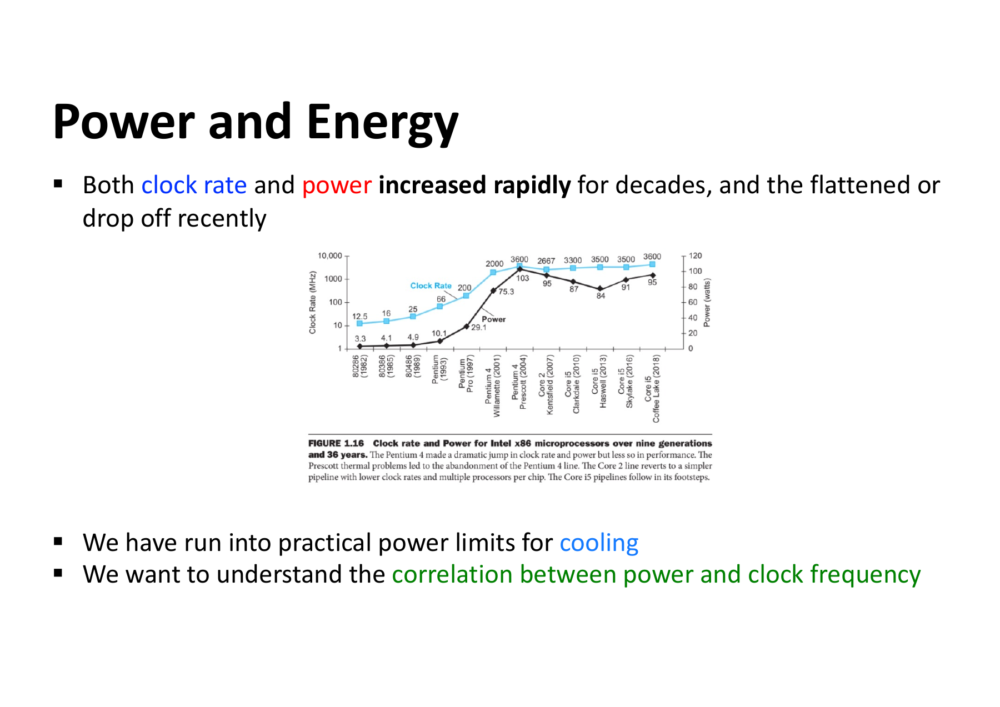

**回忆晶体管开关原理（P221）**：n 型 MOS 管，gate 加高电压 → source-drain 之间像一根导线（闭合电路）；gate 加零电压 → 断路。取决于工艺，「高电压」可从 0.3V 到 3V 不等。

## 13.3 降低动态功耗

**两条路**：
1. **降低频率**
2. **降低供电电压**（**平方级下降**，效果最好）

**过去约 30 年的现实**：
- 频率增长了 **1000×**
- 电压每代下降约 **15%**（从 5V 降到 1V）
- **功耗增长了 30×**

**A、F、N 一直在涨 → 撞上 power wall（功耗墙）。**

⚠️ **降低供电电压已不再可行**：会**增加漏电流**，并带来制造复杂度（成本）。

功耗单位是**瓦特（watts）**，通常报告**峰值或平均值**。

## 13.4 Dynamic vs Static Power（对比表）

| | **Dynamic Power** | **Static Power** |
|---|---|---|
| 来源 | 晶体管**切换**时耗散 | **漏电流（leakage current）**，晶体管不切换也在流 |
| 地位 | 能耗的**主要来源** | 近年**显著上升，已占总功耗约 40%** |
| 影响因素 | 某些**指令组合**会增加动态功耗（翻转控制位导致切换活动增加） | 进一步降低供电电压反而**增加漏电** |
| 风险 | — | **Thermal runaway（热失控）** 现象 |

（延伸阅读：Nam and Todd 的论文）

## 13.5 Power vs Energy（概念辨析，必考）

> **Energy 是功率在时间上的积累。**

- 单位：**焦耳（joules = watt-seconds）** 或 **千瓦时（kWh）**
- **1 kWh = 3,600,000 焦耳**（电费账单用这个）
- ⚠️ **P_static 一直都在**（与活动无关）

**类比（P226）**：
- **开车**：power = 你开的**速率**（mph）；energy = 你开的**总距离**（miles）
- **水管注水到桶**：power = 水的**流速**（升/秒）；energy = **最终桶里有多少水**（升）

## 13.6 该用哪个指标？

| 指标 | 用途 |
|---|---|
| **Power** | 决定**封装与散热需求** |
| **Energy** | 比较两个 CPU 的**能效/电池效率** |

- **若目标是最大化电池续航 → 用 energy 指标**
- **Power 是速率指标（焦耳/秒）**
- ⚠️ **一个 CPU 可能功耗更高，但因为更早跑完程序而更省能量**

**例题（P228/231）—— 同一程序，不同 CPU**：

| | Power (Watts) | Execution time (s) | **Energy = P × T (J)** |
|---|---|---|---|
| Processor A | 100 W | 100 s | **10,000 J** |
| Processor B | 80 W | 140 s | **11,200 J** |
| Processor C | 75 W | 120 s | **9,000 J** ← 最省能 |

**结论**：**功耗最低的 B 反而最费能量**。C 才是能效最优。这就是「power ≠ energy」的教科书式反例。

⚠️ **版本差异**：旧版 P216 只有 A（100W/100s）和 B（80W/**150s**）两个处理器；新版改为 B = 140s 并新增 C。**以新版三处理器数据为准。**

**例题 —— 同一 CPU，不同程序（P229）**：

| | Power | Execution time | **Energy** |
|---|---|---|---|
| C++ program | 100 W | 75 s | **7,500 J** |
| Java program | 100 W | 750 s | **75,000 J** |

功率相同时，**能耗差距完全由执行时间决定**——10 倍慢就是 10 倍耗电。

## 13.7 Energy 指标的问题 → EDP

**问题**：降低功耗的一个办法是**把 CPU 降速**，但这会严重伤害性能。**性能（执行时间）和功耗在系统设计中都很重要。**

> **EDP（Energy-Delay Product，能量-延迟积）** 用于平衡两者：
> $$EDP = Energy \times Delay$$
> 其中 delay 指执行时间。**EDP 惩罚延迟更高的系统**，因此在能量和性能都重要时是个有用的指标。

## 13.8 多核与功耗管理

**AMD EPYC 9754S**（Zen 4c 微架构）：单个 die 上 **128 个 Zen 4c 核心**（core = CPU），规定了 **base clock** 和 **boost clock**。

**多核带来的功耗/能量管理灵活性**：
- 不必让所有核心都跑最高频率
- 只用需要的核心
- **写并行软件**——这是「造一个 100 GHz 单核」的替代方案（后者会导致无法管理的热问题）

**TDP（Thermal Design Point）**：
- 不同的功耗评级以 TDP 表示
- ⚠️ TDP 的**确切定义是有微妙之处的**，需要读数据手册
- ⚠️ **TDP ≠ 电池续航**——它是**散热设计指南**

**Chiplet（小芯粒）**：
- 一个 chiplet 是构成更大芯片的**小芯片积木**
- **CCD（Core Complex Die）** = 包含 **8 个共享缓存的核心**的一组
- 基于 chiplet 的方法带来**更好的良率（yield）和复杂度管理**

---

# 十四、【新版补充】程序结构、Flash/SRAM、局部性与 Cache

> 这一整段（P237–255）只在 `set6__后半部分_.pdf` 中存在，旧版没有。是往后 memory hierarchy 内容的引子。

## 14.1 好的程序构造

- **条件构造**：if/else 或条件执行
- **迭代构造**：循环
- **函数**
- **数据结构**：数组、指针、地址 vs 数据、内存卫生（memory hygiene）、内存利用率

## 14.2 Code + Data = Program

- 在 **Von Neumann 模型**中，代码和数据**驻留在同一地址空间**
- **Address space**：CPU 能生成的地址列表
- micro:bit 上地址空间被划分成**段（segments）**，各段由**不同的物理技术**支撑：
  - **代码存在 Flash 存储器中**
  - **栈和堆在 SRAM 中**
  - **I/O 外设可以用 `LDR`/`STR` 通过特殊地址访问**（即 MMIO）

**micro:bit（ARMv7-M）地址空间分段**：

| 段 | 地址范围 | 大小 |
|---|---|---|
| Vendor-specific memory | `0xE0100000` – `0xFFFFFFFF` | 511 MB |
| Private peripheral bus | `0xE0000000` – `0xE00FFFFF` | 1 MB |
| External device | `0xA0000000` – `0xDFFFFFFF` | 1 GB |
| External RAM | `0x60000000` – `0x9FFFFFFF` | 1 GB |
| **Peripheral** | `0x40000000` – `0x5FFFFFFF` | 0.5 GB |
| **SRAM** | `0x20000000` – `0x3FFFFFFF` | 0.5 GB |
| **Code** | `0x00000000` – `0x1FFFFFFF` | 0.5 GB |

> 💡 对照回 P194：GPIO P0 的基址 `0x50000000` 正好落在 **Peripheral** 段（`0x40000000`–`0x5FFFFFFF`）里。前后能对上，说明你理解到位了。

## 14.3 为什么代码存在 Flash 里

- **Flash 是非易失/持久存储介质**，断电后代码依然在，因此被用作存储设备
- micro:bit 上 Flash 与 CPU、SRAM **集成在同一芯片上**
- **Flash 容易与 CMOS 工艺集成，DRAM 不容易**——所以地址空间里才有一个 External RAM 段

**但 Flash 慢**：
- 高容量 Flash 存储设备延迟在**微秒**级（对比 RAM 的纳秒级）
- nRF52833（micro:bit 的 CPU）**内部 Flash 读延迟约 20–30 ns**
- **Cortex-M4 最高 64 MHz（一个周期 = 15.625 ns）** → **Flash 比一个 CPU 周期还慢**

## 14.4 如何弥补 Flash 延迟差距（考点）

**最笨的办法**：CPU 等 Flash（**wait states 或 pipeline stalls**）——效率很差。

**能做得更好吗？能，靠软硬件优化：**

| 方案 | 做法 |
|---|---|
| **硬件（Caching）** | 指令 cache 在 Flash（CODE）内部，减少 CPU 等待 Flash 的需要；**存放频繁访问的指令**，并可**提前 prefetch 指令** |
| **软件（Code placement）** | 把**热循环、中断 handler 和其他性能关键代码放进 SRAM**。SRAM 通常比 Flash 快得多。可以把关键函数放在 `.data` 段下并分支到那些函数 |

## 14.5 局部性原理（Principle of Locality）—— 必背

> **程序倾向于访问地址上接近或等于最近访问过的数据和指令。**

| 类型 | 定义 |
|---|---|
| **Temporal locality（时间局部性）** | **最近被引用过的项目**，在不久的将来**很可能再次被引用** |
| **Spatial locality（空间局部性）** | 地址**相邻**的项目倾向于被接连访问 |

**经典例子**：

```c
sum = 0;
for (i = 0; i < n; i++)
    sum += a[i];
return sum;
```

- **数据引用**：
  - 按顺序引用数组元素（**stride-1 引用模式**）→ **空间局部性**
  - 每次迭代都引用变量 `sum` → **时间局部性**
- **指令引用**：
  - 循环体指令被反复执行 → **时间局部性**
  - 指令按顺序取指 → **空间局部性**

## 14.6 存储层次（Memory Hierarchy）

**三条基本且持久的软硬件性质**：
1. **更快的存储技术：每字节更贵、容量更小、更耗电（发热！）**
2. **CPU 与主存的速度差距在不断拉大**
3. **写得好的程序倾向于表现出良好的局部性**

> 这三条性质**完美互补**，共同指向一种组织内存与存储系统的方法：**memory hierarchy（存储层次）**。

| 层级 | 设备 | 内容来源 |
|---|---|---|
| **L0** | **Regs**（CPU 寄存器） | 保存从 L1 cache 取来的字 |
| **L1** | L1 cache（SRAM） | 保存从 L2 cache 取来的 cache lines |
| **L2** | L2 cache（SRAM） | 保存从 L3 cache 取来的 cache lines |
| **L3** | L3 cache（SRAM） | 保存从主存取来的 cache lines |
| **L4** | **Main memory（DRAM）** | 保存从磁盘取来的 disk blocks |
| **L5+** | 本地磁盘 / 远程存储 | — |

**方向**：向上 = 更小、更快、每字节更贵；向下 = 更大、更慢、更便宜。

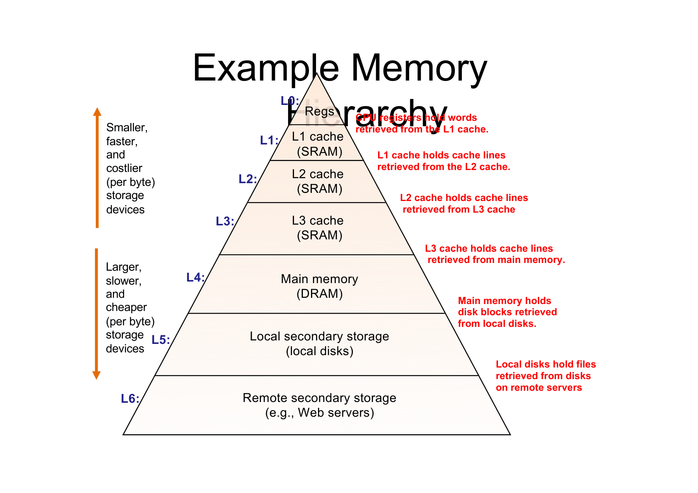

## 14.7 Cache 基本概念

> **Cache**：一个更小、更快的存储设备，充当**更大、更慢设备中某个数据子集的暂存区（staging area）**。

**存储层次的根本思想**：**对每个 k，第 k 层这个更快更小的设备，充当第 k+1 层那个更大更慢设备的 cache。**

**通用 cache 概念**：
- 内存被视为**划分成「块（blocks）」**
- cache 缓存这些块的一个**子集**
- 数据以**块大小的传输单元（block-sized transfer units）** 复制
- **块要足够大以利用空间局部性**

| 情形 | 定义 |
|---|---|
| **Hit（命中）** | 需要块 b 的数据，**块 b 就在 cache 中** |
| **Miss（缺失）** | 块 b 不在 cache 中 → 从内存**取回** b → **存入 cache** |

**Miss 时要做的两个决策（必记术语）**：
- **Placement policy（放置策略）**：决定块 b 放到哪里
- **Replacement policy（替换策略）**：决定哪个块被**驱逐（victim）**

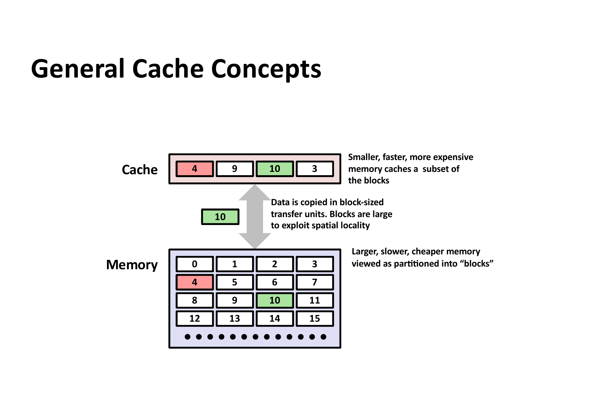

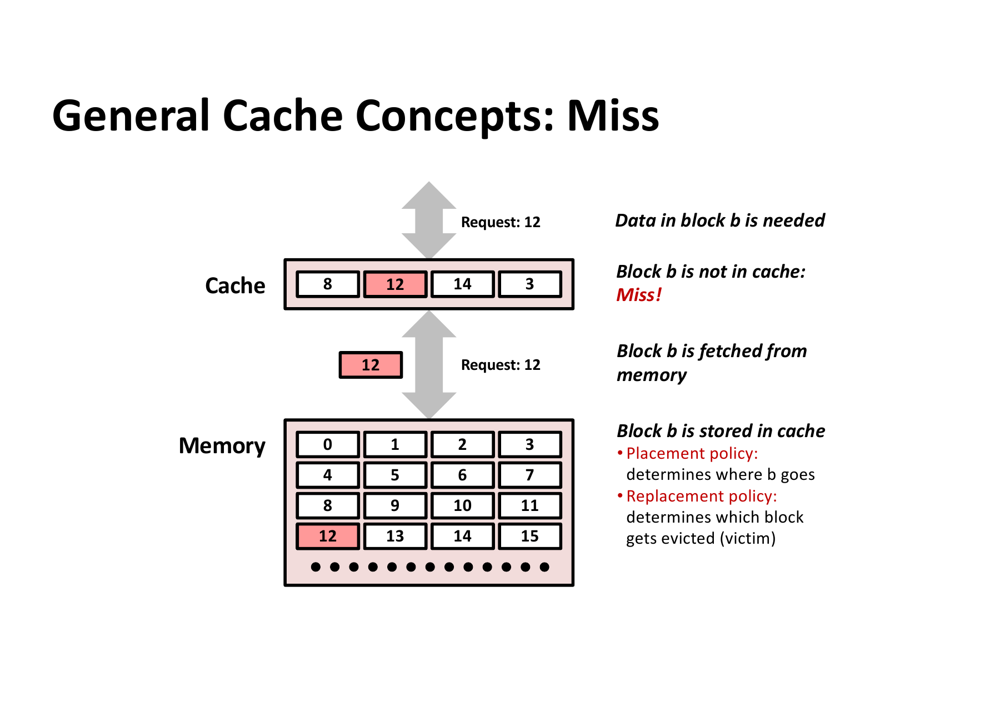

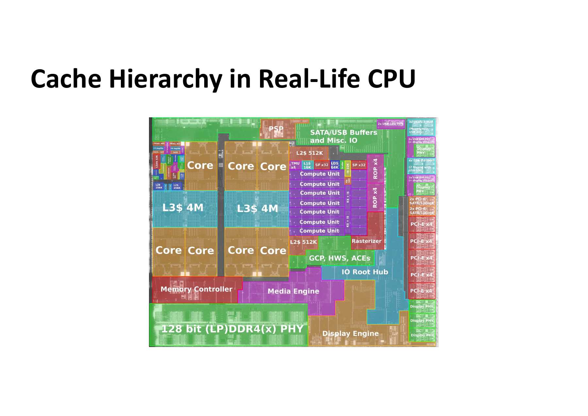

---

# 十五、幻灯片错误与版本差异汇总

| 位置 | 问题 | 正确说法 |
|---|---|---|
| **P38** | `push → SP = SP + 4`，`pop → SP − 4` | **反了**。ARM 是 Full Descending：**PUSH 减 4，POP 加 4** |
| **P60** | "PUSH {R4} … adds 4 to SP"，"POP … subtracts 4" | 同上，**反了**。（你的手写批注「substract/add」是对的） |
| **P51 vs P52–54** | 注释一会儿 `; R0 = result` 一会儿 `; R2 = result` | 实际 result 先在 **R4**，`MOV R0, R4` 后在 **R0** |
| **P27** | "LR = PC + 4 = 0x00000204" | 语义上是「BL 指令地址 + 4」。注意与 P5 的 BTA「PC + 8」用的是**不同的 PC 基准**，别混 |
| **P187（旧版）vs P198（新版）** | 旧版 "below: memory-mapped I/O"，新版 "**must use** memory-mapped I/O" | 按**新版**：**DMA 必须配 MMIO**（与 P208 "DMA cannot work with port-mapped" 一致） |
| **P216（旧版）vs P228/231（新版）** | Processor B 执行时间从 150s 改成 140s，且新增 Processor C（75W/120s） | 按**新版三处理器**数据算能耗 |
| **P157（旧版）** | 标记为「不是最新的 ppt 版本」 | 用 `后半部分` 文件的 P157–168 替代 |
| **P228 与 P231** | 完全相同的一张幻灯片出现了两次（中间夹了 P229/P230） | 不是错误，是讲课时的回顾；截图取一张即可 |

---

# 十六、复习自检清单

回答不出来就回去翻对应章节：

**函数与栈**
1. BTA 三步是什么？为什么是 PC + 8？
2. ARM 是哪一种栈（四选一）？PUSH 时 SP 加还是减？
3. Preserved 和 Nonpreserved 分别有哪些寄存器？两条保存规则怎么说？
4. `PUSH {R4, R8, LR}` 中哪个寄存器存在最高地址？
5. Stack frame 里通常有哪些东西？为什么说「栈不是硬件部件」？
6. ABI 和 ISA 的区别是什么？
7. 递归函数为什么既要遵守 caller save rule 又要遵守 callee save rule？
8. factorial 的 base case 为什么不用恢复 LR？

**内存**
9. ARM 内存映射的五个段从高到低是什么？heap 和 stack 分别往哪长？
10. 全局变量、static 变量、局部数组、`malloc` 的对象分别在哪个段？
11. 虚拟内存的三大好处？page table 里 key 和 value 分别是什么？
12. 静态分配 / 栈分配 / 堆分配的生命期各由什么决定？
13. Memory leak 的定义是什么？

**异常与 I/O**
14. Interrupt / Trap / Fault / Abort 四者怎么分？各举一例。
15. 内部异常和外部异常分别何时处理？什么异常必须立刻处理？
16. Cortex-M 异常入口时硬件自动压栈哪 8 个东西？为什么正好是这些？
17. `IPSR == 0` 和 `IPSR > 0` 分别意味着什么？
18. MSP 和 PSP 分别在什么模式下使用？为什么 handler 之后总用 MSP？
19. I/O 三维分类各是哪两个选项？哪个组合是不可能的？
20. DMA 需要 CPU 提供哪三样信息？DMA 完成后怎么通知 CPU？
21. micro:bit 的 "ports P0/P1" 是不是 port-mapped I/O？

**性能与功耗**
22. Amdahl 公式是什么？「快 150%」对应 k 等于多少？
23. P_dynamic 公式里五个因子各是什么？哪个是平方项？
24. 为什么「功耗更低的 CPU」可能反而更费电？
25. EDP 是什么？为什么需要它？
26. 时间局部性和空间局部性的定义？用一段循环各举一例。
27. Cache miss 时要做哪两个策略决策？

---
