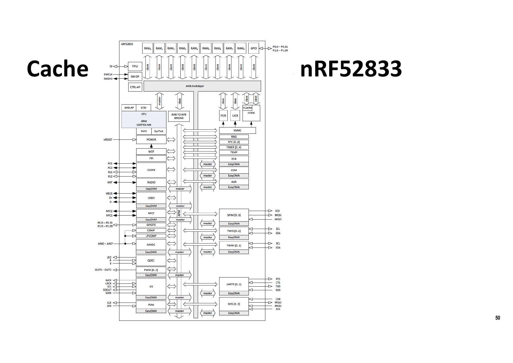
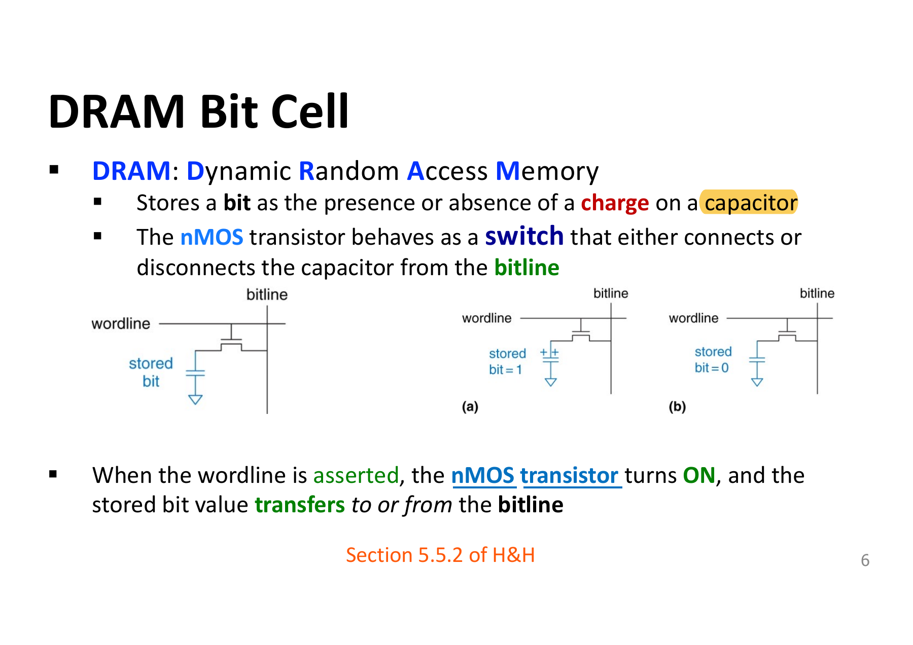
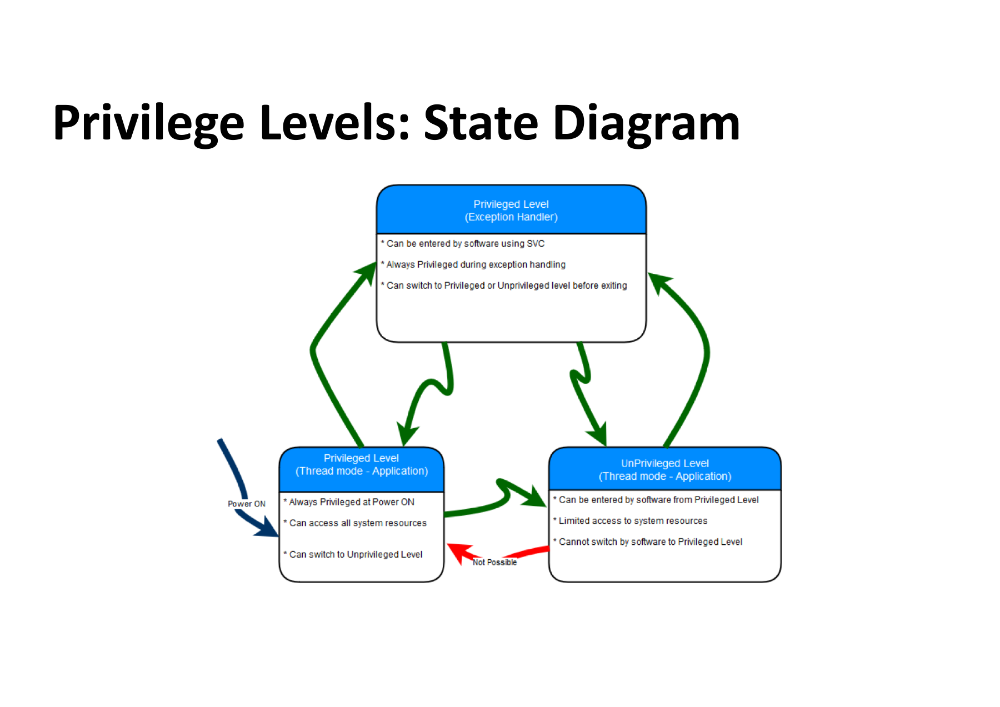
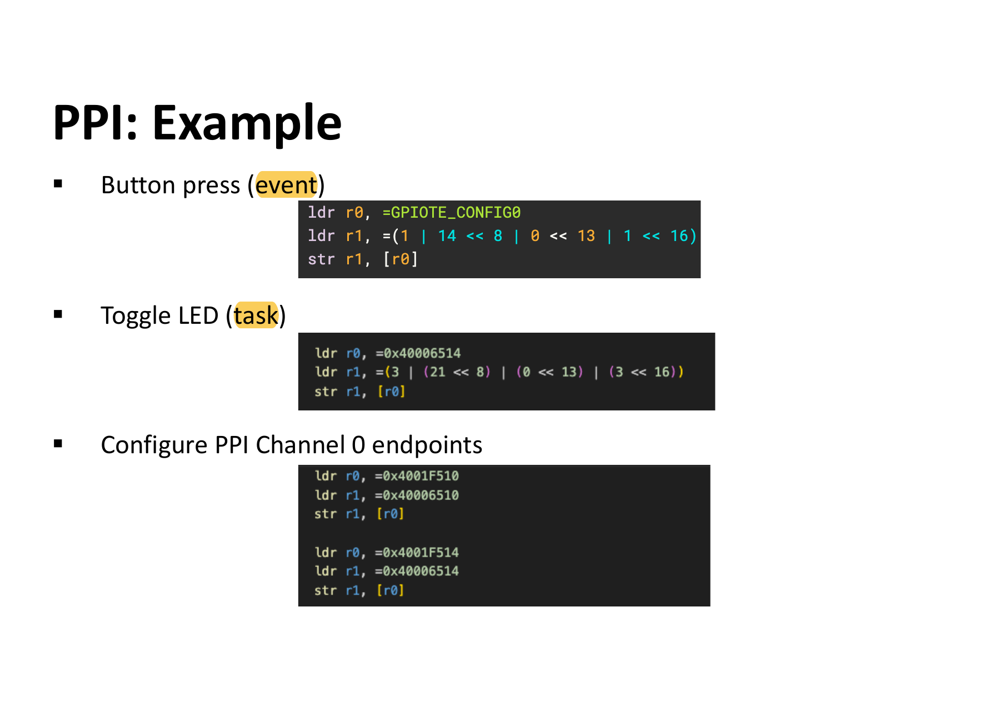
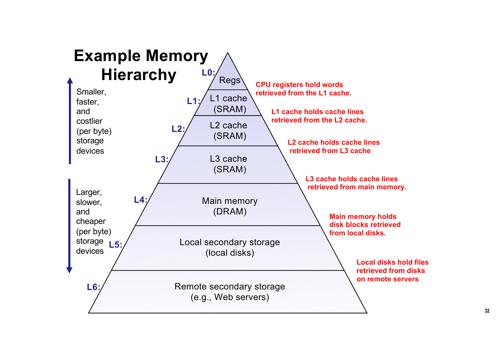
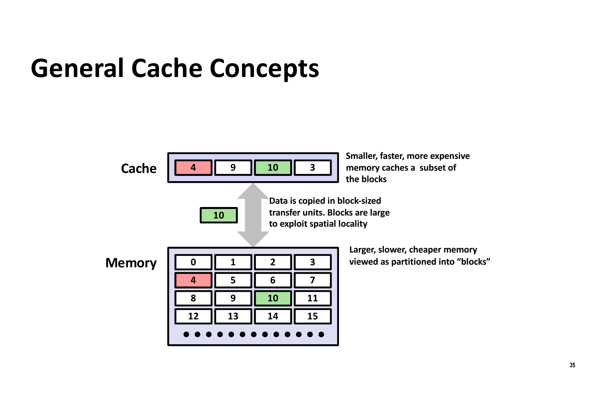
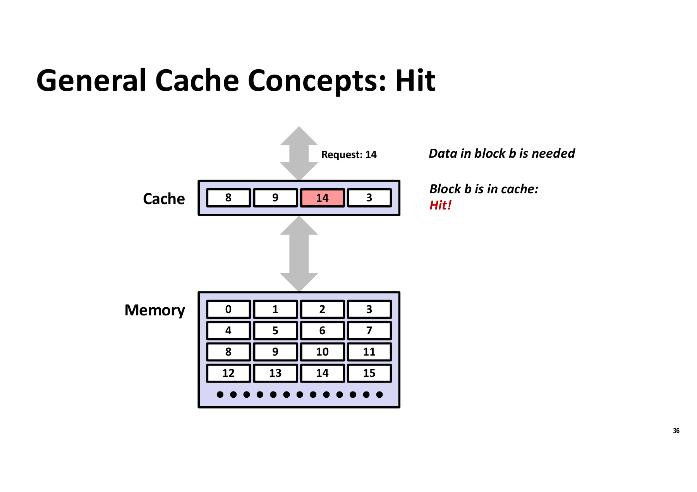
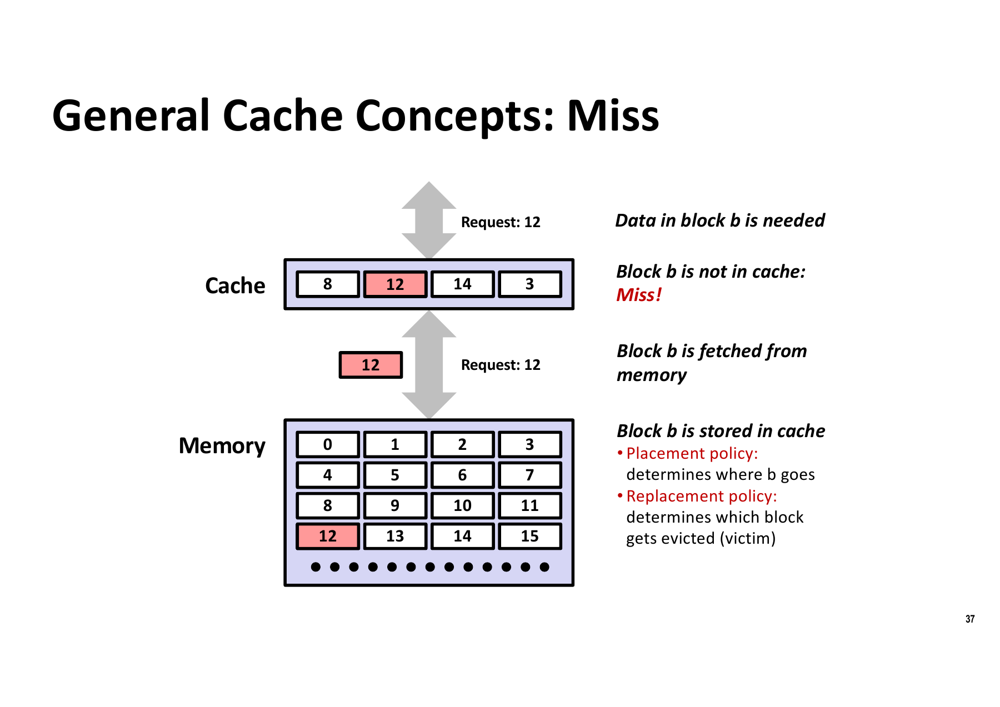
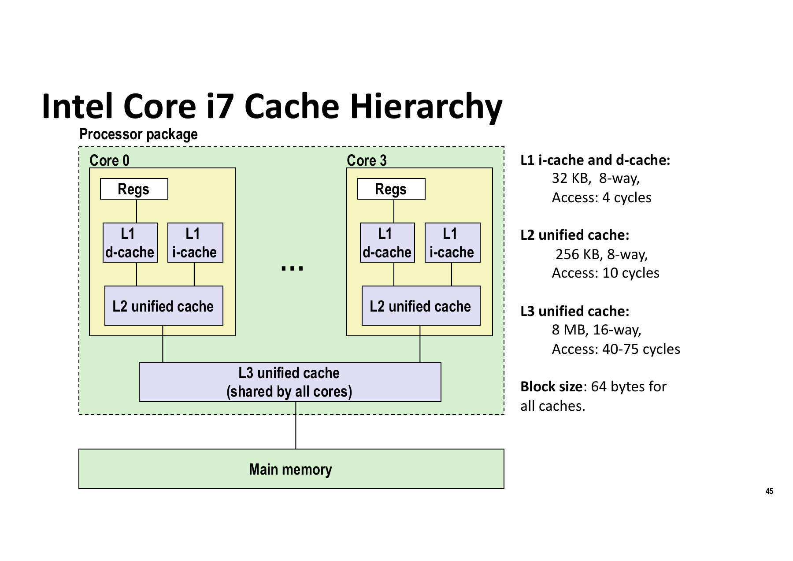
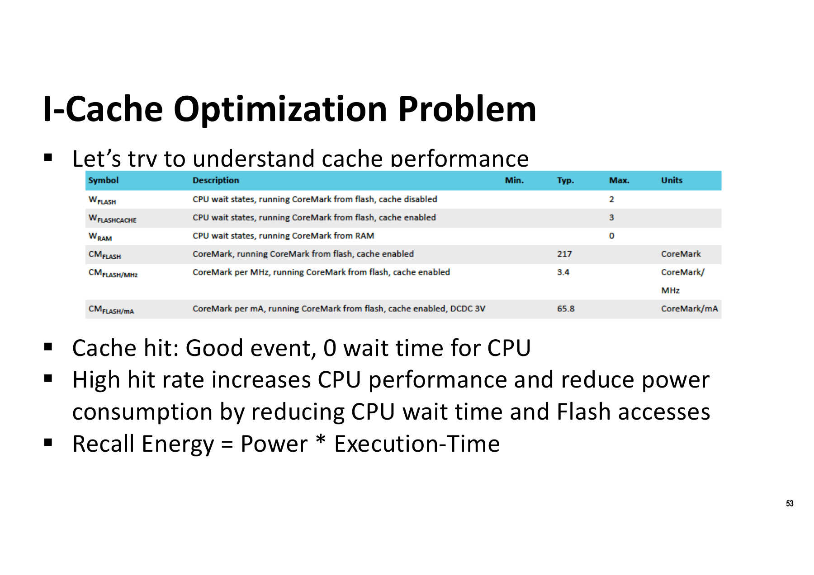

# COMP2300 Set 7 笔记 — micro:bit 硬件、特权级与中断、局部性与 Cache

> **课程**：ANU COMP2300 / COMP6300 / ENGN2219 — Computer Organisation and Program Execution
> **讲师**：Shoaib Akram
> **本 set 主题一句话**：从 micro:bit 的真实硬件出发，讲清「代码存在哪儿（Flash）、CPU 怎么绕开慢速存储（I-Cache / 代码放 SRAM）、怎么响应外部世界（特权级 / SVC / 中断 / GPIOTE / PPI / SysTick）」，并由此引出局部性原理与整个 Cache 层次结构。
> **页码**：PDF 页码 = 幻灯片右下角数字 + 1。

---

## 一、总览:这节课在讲什么

| 板块 | 内容 |
|---|---|
| micro:bit 硬件特性 | 地址空间分段、Flash 存代码、SRAM 存栈堆、memory-mapped I/O |
| 慢速 Flash 的应对 | wait states / I-Cache(硬件)/ 代码搬到 SRAM(软件) |
| 特权与异常 | Thread/Handler mode、SVC 软件陷阱、异常入栈帧 |
| 外设与中断 | GPIOTE(event/task)、NVIC、PPI(完全绕过 CPU)、SysTick |
| 局部性与 Cache | temporal/spatial locality、memory hierarchy、hit/miss、placement/replacement、direct-mapped vs n-way |
| 真实系统 | Intel i7 / AMD 3D V-Cache / Cortex-A72 / A53 / M4(无 cache)/ nRF52833 I-Cache |

> ⚠️ **P2 的 "Introduction to pipelining" 在本 set 里根本没有出现**,整个 deck 到 I-Cache 优化就结束了。流水线内容应该在 Set 8。别以为自己漏看了。

---

## 二、General Concepts:程序与地址空间

### 核心命题
- **Code + Data = Program**。Von Neumann 模型下,**代码和数据共享同一个地址空间**(与 Harvard 模型的区别是考点)。
- **Address space(地址空间)**:CPU 能生成的所有地址的集合。
- micro:bit 把地址空间**分段(partitioned into segments)**,**不同段由不同的物理技术支撑**——这是本节最重要的一句话:地址空间是逻辑视图,背后是 Flash / SRAM / 外设寄存器等异构介质。
- 代码默认放 **Flash**;**栈和堆放 SRAM**。
- **I/O 外设通过特殊地址用 LDR/STR 访问 → memory-mapped I/O**(不需要专门的 I/O 指令,这是 ARM 的选择)。

### Cortex-M 地址空间分段(P4 右侧图,已重建为表)

| 地址范围 | 段名 | 大小 |
|---|---|---|
| 0x00000000 – 0x1FFFFFFF | **Code**(micro:bit 上是 Flash) | 0.5 GB |
| 0x20000000 – 0x3FFFFFFF | **SRAM** | 0.5 GB |
| 0x40000000 – 0x5FFFFFFF | **Peripheral** | 0.5 GB |
| 0x60000000 – 0x9FFFFFFF | External RAM | 1 GB |
| 0xA0000000 – 0xDFFFFFFF | External device | 1 GB |
| 0xE0000000 – 0xE00FFFFF | **Private peripheral bus(PPB)** | 1 MB |
| 0xE0100000 – 0xFFFFFFFF | Vendor-specific memory | 511 MB |

**这张表能直接解释后面所有地址**,自己对一遍:
- GPIOTE base `0x40006000`、PPI base `0x4001F000` → 落在 **Peripheral** 段(芯片厂商 Nordic 定义)
- NVIC ISER0 `0xE000E100`、SysTick `0xE000E010` → 落在 **PPB** 段(ARM 内核定义,所有 Cortex-M 一样)

**易考点**:给一个地址问它属于哪个段 / 属于内核还是厂商外设。看 `0xE000xxxx` 就是内核,`0x4000xxxx` 就是厂商外设。

---

## 三、代码存储与执行:Flash 为什么是问题

### Flash 的定位
- 代码默认存 Flash,因为它是 **non-volatile / persistent**,断电不丢 → 所以 Flash 是**存储设备(storage)**,不是内存。
- micro:bit 上 Flash **集成在微控制器芯片上**。
- **为什么片上是 Flash 而不是 DRAM**:Flash 容易与 CMOS 工艺集成,**DRAM 不容易**。所以地址空间里才专门留了一段给 external RAM(SRAM 或 DRAM)。

### 必记的延迟数字(考点)

| 项 | 数值 |
|---|---|
| 高容量 Flash 存储设备延迟 | **微秒(µs)** 级 |
| RAM 延迟 | **纳秒(ns)** 级 |
| nRF52833 片内 Flash 读延迟 | **30–40 ns** |
| Cortex-M4 主频 | 最高 **64 MHz** |
| 一个 CPU 周期 | **15.625 ns**(= 1/64 MHz) |

**结论:30–40 ns > 15.625 ns,Flash 比一个 CPU 周期还慢** → 取指必然要等。这就是整个后半节课的动机。

### 怎么弥补这个延迟差(P8,三条路线,必背)

1. **CPU 直接等**:插入 **wait states / pipeline stalls**。能用,但低效。
2. **硬件方案:Caching**
   - **指令 cache 位于 Flash(CODE)一侧**,用来减少 CPU 等待 Flash 的次数。
   - 存放频繁访问的指令,并且能**提前预取(prefetch)**。
   - CPU 自己也有 **prefetch buffer**,用来取下一条顺序指令。
3. **软件方案:Code placement**
   - 把 **hot loops、interrupt handlers、性能关键代码**放进 **SRAM**。
   - SRAM 比 Flash 快得多。
   - 做法:把关键函数放到 **`.data` 段**,然后 branch 过去。



### Flash Memory 基础(P9/P10)

- 由 **floating gate transistor(浮栅晶体管)** 构成。
- 组织成 **page**,micro:bit 上 **1 page = 4 kB**;手册:Flash 共 **128 页 × 4 kB**(= 512 kB),通过 **ICODE 和 DCODE 总线**被 CPU 访问。
- **读**:无限次,任意粒度(micro:bit 上 byte addressable)。
- **写**:**一页只有先擦除(erase)才能被覆写**。
- **NVMC(non-volatile memory controller)** 负责写:找一个空页,把「未改动字节 + 改动字节」一起重写上去。也可通过配置寄存器操作。
- **Endurance(耐久度)有限**:**10 000 次 write/erase cycles**,超过阈值后存储器就不能正常工作了。**DRAM cell 没有这个问题**。
- 高端系统里 Flash 是通过 **system call 访问的存储设备**(micro:bit 上不是,micro:bit 直接把它映射进地址空间)。
- Flash 取代了旋转介质的机械硬盘(Flash 是半导体器件)。

**易考对比点**:

| | Flash | DRAM | SRAM |
|---|---|---|---|
| 易失性 | 非易失 | 易失 | 易失 |
| 写耐久度 | **有限(10k)** | 基本无限 | 基本无限 |
| 覆写前需擦除 | **是** | 否 | 否 |
| 与 CMOS 集成 | 容易 | 困难 | 容易 |
| micro:bit 上用途 | 代码(CODE 段) | (片外) | 栈/堆 + I-Cache |

### DRAM Bit Cell(P7,复习 Set 3)

- **DRAM = Dynamic Random Access Memory**。
- **用电容上有无电荷来存 1 bit**。
- **nMOS 晶体管当开关**,负责把电容**接上或断开 bitline**。
- **wordline 被 assert → nMOS 导通 → 存储的 bit 值在电容与 bitline 之间传输**(读或写方向都可以)。
- 教材出处:**H&H Section 5.5.2**。



---

## 四、CPU 运行模式与特权级

### 两种运行模式(P11,定义必须记准)

| 模式 | 何时进入 | 特权情况 |
|---|---|---|
| **Thread mode** | **Reset 时**进入,或**异常返回**后进入 | **Privileged 和 Unprivileged 代码都能在此运行** |
| **Handler mode** | **由异常触发**进入 | **Handler mode 下所有代码都是 privileged** |

### 特权级的核心思想
- **Unprivileged 执行:限制或排除对某些资源的访问**。
- **Privileged 执行:可访问所有资源**。

### 状态图要点(P12)
- **上电(Power ON)时永远是 Privileged Thread mode**。
- Privileged Thread → 可以**用软件切到 Unprivileged**。
- Unprivileged Thread → **不能用软件切回 Privileged**(图中标红的 "Not Possible")。这是安全机制的关键。
- 想从 Unprivileged 回到 Privileged,**只能通过异常**(如 SVC)进入 Handler mode,再由 handler 在退出前决定返回到 Privileged 还是 Unprivileged。



### SVC:进入 OS 并改变特权级(P13)

- 用户代码运行在**低特权级**。
- **SVC(Supervisor Call)指令**用于**在特权级之间切换**。
- CPU 从「某些约定的寄存器」读参数,执行特定 flavor 的 SVC 指令。
- **SVC 是一种特殊的软件异常,叫 trap(陷阱)**。
- 参数指定用户代码想要 OS 提供的**服务**;handler 根据参数调用对应函数。

**必须理解的三点(P15 Demo 清单直接对应考题)**:
1. 尝试在 Unprivileged 下写 CONTROL 寄存器切回特权级 → **不行**。
2. SVC handler 里怎么拿到 svc 参数 → **从栈上取**(因为异常入栈帧里保存了返回地址,而 SVC 指令的立即数在返回地址前一条指令里)。
3. 认清「**支持安全软件设计所需的体系结构支持**」是什么:模式分离 + 单向特权限制 + 硬件自动保存状态 + 向量化 handler。

### 异常入栈帧(P14,必背)

异常发生时,**硬件自动**把以下 8 个寄存器压栈(顺序按地址从低到高):

| 相对 SP 偏移 | 内容 |
|---|---|
| SP + 0x1C | **xPSR** |
| SP + 0x18 | **PC** |
| SP + 0x14 | **LR** |
| SP + 0x10 | **R12** |
| SP + 0x0C | R3 |
| SP + 0x08 | R2 |
| SP + 0x04 | R1 |
| SP + 0x00 | **R0** ← 异常后 SP 指向这里 |

- 内存地址**向下递减**增长;异常前 SP 指在这 8 个字之上。
- **PC 用于把控制权返回给被中断的程序**。
- **LR 存放一个特殊返回值(EXC_RETURN)**,用于返回控制权(不是普通的函数返回地址!这是易混点)。
- 记忆锚点:**R0–R3 + R12 + LR + PC + xPSR**,正好是 AAPCS 里的 caller-saved 集合 → 所以 handler 可以直接用 C 函数写,编译器负责 callee-saved 部分。

---

## 五、中断(Interrupts)

### 定义(P16)
- **由 I/O 设备(如键盘)触发的硬件异常叫 interrupt**,属于 **asynchronous exceptions(异步异常)**。
- CPU 在用户按键时收到 **notification**。
- **停止正常的取指周期,转去处理中断**。
- 和普通函数调用一样,异常必须:**保存返回地址 → 跳到某个地址 → 干活 → 清理 → 返回程序**。

### 核心区分(P17 明确标注是 quiz/exam 考点)

| | 软件 trap(SVC) | 外部中断(external interrupt) |
|---|---|---|
| 触发源 | **程序自己执行 SVC 指令** | **外部 I/O 设备**(按键、定时器等) |
| 同步性 | **同步(synchronous)**,发生在确定的指令边界 | **异步(asynchronous)**,随时可能来 |
| 可预测性 | 程序主动请求 | 程序被动被打断 |
| 目的 | 请求 OS 服务、提升特权级 | 响应外部事件 |
| handler | SVC_Handler,需要**解析参数** | ISR,通常需要**清事件寄存器** |

**必须能回答**(P17 原题):
- GPIOTE 的角色是什么?→ 把引脚电平变化转成 event / 把 task 转成引脚动作,免去 CPU 轮询。
- NVIC 的角色是什么?→ 接收 IRQ、按 IRQ 号路由到正确的 handler、管理使能与优先级。
- 硬件为保存体系结构状态做了什么?→ 自动压栈上面那 8 个寄存器。
- SVC trap handler 与 interrupt handler 的差别?→ 见上表。

### 术语表(P23,必须分清)

| 术语 | 全称 | 含义 |
|---|---|---|
| **IRQ** | Interrupt Request | **硬件(物理)信号线**,把中断送到 CPU 的 NVIC |
| **ISR** | Interrupt Service Routine | 中断处理程序 / 异常处理程序(interrupt handler、exception handler 都是它) |
| **ISER** | Interrupt Service Enable Register | 中断使能寄存器,`.set NVIC_ISER0, 0xE000E100` |

**IRQ 号 → ISER 中的位索引**(nRF52833,考试可能给代码让你反推是哪个外设):

| 外设 / 中断 | ISER 位索引 | 说明 |
|---|---|---|
| POWER_CLOCK | 0 | 电源与时钟管理 |
| RADIO | 1 | 蓝牙射频 |
| UART0 | 2 | UART 通信 |
| SPI0_TWI0 | 3 | SPI / I2C(TWI)通信 |
| **GPIOTE** | **6** | **GPIO tasks and events(如按键)** |
| TIMER0 | 8 | 通用定时器 0 |
| TIMER1 | 9 | 通用定时器 1 |
| TIMER2 | 10 | 通用定时器 2 |
| RTC0 | 11 | 实时计数器 0 |

**IRQ 号存在的意义**:每个中断源有唯一编号,**NVIC 靠它把正确的中断路由到正确的 handler**。

---

## 六、GPIOTE:GPIO Tasks and Events

### 概念(P18/P19)

- **核心价值:把 CPU 从轮询 GPIO 引脚中解放出来**。
- **Event(事件)**
  - 外设的**输出**,表示「某件事发生了」
  - 例子:**按键按下**
  - **连接到 NVIC 或 PPI**
- **Task(任务)**
  - 外设的**输入**,告诉它「去做某件事」
  - 例子:**翻转 LED**
  - **连接到 PPI**
- **GPIOTE channel**:为「某个具体引脚 ↔ 某个 task/event」提供**专用硬件通路,无需 CPU 介入**。
- 每个 channel 独立,可监视/控制不同的 GPIO 引脚。
- **共 8 个 channel,每个 channel 对应一个寄存器**。
- 你需要选择:**mode(task 还是 event)、pin、port、polarity**。

**三条优势(P19)**:
1. 免去 CPU 轮询;
2. 可以向 Cortex-M4 的中断控制器发中断;
3. **通过 PPI 可以完全绕过 CPU**——例如按键按下直接翻转 LED,CPU 全程不参与。

### GPIOTE 寄存器映射(base = `0x40006000`)

| 寄存器 | 偏移 | 说明 |
|---|---|---|
| TASKS_OUT[0..7] | 0x000 + 4n | 触发 OUT[n] task(按 POLARITY 动作) |
| EVENTS_IN[0] | **0x100** | CONFIG[0].PSEL 指定引脚产生的事件 |
| EVENTS_IN[1..7] | 0x104 … 0x11C | 同上,对应 CONFIG[1..7] |
| EVENTS_PORT | 0x17C | 多个输入引脚 SENSE 机制产生的事件 |
| **INTENSET** | **0x304** | **使能中断** |
| INTENCLR | 0x308 | 关闭中断 |
| **CONFIG[0]** | **0x510** | 配置 OUT[n]/SET[n]/CLR[n] task 与 IN[n] event |
| CONFIG[1..7] | 0x514 … 0x52C | 同上 |

> ⚠️ **别把 CONFIG[n](0x510+)当成 event/task 寄存器**。CONFIG 只是**配置**;真正的 event 寄存器是 **EVENTS_IN[n](0x100+)**,真正的 task 寄存器是 **TASKS_OUT[n](0x000+)**。这个区分在下面 PPI 那节直接决定对错。

### CONFIG[n] 寄存器位域(P20,已重建,不需截图)

| 字段 | 位 | 值 | 含义 |
|---|---|---|---|
| **MODE** | [1:0] | 0 = Disabled | PSEL 指定的引脚不被 GPIOTE 模块占用 |
| | | **1 = Event** | 引脚配置为**输入**;POLARITY 指定的操作发生时产生 **IN[n] event** |
| | | **3 = Task** | 引脚配置为**输出**;触发 SET[n]/CLR[n]/OUT[n] task 时按 POLARITY 动作。使能为 task 后引脚被 GPIOTE 占用,**GPIO 模块不能再把它当普通输出引脚写** |
| **PSEL** | [12:8] | 0..31 | 与 SET[n]/CLR[n]/OUT[n] task 及 IN[n] event 关联的 **GPIO 引脚号** |
| **PORT** | [13] | 0..1 | **端口号** |
| **POLARITY** | [17:16] | 0 = None | Task:OUT[n] 对引脚无影响;Event:引脚活动不产生 IN[n] |
| | | **1 = LoToHi** | Task:把引脚置 1;**Event:上升沿产生 IN[n]** |
| | | 2 = HiToLo | Task:把引脚清 0;Event:下降沿产生 IN[n] |
| | | **3 = Toggle** | **Task:翻转引脚**;Event:任意变化都产生 IN[n] |
| **OUTINIT** | [20] | 0 = Low / 1 = High | **仅 task mode 有效**:GPIOTE 通道配置时输出的初值(event mode 无影响) |

Reset 值 `0x00000000`,即默认 Disabled。

### 代码解读(P22 + P25,考试原型)

**(1) 配置 channel 0 监听按键 A**

```asm
.set GPIOTE_EVENTS_IN0, 0x40006100
.set GPIOTE_INTENSET,   0x40006304
.set GPIOTE_CONFIG0,    0x40006510

ldr r0, =GPIOTE_CONFIG0
ldr r1, =(1 | 14 << 8 | 0 << 13 | 1 << 16)
str r1, [r0]
```
逐字段拆解(**这是必考的位拼装题型**):

| 片段 | 字段 | 值 | 含义 |
|---|---|---|---|
| `1` | MODE[1:0] | 1 | **Event mode** |
| `14 << 8` | PSEL[12:8] | 14 | **引脚 14** |
| `0 << 13` | PORT[13] | 0 | **端口 0** |
| `1 << 16` | POLARITY[17:16] | 1 | **LoToHi = 上升沿** |

→ 「在 channel 0 上监视 (pin 14, port 0)(pin-map 里就是 **button A**),在**上升沿**产生事件」。

**(2) 使能中断**
```asm
ldr r0, =GPIOTE_INTENSET
ldr r1, =0b1                @ 使能 IN[0] 事件的中断
str r1, [r0]
```
→ 检测到事件时向 CPU 的 NVIC 发出 signal/IRQ。

**(3) 在 NVIC 里放行这个 IRQ**
```asm
ldr r0, =NVIC_ISER0         @ 0xE000E100
ldr r1, =(1 << 6)           @ GPIOTE 的 IRQ 号是 6
str r1, [r0]
```

**三步链条要背下来:GPIOTE_CONFIG(产生事件)→ GPIOTE_INTENSET(允许发 IRQ)→ NVIC_ISER(允许 CPU 接收)。少任何一步中断都不会到达 handler。**

---

## 七、PPI:完全绕过 CPU

### 概念(P24)
- **PPI(Programmable Peripheral Interconnect)** 让**外设之间自主交互**,使用 task 和 event,**与 CPU 无关**。
- 机制:**一个外设发生 event → 自动触发另一个外设的 task**,两者通过 **PPI channel** 连接。
- nRF52833 的 PPI:**20 个可配置通道 CH[0..19]** + **12 个预编程通道 CH[20..31]**,base = **`0x4001F000`**。

### 基本步骤(必背四步)
1. 用 GPIOTE 设置一个 **event**;
2. 用 GPIOTE 设置一个 **task**;
3. **不要**设置到 NVIC 的中断请求线;
4. 选一个 **PPI channel**,把 **task 和 event 寄存器的地址**告诉它。

### PPI 寄存器(P26)

| 寄存器 | 偏移 | 说明 |
|---|---|---|
| TASKS_CHG[0..5].EN / .DIS | 0x000 / 0x004 …(每组 8 字节) | 使能 / 关闭通道组 |
| **CHEN** | 0x500 | 通道使能寄存器 |
| **CHENSET** | **0x504** | 通道使能置位寄存器 |
| CHENCLR | 0x508 | 通道使能清除寄存器 |
| **CH[0].EEP** | **0x510** | **通道 0 的 event endpoint** |
| **CH[0].TEP** | **0x514** | **通道 0 的 task endpoint** |
| CH[1].EEP / .TEP | 0x518 / 0x51C | 通道 1 |
| CH[2].EEP | 0x520 | 通道 2 |

### 示例代码(P25)

```asm
@ (1) 按键按下 = event:channel 0,pin 14,port 0,LoToHi,Event mode
ldr r0, =GPIOTE_CONFIG0            @ 0x40006510
ldr r1, =(1 | 14 << 8 | 0 << 13 | 1 << 16)
str r1, [r0]

@ (2) 翻转 LED = task:channel 1(CONFIG[1] = 0x40006514)
ldr r0, =0x40006514
ldr r1, =(3 | (21 << 8) | (0 << 13) | (3 << 16))
str r1, [r0]
@ MODE=3(Task), PSEL=21, PORT=0, POLARITY=3(Toggle)

@ (3) 配置 PPI channel 0 的两个 endpoint
ldr r0, =0x4001F510                @ CH[0].EEP
ldr r1, =0x40006510
str r1, [r0]

ldr r0, =0x4001F514                @ CH[0].TEP
ldr r1, =0x40006514
str r1, [r0]
```

> ⚠️ **幻灯片错误(P25)——这段 PPI endpoint 代码是错的,别照抄**
>
> 1. **EEP/TEP 写的地址不对**。EEP 要写的是**事件寄存器**的地址,TEP 要写的是**任务寄存器**的地址。而代码写进去的 `0x40006510` / `0x40006514` 是 GPIOTE 的 **CONFIG[0] / CONFIG[1]**,那是**配置寄存器**,不是 event/task 寄存器。
>    - 正确的 EEP 应为 **`0x40006100`**(GPIOTE `EVENTS_IN[0]`)
>    - 正确的 TEP 应为 **`0x40006004`**(GPIOTE `TASKS_OUT[1]`,偏移 `0x000 + 4×1`)
> 2. **少了使能 PPI 通道这一步**。必须再写一次 `CHENSET`(`0x4001F504`)把 bit 0 置 1,通道才真正连通:
>    ```asm
>    ldr r0, =0x4001F504        @ PPI CHENSET
>    ldr r1, =(1 << 0)          @ 使能 channel 0
>    str r1, [r0]
>    ```
>
> 概念链条(event 寄存器 → PPI channel → task 寄存器)是对的,**具体地址不要背幻灯片上的**。



**GPIOTE / NVIC / PPI 三条路径对比(考点)**:

| 路径 | 数据流 | CPU 参与 |
|---|---|---|
| 轮询 | CPU 反复读 GPIO 引脚 | **全程占用 CPU** |
| GPIOTE + NVIC | 引脚 → GPIOTE event → IRQ → NVIC → ISR | **CPU 被中断,执行 handler** |
| GPIOTE + PPI | 引脚 → GPIOTE event → PPI channel → GPIOTE task → 引脚 | **CPU 完全不参与** |

---

## 八、SysTick Timer

### 概念(P27)
- 用于**调度周期性事件**(定时器到期时触发)。
- 使能后,**从 reload value 递减计数到 0**;
- 下一个时钟周期**重新装载 SYST_RVR 的值**,之后每个时钟周期继续递减;
- **向 NVIC 发中断**,若 handler 设置正确就会被执行。
- ⚠️ **不要与 CLOCK 混淆**:CLOCK 在 **CPU 外部**,用**晶振(crystal oscillator)** 产生处理器时钟信号;SysTick 是内核里的计数器外设。

### 寄存器(P28)

| 地址 | 名称 | 类型 | 权限 | 复位值 | 说明 |
|---|---|---|---|---|---|
| `0xE000E010` | **SYST_CSR** | RW | Privileged | 0x00000000 | 控制与状态寄存器 |
| `0xE000E014` | **SYST_RVR** | RW | Privileged | Unknown | 重装载值寄存器 |
| `0xE000E018` | **SYST_CVR** | RW | Privileged | Unknown | 当前值寄存器 |
| `0xE000E01C` | SYST_CALIB | **RO** | Privileged | 实现定义 | 校准值寄存器 |

> 小坑:P27 说 "Three memory mapped registers",但手册表里有四个。第四个 **SYST_CALIB 是只读的校准寄存器**,软件配置时用不到,所以讲义只算三个。

### SYST_CSR 位域

| 位 | 名称 | 含义 |
|---|---|---|
| [16] | **COUNTFLAG** | 上次读取以来计数器是否归零过 |
| [2] | **CLKSOURCE** | 时钟源选择 |
| [1] | **TICKINT** | 计数到 0 时是否产生 SysTick 异常 |
| [0] | **ENABLE** | 使能计数器 |

其余为 Reserved。

### 标准初始化代码(P28,套路化,背下来)

```asm
main:
    ldr r0, =0xE000E014     @ SYST_RVR
    ldr r1, =0x????         @ 装入 reload 值(决定周期)
    str r1, [r0]

    ldr r0, =0xE000E018     @ SYST_CVR
    mov r1, #0              @ 清当前值(写任意值都会清零)
    str r1, [r0]

    ldr r0, =0xE000E010     @ SYST_CSR
    ldr r1, =0x00000007     @ ENABLE | TICKINT | CLKSOURCE 三位全 1
    str r1, [r0]

    bx lr

SysTick_Handler:
    @ do something
    bx lr
```

**顺序有讲究:先设 RVR → 再清 CVR → 最后写 CSR 使能**。反过来会用到未定义的当前值。`0x7 = 0b111` 正好是低三位全开。

---

## 九、局部性原理(Locality)

### 定义(P30,必背)

**Principle of Locality:程序倾向于访问「与最近访问过的地址相同或相邻」的数据和指令。**

| 类型 | 定义 |
|---|---|
| **Temporal locality(时间局部性)** | **最近被引用过的项,很可能在不久的将来再次被引用** |
| **Spatial locality(空间局部性)** | **地址相邻的项,倾向于在时间上相近地被引用** |

### 经典例子(P31,考试直接考这个)

```c
sum = 0;
for (i = 0; i < n; i++)
    sum += a[i];
return sum;
```

| 引用类型 | 具体行为 | 局部性 |
|---|---|---|
| **数据引用** | 依次访问数组元素(**stride-1 访问模式**) | **空间局部性** |
| | 每次迭代都引用变量 `sum` | **时间局部性** |
| **指令引用** | 按顺序执行指令 | **空间局部性** |
| | 循环体被反复执行 | **时间局部性** |

**记忆法**:「**遍历 → 空间;重用 → 时间**」。数据和指令**各有一份**空间 + 时间局部性,别只答一半。

---

## 十、存储层次(Memory Hierarchy)

### 为什么会有层次(P32,三条基本性质)

1. **更快的存储技术:每字节更贵、容量更小、功耗更高(发热!)**;
2. **CPU 与主存的速度差距在持续拉大**;
3. **写得好的程序倾向于表现出良好的局部性**。

**这三条性质彼此完美互补** → 提示了一种组织存储系统的方式:**memory hierarchy**。

### 层次结构(P33)

| 层级 | 内容 | 技术 |
|---|---|---|
| L0 | Registers | — |
| L1 | L1 cache | SRAM |
| L2 | L2 cache | SRAM |
| L3 | L3 cache | SRAM |
| L4 | Main memory | DRAM |
| L5 | Local secondary storage | 本地磁盘 |
| L6 | Remote secondary storage | Web servers 等 |

**向上:更小、更快、每字节更贵;向下:更大、更慢、每字节更便宜。**
**每一层都从下一层取数据**:寄存器从 L1 取 word,L1 从 L2 取 cache line,……,主存从本地磁盘取 disk block,本地磁盘从远程服务器取文件。



### Cache 的一般定义(P34)

- **Cache:一个更小、更快的存储设备,充当更大、更慢设备中「数据子集」的暂存区(staging area)。**
- **存储层次的根本思想:对每个 k,第 k 层这个更快更小的设备,充当第 k+1 层那个更大更慢设备的 cache。**
- **为什么有效**:由于局部性,程序访问第 k 层数据的频率**远高于**访问第 k+1 层;因此第 k+1 层可以更慢,从而更大更便宜。
- **Big Idea(原话很值钱)**:存储层次创造了一个**大池子**,它的**成本接近底层的廉价存储**,但**向程序供数的速率接近顶层的快速存储**。

### Cache 怎么工作(P35)

- Cache memories 是**小而快的 SRAM 存储器,由硬件自动管理**(对软件透明)。
  - 保存主存中频繁访问的 block;
  - **CPU 先查 cache,再查内存**。
- **实现技术对应关系(必记)**:

| 层次 | 器件 |
|---|---|
| Cache | **SRAM cell** |
| Main memory | **DRAM cell** |
| Storage(非易失/持久) | **Flash memory cell** |

- 高性能系统:**SRAM cache 后面是 DRAM 内存**。
- **micro:bit:一个 SRAM 指令 cache 后面是 Flash(code)存储器**。← 这就是本 set 前后两半内容的接缝,考点。

### 一般 Cache 概念:Hit 与 Miss(P36–P38)

**基本模型**:
- 慢速大容量存储被**划分为 block**;
- Cache 只缓存其中的**一个子集**;
- 数据以 **block 为单位**在层间传输;
- **block 做得大是为了利用空间局部性**。

**Hit(P37)**:请求 block 14 → block 14 在 cache 中 → **命中**。

**Miss(P38)**:请求 block 12 → 不在 cache 中 → **缺失** → 从内存取回 block 12 → 存入 cache。此时涉及两个策略:
- **Placement policy(放置策略):决定 b 放在哪里**;
- **Replacement policy(替换策略):决定哪个 block 被逐出(victim)**。







---

## 十一、Cache 性能(必考计算)

### 三个指标(P39)

| 指标 | 定义 | 典型值 |
|---|---|---|
| **Miss Rate** | **misses / accesses = 1 − hit rate** | **L1: 3–10%**;L2 可以很小(如 < 1%) |
| **Hit Time** | 把 cache 中一行送到处理器的时间,**包含判断是否命中的时间** | **L1: 4 周期;L2: 10 周期** |
| **Miss Penalty** | 因为 miss 而**额外**需要的时间 | **主存:50–200 周期(趋势:还在增加!)** |

### 必记公式

```
Miss Rate = 1 − Hit Rate

平均访问时间 = Hit Time + Miss Rate × Miss Penalty
```

### 经典算例(P40,几乎必考)

设 **hit time = 1 周期,miss penalty = 100 周期**:

| 命中率 | 计算 | 平均访问时间 |
|---|---|---|
| 97% | 1 + 0.03 × 100 | **4 周期** |
| 99% | 1 + 0.01 × 100 | **2 周期** |

**结论:99% 命中率比 97% 快了整整一倍。**

**为什么用 "miss rate" 而不是 "hit rate"**:97% → 99% 看起来只差 2 个百分点,但 miss rate 从 3% 降到 1% 是**降到三分之一**,性能差异被 hit/miss 之间**高达 100 倍**的差距放大了。**hit rate 会掩盖真实差距,miss rate 不会。**

---

## 十二、放置与替换策略(Placement & Replacement)

### Cache line 与 tag(P42)

- **Cache line:一个数据 block 关联一个 tag(内存地址的一部分)**。
- 因为 tag 位与数据一起存储,**这类 cache 被称为 associative cache(相联 cache)**。
- 地址中一部分位用来**在 block 内定位字节**,另一部分用来**决定 block 放在哪个位置**。

### 两种极端(必背对比表)

| | **n-way set-associative** | **Direct-mapped(n = 1)** |
|---|---|---|
| 放置规则 | 慢速层的每个 block 可放在快速层 **n 个可能位置**中的一个 | 慢速层的每个 block **只能放在唯一一个位置** |
| 别名 | n 路组相联 | 1-way set-associative |
| 放置自由度 | **大** | 无 |
| 硅面积/成本 | **更多**(需要更多比较器) | **实现简单** |
| Miss rate | **低**(hit rate 高) | **高**(冲突频繁,hit rate 低) |

- **Replacement policy 在 cache 满时才需要**,例如 **LRU(least recently used,最近最少使用)**。
- 注意:direct-mapped 严格来说不需要替换策略选择——位置唯一,只能踢掉那一个。

### 地址切分(P43/P44,考试原型)

假设 **cache block size = 8 bytes,direct mapped(每个 set 一行)**:

```
地址结构:  |  t bits (tag)  |  set index  |  block offset  |
                             (0…01)          (100)
```

- **block offset**:block size = 8 bytes → 需要 **log₂8 = 3 位**(图中 `100` = 字节 4)
- **set index**:选择哪个 set(direct-mapped 下每个 set 只有一行)
- **tag**:剩余高位,与该行存的 tag 比较

**命中判定:`valid == 1` 且 `tag 匹配` → hit。**
按图中例子:offset = `100` = 4 → 这个 **4 字节的 int 位于 block 内字节 4–7**。
**若 tag 不匹配:旧行被逐出并替换(evicted and replaced)。**


---

## 十三、为什么要多级 Cache(P45)

- **Smaller is faster** —— 计算机体系结构的通用原则。
- 极快的 SRAM cache 放在**离 CPU 最近**处;
- 后续层级用**逐渐变慢**的 SRAM,在**成本与性能之间平衡**;
- 结果就是 **典型 3 级的 cache 层次**。

| 级别 | 容量 | 访问延迟 |
|---|---|---|
| **L1** | **几十 KB** | **1 个时钟周期**(讲义此页说法) |
| **L2** | — | **~10 周期** |
| **L3** | — | **~30 周期** |

- L1 的目标:**CPU 永远不为下一条指令或数据 stall(等待)**。
- **L1 被拆成两个 cache:instruction cache 和 data cache**(**split L1**,这是考点;L2/L3 通常是 unified)。

> ⚠️ **幻灯片前后矛盾**:P45 说 L1 访问延迟是 **1 个时钟周期**,但 P39 的典型值表和 P46 的 Intel i7 数据都说 L1 是 **4 个周期**。
> 怎么理解:**1 周期**是「理想化的教学说法/流水线视角下的吞吐」,**4 周期**是真实处理器的 load-use latency。答题时看清楚题目引用的是哪一页;如果没指定,写 **L1 ≈ 1–4 周期,L2 ≈ 10 周期,L3 ≈ 30–75 周期** 并说明来源更稳。

---

## 十四、真实系统的 Cache 层次

### Intel Core i7(P46,已重建为表)

| Cache | 容量 | 相联度 | 访问延迟 | 共享情况 |
|---|---|---|---|---|
| **L1 i-cache / d-cache** | **32 KB** 各一个 | **8-way** | **4 周期** | **每核私有,split** |
| **L2 unified** | **256 KB** | **8-way** | **10 周期** | 每核私有,**unified** |
| **L3 unified** | **8 MB** | **16-way** | **40–75 周期** | **所有核共享** |

**所有 cache 的 block size 均为 64 bytes。**

**规律(记这个比记数字有用)**:**越往下 → 越大、相联度越高、越慢、越倾向于共享和 unified。**



### ARM Cortex-A72(P48)
- **L1:48 KB I-Cache(带 parity) + 32 KB D-Cache(带 ECC)**,每核私有,split。
- **L2:512 KB ~ 4 MB,带 ECC**,多核共享。
- 另有 ARMv8-A 32b/64b CPU、NEON SIMD 引擎、FPU、ACP、SCU、128-bit AMBA 4 ACE / AMBA 5 CHI 一致性总线接口。

### ARM Cortex-A53(P49,**延迟数字是重点**)

| 层级 | 延迟 |
|---|---|
| **L1 hit** | **3.4 ns** |
| **L2 hit** | **16.6 ns** |
| **Main memory access** | **154 ns** |

结构:4 个核各有私有 L1 → 共享 L2 → 主存。
**注意这里给的是绝对时间(ns)而不是周期数**,和 i7 那张表的单位不同,别混用。**L1 : L2 : 主存 ≈ 1 : 5 : 45**,这个比例关系比绝对值更值得记。

### AMD EPYC 7003X Milan-X / 3D V-Cache(P47)
- 每 CCD **8 核**,每核 **32 K I-Cache + 32 K D-Cache(8-way)**,**私有 512 K L2**。
- Zen3:**8 核共享 32 MB L3**,16-way 组相联,每核 32 B/cycle 接口,DECTED ECC。
- Zen3+ V-Cache:**堆叠后共享 L3 最高 96 MB**,>2 TB/s L3 带宽,**+4 周期延迟代价**。
- 要点:**3D 堆叠让 L3 容量翻三倍,代价只是 4 个周期** —— 容量 vs 延迟权衡的现实案例。

### ARM Cortex-M4 / micro:bit(P50–P51)
- **micro:bit 上的 CPU 没有 cache** ☹
- **但是……** 芯片上仍有 cache,只不过它**不在 CPU 里,而在 Flash(NVMC)一侧** → 见下一节。

---

## 十五、nRF52833 的 I-Cache

### 位置与配置(P52)

- **可以为 NVMC 中的 ICODE 总线启用一个指令 cache(I-Cache)**。
- 也就是说:**指令 cache 位于 Flash 存储器一侧**,而不是 CPU 内部。这是与通用处理器最大的结构差异。
- **启用 cache 是一种权衡(tradeoff)**,所以硬件**暴露了 profiling 寄存器**来跟踪 hit/miss rate,让你**基于数据做决定**。

**ICACHECNF(地址偏移 `0x540`,I-code cache configuration register,复位值 `0x00000000`)**:

| 字段 | 位 | 值 | 含义 |
|---|---|---|---|
| **CACHEEN** | [0] | 0 = Disabled | **关闭 cache,并使所有 cache entry 失效(invalidate)** |
| | | 1 = Enabled | 启用 cache |
| **CACHEPROFEN** | [8] | 0 = Disabled | 关闭 cache profiling |
| | | 1 = Enabled | 启用 cache profiling |

### Profiling 寄存器(P53)

| 寄存器 | 偏移 | 说明 |
|---|---|---|
| **IHIT** | **0x548** | I-code cache **hit** 计数器,字段 HITS(RW) |
| **IMISS** | **0x54C** | I-code cache **miss** 计数器,字段 MISSES(RW) |

两者复位值均为 `0x00000000`,且 **可写,但只能写 `0`**(即只能清零,不能设成任意值)。

**手册补充(P56 引文)**:启用 profiling 后,**每次指令 cache 命中/缺失,IHIT/IMISS 分别递增**。**这两个寄存器到达最大值后不会回绕(do not wrap around)**;如果达到了最大值,应该**缩短 profiling 时长**才能得到正确数字。

> 易考陷阱:计数器**不回绕** ≠ 溢出后归零。达到上限就一直停在上限,数据从此失真。

### I-Cache 优化问题(P54–P56)

**nRF52833 数据手册关键参数(已重建为表,考点)**:

| 符号 | 描述 | 数值 | 单位 |
|---|---|---|---|
| **W_FLASH** | 从 flash 运行 CoreMark,**cache 关闭**时的 CPU wait states | **Max 2** | — |
| **W_FLASHCACHE** | 从 flash 运行 CoreMark,**cache 开启**时的 CPU wait states | **Max 3** | — |
| **W_RAM** | 从 **RAM** 运行 CoreMark 的 CPU wait states | **Max 0** | — |
| CM_FLASH | 从 flash 运行 CoreMark(cache 开启) | 217(typ) | CoreMark |
| CM_FLASH/MHz | 每 MHz 的 CoreMark | 3.4 | CoreMark/MHz |
| CM_FLASH/mA | 每 mA 的 CoreMark(DCDC 3V) | 65.8 | CoreMark/mA |

**这张表最反直觉、也最容易考的一点**:
> **W_FLASHCACHE(3) > W_FLASH(2)**。开了 cache,**miss 时的等待反而比不开 cache 更长**(多了查 cache 那一步)。

由此推出两句结论:
- **Cache hit:好事件,CPU 等待时间为 0。**
- **Cache miss:坏事件,等待时间比 cache 关闭时更长** —— **这就是 block size 重要的原因**(大 block 用空间局部性摊薄 miss 成本)。

**性能与功耗的双重收益**:
- **高命中率既提升 CPU 性能,又降低功耗**——因为同时减少了 **CPU 等待时间**和 **Flash 访问次数**。
- 回忆公式:**Energy = Power × Execution-Time**。缩短执行时间本身就省能量。
- 但 **cache 本身开启时也要耗电流**。所以是一个净收益判断:
  > **如果「减少 Flash 访问带来的平均电流下降」大于「cache 自身的功耗需求」,那么执行该程序代码的平均电流就会下降。**

**优化的责任该放在哪(P56,开放性讨论题)**:

| 方案 | 优势 |
|---|---|
| **硬件控制器** | 可以跟踪 cache 命中率,**自动开关 cache,对软件透明** |
| **软件(程序)** | **更了解每个函数的行为(程序员的洞察)** |

> **"Where to place the burden of optimization is an important research question."** 这句话是本 set 的收尾,属于开放式讨论题的标准答法素材:硬件透明但短视,软件有全局语义但需要人工介入。



---

## 十六、发现的幻灯片问题汇总

| 页码 | 问题 | 说明 |
|---|---|---|
| **P25** | **PPI endpoint 地址写错** | EEP/TEP 写入的是 GPIOTE 的 **CONFIG[0]/CONFIG[1]**(`0x40006510` / `0x40006514`),而非 **EVENTS_IN[0]**(`0x40006100`)/ **TASKS_OUT[1]**(`0x40006004`)。 |
| **P25** | **缺少 PPI 通道使能** | 没有写 `CHENSET`(`0x4001F504`),channel 0 实际不会生效。 |
| **P39 vs P45** | **L1 延迟自相矛盾** | P39/P46 说 4 周期,P45 说 1 周期。 |
| **P27** | 说 "Three memory mapped registers" | 手册表里有 4 个(第 4 个 SYST_CALIB 是 RO,不参与配置)。 |
| **P55** | 句子表述混乱 + 重复词 | "more wait time for CPU than cache enabled" 应为 "than when cache is **disabled**";"the the average current" 重复了 "the"。 |
| **P8 / P52** | 措辞不严谨 | "instruction cache is **inside** Flash memory" —— 严格说 I-Cache 在 **NVMC / ICODE 总线**一侧,不在 Flash 阵列内部。理解为「在 Flash 侧而非 CPU 侧」即可。 |
| **P2** | 承诺了 pipelining | 本 deck 完全没有流水线内容。 |
| **P9** | endurance 表未标注上下文 | "10 000 write/erase cycles" 是**每页**的耐久度,幻灯片未说明。 |

---

## 十七、全 Set 必背清单(考前 10 分钟版)

1. **PDF 页码 = 幻灯片编号 + 1**(整理笔记用)。
2. **Flash 30–40 ns > CPU 周期 15.625 ns(64 MHz)** → 必须等 → 三条对策:wait states / I-Cache / 代码放 SRAM。
3. **Thread mode 可特权可非特权;Handler mode 全部特权;Unprivileged 不能用软件切回 Privileged**。
4. **异常入栈帧 8 个寄存器:R0, R1, R2, R3, R12, LR, PC, xPSR**(地址由低到高)。
5. **SVC = 同步软件 trap;interrupt = 异步硬件异常**。
6. **GPIOTE:event 是外设输出,task 是外设输入;CONFIG 位域 MODE[1:0] / PSEL[12:8] / PORT[13] / POLARITY[17:16] / OUTINIT[20]**。
7. **中断三步链:GPIOTE_CONFIG → GPIOTE_INTENSET → NVIC_ISER0(GPIOTE IRQ = 6)**。
8. **PPI 让 event 直接触发 task,CPU 完全不参与**。
9. **SysTick 初始化顺序:RVR → CVR(清零)→ CSR = 0x7**。
10. **Temporal = 重用;Spatial = 相邻。数组遍历例子里数据和指令各有两种局部性**。
11. **平均访问时间 = Hit Time + Miss Rate × Miss Penalty**;经典算例 97% → 4 周期,99% → 2 周期。
12. **Direct-mapped:简单、miss rate 高;n-way:硅面积大、miss rate 低;满了才需要 LRU**。
13. **地址切分:tag | set index | block offset**;offset 位数 = log₂(block size)。
14. **SRAM → cache,DRAM → 主存,Flash → 存储设备**。
15. **micro:bit 的 I-Cache 在 Flash(NVMC/ICODE)侧,不在 CPU 里;M4 内核本身无 cache**。
16. **W_FLASHCACHE(3) > W_FLASH(2)**:开 cache 后 miss 更贵,所以命中率与 block size 才是关键。

---
