# COMP2300 Set 8 笔记 — 流水线、冒险与分支预测

> **课程**：ANU COMP2300 — Computer Organisation and Program Execution
> **讲师**：Shoaib Akram
> **本 set 主题一句话**：把单周期 ARM 微架构切成 5 级流水线（F/D/E/M/W），用 pipeline register 隔离各级以提升吞吐；随之而来的 structural / data / control 三类 hazard 分别用 forwarding、stalling、flushing 和分支预测来化解，最后扩展到 superscalar 与动态分支预测。
> **页码**：`set8.pdf` 共 143 页；PDF 页码 = 幻灯片右下角数字 + 1（不少页隐藏了编号，以 PDF 页码为准）。

---

## 一、为什么要流水线：latency vs. throughput

### 1.1 电路的两个速度指标

| 指标 | 定义 | 单位 |
|---|---|---|
| **Latency（延迟）** | 产生**一组**输出所需的时间 | 秒 |
| **Throughput（吞吐）** | 单位时间处理的输入组数 | 组/秒 |

并行是提升 throughput 的关键手段。**注意这两个指标可以完全解耦**——这是本 set 的核心直觉。

### 1.2 两种并行

| 类型 | 做法 | Latency | Throughput | 硬件成本 |
|---|---|---|---|---|
| **Spatial Parallelism（空间并行）** | 复制 N 份完整硬件 | 不变，仍是 L | N/L（加速比 = N） | N 倍硬件 |
| **Temporal Parallelism = Pipelining（时间并行）** | 把电路切成 M 个等长 stage，插寄存器 | **不变甚至变长** | M/L（理想加速比 = M） | 只多了 pipeline register |

> **必记结论**：
> - Spatial parallelism **不降低** latency。每个任务仍要 L 秒，只是同一时间能干更多任务。
> - Pipelining **也不降低** latency，甚至因为寄存器的 sequencing overhead 和「按最慢 stage 定 Tc」而**增加**单条指令的 latency。
> - **流水线的挑战：找到长度相等的 stage。** 不等长 → internal fragmentation（内部碎片），Tc 被最慢的那一级拖死。

### 1.3 Cookie 例子（必考的直觉题）

任务：Roll cookies 5 min → Bake 15 min。总 latency = 20 min。

| 场景 | Latency | Throughput | 说明 |
|---|---|---|---|
| 无并行（Ben only） | 20 min（1/3 h） | **3 盘/小时** | 每 20 min 一盘 |
| 空间并行（Ben + Jon，各有烤箱） | 20 min（不变） | **6 盘/小时** | 硬件复制，翻倍 |
| 流水线（Ben only，滚下一盘时上一盘在烤） | 20 min（不变） | **4 盘/小时** | 每 15 min 进一盘（受限于最慢 stage） |
| 空间 + 时间并行 | 20 min（不变） | **8 盘/小时** | 两条流水线 |

> **考点细节**：流水线场景下，第一个小时 Ben 会**损失 5 分钟**来「填充流水线」（fill time）。理想吞吐 = 60/15 = 4，但真正达到稳态需要预热。

### 1.4 洗衣房例子

Wash → Dry → Fold → Hang，各 30 min。
- Sequential：每 2 小时开一批。
- Pipelined：每 30 min 开一批 → **理想加速比 = 4**。
- 但只洗 3 批（Alice/Bob/Tim）时，**实际加速比只有 2**，因为 fill + drain 占比太大。

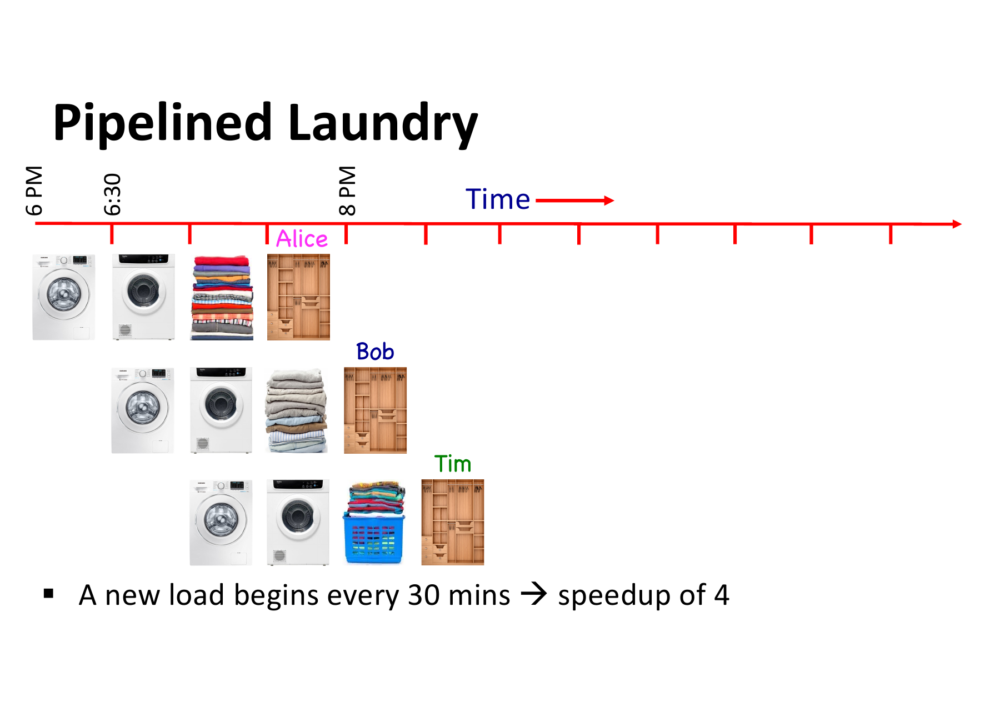

### 1.5 流水线化电路的三步

1. 把大的组合电路切成更短的 stage。
2. 在 stage 之间**插入寄存器**——上一级的输出被存进寄存器，传给下一级。
3. 用**更高的时钟频率**跑（Tc 由最慢 stage 决定，而不是整条组合路径）。

---

## 二、五级流水线微架构

### 2.1 五个 stage

| 缩写 | 全名 | 干什么 |
|---|---|---|
| **F** | Fetch | 从 instruction memory 取指，PC ← PC+4 |
| **D** / DE / DEC / RF | Decode / RF-Read | 译码 + 读寄存器堆 + 立即数扩展 |
| **E** / EX | Execute | ALU 运算 / 计算地址 / 判断条件 |
| **M** / MEM | Memory | 访问 data memory（LDR/STR） |
| **W** / WB | Writeback | 结果写回寄存器堆 |

### 2.2 核心思想（Key Idea）

- 任何一个周期里，流水线中**最多可以有 5 条指令**，各处于不同 stage。目的是**最大化硬件资源利用率**。
- 各 stage 必须用 **pipeline register（PPR，非架构寄存器）** 互相隔离。
- **每个周期，一个 stage 的工作成果必须被保存进它的 PPR。**
- PPR 是下一个 stage 在后续周期取数据的来源。
- **如果流水线下游的任何 stage 需要上游的数据，这个数据必须一路穿过所有 PPR 传下去。** ← 这条是后面 WA3 bug 的伏笔。

### 2.3 PPR 命名

- **PC 本身就是 Fetch PPR。**
- F↔D 之间：**Decode PPR**
- D↔E 之间：**Execute PPR**
- E↔M 之间：**Memory PPR**
- M↔W 之间：**Writeback PPR**

信号命名约定：加后缀 **F / D / E / M / W** 表示该信号当前所在的 stage。例如 `InstrD`、`ALUResultE`、`ALUOutM`、`ResultW`、`WA3E`。

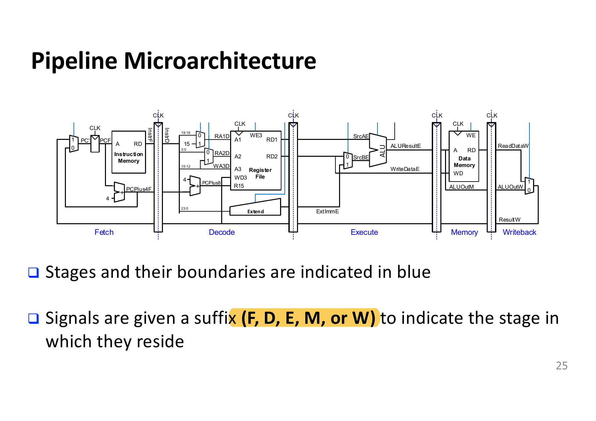

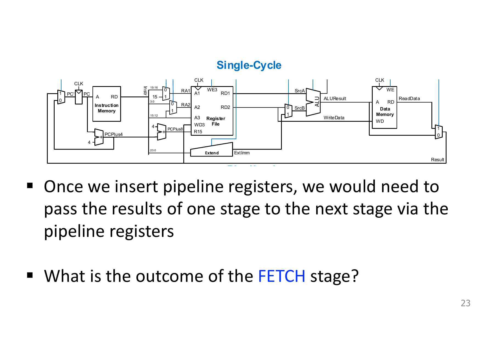

### 2.4 各 PPR 之间到底传什么（易考）

| 边界 | 传递的内容 |
|---|---|
| **F → D** | Instruction、PC+4 |
| **D → E** | 两个寄存器读出值（RD1/RD2）、扩展后的立即数（ExtImm） |
| **E → M** | `ALUResultE`、`WriteDataE` |
| **M → W** | ALU 结果 `ALUOutM`、内存读出数据 `ReadDataW` |

> `WriteDataE` 是从 RF 读出的寄存器之一，M 阶段在执行 **STR** 时需要它来写内存 —— 所以它必须被一路传到 M。

> **Think 题（幻灯片留给你的）**：每个 pipeline register 的宽度是多少？把上表每一项的位宽加起来即可。

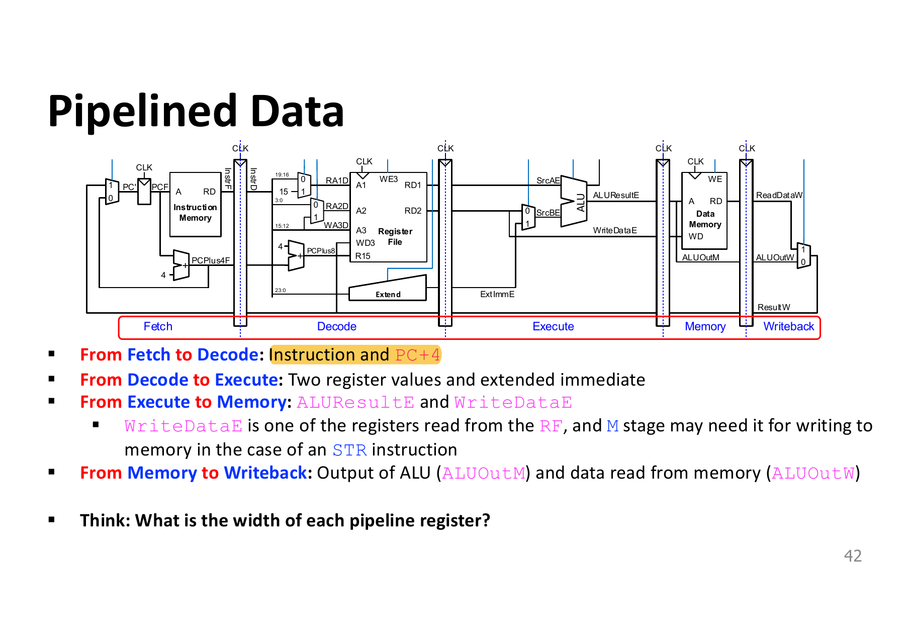

### 2.5 逐周期运行（Pipeline Operation）

例程：

```armasm
I1: ADD R0, R5, #10
I2: ADD R1, R5, #10
I3: ADD R2, R5, #10
I4: STR R0, [R7, #4]
I5: STR R1, [R7, #8]
I6: STR R2, [R7, #12]
```

PDF **P28–P38** 是 Cycle 1 到 Cycle 10 的逐周期数据通路走查（每页一个周期）。**不需要每页都截**——挑一张「流水线满载」的代表图即可，规律看懂就行：

- Cycle 1–4：填充（fill），流水线未满。
- **Cycle 5：流水线满载**（F=I5, D=I4, E=I3, M=I2, W=I1），"Is the pipeline fully utilized? **YES**"。
- Cycle 6–10：排空（drain）。

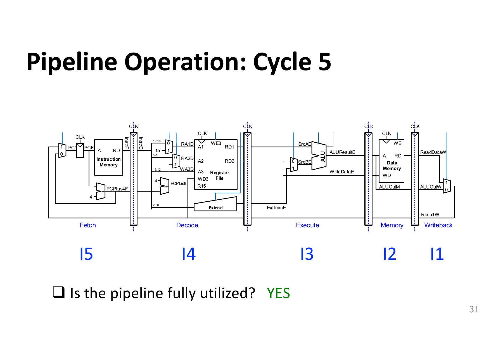

---

## 三、WA3 Bug：一个必考的设计缺陷

### 3.1 Bug 是什么

**错误位置：Writeback 阶段的寄存器堆写逻辑。**

在最初的流水线数据通路里，写目标寄存器号 **WA3（来自 Instr[15:12]）在 Decode 阶段产生后，没有被流水化下去**。Writeback 阶段用的是**当前在 Decode 阶段那条指令**的 WA3，而不是**正在写回**那条指令的 WA3。

示例序列：

```armasm
LDR  R2,  [R0, #40]
ADD  R3,  R9, R10
SUB  R4,  R1, R5
AND  R5,  R12, R13
STR  R6,  [R1, #20]
ORR  R7,  R11, #42
```

Cycle 5 时 `LDR R2` 处于 Writeback，但此刻 Decode 阶段是 `AND R5, R12, R13`。于是 LDR 的结果被**错误地写进 R5 而不是 R2**。

### 3.2 修正

> **`WA3` 信号必须沿着 Execute → Memory → Writeback 一路流水化**（变成 `WA3D → WA3E → WA3M → WA3W`），才能和指令的其余部分保持同步。

这正是 §2.2 那条原则的直接应用：**下游需要的上游数据，必须穿过 PPR**。

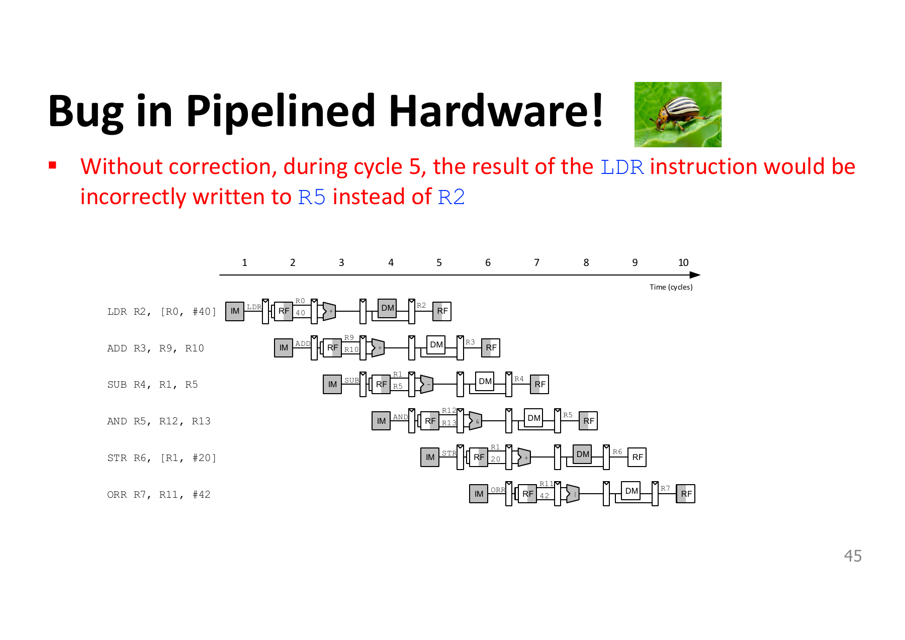

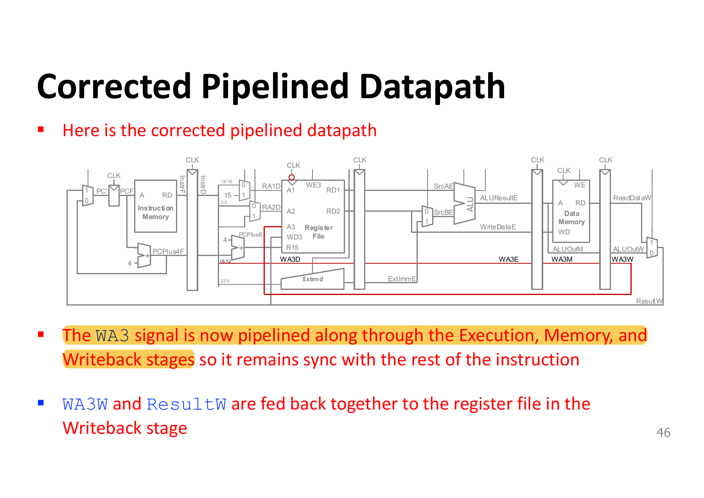

### 3.3 优化版数据通路

用**已经更新为 PC+4 的 `PCPlus4F`** 来产生 `PCPlus8D`，从而**省掉一个加法器**。

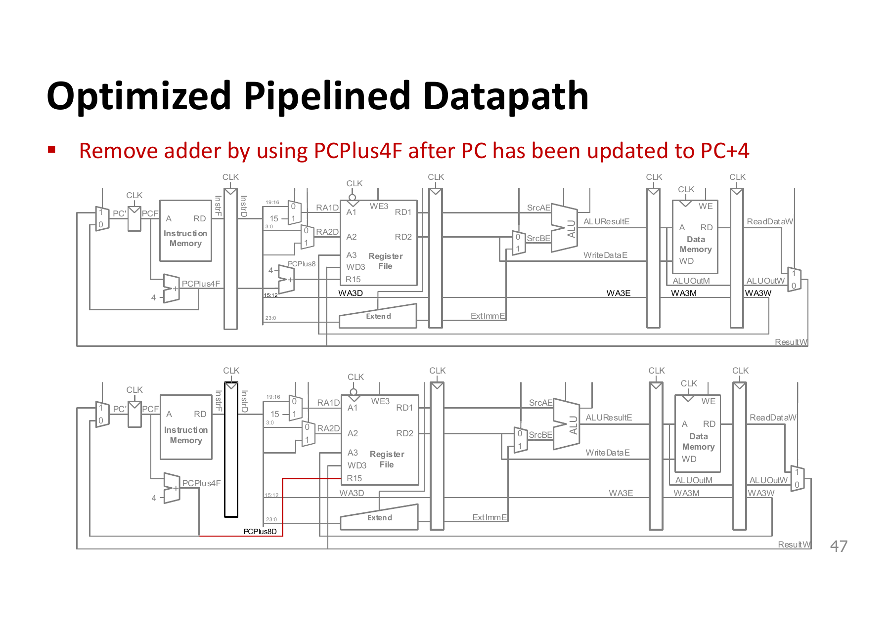

---

## 四、流水线的控制单元

- **控制信号和单周期处理器完全相同**，因此**沿用同一个 control unit**。
- Control unit 在 **Decode 阶段**检查指令的 `Op` 和 `Funct` 字段来产生控制信号。
- **这些控制信号必须和数据一起被流水化下去**（`RegWriteD → RegWriteE → RegWriteM → RegWriteW` 等）。
- Control unit 还会检查 `Rd` 字段（这是一条**反向流**）。
- **`RegWrite` 和 `WA3` 需要特殊处理**（backward flow，从 W 阶段流回 RF 的写端口）。

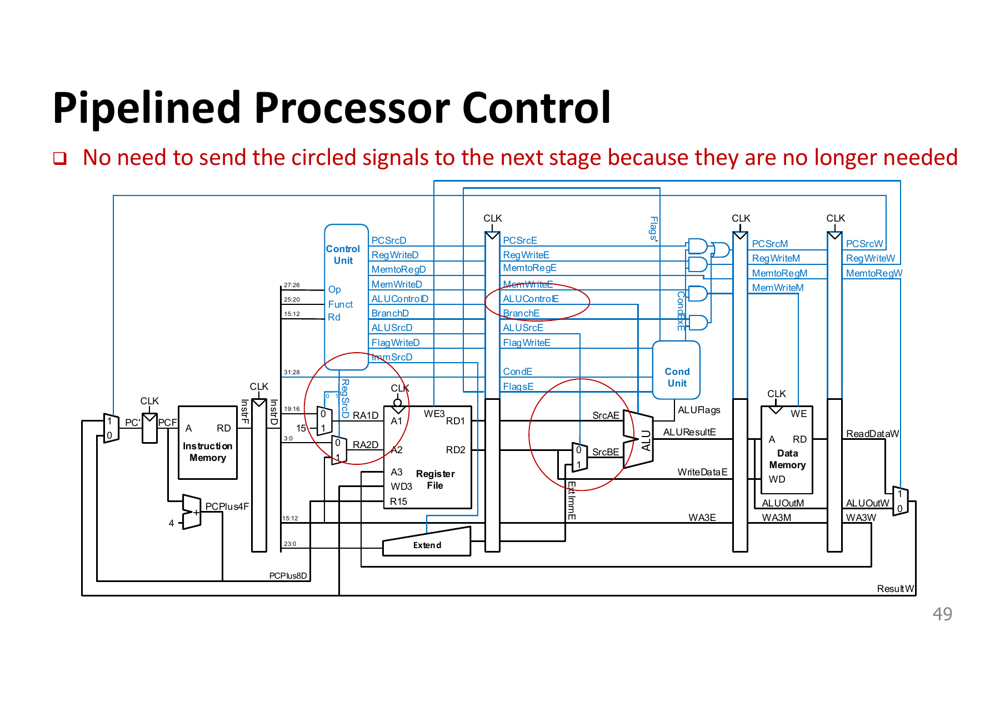

---

## 五、性能分析

### 5.1 CPI / IPC 与 fill / drain

上面 6 条指令的例子用了 **10 个周期**：

- **CPI = 10 / 6 = 1.66**
- **IPC = 6 / 10 = 0.6**

理想情况下我们希望 **IPC ≈ 1**（每周期完成一条指令）。为什么达不到？

- **Pipeline fill time**：填满流水线、让它满效率运转所需的时间。
- **Pipeline drain time**：流水线里没有新工作可做时浪费掉的时间。

**这两者只有在「工作量相对流水线级数很小」时才致命。**

### 5.2 摊销（必记公式）

对 5 级流水线、N 条指令：

$$\text{CPI} = \frac{N + (\text{stages} - 1)}{N} = \frac{N + 4}{N}$$

- N = 6 → CPI = 10/6 = 1.66
- **N = 10⁹ → CPI = (10⁹ + 4)/10⁹ ≈ 1**

> **结论**：真实程序执行数十亿条指令，fill/drain 的开销被完全摊销掉。

### 5.3 Timing Diagram：single-cycle vs. pipelined

基于教材 Table 7.5 的逻辑元件延迟：

| 微架构 | 每条指令占用 | 吞吐（IPS） |
|---|---|---|
| **Single-cycle** | 680 ps（整条组合路径） | 1 / 680 ps = **1.47 G instr/s** |
| **Pipelined** | 200 ps（**由最慢的 stage 决定**） | 1 / 200 ps = **5 G instr/s** |

加速比 = 680/200 = 3.4，而不是理想的 5 —— 因为 **stage 长度不均衡**。

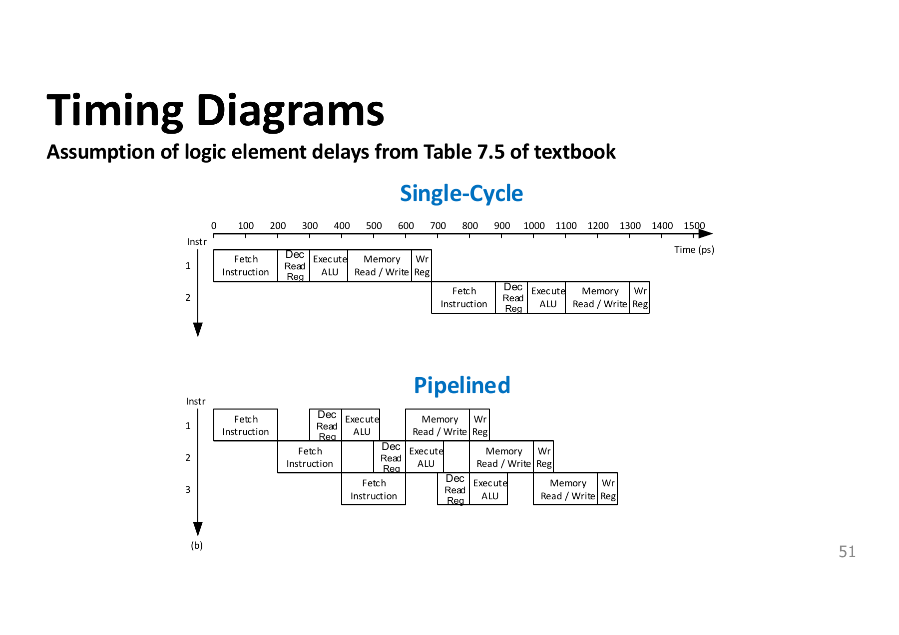

### 5.4 单条指令的 latency 反而变长（核心考点）

> **Pipelining 不降低单条指令的 latency，而是让它变长。** 两个原因：
> 1. **Pipeline register 的 sequencing overhead**（setup + clock-to-Q）。
> 2. **Tc 由最慢的 stage 决定** —— 快的 stage 会浪费时间（internal fragmentation，级不均衡导致）。
>
> Pipelining 提升的是**整个 workload 的 throughput**，且要求 workload（指令数）**足够大**。

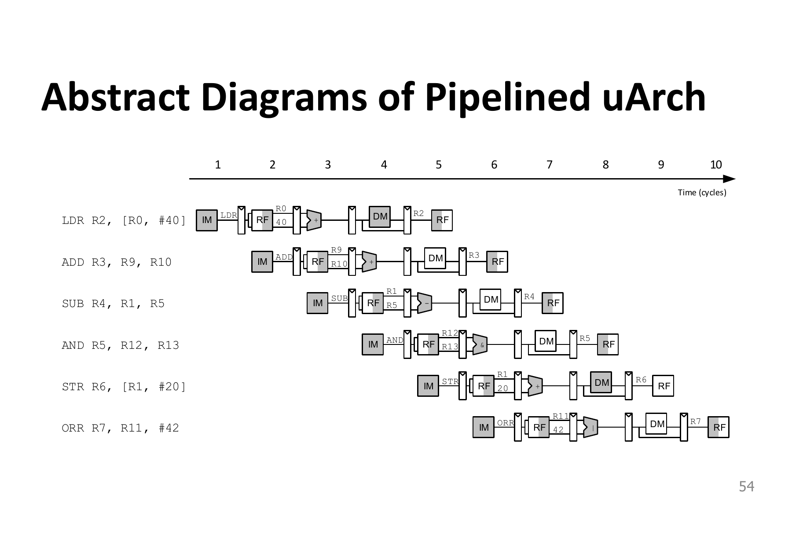

### 5.5 寄存器堆的读写策略（免费消除一个 hazard）

> **在时钟周期的前半段写、后半段读。**
>
> 这样在**同一个周期**内，一条指令的 writeback 就能被更年轻指令的寄存器读所看到 —— **距离为 3 的 RAW 相关（W 和 D 撞在同一周期）自动被消除，不需要 forwarding。**

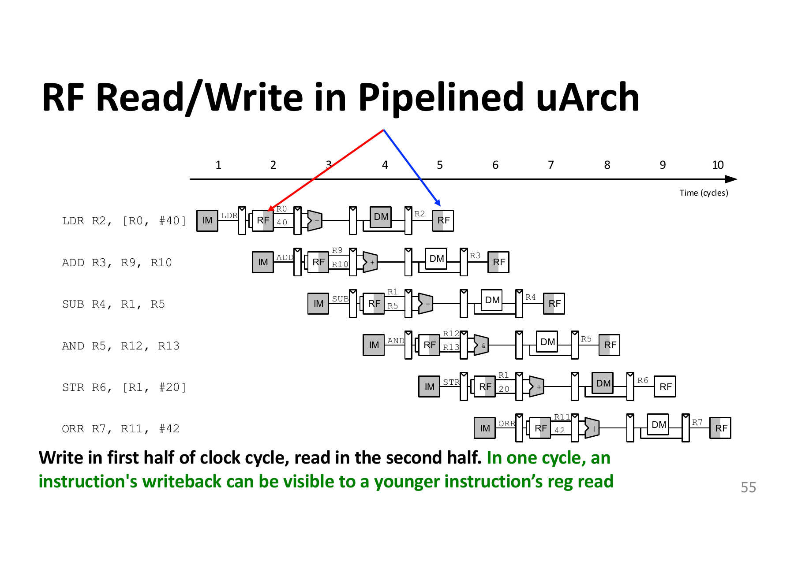

### 5.6 简化画法

```
      C1  C2  C3  C4  C5  C6  C7  C8
I1    F   D   E   M   W
I2        F   D   E   M   W
I3            F   D   E   M   W
I4                F   D   E   M   W
```

这个 F/D/E/M/W 阶梯图是做题时最快的表示法，**务必练熟**。

---

## 六、流水线冒险（Pipeline Hazards）

### 6.1 三类 hazard

| 类型 | 触发条件 | 本课程中的例子 |
|---|---|---|
| **Structural hazard（结构冒险）** | 两条指令想用**同一个资源** | ① 指令内存（F 阶段）和数据内存（M 阶段）—— 用**分离的 IM/DM** 解决；② 寄存器堆在**两个不同 stage 被访问**（D 阶段读、W 阶段写）—— 用**前半写后半读**解决 |
| **Data hazard（数据冒险）** | 后面的指令需要前面指令的**结果** | RAW（read-after-write） |
| **Control hazard（控制冒险）** | 流水线里有**改变 PC** 的指令 | B 指令、对 R15 的写 |

### 6.2 换个视角：反向流（backward flow）

> **指令和数据总体上从左往右流动。从右往左的流动会影响未来的指令，这就是 hazard 的来源。**

两条反向流：
1. **Writeback 阶段把结果写回寄存器堆** → 数据冒险的根源。
2. **下一个 PC 的选择（PC+4 还是分支目标地址）** → 控制冒险的根源。

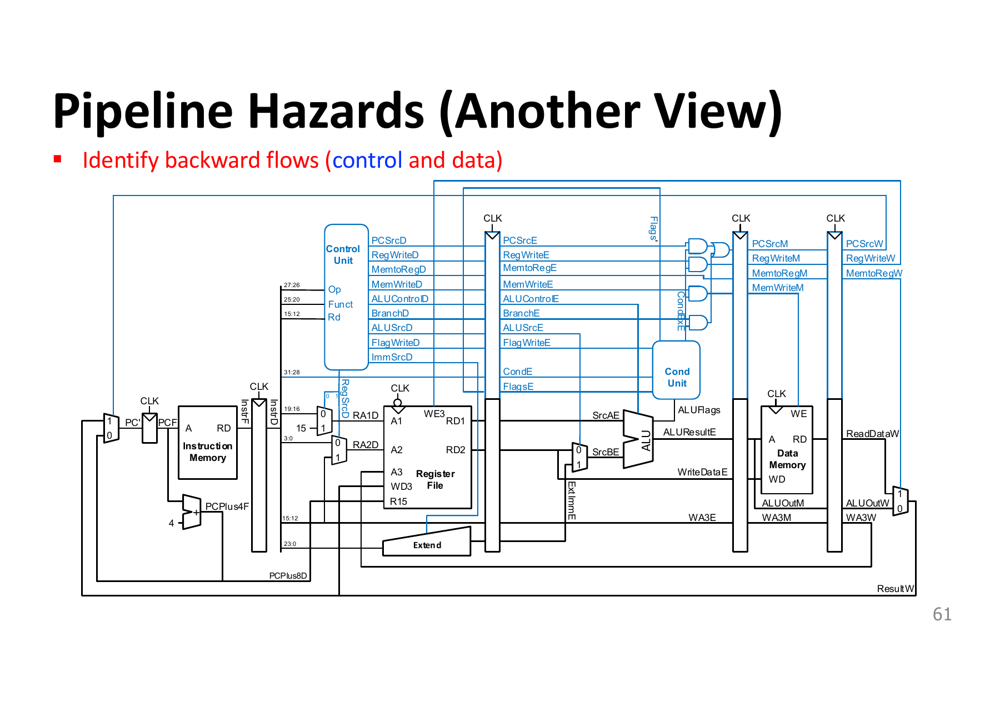

### 6.3 缓解策略的取舍

从处理器角度看，不同方案的代价不同：
- 架构状态需要**严重修补**（已经写错了要回滚）；
- 架构状态**不被触碰**，hazard 被规避；
- 需要**专用逻辑**来规避 hazard；
- 防御性思路：**stall 住 CPU 直到 hazard 消失**。

Power、energy、latency 都是考量因素。

### 6.4 Data Dependence vs. Hazard（**必须分清**）

在冯·诺依曼模型下，指令之间通过数据相互依赖。

**True dependence（真相关 / 数据相关）**：一条指令产生的结果被后续指令消费。

```armasm
; 有相关
ADD  R0, R0, #4
LDR  R1, [R0, #0]    ; 依赖 ADD 的 R0
SUB  R2, R1, #1      ; 依赖 LDR 的 R1

; 无相关
ADD  R0, R1, #4
LDR  R2, [R3, #0]
ADD  R4, R5, #1
```

> **两个极其重要的区分（送分题）**：
> - **True dependence 是「程序」的属性** —— 程序员的意图通过它表达。
> - **Hazard 是「微架构」的属性** —— **同一个 dependence，在不同微架构上可能是 hazard，也可能不是。**
> - 推论：**单周期微架构上不可能出现 RAW hazard**（一条指令在一个周期内完全做完），但相关依然存在。

### 6.5 例子：三个数据冒险

```armasm
ADD  R1, R4, R5
AND  R8, R1, R3    ; 距离 1，最严重
ORR  R9, R6, R1    ; 距离 2
SUB  R10, R1, R7   ; 距离 3
```

- `SUB`（距离 3）的 hazard 被**「前半写后半读」策略免费消除**。
- 剩下 `AND`（距离 1）和 `ORR`（距离 2）两个 hazard 需要处理。

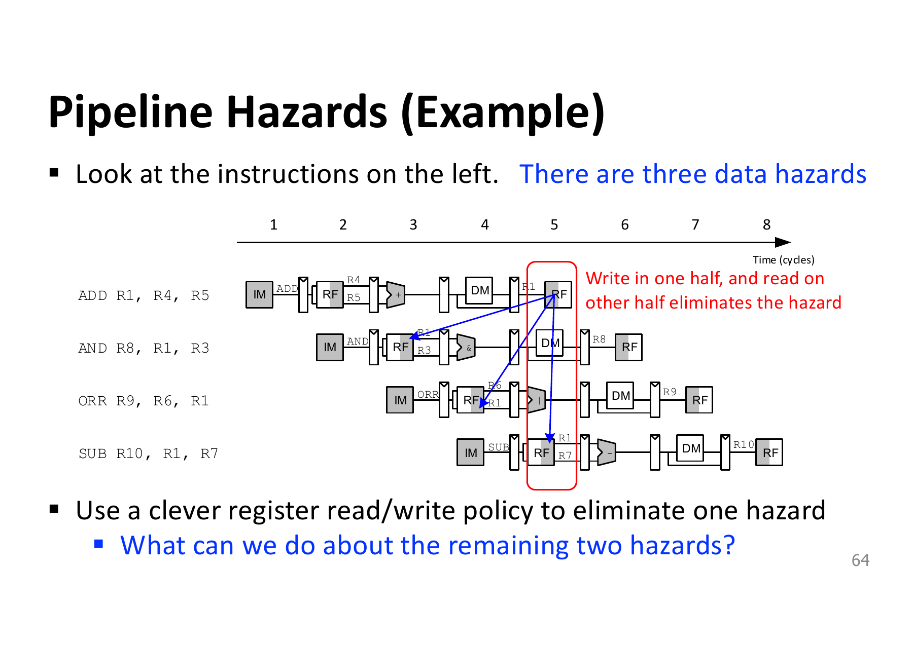

---

## 七、解决数据冒险

### 方案 1：Software Interlocking（软件互锁）

**编译期插入 NOP**：
- NOP 是什么都不做的指令。
- 插入足够多的 NOP，等结果准备好。
- **更好的做法**：编译期把**独立的有用指令**调度到前面来填这些槽（instruction scheduling）。

上面的例子需要在 `ADD` 和 `AND` 之间插 **2 个 NOP**。

**缺点**：
- 编程复杂化（编译器必须知道微架构的流水线深度 → 破坏 ISA 抽象）。
- 速度下降（NOP 白白占周期）。

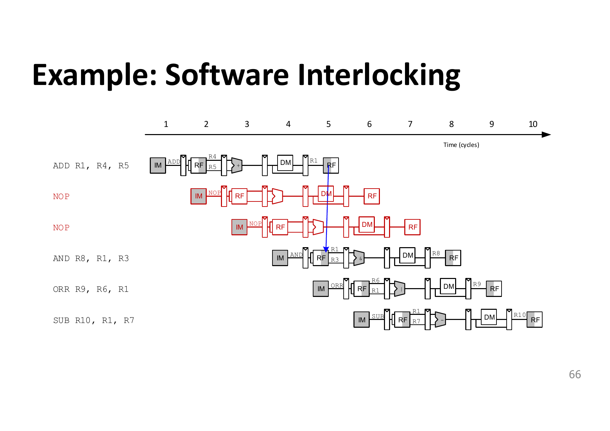

### 方案 2：Forwarding / Bypassing（转发 / 旁路）

**硬件方案。除少数特殊情况外，数据冒险都能靠 forwarding 解决。**

**原理**：加额外硬件，把 **Memory 阶段或 Writeback 阶段**的结果直接送到 **Execute 阶段**的相关指令。
> **关键：绕过（bypass）寄存器堆，提前从 pipeline register 里拿结果。**

**硬件代价**：在 ALU 前面加**多路选择器（mux）**，从三个来源中选操作数：
1. **RF**（正常路径）
2. **Memory PPR**（`ALUOutM`）
3. **Writeback PPR**（`ResultW`）

**为什么可行**：`ADD` 的和在 **cycle 3** 就被 ALU 算出来了，而 `AND` 在 **cycle 4** 才需要它 —— 时间上完全来得及，根本不用等它出现在寄存器堆里。

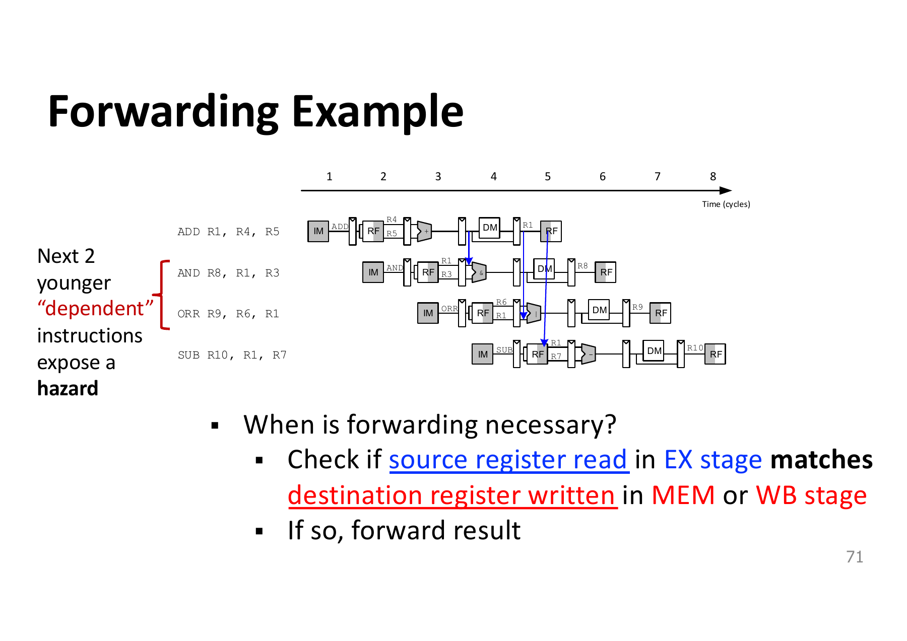

#### 转发的判定条件与控制方程（**必记**）

**什么时候需要转发**：Execute 阶段读的源寄存器，与 Memory 或 Writeback 阶段要写的目标寄存器相同。

```
; Execute 的源 == Memory 的目标？
Match_1E_M = (RA1E == WA3M)
Match_2E_M = (RA2E == WA3M)

; Execute 的源 == Writeback 的目标？
Match_1E_W = (RA1E == WA3W)
Match_2E_W = (RA2E == WA3W)

; 优先级：M 阶段优先于 W 阶段（M 里的是更年轻、更新的值）
if      (Match_1E_M · RegWriteM)   ForwardAE = 10;   ; 从 Memory PPR 转发
else if (Match_1E_W · RegWriteW)   ForwardAE = 01;   ; 从 Writeback PPR 转发
else                               ForwardAE = 00;   ; 正常从 RF 读

; ForwardBE 完全相同，只是把 Match_1E 换成 Match_2E
```

> **易错点**：必须**与上 `RegWriteM` / `RegWriteW`** —— 如果那条指令根本不写寄存器（比如 STR、CMP），寄存器号相同也不能转发。
>
> **优先级不能反** —— M 阶段的指令比 W 阶段的更年轻，它的值才是最新的。

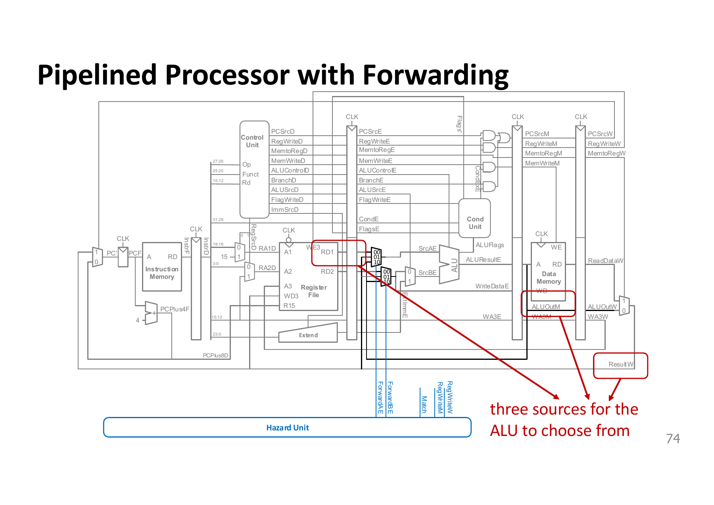

#### Forwarding Exercise（考题原型，附答案）

```
      C1  C2  C3  C4  C5  C6  C7  C8        PPR 编码
I1    F   D   E   M   W                       D
I2        F   D   E   M   W                   E
I3            F   D   E   M   W               M
I4                F   D   E   M   W           W
```

| 问题 | 答案 | 理由 |
|---|---|---|
| I1(M) → I2(E) 转发有效吗？ | **有效** | I1 在 M 是 C4，I2 在 E 也是 C4，同周期，来得及 |
| I1(W) → I3(E) 转发有效吗？ | **有效** | I1 在 W 是 C5，I3 在 E 也是 C5，同周期 |
| I1(W) → I2(E) 转发有效吗？ | **无效** | I1 在 W 是 C5，但 I2 在 E 是 C4 —— **需要时间倒流**。（况且 I2 已经从 I1(M) 拿到值了） |

> **通用判据：转发有效 ⟺ 源和目的在同一个时钟周期上对齐（或源更早）。永远不能往回传。**

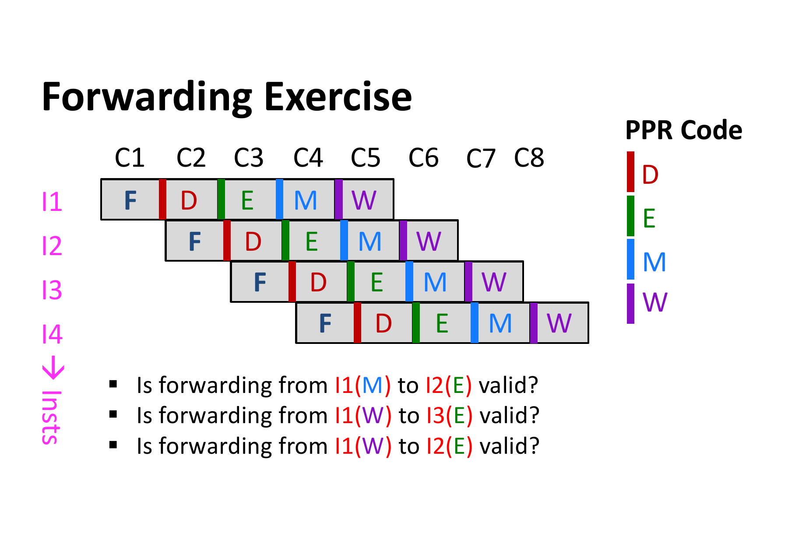

### 方案 3：Stalling（用于 Load-Use Hazard）

#### Load-Use Hazard：forwarding 治不了的那个特例

> **LDR 的执行有两个周期的延迟（E + M）。数据要到 MEM 阶段结束才读出来，无法转发给紧邻的下一条指令的 EX 阶段。**

```armasm
LDR  R1, [R4, #40]
AND  R8, R1, R3     ; ← Load-Use hazard！
```

- LDR 在 **cycle 4 结束**才从内存拿到数据。
- AND 在 **cycle 4 开始**就需要这个数据。
- **不能让时间倒流去修补。** ⇒ **必须 stall。**

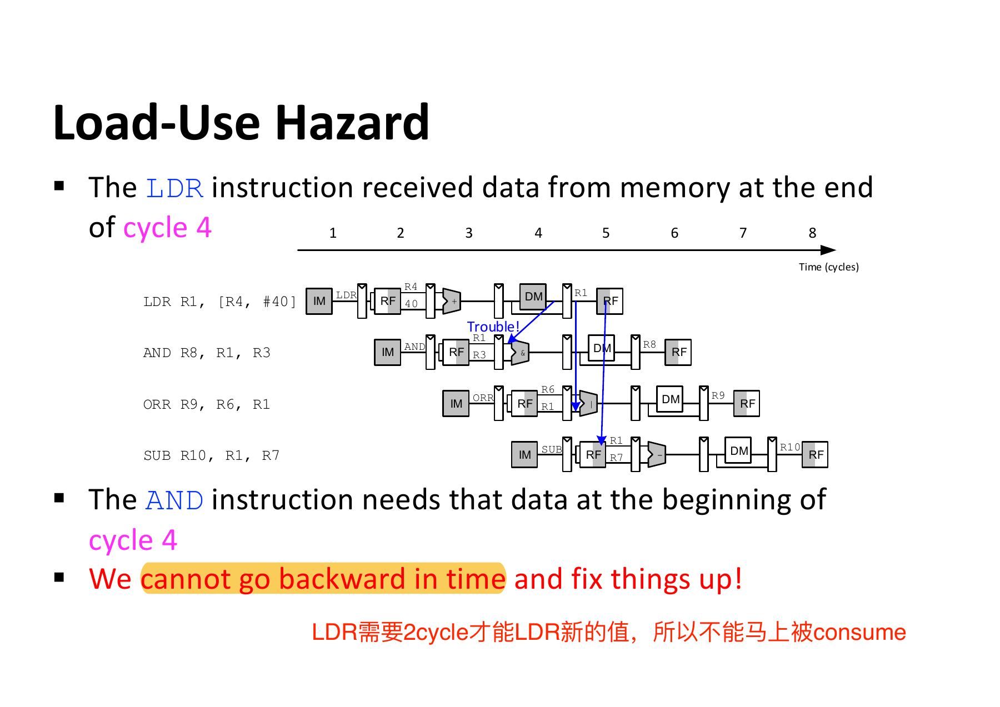

#### 解决：在 Decode 阶段停一拍

- 相关指令（LDR 的「user」）**在 Decode 阶段结束时被译码出来**，此时可以检测到 hazard。
- **把这条相关指令在 Decode 阶段 stall 一个周期**，直到 LDR 完成内存读。
- 与此同时，**紧跟在「user」后面的那条指令必须留在 Fetch 阶段**，因为 Decode 阶段被占住了。
- Cycle 5：结果从 LDR 的 **WB** 转发到 AND 的 **EX**。

> **注意：stall + forwarding 是配合使用的，不是二选一。** Stall 一拍之后，仍然需要 W→E 转发才能凑上。

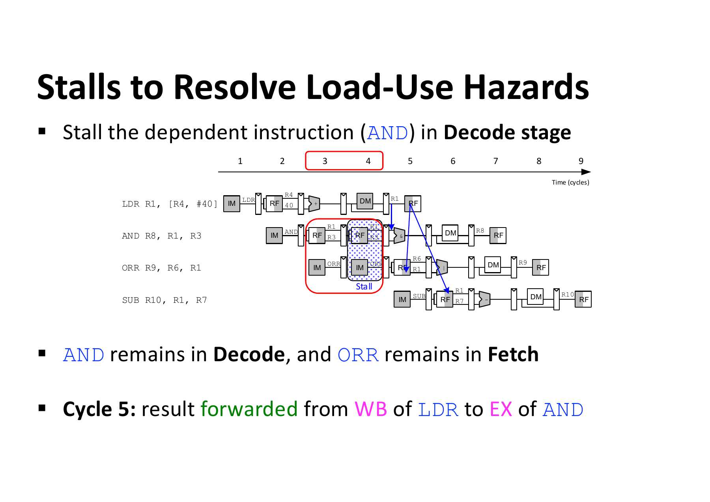

#### Stall 到底做了哪三件事（**必记**）

> **Stall 住 stage X ⟹**
> 1. **Stall 住 stage X**（显然）
> 2. **Stall 住 stage X − 1**（上游全部堵住）
> 3. **在 stage X + 1 塞进一个 bubble**（气泡）

#### Stall 的逐周期可视化（i1–i5，i2–i3 之间有 Load-Use hazard）

| Cycle | Fetch | Decode | Execute | Memory | Writeback |
|---|---|---|---|---|---|
| 1 | i1 | | | | |
| 2 | i2 | i1 | | | |
| 3 | i3 | i2 | i1 | | |
| **4（stall）** | **i3** | **i2** | **00000000** | i1 | |
| 5 | i4 | i3 | i2 | 00000000 | i1 |
| 6 | i5 | i4 | i3 | i2 | 00000000 |
| 7 | — | i5 | i4 | i3 | i2 |

看 cycle 4：i3 和 i2 **原地不动**（Fetch 和 Decode 被 stall），Execute 里被塞进全零 = bubble。这个 bubble 随后一路向下游传播。

#### Pipeline Bubble

- EX 在 cycle 4 空转、MEM 在 cycle 5 空转、WB 在 cycle 6 空转。
- 这个「空转的 stage 沿流水线传播」的现象叫 **bubble（气泡）**。
- **Bubble 的行为等价于一条 NOP 指令。**

#### Stall 的硬件实现（**必记**）

| 操作 | 硬件手段 |
|---|---|
| **Stall** | 用 pipeline register 的 **Enable 输入**，保持（hold/retain）寄存器内容不变。**所有上游 stage 也必须一起 stall。** |
| **Flush（塞 bubble）** | 用 pipeline register 的 **Clear 输入**，把寄存器内容清零。 |

> **Bubble 是通过「清空 stall 那一级正后方的 pipeline register」引入的**，目的是**防止伪造的信息继续向前传播**。
>
> **忘记引入 bubble 会错误地更新架构状态。** Stall 会降低性能，所以只在必要时使用。

#### Load-Use 的 stall 控制方程（**必记**）

```
; Decode 阶段的任一源寄存器，是否与 Execute 阶段正在写的寄存器相同？
Match_12D_E = (RA1D == WA3E) + (RA2D == WA3E)

; Execute 阶段是 LDR，且上面匹配成立？（MemtoRegE 标识 LDR）
ldrstall = Match_12D_E · MemtoRegE

StallF = StallD = FlushE = ldrstall
```

> **注意这里比较的是 D 阶段的源 和 E 阶段的目标**（比 forwarding 的判定早了一级），因为要在 hazard 造成损害**之前**就检测到。

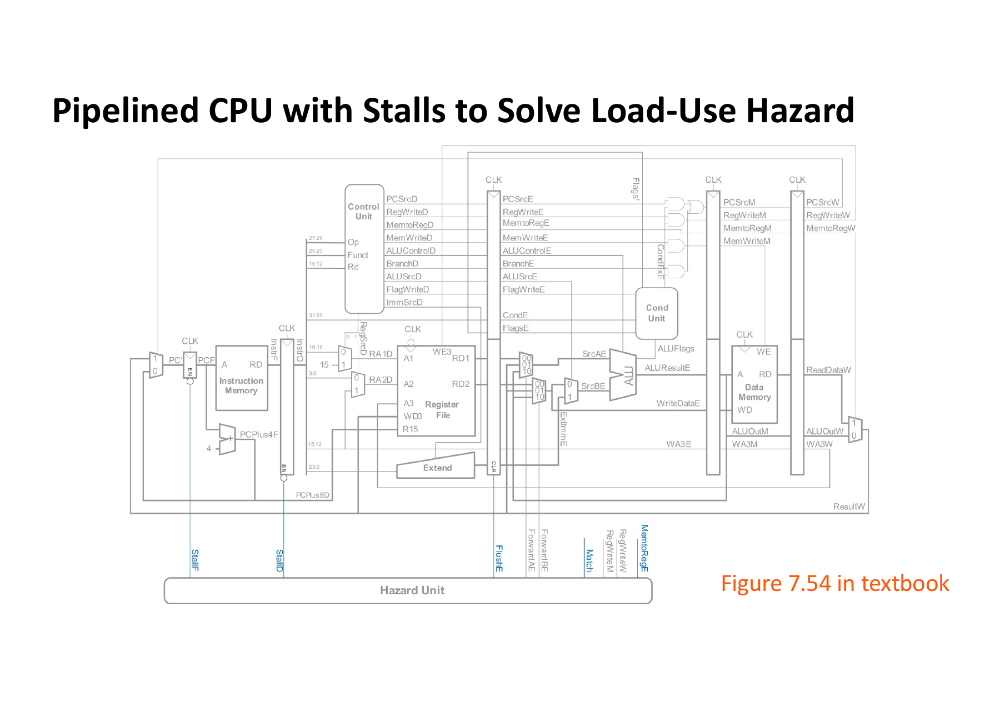

---

## 八、控制冒险（Control Hazards）

### 8.1 成因

控制冒险来自**顺序控制流的改变**：
- **Branch（B）指令**
- **普通指令写 PC（R15）** ← ARM 特有，PC 是通用寄存器之一

> 流水线处理器**不知道下一条该取哪条指令**：分支的取舍在指令被 fetch 的时候还没做出决定，但 **PC 寄存器在 Fetch 阶段就已经被递增了**。

### 8.2 两种解决思路

| 方案 | 做法 | 代价 |
|---|---|---|
| **Stall** | 遇到分支就停 | 指令在第 1 级 fetch，分支在第 **5** 级解析 ⇒ **每条分支停 4 个周期**，代价极高 |
| **Branch Prediction** | 预测分支结果 | 预测**正确 → 零代价**；预测**错误 → 清空流水线（flush）+ 从正确目标重启（recovery）**。**误预测代价取决于何时启动 recovery** |

### 8.3 最简单的预测器（静态策略）

| 策略 | 行为 | 预测正确 | 预测错误 |
|---|---|---|---|
| **Predict-always-untaken** | 继续顺序取指（保持流水线繁忙） | 什么都不用做 | **Flush 4 条指令**，修复架构状态（用正确目标更新 PC） |
| **Predict-always-taken** | 目标地址在 Fetch 阶段还不知道 ⇒ **CPU 仍要停 4 个周期** | 跳到目标指令，无损失 | 用下一条指令的递增 PC，**4 个周期浪费** |

两者都属于**静态（static）预测策略**。

> **Predict-always-taken 的坑（易考）**：即使预测正确，因为**目标地址算不出来**，CPU 还是得停 4 个周期。所以在没有 BTB 的情况下，always-taken 并不优于 always-untaken。

**Dynamic branch prediction（动态预测）**：同一条分支的不同次执行给出不同预测，**把最近的分支行为纳入考虑**。

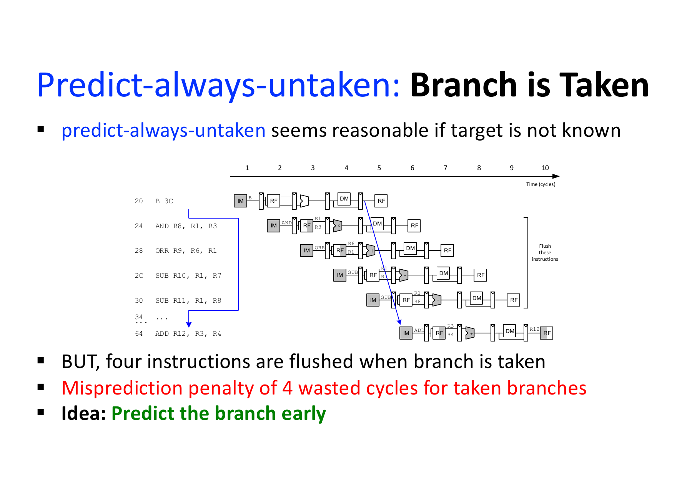

### 8.4 Early Branch Resolution（提前解析，**重点**）

> **分支目标地址最早能在 EX 阶段得知 ⇒ 在 EX 阶段更新 PC，省下 2 个周期。**
> **误预测代价从 4 个周期降到 2 个周期**，只需 flush 掉 Fetch 和 Decode 里的 2 条指令。

**硬件改动**：
1. 在 **PC 寄存器前面加一个 branch multiplexer**，用来从 `ALUResultE` 选出 BTA（branch target address）。
2. 加 **`BranchTakenE`** 选择信号 —— **只在分支条件满足时置位**。

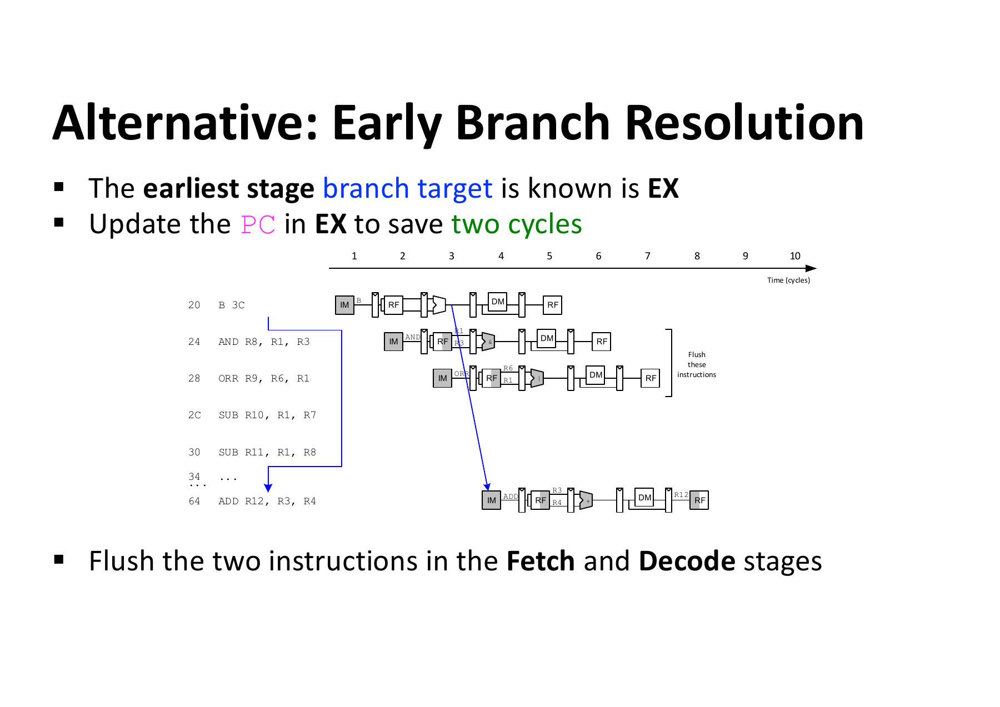

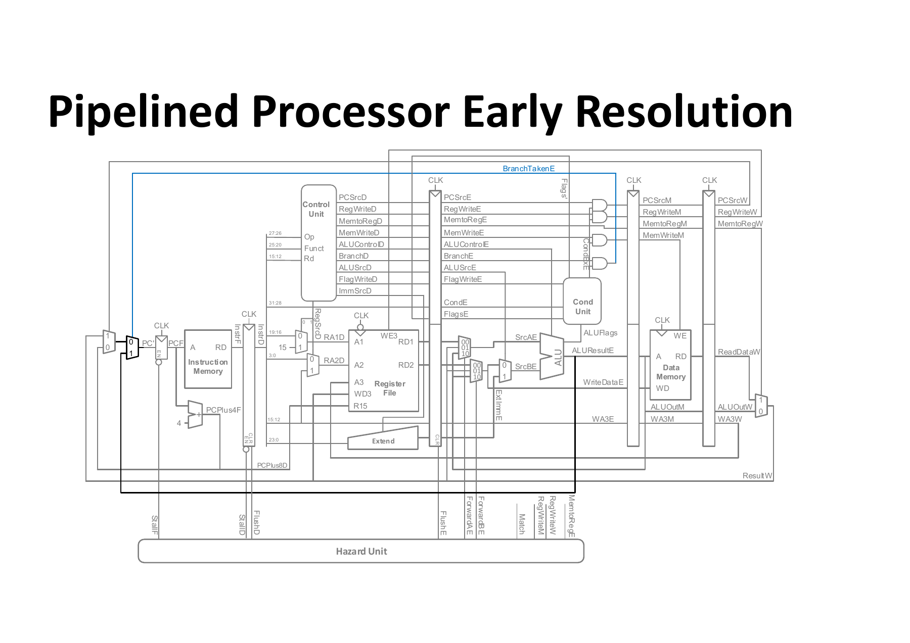

### 8.5 Flush / Stall 控制方程

**只考虑早期分支解析 + Load-Use：**

```
StallF = ldrStallD
StallD = ldrStallD
FlushD = BranchTakenE
FlushE = ldrStallD + BranchTakenE
```

**写 PC（R15）的情况**（比 B 指令代价大得多，**仍然停 4 个周期**）：

```
StallF = PCSrcD + PCSrcE + PCSrcM
FlushD = PCSrcD + PCSrcE + PCSrcM + PCSrcW
```

**完整版（教材 p.440，必记）**：

```
PCWrPendingF = PCSrcD + PCSrcE + PCSrcM        ; D/E/M 中有 PC 写在进行中

StallF = ldrStallD + PCWrPendingF              ; Load-Use 冒险，或 D/E/M 中有 PC 写
StallD = ldrStallD                             ; 只因 Load-Use 冒险停 Decode
FlushD = PCWrPendingF + PCSrcW + BranchTakenE  ; D/E/M/W 中有 PC 写，或 E 中分支已 taken
FlushE = ldrStallD + BranchTakenE              ; Load-Use 塞泡，或分支 taken
```

#### 为什么 StallF / FlushD 是这样（逐周期推演，易考）

设 PC 改写指令 I 在 cycle 1 被 fetch：

| Cycle | 事件 |
|---|---|
| 1 | I 被 fetch |
| 2 | I 被译码，`PCSrcD` 置位 |
| 3 | I 执行，`PCSrcE` 置位 |
| 4 | I 在 M 阶段，`PCSrcM` 置位 |
| 5 | `PCSrcW` 置位，新 PC 被写到 `ResultW` 总线 |
| 6 | PC 是寄存器，在下一个时钟周期（cycle 6）被更新 |
| 7 | 正确的指令进入 Decode 寄存器 |

- **StallF**：cycle 5 时 `StallF` 置位，好让下一个周期 PC 寄存器能正确捕获新的指令地址（`ResultW`）。**前 4 个周期 `StallF` 保持 deassert**，以免干扰 PC。
- **FlushD**：如果 cycle 5 保持 `FlushD` 置位，那么 cycle 6 开始的上升沿到来时，寄存器仍读出全零。**cycle 6 释放 `FlushD`**，于是 cycle 7 正确的指令能在时钟边沿被捕获进 Decode 寄存器。

### 8.6 三条决策规则总结（**背下来**）

**什么时候 Forward？**
> 两条指令之间存在 RAW 冒险，**且更老的那条不是 load**。
> ```armasm
> ADD R0, R1, R2
> SUB R4, R0, #1      ; forward
>
> MUL R12, R2, R3
> ADD R0, R12, #1     ; forward
> ```

**什么时候 Stall？**
> - **Load-use hazard**：发现「use」时 stall 住 **Decode 和 Fetch** 两级。
> - **PC 改写指令**：理论上可以 stall Fetch 四个周期，但**因复杂度原因本课的实现中并未采用**。

**什么时候 Flush？**
> - **Load-use hazard**：flush **Execute** pipeline register（塞 bubble）。
> - **PC 改写指令**：持续 flush **Decode** 阶段，直到新指令（分支目标）出现在 Decode PPR 中。
> - **Branch 指令**：分支在 **Execute** 阶段被提前解析时，flush **Decode 和 Execute** 两个 pipeline register。

**CPU 如何实现 Stall 和 Flush？**
> - **Stall** → pipeline register 的 **Enable** 输入（保持原值）
> - **Flush** → pipeline register 的 **Clear** 输入（清零）

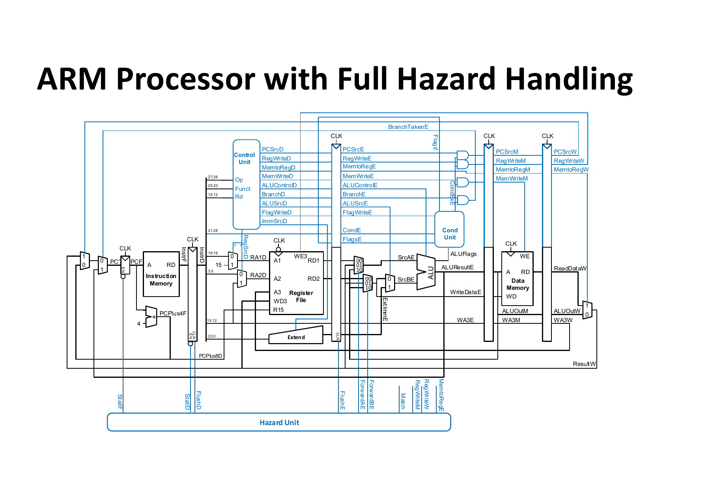

---

## 九、超标量处理器（Superscalar）

### 9.1 思想

> **复制多份数据通路硬件，同时执行多条指令。**
> 例：**2-way superscalar** 每周期 fetch 并 execute **2 条**指令。

**2-way 的硬件需求**：
- **6 端口寄存器堆**（4 读 + 2 写）
- **2 个 ALU**
- **2 端口数据内存**
- **理想 CPI = 0.5，理想 IPC = 2**

**但**：相关（dependency）和冒险（hazard）会阻碍达到理想 IPC。（幻灯片上的图**未画出** forwarding 和 hazard detection 逻辑。）

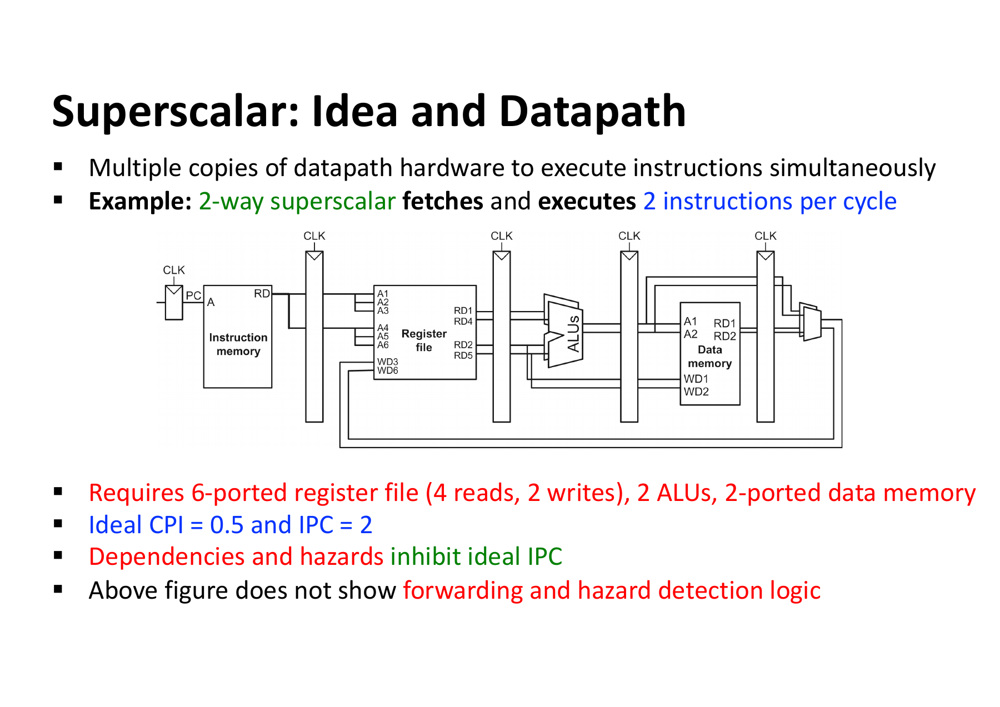

### 9.2 相关的影响

- **理想情况**（无相关的程序）：6 条指令 3 个周期发射完，**IPC = 2**。
- **有数据相关的程序**：CPU 平均 **5 个周期完成 6 条指令 ⇒ IPC = 1.2**。
  - 也可以从 **fetch 侧**算 IPC（5 个周期发射 6 条指令），结果相同。

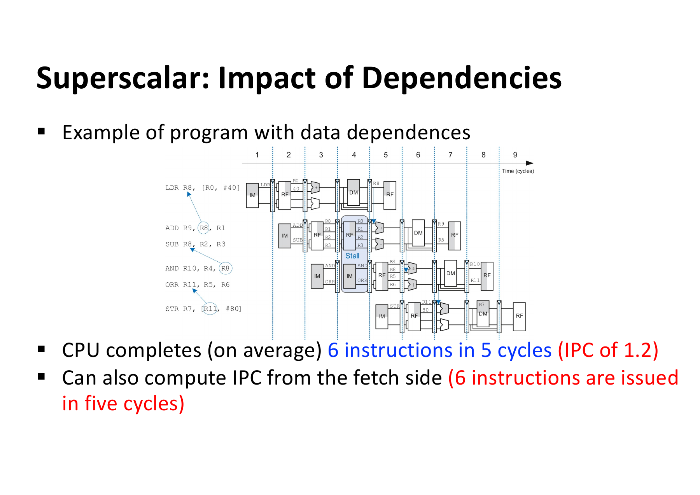

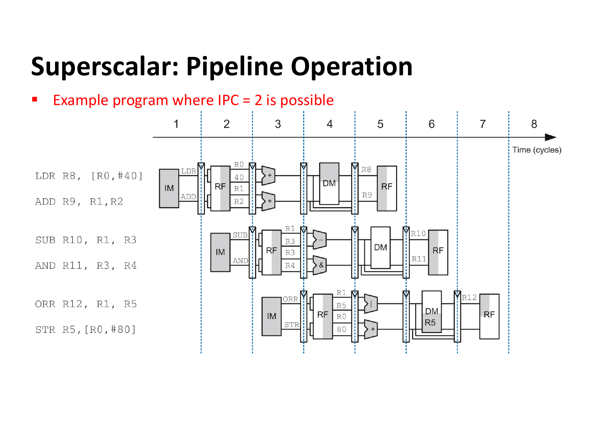

### 9.3 In-Order Superscalar 的取舍

- 超标量 = **空间并行 + 时间并行**（一个 CPU 里有两条流水线 lane，资源复制）。
- **2-wide、4-wide、6-wide 都很常见**（wide 就是 way）。
- **真实程序里相关太多（数据 + 控制）**：
  - 很难每周期都**按序（in order）**找到足够多可发射的指令。
  - **乱序（out-of-order）CPU 打破这个瓶颈。**
- 大量执行单元 + 复杂的转发和冒险检测逻辑 → **面积、功率、能耗**代价高昂。

---

## 十、分支预测

### 10.1 静态分支预测

- 策略 1：**永远预测 not taken**
- 策略 2：**永远预测 taken**

> **误预测代价对超标量而言更大** —— 处理「错误路径（wrong path）」指令的努力全部白费，而且宽度越宽，一次 flush 掉的指令越多。
>
> ⇒ 我们需要**准确率 > 99%** 的预测器。

### 10.2 动态分支预测

> **在 Fetch 阶段，基于这条分支最近的行为来预测它的结果。**

需要两样东西：

| 需要什么 | 从哪来 |
|---|---|
| **Branch identification（分支标识）** | **PC 唯一标识一条分支** —— 用指令内存中的分支地址，可以直接从 PC 拿 |
| **Branch behavior（分支行为）** | ALU 的条件判断结果（上次 taken/untaken）；**还需要存储上次执行时的分支目标** |

### 10.3 One-Bit Predictor（1-bit 预测器）

**Branch History Table (BHT)**，又叫 Branch Prediction Buffer：
- 一小块内存，用**分支地址的低位比特**索引。
- 每个条目存**一个 bit**，表示这条分支最近是否被 taken。

**由于表项数量有限，会有冲突（conflict / aliasing）** —— 不同的分支映射到同一个条目。

**操作（放在 Fetch 阶段）**：
- 预测 **untaken** → 取下一条顺序指令
- 预测 **taken** → 计算目标地址并从目标处取指

**BHT 更新**：
- 结果与预测**一致** → 什么都不做
- 结果与预测**不一致** → ① **翻转 BHT 中的那个 bit**；② **flush 流水线并更新 PC**

> **两个思考题的标准答案**：
> - **误预测会影响正确性吗？→ 不会。** 预测器只是性能优化，架构状态由 recovery 机制保证正确。
> - **误预测会影响性能吗？→ 会。** flush + 重新取指的周期全部浪费。

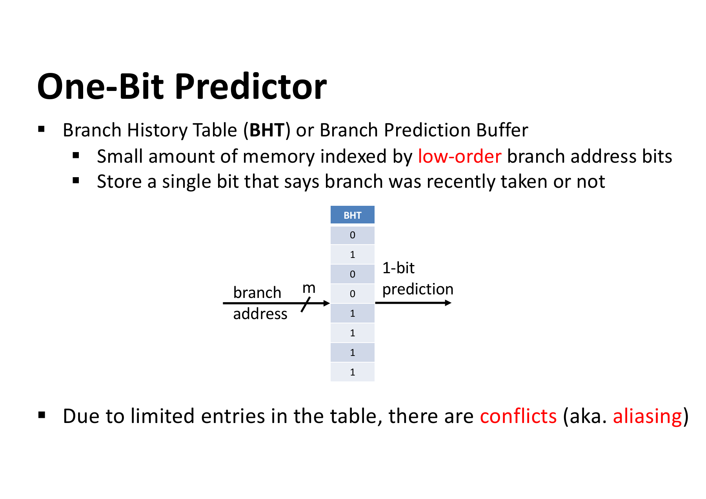

### 10.4 1-bit 预测器的病态：循环终止

```armasm
        MOV R1, #0
        MOV R0, #1
FOR:
        CMP R0, #10
        BGE DONE        ; ← 分析这条分支
        ADD R1, R1, R0
        ADD R1, R1, R0
        B FOR
DONE:
```

`BGE DONE` 执行 10 次的行为（假设初始状态为 Taken）：

| i | 1 | 2 | 3 | 4 | 5 | 6 | 7 | 8 | 9 | 10 |
|---|---|---|---|---|---|---|---|---|---|---|
| **Direction（实际）** | NT | NT | NT | NT | NT | NT | NT | NT | NT | **T** |
| **Current State / Prediction** | **T** | NT | NT | NT | NT | NT | NT | NT | NT | NT |
| **New State** | NT | NT | NT | NT | NT | NT | NT | NT | NT | **T** |

- **误预测 2 次**（i=1 的冷启动 + i=10 的循环退出）
- **准确率 = 8/10 = 80%**

> **Anomalous Decision（异常决策）**：
> - 一条 **90% 的时间都 NOT TAKEN** 的分支，1-bit 预测器的准确率却只有 **80%**。
> - **异常 = 强烈偏向某一方向的分支突然走了另一个方向。**
> - **一次异常决策就能把 1-bit 预测器「甩飞」（thrown off）** —— 因为它不但这次错，下次还会因为状态被翻转而再错一次。

> ⚠️ **幻灯片问题**：这段循环代码里**没有 `ADD R0, R0, #1` 之类递增 R0 的指令**，`R0` 恒为 1，实际是个死循环，永远不会走到 `DONE`。分析里假设的「前 9 次 NT、第 10 次 T」是**作者的意图**而非代码的实际行为。做题时按意图理解即可，但要知道代码本身有 bug。

### 10.5 Smith's Algorithm（2-bit 饱和计数器）

> **1979 年 James E. Smith 注意到 1-bit 预测器在循环终止处的性能病态，提出了 Smith 分支预测算法。**
>
> **核心洞见：给预测器的状态加上「迟滞 / 惯性」（hysteresis / inertia）。**
> **同一个结果必须连续出现多次，才能到达「强」状态。**

**饱和计数器（saturating counter）** 把最近若干次分支的结果映射到一个多状态计数器上。

**k = 2 的四个状态**：

| 编码 | 状态 | 预测 |
|---|---|---|
| **00** | Strongly Not-Taken (SN) | Untaken |
| **01** | Weakly Not-Taken (WN) | Untaken |
| **10** | Weakly Taken (WT) | Taken |
| **11** | Strongly Taken (ST) | Taken |

**状态转移**：taken 时 +1（在 11 饱和），untaken 时 −1（在 00 饱和）。**预测 = 计数器的 MSB。**

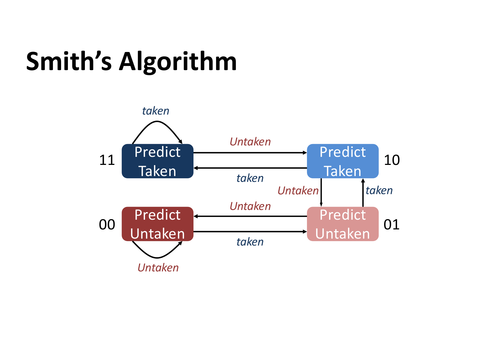

**硬件（k = 2）**：
- BHT 里存 **2^m 个 k-bit 计数器**，用分支地址的 m 位索引。
- 读出计数器 → **MSB 作为分支预测**。
- 分支结果回来后，**饱和计数器 increment/decrement** → 写回更新后的计数值。

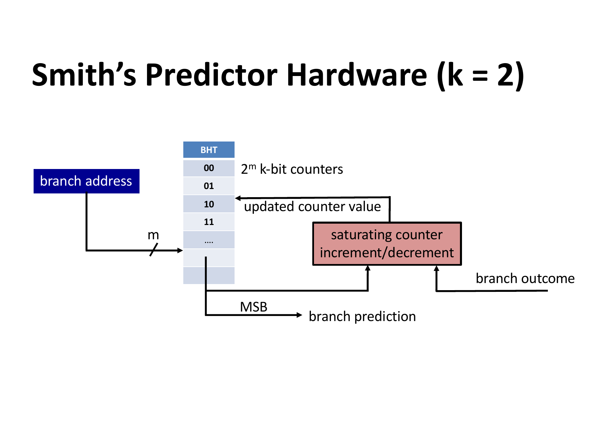

### 10.6 Smith1 vs. Smith2 对比（分支行为突变时）

| 实际方向 | Smith1 状态 | Smith1 预测 | Smith2 状态 | Smith2 预测 |
|---|---|---|---|---|
| 1 | 1 | 1 ✓ | 11 | 1 ✓ |
| 1 | 1 | 1 ✓ | 11 | 1 ✓ |
| **0** | 1 | 1 ✗ **误预测** | 11 | 1 ✗ **误预测** |
| **1** | 0 | 0 ✗ **误预测** | 10 | 1 ✓ |
| 1 | 1 | 1 ✓ | 11 | 1 ✓ |
| 1 | 1 | 1 ✓ | 11 | 1 ✓ |

> **关键差异**：单次异常（那个 `0`）之后，**Smith1 被翻转到错误状态，紧接着又错一次（共错 2 次）**；**Smith2 只从 ST 降到 WT，预测方向不变，只错 1 次**。这就是 hysteresis 的价值。

### 10.7 Branch Target Buffer (BTB)

- **Buffer = 存放「某些」信息的小块内存。**
- CPU 在 **Fetch 阶段**需要知道两件事：① **分支方向**；② **分支目标地址**。
- **BTB 存放 taken 分支的目标地址。**
- **搜索 untaken 分支的目标是没有意义的** —— untaken 就是 PC+4，不用查表。

**BTB 的操作**：

| 情况 | 行为 |
|---|---|
| 预测 **taken** | 从 **BTB 取目标地址** |
| 预测 **untaken** | **PC = PC + 4** |
| 预测**正确** | 继续正常执行 |
| 预测**错误** | **flush 所有含有误预测路径指令的流水级** |

> **BHT 和 BTB 的分工（易混）**：**BHT 回答「跳不跳」，BTB 回答「跳到哪」。** 有了 BTB，predict-always-taken 才真正可行（否则目标地址算不出来还是得停）。

### 10.8 Correlating Branch Predictors（相关分支预测器）

真实程序里，**一条分支的结果常常取决于其他分支的行为**：

```c
aa = 0; bb = 0;
if (cond1)
    aa = 1;
if (aa == bb)     // ← 这条分支的结果强烈依赖上面那条
    {…}
```

**传统的（非相关）预测器只看单条分支自己的结果，捕捉不到这种关系。**

相关预测器通过组合以下三种信息提升准确率：
1. **Local history（局部历史）** —— **同一条分支**过去的行为
2. **Global history（全局历史）** —— 程序中**最近若干条分支**的结果
3. **Branch address（分支地址）** —— 用来区分历史相似的不同分支

### 10.9 分支预测的现状

- 现代处理器的**关键部件**，尤其是**超标量和乱序处理器**。
- **预测准确率超过 99%。**
- **最新技术：深度神经网络、机器学习方法。**
- COMP4045 里会在 C++ 模拟器中实现并比较 state-of-the-art 的分支预测器。

---

## 十一、真实流水线：存储器延迟

本 set 全程假设**数据内存访问 1 个周期**，这是极大的简化。

| 事件 | 真实代价 |
|---|---|
| 每次内存访问 | **数百个周期** |
| **Cache hit** | **1–4 个周期** |
| **Cache miss** | **接近 100 个周期** |

> **因此，一个按序（in-order）流水线 CPU 在内存繁忙时会 stall 100 个周期。**

**接下来的方向**：
- **激进的按序 CPU**：在 cache miss 期间**继续做有用的工作**（直到遇到无法回避的 RAW 冒险为止）。
- **乱序（out-of-order）CPU**：在 cache miss **和** RAW 冒险存在时都能继续做有用的工作。

---

## 十二、核心概念辨析与易考点清单

### 12.1 必须分清的成对概念

| A | B | 区别 |
|---|---|---|
| **Latency** | **Throughput** | 单任务耗时 vs. 单位时间任务数。**并行只提升后者。** |
| **Spatial parallelism** | **Pipelining** | 复制硬件（N 倍成本，加速 N） vs. 切分阶段（几乎零额外硬件，加速 M） |
| **Data dependence** | **Data hazard** | **程序的属性**（程序员意图） vs. **微架构的属性**（同一相关在单周期上不是 hazard） |
| **BHT** | **BTB** | 存「跳不跳」（1 或 2 bit） vs. 存「跳到哪」（目标地址） |
| **Stall** | **Flush** | Enable 输入保持原值 vs. Clear 输入清零 |
| **Static prediction** | **Dynamic prediction** | 固定策略 vs. 依据最近行为，同一分支不同次可以不同预测 |
| **Smith1 (1-bit)** | **Smith2 (2-bit)** | 单次异常错 2 次 vs. 单次异常只错 1 次（hysteresis） |

### 12.2 必记公式

```
理想流水线加速比        = M（级数）
N 条指令的实际 CPI      = (N + M - 1) / N        ← 5 级时为 (N+4)/N
IPC                     = 1 / CPI
吞吐（IPS）             = 1 / Tc，Tc 由最慢 stage 决定
n-way 超标量理想 CPI    = 1/n，理想 IPC = n

误预测代价：
  分支在 W 阶段解析      → flush 4 条，penalty = 4 cycles
  分支在 E 阶段解析      → flush 2 条，penalty = 2 cycles
  写 PC（R15）           → 仍为 4 cycles
```

### 12.3 控制方程速查

```
; --- Forwarding（比较 E 阶段源 vs M/W 阶段目标）---
Match_1E_M = (RA1E == WA3M)      Match_2E_M = (RA2E == WA3M)
Match_1E_W = (RA1E == WA3W)      Match_2E_W = (RA2E == WA3W)
if      (Match_1E_M · RegWriteM)  ForwardAE = 10
else if (Match_1E_W · RegWriteW)  ForwardAE = 01
else                              ForwardAE = 00

; --- Load-Use Stall（比较 D 阶段源 vs E 阶段目标）---
Match_12D_E = (RA1D == WA3E) + (RA2D == WA3E)
ldrStallD   = Match_12D_E · MemtoRegE

; --- 完整 Stall/Flush 逻辑 ---
PCWrPendingF = PCSrcD + PCSrcE + PCSrcM
StallF = ldrStallD + PCWrPendingF
StallD = ldrStallD
FlushD = PCWrPendingF + PCSrcW + BranchTakenE
FlushE = ldrStallD + BranchTakenE
```

### 12.4 高频考题类型

1. **给一段汇编 + 5 级流水线，画 F/D/E/M/W 阶梯图，标出所有 hazard，说明各自怎么解决。**
2. **判断某个 forwarding 是否有效**（时间对齐判据：源的 stage 周期 ≤ 目的的 EX 周期）。
3. **给 N、级数，算 CPI / IPC / 加速比**，并解释为什么达不到理想值。
4. **WA3 bug 分析**：为什么不流水化 WA3 会写错寄存器，哪个周期写错，写到哪个寄存器。
5. **1-bit / 2-bit 预测器在给定分支序列上的状态转移表 + 准确率计算。**
6. **Stall 的逐周期表格填空**（哪一级 hold、哪一级塞 bubble）。
7. **区分 dependence 与 hazard**（概念题送分）。

### 12.5 ⚠️ 幻灯片存在的问题

| PDF 页 | 问题 |
|---|---|
| **P84** | 标题写 "Load-use hazard between **i1 – i2**"，与同组其他所有帧（P81–P89）的 "i2 – i3" 矛盾。以 **i2 – i3** 为准。 |
| **P118** | "In-Order Superscalar: Role of Compiler" 整页只有一个字母 "**A**" —— **未完成的幻灯片**，无内容可整理。该主题（编译器做指令调度以喂饱超标量流水线）需自行补充。 |
| **P125–P129** | 循环例子中缺少 `ADD R0, R0, #1`，`R0` 恒为 1，代码实际是死循环，永远到不了 `DONE`。分析结论（80% 准确率）按作者意图仍然成立。 |
| **P130** | "anomolous" 拼写错误（应为 anomalous）。 |
| **P75 / P108 等** | 多张幻灯片标题被 "Stalling" 母版文字污染（如 "Stalls **Stalling** to Resolve..."、"ARM Processor **Stalling** with Full Hazard Handling"），是 PPT 母版残留，忽略即可。 |

---
