# COMP2300 Set 9 笔记 — ILP、乱序执行：Scoreboard、ROB 与寄存器重命名

> **课程**：ANU COMP2300 / COMP6300 / ENGN2219 — Computer Organisation and Program Execution
> **讲师**：Shoaib Akram
> **本 set 主题一句话**：**把顺序流水线拆掉「顺序发射」这个枷锁**——先用依赖/冒险分类说明为什么 in-order 会被一条 load miss 卡死整条流水线，再用 **Scoreboard（OOO v.1）** 实现乱序发射，发现它无法恢复误预测、异常不精确、且 WAR/WAW 会退回顺序；最后用 **ARF + ROB + 重命名（OOO v.2 / Tomasulo 血统）** 一次性解决这三个问题，得到现代乱序超标量处理器的骨架。
> **参考**：H&H *Digital Design and Computer Architecture*（本 set 内容更多对应 H&P Chapter 3）。

---

## ⚠️ 页码说明(本 set 与前几个 set 不同,注意)

**Set 9 的 PDF 页码 = 幻灯片右下角数字,偏移量为 0。**

前几个 set 的规律(PDF 页码 = 幻灯片号 + 1)在这里**不成立**。本文件的标题页被算作第 1 页且不显示编号,从第 2 页起 PDF 页码与打印编号完全一致(P2 显示 "2",P41 显示 "41",P131 显示 "131")。
本笔记中所有 "PDF Pxx" 直接就是 PDF 阅读器页码,也就是幻灯片右下角数字。全文件共 **150 页**。

**另注**:P47 标题后带有 "有缺陷"、P71 底部有一段中文说明——这两处是 PDF 文件里**已有的中文批注**,不是 Akram 的原始讲稿内容。别把它当官方表述引用。

---

# 一、ILP 与依赖 / 冒险(PDF P2–P9)

## 1.1 什么是 ILP

**指令级并行(Instruction-Level Parallelism)= 让多条指令的执行在时间上重叠。**

已经见过的 ILP:
- **标量顺序流水线**:部分重叠(每周期最多 1 条进入)
- **超标量顺序流水线**:完全重叠(每周期多条)

**完全重叠的前提**:多个功能单元 + 多条数据通路。
**ILP 处理器的赌注**:程序里有大量指令彼此独立。这个赌注赢了就快,输了(依赖密集)就白搭硬件。

## 1.2 依赖 vs 冒险 —— 这是核心概念区分,必考

| | 定义 | 属于谁的属性 |
|---|---|---|
| **Dependence(依赖)** | 指令之间的逻辑关系 | **程序的属性**(与硬件无关) |
| **Hazard(冒险)** | 因为并发执行导致依赖可能被违反 | **微架构的属性**(与实现有关) |

> 同一段代码在单周期 CPU 上跑,依赖照样存在,但**不产生任何冒险**——因为没有并发执行。冒险是硬件造出来的问题。

## 1.3 三类依赖 → 三类数据冒险

| 依赖类型 | 例子 | 含义 | 对应冒险 | 真/假依赖 |
|---|---|---|---|---|
| **True / Data dependence** | `1. LDR R2,[R6,#0]`<br>`2. ADD R3,R2,R5` | 2 需要 1 的结果 | **RAW**(Read-after-Write) | **真依赖**,无法消除 |
| **Anti dependence** | `1. LDR R2,[R6,#0]`<br>`2. ADD R6,R3,R5` | 2 要写 1 要读的寄存器 | **WAR**(Write-after-Read) | **假依赖**,换个寄存器即可消除 |
| **Output dependence** | `1. LDR R2,[R6,#0]`<br>`2. ADD R2,R7,R8` | 1 和 2 写同一个寄存器 | **WAW**(Write-after-Write) | **假依赖**,换个寄存器即可消除 |

**必记推论**:
- 真依赖 → RAW,只能靠等待/转发解决。
- 反依赖 + 输出依赖 = **假依赖(name dependence,名字依赖)**,只是因为寄存器名字复用产生的。→ **寄存器重命名可以彻底消灭它们**。这就是后面 ROB 存在的一半理由。

## 1.4 依赖链(dependence chain)

```
1. LDR R2, [R6,#0]      1     3
2. ADD R3, R2, R5       2     4
3. LDR R4, [R6,#0]
4. ADD R7, R4, R9      两条互相独立的依赖链
```
ILP 的来源 = **多条独立依赖链可以同时在执行中**。

## 1.5 各种微架构里会出现哪些冒险

| 微架构 | RAW | WAR | WAW |
|---|---|---|---|
| 单周期 CPU | ✗(无并发) | ✗ | ✗ |
| 基本 ARM 5 级顺序流水线 | ✓ | ✗ | ✗ |
| 本 set 的乱序 CPU | ✓ | **✓** | **✓** |

> WAR/WAW 只有在**乱序写回/乱序发射**时才会真正成为冒险。顺序流水线里读永远在前面指令,写永远按序,所以不会出问题。

---

# 二、从顺序到乱序:为什么 in-order 不够(PDF P10–P41)

## 2.1 基本顺序流水线的问题(P11–P13)

顺序流水线 = fetch / decode / execute **全部按程序序**,硬件**完全不重排**。

加上真实的数据 cache(100 周期主存延迟)之后,它会因为**结构相关**而**整条流水线卡死**:
- 只有一个 ALU,一次只能执行一个操作
- 内存一次只能处理一个请求
- MEM 阶段 stall → EX stall → 整条流水线 stall

这叫 **stall-on-miss(一 miss 就全停)** 流水线。

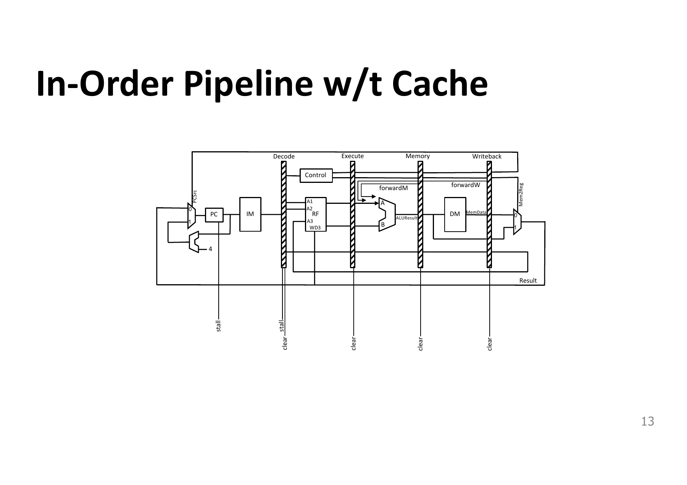

## 2.2 更激进的顺序流水线:Stall-on-Use(P14–P17)

为了证明「问题不在硬件不够强,而在顺序发射这个策略本身」,课件换成一个**激进版顺序流水线**:

**结构变化**
- **Decode 和 Register Read 拆成两级**
- **访存搬到 Execute 级内部**
- 内存可以**同时处理多个请求**(non-blocking / lock-up free cache)
- **多个功能单元**,指令不会因结构相关而 stall
- Load 被拆成三步:**agen(地址生成) → D$(cache 访问) → Mem(miss 时访主存)**

**流水线级(缩写在时序表里会用到)**

| 缩写 | 级 |
|---|---|
| FE | Fetch |
| DE | Decode |
| RR | Register Read(**同时是 issue 级**) |
| EX | Execute(Big ALU / Tiny ALU / agen+D$+Mem) |
| WB | Writeback |

**Issue 的定义**:当操作数就绪时,把指令送到 ALU 去执行。本设计把 issue 逻辑放在 **RR 级**。

**RR 级的发射策略(P17,必记)**

| 冒险 | 处理 |
|---|---|
| **RAW** | 源寄存器未就绪 → **stall** |
| **WAW** | 目的寄存器 "busy" → **stall** |
| **WAR** | **不是问题**。顺序发射保证前一条指令的读发生在后一条指令的写之前 |

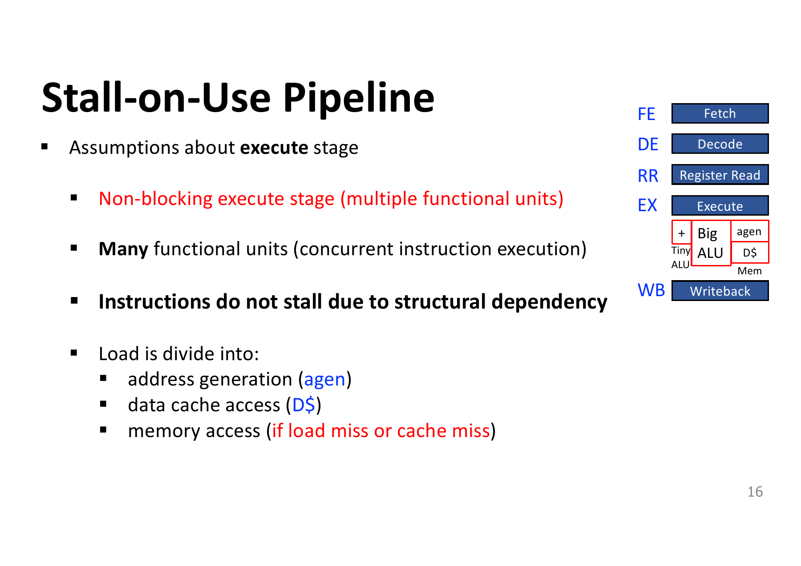

## 2.3 场景 1:load miss + 后续全独立(P18–P28)

```
i1: LDR R2, [R1, #0]     ← cache miss
i2: ADD R4, R3, #1       ← 独立
i3: ADD R6, R5, #2       ← 独立
i4: ADD R7, R6, #3       ← 依赖 i3(但 i3 很快)
```

**时序结果(P27/P28)**

| 周期 | 1 | 2 | 3 | 4 | 5 | 6–8 | 9 |
|---|---|---|---|---|---|---|---|
| i1 | FE | DE | RR | EX@ | EXD$ | …miss… | WB |
| i2 | | FE | DE | RR | EX | WB | |
| i3 | | | FE | DE | RR | EX / WB | |
| i4 | | | | FE | DE | RR / EX / WB | |

**结论(P28)**:激进顺序流水线**可以在 load miss「底下」干活**,把访存延迟藏起来。注意 i2/i3/i4 **先于 i1 完成写回**——顺序发射,但**乱序完成**。

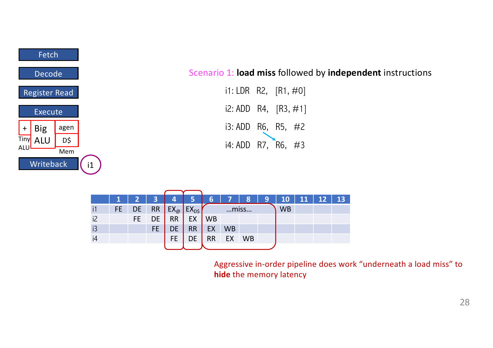

## 2.4 场景 2:load miss + 紧跟一条相关指令(P29–P41)—— 关键反例

```
i1: LDR R2, [R1, #0]     ← cache miss
i2: ADD R4, R2, #1       ← 依赖 i1(RAW)
i3: ADD R6, R5, #2       ← 独立!
i4: ADD R7, R6, #3       ← 依赖 i3
```

**时序结果(P39/P40)**

| 周期 | 1 | 2 | 3 | 4 | 5 | 6 | 7 | 8 | 9 | 10 | 11 | 12 | 13 |
|---|---|---|---|---|---|---|---|---|---|---|---|---|---|
| i1 | FE | DE | RR | EX@ | EXD$ | …miss… | | | | WB | | | |
| i2 | | FE | DE | **RR** | **RR** | **RR** | **RR** | **RR** | **RR** | EX | WB | | |
| i3 | | | FE | **DE** | **DE** | **DE** | **DE** | **DE** | **DE** | RR | EX | WB | |
| i4 | | | | **FE** | **FE** | **FE** | **FE** | **FE** | **FE** | DE | RR | EX | WB |

**结论(P40–P41),这是本 set 的中心论点:**

- i2 等 i1 是**应该的**(真依赖,没办法)。
- 但 i3、i4 跟 i1–i2 这条链**完全无关**,却被一起卡住了。
- **关键洞察:顺序发射把数据相关变成了结构冒险。** RR(issue)级被卡住的 i2 占着,后面的指令根本挤不进来。
- 所以问题**不在硬件资源不够**,而在 **in-order issue 这个策略本身**。

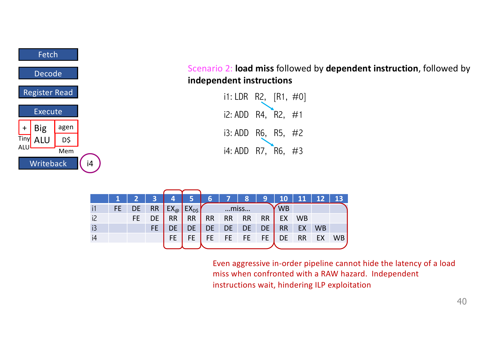

---

# 三、乱序的本质与 Issue Queue(P42–P46)

## 3.1 OOO 的定义(P42)

> 一条指令若与前面的指令有 RAW 冒险 → **它自己 stall,这没问题**。
> 但它**后面的独立指令不应该 stall**,它们可以**不按程序序发射(out of order)**。

## 3.2 Issue Queue —— 解除 RR 级的阻塞(P43)

新增一个指令缓冲区,专门存放**因数据相关而 stall 的指令**。别名一大堆,考试里都可能出现:

> **reservation stations / issue buffer / issue queue (IQ) / scheduler / scheduling window**

作用:
- stall 的指令**不再阻碍取指**
- 年轻的就绪指令可以**越过**年长的未就绪指令发射执行
- 把流水线向未来的独立指令「打开」→ 容忍长延迟(cache miss、浮点)、更好地挖掘 ILP

## 3.3 静态 vs 动态调度(P44–P46)—— 概念区分,必考

| | Static scheduling | Dynamic scheduling |
|---|---|---|
| 何时 | **编译期**(compile time) | **运行期**(program execution) |
| 谁做 | 编译器决定执行顺序 | **硬件**决定,对软件透明 |
| 依赖检查 | 依赖硬件做冒险检测保证正确性 | 硬件做 |
| 例子 | ARM 5 级流水线、之前的 2-way 顺序超标量 | 本 set 的 OOO |
| 口号 | — | **"Smart hardware, dumb software"** |

**Instruction schedule(指令调度)= 指令执行的一种顺序。** 目标:最大化 ILP;约束:**所有依赖必须被遵守**。

> 现实中的动态调度处理器都是**超标量**的;课件为了讲清原理,一律**假设标量(每周期 1 条)**。考试题也多按标量算。

---

# 四、OOO v.1:CDC 6600 Scoreboard(P47–P66)

## 4.1 流水线结构变化(P47–P48)

```
Fetch  →  Decode  →  Register Read  →  Dispatch  ─┐   in-order fetch/dispatch engine
                                                   │
                                    ┌── Issue Queue (IQ) ──┐   按序插入
                                                   │        出队乱序
                            Issue → Execute → Writeback     OOO issue/execute engine
```

**新增两级**:**Dispatch(DI)**、**Issue(IS)**
**新增部件**:**Scoreboard**
**新增总线**:**Common Data Bus (CDB)** —— 同时负责写回和转发

**新的流水线级缩写(时序表里会用)**:FE / DE / RR / **DI** / **IS** / EX / WB

## 4.2 三张表的字段(必须记住结构)

**Scoreboard**:每个体系结构寄存器 1 个 valid 位

| 寄存器 | v |
|---|---|
| r0..r7 | 1 = 值在寄存器堆里且**就绪**;0 = **未就绪**(有指令正在生产它) |

**Register File**:r0..r7 的值

**Issue Queue (IQ)** 每个槽位的字段:

| 字段 | 含义 |
|---|---|
| `v` | 槽位占用位(1 = 被占用,**不是**就绪位) |
| `dst tag` | 目的寄存器标签 |
| `rs1 rdy` | 源 1 是否就绪 |
| `rs1 tag/value` | rdy=1 存值,rdy=0 存**生产者的 tag** |
| `rs2 rdy` / `rs2 tag/value` | 同上 |

> ⚠️ **易混点**:这里有**两个不同的 `v`**。Scoreboard 的 `v` 是「寄存器值就绪」,IQ 的 `v` 是「槽位被占用」。而且到了 v.2 的 RMT 里,`v` 的含义又**反过来**(见 §6.3)。考试极易踩坑。

## 4.3 各级的具体动作(P50–P51,必背)

**Dispatch 级**
1. 把指令从 RR/DI 流水寄存器复制进 IQ(前提:IQ 有空槽)
2. 把该槽的 `v` 置 1(表示占用)

**Issue 级**
1. 两个操作数都就绪 → 把指令送去执行单元
2. **释放 IQ 槽位(v = 0)**

**Scoreboard 更新**
- 某指令以 rN 为目的寄存器时,把对应 bit 置 **0(NOT READY)**
- 指令读操作数时:**scoreboard v=0 → 抓 tag;v=1 → 从寄存器堆抓值**

**指令怎么被选中执行?(记忆口诀在此)**
1. IQ 等待目的 tag 出现在唤醒总线上
2. tag 出现 → **唤醒所有等这个 tag 的指令**
3. 从「就绪」的指令中挑一条送去执行
4. 口诀:**Capture-Tag-And-Go-For-Execution**

**Common Data Bus (CDB)**
- 值通过 CDB **广播**,**绕过寄存器堆的写入**
- CDB 就是转发(forwarding)的实现
- 广播目标三处:**IQ、寄存器堆、Execute 级**

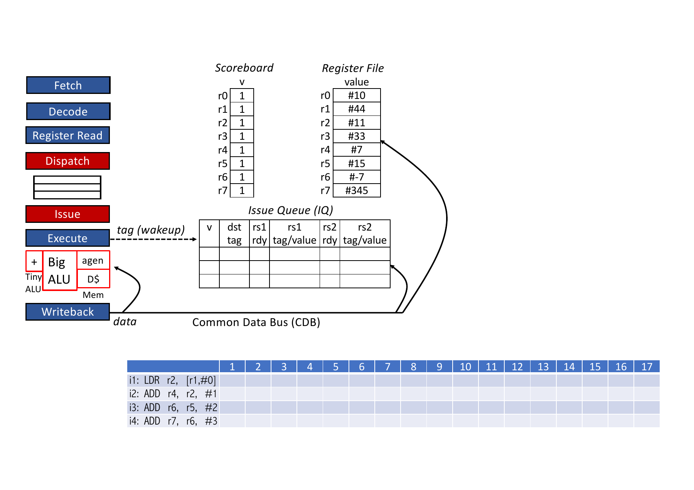

## 4.4 逐周期推演(P52–P65)

**页码 ↔ 周期映射:`PDF 页码 = 周期号 + 52`**(P52 = 初始状态,P53 = 周期 1,……,P65 = 周期 13)

程序(和场景 2 一样):
```
i1: LDR r2, [r1,#0]     ← cache miss
i2: ADD r4, r2, #1      ← RAW on r2
i3: ADD r6, r5, #2      ← 独立
i4: ADD r7, r6, #3      ← 依赖 i3
```
初始 RF:`r0=#10 r1=#44 r2=#11 r3=#33 r4=#7 r5=#15 r6=#-7 r7=#345`

**最终时序(P65)**

| 周期 | 1 | 2 | 3 | 4 | 5 | 6 | 7 | 8–10 | 11 | 12 | 13 |
|---|---|---|---|---|---|---|---|---|---|---|---|
| i1 | FE | DE | RR | DI | IS | EX@ | EXD$ | …miss… | WB | | |
| i2 | | FE | DE | RR | DI | IS | IS | IS ×3 | IS | EX | WB |
| i3 | | | FE | DE | RR | DI | IS | **EX(8) / WB(9)** | | | |
| i4 | | | | FE | DE | RR | DI | **IS(8) / EX(9) / WB(10)** | | | |

**跟顺序版对比(硬核考点)**

| | 激进顺序 (§2.4) | Scoreboard OOO |
|---|---|---|
| i4 完成周期 | **13** | **10** |
| i3 完成周期 | 12 | 9 |
| i2 完成周期 | 11 | 13(多了 DI/IS 两级) |
| i3/i4 是否被 i2 卡住 | **是** | **否** |

> 注意:OOO 并不是让每条指令都变快。i2 反而**晚了 2 个周期**(多了 DI + IS 两级流水)。**收益来自独立指令不再排队**,不是来自单条指令的延迟降低。这个 trade-off 常被考。

**关键中间状态**
- **周期 5(P57)**:i1 进 IS,IQ 槽 0 填入 `dst=r2, rs1 rdy=1 #0, rs2 rdy=1 #44`;scoreboard `v[r2]=0`
- **周期 7(P59)**:i1 cache miss;IQ 里 i2(`rs1 rdy=0, tag=r2`)、i3(全就绪)同时在队;`v[r2]=v[r4]=v[r6]=v[r7]=0`
- **周期 9(P61)**:i3 执行完 → CDB 广播 `(r6, #17)` → **唤醒 i4**(rs1 rdy 0→1),i4 立刻可执行。**这是 wakeup + CDB 转发的典型帧。**
- **周期 13(P65)**:i1 的值 `#666` 经 CDB 唤醒 i2,i2 执行写 `r4=#667`

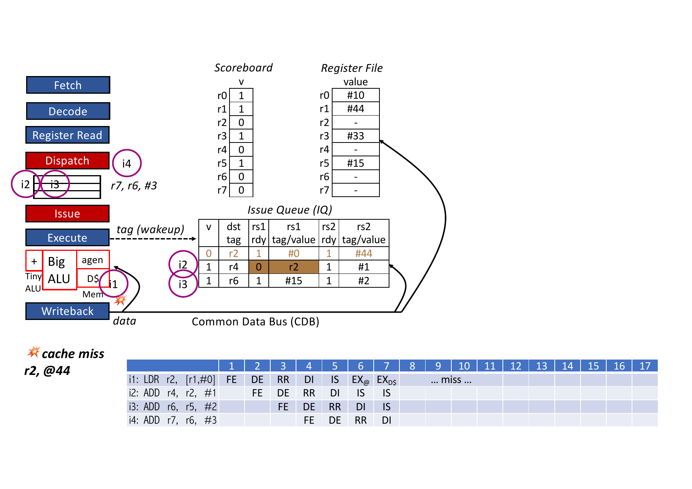


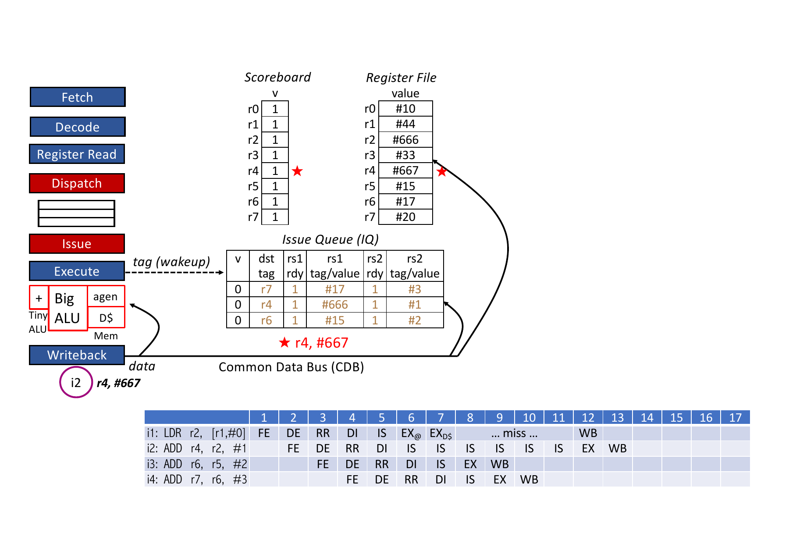

## 4.5 阶段小结(P66)

动态调度超标量处理器:
- 硬件在**运行期**做调度,可以重排指令榨取 ILP
- **同一段指令序列在不同次执行中可以产生不同的调度**(因为分支行为会变)—— 这是编译器做不到的
- 机制本质:**把指令收集到一个大的 instruction window 里,做 dataflow 分析**;操作数就绪且无冒险就执行
- 任一周期都有**多条独立依赖链**在执行

---

# 五、OOO v.1 的三大问题(P67–P69)—— 必考

| # | 问题 | 后果 |
|---|---|---|
| **1** | **无法从分支误预测中恢复** | 年轻指令相对年长指令是**推测执行**的;可能存在还没执行的、被预测过的老分支。一旦预测错,已经乱序写进 RF 的结果**无法撤销** |
| **2** | **异常不精确** | 寄存器堆被**乱序**更新,机器状态不再等价于顺序执行 |
| **3** | **两条指令写同一个目的寄存器时退化回顺序** | WAR/WAW 导致 stall:必须在 RR 级把年轻的生产者卡住,直到年长的生产者执行完 |

**问题 1 图示(P68)**
`i2: BNE r2, i7` 误预测。但 i3、i4 早已执行并写回 RF,`r6`、`r7` 的原值**已经找不回来了**;而且 i3、i4 已经离开流水线("long gone"),连 flush 都无从谈起。

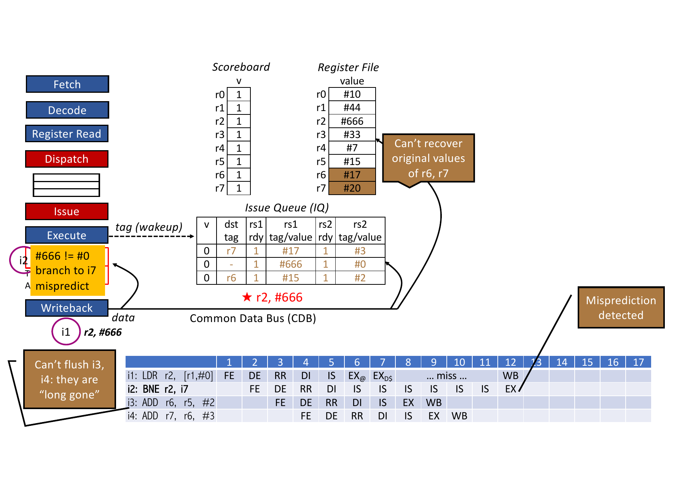

**问题 3 图示(P69)**
```
i1: LDR r2, [r1,#0]     ← cache miss,生产 r2
i2: ADD r4, r2, #1      ← 消费 r2(正确的 RAW 唤醒)
i3: ADD r2, r5, #2      ← 也生产 r2!(WAW with i1)
i4: ADD r7, r2, #3      ← 应该消费 i3 的 r2
```
如果不在 RR 级把 i3 卡住:
- i3 先执行完,写 `r2`;之后 i1 的 miss 解决,**i1 会把 i3 的结果覆盖掉** → **WAW 处理错误**
- 更糟:i3 广播 tag `r2` 时,**等着 i1 的 r2 的 i2 会被错误唤醒** → 图中标为 **"Incorrect Wakeup: WAR"**(i2 抓到了本不该属于它的值)
- 只有 i4 等 i3 的 r2 才是 **"Correct Wakeup: RAW"**

> **根因**:scoreboard 用**体系结构寄存器名**当 tag,而寄存器名**不唯一**。同一个 `r2` 可能对应多个生产者,tag 无法区分。→ 解法就是**重命名成唯一 tag**。

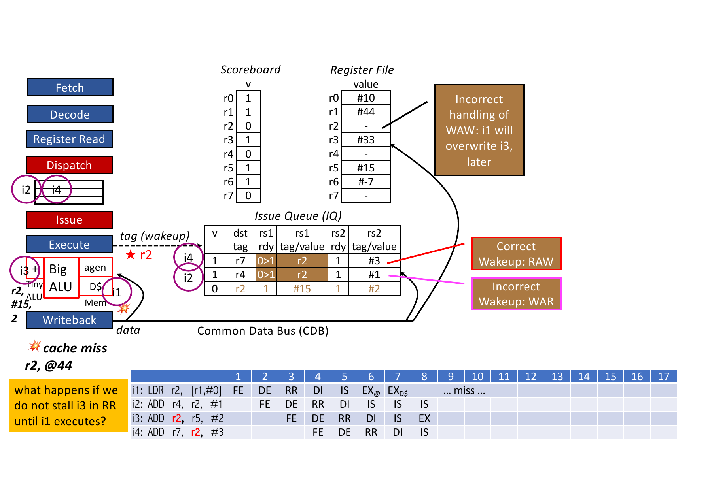

---

# 六、精确异常与 ROB(P70–P85)

## 6.1 精确异常的定义(P71)—— 三条,逐字记

一个异常是 **precise(精确)** 的,当且仅当:

1. **出错指令之前的所有指令都已完成**,且其效果已经可见
2. **出错指令本身未完成**——它要么引发了异常,要么根本没执行
3. **之后的任何指令都未执行**,也未对机器状态(寄存器、内存)做出任何可见改动

> 一句话:**异常发生时,机器状态必须与「顺序执行到这条指令为止」完全等价。** 这是乱序 CPU 能正确恢复、支持系统调用和调试的根本保障。

## 6.2 例子

**精确的情形(P72)**:`LDR R1, [R1, #0]` 触发内存保护错误
→ 之前指令全完成 / 本指令未完成 / 之后指令未开始 → OS 可以修正地址,然后**从这条 LDR 安全地恢复执行**。

**不精确的情形(P73,CDC6600)**
```
i1: ADD R0, R0, #4
i2: LDR R1, [R0, #0]     ← cache miss,后来才发现是非法地址
i3: ADD R2, R2, #1        ← 已乱序执行完
i4: ADD R3, R3, #2        ← 已乱序执行完
i5: ADD R4, R3, #1        ← 已乱序执行完
i6: SUB R5, R1, #1
```
LDR 之后才产生软件异常,CPU 跳到 handler。但此时 RF 里**已经反映了 i3/i4/i5 的执行结果**,与顺序编程模型不一致 → **异常不精确**。

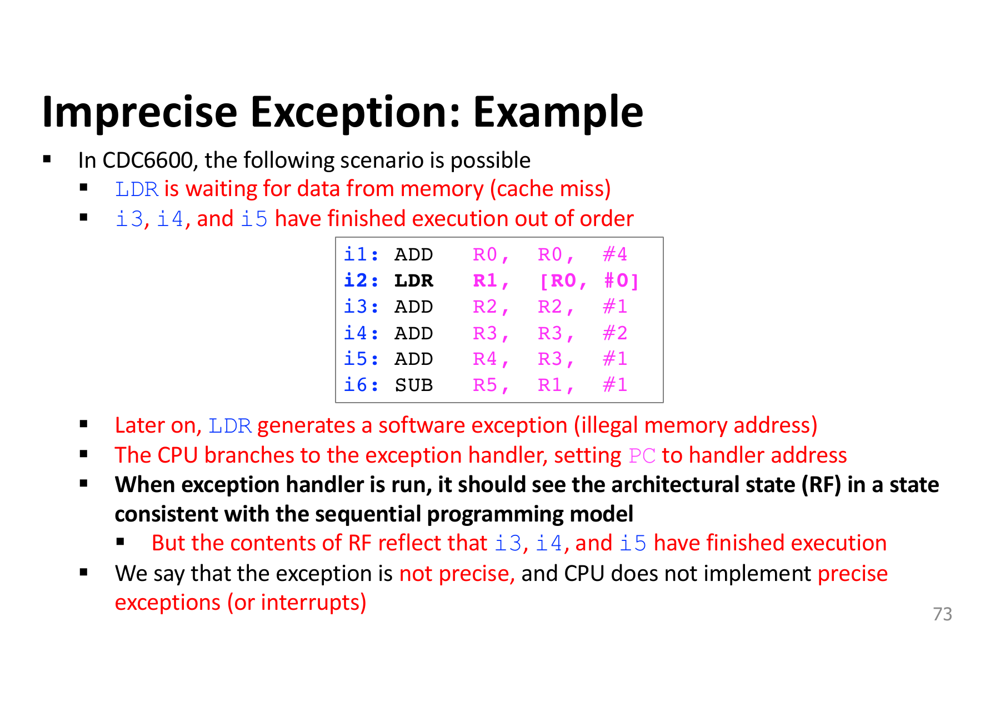

## 6.3 解法:乱序执行 + 按序提交(P74)

> **需要一种机制:允许指令 out-of-order execution,但对体系结构状态 in-order commitment。**
> 这个结构叫 **Reorder Buffer (ROB)**。它同时解决**精确异常**和**分支误预测恢复**。

## 6.4 硬件推测的四大支柱(P76,必背)

**Hardware Speculation = 四个思想的组合:**

1. **Register renaming** —— 消除 WAR / WAW
2. **Dynamic branch prediction** —— 消除控制冒险
3. **Dynamic scheduling** —— 乱序执行
4. **Reorder buffer (ROB)** —— 精确中断 + 误预测恢复

## 6.5 现代流水线的「两个驼峰」(P77)

```
   in order          |          out of order          |     in order
F → D → [SCHEDULE] → [ EX 各种功能单元:整数加/整数乘/浮点乘/访存 ] → [REORDER] → W
        驼峰 1                                                        驼峰 2
```
- **驼峰 1 = Reservation stations(scheduling window)**
- **驼峰 2 = Reordering(reorder buffer,又叫 instruction window / active window)**


## 6.6 OOO v.2:ROB 做了什么(P78)

- **ROB 同时支持乱序执行 + 从误预测和异常中恢复**
- **ROB 还实现寄存器重命名**:
  - 把**不唯一**的目的 tag(体系结构寄存器名)重命名成**唯一**的目的 tag(**ROB tag**)
  - 源 tag 也一并重命名,**无歧义地把消费者链接到它的生产者**
  - **WAR/WAW 在重命名后被彻底消灭**,不再需要退回顺序

## 6.7 重命名例子(P80)

假设 R7、R8 在 RF 里是最新的:

| 原始序列 | 重命名后 |
|---|---|
| `i1: ADD R0, R7, #4` | `i1: ADD ROB0, R7, #4` |
| `i2: ADD R1, R0, #1` | `i2: ADD ROB1, ROB0, #1` |
| `i3: ADD R0, R8, #8` | `i3: ADD ROB2, R8, #8` |
| `i4: ADD R2, R0, #1` | `i4: ADD ROB3, ROB2, #1` |

- i1 与 i3 之间的 **WAW 消失**(一个写 ROB0,一个写 ROB2)
- **所有真依赖仍被遵守**(i2 明确指向 ROB0,i4 明确指向 ROB2)
- ROB0/ROB1/… 是**扩展的微架构寄存器**,**对程序员不可见**(non-architectural)

## 6.8 ARF + ROB:扩展寄存器堆(P81)

原来的 "Register File" 被拆成两部分:

| | 内容 | 性质 |
|---|---|---|
| **ARF**(Architectural Register File) | 体系结构寄存器的值,**如同顺序流水线产生的一样** | **已提交 / 非推测**。误预测或异常时可安全回退到这里 |
| **ROB**(Reorder Buffer) | 体系结构寄存器的**推测版本**,同一个寄存器**可以有多个推测版本** | 推测状态。**循环缓冲(circular FIFO)**,有 **Head(H)** 和 **Tail(T)** 指针 |

**ROB 是按程序序排列的、从最老到最年轻的指令列表:**
- **ROB Head = 最老的未退休指令**
- **ROB Tail = 最年轻的指令**

**ROB 表项字段(P79)**

| 字段 | 含义 |
|---|---|
| `value` | 推测结果值 |
| `dst` | 目的体系结构寄存器 |
| `rdy` | 值是否已产生 |
| `exc` | 异常位 |
| `misp` | 误预测位 |
| `PC` | 该指令的 PC(恢复时用) |

**RMT(Rename Map Table)字段** —— Intel 叫 **RAT(Register Alias Table)**

| 字段 | 含义 |
|---|---|
| `v` | **1 = 该体系结构寄存器当前被映射到 ROB(最新值在 ROB 里,不在 ARF)**;0 = 最新值在 ARF |
| `Tag` | 映射到哪个 ROB 表项 |

> ⚠️ **极易踩坑**:RMT 的 `v=1` 表示「值**不**在 ARF 里」,而 Scoreboard 的 `v=1` 表示「值**就在** RF 里且就绪」。**两者极性相反。** 做题时先确认自己在哪个版本的机器上。

## 6.9 新增的流水线级与规则(P82–P85 一页速查)

**流水线级(v.2 完整)**:FE → DE → **RN(Rename)** → RR → DI → IS → EX → WB → **RT(Retire)**

### Rename 级(在 Decode 之后、Register Read 之前)
1. 在 **ROB Tail** 指向的表项给新指令分配位置,这个位置就是它的**唯一 ROB tag**
2. **源寄存器**重命名到扩展寄存器集合 ARF+ROB:重命名精确定位了值的位置(在 ARF 还是在 ROB;若在 ROB 则是哪个 tag)→ 无歧义地把消费者链到生产者
3. **目的寄存器**重命名为该指令的唯一 ROB tag
4. **Tail 指针递增**;RMT 中该目的寄存器 `v=1, Tag=新 ROB tag`

### Register Read 级
消费者从**三个地方之一**取源操作数(必背):

| 来源 | 条件 |
|---|---|
| **ARF** | 生产者**已从 ROB 退休** |
| **ROB**(用重命名后的源 tag) | 生产者**已执行但尚未退休** |
| **Bypass / CDB** | 生产者**尚未执行** |

若 ROB 表项显示值还没就绪(生产者未执行)→ **指令把重命名后的源 tag 作为值的代理(proxy)带进 IQ**,等待唤醒。

### Writeback 级
指令把**推测结果乱序写进自己的 ROB 表项**,**不写 ARF**。

### Retire 级(新增)
**按程序序**把结果从 ROB 安全提交到 ARF。

### 误预测 / 异常恢复
1. 出错指令**乱序地**在自己的 ROB 表项里置 **misp 位或 exc 位**
2. CPU **等到该指令到达 ROB Head**(成为最老的未退休指令)
3. 到达后:**flush 流水线和 ROB 中所有指令**,并把 **RMT 恢复到「空流水线」的一致状态**

> P85 是一整页的 "1-Page Cheat sheet",内容就是 §6.8 + §6.9 的合集,纯文字,已全部复述,**不需要截图**。考前直接看本节即可。

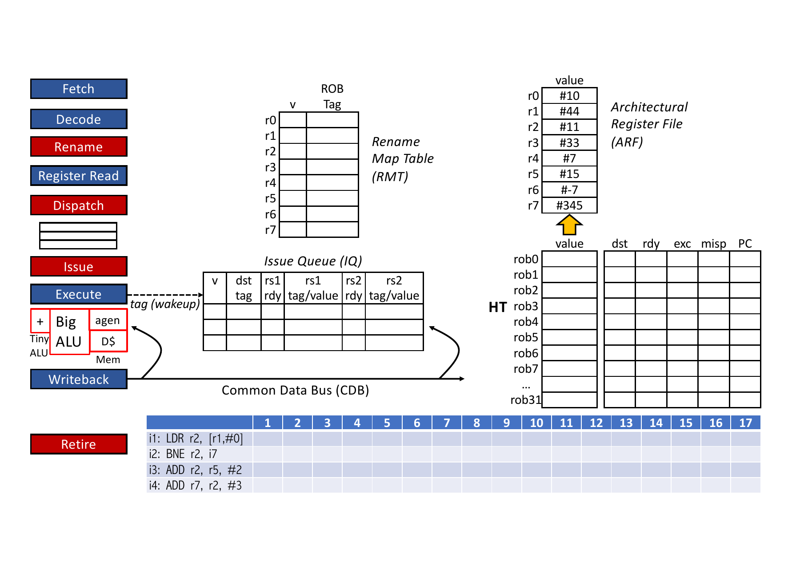

---

# 七、OOO v.2 逐周期推演:无误预测(P86–P124)

**页码 ↔ 周期映射:`状态图 PDF 页码 = 周期号 + 86`**(P86 = 初始,P87 = 周期 1,……,P103 = 周期 17)
**文字解说页 P106–P125 单独成组**:`解说页 PDF 页码 = 周期号 + 105`(P106 = Cycle 1,……,P122 = Cycle 17)

## 7.1 程序与初始状态

```
i1: LDR r2, [r1,#0]     ← cache miss,取回 #0
i2: BNE r2, i7          ← 分支,取决于 r2
i3: ADD r2, r5, #2      ← 又写 r2(与 i1 构成 WAW)
i4: ADD r7, r2, #3      ← 读 r2,应拿 i3 的值
i5: ADD r4, r2, r7      ← 读 i3 的 r2 和 i4 的 r7
```
初始 ARF:`r0=#10 r1=#44 r2=#11 r3=#33 r4=#7 r5=#15 r6=#-7 r7=#345`
ROB 初始 Head=Tail=**rob3**。**分支预测策略:always not-taken(总是预测不跳转)。**

## 7.2 完整时序表(P105)

| 周期 | 1 | 2 | 3 | 4 | 5 | 6 | 7 | 8 | 9 | 10 | 11 | 12 | 13 | 14 | 15 | 16 | 17 | 18 |
|---|---|---|---|---|---|---|---|---|---|---|---|---|---|---|---|---|---|---|
| **i1** | FE | DE | RN | RR | DI | IS | EX@ | EXD$ | …miss… | | | | WB | **RT** | | | | |
| **i2** | | FE | DE | RN | RR | DI | IS | IS | IS | IS | IS | IS | EX | WB | **RT** | | | |
| **i3** | | | FE | DE | RN | RR | DI | IS | EX | WB | RT | RT | RT | RT | RT | **RT** | | |
| **i4** | | | | FE | DE | RN | RR | DI | IS | EX | WB | RT | RT | RT | RT | RT | **RT** | |
| **i5** | | | | | | | | | FE | DE | RN | RR | DI | IS | EX | WB | RT | **RT** |

**读表要点**:
- i3 在**周期 10 就写回**,但要**等到周期 16 才退休**——因为它前面还有 i1、i2 没退休。**这就是「乱序执行、按序提交」。**
- i5 在**周期 9 就被取指**了。取指完全没有被 i1 的 cache miss 阻塞。

## 7.3 逐周期要点(P106–P123,提炼)

**周期 3(i1 Rename)** —— 重命名的标准动作模板,必记
1. 在 **rob3** 给 i1 分配表项(Tail 当前在 rob3)
2. 目的操作数 `r2` 重命名为 **rob3**
3. Tail 递增到 rob4
4. RMT 中 **`v[r2]=1`, Tag=rob3**
5. 一个源是常数 0
6. 第二个源 `r1` 重命名为 **ARF[r1]**,因为 RMT 中 `v[r1]=0`
- 同周期 i3 被取指,**这是推测取指**(i2 是分支,可能跳转;预测策略是 always-not-taken)

**周期 4(i2 Rename)**
- 分配 rob4;目的 `r2` → rob4;Tail → rob5
- **源 `r2` 重命名为 rob3**,因为 RMT 中 `v[r2]=1` → 把 tag 带进 IQ,等生产者 i1 产出值
- 同周期 i1 在 RR 读 ARF[r1] = **44**

**周期 5(i3 Rename)**
- 分配 rob5;目的 `r2` → rob5,**RMT 中 `v[r2]` 保持 1,Tag 覆盖为 rob5**
- 源 `r5` → ARF[r5],因为 `v[r5]=0`
- **WAW(i1 vs i3)在这一步被消灭:两条指令写不同的 ROB 表项**

**周期 6(i4 Rename)**
- 分配 rob6,Tail → rob7;目的 `r7` → rob6,`v[r7]=1`
- 源 `r2` → **rob5**(RMT 当前 Tag)→ **正确拿到 i3 的版本,而不是 i1 的**

**周期 7(i1 Execute-agen)**
- i1 发射到 agen 单元,源为 #0 和 #44;**对应 IQ 槽被释放(v=0)**

**周期 8(i1 Execute-D$)**:查 SRAM 数据 cache
**周期 9–12(i1 …miss…)**:从主存读数据

**周期 9(i3 Execute)**
- i3 发射到 Tiny ALU,从 IQ 释放
- **在周期末尾把目的 tag `rob5` 送到 IQ 前的 wakeup 逻辑**

**周期 9(i4 Issue)**:`rs1 rdy` 由 0 变 1(收到 rob5 的唤醒),下周期可执行

**周期 10(i3 Writeback)**
- 把结果写进**自己的 ROB 表项 rob5**
- **通过 CDB 广播 tag/value,转发给等待的指令**

**周期 11(i3 Retire)**:i3 只能**排队等它到达 ROB Head**;因为更老的指令还没执行完,Head 被堵住

**周期 12(i1 miss 解决)**:i1 把目的 tag `rob3` 送到 IQ,**唤醒 i2**

**周期 13**
- i1 Writeback:把结果 `#0` 写进 rob3
- i2 Execute:分支条件求值,`#0 != #0` 为假 → **not-taken,与预测一致 → 无误预测**;i2 从 **CDB 抓到 r2(rob3)的值**(转发)

**周期 14(i1 Retire)** —— **退休的标准动作模板,必记**
1. i1 到达 **ROB Head**,进入 Retire 级
2. 用它 ROB 表项里的值更新 **ARF[r2]**
3. **检查 RMT 中 r2 对应的 tag:因为是 rob5(不是 rob3),所以 `v` 位保持不变**
4. **ROB Head 递增**(移到 rob4)
- 同周期 i2 Writeback:分支无值可写;**因为实际 not-taken 且预测也是 not-taken,把 ROB 的 `misp` 位置 0**

**周期 15(i2 Retire)**:无值写 ARF,直接退休;Head → rob5

**周期 16(i3 Retire)**
1. 到达 Head,写 **ARF[r2] = #17**
2. **检查 RMT:r2 的 tag 就是 rob5 → 匹配 → 把 `v` 位复位为 0**
3. Head → rob6

**周期 17(i4 Retire)**:写 **ARF[r7] = #20**;RMT 中 r7 的 tag == rob6 → **复位 v 位**;Head → rob7

**i5 单独轨迹(P123)**:FE(9) → DE(10) → RN(11,分配 rob7,两个源分别重命名为 **rob5** 和 **rob6**,因为 RMT 中 `v[r2]=v[r7]=1)→ RR(12,两个源在 ROB 里都已就绪,直接取值)→ DI(13) → IS(14) → EX(15) → WB(16) → RT(17–18,**Head = Tail,全部完成**)

### ⭐ 退休时 RMT 的处理规则(最容易考、最容易错)

> 指令退休时,**只有当 RMT 中该目的寄存器的 Tag 恰好等于本指令的 ROB tag 时,才清除 RMT 的 v 位**。
> 若不相等,说明**还有更年轻的指令重命名过这个寄存器**,RMT 的映射仍然有效 → **不能动**。
>
> 对照周期 14(i1,rob3 ≠ rob5 → **不清**)与周期 16(i3,rob5 == rob5 → **清**)。

## 7.4 观察结论(P124)

- 与只有 scoreboard 的版本相比,**ROB 没有降低性能**:取指没有像之前那样 stall(容忍了 D$ miss)
- **按序退休并没有阻碍乱序、推测执行**
- 本例中 **ROB 并未被用于恢复**,只用到了它的**重命名**功能
- 但已经能看出**没有 ROB 时误预测的危险**


---

# 八、误预测恢复(P125–P130, P149)

## 8.1 场景变化(P125)

同一段程序,唯一改动:**i1 这条 load 取回的值是 `#666` 而不是 `#0`。**
于是 `i2: BNE r2, i7` 的条件 `#666 != #0` 为**真 → taken**,而预测是 not-taken → **误预测**。

## 8.2 恢复三步(P126 → P127 → P128)

**第一步:检测(P126,周期 13)**
- i2 在 EX 级求值,发现 `#666 != #0` 为真 → **taken → misprediction**
- 此时 ROB Head 还在 rob3(i1 正在 WB)
- **注意:i3 和 i4 早就执行完并写回 ROB 了,但它们的值还在 ROB 里,ARF 完全没被污染**

**第二步:标记 + 等待到达 Head(P127,周期 14)**
- i2 **乱序地**把自己 ROB 表项(rob4)的 **`misp` 位置 1**
- 同周期 i1 退休,写 ARF[r2] = #666;检查 RMT 发现 `rob5 != rob3` → **不复位 v 位**(图上标注 "Don't reset: rob5 != rob3")
- **Head 移到 rob4**,即 i2 到达 Head

**第三步:执行恢复(P128,周期 15)** —— **四个动作,必背**
1. **`T = H`**,把 ROB 整个清空(flush ROB)
2. **flash-clear RMT 的所有 v 位**(一次性全清零)
3. **flush 所有流水线级**——它们装的都是比 ROB Head(即分支)更年轻的指令,包括正在流水线里的 i5
4. 重定向取指到分支目标 **i7**

**恢复后的体系结构状态(P130 / P149)**
```
ARF: r0=#10  r1=#44  r2=#666  r3=#33  r4=#7  r5=#15  r6=#-7  r7=#345
RMT: 全部 v=0
ROB: H = T
```
→ **i3(r2=#17)、i4(r7=#20)、i5(r4=#37)的结果全部被丢弃**,因为它们在错误路径上。**只有 i1 和 i2 的效果保留。这正是精确异常的定义。**

### 为什么 flash-clear RMT 就够了?

因为 flush 之后,**所有有效的体系结构值都在 ARF 里**(ROB 里剩下的全是错误路径的推测值,已被丢弃)。把 RMT 全清零就等价于说「所有寄存器的最新值都在 ARF」——这正是空流水线的一致状态。**不需要逐条回滚。**


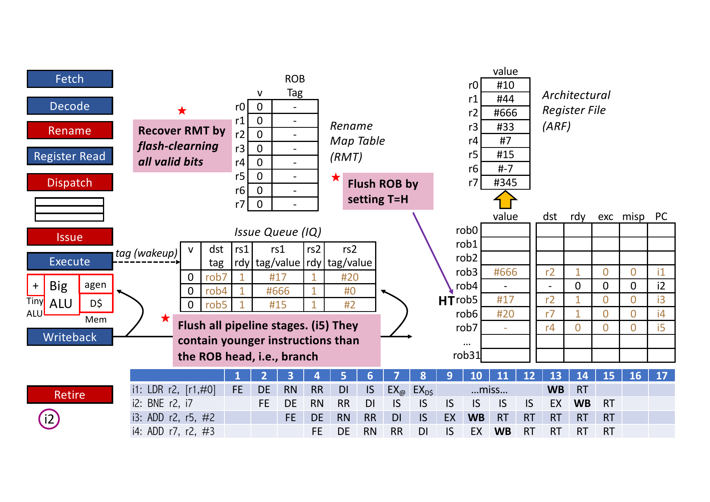


## 8.3 顺序 → 乱序 结构总对比(P129)

| 顺序流水线 | 乱序流水线(v.2) | 新增部分的作用 |
|---|---|---|
| Fetch | Fetch | |
| Decode | Decode | |
| — | **Rename** | 扩展寄存器堆:**ARF(已提交状态)+ ROB(推测状态)**;提供恢复能力并消除 WAR/WAW |
| RF Read / Issue | Register Read | |
| — | **Dispatch** | **按序**把指令插入 IQ |
| — | **Issue Queue → Issue** | **乱序**把指令从 IQ 取出 |
| Execute | Execute | |
| Writeback | Writeback | |
| — | **Retire** | **按序**把结果从 ROB 提交到 ARF |

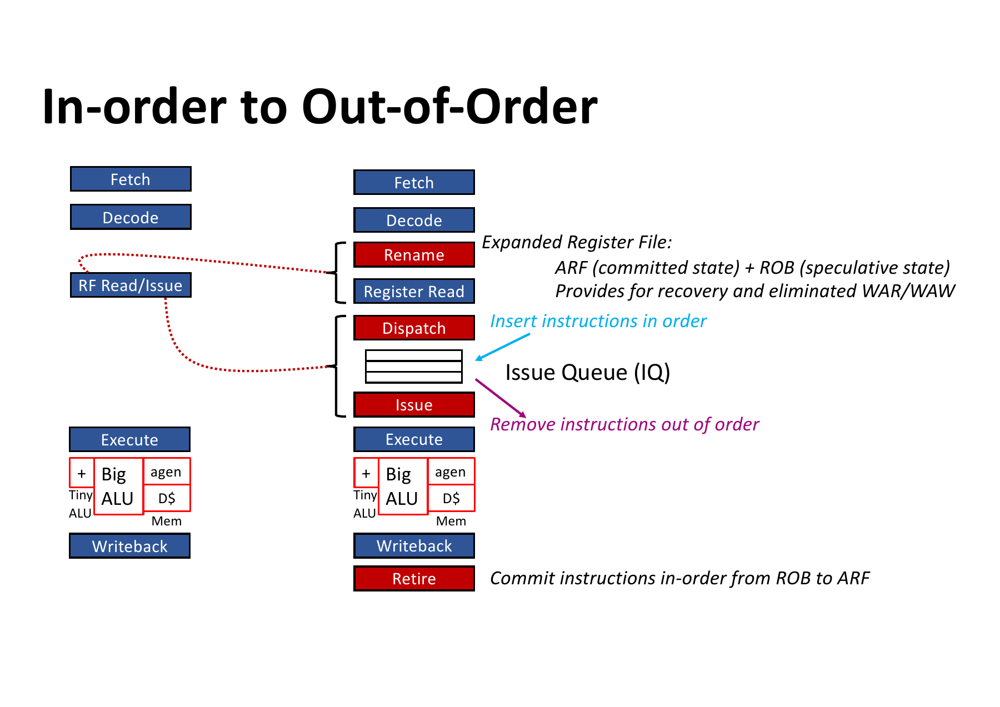

## 8.4 ARF + ROB 总结图(P134)

- **物理寄存器堆 = ARF + ROB**
- **提交 = 把 ROB Head 的值搬进 ARF**
- ROB 里可以同时存在同一个体系结构寄存器的**多个版本**(图中 `r5 = rob31` 和 `r5 = rob87` 并存)
- **恢复流程**:等待异常/误预测到达 Head → **T = H** → **复位 RMT 全部 v 位**

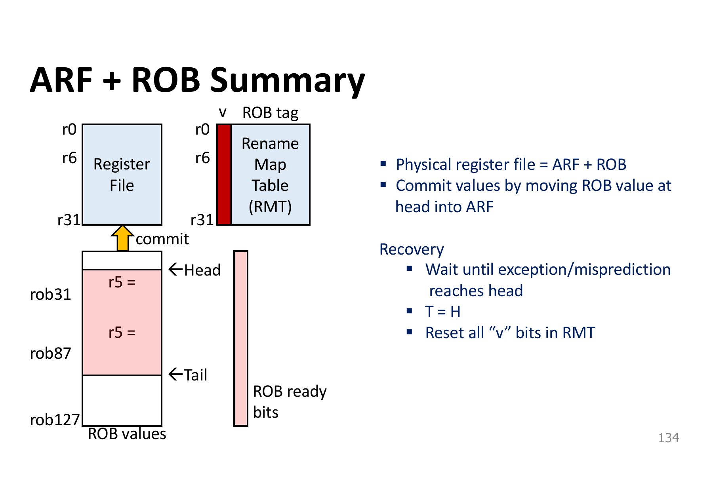

---

# 九、Load / Store 的乱序执行(P131–P132)

**Load 和 store 也会乱序执行。**

**安全条件**:load 和 store 访问**不同地址**时,乱序是安全的。访问**同一地址**时,重排会产生冒险:

| 必须遵守 | 含义 |
|---|---|
| **WAR** | Load **不得**消费一个比它年轻的 store 的数据 |
| **RAW** | 在 load **之前(更老)** 的最近一条 store,**必须**为它提供值 |

## 推测式 Load 执行(Speculative Load Execution)

- Load **在所有更老 store 的地址都还未知时就推测执行**,靠一个叫 **LSQ(Load-Store Queue)** 的结构支撑
- Load **搜索所有地址匹配的推测(更老)store**;拿到「它能拿到的最好的值」(cache / 主存 / ROB / RF / …)
- 若拿到的是陈旧值 —— **恢复机制会兜底**
- Store 执行时,**取消所有地址匹配的、更年轻的推测 load**

> **推论(P132)**:一旦有了推测支持,就可以推测别的东西 —— 比如直接**预测寄存器的值(value prediction)**。

---

# 十、历史、总结与外延(P133–P146)

## 10.1 Tomasulo 与 IBM 360/91(P133)

- **ARF + ROB 方案基于 Tomasulo 算法(1967)**
- 原始目标:并发执行多条浮点指令
- **原始机器是不精确的(没有 ROB)**,用 **issue queue 做重命名**
- 采用 **"stall on branch"**,因此只能挖掘**有限的 ILP**

> 考点区分:**Tomasulo 原版 ≠ 课上讲的 v.2**。原版无 ROB、异常不精确、遇分支就停。ROB 是后来加上去的。

## 10.2 主要概念复习(P135,逐条记)

| 概念 | 定义 |
|---|---|
| **Dynamic branch prediction** | 选择接下来执行哪些指令 |
| **Speculation** | 在依赖被解决之前就执行指令(并具备**撤销**错误推测序列的能力) |
| **Dynamic scheduling** | 处理不同指令组合的调度。**动态调度与推测密不可分**——没有推测的动态调度只能挖到有限 ILP,因为分支必须先解决才能执行预测路径上的指令 |
| **Register renaming** | 把逻辑/体系结构寄存器重命名到扩展的物理寄存器集合,**避免 WAR/WAW** |
| **Hardware-based speculation** | = 动态分支预测 + 动态调度 + 推测。**重命名是可选但重要的优化** |
| **Precise interrupts** | 异常发生时,体系结构状态必须对应顺序执行的状态 |

## 10.3 现代处理器高性能的关键(P136–P137)

1. 用**寄存器重命名**消除假依赖
2. 用**动态分支预测**推测式取指,把 issue queue **填满**
3. **乱序发射**,让所有功能单元都忙起来
4. 用**超标量**每周期取/译/……/发射**多条指令**

> **上述一切的根本理由:隐藏内存延迟,在 cache miss「底下」干活。等内存会杀死性能,而访存又极其频繁。**

补充(P137):
- **小的指令窗口里没什么 ILP**(依赖太多)
- 需要**大的调度窗口**(IQ 槽位多)才能找到独立指令,并配上**尺寸匹配的 ROB**
- 现代处理器用的都是 **ARF+ROB 方案的变体**

## 10.4 历史之争:硬件动态 vs 软件静态(P138)

| | 动态(硬件) | 静态(软件/编译器) |
|---|---|---|
| 优点 | **可移植**:换处理器不用重编译;硬件**知道运行时信息**(循环计数、分支方向、程序输入、load miss) | 编译器可做**全程序优化**;有**充足时间**分析代码找 ILP |
| 缺点 | 功耗、能耗、**安全**问题 | **不知道程序输入**,只能靠猜;**商业上失败** |

## 10.5 ILP 开发的三类处理器(P139–P140)

| 类别 | 谁调度 | 硬件是否重排 | 硬件是否查依赖 |
|---|---|---|---|
| **静态调度超标量** | 编译器(程序创建时) | **否** | **是**(编译器可依赖硬件保证正确性) |
| **VLIW**(Very Long Instruction Word) | 编译器 | 否 | **否**(硬件完全不查依赖) |
| **动态调度超标量** | **硬件**(运行时) | **是** | 是 |

**VLIW 细节**:编译器把指令打包成 **bundle**,一个 bundle 里**最多 28 条指令**,且**彼此完全独立**;编译器做「非常聪明且深入」的程序分析来构造高 ILP 的调度。

**动态调度超标量的独有能力**:**同一段指令序列的不同次执行可以产生不同的调度**。

## 10.6 内存级并行 MLP(P141–P143)

乱序 CPU 靠 ILP **同时产生大量 load miss**,整个系统必须配合:

- **Cache 必须是 lock-up free(非阻塞)** 的
- **DRAM 主存**必须能并行处理多个请求 —— 通过多个 **channel、rank、bank**
- **存储设备(SSD)** 内部也有并行性支持并发访问

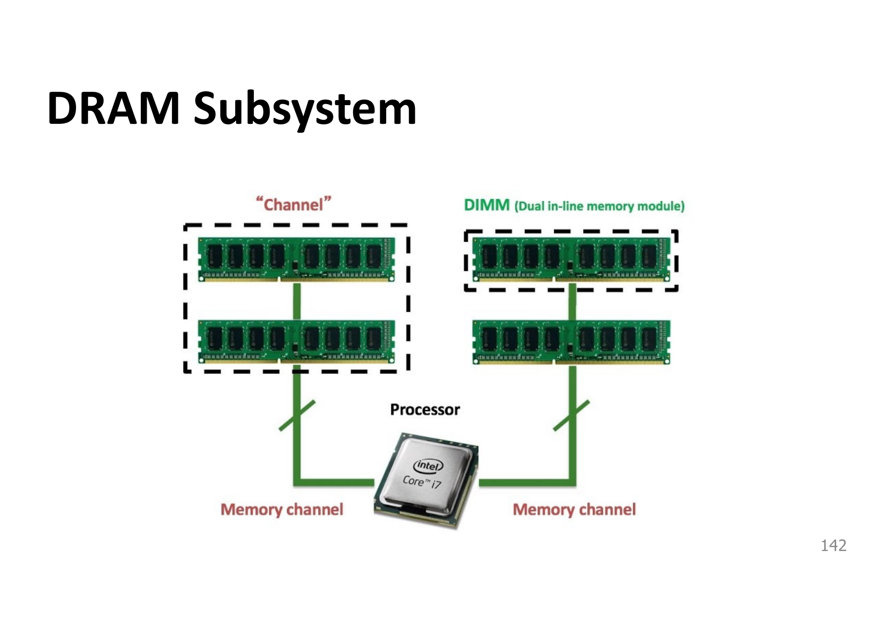

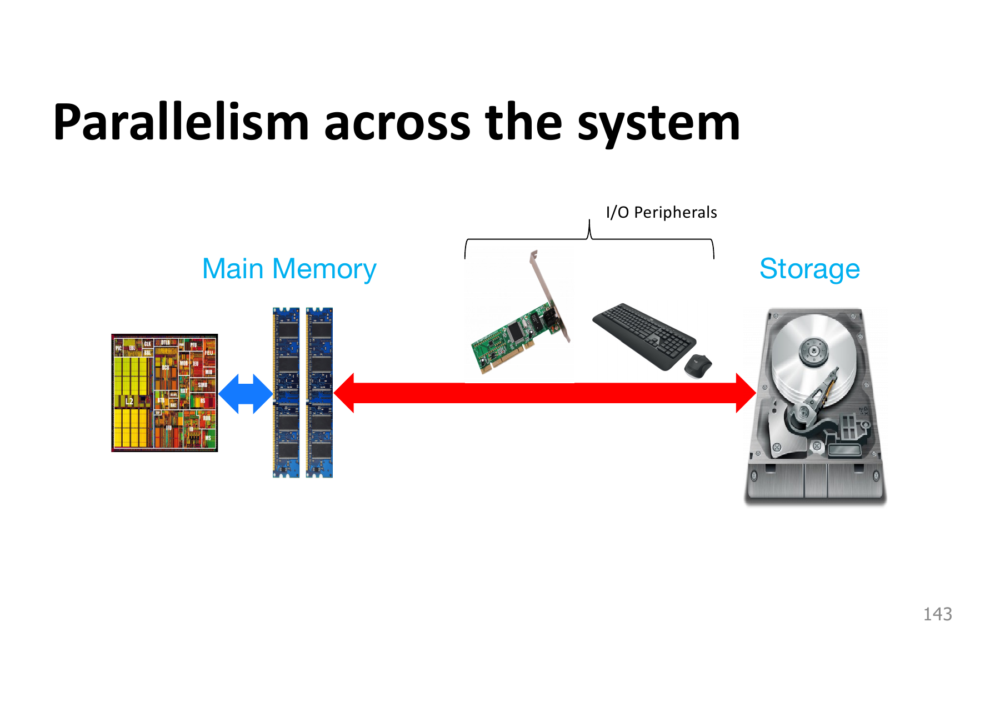

## 10.7 其他形式的并行(P144)

| 形式 | 要点 |
|---|---|
| **Multicore** | 空间并行(因为频率已无法继续提升)。AMD 有 128 核的 CPU |
| **Hyperthreading** | 2-way 超线程,更好地利用超标量 OOO 核。因为每周期很难找到 N(4/8/12)条指令发射;多个软件线程**共享超标量 OOO 核的资源**(**各自独立的 RF + 共享的乱序机构**) |
| **SIMD registers** | 单指令多数据。用很宽的寄存器对多个数据项执行同一条指令 |

## 10.8 安全漏洞(P145)

- **硬件推测导致安全漏洞**
- 为什么要教 OOO?**性能、能耗、安全**(安全越来越重要)
- 课件明确不覆盖此主题,留作作业:「用 AI 讨论硬件推测如何使 Spectre variant 1 成为可能」

> P146 是 COMP3703 客座讲座通知(时间地点讲者),**与考试无关,不用截**。

---

# ⚠️ 课件错误 / 存疑之处(考试遇到别被带偏)

| PDF 页 | 问题 | 正确写法 / 说明 |
|---|---|---|
| **P19–P28** | 场景 1 的 `i2: ADD R4, [R3, #1]` **语法错误**。ADD 的第二个源不能写成内存寻址方括号形式 | 应为 `ADD R4, R3, #1`。从后续时序看它就是一条普通的独立 ALU 指令 |
| **P48, P50** | 标题拼写 **"Dispath"** | 应为 **Dispatch**(两页都错) |
| **P122** | 「since tag corresponding to r7 in RMT is **rob67**」 | 应为 **rob6**。多打了一个 6 |
| **P144** | 「Wide (up to **1024-byte**) registers」 | 数量级可疑。AVX-512 是 512 **bit**(64 byte),ARM SVE 最宽 2048 bit(256 byte)。**1024-byte = 8192 bit** 目前不存在,大概率是把 bit 写成了 byte |
| **P139** | 「up to **28** instructions in a bundle」看起来离谱 | 其实**没错**,指的是 Multiflow TRACE 28/300 这类早期 VLIW(每条超长指令 28 个操作)。但 Itanium 是 3 条/bundle,别混淆 |
| **P123** | i5 的 Retire 写成 "Cycle #17-18",但时序表只画到第 17 周期 | 表格宽度不够,不是逻辑错误 |
| **P130 vs P149** | 完全相同的一张图出现两次 | P149 只是多了 "From Here / To Here" 的收尾框。截一张即可 |
| **P47, P71** | 出现中文文字("有缺陷"、精确异常的中文解释) | 这是**PDF 文件里已有的第三方批注**,不是讲稿原文。别当官方定义引用 |

---

# 📌 必背清单(考前 30 分钟看这个)

## 定义类
1. **Dependence 是程序属性;Hazard 是微架构属性。**
2. **真依赖 → RAW(不可消除);反依赖 → WAR、输出依赖 → WAW,二者都是假依赖(name dependence),可用重命名消除。**
3. **精确异常三条件**:① 之前指令全部完成且效果可见 ② 出错指令未完成 ③ 之后指令未执行、无任何可见改动。
4. **Static = 编译期,Dynamic = 运行期。** ARM 5 级流水线和顺序超标量都是静态调度。
5. **Issue** = 操作数就绪时把指令送进功能单元。
6. **Hardware speculation 四要素**:寄存器重命名 + 动态分支预测 + 动态调度 + ROB。

## 结构类
7. **顺序流水线级**:FE / DE / RR / EX / WB
8. **OOO v.1(Scoreboard)**:FE / DE / RR / **DI** / **IS** / EX / WB;新增 Scoreboard + IQ + **CDB**
9. **OOO v.2(ARF+ROB)**:FE / DE / **RN** / RR / DI / IS / EX / WB / **RT**
10. **两个驼峰**:驼峰 1 = reservation stations(调度窗口);驼峰 2 = reorder buffer(指令窗口)
11. **ROB 表项字段**:value / dst / rdy / **exc** / **misp** / PC
12. **RMT 字段**:v / Tag。Intel 叫 **RAT**。
13. **ARF = 已提交状态;ROB = 推测状态;物理寄存器堆 = ARF + ROB。**
14. **ROB 是循环 FIFO**,Head = 最老未退休指令,Tail = 最年轻指令。

## 机制类
15. **顺序发射把数据相关变成结构冒险** —— 这是必须做 OOO 的根本原因。
16. **Capture-Tag-And-Go-For-Execution**(scoreboard 的唤醒-选择口诀)。
17. **CDB 广播三处**:IQ、寄存器堆、Execute 级;它就是转发的实现,**绕过 RF 写入**。
18. **RR 级取源操作数的三个来源**:**ARF**(生产者已退休)/ **ROB**(已执行未退休)/ **Bypass**(未执行)。
19. **退休时清 RMT v 位的条件**:**RMT 中该寄存器的 Tag == 本指令的 ROB tag** 才清;不等就不动。
20. **恢复四步**:等到 Head → **T = H** → **flash-clear RMT 全部 v 位** → **flush 所有流水线级**,重定向取指。
21. **Load/Store 乱序**:不同地址安全;同地址必须保 WAR(load 不吃更年轻 store 的值)和 RAW(最近的更老 store 供值);靠 **LSQ**。
22. **OOO v.1 三大问题**:不能从误预测恢复 / 异常不精确 / WAR-WAW 导致退回顺序。**ROB 一次解决三个。**

## 极性陷阱(单独记)
23. **Scoreboard 的 `v=1` = 值在 RF 里且就绪。**
24. **RMT 的 `v=1` = 值在 ROB 里(不在 ARF)。**
25. **IQ 的 `v=1` = 槽位被占用。**
> 三个 `v`,三种含义。做题先确认在哪张表上。

## 数字类
26. 主存延迟假设 **100 周期**
27. 场景 2 中:激进顺序 i4 完成于**周期 13**;Scoreboard 完成于**周期 10**
28. ROB 版时序:i1 RT@14、i2 RT@15、i3 RT@16、i4 RT@17、i5 RT@18;i5 FE@**9**(取指未被 miss 阻塞)
29. Tomasulo 算法:**1967 年,IBM 360/91**

---
