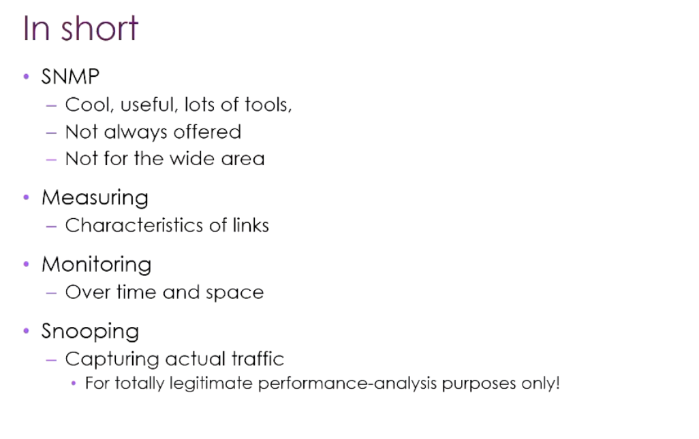

# COMP3310 Week 10: Network Security

> This week had two lectures: Mon = wrapping up SNMP + Security Part 1 (attack types + encryption basics); Tue = Security Part 2 (DNS/DNSSEC + firewalls + VPN).

---

## Part A: Wrapping Up SNMP



### GetNext vs GetBulk

ASN.1 has no "table" data structure, only the OID tree. Interfaces on different devices are extremely heterogeneous (Ethernet has MTU/packet counts, an ATM card has no IP address and counts cells rather than packets); storing them in a table would mean an explosion of columns or absurd sparseness.

**Solution**: map each "cell" to a unique OID; the Manager uses GetNext to walk the tree in lexicographic order, and when it walks outside the interface subtree it knows it's done — no need to know in advance how many interfaces or columns there are.

| Method | Description | Limitation |
|------|------|------|
| **GetNext** | One OID at a time, lots of round-trip traffic, the Manager must maintain traversal state | Frequent round trips |
| **GetBulk** (introduced in v2) | Get back everything under a node in one go | 64KB UDP packet limit; with many interfaces the agent returns tooBig |

### Practical tool stack

| Tool | Explanation |
|------|------|
| **MRTG** | The granddaddy, introduced RRD (Round-Robin Database) — old data is automatically downsampled, data from 3 years ago kept only at 5min/1h granularity, saving disk |
| **Cacti / Nagios** | Modern wrappers around MRTG, like a "Home Assistant for network devices" |
| **Weathermap** | Based on MRTG data, overlays traffic colouring on geographic/topology maps |
| **Vendor-specific tools** | Recognise the specific model and render the device's port panel directly |

### Cross-domain monitoring: SNMP doesn't apply, so what then

SNMP is limited to your own administrative domain; across domains there are these alternatives:

| Approach | Explanation |
|------|------|
| On-device packet capture | Most home routers support it; export a pcap directly to Wireshark |
| Port Mirroring | The switch mirrors one port's traffic to another port, connected to a monitoring machine |
| Fibre splitting | A prism reflects ~10% of the light to a sensor, unnoticed by A/B |
| **Looking Glass** | Public query interfaces run by carriers, ~700+ sites; you can do ping/traceroute/BGP lookup from the other party's POP. Solves the "traceroute only shows the outbound path" problem — tracerouting back from the far end shows the return path |
| **perfSONAR / Beacon** | A group of peer nodes ping each other to produce an N×N matrix; a column/row turning red collectively means that node has a problem |

> **SNMP in one sentence**: old but still mainstream, supported by almost every device, limited to the internal domain. Never expose SNMPv1/v2 plaintext community strings to the public Internet.

---

## Part B: Security Part 1

> "Security comes at the end of this course, because Internet protocols themselves only considered security at the end — disturbingly consistently." —— Markus

### 1. Core philosophy

- Security can't "prove the absence of vulnerabilities", only **reduce the probability**
- **Asymmetry**: the defender has to plug every hole, the attacker only has to find one
- Key variables: **cost vs risk × impact**. A home network vs a commercial bank vs a nation-level target need completely different levels of investment
- Attacker tiers: from script kiddies (download tools and scan the whole Internet) to nation-states (top-tier computing power + dedicated teams)

### 2. Hierarchy of attack types (in increasing order of activeness)

| Type | Description |
|------|------|
| **Eavesdropping (passive)** | Reading packet contents. Even reading only metadata — knowing when and with whom you communicate and how much traffic — lets one infer working hours, service dependencies, living habits |
| **Intrusion (active)** | Breaking into devices, modifying packets |
| **Impersonation** | Forging identity, sending packets in your place |
| **Extortion / DoS** | Stopping you or others from being served normally. Ransomware is the "commercialised version" |

### 3. Can packets be trusted? — No

The packet you receive comes from the **last device** on the path, not from the source host. Every router, switch and AP on the path reads and modifies packets (at least modifying TTL/checksum; NAT modifies addresses; some ISP routers even modify the TCP congestion window to slow the flow).

**WiFi is the weakest link**: set up a fake AP on a phone named "ANU"; after the victim connects, relay transparently and they won't notice.

**Physical-layer risks**:
- Chip-level sniffing (a soldering iron + a few dozen dollars to read firmware, full of hard-coded IPs/passwords)
- Fibre-splitting eavesdropping (US intelligence agencies did this on submarine cables for years)
- Copper acting as an antenna both leaks and allows injection
- **Tempest attacks**: HDMI cables leaking screen content, keyboard sounds distinguishing keys, VGA cable radiation — side channels simply can't be blocked

### 4. Specific attacks

#### DHCP Poisoning


```
1. The attacker repeatedly sends DHCP Discovers with different MACs → exhausts the DHCP address pool
2. The real DHCP server refuses new devices
3. The attacker acts as the DHCP server itself
4. In the Offer, set Gateway/DNS to the attacker's IP
5. All of the victim's upstream traffic passes through the attacker
```

**Mitigation**: the switch limits the number of MACs per port and only trusts DHCP Offers from specific ports (DHCP Snooping).
**Problem**: cheap switches simply don't have this feature.

#### ARP Poisoning


```
1. The attacker sends Gratuitous ARPs:
   - Tells the victim: "Gateway IP = my MAC"
   - Tells the Gateway: "victim IP = my MAC"
2. Both sides' ARP caches are overwritten
3. All traffic passes through the attacker (Man-in-the-Middle)
```

**Mitigation**: Dynamic ARP Inspection (depends on DHCP Snooping, still requiring the switch itself to support it).

> "This is hard to protect against." —— When the operating system detects a MAC conflict it knows something's wrong, but it can't tell you which port or which room the conflicting device is plugged into. In a WiFi environment it simply can't be located.

#### BGP route hijacking

Two ways to play it:
- **More specific prefix**: announce a more specific prefix than the real owner, and the traffic is stolen
- **Path injection**: insert fake AS numbers into the AS path

**Classic case**: a country wanted to block YouTube, so it announced YouTube's IP range via its own AS — intended to black-hole its own country's traffic, but the announcement leaked to neighbouring countries, global YouTube traffic was sucked away, and YouTube staff came in in the morning to find no traffic. One big Facebook outage was a similar BGP mistake too (a slip of the finger somewhere in Europe).

**Mitigations**: RPKI, Prefix Registries, BGPsec — they exist but are extremely hard to deploy.

### 5. IDS vs IPS

| Type | Function | Explanation |
|------|------|------|
| **IDS** (Intrusion Detection) | Monitoring + alerting | Signature-based or heuristic (all add AI now) |
| **IPS** (Intrusion Prevention) | Automatically works with the firewall to block or redirect | Needs higher confidence to respond automatically |

> Anecdote: an assignment used to involve scraping the Bureau of Met's HTTP site; for the first 90% of the time it was fine, but near the deadline the whole class scraped at once, directly triggering BoM's IDS; all ANU traffic was blocked and the assignment couldn't be submitted.

### 6. Encryption basics

#### The four properties of encryption

| Property | What it solves |
|------|---------|
| **Confidentiality** | Prevents peeking at content |
| **Authentication** | Confirms the other party's identity / Non-repudiation |
| **Integrity** | Content wasn't tampered with en route |
| **Freshness** | Prevents replay attacks |

#### Symmetric vs asymmetric (quick overview)

| Dimension | Symmetric encryption | Asymmetric encryption |
|------|---------|-----------|
| Number of keys | 1 shared by both sides | 1 pair per person (pub + priv) |
| Speed | Fast (GB/s scale) | Slow (100–10000 times slower) |
| Key length | 128–256 bit is enough | RSA needs 2048+, ECC 256+ |
| Mainly solves | Confidentiality | Confidentiality + authentication + non-repudiation |
| Fatal weakness | How to distribute keys | Public key ownership (needs PKI) |
| Typical algorithms | AES, ChaCha20 | RSA, ECC, DH |
| Practical use | Workhorse for data transfer | Handshakes, signatures, key exchange |

**The practical scheme**: use asymmetric for the handshake + negotiate a temporary symmetric session key, then run the data with symmetric encryption. This is the essence of TLS.

#### PKI and certificates

How do you know a public key belongs to someone? A CA needs to sign a certificate (X.509) with the CA private key, binding "identity metadata + public key".

**Why a hierarchy rather than a single CA**: a single CA would be too busy, too conspicuous (an attack target), and a monopoly. Browsers have ~88 root CA public keys built in, and the chain is verified level by level up to the root.

**Certificate revocation is PKI's Achilles' heel**:
- Private key leaked → a CRL (Certificate Revocation List) must be maintained — like early shops leafing through a "cancelled card numbers book" for credit cards
- Let's Encrypt can't cope with 100,000 revocation query requests per second; the revocation mechanism exists in name only
- Geoff Huston revoked a certificate a few months ago, and the world still considers it valid

> "Yeah, this is a bit of a problem. Anyway, we're still gonna trust it for banking, voting and health records." —— Markus (smirking)

#### SSL → TLS

- 1995 Netscape introduced SSL, originally specifically for HTTP → HTTPS
- From 1999 generalised into TLS (currently v1.3 / 2018)
- **Position**: sandwiched between Transport and Application, encrypting the TCP payload; the UDP version is called DTLS
- The TLS handshake completes **before** the first HTTP request: verify the server certificate + negotiate the session key + establish the encrypted pipe
- This is the motivation for QUIC: TCP handshake + TLS handshake + application-layer handshake = an explosion in the number of round trips; Google compressed it to ~2 RTTs

#### At which layer should you encrypt?

> "It depends on what you want to protect against." —— Markus

| Threat model | Corresponding approach |
|---------|---------|
| Prevent packet contents being read | TLS is enough |
| Prevent "the other side seeing whom you're communicating with" | IPsec or VPN (the IP header still leaks) |
| Don't trust the VPN provider | Past the VPN endpoint it's plaintext, so encrypt again at a higher layer |
| Extremely paranoid | Encrypt at every layer, at the cost of performance and complexity |

**Thinking framework**: there's no silver bullet; first determine the threat model, then pick the layer to encrypt at.

---

## Part C: Encryption in Depth

### 1. Symmetric encryption

```
Plaintext ──[encryption algorithm + key K]──> ciphertext
Ciphertext ──[decryption algorithm + key K]──> plaintext
```

Both ends use the same K. The algorithm itself is public (Kerckhoffs's principle: security depends only on the key, not on keeping the algorithm secret).

**Mainstream algorithms**:

| Algorithm | Explanation |
|------|------|
| **AES** | The modern de facto standard, 128/192/256-bit keys; Intel AES-NI hardware acceleration, extremely fast |
| **ChaCha20** | Faster than software AES when there's no AES hardware acceleration (early ARM phones); one of the mainstays of TLS 1.3 |
| 3DES / RC4 / DES | Deprecated. RC4 was the pain point of WEP/early TLS |

**Modes of operation**:

| Mode | Description | Conclusion |
|------|------|------|
| **ECB** | Each block encrypted independently. Same plaintext block = same ciphertext block ("you can still see the penguin after encryption") | **Never use it** |
| **CBC** | Each block is XORed with the previous ciphertext block before encryption, needs an IV | Was the mainstay, risk of padding oracle attacks (POODLE) |
| **GCM** | Encryption + authentication combined (AEAD), protecting both confidentiality and integrity | Mandated by TLS 1.3, **the modern first choice** |

**The fatal problem: key distribution**. For N users to communicate pairwise you need N(N-1)/2 keys (1000 people ≈ 500,000 keys). This is why asymmetric encryption is needed.

### 2. Asymmetric encryption

Everyone has a key pair:
- **Private Key**: kept strictly to yourself, never passed on
- **Public Key**: public, anyone can take it

Mathematically they're a pair, but the private key can't be derived from the public key (in reasonable time).

**Two uses (easily confused)**:

| Use | Who encrypts | Who decrypts | Purpose |
|------|--------|--------|------|
| **Encrypted transmission** | The sender encrypts with the receiver's **public key** | The receiver decrypts with their own **private key** | Confidentiality |
| **Digital signature** | The sender signs with their own **private key** | Anyone verifies with the sender's **public key** | Authentication + non-repudiation |

**Mainstream algorithms**:

| Algorithm | Basis | Explanation |
|------|------|------|
| **RSA** | Difficulty of factoring large integers | The most classic; 2048 bits is the current minimum safe line; slow |
| **ECC** | Elliptic curve discrete logarithm | Much shorter keys for equivalent security: 256-bit ECC ≈ 3072-bit RSA |
| **ECDSA / EdDSA** | Based on ECC | Signature algorithms |
| **DH / ECDH** | Discrete logarithm | Key **agreement** algorithms (not encryption algorithms) |

**The fatal problem: public key ownership**. A man in the middle, Mallory, can replace "Bob's public key" with "her own public key"; Alice encrypts with Mallory's public key, and Mallory decrypts directly. This is why PKI + CAs are needed.

### 3. Hybrid encryption (the essence of TLS)

Symmetric only: key distribution kills you. Asymmetric only: speed kills you.

**Solution: use asymmetric for the "opening", symmetric for the "main battle"**:

```
Establishing the connection (slow, run only once):
1. Alice gets Bob's public key
2. Alice generates a random symmetric session key K_session
3. Alice encrypts K_session with Bob_pub and sends it to Bob
4. Bob decrypts with Bob_priv to get K_session

Data transfer (fast, for a long time):
5. From then on all data is symmetrically encrypted with K_session (AES-GCM)
```

#### Forward Secrecy

**Problem**: if the bank server's private key leaks five years later, the attacker can use the private key to decrypt that "message ���encrypting K_session" from back then, and thereby decrypt all historical traffic.

**Definition of forward secrecy**: even if the long-term private key leaks in the future, past session contents won't be decrypted.

**The modern approach: Diffie-Hellman key exchange**

```
Public parameters: a large prime p, a generator g (public to the whole network)

Alice: randomly picks a (private), computes A = g^a mod p, sends A → Bob
Bob:   randomly picks b (private), computes B = g^b mod p, sends B → Alice

Each computes:
  Alice: K = B^a mod p = g^(ab) mod p
  Bob:   K = A^b mod p = g^(ab) mod p
  → both sides get K = g^(ab) mod p

An eavesdropper only sees g, p, A=g^a, B=g^b
Computing g^(ab) requires deriving a from g^a (the discrete logarithm problem, computationally hard)
```

**Why there's forward secrecy**: a and b are generated temporarily for each session and thrown away after use (Ephemeral). Even if the long-term private key leaks in the future, the attacker can't reconstruct the a and b from back then.

**But DH on its own has a hole**: DH itself provides no authentication, so a man in the middle can do a separate DH with Alice and with Bob.

#### The complete picture of TLS 1.3 (the combination punch)

```
Client                                         Server
  │                                              │
  │── ClientHello (algorithm list + client DH public key g^a) ──→│
  │                                              │
  │←── ServerHello (chosen algorithm + server DH public key g^b)   │
  │←── Server certificate (containing the server's long-term public key)                  │
  │←── Whole handshake signed with the server's long-term private key               │
  │                                              │
  │  Each side computes K_session = g^(ab)               │
  │  Client verifies certificate + signature, confirming the server's identity            │
  │                                              │
  │←────── All subsequent data AES-GCM(K_session) ──────→│
```

Three cryptographic primitives each doing their own job:
1. **ECDHE**: negotiates K_session, providing forward secrecy
2. **RSA/ECDSA signatures**: server identity authentication
3. **AES-GCM / ChaCha20-Poly1305**: high-speed data encryption + integrity

#### Additional points

- **The client usually isn't authenticated**. TLS by default only authenticates the server; only mTLS does mutual authentication (common in enterprise intranets, API gateways)
- **The private key is almost the only thing that truly needs strict protection**. An HSM (Hardware Security Module) means the private key never leaves the hardware
- **Post-quantum cryptography**: Shor's algorithm can theoretically break RSA and ECC in polynomial time; symmetric encryption (AES) is affected by Grover's algorithm, and doubling the key length is enough (AES-256 is still secure). NIST is already standardising post-quantum algorithms (CRYSTALS-Kyber, etc.)

---

## Part D: Security Part 2 (Tue)

### 1. Why DNS is insecure

Every time a new named service is accessed, the client first has to query DNS, and by default it unconditionally trusts the reply. Attacking DNS can:
- Lead users to forged bank/government websites for phishing
- Redirect IoT devices' traffic to a local server ("unbricking")

**The soft target**: the four tiers of authoritative servers in the DNS chain (root → .au → .edu.au → anu.edu.au) are heavily defended; the **edge resolver** is the target — at startup it has almost no cache and will actively query upstream.

**Cache Poisoning in three steps**:

| Apparent difficulty | In reality |
|-----------|--------|
| ① How does the attacker know when to send? | Act as a client and send a query yourself, triggering the resolver to ask upstream |
| ② How do you get the resolver to believe it? | The resolver only checks: whether the source IP is known / whether the ID matches / whether it corresponds to an outstanding query — it doesn't look at the content |
| ③ What happens when the real reply arrives? | There's no longer an outstanding query → the real reply is discarded, the poisoned data is already in the cache |

Ways to get past the header checks:
1. Forge the source IP (DNS uses UDP, no handshake, can spray one-way)
2. Brute-force guess the 16-bit ID (throw out tens of thousands of replies, one will always hit)
3. Flood, arriving ahead of the real reply

### 2. DNSSEC

**Design goals** (note what it does NOT do):

| Property | Does DNSSEC do it? |
|------|-------------|
| Integrity | ✅ Data wasn't tampered with |
| Authenticity (of origin) | ✅ Really comes from the authoritative source |
| Confidentiality | ❌ No, everyone should be able to query DNS |

**Key new Resource Records**:

| RR | Role |
|----|------|
| **RRSIG** | Digital signature over a group of records (A/AAAA/MX... combined into one set) |
| **DNSKEY** | Public key for verifying RRSIGs, two kinds: KSK and ZSK |
| └ KSK (Key Signing Key) | Heavyweight, signs the ZSK, rarely changed |
| └ ZSK (Zone Signing Key) | Lightweight, actually signs records, similar to a session key, can be rotated frequently |
| **DS** (Delegation Signer) | Pointer from the parent zone to the child zone's KSK |
| **NSEC / NSEC3** | Signed "this name doesn't exist" answers |

**Why split KSK/ZSK**: asymmetric encryption is expensive, and DNS is the starting point of every transaction. The KSK is heavy but rarely used, the ZSK is light and can be rotated frequently, reducing the nameserver verification load. Essentially the session key idea.

**Chain of Trust**:


```
Trust anchor = root's public key (hard-coded in the operating system)

1. Use key(root)       to verify the authenticity of NS(.au)
2. Use key(.au)        to verify NS(.edu.au)
3. Use key(.edu.au)    to verify NS(.anu.edu.au)
4. Use key(.anu.edu.au) to verify www.anu.edu.au's IP
```

**A few design details**:
- Cryptographic algorithms are replaceable (preparing for post-quantum), keys can be revoked / rolled over
- **NSEC's information-leak pitfall**: when NSEC answers "doesn't exist", it incidentally tells you what the next existing record is (similar to SNMP GetNext). An attacker can enumerate the whole zone just by throwing arbitrary strings. NSEC3 (hash) mitigates this.
- Lesson: "Either lie, or don't trust DNS to hold your secrets." —— Don't use names like `super-valuable-finance-system.com.au` that expose key information; use opaque names.

**Deployment status**:

| Tier | Enablement rate |
|------|--------|
| Root servers | Done since 2010 |
| High-value gTLDs (.gov / .mil etc.) | ~90% |
| ccTLD | ~50% |
| Lower domains | 2%–90%, a huge gap |
| Application layer | 10–15% |
| IoT devices | Basically none |

### 3. Did TLS solve everything? Far from it

TLS has been broken at least 12+ times, for reasons covering:
- Code bugs (OpenSSL CVEs over the years)
- Algorithm/mathematical flaws
- Protocol-interaction side channels (exploiting TCP stack features to read key fragments in memory)
- **Three-letter agency involvement**: encryption depends on large random numbers; if the RNG is deliberately weakened (predictable), brute-force search becomes feasible. Some open-source libraries' RNGs are suspected of having been tampered with (exposed in the Snowden era)
- **Quantum threat**: the mathematical problems that the existing public key system relies on happen to be friendly to quantum algorithms. Within 3–10 years the existing system will fail on a large scale

**TLS's coverage blind spots**:

| Protocol | Status |
|------|------|
| DHCP | Completely unencrypted, nobody considered it |
| BGP | There's BGPsec, perfect in the lab, zero deployment on real hardware |
| IP header | Even with TLS, source/destination/traffic patterns still leak |

> "Use TLS. Don't reinvent the wheel. If you really want to reinvent it, get a PhD and then still use the libraries." —— Markus

### 4. Firewalls

An edge router / gateway / process that explicitly drops unwanted packets. The Internet is end-to-end by default: anyone can send you packets. The firewall's job is to let only "nice packets" through.

#### Stateless firewalls


- Each packet is looked at independently, no state kept across packets
- Allow-deny based on IP / TCP-UDP / Port number
- **Blacklist vs Whitelist**: you can never list all the bad guys → deny all by default, only allow the known good
- Example: `deny port 25 tcp` (email), `deny all, allow port 80 tcp` (http)
- ⚠️ Ports are only a convention, not enforced: SMTP can run on any port, and people intent on getting around it do just that

#### Stateful firewalls


- Tracks flows, changes rules based on earlier events
- Typical scenario: NAT — internal `10.0.0.2:39180` actively initiates TCP to external `201.34.56.78:80`, the firewall dynamically adds a rule: allow that external IP:port to send replies to the mapped port, automatically cleared after an idle timeout
- This is why home routers need no configuration: inside→outside + replies work, while the outside actively connecting inside can't get in by default (unless there's explicit port forwarding)

#### Application firewalls (Application Firewall / DPI)


- Understands application protocols like HTTP / SMTP / IMAP / POP
- Reassembles multi-packet messages, looks at content, identifies viruses and malicious attachments
- **Huge cost**: running on a general-purpose machine drags it down; encrypted traffic basically can't be inspected (or there's man-in-the-middle decryption and re-encryption, with performance exploding)

#### Firewall deployment locations


| Location | Explanation |
|------|------|
| Dedicated appliance (especially DPI) | Performance proportional to price |
| Edge router / modem | Most common |
| Internal WAP / switch | Protects against internal threats |
| Host OS (iptables / Windows Defender) | Protects against neighbours on the same segment |

> Early CERT statistics: ~80% of attacks come from **inside** the organisation. Defending the perimeter alone isn't enough.
> "It's important to keep your employees gruntled."

**DMZ (Demilitarised Zone)**:

```
[Internal LAN] ←─firewall2─← [DMZ: web / mail server] ←─firewall1─← [Internet]
```

External packets first pass firewall1 into the DMZ, and DMZ services then access the internal core (finance, HR, student grades) on their behalf. ANU's reverse proxy does something similar.

Multiple firewalls = more secure + more maintenance points + more potential configuration conflicts.

### 5. VPN — building a "virtual leased line" across the public Internet

**Motivation**: a company has a LAN in each of two locations and has to communicate over the public Internet in between, requiring:
- Traffic content confidential ✅
- Not wanting to leak even the metadata (who is communicating with whom) ← TLS can't do this (the IP header is still there)

| Approach | Description | Assessment |
|------|------|------|
| Running bare over the public Internet | Accept the metadata leak | Depends on the scenario |
| Leased line | Get a carrier to run a dedicated physical link | Small attack surface, but expensive and doesn't scale |
| **VPN** | Simulate a leased line using the public Internet | The value-for-money winner |

**Basic mechanism: IP-in-IP encapsulation**

```
Original packet [IP | TCP | TLS | HTTP]

VPN wraps another layer:
[ New IP | ESP hdr | Old IP | TCP | Payload + padding | Auth Hdr ]
            ↑────────────── Encrypted ──────────────────↑
            ↑──────────── Authenticated ──────────────────────────↑
```

Bare IP-in-IP has no security guarantees; it only makes sense together with IPsec: encrypt the whole old IP packet (including the original source/dest/payload), with the ESP header providing authentication.

**Three modes of operation**:

| Mode | Endpoints | Characteristics |
|------|------|------|
| **Tunnel mode** | Router ↔ Router | Whole subnets interconnected transparently, looking like the same LAN; NAT-friendly; most common |
| **Transport mode** | Host ↔ Host | Only encrypts the IP payload (no re-encapsulation); poor compatibility with NAT |
| **Mixed mode** | Host ↔ Router | A remote employee connecting to the company VPN gateway; everyday VPN clients are this |

**The double edge of Address Opacity**:
- ✅ The original source/dest are encrypted, a man in the middle can't see the real communicating peers
- ✅ Exploitable: the exit IP looks like the geographic location of the VPN server → bypass geo-restrictions
- ⚠️ Breaks firewall rules (inner IPs and ports can't be seen), disrupts optimal routing

### 6. VPN's fatal flaw: DHCP route injection

> Reference: Ars Technica 2024/05 — TunnelVision attack

When the VPN starts, the system's forwarding table is updated:

```
0.0.0.0/0    via vpn0   ← the VPN interface becomes the default route
→ all outbound traffic goes into vpn0, is encrypted, then goes out through the physical eth0
```

Looks very secure. But DHCP option 121 can push extra routes. An attacker controlling the DHCP server pushes:

```
0.0.0.0/1     via eth0   ← covers 0.0.0.0–127.255.255.255
128.0.0.0/1   via eth0   ← covers 128.0.0.0–255.255.255.255
```

The two /1s together cover the whole Internet, and are more "specific" than /0 — longest-prefix-match uses them first.

**Result**: the VPN interface is useless, traffic goes out eth0 in plaintext. This is an attack in the DHCP phase; the VPN's own encryption/protocol has no problem at all — it was planted before the VPN even started.

**Defence**:
- Actively check `netstat -rn` / `ip route` to see whether there are strange /1 route entries
- If you don't actively check, you won't know
- Some VPN clients have started adding countermeasures (ignoring DHCP option 121 / using firewall rules to force traffic through vpn0)

---

## Quick Reference Summary for the Week

| Topic | Attack | Defence | Limitations of the defence |
|------|------|------|-----------|
| **L2 (ARP/DHCP)** | DHCP Poisoning → ARP Poisoning → MitM | DHCP Snooping; Dynamic ARP Inspection | Cheap switches can't; L2 has no identity system |
| **Routing (BGP)** | More specific prefix hijacking; AS path injection | RPKI; BGPsec; Prefix Registries | Extremely low deployment; legacy design |
| **DNS** | Cache Poisoning (forged source IP + guessing the ID + replying first) | DNSSEC (RRSIG/DNSKEY/DS, PKI chain of trust) | Uneven deployment; NSEC leaks the zone; IoT basically not enabled |
| **Transport layer** | TLS CVEs over the years; quantum computing; RNG weakening | Off-the-shelf TLS libraries; post-quantum algorithms (being standardised) | DHCP/BGP protocols lack widespread encryption; will fail in the quantum era |
| **Network perimeter** | Port scanning; application-layer attacks; internal threats | Stateless/Stateful/Application firewall; DMZ layering | ~80% of attacks come from inside; DPI performance cost is high; encrypted traffic can't be inspected |
| **Cross-site connections** | Public-Internet man in the middle; metadata exposure | IPsec VPN (Tunnel/Transport/Mixed) | DHCP option 121 route injection can completely sideline the VPN |

---

## Appendix: Correction on BGP AS Path Prepending

The Week 8/9 notes got this wrong; here is the correct logic:

In BGP route selection, **the shorter the AS path, the better**. Therefore:

- **Prepending (a legitimate operation)**: an AS repeats its own AS number on the path announced over link A (e.g. `7575 7575 7575`), making this path look longer and more "expensive", so that the far end prefers a different entry point. Commonly used for primary/backup link switching: make the backup path longer, so traffic normally takes the primary path and falls back when the primary path goes down.

- **Path Injection Attack (an attack)**: inserting fake AS numbers into the AS path is malicious behaviour, not legitimate prepending.

The earlier notes described the direction of "prepending makes the path longer" backwards and confused it with the path injection attack.

---

## Review Focus

**Must know:**
1. The complete attack flow of DHCP Poisoning / ARP Poisoning + mitigations + why the mitigations often fail
2. The two types of BGP hijack (misorigination vs path injection) and why they have global impact
3. The 4 properties of encryption (Confidentiality / Authentication / Integrity / Freshness)
4. The fatal weaknesses of symmetric vs asymmetric, and why hybrid encryption is the right answer
5. Why the PKI revocation mechanism is broken — CRLs don't scale
6. TLS's position in the protocol stack + the handshake happens before the first HTTP request
7. Definition of forward secrecy + why DH key exchange achieves it
8. DNS Cache Poisoning in three steps + the DNSSEC chain of trust
9. The NSEC information-leak problem + NSEC3's mitigation
10. The differences and use cases of the three firewalls (Stateless/Stateful/DPI)
11. The two-layer firewall structure of a DMZ
12. The VPN DHCP option 121 route injection attack (TunnelVision)

**Understanding is enough:**
- Details of AES modes of operation (just know the differences between ECB/CBC/GCM)
- The mathematical derivation of DH (know the principle, no need to memorise formulas)
- The specific formats of each DNSSEC RR type
- Legitimate scenarios for BGP AS Path Prepending
