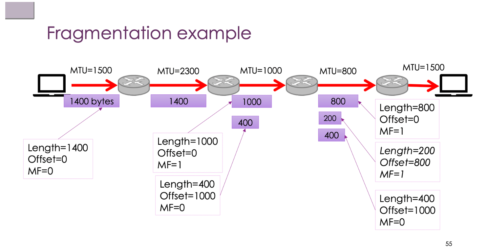

# Network Week 4 Notes

**This week's thread:** Protocol layering → Encapsulation → IPv4 in detail → IP fragmentation → IPv6 → Forwarding and routing

---

## 1. Layering

### 1.1 Why layer


The three core principles of layering:

| Principle | Meaning |
|------|------|
| Separation of concerns | Each layer does only one thing, reducing complexity |
| Abstraction | Upper layers don't care about lower layers' implementation details |
| Interoperability | As long as the interface is consistent, any layer's implementation can be replaced |

**Three design rules:**

1. **Use Layers to divide functions:** each layer focuses on a single responsibility (application logic / reliable transport / routing / local transmission)
2. **Use Protocols to communicate within the same layer:** peers at the same layer exchange information via protocols (logical communication)
3. **Use Service interfaces to call the layer below:** upper layers don't operate the lower layers directly, they only call interfaces

Actual data is **not transmitted directly sideways**, but: the sender goes down layer by layer → across the network → the receiver goes up layer by layer.

### 1.2 Hiding path complexity


From the application layer's perspective, the Browser and Server seem to "communicate directly" (end-to-end logical communication).

The actual path may pass through 20 different LANs, for example:
```
Your computer → WiFi → phone hotspot → 5G base station → carrier backbone → DSL → home router → Ethernet → server
```

Each segment may use a different technology (WiFi / Ethernet / fibre / copper), but the upper-layer application is completely unaware of it.

**Key conclusion:** logically "end-to-end", physically a "multi-hop complex path"; layering hides the complexity.

> **Exception:** only when performance problems appear (slow network, packet loss, high delay) do you need to investigate the lower layers.

### 1.3 Protocol Stack


**PDU (Protocol Data Unit) — the data unit of each layer:**

| Layer | PDU name | Typical protocols | Corresponding devices |
|----|----------|----------|----------|
| Application | Message / Data | HTTP, DNS | Proxy, Gateway |
| Transport | Segment / Datagram | TCP, UDP | — |
| Network | **Packet** | IP | Router |
| Link | **Frame** | Ethernet, WiFi | Switch, Bridge |
| Physical | Bits | — | Hub, Repeater |

**Note: Packet ≠ Frame ≠ Segment; don't mix them up.**

**SDU (Service Data Unit):** the data a layer receives from the layer above, used as its own payload.

> **Example:** TCP's SDU = HTTP data; IP's SDU = TCP segment.

---

## 2. The OSI Reference Model and Real-World Implementation

### 2.1 The OSI seven-layer model


| Layer | Name | Core role |
|----|------|----------|
| 7 | Application | Application logic (HTTP, DNS, SMTP) |
| 6 | Presentation | Data format conversion (encoding, encryption, compression) |
| 5 | Session | Session management (connection state, recovery after disconnection) |
| 4 | Transport | End-to-end transport (reliability, flow control) |
| 3 | Network | Routing across networks (IP) |
| 2 | Link | Single-hop transmission (Frame) |
| 1 | Physical | Bit transmission (signals) |

**Reality:** OSI is "a great standard — almost never fully used". The actual Internet is closer to a **4-layer model**:
- Application (including the functions of OSI layers 5, 6, 7)
- Transport
- Network
- Link + Physical

### 2.2 Layering in reality

Layering is a design **principle**, not a mandatory rule:

- **Protocols can cross layers:** some protocols involve several layers at once
- **Layers have sublayers internally:** Ethernet's Link layer is split into MAC and LLC (LLC handles multiplexing, flow control, error handling)
- **Important principle:** used to **guide** protocol design, not to be applied mechanically

**End-to-End Principle:**
- Smart edges: complex logic is placed in the Client/Server
- Dumb core: the network in the middle only forwards and keeps little state

> **Example:** Reliable transport (retransmission, ordering guarantees) is implemented by TCP at the endpoints, not by intermediate routers. That way routers can forward at very high speed without maintaining state for each connection.

---

## 3. Encapsulation

### 3.1 The encapsulation mechanism


Each layer takes the upper layer's data as its payload, adds its own Header (and sometimes a Trailer), and passes it to the layer below:

```
HTTP data
    ↓ + TCP header
TCP segment
    ↓ + IP header
IP packet
    ↓ + Ethernet header + trailer
Ethernet frame
    ↓
Physical signal transmission
```

Nested structure (like Russian dolls):
```
[ Ethernet frame                              ]
    [ IP packet                          ]
        [ TCP segment             ]
            [ HTTP request   ]
```

**Each layer looks only at its own header and doesn't parse the inner data.**

The receiver performs the reverse **Decapsulation**: stripping headers layer by layer and handing the payload to the layer above.

### 3.2 Key properties of Frames

A Frame is a **per-hop** data unit, valid only on the current link:

| Concept | Scope |
|------|------|
| Frame (Ethernet/WiFi) | One hop |
| Packet (IP) | End-to-end |
| Segment (TCP) | End-to-end |

**At every Router, the Frame is torn down and re-encapsulated:**

```
WiFi frame → arrives at Router → IP packet taken out → re-encapsulated as Ethernet frame → sent out
```

The contents of the IP packet are basically unchanged (except TTL), but the Frame is replaced at every hop.

### 3.3 Processing principles of intermediate devices

**Ideal:** Minimal Packet Inspection
- Switch → looks only at the MAC address (Layer 2)
- Router → looks only at the IP header (Layer 3)
- Hub → looks at nothing, purely forwards electrical signals

**In reality deeper inspection is sometimes needed:**
- Firewall: needs to look at transport-layer ports or application-layer content
- VPN: needs to encapsulate/decapsulate entire packets
- DPI (Deep Packet Inspection): inspects down to the application-layer payload

**Cost:** DPI adds significant delay and device load.

---

## 4. IPv4

### 4.1 Responsibilities of the IP layer

The IP layer is **as thin a glue layer as possible**, responsible for only four things:
1. Delivering packets to their destination
2. Providing a globally uniform addressing system
3. Coping with network topology changes
4. Running on top of any link as far as possible

Design principle: **Best-effort** — no strong guarantees; packet loss, reordering and retransmission are handled by upper layers.

### 4.2 IPv4 Header structure


Each row is 32 bits (4 bytes); the standard header has 5 rows = 20 bytes:

**Row 1 (bits 0–31):**

| Field | Width | Meaning |
|------|------|------|
| Version | 4 bit | IP version (IPv4 = 4) |
| IHL | 4 bit | Header length in 32-bit words (minimum 5 = 20 bytes) |
| DSCP / DiffServ | 6 bit | Quality of service (QoS) classification |
| ECN | 2 bit | Explicit Congestion Notification |
| Total Length | 16 bit | Number of bytes in the whole IP packet (header + payload) |

**Row 2 (bits 32–63):**

| Field | Width | Meaning |
|------|------|------|
| Identification | 16 bit | Fragment identifier; fragments of the same packet share this value |
| Reserved | 1 bit | Reserved bit (should be 0) |
| DF | 1 bit | Don't Fragment: fragmentation forbidden |
| MF | 1 bit | More Fragments: more fragments follow |
| Fragment Offset | 13 bit | The offset of this fragment within the original packet (in units of 8 bytes) |

**Row 3 (bits 64–95):**

| Field | Width | Meaning |
|------|------|------|
| TTL | 8 bit | Time To Live: decremented by 1 at each hop, discarded at 0, prevents packets from looping forever |
| Protocol | 8 bit | Upper-layer protocol: 6 = TCP, 17 = UDP, 1 = ICMP |
| Header Checksum | 16 bit | Checks the header only (TTL changes at every hop, so the checksum must also be updated by routers) |

**Rows 4 and 5 (32 bits each):**
- Source Address: source IP (32 bit)
- Destination Address: destination IP (32 bit)

**Row 6 (optional):** Options + Padding (if present, IHL > 5)

> **Example:** IHL = 5 → header = 5 × 4 = 20 bytes (no Options); IHL = 6 → header = 24 bytes (including 4 bytes of Options)

> **Note:** TTL decreases at every hop, so routers **must also update the Header Checksum**; this is one of the important differences between IPv4 and IPv6 (IPv6 removed the Header Checksum).

### 4.3 IPv4 addresses

**What an address is:** an IP address identifies a **network interface**, not a whole host. A router with multiple network cards has multiple IP addresses.

**Address notation:** 32-bit, dotted decimal (Dotted Quad):
```
192.168.1.10 = 11000000.10101000.00000001.00001010
```

**Prefix / CIDR notation:**
- `192.168.1.0/24` means the first 24 bits are the network part and the last 8 bits are the host part
- Longer prefix → smaller network range → fewer hosts
- Purpose: routing table **Aggregation**, one entry representing a batch of addresses

**Special addresses:**

| Address | Meaning |
|------|------|
| `0.0.0.0` | Unknown/any interface (used in DHCP requests) |
| `127.0.0.1` (/8) | Loopback, sent to yourself, never leaves the network card |
| `169.254.0.0/16` | Link-local, auto-assigned when DHCP fails, usually means a network configuration problem |
| `10.0.0.0/8` `172.16.0.0/12` `192.168.0.0/16` | Private addresses (RFC 1918), not routed on the public Internet |
| `224.0.0.0/4` | Multicast |
| `255.255.255.255` | Limited broadcast |

**The old Classful addressing system (historical terminology):**

| Class | Prefix | Address range |
|------|------|----------|
| Class A | /8 | 1.0.0.0 – 126.0.0.0 |
| Class B | /16 | 128.0.0.0 – 191.255.0.0 |
| Class C | /24 | 192.0.0.0 – 223.255.255.0 |
| Class D | — | 224.0.0.0/4, Multicast |
| Class E | — | 240.0.0.0+, experimental use |

Modern routing uses **CIDR (Classless Inter-Domain Routing)**, which doesn't depend on classful boundaries.

### 4.4 The Forwarding Table and longest prefix match

**Forwarding Table:** a table of rules mapping destination network prefixes → next hop or outgoing interface.

A host's forwarding table is very simple, usually with only two rules:
```
192.168.1.0/24  →  on-link (send directly on this LAN)
0.0.0.0/0       →  192.168.1.1 (send to the default gateway)
```

**Longest Prefix Match:** when several entries match the destination IP, choose the one with the **longest (most specific) prefix**.

> **Example:**
> ```
> Entry A: 150.203.0.0/16  → Router 5
> Entry B: 150.203.10.0/24 → Router 4
>
> Destination 150.203.10.200:
>   matches A (/16) ✓  matches B (/24) ✓
>   → choose /24 (longer, more specific) → go via Router 4
>
> Destination 150.203.8.99:
>   matches A (/16) ✓  doesn't match B
>   → choose /16 → go via Router 5
> ```

**Why are overlapping entries allowed?** It's a feature, not a bug — you can use a short prefix as a default route, then use longer prefixes to "carve out" specific subnets that take different paths (faster/cheaper/more secure/policy-compliant).

**Forwarding vs Routing (important distinction):**

| Concept | Level | Role |
|------|------|------|
| Forwarding | A single router, a local action | Receive packet → look up table → decide next hop |
| Routing | A global process | How all routers learn, build and update their forwarding tables |

This corresponds to the separation of the **Data Plane** and the **Control Plane**.

### 4.5 ARP (Address Resolution Protocol)

**Problem:** the Network Layer knows the destination IP, but the Link Layer only understands MAC addresses, so IPs need to be mapped to MACs.

**Workflow:**
```
Host A wants to send to 192.168.1.20 (same LAN)
  ↓
A sends an ARP Request (broadcast: FF:FF:FF:FF:FF:FF)
  "Who has 192.168.1.20? Tell 192.168.1.10"
  ↓
192.168.1.20 replies with an ARP Reply (unicast to A)
  "192.168.1.20 is at AA:BB:CC:DD:EE:FF"
  ↓
A caches this mapping (ARP Cache) and uses it directly afterwards
```

- The ARP Cache has an aging time; entries are re-queried after expiry
- **Gratuitous ARP:** a host proactively broadcasts its own IP-MAC mapping, used for advance announcement or detecting IP address conflicts

> **Example:** The first time you ping a machine on the same network, the OS first sends an ARP request; you can view the local ARP cache table with the `arp -a` command.

---

## 5. IP Multicast and ICMP

### 5.1 IP Multicast

**Multicast addresses:** `224.0.0.0/4` (Class D)

| Type | Behaviour |
|------|------|
| Unicast | Sent to one specific host |
| Broadcast | Sent to all hosts on the link |
| **Multicast** | Sent to a group; only **hosts that have joined the group** receive it |

The sender sends only **one copy** of the packet; routers replicate it as needed and distribute it along the paths to group members; hosts not in the group don't receive it and don't have to process the traffic.

**IGMP (Internet Group Membership Protocol):** the protocol hosts use to tell the local router "I want to join/leave a multicast group".

> **Example:** Video conferencing systems or IPTV use multicast; the sender sends once and multiple receivers watch simultaneously. With unicast, the server would have to send a separate copy to each receiver, with bandwidth consumption proportional to the number of receivers.

**Note:** Multicast requires routers to maintain "group membership state", which to some extent contradicts the Internet's stateless end-to-end principle.

### 5.2 ICMP (Internet Control Message Protocol)

ICMP is the Internet's **control/error feedback protocol**, itself encapsulated in the payload of an IP packet (Protocol = 1).

**Common ICMP types:**

| Type | Name | Use |
|------|------|------|
| 0 | Echo Reply | Response to ping |
| 3 | Destination Unreachable | Destination unreachable (various Codes distinguish the reason) |
| 8 | Echo Request | Ping request |
| 11 | Time Exceeded | TTL reached 0 (traceroute uses this message) |

**Ping:**
```
Sender → ICMP Echo Request → destination host
Destination host → ICMP Echo Reply → sender
```
Use: test host reachability, roughly measure RTT (Round Trip Time).

Note: administrators may block ICMP; a failed ping doesn't necessarily mean the host is down.

**Traceroute:**

Uses **increasing TTL + ICMP Time Exceeded** to probe the path hop by hop:

```
Send TTL=1 → the 1st-hop router discards it and returns Time Exceeded (with the router's IP)
Send TTL=2 → the 2nd-hop router returns Time Exceeded
...
Send TTL=N → reaches the destination, returns Echo Reply or Port Unreachable
```

Each hop is usually probed 3 times, showing each hop's RTT and IP. A large jump in RTT usually means a sudden increase in physical distance (e.g. crossing an ocean).

> **Example:** With `traceroute bbc.co.uk` you can observe whether the path goes Australia → USA → Europe or directly to Europe; RTT jumps roughly correspond to transoceanic cable nodes.

---

## 6. IP Fragmentation

### 6.1 MTU (Maximum Transmission Unit)

**MTU:** the maximum number of bytes of IP payload a link can carry.

| Link type | Typical MTU |
|----------|----------|
| Ethernet | 1500 bytes |
| WiFi (802.11) | ~2300 bytes |
| Jumbo Ethernet | 9000 bytes |
| PPPoE | 1492 bytes |

When a packet's size exceeds the outgoing interface's MTU, the router must deal with it.

### 6.2 The fragmentation mechanism



The router cuts the large packet into multiple **fragments**, each an independent IP packet (with its own IP header):

```
Original packet: Total Length=1400, DF=0, MF=0, Offset=0

Fragmented after a link with MTU=1000:

Fragment 1: Length=1000, MF=1, Offset=0
            (first 980 bytes of payload, marked "more follow")
Fragment 2: Length=400,  MF=0, Offset=980
            (last 380 bytes of payload, marked "this is the last fragment")
```

**Key fields:**
- **Identification:** all fragments of the same original packet share this value
- **MF (More Fragments):** 1 = more fragments follow; 0 = this is the last fragment
- **Fragment Offset:** the byte offset of this fragment within the original packet (unit: 8 bytes)
- **DF (Don't Fragment):** fragmentation forbidden; if the packet is too big the router discards it and returns ICMP

**Reassembly:** fragments may take different paths and arrive out of order; they're reassembled by the **receiver**, not by routers.

### 6.3 The costs of fragmentation

| Problem | Explanation |
|------|------|
| More burden on routers/receivers | Both fragmenting and reassembling consume resources |
| Higher probability of loss | If any fragment is lost, the whole upper-layer data is discarded |
| No separate retransmission mechanism | Fragments have no ACKs of their own; the whole thing must be retransmitted by upper layers |
| Security risks | Attackers can split malicious content into several fragments; each looks normal to intermediate devices, and the attack payload is exposed only after reassembly (Teardrop attacks, etc.) |
| DPI difficulty | Full application-layer inspection can't be done at the fragment level |

### 6.4 Path MTU Discovery (PMTUD)

**A better approach:** actively probe the smallest MTU along the whole path and send at that size directly, avoiding fragmentation along the way.

**Process:**
```
1. The sender sends a large packet with DF=1 (fragmentation forbidden)
2. If a router finds the packet > its outgoing interface MTU, it can't fragment
3. The router discards the packet and returns ICMP Destination Unreachable (Code 4: Fragmentation Required)
   and reports the next-hop MTU
4. The sender learns of the bottleneck, reduces the packet size and resends
5. Repeat until the smallest MTU of the whole path is found
```

Modern systems increasingly prefer to have **hosts** perform PMTUD rather than relying on intermediate routers to fragment.

---

## 7. IPv4 Exhaustion and IPv6

### 7.1 The address allocation hierarchy

```
IANA / ICANN
     ↓
RIR (Regional Internet Registry)
     ↓
ISP
     ↓
End users
```

The five RIRs:

| Organisation | Region covered |
|------|----------|
| ARIN | North America |
| RIPE NCC | Europe, Middle East, Central Asia |
| APNIC | Asia-Pacific (including Australia) |
| AFRINIC | Africa |
| LACNIC | Latin America, Caribbean |

Global IP addresses must go through this hierarchy to guarantee uniqueness, while also accommodating route aggregation and regional governance.

### 7.2 IPv4 exhaustion

The RIRs successively exhausted their pools of new IPv4 addresses between 2011 and 2015.

**The problem isn't only "not enough addresses", but also:**
- Routing table bloat (addresses are cut up ever more finely, hard to aggregate)
- Backbone routers have to do Longest Prefix Match against nearly a million entries, an enormous strain
- Management complexity keeps rising

**Temporary solutions (postponing the problem, not fundamentally solving it):**

| Solution | Mechanism |
|------|------|
| NAT (Network Address Translation) | Lots of private addresses internally, sharing a few public IPs |
| CGN (Carrier-Grade NAT) | Carrier-level NAT, multiple users share one public IP |
| CIDR | More flexible address allocation, avoiding classful waste |

**NAT is the "IPv6 killer":** because NAT removes the urgent pressure on everyone to move to IPv6, it has greatly delayed IPv6 deployment. But NAT's side effects (breaking end-to-end transparency, difficulty for P2P, application-layer complexity) haven't gone away.

### 7.3 IPv6

**Core changes:**

| Comparison | IPv4 | IPv6 |
|--------|------|------|
| Address length | 32 bit | 128 bit |
| Header length | Variable (20–60 bytes) | Fixed 40 bytes |
| Header Checksum | Yes (must be updated at every hop) | No (reduces router burden) |
| Fragmentation | Routers can fragment | Only the source host can fragment |
| Broadcast | Yes | **No** (Multicast/Anycast used instead) |
| Address autoconfiguration | DHCP (stateful) | SLAAC (stateless, automatic configuration) |

**IPv6 address notation (128-bit, colon-separated hexadecimal):**

```
Full format: 3018:0ae8:0000:0000:0000:ae00:0098:8ac2
Compression rules:
  1. Leading 0s in each group can be omitted
  2. Consecutive all-0 groups can be compressed to :: (only once)
Compressed result: 3018:ae8::ae00:98:8ac2
```

**IPv6 address types (note: no Broadcast):**

| Type | Meaning |
|------|------|
| Unicast | Sent to one host |
| Multicast | Sent to all members of a group |
| **Anycast** | Sent to **the nearest one** of the members of a group |

IPv6 also introduces the concept of **Scope**: Link-local (starting with `fe80::`) / Site-local / Global.

> **Example (Anycast application):** DNS root servers use Anycast addresses; multiple physical servers around the world share the same IP, and DNS requests are automatically routed to the "nearest" one. CDN node assignment also often uses Anycast.

### 7.4 IPv6 migration schemes

| Scheme | Principle |
|------|------|
| Dual Stack | Devices run IPv4 and IPv6 simultaneously |
| Tunnelling | IPv6 packets are encapsulated inside IPv4 packets for transmission |
| Translation (NAT64) | Address and protocol translation at the IPv4/IPv6 boundary |

**Why migration is so slow:**
- Too many old systems and devices (especially embedded devices, industrial systems)
- Can't switch overnight as ARPANET did in 1983
- Patches such as NAT keep IPv4 usable, so there's little strong commercial motivation
- IPv6 usage keeps growing (about 40%+ by Google's statistics), but it will coexist with IPv4 for a long time

---

## 8. Why LANs Can't Simply Be Extended into the Internet

LAN technologies (Ethernet/WiFi) can't directly form a global network, for four reasons:

| Problem | Explanation |
|------|------|
| **Media heterogeneity** | Copper, fibre, wireless, mobile and low-power each suit different LAN technologies |
| **Scaling problems** | A LAN's address table (MAC table), broadcast domain and STP topology updates can't cope at all at global scale |
| **Traffic control** | STP seeks only "no loops", not "optimal paths"; real networks are also constrained by cost, policy and geography |
| **Protocol incompatibility** | Address formats, frame formats and service models of the various LANs aren't uniform; applications can't be written in a separate version for each LAN |

**Solution:** add a **common layer (the IP layer)** on top of the various LANs, abstracting out "interconnection" and hiding the underlying heterogeneity.

---

## 9. Packet Switching vs Circuit Switching

| Comparison | Circuit Switching | Packet Switching |
|--------|-------------------|------------------|
| Resource reservation | A dedicated path reserved at setup | No reservation, statistical multiplexing |
| Loss recovery | None (if the path breaks, everything breaks) | Losing a single packet doesn't affect others |
| Supports sharing among many users | No | Yes (Statistical Multiplexing) |
| Delay guarantee | Yes (stable) | No (jitter, reordering) |
| Bandwidth utilisation | Low (wasted when idle) | High |
| Suitable for | Voice calls | Data communication (HTTP/video/files) |

**The cost of packets:** they may arrive out of order, with varying delay (jitter), and without strong guarantees; these must be handled by the receiver/upper-layer protocols (TCP).

**"Circuits in the packet world":** MPLS (Multi-Protocol Label Switching) — establishing preconfigured paths (Label Switched Paths) on a packet network, providing more controllable paths and QoS while keeping the advantages of statistical multiplexing.

---

## 10. Summary of Core Knowledge Points

| Exam point | Key points |
|------|------|
| Layering principles | Separation of concerns / Abstraction / Interoperability |
| PDU naming | Message / Segment / **Packet** / **Frame** / Bits (don't mix them up) |
| Encapsulation | Each layer adds a header, each layer looks only at its own header |
| End-to-end | Complex logic at the endpoints, the core network as simple as possible (smart edges, dumb core) |
| Forwarding vs Routing | Forwarding = local table lookup to decide the next hop; Routing = global learning to build tables (Data Plane / Control Plane) |
| Longest Prefix Match | Among multiple matches, choose the one with the **longest** (most specific) prefix |
| ARP | Resolves IP addresses to MAC addresses within the same LAN |
| TTL | Decremented by 1 at each hop, prevents packets from looping forever; traceroute uses this mechanism |
| IP Fragmentation | Routers fragment according to MTU, the receiver reassembles; costly, PMTUD recommended instead |
| Path MTU Discovery | DF=1 + ICMP Fragmentation Required; the host actively probes the path's minimum MTU |
| IPv4 special addresses | 127.0.0.1 (loopback) / 169.254.x.x (link-local, configuration failed) / 10/172.16/192.168 (private) |
| Multicast vs Broadcast | Multicast is delivered only to group members; IPv6 has **no Broadcast** |
| ICMP | Control/error protocol; ping = Echo Request/Reply; traceroute = TTL + Time Exceeded |
| IPv6 core changes | 128-bit addresses / fixed header / no Broadcast / no router fragmentation / Anycast |
| NAT is the IPv6 killer | NAT delayed IPv6 deployment, but brings side effects such as breaking end-to-end transparency |
