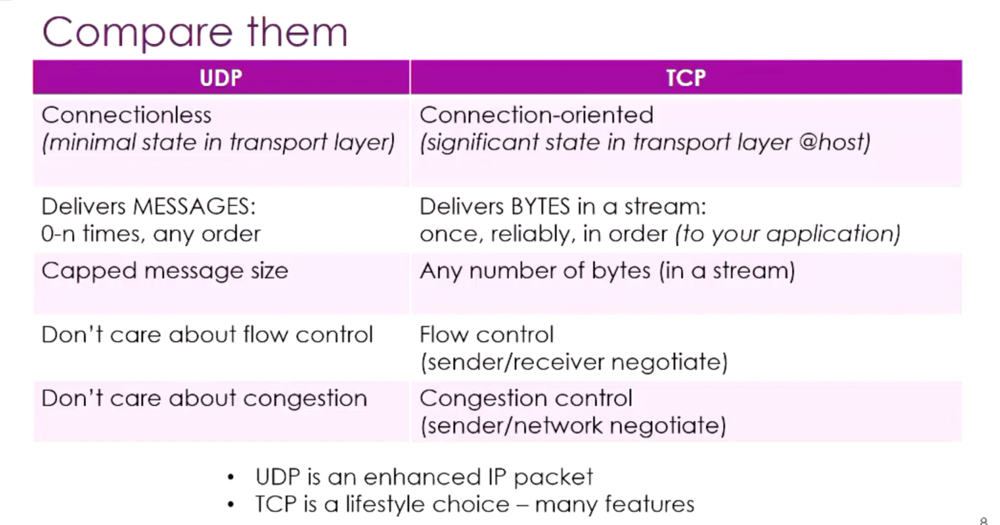
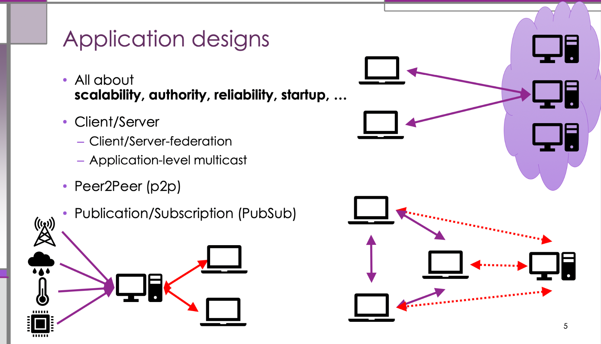
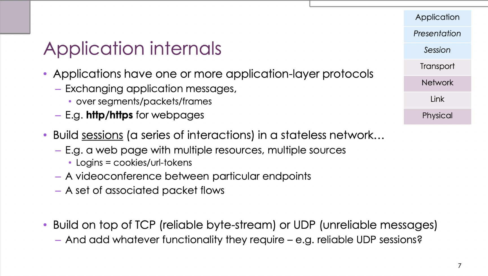
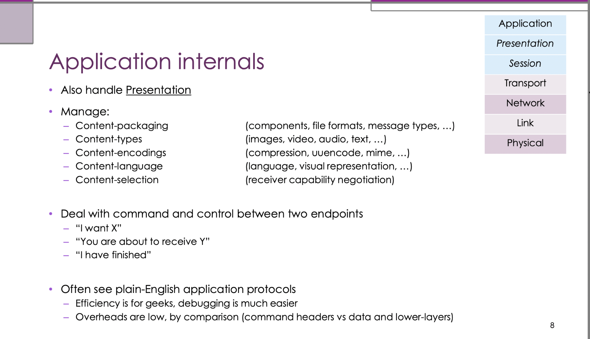
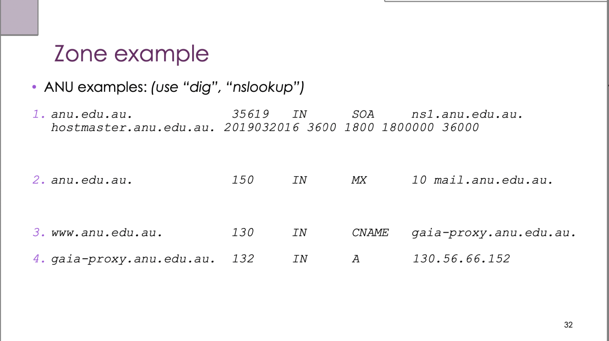
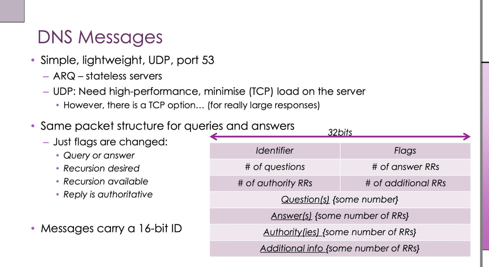

# Network Week 5 Notes

---

## 1. IPv6 Migration Methods (continued from Week 4)

IPv4 → IPv6 is a gradual process, with three main transition technologies:

| Strategy | Principle | Applicable scenario |
|------|------|----------|
| **Dual Stack** | Devices run IPv4 and IPv6 simultaneously | Both protocols coexisting during the transition |
| **Tunneling** | IPv6 packets encapsulated in IPv4 packets for transmission | IPv6 islands crossing IPv4 networks |
| **Translation (NAT64)** | IPv4/IPv6 protocol translation at the gateway | IPv6-only networks accessing IPv4 servers |

**Why NAT is the "IPv6 killer"**: NAT lets large numbers of devices share one IPv4 address, masking the urgency of IPv4 exhaustion and greatly reducing the motivation to migrate to IPv6.

---

## 2. Transport Layer Overview

### Responsibilities of the transport layer

- Provides **end-to-end** communication services
- The network layer (IP) handles host-to-host routing; the transport layer handles **process-to-process** communication
- Multiplexing: multiple applications on one host can use the network simultaneously

### UDP vs TCP comparison



| Feature | UDP | TCP |
|------|-----|-----|
| Connection | Connectionless | Connection-oriented |
| Reliability | Delivery not guaranteed | Reliable transport (ACK + retransmission) |
| Order | Order not guaranteed | Order guaranteed |
| Flow control | None | Yes |
| Congestion control | None | Yes |
| Overhead | Small (8-byte header) | Large (20+ byte header) |
| Delay | Low | High (three-way handshake, acknowledgements, etc.) |
| Applicable scenarios | DNS, video streaming, games, VoIP | HTTP, file transfer, email |

**Core principle**: UDP leaves reliability decisions to the application layer; TCP guarantees reliability at the transport layer.

> **Example**: Video conferencing (Zoom/Teams) uses UDP: occasionally losing a frame doesn't matter, but stalling for 2 seconds to retransmit would hurt the experience. Web page downloads use TCP: every byte must arrive intact, otherwise the HTML/JS would be corrupted.

---

## 3. Ports, Sockets and NAT

### Port Numbers

- A port number is a **16-bit integer** (0–65535)
- Distinguishes different applications/processes on the same host
- Well-known ports:
  - 80 = HTTP, 443 = HTTPS
  - 53 = DNS, 25 = SMTP, 22 = SSH

### Socket

A connection is uniquely identified by a five-tuple:

```
(protocol, source IP, source port, destination IP, destination port)
```

> **Example**: A browser opens 10 TCP connections to `93.184.216.34:443` at once; each connection has a different source port (e.g. 50001–50010), so the five-tuples all differ, and the operating system uses this to tell each connection's data apart.

### NAPT (Network Address and Port Translation)

The most common form of NAT is NAPT (also called PAT):

```
Internal device       Router (NAT)            External server
192.168.1.2:5000  →  203.0.113.1:40001  →  93.184.216.34:443
192.168.1.3:5000  →  203.0.113.1:40002  →  93.184.216.34:443
```

- The router maintains a **NAT translation table** recording internal/external port mappings
- The outside only sees the router's public IP; internal devices are hidden
- **Problem**: the outside can't initiate connections to internal devices (P2P applications need hole-punching techniques)

---

## 4. TCP Mechanisms in Detail

### 4.1 Sequence numbers and acknowledgement numbers

- TCP transmits a byte stream, and every byte is numbered (**Sequence Number**)
- The receiver replies with an **ACK**, meaning "I have received all bytes before sequence number X, and expect the next to be X"
- ACKs are **cumulative ACKs**

```
Sender sends: SEQ=0, data="Hello" (5 bytes)
Receiver replies: ACK=5 (meaning 0-4 received, expecting to start from 5)
Sender sends: SEQ=5, data="World" (5 bytes)
Receiver replies: ACK=10
```

### 4.2 Three-Way Handshake

Establishing a TCP connection takes three steps:

```
Client                          Server
  |  ------ SYN (seq=x) ------>  |   Step 1: client initiates
  |  <-- SYN-ACK (seq=y, ack=x+1) --  |   Step 2: server acknowledges and initiates
  |  ----- ACK (ack=y+1) ------>  |   Step 3: client acknowledges
  |      Connection established    |
```

**Why three steps rather than two?**  
Each side needs to confirm that its own sending ability and the other side's receiving ability are both working. A two-way handshake can't let the client confirm that the server "has acknowledged the client's sequence number".

**Four-way teardown (closing the connection)**:

```
Active closer sends FIN → peer ACKs → peer sends FIN → active closer ACKs
```

### 4.3 Sliding Window

The sliding window lets the sender send multiple packets in a row without waiting for each ACK before sending the next:

```
Window size = 4 packets:
Send: [1][2][3][4]  waiting for ACK
ACK=1 received → window slides:
Send: [2][3][4][5]  waiting for ACK
```

- **Window size** = the upper limit on unacknowledged data "in flight" in the network
- Larger window → higher throughput (but also more buffer pressure)

### 4.4 Flow Control

The receiver tells the sender how much space is left in its buffer (**receive window rwnd**):

```
Receiver ACKs carry: rwnd = 8192 bytes
Amount the sender sends each time ≤ rwnd
```

Prevents the sender from overflowing the receiver's buffer.

### 4.5 Congestion Control

TCP probes the network capacity to avoid overflowing router queues:

| Phase | Behaviour |
|------|------|
| **Slow Start** | Window grows exponentially until a threshold or packet loss |
| **Congestion Avoidance** | Linear growth, cautious probing |
| **Loss response** | Packet loss detected → window shrinks |

> **Analogy**: TCP is like driving on a motorway: first accelerate slowly (slow start), then cruise steadily (congestion avoidance), and when you hit a traffic jam (packet loss), hit the brakes (window shrinks).

---

## 5. Application Layer Overview

The application layer is where users actually "use" the network; it is responsible for:
1. Defining application protocols (HTTP, DNS, SMTP, etc.)
2. Building stateful interactions (Sessions) on top of a stateless network (IP)
3. Taking on some presentation-layer duties (data format, encoding, compression)

### Application architecture design



| Architecture | Principle | Pros | Cons | Examples |
|------|------|------|------|------|
| **Client/Server** | A centralised server responds to requests | Easy to manage, consistent data | Single-point bottleneck | HTTP, email |
| **Client/Server Federation** | Multiple servers cooperate | Scalable | Complex coordination | Google search clusters |
| **P2P** | Nodes communicate directly | Highly scalable, no centre | Hard to manage, unstable | BitTorrent, blockchain |
| **Pub/Sub** | Publishers/subscribers decoupled | Asynchronous, loosely coupled | Needs message middleware | Kafka, MQTT (IoT) |

### Application internal mechanisms





**Building stateful Sessions on a stateless network:**

- The IP network itself is **stateless** (each packet is routed independently, unaware of others)
- Applications need **sessions**: a series of related interactions (e.g. browsing multiple pages after logging in)
- Implemented via cookies, tokens, session IDs, etc.

**Presentation-layer duties taken on by the application layer:**

| Duty | Technology |
|------|------|
| Data format | JSON, HTML, protobuf |
| Content type | MIME types (text/html, image/png) |
| Compression/encoding | gzip, base64 |
| Content negotiation | HTTP `Accept`, `Accept-Encoding` headers |
| Content selection | Small images for phones, high-resolution images for PCs |

**Why are many protocols "plain text"?**  
HTTP requests are human-readable text (`GET /index.html HTTP/1.1`), sacrificing some efficiency in exchange for ease of debugging and understanding. High-performance scenarios switch to binary protocols (e.g. gRPC/protobuf).

---

## 6. DHCP (Dynamic Host Configuration Protocol)

### Purpose

When a device joins a network, it automatically obtains:
- IP address
- Subnet mask
- Default gateway
- DNS server address

### The DORA process (four-step handshake)

```
Client                              DHCP server
  |  --Discover (broadcast, src:0.0.0.0)-->  |   "Is there a DHCP server?"
  |  <------- Offer ----------------   |   "Have this IP: 192.168.1.50"
  |  --Request (broadcast, choosing that offer)-->   |   "I want this IP!"
  |  <------- Acknowledge ----------   |   "OK, leased for 24 hours"
```

| Step | Name | Direction | Explanation |
|------|------|------|------|
| D | Discover | Client broadcast | Look for a DHCP server |
| O | Offer | Server unicast | Offer an IP address |
| R | Request | Client broadcast | Confirm acceptance of that offer |
| A | Acknowledge | Server unicast | Confirm and deliver the configuration |

> **Why is the Request also a broadcast?** There may be multiple DHCP servers on the network that all sent Offers; broadcasting the Request lets the servers that weren't chosen know, so they can withdraw their Offers.

**Lease**: IP allocation is time-limited; before it expires the client must renew (`DHCPREQUEST` + `DHCPACK`), or redo the DORA process.

---

## 7. DNS (Domain Name System)

### The role of DNS

Resolves human-readable domain names (`www.google.com`) into network addresses (`142.250.190.36`).

**Three big design ideas:**
1. **Distributed**: no single point, thousands of servers worldwide
2. **Hierarchical**: a tree structure from root to leaves
3. **Automated**: no human intervention needed, queries happen automatically

### The DNS namespace hierarchy

```
. (root)
├── com
│   ├── google.com
│   │   ├── www.google.com
│   │   └── mail.google.com
│   └── amazon.com
├── org
│   └── wikipedia.org
├── edu
│   └── mit.edu
└── au
    └── edu.au
        └── anu.edu.au
```

- **Root domain (Root)**: `.`, the top of the tree
- **Top-level domains (TLD)**: `.com`, `.org`, `.edu`, `.au`, etc.
- **Second-level domains**: `google.com`, `anu.edu.au`, etc. (registered by organisations)
- **Subdomains/hostnames**: `www`, `mail`, etc. (managed by the organisation itself)

**The politics of TLDs**: `.com/.org/.net` are managed by ICANN; country-code TLDs (`.au`, `.cn`) are managed by each country's authority, each with different registration rules.

### The difference between Domain and Zone

| Concept | Meaning |
|------|------|
| **Domain** | A subtree of the namespace (administrative/responsibility boundary) |
| **Zone** | The DNS data file actually stored (technical implementation) |
| **Delegation** | Handing over management of a subdomain to another organisation |

> **Example**: `anu.edu.au` is a domain, but `cs.anu.edu.au` may be delegated to the School of Computing to manage separately, forming an independent zone.

### Resource Records

DNS zone files store RRs (Resource Records):

| Type | Role | Example |
|------|------|------|
| **SOA** | Start-of-authority record of the zone, containing primary NS info and refresh parameters | Every zone must have one |
| **A** | Domain name → IPv4 address | `www.google.com → 142.250.190.36` |
| **AAAA** | Domain name → IPv6 address | `www.google.com → 2607:f8b0:4004::200e` |
| **CNAME** | Alias → canonical name | `mail.google.com → googlemail.l.google.com` |
| **MX** | Mail server (with priority) | `google.com → smtp.google.com (priority 10)` |
| **NS** | The domain's authoritative nameserver | `google.com → ns1.google.com` |

### The DNS resolution process



Taking a query for `www.cs.anu.edu.au` as an example:

```
1. The client asks the local Resolver (usually the router or ISP)
2. The local Resolver asks a root server: "Where is .au?"
3. The root server replies: "Ask the .au TLD nameserver"
4. The local Resolver asks the .au TLD: "Where is .edu.au?"
5. The .au TLD replies: "the .edu.au nameserver"
6. The local Resolver asks the .edu.au NS: "Where is anu.edu.au?"
7. The .edu.au NS replies: "anu.edu.au's nameserver (ns.anu.edu.au)"
8. The local Resolver asks the anu.edu.au NS: "Where is cs.anu.edu.au?"
9. The anu.edu.au NS replies: "cs.anu.edu.au's nameserver"
10. The local Resolver asks the cs.anu.edu.au NS: "What is www's IP?"
11. The authoritative NS replies: the IP address
12. The local Resolver returns the result to the client
```

### Recursive vs iterative queries

| Mode | Who does the querying | Common scenario |
|------|----------|----------|
| **Recursive** | The Resolver does all the querying and returns the final result to the client | Client → local Resolver |
| **Iterative** | Each NS only returns "who to ask next", and the querier continues itself | Local Resolver → NSes at each level |

> **Actual flow**: the client sends a **recursive query** to the local Resolver; the local Resolver uses **iterative queries** to ask each NS level by level, then returns the aggregated result to the client.

### Root servers and Anycast

- There are only **13 root server IPs (A–M)** worldwide, but behind each IP are hundreds of physical servers
- They use **Anycast**: the same IP address is advertised from multiple locations, and routers deliver requests to the "nearest" one
- Anycast gives the root servers both global availability and low latency

### Caching and TTL

- Every DNS record has a **TTL (Time To Live)**, in seconds
- Resolvers can cache query results until the TTL expires
- Short TTL (e.g. 300s) → changes propagate quickly, but query volume is high
- Long TTL (e.g. 86400s) → high caching efficiency, but slow updates

> **Example**: Before changing a server's IP, first lower the TTL to 300s, then switch after the old caches expire; this reduces downtime.

### Nameserver replication and redundancy

A domain is configured with multiple NS records, and these nameservers synchronise the same zone data via **zone transfer**:

- Prevents a single point of failure: if one NS goes down, the others keep serving
- Can be cross-organisation backup (e.g. ANU and Adelaide act as secondary NS for each other)

> **Key distinction**: an external organisation listed as an NS doesn't "own" the domain; it's only authorised to **host the zone data and answer queries**, and management responsibility stays with the original organisation.

### DNS message format



DNS uses **UDP port 53** (by default):
- Queries and responses have the same format (the QR bit in the header Flags distinguishes them)
- If a response exceeds 512 bytes (or the negotiated size when EDNS0 is enabled) → switch to **TCP port 53**

### Dynamic DNS

**Scenario**: a home broadband's public IP changes periodically, but you want to access a server at home from outside.

**Solution**:
1. Register a fixed domain name with a DDNS provider (e.g. `myserver.ddns.net`)
2. An agent runs on the router, periodically detecting the public IP and updating the DNS record
3. External users access the fixed domain name, and the DDNS provider returns the current IP

Essence: **use a stable domain name to track a changing public IP**.

---

## 8. Knowledge Point Quick Reference

### Core transport-layer concepts

| Concept | UDP | TCP |
|------|-----|-----|
| Ports | Yes | Yes |
| Handshake | None | 3-way handshake |
| Reliability | None | ACK + retransmission |
| Flow control | None | rwnd |
| Congestion control | None | Slow start + congestion avoidance |
| Header size | 8 bytes | 20+ bytes |

### DNS exam point quick reference

| Exam point | Key points |
|------|------|
| Role of DNS | Domain name → IP address resolution |
| Three big designs | Distributed, hierarchical, automated |
| Namespace | Root → TLD → second-level domain → hostname |
| Domain vs Zone | Administrative boundary vs data file |
| Common RRs | SOA, A, AAAA, CNAME, MX, NS |
| Resolution path | Root → TLD → authoritative NS |
| Recursive vs iterative | Clients use recursive, Resolvers use iterative |
| Transport protocol | UDP/53 (default), TCP/53 (large responses) |
| Root servers | 13 IPs, global distribution via Anycast |
| Cache TTL | Controls record validity, affects how fast updates propagate |
