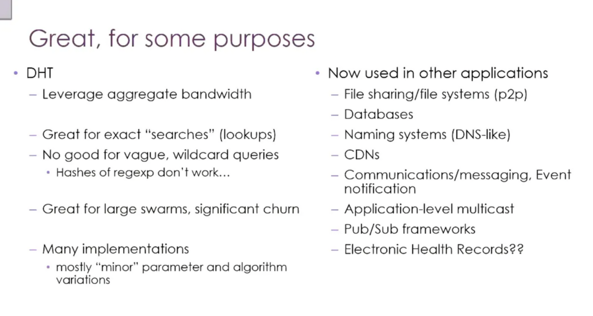
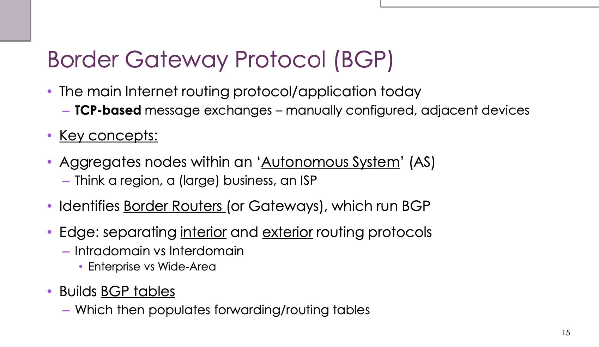
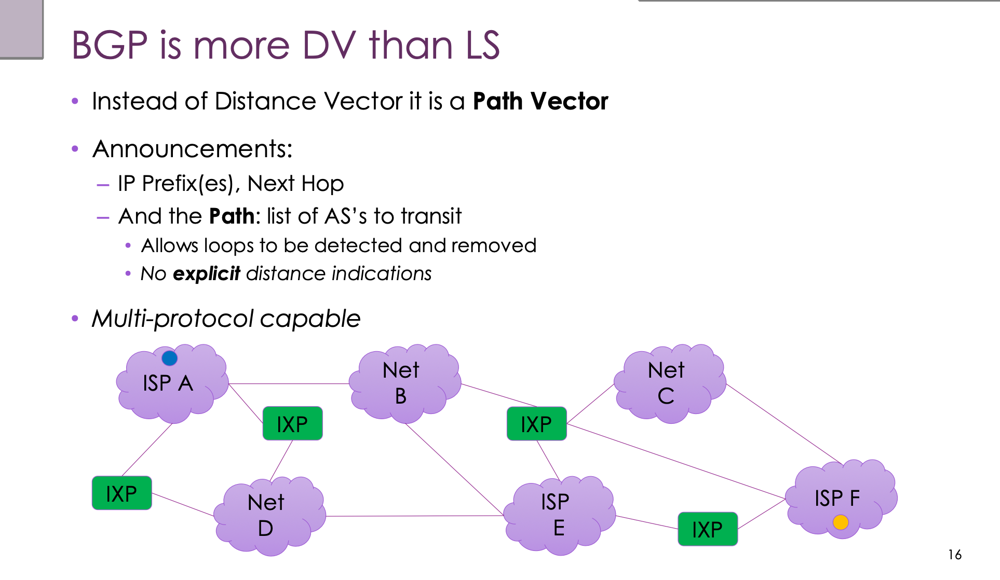
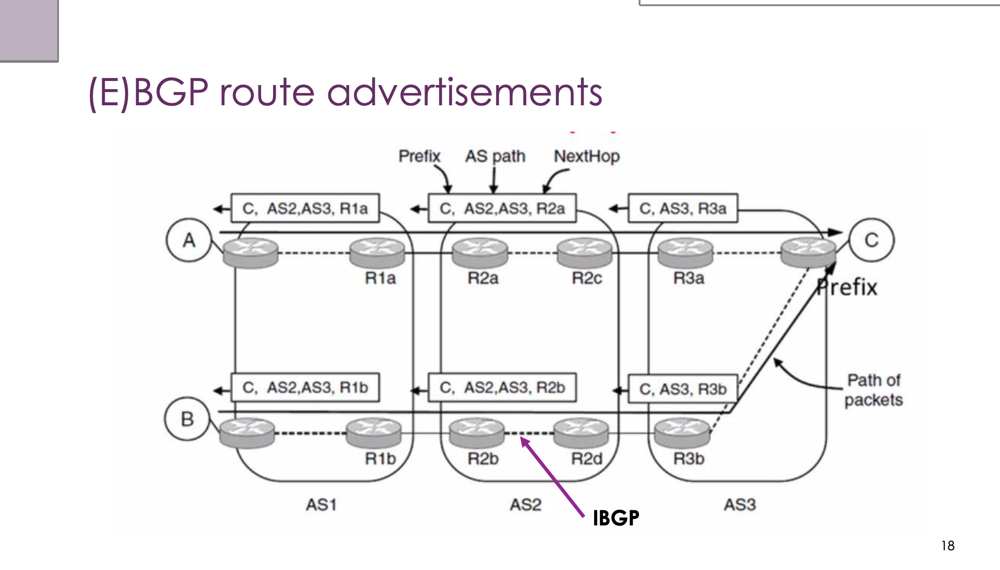
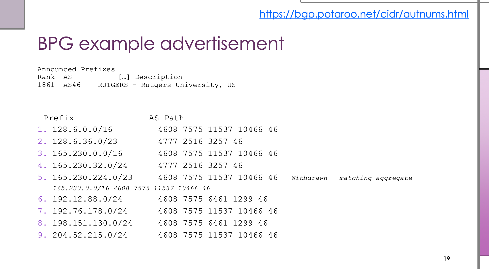

# COMP3310 Week 8: Routing

## 1. Positioning

Week 8 switches back from the application layer (wrapping up DHT) to the network layer; the core question is: **how does an IP packet get from A across the whole Internet to B**.

Routing is the largest-scale, longest-running "application" on the Internet, running 24/7 without stopping — on millions of routers.

---

## 2. Wrapping Up DHT (the tail of last week)



### Strengths and weaknesses

| Property | Explanation |
|------|------|
| Aggregate bandwidth advantage | No central server; storage on 1000 nodes = 1000 nodes serving queries simultaneously |
| Strong at exact lookup | Given a key, locate it in O(log N) hops; this is what DHTs are designed for |
| Fuzzy/wildcard queries don't work | `hash("pirates_*")` and `hash("pirates_of_caribbean")` are completely unrelated and land on different nodes |
| Strong in large-scale + high-churn scenarios | Replication + heartbeat detection + join/leave protocols are designed specifically for churn |

### Core judgements

1. A DHT solves "exact key-value lookup + decentralisation + resistance to node churn", and that's all.
2. It doesn't solve the **search** problem — needs for fuzzy matching, range queries or regular expressions must be paired with an external index.
3. In the BitTorrent world, the DHT only solves "who has this piece"; "what this piece is" still depends on external index sites.

### Actual scope of DHT applications

- **File sharing**: BitTorrent, IPFS
- **Databases**: Cassandra, DynamoDB and Riak internally use consistent hashing for data sharding (the most common industrial deployment)
- **Naming systems**: people have tried replacing DNS (Namecoin, ENS); it "kind of works", but DNS's hierarchy + caching advantages are too strong
- **CDNs**: edge node selection algorithms share ideas with DHT routing
- **Communication/messaging**: Tox, the early Skype supernode network
- **Pub/Sub**: broker federation in publish-subscribe systems

> A DHT is a distributed **primitive** for "routing + storage", not a product. What industry has really deployed at large scale isn't BitTorrent, but the sharding mechanisms of NoSQL databases (the consistent hashing ring inside Cassandra/DynamoDB is almost the same thing as Chord).

---

## 3. Forwarding vs Routing (must be distinguished)

| Concept | Level | Description |
|------|------|------|
| **Forwarding** | Data plane (per-packet) | The router's local decision — a packet arrives, look up the table, which port it goes out of |
| **Routing** | Control plane (building tables) | A global problem — all routers reach a consistent view of the network topology, otherwise loops or black holes appear |

### Layering of time scales

| Level | Time scale | Trigger |
|------|---------|---------|
| Forwarding / congestion adaptation | Seconds | Bursts, congestion |
| Routing | Minutes | Link/node failures |
| Traffic Engineering | Hours | Long-term load |
| Provisioning | Months | Growth in customer demand |

---

## 4. Why Global Routing Is Hard

- IPv4 has run out, the address space has been chopped up and sold, and geographic aggregation has been lost — /24s from the same /16 may be on opposite sides of the Earth
- The routing table has **1M+ entries**, with 170,000 updates per day
- A 100 Gbps link means processing one minimum-size IP packet every **5ns** — doing a longest prefix match of a 32-bit address against a million rows within 5ns is at the limit of chip design
- Carrier-grade routers: from US$500,000 per chassis, US$250,000 per line card, 4Tbps+ backplane

---

## 5. Optimal Paths

- The metric can be chosen: latency / bandwidth / cost / hops; each link is given a cost, and the end-to-end sum is minimised
- Costs can be **asymmetric** (satellite downlink/telephone uplink is the classic example)

**Optimality Property**: all subpaths of a shortest path are also shortest paths. This is the basis that makes the later algorithms work.

**Sink tree / Source tree**: the union of all shortest paths with a given node as destination (or source) forms a tree. When costs are symmetric the two coincide; when asymmetric they diverge.

---

## 6. The Two Big Families of Routing Algorithms

### 1. Link-State (LS) — Dijkstra

**The algorithm in three steps:**

1. **Flood**: each node broadcasts its LSP (link state packet, containing its neighbour list + costs + seq#) to the whole network
2. **Learn the topology**: each node listens to LSPs and assembles the complete topology graph locally
3. **Run Dijkstra**: each node independently computes the shortest path tree locally

**Key points:**
- Every node needs the complete topology
- Fast convergence (done once the flood is done)
- Uses flooding + sequence numbers to prevent storms; an aging mechanism handles seq# corruption and node flapping
- Representative protocols: **OSPF, IS-IS**

### 2. Distance-Vector (DV) — Distributed Bellman-Ford

**Algorithm:**
- Each node stores a vector: the distance to each destination + next hop
- Initially: 0 for itself, ∞ for others
- Periodically send the vector to **neighbours** (only neighbours)
- After receiving a neighbour's vector: for each destination take `min(own, neighbour's distance + cost to that neighbour)`
- Repeat until convergence

**The Count to Infinity problem:** good news travels fast, bad news travels slowly. After a link breaks, B sees that C still advertises it can reach A (actually C goes via B), and they ping-pong back and forth adding 1 until ∞.

**Mitigations:**
- **Split Horizon**: don't advertise a route back to the neighbour you learned it from
- **Poison Reverse**: advertise it back but with the cost set to ∞
- Define ∞ as 16 (what RIP does)

Representative protocol: **RIP** (1988, still in use today, simple but fragile)

### LS vs DV comparison


| Expectation | Distance Vector | Link State |
|------|----------------|-----------|
| Correctness | ✓ Distributed Bellman-Ford | ✓ Replicated Dijkstra |
| Efficiency | Small vectors, reasonable | Larger LSPs, reasonable |
| Fairness | Reasonable (shortest path) | Reasonable (shortest path) |
| Convergence | **Slow** (multiple rounds of exchange) | **Fast** (flood + compute) |
| Scalability | **Excellent** (only needs to know neighbours) | Fair (large amount of data) |

> Conclusion: LS is used **within a domain** (enterprise, campus), DV is used **between domains** (the Internet backbone).

---

## 7. ECMP (Equal-Cost Multipath)

Not a protocol, but an extension. It allows a set of equal-cost paths to coexist (becoming a DAG rather than a tree):

| Strategy | Pros | Cons |
|------|------|------|
| Per-packet random/round-robin | Good load balancing | Bad jitter + reordering |
| Hash on source-destination IP | Each flow's path is stable | Load may be uneven |
| By flow label (IPv6) | No need to read the 128-bit address to classify flows | IPv6 only |

IPv6 introduced the 32-bit flow label field precisely to make flow classification easy, without reading the full 128-bit address.

---

## 8. Hierarchical Routing

**Aggregation** is the core of shrinking tables — advertise an entire region externally as one aggregated node, so outside routers only need to know "which border router to use to get to region X".

**Cost:** paths are no longer optimal. The slides' example: 5 hops with the full table, 6 hops after making it hierarchical.

Note: here the unit of "hop" changes from "number of routers" to "number of regions" — not the same dimension, so they can't be compared directly.

**Trade-off:** routing people choose **short tables** rather than short paths.

---

## 9. Policy Routing and BGP

### Layer 8+ enters

The Internet is a commercial system. Once money, politics, trust, security and law come in, purely technical optimality can't be relied on.

Each ISP is a region — called an **Autonomous System (AS)**. ASes interconnect via **Internet Exchange Points (IXPs)**.

### Hot Potato Routing

An ISP's local policy: the sooner traffic is thrown out of my network, the better. Results:
- Suboptimal paths
- Inbound and outbound are **asymmetric** — traceroute shows the outbound path, and the return path may be completely different
- The hierarchy is deliberately broken, as a result of commercial rationality

### Two main commercial relationships

| Relationship | Description |
|------|------|
| **Transit** | You pay me, and I deliver your traffic to the whole Internet. Home broadband follows this model. |
| **Peering** | Both sides exchange traffic, usually without paying. CDNs, cloud providers and NRENs go this way. Peering isn't transitive. |


---

## 10. BGP in Depth

### Slide 1: What BGP is



BGP is today's main Internet routing protocol, both a protocol (defining message formats) and an application (a program running on routers). It has run 24/7 since the first version in 1989, the longest-running and largest-scale application ever.

**Three key pieces of information:**

**① TCP-based (port 179)**

Counterintuitive — a routing protocol actually running on top of TCP (OSPF uses IP protocol number 89, RIP uses UDP). Reason: BGP has to transfer complete routing tables (hundreds of thousands to over a million entries), so it must guarantee reliable transmission, ordering, flow control, and segmentation/reassembly. Side effect: a BGP neighbour relationship is a "session" concept; if the TCP connection drops it must be rebuilt.

**② Manually configured**

BGP doesn't discover neighbours automatically. Each session must be explicitly configured at both ends with the peer's IP and AS number — because who becomes neighbours with whom is decided by commercial contracts, and devices can't be allowed to adopt relatives on their own. This is also the root of BGP's security problems: connections are built by hand, but once established, you can basically only choose to believe or not believe what the other side announces.

**③ Adjacent devices**

BGP neighbours are point-to-point sessions, not necessarily physically directly connected (multi-hop eBGP is possible).

**Core concepts:**

- **Autonomous System (AS)**: a collection of networks controlled by a single administrative entity, presenting a unified routing policy externally. AS numbers are globally unique; 16-bit ones have run out, 32-bit ones are now used, and about 500,000 have been allocated.
- **Border Router / Gateway**: within an AS only the border routers run BGP; internal routers only need to deliver packets to the exit border router.
- **BGP table (RIB) → FIB**: BGP first builds the RIB (all routes learned from neighbours), then after policy filtering picks the best paths and loads them into the FIB (the actual forwarding table). What BGP knows ≠ what's actually used for forwarding.

### Slide 2: BGP is Path Vector, not Distance Vector



DV (such as RIP) only tells you the distance, not who the path goes through, so it counts to infinity. BGP's improvement: announcements carry the **complete AS path list**, not a distance.

**The three core fields of an Announcement:**

```
Prefix           AS Path              Next Hop
128.6.0.0/16     4608 7575 ... 46     <some IP>
```

| Field | Explanation |
|------|------|
| IP Prefix | This whole block of addresses is reachable via this path |
| AS Path | The list of ASes crossed in order from you to the destination — the soul of it |
| Next Hop | On receiving traffic, the first step is to send the packet to the router with this IP |

**Why Path Vector is better than DV:**

① **Loop detection**: when receiving an announcement, if you see your own AS number in the AS Path, discard it directly. Count-to-infinity simply can't happen in BGP.

② **No explicit distance**: how to interpret and rank it is decided by the receiver based on its own business logic — this is the basis of policy routing.

**Multi-protocol capable**: through the MP-BGP extension, the same protocol can carry IPv6 prefixes, VPN routes, multicast routes, MPLS labels, etc.

### Slide 3: How eBGP and iBGP work together



**Scenario**: three ASes (AS1, AS2, AS3); the destination C (Prefix) is at the far right of AS3, and the sources A/B are in AS1.

**eBGP (External BGP) — between ASes**

The announcement chain (propagating right to left, each AS crossed adding its own AS number):

```
R3a tells R2c: Prefix=C, AS Path=[AS3],        NextHop=R3a
R2a tells R1a: Prefix=C, AS Path=[AS2,AS3],    NextHop=R2a
R1a tells A:   Prefix=C, AS Path=[AS2,AS3],    NextHop=R1a
```

Two core rules:
1. **AS Path Prepend**: whenever an announcement crosses an AS boundary, the new AS must prepend its own AS number to the head of the path
2. **Next Hop rewrite**: when eBGP announces outward, the next hop is changed to itself

**iBGP (Internal BGP) — within an AS**

Why run BGP inside an AS as well? OSPF/IS-IS only carry the AS's internal topology information, not external BGP routes. If border router R2a learns a path to C from AS3, R2b and R2d inside AS2 don't know about it — iBGP solves this problem.

You can't redistribute BGP routes into OSPF (hundreds of thousands of routes would overwhelm OSPF), so all border routers within the AS establish iBGP sessions with each other to synchronise.

**Key iBGP rule:** routes learned via iBGP can't be forwarded on via iBGP (to prevent loops). Consequence: iBGP by default requires a **full mesh** — N routers need N(N-1)/2 sessions. Large ISPs use Route Reflectors or Confederations to break this constraint.

**Division of labour among the three:**

| Protocol | Role |
|------|------|
| eBGP | Between ASes, carries all external routes |
| iBGP | Between BGP routers within an AS, synchronises external routing information |
| OSPF/IS-IS | Internal AS topology, so iBGP's next hop can be resolved |

iBGP carries "the next hop to C is R3b", OSPF says "which internal interface to use to get to R3b"; only by combining the two can packets be forwarded.

> The control plane (BGP announcements flowing right to left) and the data plane (data packets flowing left to right) go in opposite directions; this is a common feature of routing protocols.

### Slide 4: A real BGP announcement example (Rutgers University)



Data source: [bgp.potaroo.net](https://bgp.potaroo.net/cidr/autnums.html) (Geoff Huston, the standard data source for studying the global state of BGP)

```
Rank  AS    Description
1861  AS46  RUTGERS - Rutgers University, US

 #  Prefix              AS Path
 1. 128.6.0.0/16        4608 7575 11537 10466 46
 2. 128.6.36.0/23       4777 2516  3257       46
 3. 165.230.0.0/16      4608 7575 11537 10466 46
 4. 165.230.32.0/24     4777 2516  3257       46
 5. 165.230.224.0/23    4608 7575 11537 10466 46  [Withdrawn - matching aggregate]
 6. 192.12.88.0/24      4608 7575  6461  1299 46
 7. 192.76.178.0/24     4608 7575 11537 10466 46
 8. 198.151.130.0/24    4608 7575  6461  1299 46
 9. 204.52.215.0/24     4608 7575 11537 10466 46
```

**How to read an AS Path: right to left**; the rightmost is the destination (AS46 = Rutgers), the leftmost is you (the observation point).

Taking row 1 `4608 7575 11537 10466 46` as an example:

```
[Observation point (Australia)] → AS4608(APNIC R&E) → AS7575(AARNet) → AS11537(Internet2) → AS10466 → AS46(Rutgers)
```

It runs entirely on NRENs — leaving Australia's academic network via AARNet, crossing the Pacific to Internet2 in the US, then on to Rutgers, without passing through the commercial Internet backbone.

**Key observations:**

① **Multiple upstreams**: from the same observation point, different Rutgers prefixes are seen via completely different paths (row 1 goes via 4608, row 2 via 4777) — a typical manifestation of policy routing.

② **More-specific prefixes**: 128.6.36.0/23 (a subset) takes a different AS Path from 128.6.0.0/16, possibly because of traffic engineering (load sharing) or to prevent prefix hijacking. The longest prefix match rule ensures the /23 is matched in preference to the /16.

③ **Withdrawn + matching aggregate** (row 5): 165.230.224.0/23 was withdrawn because its AS Path is exactly the same as that of the 165.230.0.0/16 containing it, so announcing it separately is redundant — a concrete example of slimming down the routing table.

④ **Path differences reflect business relationships**: rows 6 and 8 go through AS6461 (Zayo) and AS1299 (Telia), commercial Tier-1 backbones, rather than NRENs — these IP blocks correspond to public-facing services that need commercial Internet reachability.

---

## 11. Interior vs Exterior

| Type | Protocol | Goal | Characteristics |
|------|------|------|------|
| IGP (intra-domain) | OSPF, IS-IS (LS) | Shortest path | Complete information, pursues optimality |
| EGP (inter-domain) | BGP (Path Vector) | Policy flexibility | Scalability first, incomplete information |

The two join at the **border router** — it has one foot in OSPF and one foot in BGP.

> BGP has no real security mechanism. RPKI and BGPsec are patches added later, but RPKI deployment only just passed 50% by 2024, and almost nobody has deployed BGPsec.

---

## 12. Summary of Routing Expectations


| Expectation | Meaning |
|------|------|
| **Correctness** | Must deliver packets from A to B |
| **Efficiency** | Don't use too much bandwidth and CPU running the routing itself |
| **Fairness** | Don't waste available links |
| **Convergence** | Recover quickly after failures |
| **Scalability** | Cope with ever-larger networks |

---

## 13. Personal Commentary

1. **The spiritual link between DHT and BGP**: the DHT part (wrapped up at the start of the lecture) and this week's routing topic seem unrelated, but techniques like the finger table (log N hops), replication and bootstrap nodes share the same lineage as BGP's philosophy of "neighbours + gradual information diffusion" — distributed systems are all solving the same class of problems.

2. **The dimensional trap of hierarchical routing**: the point in the slides that "hops change meaning in the hierarchical table" is easy to miss. It looks as if 6 > 5 is worse, but in fact the unit of hop has changed from "number of routers" to "number of regions"; they're not the same dimension.

3. **Remember BGP security**: RPKI and BGPsec are later patches, and deployment is still low. The **2008 Pakistan Telecom incident** is the classic case (Pakistan wanted to block YouTube, announced a more specific prefix, it leaked globally, and YouTube was down worldwide for about 2 hours); the **2018 Amazon Route 53 hijack** redirected DNS traffic via BGP and stole about US$150,000 of ETH.

4. **BGP isn't just a variant of DV**: BGP is path vector (a variant of DV), but its "distance" information is almost entirely overridden by policy; it's essentially more like "reachability announcements + human preference scoring". Simply classifying BGP as DV misses half the story.

5. **BGP route selection is about far more than AS Path length**: in industrial practice there's a 13-step decision tree, of which AS Path length is just one step. **Local Preference** is the main battlefield of policy routing — within an AS, setting LocalPref values for different upstreams uniformly controls the whole AS's outbound preference.

**BGP in one sentence:**

> BGP is a TCP-based, manually configured Path Vector protocol running between the border routers of Autonomous Systems, letting 700,000+ ASes worldwide find each other by announcing `(prefix, AS path, next hop)` triples. The AS Path provides both the loop-prevention mechanism and the basis for policy decisions — the final path choice isn't "the shortest", but "whichever one the AS's boss wants you to take".
